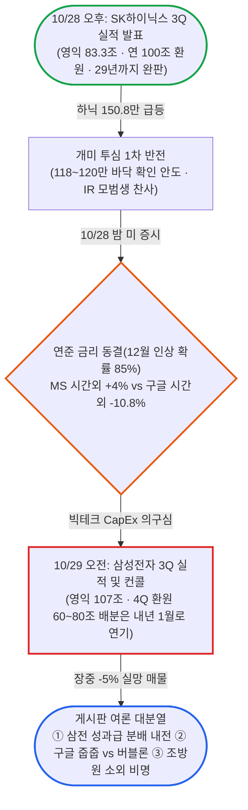

# 블라인드 주식·투자 24시간 브리핑: "하닉 100조 환원 축포 하루 만에 찬물 끼얹은 삼전 컨콜과 성과급 내전"

- **작성일**: 2026-10-29
- **수집 기간**: 2026년 10월 28일(수) 15:06 ~ 10월 29일(목) 15:03 (KST)
- **수집 규모**: 최근 24시간 내 게시글 565개 전수 수집 및 심층 분석 (본문 정밀 분석 136개, 댓글 448개, 목록 미리보기 분석 429개)

!!! warning "주의사항"
    아래 내용은 모두 블라인드 익명 사용자들의 날것의 주장과 여론이다. 수치, 인용 기사, 소식은 따로 검증하지 않았다. "속보", "뉴스에 나왔다" 같은 표현이 붙은 글도 출처가 없거나 링크만 있는 경우가 많으므로 투자 판단에 쓰기 전에 원문 기사나 공시를 직접 확인해야 한다. 작성자 소속은 블라인드에 표시된 회사명이며 실제 재직 여부는 확인할 수 없다. "언급 글 수"는 `entities.js`로 제목, 본문, 댓글에 종목명이나 별칭이 들어간 글을 센 값이다.


## 📊 블라인드 개미 공포·탐욕 지수 (Fear & Greed Index)

SK하이닉스의 100조 원 주주환원과 150.8만 원 급등이 '두 자릿수 추락 공포'를 단숨에 날려버리며 공포·탐욕 지수는 직전 26점에서 **44점(공포 ~ 중립 경계)**으로 **+18p 급반등**했다. 다만 삼성전자가 컨퍼런스콜에서 주주환원 확정을 내년 1월로 미뤄 장중 -5% 급락하고 조선·방산·원전·전력주가 소외되면서, 게시판은 시장 전체의 패닉 대신 **'하닉·구글 줍줍 환호 vs 삼전 분배 내전·조방원 눈물'**의 극단적 양극화 국면으로 진입했다.

<div class="kb-portfolio-metrics">
  <div class="kb-portfolio-metric-card">
    <span class="label">당일 공포·탐욕 지수</span>
    <span class="value">44점 (공포)</span>
    <span class="sub">중립(45점) 턱밑 회복 · 극단적 패닉 완전 탈출</span>
  </div>
  <div class="kb-portfolio-metric-card">
    <span class="label">직전 브리핑 대비</span>
    <span class="value">+18p 급반등</span>
    <span class="sub">10/24 26점(공포) ➔ 10/29 44점(공포)</span>
  </div>
  <div class="kb-portfolio-metric-card">
    <span class="label">지배적 개미 분위기</span>
    <span class="value">하닉 환호 vs 삼전 내전</span>
    <span class="sub">하닉 100조 환원 찬사 · 삼전 성과급 분배 갈등</span>
  </div>
  <div class="kb-portfolio-metric-card">
    <span class="label">역발상 수급 시그널</span>
    <span class="value">개인 인버스 1,500억</span>
    <span class="sub">개미 대규모 숏 베팅 = 지수 숏커버링 연료 대기</span>
  </div>
</div>

```vegalite
{
  "$schema": "https://vega.github.io/schema/vega-lite/v5.json",
  "background": "transparent",
  "width": "container",
  "height": 220,
  "padding": {"top": 8, "bottom": 4, "left": 4, "right": 8},
  "data": {
    "values": [
      {"metric": "종합 공포·탐욕 지수", "score": 44, "max": 100, "zone": "공포", "label": "44점 (공포 · +18p)", "desc": "하닉 100조 환원 급등으로 패닉 소멸, 삼전 컨콜 실망에 중립 턱밑 제동"},
      {"metric": "① 체감 손익·계좌 심리", "score": 42, "max": 100, "zone": "공포", "label": "42점 (공포)", "desc": "하닉 보유자 기적의 부활(+7천) vs 삼전·조방원 주주 상대적 박탈감"},
      {"metric": "② 매수·투매 수급 태도", "score": 48, "max": 100, "zone": "중립", "label": "48점 (중립)", "desc": "구글 시간외 -10.8% 세일 줍줍 열풍 vs 삼전 투매·개인 인버스 1,500억"},
      {"metric": "③ 반도체·업황 신뢰도", "score": 52, "max": 100, "zone": "중립", "label": "52점 (중립)", "desc": "하닉 29년까지 완판·20조 자사주 매입 확신 vs 구글 FCF 적자·매출채권 루머"},
      {"metric": "④ 지수 지지선 신뢰도", "score": 46, "max": 100, "zone": "중립", "label": "46점 (중립)", "desc": "코스피 4,000 비관론 소멸, 6,000~6,300 저항 돌파 및 연말 7,000 논쟁"},
      {"metric": "⑤ 역발상 바닥 기대감", "score": 32, "max": 100, "zone": "공포", "label": "32점 (공포)", "desc": "현대차 '블라 역지표' 급등 적중 및 개인 1,500억 숏 베팅의 반등 연료화"}
    ]
  },
  "encoding": {
    "y": {
      "field": "metric",
      "type": "nominal",
      "sort": null,
      "axis": {"title": null, "labelFontWeight": 500, "labelFontSize": 12, "labelLimit": 180, "ticks": false, "domain": false, "labelPadding": 12}
    }
  },
  "layer": [
    {
      "mark": {"type": "bar", "cornerRadius": 7, "height": 14, "color": "#94a3b8", "opacity": 0.14},
      "encoding": {
        "x": {
          "field": "max",
          "type": "quantitative",
          "scale": {"domain": [0, 118]},
          "axis": {
            "title": "블라인드 개미 심리 스펙트럼 (0~24 극단적 공포 · 25~44 공포 · 45~55 중립 · 56~74 탐욕 · 75~100 극단적 탐욕)",
            "values": [0, 25, 50, 75, 100],
            "labelExpr": "datum.value == 0 ? '0 (극단적 공포)' : datum.value == 25 ? '25 (공포)' : datum.value == 50 ? '50 (중립)' : datum.value == 75 ? '75 (탐욕)' : '100 (극단적 탐욕)'",
            "grid": false
          }
        }
      }
    },
    {
      "data": {"values": [{"x": 25}, {"x": 45}, {"x": 55}, {"x": 75}]},
      "mark": {"type": "rule", "strokeDash": [2, 4], "color": "#94a3b8", "opacity": 0.5},
      "encoding": {"x": {"field": "x", "type": "quantitative"}, "y": {"value": 0}, "y2": {"value": "height"}}
    },
    {
      "mark": {"type": "bar", "cornerRadius": 7, "height": 14},
      "encoding": {
        "x": {"field": "score", "type": "quantitative"},
        "color": {
          "field": "zone",
          "type": "nominal",
          "scale": {
            "domain": ["극단적 공포", "공포", "중립", "탐욕", "극단적 탐욕"],
            "range": ["#dc2626", "#ea580c", "#64748b", "#16a34a", "#2563eb"]
          },
          "legend": null
        },
        "tooltip": [
          {"field": "metric", "title": "심리 지표"},
          {"field": "label", "title": "점수 및 구간"},
          {"field": "desc", "title": "핵심 진단"}
        ]
      }
    },
    {
      "mark": {"type": "text", "align": "left", "dx": 10, "fontWeight": 600, "fontSize": 12},
      "encoding": {
        "x": {"field": "score", "type": "quantitative"},
        "text": {"field": "label", "type": "nominal"}
      }
    }
  ],
  "config": {"view": {"stroke": "transparent"}}
}
```


## 1. 24시간 핵심 요약: "하이닉스는 사이다 통과, 삼성전자는 고구마 낙제"

하이닉스의 100조 원 주주환원에 환호한 지 딱 하루 만에 삼성전자 컨퍼런스콜이 찬물을 끼얹었다. 10월 28일에는 SK하이닉스 급등과 함께 "118 ~ 120만 원에 버틴 사람이 승자"라는 안도가 게시판을 채웠다. 밤사이 알파벳(구글)이 시간외 -10.8% 급락하자 "AI 버블 조정 시작"이라는 공포가 번졌다. 이어 10월 29일 오전 삼성전자가 분기 영업이익 107조 원을 발표하고도 주주환원 규모 확정을 내년 1월로 미루자 주가는 장중 5% 급락했다.

게시판의 화살은 곧바로 삼성 경영진과 "성과급만 챙긴 직원들"에게 향했다. 직전 브리핑까지 게시판을 지배하던 주가 폭락 걱정은 **"회사가 번 돈을 주주와 직원 중 누가 가져가느냐"**라는 분배 전쟁으로 이동했다. 평일 게시글 수는 565개로 직전 주말 브리핑(274개)의 두 배를 넘어섰다.



| 구분 | 핵심 내용 요약 | 시장 함의 및 투심 기류 |
| :--- | :--- | :--- |
| **핵심 여론** | "하이닉스는 통과, 삼성은 낙제" 대조 구도 속 삼전 성과급 분배 전쟁 폭발 | 주가 등락 걱정을 넘어 주주 vs 임직원 간 이익 분배 갈등으로 감정의 골 심화 |
| **시장 상황** | 하닉 150.8만 급등 후 149만 선 숨고르기, 삼전 컨콜 중 -5% 하락, 구글 시간외 -10.8% | 미국 3대 지수 3일 연속 상승 및 필반 +1.76% 선방 속 개별 종목별 희비 극명 |
| **최대 화두** | **"삼전 영익 107조 찍고 주주환원은 내년 1월 이연"** vs **"하닉 20조 자사주 매입 개시"** | 구체적 숫자를 박은 하닉 IR에 찬사 쏟아진 반면, 삼성 IR은 "실패" 혹평 |
| **주요 풍문** | 삼전·하닉 매출채권 가짜 이익설(댓글 661개), 삼성 일가 증여세 평가기간 주가 누르기설 | 실적과 주가의 괴리를 설명하려는 음모론 재확산, 1월 말 하닉 수급 공백 경계 |
| **대응 전략** | 하닉 목표가 상향(160 ~ 200만) · 구글 급락 줍줍 vs 개인 인버스·곱버스 1,500억 매수 | 하닉은 안도 단계, 삼전은 실망 투매 단계. 개인의 대규모 숏 베팅은 역발상 반등 신호 |


---

## 2. 🎭 블라인드 명예의 전당: 개미들의 5대 레전드 어록 & 눈물의 사연

추천 수와 댓글, 조회수를 싹쓸이한 24시간 내 최고 화제 글과 댓글 티키타카다.

### ⚔️ 레전드 1. "삼전 컨콜 보니까 주주는 그냥 호구네" vs "컨콜로 주주들도 서초맛 좀 봐라 ㅋㅋ"

삼성전자가 분기 영업이익 107조 원을 내고도 4분기 환원 재원(60조 ~ 80조 원)의 구체적 배분을 2027년 1월 이사회로 미루자 주주들의 분노가 폭발했다. 곧바로 직원 성과급을 둘러싼 계급 전쟁이 벌어졌다.

> **"삼전 성과급은 생각보다 받기 어려울 거임"** (세종대학교교직원 | 👍77 · 💬97 · 👁6,432)
> 소액주주의 법적 대응 예고, 국정감사, 영업이익의 10.5%를 성과급 재원으로 요구하는 구조를 근거로 들며 성과급 지급에 제동이 걸릴 것이라 주장했다.
>
> **"삼전 컨콜 보니까 주주는 그냥 호구네"** (한양대학교교직원 | 👍28 · 💬19 · 👁694)
> "실적 잘 나오면 직원들은 협박해서 영업이익으로 억대 성과급 잔치하고, 정작 리스크 감수하고 돈 넣은 주주들만 피해 본다."
>
> - **한국전자통신연구원 (👍10)**: "상법 331조, 462조, 538조를 보면 영업이익에서 바로 현금 떼가는 건 손해는 안 보고 이익만 먹겠다는 거다. 성과급은 최악이 0원인 무위험 옵션이다."
> - **직원 측 반박 댓글 (👍63)**: "하이닉스는 작년에 이미 지급했는데 그때는 왜 아무 말 없었나. 배 아프면 입사해라."
> - **직원 측 추가 반박**: "현금으로 받는 거 아니고 전액 자사주로 받고 2년간 매도 제한이다. 우리도 위험을 같이 진다."
> - **삼성전자 직원의 자조 섞인 일침 ("컨퍼런스콜로 주주들도 서초맛좀 봐라 ㅋㅋ" | 👍3)**: "우리도 경영진한테 제발 수치로 구체화해서 이야기해 달라고 읍소하고 파업하려고 할 때 주주들한테 욕먹었는데, 지금 주주들이 답답해하는 거 우리랑 똑같네."
>     - **댓글**: "저거 수치로 이야기 안 하는 거 유구한 전통임."

### 🤡 레전드 2. "반도체 영업이익 100조 따윈 애초에 없었음" (댓글 661개 대폭발)

직전 브리핑에서도 등장했던 '매출채권 가짜 이익설'이 이번에는 댓글 661개, 조회수 2만 회를 넘기며 게시판 전체 반응 1위를 찍었다.

> **"반도체 영업이익 90조, 100조 따윈 애초에 없었음."** (현대자동차 | 👍69 · 💬661 · 👁20,787)
> "반도체 영업이익은 발생주의 회계의 허점을 이용한 것일 뿐이다. 반도체를 외상으로 넘긴 뒤 앤트로픽 지분 1%당 13조, 28조 받아야 할 외상 대금을 태우고 있다. 필요하지도 않은 제미나이, GPT, 클로드 이용 계약을 맺고 이용료 명목으로 매출채권을 상계한다. 그래서 주가가 떨어지는 거다."
>
> - **팩트 폭격 댓글 1 (👍21)**: "매출채권을 못 받는 경우는 대금업체 부도 케이스 아니면 무조건 받는 돈인데, 대체 어떤 반도체 회사가 전환사채나 지분으로 대금을 받나."
> - **팩트 폭격 댓글 2 (👍15)**: "앤트로픽에 대규모 지분 투자를 한 주체는 아마존, 구글 같은 빅테크다. 반도체 회사는 엔비디아한테 칩을 팔아먹었지 앤트로픽 채권을 들고 있지 않다. 매출채권 회수 기간(DSO)은 통상 1 ~ 2개월 안팎이다." (➔ 작성자 응수: "AI 반박 안 받음. 현실은 80%가 돈 잃었다는데.")
> - **조롱 댓글 (👍15)**: "회계사보다 회계를 잘 알고 반도체 현직보다 반도체 시장을 꿰뚫어 보는… 볼터님 또 오셨습니까."

### 💸 레전드 3. "돈은 200억 벌었는데 공허하네요" vs "재산이 9000조인데 외롭다"

장이 반등하자마자 어김없이 등장한 수백억 수익 과시 글에 개미들은 패러디 릴레이로 맞불을 놓았다.

> **"돈은 200억 정도 벌었는데 공허하네요"** (새회사 | 👍15 · 💬102 · 👁10,021)
> 거액의 수익을 인증하며 인생이 공허하다는 글을 남겨 조회수 2위에 올랐다.
>
> - **댓글 반응**: "메모장으로도 1분이면 만들겠다", "주작 작작 해라."
> - **패러디 글 ("재산이 9000조인데 외롭다..." | 👁1,112)**: 200억 인증 글을 비꼬는 초단위 허세 패러디가 연달아 올라오며 놀이판이 벌어졌다.

### 🌐 레전드 4. "구글 끝난 지가 언젠데 ㅋ" vs "(유튜브를 보며) (크롬을 쓰며)"

알파벳(구글)이 실적 발표 후 시간외에서 -10.8% 급락하자 조롱 글이 올라왔지만, 댓글창의 촌철살인 릴레이에 역공을 당했다.

> **"구글 끝난지가 언젠데 ㅋ"** (한국남동발전)
> "구글 영업이익이 삼성전자 반도 안 되는 거 아나?"
>
> - **댓글 릴레이 (👍7)**:
>     - "(유튜브를 보며)"
>     - "(크롬을 쓰며)"
>     - "(해외에서 구글지도를 쓰며)"
> - **서학개미들의 줍줍 선언**:
>     - **삼성전자 (👁1,331)**: "구글 1억 지금 사놨음. 20% 공짜로 주는데 안 먹을 이유 없지."
>     - **익명**: "구글 빤쓰까지 팔아서 아침에 매수하고 일한다. 과매도지."
>     - **비운의 갈아타기**: "어제 마소 다 팔고 구글 샀는데..." (마이크로소프트는 시간외 +4% 상승, 구글은 -10.8% 급락)

### 😭 레전드 5. "하닉 122에 전부 손절쳤는데" & "조방원은 왜케 작살나는 거야 ㅠㅠ"

하이닉스가 150만 원을 돌파하자 바닥에서 버틴 자와 공황에 던진 자의 운명이 갈렸다. 반면 반도체로 수급이 쏠리며 소외된 조선·방산·원전·전력 주주들은 피눈물을 흘렸다.

> **하이닉스 보유자 vs 손절자의 희비 교차**
>
> - **승리자 ("하닉 118~120에 버억한 분들이 진짜 승리자네" | 공무원 · 👁721)**: 공포 극단에서 매수한 투자자들에게 찬사가 쏟아졌다.
> - **생존자 ("닉스 언제팔까" | 삼성전자)**: "평단 139에 +1억 때 못 팔았다가 -7천 가서 129에 다시 물 탔더니 -1.1억 가서 멘탈 나감. 근데 일주일 지나니 현재 +7천."
> - **손절자 ("하.. 이번 폭락장에 공황와서 122에 전부 손절쳤는데" | 공무원 · 👁789)**: 진바닥에서 전량 투매한 뒤 날아가는 주가를 보며 망연자실했다.
>
> **소외된 '조방원(조선·방산·원전·전력)' 주주들의 절규**
>
> - **우리은행 ("아니 조방원은 왜케 작살나는거야 ㅠㅠ")**: "내 두에빌이랑 한화오션 어쩔 거야. 돈도 잘 버는데 주가 보면 적자에 문 닫기 직전 모습임."
> - **변압기 주주 ("변압기 물린형들 모여봐")**: "효성중공업, HD현대일렉트릭, LS일렉트릭 5월 고점 이후 거의 1/3 토막 난 곳도 있는데... 내 연저펀 망했어."
> - **LG전자 ("조선, 방산, 전력은 진짜 심각하다" 댓글)**: "조선 ㅋㅋㅋㅋ 내 연금 다 녹네."


---

## 3. 📊 숫자가 말해주는 시장 지표 & 지지선·목표가 매트릭스

### 3.1 국내외 증시 및 기업 실적 핵심 수치
게시판에서 공유된 실적, 배당, 수급, 매크로 지표 수치다.

| 항목 | 공유된 수치 및 현황 | 출처 글 및 시장 함의 |
| :--- | :--- | :--- |
| **SK하이닉스 3Q 영업이익** | **83.3조 원** | 한국수력원자력 정리 글. 시장 기대치 충족 및 '29년까지 완판' 확인 |
| **SK하이닉스 3Q 배당** | **주당 2만 원** (실적 1만 + 키옥시아 특별 1만), 총 **14.1조 원** | 11/30 기준일(11/26 목요일까지 매수 필요) |
| **SK하이닉스 연간 주주환원** | **약 100조 원** (현금배당 30조+ · 자사주 매입·소각 60조+) | 11/5 2,369만 주(3.2%) 소각, 10/29 ~ 1/28 20조 원 장내 매수 |
| **삼성전자 3Q 영업이익** | **107조 원** (DS CapEx **76.8조 원**) | 분기 영업익 107조 달성에도 매출 소폭 하회 및 금융손실 -9.5조 언급 |
| **삼성전자 3Q 배당 및 환원** | **주당 4,601원** (3Q 총 30조, 11/27 지급, 시가배당 보통주 1.7%·우선주 2.2%) | 4Q 환원 재원 **60조 ~ 80조 원** 배분 방식을 **2027년 1월 이사회**로 이연 |
| **SK하이닉스·삼전 주가** | 하닉 10/28 종가 **1,508,000원**(10/29 본장 149만 선), 삼전 컨콜 중 **-5% 하락** | 하닉과 삼전의 IR 디테일 차이가 정반대 주가 흐름 유발 |
| **수급 동향 (외인·개인)** | 외인 하닉 1달간 **880만 주 매도** 후 10/28 **26.6만 주 매수** / 개인 인버스·곱버스 **1,500억 매수** | 외인 숏커버링 유입 여부와 개인의 대규모 하락 베팅 충돌 |
| **레버리지 ETF 1개월 낙폭** | 방산레버리지 **-51.92%**, 조선레버리지 **-51.75%**, 하닉 단일레버리지 **-49.75 ~ -50.41%** | LG전자 글 기사 인용. 반도체보다 더 참혹한 조방원 레버리지 손실 |
| **미국 3대 지수 (10/28)** | 다우 **+0.19%**, S&P500 **+0.28%**, 나스닥 **+0.27%** (3일 연속 상승) | 한국GM 정리 글(👍27). S&P500 발표 기업 200곳 중 84% 서프라이즈 |
| **미국 기준금리 및 국채금리** | 기준금리 **3.75 ~ 4.00% 동결** (12월 0.25%p **인상** 확률 **85%**) / 10년물 **5.003%**, 30년물 **5.331%** | 금리 인하가 아닌 '12월 인상 가능성' 부각이 매크로 최대 부담 요인 |
| **미국 반도체·AI 인프라** | 필반 **+1.76%**, SKHY **+13.3%**, MU **+5.86%**, SNDK **+7.66%**, ORCL **+10.73%**, VRT **+16.48%**, NVDA **-1.17%** | 메모리·장비·인프라 급등 속 엔비디아 약세. 장 마감 후 MS **+4%**, 구글 **-10.8%** |
| **알파벳(구글) 3Q 세부 실적** | 매출 $1,275.8억(예상 $1,279.3억), 영업익 $405.8억(예상 $431.6억), FCF **-$9.1B**, CapEx $513.6억 | 클라우드($30.7B) 호조에도 검색·유튜브 하회 및 현금흐름 악화로 시간외 급락 |
| **유가 및 비트코인** | WTI **$101.94**, 브렌트유 **$110.55** / 비트코인 **$81,347선** | 유가 100달러 상회 지속으로 인플레이션 경계감 유지 |

### 3.2 개미들이 제시한 지수·종목 지지선 및 목표가 매트릭스
직전 브리핑의 극단적 비관치(코스피 4,000, 하닉 두 자릿수)가 자취를 감추고 상단 저항선과 목표가 논쟁으로 무게중심이 옮겨 갔다.

| 종목 / 지수 | 현재가 / 위치 | 단기 지지선 / 저항선 | 목표가 / 비관치 | 주요 기술적·심리적 근거 |
| :--- | :--- | :--- | :--- | :--- |
| **코스피 (KOSPI)** | 반등 국면 | **6,000 ~ 6,300선 저항** | **연말 7,000 ~ 10,000** | "6,000 넘으면 푸근하게 숏 베팅", "갭으로 6,300 터치 시 매도" vs "연말 7,000 ~ 10,000 간다" |
| **SK하이닉스** | 149만 ~ 150.8만 원 | **지지 118만 ~ 120만 / 저항 150만 ~ 160만 원** | **180만 ~ 200만 / 250만 ~ 300만 원** | 118 ~ 120만 바닥 확인. "거래량 부족해 150만 안착 후 160 트라이 힘겨움" vs "목표 160에서 200 상향" |
| **삼성전자** | 21만 ~ 22만 원대 | **지지 19만 ~ 21만 원** | **22만 원 재하락 우려** | 컨콜 주주환원 이연 실망으로 장중 -5% 급락. "주가가 더 빠져야 별도 이사회 자사주 발표 나온다" |
| **알파벳 (GOOGL)** | 시간외 $289 ~ $299 | **지지 $289 ~ $290** | **2027년 $375** | 시간외 -10.8% 급락에 $289 ~ $299 대거 줍줍 인증. "20% 세일" vs "AI 버블 조정 신호탄" |
| **SOXL (반도체 3배)** | $100 ~ $104 부근 | **저항 $100 ~ $105** | **$150 이상 / 단기 조정** | "100 라인대 저항 자리라 12월 금리 인상·빅테크 FCF 감소로 한번 조정 후 상승" vs "고민 끝날 땐 150 이상" |
| **네이버 (NAVER)** | 장기 침체 국면 | **지지 미확인** | **12만 원 오면 고려** | NH 이용자 중 99.6% 손실 중. "AI 건실하면 다음·네이트처럼 서서히 쇠퇴" 냉소 지배 |


---

## 4. 💣 시장 핵심 쟁점 및 여론 분열 해부

이번 24시간 동안 게시판을 가장 뜨겁게 달군 7대 핵심 논쟁이다.

| 주제 | 주장 내용과 핵심 근거 | 게시판 반응 및 팽팽한 대립 |
| :--- | :--- | :--- |
| **① 삼성전자 컨콜 주주환원 미확정** | 영익 107조에도 4Q 환원(60~80조) 배분을 내년 1월 이사회로 이연. 하닉의 '100조 못 박기'와 극명한 대비 | "직원만 챙기고 주주는 국물도 없어 실망 매물" 분노 vs "매입 단가·CapEx 76.8조 유연성 위한 포석, 곧 발표할 것" |
| **② 삼성전자 성과급 분배 전쟁** | 영업익 10.5% 재원 요구 및 고연차 15억 설에 소액주주 반발. 상법상 이익 분배 원칙 위배 주장 | "손해 안 보는 무위험 옵션" 주주 비판 vs "하닉 땐 조용하더니 왜 삼전만 갖고 그러나, 2년 매도제한 자사주다" 반박 |
| **③ 하이닉스 100조 환원과 LTA 완판** | 2029년까지 D램·HBM 솔드아웃, LTA 가격 하한선(시가 연동·계약가 90% 하한 추정) 설정으로 거품론 종식 | "3년간 분기 100조 매출 가능" 환호 vs "배터리 수주잔고처럼 불가항력 해지 가능, 3년간 분기 100조는 꿈" 의심 |
| **④ 구글 실적 쇼크와 빅테크 CapEx** | 알파벳 시간외 -10.8%, FCF -$9.1B, 주식 환매 $0, MS·구글 CapEx 예상치 대비 10% 이상 하회 우려 | "고객사 현금 마르면 메모리도 못 올라간다" 비관 vs "피차이·후드 모두 내년 CapEx 확대 공언, 문제없다" 반박 |
| **⑤ 외국인 수급과 선물·옵션 숏 전환** | 외인이 한 달간 하닉 880만 주 매도 후 고작 26.6만 주 매수로 150만 견인, 장 막판 선옵 숏 전환 주장 | "개인 꼬시고 번지 준비 끝, 3연속 사이드카 대비" 공포 vs "중간선거 앞둔 반등장, 자사주 20조 매입은 공매도가 못 이긴다" |
| **⑥ 미국 금리 인상 확률 85%와 유가** | 연준 금리 3.75~4.00% 동결 속 12월 0.25%p 인상 확률 85% 급등, 미 10년물 5.003%, WTI $101.94 | "유가·금리 오르는데 증시 상승은 비정상, SOXS 매수" vs "전 세계 자금이 미장으로 빨려 들어가 금리 무시하고 상승" |
| **⑦ 조방원(조선·방산·원전·전력) 소외** | 반도체로 수급 블랙홀 현상 발생. 방산·조선 레버리지 한 달 새 -51% 폭락하며 하닉 레버리지보다 더 하락 | "실적 좋은데 적자 폐업 직전 주가" 절규 및 손절 고민 vs "다들 욕할 때가 기회, 지금 사야지" 소수 역발상 |

### 4.1 가장 체계적인 분석 글: "삼성전자 오늘 하락 이유" (GS리테일 | 👍11 · 💬7 · 👁1,199)
유튜버('IT의 신 이형수')의 분석을 공유하며 삼성전자가 컨퍼런스콜에서 자사주 매입을 밝히지 않은 4가지 이유와 IR의 패착을 짚었다.

- **삼성이 컨콜에서 말을 아낀 4가지 배경**:
    - **① 매입 단가 관리**: 컨콜 당일 발표하면 주가가 급등해 같은 돈으로 살 수 있는 주식 수가 줄어든다. 2024년 11월에도 주가가 크게 빠진 뒤 별도 이사회를 열어 깜짝 발표했다.
    - **② 투자 유연성 확보**: 같은 날 DS 부문 CapEx 76.8조 원을 공시했고 2027년에는 더 늘어날 수 있어 환원 규모를 미리 못 박기 부담스럽다.
    - **③ 보통주·우선주 및 승계 구조**: 보통주와 우선주가 공존하며(이번 배당은 둘 다 4,601원), 자사주를 소각하면 지배주주 지분율이 올라가 승계 및 금산법 한도와 얽힌다.
    - **④ 발표 타이밍**: 전날 하이닉스가 100조 원 환원을 발표한 직후라 같은 내용을 내놓으면 따라가는 모양새가 된다.
- **그럼에도 "IR로는 실패에 가깝다"는 평가**:
    - **"불확실성 할인" 자초**: "4분기 중 자사주 매입을 검토 중입니다"라는 한 줄만 있었어도 단가와 유연성을 해치지 않으면서 시장에 방향을 줄 수 있었다. 지난 7월에도 모호한 답변 하나로 주가가 20% 빠졌던 전례가 있다.
    - **향후 전망**: 재원도 있고 과거 전례도 있으므로 주가가 눌린 뒤 조만간 별도 자사주 매입 발표가 나올 가능성이 높다. "좋은 숫자는 스스로 말하지 않는다."


---

## 5. 🕵️ 찌라시와 미확인 소식 팩트체크: 신뢰도 등급 카드

게시판을 달군 9대 찌라시와 루머의 신뢰도를 분류하고 투자 관점의 체크포인트를 정리했다.

### 5.1 [루머] "삼성·하이닉스 영업이익은 매출채권으로 만든 가짜"설 (댓글 661개 폭발)
- **신뢰도**: **낮음**
- **원문 주장**: "반도체 영업이익 90조, 100조는 발생주의 회계의 허점이다. 외상으로 칩을 넘긴 뒤 앤트로픽 지분(1%당 13조 ~ 28조)과 제미나이·GPT·클로드 이용료로 매출채권을 상계하고 있다." (현대자동차 | 👍69 · 💬661 · 👁20,787)
- **팩트체크 및 반박**: 공시나 언론 근거가 전혀 없는 허구다. 앤트로픽 지분 투자 주체는 아마존·구글이며, 메모리 제조사의 주요 고객은 엔비디아·빅테크로 매출채권 회수 기간(DSO)은 통상 1 ~ 2개월이다.
- **투자 관점 핵심 체크포인트**: 하이닉스가 100조 원 환원과 14.1조 원 현금배당을 발표한 직후에도 이 글이 폭발적 반응을 얻은 것은 '실적 대비 주가 부진'에 지친 개미들의 불안 심리를 보여준다. 삼성전자 실망 매물이 깊어질수록 유사 음모론이 재확산될 수 있다.

### 5.2 [공시 확인 / 추론 혼재] 하이닉스 자사주 20조 장내 매수와 "1월 말 ~ 2월 초 재하락"설
- **신뢰도**: **매입 일정 '높음'(공시 정리), 재하락 예측 '낮음'(단순 추론)**
- **원문 주장**: 하이닉스가 10월 29일부터 내년 1월 28일까지 20조 원(1,492만 주)을 장내 매수하는데 약 10조 원만 소각하고 10조 원은 임직원 보상용이다. 자사주 매입이 끝나고 4분기 실적을 발표하는 내년 1월 말 ~ 2월 초에 외국인 숏 구축과 임직원 보상 주식(1/3 즉시 매도 가능 주장) 출회로 다시 폭락한다. (한국수력원자력 👍10 / 신한회계법인 👍4)
- **팩트체크 및 반박**: 3개월간 20조 원 장내 매수는 영업일 기준 하루 평균 약 3,000억 원 규모의 강력한 하방 지지력이다. 다만 매입 종료 시점의 재하락설은 수급 주체 소멸에 기댄 단순 추론이다.
- **투자 관점 핵심 체크포인트**: 내년 1월 28일까지는 자사주 매입이 외국인 매도를 얼마나 흡수하는지가 핵심이며, 1월 말 매입 종료 및 임직원 자사주 지급 시점의 수급 공백 여부는 일정표에 체크해 둘 만하다.

### 5.3 [루머] 엔비디아 RTX 5090·5080 단종 = "AI 거품 붕괴 신호"설
- **신뢰도**: **낮음**
- **원문 주장**: 해외 IT 팁스터(Moore's Law Is Dead) 및 노트북체크 기사를 인용해 엔비디아의 RTX 5090·5080 단종이 임박한 AI 거품 붕괴 우려를 반영한 것이며, 코어위브 등이 인프라 부족으로 고가 GPU를 창고에 방치한 채 미완성 인프라 담보 대출을 받고 있다는 주장. (LG디스플레이 | 👁555)
- **팩트체크 및 반박**: 엔비디아 공식 입장이 아닌 유출자(팁스터)의 개인 해석이며, 소비자용 게이밍 GPU 단종을 데이터센터용 AI 가속기 수요 붕괴로 직결하는 것은 논리적 비약이다.
- **투자 관점 핵심 체크포인트**: 구글 FCF 적자 전환(-$9.1B), 코어위브 재무 우려, 미국 신용융자(Margin Debt) 고점설과 결합해 'AI 부채 폭탄' 서사의 재료로 소비되고 있다.

### 5.4 [공시 기반 추론] 삼성 일가 4.5조 지분 이전과 "증여세 평가기간 주가 누르기"설
- **신뢰도**: **중간 (세법 원리는 부합하나 의도적 주가 억제는 추론)**
- **원문 주장**: 홍라희 명예관장이 이재용 회장에게 삼성전자 보통주 1,115만 8,000주(약 2.6조 원)를 증여(10/12 계약, 11/12 이전)하고, 앞서 장외 매수한 766만 7,100주(약 1.92조 원)를 합쳐 총 4.5조 원 규모 지분이 이동한다. 증여세 평가기간(증여일 전후 2개월: 2026년 9월 12일 ~ 2027년 1월 12일) 평균 종가가 1만 원 낮아지면 증여세가 약 669억 원 줄어드므로 내년 1월 12일까지 주가가 오르지 않는다. (삼성전자 | 👍4 · 👁577)
- **팩트체크 및 반박**: 상장주식 증여세를 평가기간 평균 종가로 산정하는 세법 구조는 사실이다. 또한 유진투자증권 리포트 인용을 통해 삼성생명·삼성화재의 삼성전자 지분율이 금산법 10% 한도에 근접해 자사주 소각 비중이 배당보다 낮아질 수 있다는 분석이 공유됐다.
- **투자 관점 핵심 체크포인트**: 공교롭게도 증여세 평가기간 종료일(2027년 1월 12일)과 삼성이 예고한 주주환원 결정 시점('2027년 1월 이사회')이 겹치면서 주주들의 의구심을 키우고 있다.

### 5.5 [미확인] CXMT의 애플 저가 공급 거절 & 창신 HBM 수율 30%설
- **신뢰도**: **확인 불가**
- **원문 주장**: 중국 CXMT가 애플의 저가 공급 요청을 최종 거절했고, 창신메모리 HBM 수율이 30%에 불과해 중국 빅테크들도 하이닉스에 10년 장기계약을 요청하고 있다. (라인플러스 외 | 👁826)
- **팩트체크 및 반박**: 직전 브리핑까지 하이닉스 급락의 주원인으로 꼽히던 '중국 메모리 추격 공포'가 하루 만에 '중국조차 물량이 모자란다'는 낙관론의 근거로 180도 뒤집혔다.
- **투자 관점 핵심 체크포인트**: 주가 등락에 따라 동일한 중국 메모리 이슈가 정반대로 해석되는 전형적인 확증편향 사례다.

### 5.6 [공시 확인] 체코 원전 계약 차질 루머와 두산에너빌리티 해명공시
- **신뢰도**: **중간 (해명공시 팩트, '나가리'는 과장)**
- **원문 주장**: "체코 원전 나가리"(한전KPS)라는 자극적 글 뒤로 두산에너빌리티의 DART 해명공시 링크와 함께 "해명공시가 나왔는데도 주가가 안 오른다"는 탄식이 이어졌다.
- **팩트체크 및 반박**: 체코와 한수원 컨소시엄 전체의 무산이 아니라 한수원과 대우·두산 간의 세부 계약 이슈라는 정정 댓글이 달렸다.
- **투자 관점 핵심 체크포인트**: 해명공시에도 반등하지 못하는 주가는 원전·전력 섹터 전반의 수급 이탈과 투매 심리가 그만큼 깊다는 방증이다.

### 5.7 기타 단신 풍문 모음
- **[미확인] 한화오션 6만 원 블록딜설**: "6만 원에 블록딜이 있어 상방이 막혔다"는 댓글 등장. 개인 매수세가 몰린 5.5만 원대 보유자들의 불안 자극.
- **[풍문] 각국 '최소 3일치 식량 비축' 권고**: 유럽(2025년 3월)·일본 등 기존 재난 대비 권고가 유가 100달러 돌파 및 미사일 발사 소식과 맞물려 전쟁 임박설로 재소비됨(신뢰도 낮음).
- **[풍문] 삼전·하닉 성과급 수치 및 HBM4 120% 인상설**: 삼성 반도체 고연차 부장 성과급 15억 ~ 20억 설, 하이닉스 성과급 재원 영업익 9% vs 10% 논쟁, 주력 HBM4 가격 120 ~ 121% 인상설, 머스크 휴머노이드 1,000만 대 양산 시 연간 720PB D램 수요설 등이 출처 없이 확산됨.


---

## 6. 🔍 종목·섹터별 개인 투자자 심리와 전망

평일 정규장과 빅테크·삼닉 실적 발표가 맞물리며 언급량이 폭발했다. (`entities.js` 집계 기준)

| 종목·섹터 | 언급 글 수 | 지배적 심리 | 대표 전망 (원문 인용) | 소수 반대 의견 |
| :--- | :---: | :--- | :--- | :--- |
| **SK하이닉스** | 123 | 바닥 탈출 안도와 "IR 모범생" 찬사, 150만 안착 관망 | "29년까지 생산량은 다 팔렸대 IR 안 들음?", "300 가능" | "닉스는 내년 1월 말 ~ 2월 초에 또 빠짐", "하닉을 믿지 마라" |
| **삼성전자** | 101 | 주주환원 내년 1월 이연에 대한 분노, 성과급 내전 | "주주한테 환원이 안 되는데 사야 할 이유가 어디에도 없다" | "삼성이 곧 별도 이사회에서 자사주 매입을 발표할 거라고 본다" |
| **반도체·메모리** | 65 | 3년 완판·LTA로 거품론 종식 확신 vs 빅테크 CapEx 우려 | "그래도 이번엔 ai 거품 논란을 종식시킨 듯" | "구글이 쳐박으면 메모리는 절대 못 올라가" |
| **국내 지수(코스피·코스닥)** | 64 | 급등 다음 날 되돌림 피로감, 반도체 편중 장세 불만 | "연말 7000 이상 간다고 보고 담은 거여" | "코스피는 줄 때 빨리 먹고 튀는 게 진리임" |
| **구글·MS·빅테크** | 구글 63 / MS 13 / AI 19 | 구글 -10.8% 쇼크 놀람과 "20% 세일" 저가 줍줍 공존 | "20% 공짜로 주는데 안 먹을 이유 없지" | "구글이 이번 ai 버블 조정 스타트 끊은 거 아니냐" |
| **미국 지수·채권·환율** | 미장 29 / 채권·환율 28 | "국장 -5천, 미장 +3.8억" 미장 우위론, 환율 1,200 vs 1,400 논쟁 | "결론: 미장의 비중을 높게 가져갑니다" | "2030년까지는 미장 지수보다 삼닉 투자가 수익률 더 높을 듯" |
| **현대차** | 25 | 극단적 조롱과 체념 직후 장중 급등에 어리둥절(역지표) | "현대차 << 그 어느 시점에도 투자 매력이 없다" | "블라에서 까는 걸 보니 사야겠다", "반등하네 블라지표 완벽" |
| **레버리지·인버스·SOXL** | 레버·인버스 25 / SOXL 17 | 개인 인버스 1,500억 매수와 SOXL $100 저항선 줄다리기 | "숏 치고 하락 외치는 중인데 뭐 잘못된 거라도?" | "딱 오늘까지만 속슬 신입 받겠다" |
| **조방원(조선·방산·원전·전력)** | 합계 24 | 반도체 수급 블랙홀에 따른 소외와 연금 계좌 비명 | "돈도 잘 버는데 주가 보면 적자에 문 닫기 직전 모습임" | "남들 다 욕할 때 그럼 사야지" |
| **네이버** | 16 | NH 투자자 99.6% 손실, AI 시대 검색 도태 냉소 | "사지 마 뭘 해도 안 될 놈", "공짜로 줘도 안 가짐" | "12만 오면 고려" |

### 6.1 SK하이닉스 (언급 123개, 압도적 1위)
- **보유자 상태**: 평단 200만 원에서 물타기로 168만 원까지 낮춘 보유자, 평단 139만 원에서 -1.1억 원까지 찍었다가 +7,000만 원으로 부활한 생존자, 118만 ~ 120만 원 진바닥 매수자, 그리고 122만 원에 공황 손절한 투매자가 한데 뒤엉켜 있다. 단일종목 레버리지 ETF 보유자는 한 달 새 -50% 반토막(-70% 계좌 인증) 상처가 깊다.
- **투심 기류**: **"안도 랠리 초입과 IR 자부심"**. 직전 브리핑의 '두 자릿수(100만 원 이하) 붕괴 공포'가 완전히 사라지고 "삼전 안 사면 됩니다 -하닉 주주-"처럼 삼성을 조롱하는 여유가 생겼다.
- **상승론 vs 신중론**:
    - **상승론**: 2029년까지 물량 완판, LTA 가격 하한선, 20조 원 자사주 장내 매입을 근거로 목표가를 160만 원에서 200만 ~ 300만 원으로 높여 잡는다.
    - **신중론**: 7월 실적 발표 당시 상한가(170만 원대) 대비 탄력과 거래량이 약하며, 150만 ~ 160만 원대 본전 매물 벽과 내년 1월 말 자사주 매입 종료 후 외국인 숏 재구축을 경계한다.

### 6.2 삼성전자 (언급 101개, 2위)
- **보유자 상태**: 36만 원대 고점 물림 층과 최근 19만 ~ 21만 원대 저가 매수 층이 공존한다.
- **투심 기류**: **"기대에서 배신감과 실망 투매로 급반전"**. 직전 브리핑에서 '하이닉스보다 안전한 배당 대안'으로 꼽혔던 위상이 하루 만에 무너졌다. 분기 영업이익 107조 원과 주당 4,601원 배당에도 불구하고, 4분기 환원 재원(60조 ~ 80조 원)의 구체적 소각·배당 계획을 내년 1월로 미루자 "이젠 다신 안 산다"는 손절 선언이 줄을 이었다.
- **역발상 포인트**: 실망 매물이 쏟아진 뒤 별도 이사회를 열어 자사주 매입을 전격 발표했던 2024년 11월 사례가 재현될 수 있다는 분석과, 보통주 대비 배당 매력이 높은 우선주(`삼전우`, 시가배당률 2.2%) 분할 매수 의견이 대안으로 제시됐다.

### 6.3 구글(알파벳)·마이크로소프트·AI 빅테크 (합계 95개)
- **구글 급락을 바라보는 두 시선**:
    - **기회론 (우세)**: 클라우드 매출이 +103% 성장하고 분당 320억 토큰을 처리하는 펀더멘털 대비 시간외 -10.8%($289 ~ $299)는 과매도라며 "1억 매수", "빤쓰까지 팔아 줍줍" 인증이 쏟아졌다.
    - **위기론**: 잉여현금흐름(FCF)이 -$9.1B로 적자 전환하고 자사주 매입이 $0으로 멈춘 점을 들어 "빅테크 본체의 현금 창출력이 흔들리면 한국 메모리 수요도 꺾인다"는 경고가 맞섰다.

### 6.4 현대차 (언급 25개) & 조방원 (언급 24개)
- **현대차의 완벽한 '블라 역지표' 증명**: "그 어느 시점에도 투자 매력이 없다", "자동차 사양산업 물리면 자사주 매입도 안 해줌", "상장폐지 되나요?" 등 조롱이 극에 달한 직후 장중 급등이 터져 나오며 "블라에서 까는 걸 보니 사야겠다"는 역지표 공식이 다시 한번 입증됐다.
- **조방원(조선·방산·원전·전력)의 수급 소외**: 효성중공업·HD현대일렉트릭·LS일렉트릭 등 변압기주와 두산에너빌리티·한화오션 등이 반도체 수급 블랙홀에 밀려 끝없이 하락하자 연금저축 계좌 투자자들의 손절 고민이 극에 달했다.


---

## 7. 🧠 대표 투자 의견 및 실전 멘탈 관리 조언

### 7.1 대안 섹터 및 ETF 비교 매트릭스

| 대안 섹터 / 상품 | 옹호 논리 및 매력도 | 반론 및 실전 투자 주의점 |
| :--- | :--- | :--- |
| **메모리 2배 ETF (`RAM`)** | 삼전·하닉·마이크론·샌디스크 핵심 메모리 4사 압축 2배 베팅 | "SOXL보다 더 빡센 고위험 상품, 내일 삼닉 밀리면 나락도 두 배" |
| **배당 기준일 우회 ETF** | 배당 기준일 놓친 경우 `RISE 삼성전자SK하이닉스채권혼합50`, `ACE 200` 최저 보수 활용 | 개별주 직접 보유 대비 상승 탄력 제한 |
| **미국 지수 적립 (`QQQ`·`QLD`·`SGOV`)** | 7년 투자 기준 국장(-5천) 대비 미장(+3.8억) 압도적 우위 증명 | 일반계좌 국내상장 미 ETF 매도 시 15.4% 배당소득세 및 건보료·종소세 폭탄 주의 |
| **광통신 (`AXT`) & 데이터센터 ETF** | `AXT` 사모펀드 투자 유치 및 셀레스티카급 실적 기대, 데센 ETF 낙폭 과대 | 미중 갈등 리스크 및 코어위브 등 적자 네오클라우드 부실 우려 |
| **대형 증권주** | 코스피 선행지표 성격 및 추가 20% 하락 시 배당수익률 6%대 후반 매력 | 지수 고점 부근에서 증권주 신저점 갱신 시 시장 전체 추가 급락 신호로 경계 |

### 7.2 고수들의 실전 투자 태도 조언
- **최고점 매도 환상을 버려라** ("익절이 중요한 이유.. 2억 날린 썰" 댓글 | 👍2):
    - "매도 타이밍은 다른 더 좋은 투자처가 나타났을 때가 되어야 한다. 최고점 매도를 노리는 사람은 하이닉스 100만 원 가기도 전에 다 팔았다. 지금 수익에서 50%만 가져간다 생각하면 마음이 편하다."
- **과거 백테스트의 함정을 경계하라** (ex-이와이파르테논):
    - "유튜버 매매법을 검증할 때 2025 ~ 2026년 불장 데이터만 돌리면 앵무새 매매법, 망치 매매법도 다 수익이 난다. 박스피 시절(2015년 이후 장기 데이터)에도 통하는지 확인해야 한다."
- **레버리지·숏 포지션의 엄격한 한도 관리**:
    - "레버리지 당겨서 부자 될 수도 있지만 나락 가는 경우가 훨씬 많다. 숏은 진짜 떨어진다 싶은 날 자산의 10% 이하로 하루 단타 헤지용으로만 써야 한다."


---

## 8. 🗓️ 향후 시장 핵심 10대 모니터링 체크포인트

1. **삼성전자의 별도 이사회 자사주 매입 발표 여부**: 컨콜 실망 매물로 주가가 눌린 뒤 2024년 11월처럼 깜짝 자사주 매입 공시가 나오는지 최우선 확인.
2. **SK하이닉스 20조 원 장내 매수(10/29 ~ 2027/1/28)와 외국인 수급**: 하루 평균 약 3,000억 원 규모의 자사주 매입이 외국인의 현·선물 매도를 받아내며 150만 원 선에 안착하는지 점검.
3. **알파벳(구글) 본장 주가 회복 및 빅테크 CapEx 스탠스**: 시간외 -10.8% 급락과 FCF -$9.1B 적자 전환이 단기 해프닝으로 끝날지, 메모리 섹터 투심에 연쇄 타격을 줄지 확인.
4. **삼성 일가 주식 이전(11/12) 및 증여세 평가기간(~2027/1/12)**: 평가기간 종료와 내년 1월 이사회 주주환원 발표 시점의 맞물림 및 금산법(생명·화재 지분율 10% 한도) 영향 체크.
5. **미국 12월 기준금리 인상 확률(85%)과 10년물 국채금리(5.003%) 추이**: 금리 인하가 아닌 인상 가능성이 실제로 유지되는지, 고금리가 기술주 멀티플을 압박하는지 추적.
6. **개인 인버스·곱버스 1,500억 매수의 결말**: 개인의 대규모 숏 베팅이 다음 거래일(10/30 금) 외국인·기관의 숏커버링 연료가 될지 투자 주체별 수급 확인.
7. **삼전·하닉 배당 및 자사주 소각 일정**: 하이닉스 2,369만 주 소각(11/5), 삼성전자 3Q 배당금 지급(11/27), 하이닉스 3Q 배당 기준일(11/30, 11/26 목요일까지 매수 필요) 체크.
8. **'AI 부채 폭탄' 및 매출채권 음모론 확산 여부**: 엔비디아 RTX 단종설, 코어위브 적자, 매출채권 가짜 이익설 등 비관 서사가 실제 기업 현금흐름 데이터로 반박되는지 확인.
9. **조방원(조선·방산·원전·전력) 투매 진정 여부**: 두산에너빌리티 해명공시 이후 주가 반응 및 한화오션 블록딜 루머 진위, 반도체 쏠림 완화 시 순환매 유입 여부 점검.
10. **앤트로픽(Anthropic) 상장 일정 및 파급 효과**: 대형 AI IPO가 시장 유동성을 빨아들이는 악재가 될지, 구글·아마존의 지분 가치를 재평가시키는 촉매가 될지 모니터링.

---

*이 브리핑은 블라인드 주식·투자 라운지의 최근 24시간 비정형 익명 게시글 565개를 전수 분석하여 개미들의 적나라한 심리와 시장의 이면을 기록한 자료입니다. 특정 종목에 대한 매수·매도 권유가 아닙니다.*

