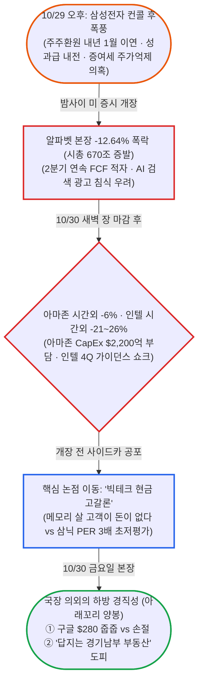

# 블라인드 주식·투자 24시간 브리핑: "구글·아마존·인텔 3연타에 얼어붙은 투심과 '답지는 경기남부 부동산' 절규"

- **작성일**: 2026-10-30
- **수집 기간**: 2026년 10월 29일(목) 14:35 ~ 10월 30일(금) 14:33 (KST)
- **수집 규모**: 최근 24시간 내 게시글 645개 전수 수집 및 심층 분석 (본문·댓글 정밀 분석 153개, 댓글·대댓글 1,168개, 목록 미리보기 분석 492개)

!!! warning "주의사항"
    아래 내용은 모두 블라인드 익명 사용자들의 날것의 주장과 여론이다. 수치, 인용 기사, 소식은 따로 검증하지 않았다. "속보", "뉴스에 나왔다" 같은 표현이 붙은 글도 출처가 없거나 링크만 있는 경우가 많으므로 투자 판단에 쓰기 전에 원문 기사나 공시를 직접 확인해야 한다. 작성자 소속은 블라인드에 표시된 회사명이며 실제 재직 여부는 확인할 수 없다. "언급 글 수"는 `entities.js`로 제목, 본문, 댓글에 종목명이나 별칭이 들어간 글을 센 값이다.


## 📊 블라인드 개미 공포·탐욕 지수 (Fear & Greed Index)

하루 전 SK하이닉스의 100조 원 주주환원이 살려냈던 투심(44점)이 하룻밤 만에 다시 얼어붙었다. 알파벳 본장 **-12.64% 폭락(시총 약 670조 원 증발)**에 이어 장 마감 후 **아마존 시간외 -6%, 인텔 시간외 -21 ~ -26% 폭락**이 겹치며 공포·탐욕 지수는 **33점(공포)**으로 **-11p 급락**했다. "실적이 나빠도 하락, 좋아도 하락, 설비투자를 줄이면 투자 안 해서 하락, 늘리면 돈 없다고 하락한다"는 피로감이 극에 달했다. 지친 개미들은 주식을 접고 서울·경기남부 부동산으로 도망치자며 절규했지만, 금요일 국내 본장이 우려했던 매도 사이드카 대신 아래꼬리 양봉으로 버텨내며 극단적 패닉(24점 이하)으로의 추락은 막아냈다.

<div class="kb-portfolio-metrics">
  <div class="kb-portfolio-metric-card">
    <span class="label">당일 공포·탐욕 지수</span>
    <span class="value">33점 (공포)</span>
    <span class="sub">빅테크 3연타에 중립 문턱(44점)서 재추락</span>
  </div>
  <div class="kb-portfolio-metric-card">
    <span class="label">직전 브리핑 대비</span>
    <span class="value">-11p 급락</span>
    <span class="sub">10/29 44점(공포) ➔ 10/30 33점(공포)</span>
  </div>
  <div class="kb-portfolio-metric-card">
    <span class="label">지배적 개미 분위기</span>
    <span class="value">AI 피로감 · 부동산 도피</span>
    <span class="sub">빅테크 현금 고갈 공포 vs 경기남부 아파트 불패론</span>
  </div>
  <div class="kb-portfolio-metric-card">
    <span class="label">역발상 수급 시그널</span>
    <span class="value">미장 폭락 속 국장 선방</span>
    <span class="sub">개미 저가 매수 유입 및 구글 '제2의 마소' 줍줍</span>
  </div>
</div>

```vegalite
{
  "$schema": "https://vega.github.io/schema/vega-lite/v5.json",
  "background": "transparent",
  "width": "container",
  "height": 220,
  "padding": {"top": 8, "bottom": 4, "left": 4, "right": 8},
  "data": {
    "values": [
      {"metric": "종합 공포·탐욕 지수", "score": 33, "max": 100, "zone": "공포", "label": "33점 (공포 · -11p)", "desc": "구글·아마존·인텔 연쇄 폭락에 투심 냉각, 금요일 국장 선방으로 극단적 패닉은 방어"},
      {"metric": "① 체감 손익·계좌 심리", "score": 31, "max": 100, "zone": "공포", "label": "31점 (공포)", "desc": "구글 풀매수 하룻밤 -2천만 원, 2천 잃고 카누 2천 원 아끼는 현타, 밥값 걱정 자조"},
      {"metric": "② 매수·투매 수급 태도", "score": 36, "max": 100, "zone": "공포", "label": "36점 (공포)", "desc": "구글 $280선 분할 줍줍·SOXL $90 체결 vs 현금 확보·서울 및 경기남부 부동산 탈출론"},
      {"metric": "③ 반도체·업황 신뢰도", "score": 34, "max": 100, "zone": "공포", "label": "34점 (공포)", "desc": "'메모리 사줄 빅테크 통장이 비었다' 현금 고갈론 대두 vs 삼닉 PER 3배 미만 저평가"},
      {"metric": "④ 지수 지지선 신뢰도", "score": 29, "max": 100, "zone": "공포", "label": "29점 (공포)", "desc": "코스피 6,000 천장·연내 4,500 회귀 비관론 vs 나스닥 폭락에도 흔들리지 않은 국장"},
      {"metric": "⑤ 역발상 바닥 기대감", "score": 35, "max": 100, "zone": "공포", "label": "35점 (공포)", "desc": "'상반기 마소 망한다더니 30% 올랐다, 구글도 6개월 뒤 돈 번다' 블반꿀 역지표 기대"}
    ]
  },
  "encoding": {
    "y": {
      "field": "metric",
      "type": "nominal",
      "sort": null,
      "axis": {"title": null, "labelFontWeight": 500, "labelFontSize": 12, "labelLimit": 180, "ticks": false, "domain": false, "labelPadding": 12}
    }
  },
  "layer": [
    {
      "mark": {"type": "bar", "cornerRadius": 7, "height": 14, "color": "#94a3b8", "opacity": 0.14},
      "encoding": {
        "x": {
          "field": "max",
          "type": "quantitative",
          "scale": {"domain": [0, 118]},
          "axis": {
            "title": "블라인드 개미 심리 스펙트럼 (0~24 극단적 공포 · 25~44 공포 · 45~55 중립 · 56~74 탐욕 · 75~100 극단적 탐욕)",
            "values": [0, 25, 50, 75, 100],
            "labelExpr": "datum.value == 0 ? '0 (극단적 공포)' : datum.value == 25 ? '25 (공포)' : datum.value == 50 ? '50 (중립)' : datum.value == 75 ? '75 (탐욕)' : '100 (극단적 탐욕)'",
            "grid": false
          }
        }
      }
    },
    {
      "data": {"values": [{"x": 25}, {"x": 45}, {"x": 55}, {"x": 75}]},
      "mark": {"type": "rule", "strokeDash": [2, 4], "color": "#94a3b8", "opacity": 0.5},
      "encoding": {"x": {"field": "x", "type": "quantitative"}, "y": {"value": 0}, "y2": {"value": "height"}}
    },
    {
      "mark": {"type": "bar", "cornerRadius": 7, "height": 14},
      "encoding": {
        "x": {"field": "score", "type": "quantitative"},
        "color": {
          "field": "zone",
          "type": "nominal",
          "scale": {
            "domain": ["극단적 공포", "공포", "중립", "탐욕", "극단적 탐욕"],
            "range": ["#dc2626", "#ea580c", "#64748b", "#16a34a", "#2563eb"]
          },
          "legend": null
        },
        "tooltip": [
          {"field": "metric", "title": "심리 지표"},
          {"field": "label", "title": "점수 및 구간"},
          {"field": "desc", "title": "핵심 진단"}
        ]
      }
    },
    {
      "mark": {"type": "text", "align": "left", "dx": 10, "fontWeight": 600, "fontSize": 12},
      "encoding": {
        "x": {"field": "score", "type": "quantitative"},
        "text": {"field": "label", "type": "nominal"}
      }
    }
  ],
  "config": {"view": {"stroke": "transparent"}}
}
```


## 1. 24시간 핵심 요약: "빅테크 현금 고갈 공포가 삼닉을 덮쳤고, 개미는 부동산을 외쳤다"

구글, 아마존, 인텔이 연달아 무너지자 개미들의 머릿속에 무서운 질문 하나가 떠올랐다. **"메모리를 사줄 빅테크 고객사들의 통장이 비어가는데, 과연 한국 반도체의 호황이 계속될 수 있는가?"** 10월 29일 오후까지 게시판을 달궜던 삼성전자 성과급 내전과 오너 증여세 논란은 밤사이 미국 증시에서 터진 빅테크 연쇄 쇼크로 옮겨붙었다. 알파벳이 본장에서 -12.64% 폭락해 하루 만에 시가총액 약 5,000억 달러(약 670조 원)가 날아갔고, 장 마감 뒤 아마존이 시간외 -6%, 인텔이 시간외 -21 ~ -26% 급락했다.

10월 30일 금요일 아침 게시판은 "블랙프라이데이·하락 사이드카 확정"이라는 비명으로 시작됐다. 하지만 막상 뚜껑을 연 국내 정규장은 나스닥 폭락이 무색하게 보합권에서 버티며 오후 2시 기준 아래꼬리 긴 십자 양봉을 만들어냈다. 개미들은 호재에도 빠지고 악재에도 빠지는 AI·반도체 장세에 극심한 피로감을 호소하며 **"결국 답지는 풀대출 서울·경기남부 아파트뿐"**이라는 부동산 회귀론을 쏟아냈다.



| 구분 | 핵심 내용 요약 | 시장 함의 및 투심 기류 |
| :--- | :--- | :--- |
| **핵심 여론** | "빅테크 현금 바닥나는데 반도체가 무사하겠나" vs "주식 접고 경기남부 집 사자" | 실적·CapEx 증감 어느 쪽이든 하락하는 장세에 개미들의 정신적 피로감 극대화 |
| **시장 상황** | 알파벳 -12.64%, 아마존 시간외 -6%, 인텔 시간외 -21 ~ -26% 속 금요일 국장 선방 | 미장 빅테크 폭락에도 코스피는 투매 없이 아래꼬리 양봉으로 버티며 디커플링 |
| **최대 화두** | **"메모리 사줄 고객(빅테크) 돈이 없다"** vs **"삼전·하닉 연 200조 환전 수요·PER 3배"** | AI 인프라 수익성 회의론과 한국 메모리 초저평가·원화 강세 수급론의 정면충돌 |
| **주요 풍문** | 이재용 증여세 평가기간(~2027.1.12) 주가 누르기설, PBR 0.8배 법안 후퇴, ISA 건보료설 | 코리아 디스카운트와 지배구조·세제 불신이 삼성전자 매수 보류("1월까지 안 산다") 유발 |
| **대응 전략** | 구글 $280선 분할 줍줍 · 하닉 154만 일단 익절 · JEPQ 배당으로 QLD/S&P500 적립 | 무지성 레버리지 풀매수 대신 현금 버퍼 확보 및 지수·부동산으로 시선 분산 |


---

## 2. 🎭 블라인드 명예의 전당: 개미들의 5대 레전드 어록 & 눈물의 사연

지난 24시간 동안 추천과 댓글을 싹쓸이한 화제 글과 촌철살인 댓글 티키타카다.

### ⚔️ 레전드 1. "삼전 컨콜 보니까 주주는 그냥 호구네" (👍237 폭발) vs "막상 입사하니 노조 응원하게 되노"

전날 삼성전자 컨퍼런스콜 직후 올라온 성토 글이 밤사이 추천 237개, 조회수 9,300회를 돌파하며 전체 반응 1위를 차지했다. 여기에 SK하이닉스 직원의 솔직한 태세 전환 고백까지 더해지며 성과급 내전 2라운드가 불타올랐다.

> **"삼전 컨콜 보니까 주주는 그냥 호구네"** (한양대학교교직원 | 👍237 · 💬73 · 👁9,338)
> "실적 잘 나오면 직원들은 협박해서 영업이익으로 억대 성과급 잔치하고, 정작 리스크 감수하고 돈 넣은 주주들만 피해. 고졸 생산직 직원들이 성과급으로 수억씩 챙기는 걸 일반 대중이 무조건 좋게 봐줄 거라는 착각은 버려야지."
>
> - **직원 측 반격 댓글 1 (👍94)**: "꿀 빨고 싶어서 교직원 하면서 남이 돈 버는 건 배 아파?ㅋㅋㅋ"
> - **직원 측 반격 댓글 2 (👍34)**: "리스크 감수하고 돈 넣은 주주들 환원 안 해준다는 게 직원이 말한 거임 회사가 말한 거임? 저쪽 하이닉스는 직원도 돈 많이 주고 주주환원도 많이 해주는데 삼전은 안 해주니까 직원 탓 같아?"
> - **직원 측 반격 댓글 3 (👍32)**: "리스크 감수하라고 5만 원에서 30만 원까지 올려줬는데 그때 겨울잠 잤냐? 30만 원에 쳐 물려놓고 갑자기 보상 타령이노. 나 주주요 = 1주 있음 ㅋㅋㅋ"
> - **주주 측 재반박 ("성과급은 지들끼리 쿵짝하고ㅋㅋㅋ" | 롯데정밀화학 · 👍20)**: "1주만 있어도 주인의식을 가져야지 인마. 내 주식 몇 개가 너 연봉보다 많을 텐데?"
>
> **"사람 진짜 쉽게 변한다"** (SK하이닉스 | 👍6 · 💬20 · 👁949)
> "현대차 노조 개싫어했고 쟤네가 뭐 했다고 성과급을 그리 받나 나도 욕하던 사람이었는데, 내가 막상 합류하니까 노조 응원하게 되고 성과급 잔치를 하니 주주를 ㅈ으로 보니 이런 말에 동의가 안 되노."
>
> - **댓글 (👍10)**: "ㅋㅋㅋ 이미 현대 직원들은 느끼고 있던 감정을 이제 느끼네 ㅋㅋ 근데 하닉 직원들이 뭐 했다고 성과급을 몇억 단위로 받음? 솔직히 직원들 퍼포먼스로 이렇게 된 게 아니라 시장 상황 땜에 이런 거라 한 3년만 참아 어차피 원래 가격으로 돌아올 거니깐."
> - **댓글 (👍3)**: "솔직히 하이닉스 주가 쭉 올라서 400만 원 500만 원 갔으면 성과금으로 태클 걸었을까 싶음. 그냥 주가는 박살 나고 배 아프니까 그런 거지."

### 🤯 레전드 2. "실적이 나빠도 하락, 좋아도 하락… 이젠 내가 알던 미장은 없구나"

구글에 이어 아마존과 인텔까지 시간외에서 무너지자, '미장 빅테크 불패 신화'를 믿던 서학개미들의 멘탈이 단체로 바스라졌다.

> **"아 반도체 빅테크 ai주 피로감이 한계에 도달함"** (삼정KPMG | 👍7 · 💬9 · 👁540)
> "실적이 나빠도 하락, 실적이 좋아도 하락. capex 줄이면 ai에 투자 안 해서 하락, capex 늘리면 돈 없다고 하락. 그냥 ㅈㄴ 피로하다 어쩌라는 건지."
>
> - **댓글**: "어제랑 그제 폭등했는데? 닉스 120에서 150까지 올라준 건 생각 안 하냐? 고마운 줄 알아야지."
> - **작성자 대댓글**: "10% 빠지고 2% 오르면 폭등임? 막일하다가 철도에 감전당했나."
>
> **"이젠 내가 알던 미장은 없구나"** (한국철도공사 | 👍4 · 💬1 · 👁872)
> "과거엔 빅테크 하락 시 매수 딸깍만 하면 됐음. 재투자가 거의 필요 없고 주주환원 최고에 독점적 지위와 가격결정력 그리고 기술적 해자까지 있었지. 근데 ai가 다 망쳐버렸어. 이젠 모두가 모두의 경쟁자가 되었고 고고한 학에서 늪지에서 진흙 뒤집어쓰고 개싸움만 벌이고 있음."
>
> **"확실히 미장하는 애들이 온실 속 화초긴 하네 ㅋㅋ"** (현대모비스 | 👍16 · 💬7 · 👁877)
> "구글 하루 10% 빼는 거 가지고 망하니 어쩌니 ㅋㅋ 국장은 일상이다 이놈들아 ㅋㅋ"
>
> - **댓글 릴레이**: "국장을 왜 해서 일상처럼 겪어(👍4)", "뜨듯한 온실 냅두고 왜 야생에서 지냄?(👍1)", "미장 초보들이나 하는 소리지 미장은 상하한가가 없단닼ㅋㅋㅋㅋ(👍2)"

### 😭 레전드 3. "2천만 원 잃고 카누 2천 원 아끼려다 현타" & "집 살 돈 없어 주식했다가 밥값도 없어짐"

수천만 원에서 수억 원을 날리고도 일상에서 몇천 원을 아끼고 있는 개미들의 웃픈 자조가 게시판을 울렸다.

> **"집 살 돈 없어서 주식한 결과"** (NAVER | 👍8 · 💬4 · 👁213)
> "밥 사먹을 돈도 없게 되어벌임."
>
> - **댓글**: "무료로 다이어트 돼서 마운자로 값 아꼈잖아 한잔 해."
> - **댓글**: "돗자리는?"
>
> **"2천만원 잃고"** (공무원 | 👍4 · 💬8 · 👁716)
> "오늘 커피값 2천원 아낄려고 카누 먹은 거 개현타 오네."
>
> - **댓글**: "형 혹시 아이렌 2배 샀어?? 나랑 똑같네 ㅋㅋㅋㅋ 응 난 손절하고 커뮤 가서 정신승리하는 중이야 ㅋㅋㅋㅋ" (계좌 -94.48% ~ -95% 인증에 경악)
>
> **"어제 자기전에 구글 풀매수 때리고 잤는데"** (새회사 | 👍7 · 💬11 · 👁785)
> "벌써 -2천임 시발 제발 한번만 살려줘." (전날 시간외 -10.8%를 바닥으로 보고 2억 원어치 풀매수했다가 본장 -12.64% 추가 하락 직격탄)
>
> - **댓글 (👍5)**: "너 납치됐어."
> - **댓글**: "현차에 물린 것보다 나음 그냥 일 년 뒤에 봐라."
>
> **"오늘 20분만에 500잃었음.."** (녹십자웰빙 | 👍1 · 💬6 · 👁428)
> "다음 주에 후쿠오카 가는데 비용 150 정도 들 거라 대충 그 돈만 멘징할려고 급등주 단타했는데.. 하.. 650짜리 일본 여행 가게 생겼네.."

### 🏠 레전드 4. "하닉 293층 반토막에 그랜저 할부" vs "답지는 경기남부 부동산!"

6월 반도체 고점에 레버리지를 질렀다가 인생 계획이 꼬인 40세 직장인의 한탄과, 주식 대신 부동산을 외치는 글들이 대조를 이뤘다.

> **"내나이 내년 40살인데 결혼불가능"** (새회사 | 👍2 · 💬13 · 👁574)
> "집도 없고 처자식도 없는데 6월달에 레버리지로 돈 쓸어담다가 하닉 293층에 본주 레버리지에 돈 다 쳐박고 재산 반토막 남(남은 돈 6천만 원). 아 그때 삘 받아서 그랜저 한 대 할부로 샀다 차라리 일시불로 살걸 ㅅㅂ"
>
> - **댓글 (👍11)**: "감사합니다 고객님. 신차 나오면 팜플렛 보내드리겠습니다."
>
> **"인생 쉽게 살자"** (LG이노텍 | 👍7 · 💬6 · 👁468)
> "영끌해서 서울에 집 사놓고 주식은 안 사고 그냥 오르는지 내리는지 강 건너 불구경하듯 보다 보면 알아서 자산 증식이 되는데 하루하루 스트레스 받아가면서 주식을 꼭 해야 해?"
>
> - **댓글**: "너처럼 주식 안 하고 가만히 있잖아? 그럼 주변 사람들 자산이 알아서 녹음. 그래서 상대 자산 순위 오름 개꿀~"
> - **댓글 (👍2)**: "속슬 오늘 10퍼 손해 봤다고 어그로 끌면서 동정 여론 받는 티배깅이 개꿀잼인데 이걸 안 해?"
>
> **"'국장에서 도박 그만하고 경기남부에 집 사라.'"** (NC | 👍6 · 💬4 · 👁461)
> "경기남부 시대, '집값 상승 1등 ~ 12등 중 경기남부가 9개 싹쓸이'. 이제는 좋든 싫든 AI 경기남부의 시대가 왔다."
>
> - **댓글 (👍5)**: "사놓고 가만히 살면 몇억씩 오르는데 왜 이걸 안 하고 주식 사팔사팔하면서 돈 다 꼴아박는지 정말로 이해 불가."

### 🤣 레전드 5. "주식 투자 4달 만에 1.6억 만들었다" & "스타벅스 들어가서 주식으로 여친 사귈까?"

살벌한 하락장 속에서도 엉뚱한 고민과 드립으로 댓글 수백 개를 모은 유머 글들이다.

> **"주식 투자 4달만에 1.6억 만들었다."** (LG에너지솔루션 | 👍62 · 💬200 · 👁9,498)
> 계좌 인증 사진에 신체 사이즈 암시 숫자를 적어 올려 댓글 200개가 폭발했다.
>
> - **댓글**: "실례가 안 된다면 21.4cm의 의미를 여쭤봐도 괜찮을까요? ➔ (작성자) 니가 떠올리는 거 맞아 ➔ 주식창은 음봉이어도 자신감은 장대양봉인 청년."
> - **댓글 (👍5)**: "힘내 난 현대차 샀다 ➔ (작성자) 너 앞에선 나도 하수네 ➔ (대댓글) 힘내 난 현대차 다닌다 ➔ 현대차 네가 제일 문제다 아틀라스 어떻게 되고 있냐."
>
> **"형들 누님들 나 고민이 있어."** (ex-현대자동차 | 👍0 · 💬55 · 👁361)
> "나 연애하고 싶은데 여초 직장에 들어가서 주식으로 어필하면 결혼 가능할까? 예를 들면 스타벅스 같은 곳? 아파트는 두 채 있어. 마음에 들면 나 이 정도 가지고 있다, 너 퇴사하고 나랑 살자 할랬는데."
>
> - **댓글 (👍3)**: "개찐따 같노 ➔ (작성자) 맞는 말이라 반박 안 함 ➔ 대댓마저 개찐따네 ㅋㅋ"
> - **진지한 조언 댓글**: "여자가 형보다 재산에 호감을 느끼고 접근하면 나중에 대부분 불행하더라고. 내 친구가 그렇게 결혼하고 이혼했어. 연애해도 주식이나 자산은 결혼 전까진 가능하면 공개하진 말고."


---

## 3. 📊 숫자가 말해주는 시장 지표 & 지지선·목표가 매트릭스

### 3.1 국내외 증시 및 빅테크·반도체 실적 핵심 수치

게시판에서 공유된 10월 29일 밤 미국 증시 마감 수치와 기업별 가이던스, 국내 수급 데이터다.

| 항목 | 공유된 수치 및 현황 | 출처 글 및 시장 함의 |
| :--- | :--- | :--- |
| **미국 3대 지수 (10/29)** | 다우 **-0.25%**, S&P500 **-0.3%**, 나스닥 **-1.38%** | 한국GM 정리 글(👍14). 알파벳 폭락 여파로 3일 연속 상승 멈추고 하락 마감 |
| **미국 GDP·금리·유가** | 3Q GDP 성장률 **3.4%**(예상 상회) / 10년물 **4.937%**, 30년물 **5.298%** / WTI **$102.86**, 브렌트유 **$111.52** | 견조한 성장과 PCE 물가·중동 유가 부담 지속. 비트코인은 **$79,386선** |
| **알파벳(구글) 본장 폭락** | 정규장 **-12.64%** 급락 (장중 -14% 언급), 하루 시총 **약 $5,000억(약 670조 원)** 증발 | 2분기 연속 FCF 적자 및 검색 광고 수익성 의구심 폭발. "하닉 시총 절반이 하루에 증발" |
| **아마존(`AMZN`) 실적·주가** | 정규장 **-4.25%**, 시간외 **-6%** / 2026년 CapEx **$2,200억 유지** | 3Q 영업익 상회에도 CapEx 부담 및 4Q 가이던스(매출 $2,400 ~ 2,470억, 영익 $285 ~ 335억) 실망 |
| **인텔(`INTC`) 실적·주가** | 정규장 **-3.62%**, 시간외 **-21 ~ -26%** (앱장 $90 ➔ **$72** 추락 언급) | 4Q 매출 가이던스 **$150 ~ 160억**(예상 **$170.5억**) 대규모 미스로 시간외 투매 |
| **샌디스크(`SNDK`) 실적·주가** | 정규장 **-5.32%**, 시간외 **-2.8%** | 1Q 실적·2Q 전망 모두 예상 상회 및 높은 매출총이익률에도 하락해 "왜 빠지냐" 원성 |
| **필라델피아 반도체 및 칩** | 필반 **-1.42%** / 마벨 **-13.24%**, 마이크론 **-4.98%**, ARM **-3.02%**, AMD **-2.08%**, 브로드컴 **-1.94%**, TSMC **-1.75%**, SKHY **-1.58%**, 엔비디아 **-0.8%** | 메모리·AI 칩 전반 약세 속 **KLA(+5.45%), AMAT(+1.36%), 퀄컴(+1.33%), ASML(+0.77%)** 장비주 선방 |
| **M7·빅테크·소프트웨어** | 애플 **+1.48%**, 메타 **+1.96%**, 넷플릭스 **+0.1%**, MS **-0.16%**, 팔란티어 **-0.2%**, 서비스나우 **-25%** 언급 | AI 자본지출 경쟁에서 비켜난 애플 신고가 행진 vs AI 투자 부담 빅테크 급락 대비 |
| **삼성 일가 증여세 추산** | 홍라희 ➔ 이재용 **1,115.8만 주(약 2.6조)** 증여 + **766.7만 주(약 1.92조)** 장외 매수 = **4.5조 원** | 평가기간(**2026.9.12 ~ 2027.1.12**) 평균 종가 1만 원 하락 시 증여세 **약 669억 원**(3만 원 하락 시 **2,010억 원**) 감소 추산 |
| **SK하이닉스 외국계 창구** | JP모건 10/29 **44만 주 매수** ➔ 10/30 오전 **11만 주 매도** | 하이닉스 현직자 공유. 단기 급등 후 외국계 창구의 차익실현 물량 출회 경계 |
| **테마 ETF 손실 투자자 비율** | 방산 ETF 투자자 **100% 손실 중**, `SOL AI반도체 ETF` 투자자 **93% 손실 중** | 신한회계법인 한투 앱 집계 공유. 대부분 코스피 7,000 이상 고점에서 탑승해 물림 |

### 3.2 개미들이 제시한 지수·종목 지지선 및 목표가 매트릭스

미국 빅테크 어닝 쇼크로 코스피 상단 저항선(6,000선) 경계감이 강해졌고, 개별 종목은 저가 매수 타점과 손절선이 팽팽하게 맞섰다.

| 종목 / 지수 | 현재가 / 위치 | 단기 지지선 / 저항선 | 목표가 / 비관치 | 주요 기술적·심리적 근거 |
| :--- | :--- | :--- | :--- | :--- |
| **코스피 (KOSPI)** | 5,000 후반 보합 선방 | **저항 6,000 / 롱 전환 6,500** | **12월 5,000 / 연내 4,500** | "지난달 7,000처럼 지금은 6,000이 절대 못 넘는 천장, 연내 4,500 찍는다" vs "11월 기술적 반등" |
| **SK하이닉스** | 150만 ~ 154만 원대 | **지지 150만 / 저항 160만 ~ 200만 원** | **단기 170만 / 장기 250 ~ 500만 vs 비관 85만 원** | 154만 원 본전·익절 물량 소화 중. "160 ~ 200만 원에 500만 명 물려 있어 돌파 난항" vs "PER 3배 미만" |
| **삼성전자** | 21만 원대 (21층) | **지지 20만 원 (최악 17 ~ 18만 원)** | **1년 내 25 ~ 30만 vs 비관 10만 초반 ~ 15만 원** | "21층은 무릎, 20 밑에서 주우면 1년 내 25 ~ 30만" vs "증여세 끝나는 내년 1월까지 15만 언더 대기" |
| **알파벳 (GOOGL)** | 본장 -12.64% 급락 ($280선) | **1차 지지 $280 / 1년 이동평균선** | **2차 지지 $250 / 극단 비관 $140** | "$280선 및 1년선 터치 시 분할 매수, 6개월 뒤 최소 +30%" vs "52주 신저가 쏠림·숏 타겟 경계" |
| **SOXL (반도체 3배)** | $85 ~ $98 공방 | **지지 $85 ~ $90 / 반등 기점 $98** | **단기 +12% 반등 vs 비관 $80 하회(-40%)** | "$90 지정가 매수 줄줄이 체결, $85.91 평단 반등 서막" vs "인텔 -26%면 SOXL도 더 꽂힌다" |
| **인텔 (INTC)** | 시간외 -21 ~ -26% (앱장 $72) | **지지 미확인** | **비관 $40 이하 / $20** | "정부 억빠로 $90 간 회사, 4Q 가이던스 폭망으로 $40·$20도 비싸다. 차라리 수혜주 AMD 매수" |
| **네이버 (NAVER)** | 장기 하락 횡보 (5년 -60%) | **16만 원대 추락 우려** | **손절가 20만 원 (고점 40만 원)** | "최수연 체제 5년 존버 -60%, 엔비디아 칩팔이 유증" 냉소 vs "엔비디아 3대 주주·스테이블코인 저점" |


---

## 4. 💣 시장 핵심 쟁점 및 여론 분열 해부

이번 24시간 동안 게시판을 가장 뜨겁게 달군 6대 핵심 논쟁이다.

| 주제 | 주장 내용과 핵심 근거 | 게시판 반응 및 팽팽한 대립 |
| :--- | :--- | :--- |
| **① 빅테크 현금 고갈과 메모리 수요 지속성** | 구글(2분기 연속 FCF 적자)·메타·아마존(CapEx $2,200억) 현금 바닥, MS 채권 발행, 스페이스X 8%·코어위브 10%대 고금리 차입 | "고객 통장이 비었는데 LTA도 위약금 내고 파기할 판" 비관 vs "미·중 AI 전시상황이라 빚내서라도 무조건 메모리 산다" 반박 |
| **② 알파벳(-12.64%) 본업 침식 vs 클라우드 성장** | AI가 캐시카우인 검색 광고를 침식하고 메타에 광고 점유율을 뺏기며 하루 만에 시총 670조 원 증발 | "이도 저도 안 되는 혁신가의 딜레마, 52주 신저가 근처는 매수 금지" vs "클라우드 60% ➔ 80% ➔ 100% 폭발 성장, F/PER 19배는 바겐세일" |
| **③ 삼성전자 증여세 주가 누르기 vs IR 실책** | 홍라희 ➔ 이재용 4.5조 지분 이전 평가기간(2026.9.12 ~ 2027.1.12) 평균 주가 1만 원 하락 시 증여세 669억 절감 | "주주환원을 내년 1월 이사회로 미룬 진짜 이유가 증여세 때문" 분노 vs "40조 자산가가 2천억 아끼려 몇조 날리겠나, 단순 IR 찐빠" |
| **④ 인텔(-21 ~ -26%) 폭락의 반도체 파장** | 인텔 4Q 가이던스($150 ~ 160억 vs 예상 $170.5억) 쇼크로 시간외 폭락, 반도체 전반 피크아웃 우려 자극 | "구글 이어 인텔·아마존까지 AI 수익성 불신 확산" vs "인텔은 원래 산소호흡기 떼기 직전 기업, AMD가 점유율 뺏는 개별 이슈" |
| **⑤ 삼전·하닉 연 200조 환전 수급 vs 미장 우위** | 삼닉이 자사주·배당·성과급 주려면 연간 최소 200조 원 달러 ➔ 원화 환전 수요 발생, 환율 1,200원대 안착 전망 | "연 영익 300조·PER 3배 미만에 원화 강세까지 겹쳐 2030년까진 삼닉이 미장 이긴다" vs "반도체 호황은 유한, 미·한 체급 차로 환율 1,300 밑 불가" |
| **⑥ 주식 환멸과 경기남부·서울 부동산 회귀론** | 삼닉 억대 성과급이 소비·주식이 아닌 서울·경기남부 아파트(상승률 1 ~ 12위 중 9곳 싹쓸이)로만 유입 | "풀대출 집 사서 불구경하는 게 승자" 부동산 대세론 vs "동탄 신규 분양가 17억 미분양 등 건설경기도 불황" 반론 |

### 4.1 심층 분석 글 대조: "메모리 사줄 고객이 돈이 없다" vs "삼닉 영업이익 300조에 PER 3배 미만"

이번 브리핑에서 가장 수준 높은 논쟁이 벌어진 주제는 **'빅테크의 자금 조달 한계가 한국 메모리 반도체에 미칠 영향'**이었다.

- **비관론 ("메모리 좋은거 다 안다" 새회사 👍3 · 👁920 / "ai가 존재하는한" 댓글)**:
    - **① 빅테크·네오클라우드 유동성 고갈 (★★★★)**: 메모리를 사주는 빅테크와 데이터센터를 짓는 네오클라우드(코어위브 금리 10%대 상회)의 통장이 말라가고 있다. 내년에 미국 국채 발행도 늘어나는데 빅테크까지 대량으로 회사채를 찍어내면 금리 부담이 가중된다.
    - **② 중국 메모리 점유율 10% 진입과 2028 ~ 2029년 치킨게임**: 고단가 시기에 돈을 번 중국 메모리 업체들이 설비를 늘려 마이크론·하닉·삼성의 3파전이 4파전으로 바뀌고 있다. 수요가 꺾이는 순간 장기공급계약(LTA)은 위약금을 물고 파기될 수 있다.
    - **③ 미국 중간선거 이후 이란 공습 리스크 (★★★★★)**: 선거 직후 트럼프가 이란을 타격하고 중동 에너지 시설이 공격받으면 유가·물가·금리가 폭발한다. "지금은 PER, PBR로 보는 시장이 아니다."
- **낙관론 ("ai가 존재하는한" 에스엘 👍2 / "미장 지수투자 계속 하는게 맞을까?" 한국원자력연구원 💬16)**:
    - **① 합산 영업이익 300조 원과 PER 3배 미만의 절대 저평가**: 선단 공정일수록 공정 소요시간(TAT)이 길어져 웨이퍼 출하가 제한되므로 공급 과잉 우려는 과장됐다. 삼전·하닉 합산 영업이익 300조 원 시대에 PER 3배 미만은 과도한 할인이다.
    - **② 연간 200조 원 규모의 달러 ➔ 원화 환전 수급**: 삼전과 하닉이 자사주 매입, 배당, 성과급을 지급하려면 매년 200조 원 안팎의 달러를 원화로 바꿔야 한다. 환차손을 감수해야 하는 미장 지수보다 삼닉의 실질 수익률이 앞설 수 있다.


---

## 5. 🕵️ 찌라시와 미확인 소식 팩트체크: 신뢰도 등급 카드

게시판을 달군 8대 루머와 정책 소식의 신뢰도를 검증했다.

### 5.1 [공시 기반 추론] 이재용 회장 4.5조 지분 이전과 "증여세 평가기간(2027.1.12) 주가 누르기"설
- **신뢰도**: **중간 (지분 증여 공시와 세법 계산은 팩트, 고의적 주가 억제는 추론)**
- **원문 주장**: 홍라희 명예관장이 이재용 회장에게 삼성전자 보통주 1,115만 8,000주(약 2.6조 원)를 증여(11/12 이전)하고 앞서 766만 7,100주(약 1.92조 원)를 장외 매수해 총 4.5조 원 지분이 이동한다. 증여일 전후 2개월인 **2026년 9월 12일 ~ 2027년 1월 12일** 평균 종가가 1만 원 낮아지면 증여세가 약 669억 원(3만 원 하락 시 약 2,010억 원) 줄어드므로 내년 1월까지 일부러 주가를 누르고 있다. (삼성전자 👍6 · 👁716 / 새회사 👍9 · 👁796)
- **팩트체크 및 반박**: 세법상 상장주식 증여재산 평가 구조는 사실이나, 40조 원대 주식 자산을 가진 대주주가 2,000억 원을 아끼려고 고의로 컨콜을 망쳤다는 것은 음모론에 가깝다는 반박("곰곰히 생각해보니 삼전 주주환원 미룬게")이 맞섰다.
- **투자 관점 핵심 체크포인트**: 진위와 별개로 '2027년 1월 이사회' 시점과 증여세 평가기간 종료일이 겹치면서 개인들 사이에 **"내년 1월 전까지 삼전 매수 보류"** 심리가 강하게 형성됐다.

### 5.2 [언론 보도] "PBR 0.8배 미만 주가누르기 방지법" 정부·여당 끝장토론회 이견 노출
- **신뢰도**: **높음 (한국경제TV 보도 인용)**
- **원문 주장**: 민주당은 상장주식 평가액이 순자산가치의 80%(PBR 0.8배) 미만이면 비상장주식처럼 평가해 과세하는 방안을 추진했으나, 정부가 대상을 '업종별 PBR 하위 25%(코스닥 하위 10%)'로 한정하는 안을 고수해 끝장토론회에서도 이견을 좁히지 못했다. (한국국토정보공사 | 👍5 · 💬3 · 👁309)
- **팩트체크 및 반박**: 세법 개정안을 둘러싼 실제 당정 논의 내용이다.
- **투자 관점 핵심 체크포인트**: 적용 대상이 하위 25%로 축소될 경우 저PBR 대기업·지주사의 밸류업 강제력이 약화될 수 있어 주주들의 실망을 샀다.

### 5.3 [루머 / 정책 우려] "ISA 건강보험료 분리과세 혜택 폐지" 논란
- **신뢰도**: **중간 (건보 재정 적자 보도와 투자자 불안 결합)**
- **원문 주장**: 정부가 2027년 생산적 금융 ISA를 만든다면서 정작 건보료 적자를 이유로 ISA의 핵심 혜택인 건강보험료 분리과세(건보료 미부과)를 없애려 한다. (새회사 | 👍4 · 👁330)
- **팩트체크 및 반박**: 확정된 법안이 아니라 금융소득 건보료 부과 확대 움직임에 대한 직장인들의 선제적 공포다.
- **투자 관점 핵심 체크포인트**: ISA와 연금저축을 활용한 국내 상장 미국 ETF·커버드콜 투자자들에게 가장 민감한 세제 변수다.

### 5.4 [단신 루머] "바이낸스 해킹설" & "젠슨 황 중국 스파이 연계설"
- **신뢰도**: **낮음**
- **원문 주장**: ① 장 개장 전 악재 정리 글에서 아마존·인텔 실적과 함께 "바이낸스 해킹설이 도는 중"(LG생활건강 | 👁1,749)이라고 언급. ② NYT 기사 링크와 함께 "젠슨황 스파이 연계 기사 뜨네"(수협은행 | 👁1,157) 게시.
- **팩트체크 및 반박**: 바이낸스 해킹설은 근거가 없으며 비트코인도 $79,386선에서 평온했다. NYT 기사는 엔비디아의 대중국 비즈니스 및 안보 표적 우려를 다룬 기사로, 댓글에서도 "젠슨 황이 스파이라는 게 아니라 스파이들의 표적이라는 뜻"이라고 바로잡았다.
- **투자 관점 핵심 체크포인트**: 빅테크 급락 날 새벽에 투자자들의 공포를 극대화하기 위해 덧붙여진 전형적인 과장 소음이다.

### 5.5 [업계 인터뷰 전언] "현대모비스, 아틀라스 로봇 부품 원가 공급" 논란
- **신뢰도**: **중간 (보스턴다이내믹스 CFO 발언 전언)**
- **원문 주장**: 지난 19일 보스턴다이내믹스 CFO가 인터뷰에서 현대모비스가 아틀라스 부품을 원가 수준으로 공급한다고 밝혔으며, 이는 지배구조상 현대모비스 가치를 누르기 위한 계열사 등골 빼먹기다. (새회사 | 👍2 · 💬3 · 👁588)
- **팩트체크 및 반박**: 초기 개발·테스트 물량에 대한 원가 공급인지 본격 양산 시점 조건인지는 확인되지 않았다.
- **투자 관점 핵심 체크포인트**: 현대차·기아·현대모비스 주가가 동반 침체된 상황에서 그룹 지배구조와 로봇 수익 배분에 대한 주주 불신을 키우는 재료다.

### 5.6 [수급·공시 단신] 하이닉스 JP모건 창구 매물 · 체코 원전 시공 조건 · JYP · NRXP
- **[수급 확인] SK하이닉스 JP모건 창구 동향**: 전날 44만 주를 매수한 JP모건이 10/30 장중 하락에 11만 주를 덜어내고 있어 절반가량 추가 매물 출회 가능성 주의(SK하이닉스 현직자 | 👁275).
- **[현직자 전언] 체코 원전 대우·두산 시공 협상 난항 이유**: 체코와 한수원의 문제가 아니라 한수원이 설계도 없이 시공(C)만 발주하면서 총액계약을 요구해 시공사들이 입찰을 꺼리는 구조라는 한전KPS 직원의 설명(👍3 · 💬6 · 👁643).
- **[보도 확인] JYP 일본계 넥스록 적대적 M&A설 사실무근**: LS증권 뉴스를 통해 사실무근으로 확인됐으며 주가 영향도 미미(새회사 | 👁236).


---

## 6. 🔍 종목·섹터별 개인 투자자 심리와 전망

`entities.js`로 집계한 49개 종목·섹터 중 언급이 집중된 상위 핵심 종목·섹터의 민심 요약이다.

| 종목·섹터 | 언급 글 수 | 지배적 심리 | 대표 전망 (원문 인용) | 소수 반대 의견 |
| :--- | :---: | :--- | :--- | :--- |
| **국내 지수(코스피·코스닥)** | 87 | 국장 구조 환멸 속 금요일 장중 선방에 안도 | "6천 위에서는 절대 안착 못 하고 추락… 12월엔 5천이 통곡의 벽" | "나스닥 폭락했는데 국장 미동도 안 함", "개미가 외인보다 잘하네" |
| **SK하이닉스** | 86 | 빅테크 현금 고갈 불안 vs 150만 방어·PER 3배 저평가 | "전국민 최소 500만 명이 삼닉스에 물려 있는데 상승 힘이 남았을까?" | "반도체 다 말아올림 내일 하닉 170 예정", "영익 300조에 PER 3도 안 됨" |
| **구글(알파벳)** | 85 | 하루 -12.64%(시총 670조 증발) 패닉 vs "제2의 마소" 줍줍 | "주주환원할 현금이 없거든 두 분기 연속 마이너스", "풀매수 벌써 -2천" | "상반기에 마소 망한다더니 30% 먹었음. 지금 구글 사놓고 6개월 뒤에 봐라" |
| **반도체·메모리** | 64 | "메모리 사줄 고객 통장이 비었다" 피크아웃 공포 재점화 | "메모리를 사주는 주체들이 모두 현금 오링이다 근데 지속 가능하다?" | "중국과 사실상 전시상황이라 빅테크는 적자 보면서라도 살 듯" |
| **삼성전자** | 59 | 컨콜 배신감, 성과급 내전, 증여세 주가 억제 성토 | "삼전 컨콜 보니까 주주는 그냥 호구네", "1월까지 삼전 손대는 거 아님" | "21층 무릎은 되는 것 같은데 합리적 선택 아닐까? 1년 내 25 ~ 30만" |
| **미국 지수(나스닥·S&P)** | 40 | 빅테크 급락에 "내가 알던 미장이 아니다" 당혹감 | "과거엔 빅테크 하락 시 매수 딸깍만 하면 됐음… AI가 다 망쳐버렸어" | "7년 투자 국장 -5천, 미장 +3.8억. 미장 비중을 높게 가져갑니다" |
| **현대차·기아** | 35 | -5,000만 원 물림·"상폐 차트" 절망과 '현차거지' 조롱 | "현대차 현재 -5000 육박인데 얼마쯤에서 물타야 될까요 반려주식 됨" | "-38% 과감히 손절, 선수 교체 느낌으로 삼전기·스퀘어 사서 회복 중" |
| **SOXL (반도체 3배)** | 30 | 인텔·구글 급락에 $90 체결 긴장감 vs "+12% 반등" 기대 | "인텔이 -26%인데 SOXL은 -40 가야 되는 거 아니냐?", "평단 190 탈출 가능?" | "속슬 평단 85.91이다… 이제 떨어질 만큼 떨어졌고 반등의 서막 드가자~" |
| **AI·빅테크** | 29 | CapEx 증감 어느 쪽이든 맞고 빠지는 장세에 피로감 극달 | "capex 줄이면 투자 안 해서 하락, 늘리면 돈 없다고 하락" | "오라클은 FCF 개선 시점 짚어줘 매를 먼저 맞고 반등하는 시점" |
| **부동산 (서울·경기남부)** | 22 | 주식 손실에 지쳐 "답지는 서울·경기남부 아파트" 대세론 | "집값 상승 1 ~ 12등 중 경기남부가 9개 싹쓸이, AI 경기남부 시대" | "동탄 신규 분양가 17억에 미분양 터지는 거 보면 건설경기도 불황" |
| **인텔·아마존** | 18 / 16 | 인텔 시간외 -21 ~ -26%, 아마존 -6% 연쇄 쇼크 충격 | "인텔 시간외 실화냐? -23% 튀어", "구글 아마존 인텔 다 박살 나네" | "인텔은 원래 산소호흡기 떼기 직전… 같이 떨어진 AMD가 수혜주다" |
| **조방원 (조선·방산·원전·전력)** | 합계 18 | 방산 ETF 100% 손실·한화에어로 영익 -96%·전력 1년 전 회귀 | "전력기기 코스피 3500 때 가격으로 돌아옴", "조선은 부품 다 수입 조립" | "국장은 실적 나락 가면 악재 해소라고 올라감", "해외서 조립을 못 한다며!" |

### 6.1 알파벳(구글)·아마존·인텔 (빅테크 쇼크의 진원지)
- **보유자 상태**: 전날 시간외 하락(-10.8%)에 "20% 세일"이라며 풀매수했다가 본장 -12.64% 폭락에 하룻밤 새 -2,000만 원이 찍힌 투자자, 연초 마소를 팔고 구글로 갈아타 양쪽에서 손실을 본 투자자, 그리고 $280선에서 분할 매수를 시작한 투자자가 뒤섞여 있다.
- **핵심 대립**:
    - **비관론**: 두 분기 연속 잉여현금흐름(FCF) 적자로 자사주 환매 여력이 사라졌고, 캐시카우인 검색 광고가 AI 침식 및 메타와의 경쟁으로 흔들리고 있다. "52주 신저가 근처 주식은 공매도 타겟이 되므로 사는 게 아니다."
    - **낙관론**: 구글 클라우드가 60% ➔ 80% ➔ 100%로 폭발 성장 중이고 포워드 PER 19배는 테슬라(200 ~ 349배) 대비 극단적 저평가다. "상반기 마소 망한다더니 그때 샀으면 +30% 먹었다. 블라 반대로 하면 6개월 뒤 돈 번다."
- **인텔(-21 ~ -26%)과 샌디스크(-5.32%)**: 인텔은 4분기 매출 가이던스 미스($150 ~ 160억 vs 예상 $170.5억)로 앱장 $72까지 추락해 "파운드리·PC 다 적자라 $20도 비싸다, 수혜주인 AMD를 사라"는 혹평을 받았다. 반면 샌디스크는 호실적과 높은 마진율에도 하락해 보유자들의 원성을 샀다.

### 6.2 SK하이닉스 & 삼성전자 (고객사 현금 걱정 vs 지배구조 분노)
- **SK하이닉스 (언급 86개)**:
    - **투심 기류**: -1억 원 갔던 계좌가 회복되자 **154만 원에 일단 익절**하고 쉬러 간다는 인증이 나오는 등 150만 ~ 160만 원 구간에서 본전·차익실현 매물 소화가 진행 중이다.
    - **쟁점**: 빅테크 현금 고갈로 LTA가 파기될 수 있다는 비관론(85만 원 회귀설, 160 ~ 200만 원대 500만 명 매물벽)과, 연간 합산 영업이익 300조 원·PER 3배 미만 초저평가 및 연 200조 원 달러 환전 수요로 미장 지수를 이긴다는 낙관론이 맞선다.
- **삼성전자 (언급 59개)**:
    - **투심 기류**: 컨콜에서 주주환원 확정을 내년 1월로 미룬 것에 대한 분노가 이재용 회장 증여세 평가기간(~2027.1.12) 주가 억제 의혹으로 번지며 **"1월까지는 삼전 손대는 거 아니다(15만 원 언더 대기)"**라는 냉소가 우세하다.
    - **반론**: "최악 17 ~ 18만 원을 열어두더라도 현재 21층(21만 원대)은 무릎 수준이며 1년 내 25 ~ 30만 원 회복이 가능하다"는 저가 매수론과 우선주(`삼전우`) 대안론이 맞서고 있다.

### 6.3 현대차·기아 & 조방원 (끝없는 소외와 '선수 교체' 손절)
- **현대차·기아 (언급 35개)**: -5,000만 원 손실로 '반려주식'이 된 보유자와 58층 거주자의 비명 속에 "년봉 차트가 상폐 주식 같다", "중형 SUV 전기차를 회피한 사이 테슬라·중국차에 폭격당했다", "아틀라스 로봇 부품을 모비스가 원가로 대준다"는 비판이 쏟아졌다. -38%(-2,000만 원)에서 과감히 손절해 삼성전기·스퀘어로 갈아타 회복 중이라는 **'선수 교체형 손절'** 사례가 주목받았다.
- **조방원 (조선·방산·원전·전력, 합계 18개)**: 방산 ETF 투자자 100% 손실, 한화에어로스페이스 영업이익 -96% 쇼크 언급, 전력기기주 1년 전 가격(2025년 10월 말, 코스피 3,500 시절) 회귀 및 -50% 손실 등 반도체 이상으로 참혹한 계좌 상태가 공유됐다.


---

## 7. 🧠 대표 투자 의견 및 자산 배분·멘탈 관리 조언

### 7.1 고수들의 자산 배분 및 대안 전략 매트릭스

| 전략 / 자산군 | 핵심 논리 및 포트폴리오 구성 | 반론 및 실전 투자 주의점 |
| :--- | :--- | :--- |
| **`JEPQ` 배당 ➔ `ISA`·`S&P500`·`QLD` 적립** | 원금 2.9억 `JEPQ`(월 배당 230만) + 월 저축 300만 = **월 530만 원 현금흐름**으로 `S&P500` 단일 적립, `ISA` 내 한국 상장 2~3세대 나스닥 커버드콜(나스닥 0.8~0.9배 동행), 또는 `QLD` 적립 추천 | 미국 직투 `JEPQ`는 원금 성장이 정체되므로 자산 증식기 직장인에게는 지수·레버리지 적립 결합이 유리 |
| **10억 ~ 90억 자산가의 현금 버퍼 공식** | ① **10억 주식 투자자**: 미국 지수(`S&P500`·`나스닥`) 5.5억 + 현금 4.5억 / ② **90억 은퇴 모델**: 서울 30억 아파트 + 현금 10억 + `SCHD` 50억(월 세후 배당 1,200만 중 400만 생활비·800만 재투자) | 개별주 몰빵 대신 40% 안팎의 현금 버퍼나 배당 현금흐름이 있어야 폭락장 멘탈 방어 가능 |
| **서울·경기남부 부동산 갈아타기** | 삼전·하닉의 억대 성과급이 경기남부(집값 상승 상위 12곳 중 9곳)와 서울 아파트로 직행하므로 레버리지는 주식이 아니라 부동산에 써야 한다는 주장 | 동탄 신규 분양가 17억 원 미분양 등 고분양가 저항 및 금리 부담 점검 필수 |
| **오라클(`ORCL`) & `AMD` 선별 베팅** | 빅테크 CapEx 피로감 속에서 이미 매를 먼저 맞고 AI World Investor Day로 FCF 개선 시점을 증명한 `ORCL`, 인텔 몰락의 반사이익을 입는 `AMD` 주목 | 오라클은 12월 실적 확인 필요, AMD는 11/4 실적 발표 변동성 경계 |

### 7.2 뼈때리는 실전 투자 태도 조언
- **매몰비용에 갇혀 '반려주식'을 만들지 마라 ("선수 교체 마인드")**:
    - 현대차에서 -38%(-2,000만 원)를 손절하고 삼성전기·스퀘어로 갈아타 회복한 투자자는 **"손절한다는 느낌이 아니라 선수 교체한다는 느낌, 다른 주식으로 교환한다는 느낌으로 팔고 바로 옮겼다"**고 조언했다.
- **워런 버핏·빌 애크먼의 포트폴리오를 무지성 복제하지 마라**:
    - 슈퍼인베스터들의 자금 규모, 옵션·우선주 조건, 보유 호흡은 개인과 완전히 다르다. 빌 애크먼의 과거 밸리언트 실패나 버핏의 옥시덴탈(`OXY`)처럼 대가들도 물릴 수 있으므로 맹목적 추종은 금물이다.
- **실적 발표 시즌의 도박성 레버리지를 멈춰라**:
    - "역사적으로 실적 발표 직후 주가가 급락할 확률이 80%가 넘는다", "지금 장에서 레버리지는 날씨 맞추기랑 다를 게 없다."


---

## 8. 🗓️ 향후 시장 핵심 10대 모니터링 체크포인트

1. **미국 금요일 본장(10/30 밤) 아마존(-6%)·인텔(-21 ~ -26%) 시간외 급락 소화 여부**: 시간외 폭락이 본장에서 저가 매수로 말아 올려질지, 아니면 나스닥과 `SOXL`($80 ~ $90선)의 추가 투매를 부를지가 다음 주 월요일 국내 장을 결정한다.
2. **알파벳(구글) $280선 및 1년 이동평균선 지지력**: 하루 -12.64% 폭락 후 서학개미들의 물타기가 집중된 $280선이 지켜지는지, '52주 신저가 쏠림' 경고처럼 $250까지 밀리는지 확인.
3. **11월 빅테크·반도체 실적 릴레이 (11/3 애플·팔란티어, 11/4 AMD, 11/19 엔비디아)**: 인텔 폭락의 반사이익 기대가 걸린 `AMD`(11/4)와 AI 사이클의 최종 심판대인 `엔비디아`(11/19) 실적이 시장 방향성의 분수령이다.
4. **'빅테크 현금 고갈 ➔ 메모리 LTA 파기/단가 인하' 우려의 확산 여부**: 구글·아마존의 현금흐름 악화와 MS의 회사채 발행이 실제 한국 메모리 반도체 주문량이나 가격 협상력을 훼손하는지 점검.
5. **삼성전자 별도 자사주 매입 공시 vs 증여세 평가기간(~2027.1.12) 수급 공백**: 이재용 회장 증여세 평가기간 때문에 내년 1월까지 주가를 누른다는 불신을 깰 깜짝 자사주 매입 발표가 나오는지, 20만 ~ 21만 원 지지선이 버티는지 확인.
6. **SK하이닉스 150만 ~ 160만 원 매물벽 소화 및 JP모건 창구 수급**: 20조 원 자사주 매입과 외국계 창구 차익실현(JP모건 44만 주 매수 후 11만 주 매도 등)·개인 본전 탈출 매물 간의 힘겨루기 체크.
7. **코스피 6,000선 저항 돌파 vs 5,000선 회귀 공방**: 금요일 장중 확인된 아래꼬리 양봉의 하방 경직성이 다음 주에도 이어져 6,000선 탈환을 시도할지 점검.
8. **정부·여당 '주가누르기 방지법(PBR 0.8배 vs 하위 25%)' 및 'ISA 건보료 분리과세' 입법 추이**: 국내 증시 밸류업 동력과 직결되는 세법 개정안 및 ISA 절세 혜택 유지 여부 확인.
9. **미국 중간선거 직후 대(對)이란 군사 행동 및 유가(WTI $102.86, 브렌트유 $111.52)·유조선 운임 추이**: 중간선거 이후 중동 에너지 쇼크가 터질 수 있다는 경고가 실제 유가와 국채금리(10년물 4.937%)를 자극하는지 추적.
10. **조방원(조선·방산·원전·전력) 및 현대차그룹주의 투매 진정 시점**: 투자자 100%가 손실 중이라는 방산 ETF와 1년 전 가격으로 돌아간 전력기기주, 아틀라스 원가 공급 논란이 불거진 현대모비스에서 거래량 실린 바닥 신호가 나오는지 확인.
