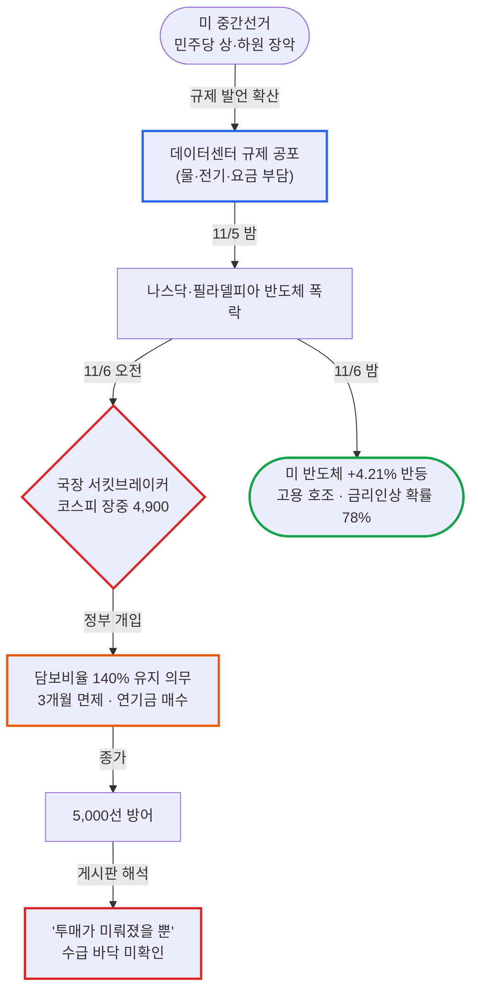

# 블라인드 주식·투자 24시간 브리핑: "서킷브레이커가 울린 날, 파혼 고백과 '오늘 못 샀으면 접어라'가 같이 떴다"

- **작성일**: 2026-11-07
- **수집 기간**: 2026년 11월 6일(금) 09:23 ~ 11월 7일(토) 07:38 (KST)
- **수집 규모**: 최근 24시간 게시글 1,202개 전수 수집 (본문·댓글 정밀 분석 137개, 댓글 715개 + 대댓글 378개 = 반응 1,093개, 목록 미리보기 분석 1,065개)

!!! warning "주의사항"
    아래 내용은 모두 블라인드 익명 사용자들의 날것의 주장과 여론이다. 수치, 인용 기사, 소식은 따로 검증하지 않았다. "속보", "뉴스에 나왔다" 같은 표현이 붙은 글도 출처가 없거나 링크만 있는 경우가 많으므로 투자 판단에 쓰기 전에 원문 기사나 공시를 직접 확인해야 한다. 작성자 소속은 블라인드에 표시된 회사명이며 실제 재직 여부는 확인할 수 없다. "언급 글 수"는 `entities.js`로 제목, 본문, 댓글에 종목명이나 별칭이 들어간 글을 센 값이다. 10/31 ~ 11/5 사이에는 수집하지 않았으므로, "직전 대비"는 10/30 브리핑과 비교한 일주일 단위 변화다.


## 📊 블라인드 개미 공포·탐욕 지수 (Fear & Greed Index)

브리핑을 시작한 뒤 처음으로 극단적 공포 구간에 들어왔다. 10/30에 33점이던 지수가 일주일 만에 **20점(극단적 공포, -13p)**으로 떨어졌다. 게시판 키워드는 "한강", "파혼", "반대매매", "서킷"이었다. 반응 1위 글은 SOXL에 신용대출 1.4억 원을 물타다 결혼이 흔들린다는 고백이었다. 그런데 완전한 항복은 아니다. "오늘 한 주도 못 샀으면 접어라", "일단 하이닉스 3억 원 매수" 같은 공격적 매수 글도 상위에 올랐다. 공포는 바닥인데, 아직 "아무도 안 사는" 상태는 아니다. 이게 이번 지수의 핵심이다.

<div class="kb-portfolio-metrics">
  <div class="kb-portfolio-metric-card">
    <span class="label">당일 공포·탐욕 지수</span>
    <span class="value">20점 (극단적 공포)</span>
    <span class="sub">브리핑 시작 후 첫 극단적 공포 구간 진입</span>
  </div>
  <div class="kb-portfolio-metric-card">
    <span class="label">직전 브리핑 대비</span>
    <span class="value">-13p 급락</span>
    <span class="sub">10/30 33점(공포) ➔ 11/7 20점(극단적 공포)</span>
  </div>
  <div class="kb-portfolio-metric-card">
    <span class="label">지배적 개미 분위기</span>
    <span class="value">손실 인증 · 정부 성토</span>
    <span class="sub">한강 밈·파혼 고백 vs "오늘 못 샀으면 접어라" 줍줍파</span>
  </div>
  <div class="kb-portfolio-metric-card">
    <span class="label">역발상 수급 시그널</span>
    <span class="value">투매 미완료 경계</span>
    <span class="sub">심리는 바닥권, 반대매매 유예로 수급 바닥은 미확인</span>
  </div>
</div>

```vegalite
{
  "$schema": "https://vega.github.io/schema/vega-lite/v5.json",
  "background": "transparent",
  "width": "container",
  "height": 220,
  "padding": {"top": 8, "bottom": 4, "left": 4, "right": 8},
  "data": {
    "values": [
      {"metric": "종합 공포·탐욕 지수", "score": 20, "max": 100, "zone": "극단적 공포", "label": "20점 (극단적 공포 · -13p)", "desc": "데이터센터 규제 공포발 반도체 폭락과 서킷브레이커, 담보비율 면제로 투매는 이연"},
      {"metric": "① 체감 손익·계좌 심리", "score": 10, "max": 100, "zone": "극단적 공포", "label": "10점 (극단적 공포)", "desc": "-3억·-8억 인증, 3년치 연봉 날림, SOXL 신용대출 물타기 후 파혼 위기"},
      {"metric": "② 매수·투매 수급 태도", "score": 28, "max": 100, "zone": "공포", "label": "28점 (공포)", "desc": "하이닉스 3억 매수·삼전 17.8 줍줍 vs '반대매매 유예 끝나고 진입' 관망"},
      {"metric": "③ 반도체·업황 신뢰도", "score": 15, "max": 100, "zone": "극단적 공포", "label": "15점 (극단적 공포)", "desc": "'메모리는 올 상반기가 고점' 가격 피크론이 주류로 부상"},
      {"metric": "④ 지수 지지선 신뢰도", "score": 18, "max": 100, "zone": "극단적 공포", "label": "18점 (극단적 공포)", "desc": "5,000선 방어를 '연기금 차력쇼'로 불신, 국장 4천 전후 시나리오 확산"},
      {"metric": "⑤ 역발상 바닥 기대감", "score": 29, "max": 100, "zone": "공포", "label": "29점 (공포)", "desc": "'조롱이 덜해서 오히려 무섭다' 역발상 vs '아직 곡소리 초입'"}
    ]
  },
  "encoding": {
    "y": {
      "field": "metric",
      "type": "nominal",
      "sort": null,
      "axis": {"title": null, "labelFontWeight": 500, "labelFontSize": 12, "labelLimit": 180, "ticks": false, "domain": false, "labelPadding": 12}
    }
  },
  "layer": [
    {
      "mark": {"type": "bar", "cornerRadius": 7, "height": 14, "color": "#94a3b8", "opacity": 0.14},
      "encoding": {
        "x": {
          "field": "max",
          "type": "quantitative",
          "scale": {"domain": [0, 118]},
          "axis": {
            "title": "블라인드 개미 심리 스펙트럼 (0~24 극단적 공포 · 25~44 공포 · 45~55 중립 · 56~74 탐욕 · 75~100 극단적 탐욕)",
            "values": [0, 25, 50, 75, 100],
            "labelExpr": "datum.value == 0 ? '0 (극단적 공포)' : datum.value == 25 ? '25 (공포)' : datum.value == 50 ? '50 (중립)' : datum.value == 75 ? '75 (탐욕)' : '100 (극단적 탐욕)'",
            "grid": false
          }
        }
      }
    },
    {
      "data": {"values": [{"x": 25}, {"x": 45}, {"x": 55}, {"x": 75}]},
      "mark": {"type": "rule", "strokeDash": [2, 4], "color": "#94a3b8", "opacity": 0.5},
      "encoding": {"x": {"field": "x", "type": "quantitative"}, "y": {"value": 0}, "y2": {"value": "height"}}
    },
    {
      "mark": {"type": "bar", "cornerRadius": 7, "height": 14},
      "encoding": {
        "x": {"field": "score", "type": "quantitative"},
        "color": {
          "field": "zone",
          "type": "nominal",
          "scale": {
            "domain": ["극단적 공포", "공포", "중립", "탐욕", "극단적 탐욕"],
            "range": ["#dc2626", "#ea580c", "#64748b", "#16a34a", "#2563eb"]
          },
          "legend": null
        },
        "tooltip": [
          {"field": "metric", "title": "심리 지표"},
          {"field": "label", "title": "점수 및 구간"},
          {"field": "desc", "title": "핵심 진단"}
        ]
      }
    },
    {
      "mark": {"type": "text", "align": "left", "dx": 10, "fontWeight": 600, "fontSize": 12},
      "encoding": {
        "x": {"field": "score", "type": "quantitative"},
        "text": {"field": "label", "type": "nominal"}
      }
    }
  ],
  "config": {"view": {"stroke": "transparent"}}
}
```


## 1. 24시간 핵심 요약: 서킷브레이커와 5,000선 공방

미국 중간선거에서 민주당이 상·하원을 가져갔다. 그 뒤 "데이터센터 규제" 공포가 번지며 11/5(목) 밤 나스닥과 필라델피아 반도체지수가 폭락했다. 이 충격이 11/6(금) 국내장을 그대로 덮쳤다. 서킷브레이커가 발동됐고, 코스피는 장중 4,900선까지 밀렸다. 삼성전자는 189,700원(-5.86%)에 마감했고, SK하이닉스는 장중 108만 원을 찍었다.

같은 날 오전 정부와 금융당국은 주식담보대출 담보비율(140%) 유지 의무를 3개월 면제했다. 반대매매 물량이 터지지 않았고, 연기금이 받치면서 코스피는 5,000선을 지켰다. 게시판은 이걸 안도로 받지 않았다. "연기금 차력쇼", "매도 폭탄을 뒤로 미뤘을 뿐"이라는 불신이 더 컸다. 그리고 금요일 밤 미국장에서 반도체는 하루 만에 반등했다(필라델피아 반도체 +4.21%).



| 구분 | 핵심 내용 | 투심 기류 |
| :--- | :--- | :--- |
| **핵심 여론** | 손실 인증·한강 밈 vs "오늘 한 주도 못 샀으면 접어라" | 공포는 극단, 매수 의지는 살아 있음 |
| **최대 분노 대상** | 정부·민주당(한·미 양쪽)·삼닉 성과급 | 하락 자체보다 "누구 탓인가"에 에너지가 쏠림 |
| **가장 큰 쟁점** | 담보비율 면제와 연기금 방어 | "바닥 확인을 막았다" 비판이 압도적 |
| **업황 논리 변화** | 수요 걱정 ➔ 메모리 가격(P) 피크론 | "빅테크가 급할 게 없어지면 가격협상력이 넘어간다" |
| **다음 주 관전점** | 11/9(월) 반대매매 물량, 5,000선 재시험 | 미국 반등이 국장으로 이어지는지가 관건 |

---

## 2. 🎭 블라인드 명예의 전당: 이번 주 레전드 글

1,202개 글 가운데 추천과 댓글을 쓸어 담은 글과 댓글 티키타카다. 손실 인증은 놀이가 됐고, 정치는 한·미 양쪽으로 욕을 먹었다.

### 💍 레전드 1. "속슬때문에 파혼하게 생겼네" (👁28,775)

이번 브리핑 반응 1위다. 10월에 반 토막 난 SOXL을 160달러부터 사들였고, 100달러 아래에서는 신용대출까지 받아 물을 탔다. 그리고 며칠 만에 40달러대가 됐다.

> **"속슬때문에 파혼하게 생겼네"** (스타트업 | 👍55 · 💬226 · 👁28,775)
> "10월에 속슬 300에서 반토막 났길래 160부터 좀 무리하게 들어갔고 이번달 초에 100달러 아래에서 신용대출 1.4억 받아서 물타서 평단도 낮춰놨는데 며칠만에 이렇게 될 줄 몰랐다" / "내년 5월 결혼 예정인데…지금 손절하면 대출 다갚아도 빚쟁이신세"
>
> - **최다 추천 댓글 (👍65)**: "나같아도 파혼하지. 도박하는 미친놈이랑 결혼 어케함"
> - **냉정한 댓글 (👍24)**: "중간선거 앞두고 변동성 극심할거 다 아는데 레버타는 능지면 벌받아 마땅하다"
> - **현실 조언 (👍30)**: "6불까지 가능성 열어두고 10분할로 진입해야함…일부 손절을 해서라도 신용대출만큼은 어떻게든 최대한 갚아라"

댓글 온도는 차가웠다. 그래도 가장 높은 공감을 얻은 조언은 "신용대출부터 갚아라"였다. 레버리지에 신용까지 얹은 계좌가 어떻게 끝나는지, 게시판 전체가 지켜본 셈이다.

### 💸 레전드 2. "다들 잃은 돈을 물건으로 치환해보자"

손실이 너무 커지자 개미들은 그걸 놀이로 바꿨다. 손실 금액 인증, 물건 환산, 한강 웨이팅 드립이 수십 건 이어졌다.

> **"다들 얼마나 잃었는지 써보자"** (삼성전자 | 💬21)
>
> - "-6천", "1.2억 확정손실"
> - "현재까지 2억 7천만원 손실…약 3년치 연봉 날림"
>
> **"고통을 나누자"** (대상): "-3억", "-8억"
>
> **"다들 잃은 돈을 물건으로 치환해보자"** (NAVER): "제네시스 g80", "2027 포르쉐 카이엔", "벤츠 g바겐 amg"
>
> **"자리 있나"** (삼성전기): "한강 지금 웨이팅 있나요?"
>
> - **댓글**: "손실률에 따라 먼저 자리하게 해준답니다"

"아마 혼자였으면 죽었을거야"(공무원 | 👍10 · 💬57 · 👁4,793)는 "속슬 평단 80…시드는 7천에서 현재 5천"이라고 썼다. 웃자고 쓰는 글인데 숫자는 하나도 안 웃기다.

### 🏛️ 레전드 3. "그래도 석열이 때 2300보단 낫잖아?"

정부 성토는 이번 장의 두 번째 주제다. 한국 민주당, 미국 민주당이 한꺼번에 욕을 먹었다.

> **"다들 왜 그래? 그래도 석열이 때 2300보단 낫잖아?"** (새회사 | 👍22 · 💬42 · 👁4,300)
>
> - **댓글 (👍120)**: "그땐 석열이가 재명이처럼 집 팔고 주식하라고 안함"
> - **댓글 (👍80)**: "2300 일 때는 고점이 3000 이었지. 9000에서 5000이 더 심하지"

"'민주당'이 내 수익 다 깎아 먹었네"(👍15)는 "그것이 미국 민주당이든 한국 민주당이든 중요하지않다"고 했다. "한국 민주당은 탈원전 / 미국 민주당은 탈데이터센터"(SK하이닉스 | 👍11)도 공감을 얻었다. 반대로 트럼프를 그리워하는 글도 나왔다. "트럼프는 사실 한국에 천사같은 사람 아닐까"(풍산 | 👍13), "이 배은망덕한 쉑기들아"(👍10)가 그렇다. 후자는 "Ai랠리로 망한다고 난리치던 한국 반도체 부활 시켜줬잖아…마스가 프로젝트로 한국 조선업 살려줬잖아"라고 썼다.

### 🔥 레전드 4. "오늘 주식 한주도 못 샀으면 깔끔하게 접자"

비명 사이로 정반대 도발이 올라왔다. 숫자는 적지만 반응은 컸다.

> **"오늘 주식 한주도 못 샀으면 깔끔하게 접자"** (삼성화재 | 👍11 · 💬68 · 👁5,435)
> "ㅈ고수거나 주식하면 안되는 ㅂㅅ이거나 둘중 하나"
>
> - **동조 댓글 (👍11)**: "모아가는 입장에서 충분히 살만한 가격대는 맞는데 다들 왜그럼?…나도 초단기채 일부 매도한금액 반정도로 샀는데"
> - **반박 댓글 (👍15)**: "오늘 위켄드 마감이라서 미장 밤에 존나 떨어지고 담주 월욜에 귝장도 추가 하락확정인데다 12월8일엔 스액 7억6천만주 새로풀리고 1월에 데모끄라시 애들 임기시작"
> - **작성자 재반박**: "하루에 -20%씩 찍히는데 한주도 못샀으면 접어야지…손 한번은 뻗으려고 해야 계속 뛰는거지"

반박 댓글의 "미장 밤에 떨어진다"는 예측은 빗나갔다. 금요일 밤 미국 반도체는 4% 넘게 올랐다.

### 🎯 레전드 5. "일단 하이닉스 3억원 매수" & "조롱이 덜해서 오히려 무섭다"

> **"일단 하이닉스 3억원 매수"** (공무원 | 💬21 · 👁1,587)
>
> - **걱정 댓글**: "한꺼번에 너무 많이 태운거아닌가. 나눠서 들어가지"
> - **조롱 댓글**: "원래 -50프로로 시작하는거야"
>
> **"속슬 조롱을 좀 더해줬으면 하는데"** (ex-KB캐피탈)
> "조롱이 진짜 게시판에 난무해야 팍 치고 올라간다고...생각보다 조롱이 장상황에 비해 덜해서 오히려 무섭다"

두 번째 글은 이번 장을 보는 역발상 시각을 그대로 보여 준다. 조롱이 넘칠 때가 바닥이라는 게시판 경험칙이 있다. 그런데 이번엔 아직 덜 넘쳤다는 진단이다.

---

## 3. 📊 시장 지표와 지지선 매트릭스

### 3.1 국내 증시 핵심 수치 (원문 그대로)

| 항목 | 원문 수치 | 출처 글 |
| :--- | :--- | :--- |
| **코스피 장중 저점** | "코스피 4900" | "미국 민주당이 악의축이네" |
| **코스피 종가대** | "오늘 5000지킨거 보면…난 4500갈줄 알았거덩" | 변호사, 👍3 · 💬9 |
| **낙폭 비교** | "나스닥이 -5.5 인데 코스피가 -7.x 이면 개씹선방" | "그래도 코스피 선방하네" |
| **고점 대비** | "코스피9000->5000", "고점대비 -46%" | "반대매매", "닷컴버블과 지금과 비교" 댓글 |
| **아시아 증시** | "니케이 6.5프로 하락, 가권 8.8프로 하락" | "현 시점 섣부른 매수금지" 댓글 |
| **삼성전자** | 189,700원(-5.86%), 프리장 "삼전 17.5" | "노태문이 거금 썻네", "오늘 프리장에 살걸" |
| **SK하이닉스** | "아침에 108만이었는데 몇 분만에 112만" | "와 하이닉스 떡상" |
| **연기금** | "5천 방어한다고 벌써 2조 넘게 쓴거 아냐?" | 새회사, 👍5 |
| **신용 잔고** | "아직도 신용이28조" | 같은 글 댓글 |
| **SOXL** | "속슬 고점대비 88%폭락" | "SOXl" |

코스피는 고점 대비 거의 반 토막이 났다. 그래도 "나스닥보다 덜 빠졌다"는 사실이 위안이 아니라 의심을 불렀다. 연기금이 너무 세게 받쳤다는 거다.

### 3.2 개미들이 제시한 지지선·목표가 매트릭스

| 종목/지수 | 낙관·지지 | 비관·하단 | 근거 글 |
| :--- | :--- | :--- | :--- |
| **코스피** | 5,000 방어 | "4천 초중반대", "국장 4천 전후" | "차트형이다. 코스피 soxx"(계룡건설) |
| **삼성전자** | "최소 25", "17.5 오면 꼭 사자" | "2차 지지선 14", "12만원도 각오", worst "10 ~ 12" | "오늘 프리장에 살걸" 댓글, "현 시점 섣부른 매수금지" |
| **SK하이닉스** | "120만원 밑이 단기바닥", 목표 160 | "하닉 100깨짐", worst "60 ~ 70" | "일단 하이닉스 3억원 매수", "예측해본다" |
| **SOXL** | "45불은 선관위급 요새", "38불은 든든무적국밥" | "30달러도 간다", "올해안에 10달러 밑" | "속슬 45불은 선관위급 요새다", "주식 팁 알려준다" |
| **QQQ / SOXX** | "Qqq는 510, soxx는 60오면 사고 싶은데" | "soxx 125 부터 진입 10 떨어질때마다 분할매수" | "다들 qqq나 sox 얼마정도오면 영끌풀매수할거야?" |

낙관 쪽 가격과 비관 쪽 가격의 간격이 크다. 삼성전자만 해도 25만 원 목표와 10만 원대 바닥론이 같은 날 나왔다. 바닥에 대한 합의가 전혀 없다는 뜻이다.

### 3.3 11/6(금) 미국 증시: 하루 만의 반등

"11/6 미국증시"(한국GM | 👍9)가 정리한 수치다. 다우 -0.46%, S&P500 +0.31%, 나스닥 +1.09%였다. 주간으로는 다우 -0.94%, S&P500 -2.68%, 나스닥 -3.39%다. 작성자는 "AI 규제 우려로 급락했던 기술주 하루 만에 반등"이라고 요약했다.

| 구분 | 원문 수치 |
| :--- | :--- |
| **반도체** | 필라델피아반도체 +4.21%, 엔비디아 +2.78%, TSMC +6.33%, 마이크론 +5.12%, AMD +11.04%, ASML +5.02%, 인텔 +7.71%, 램리서치 +8.23%, KLA +6.69%, SKHY +2.78%, SNDK +3.55%, WDC -1.44% |
| **AI 데이터센터** | 아이렌 +20.02%, 네비우스 +7.58%, 코어위브 +6.28% |
| **원전·전력** | UEC +6.79%, 비스트라 +10.55%, 오클로 +22.66%, SMR +16.25%, 넥스트에라 -1.47%, 듀크에너지 -1.77%, 콴타서비스 +6.25% |
| **양자** | 아이온큐 +23.42%, 리게티컴퓨팅 +19.29%, 디웨이브퀀텀 +18.01%, 퀀티넘 +25.99% |
| **M7 등** | 애플 -0.52%, 알파벳 +0.78%, MS -0.99%, 아마존 -0.35%, SPCX +8.62%, 메타 +0.84%, 테슬라 +4.23% |
| **거시** | 10월 비농업 고용 16만 5,000명(예상 5만 9,000명), 실업률 4.1%(예상 4.2%), 12월 금리 인상 가능성 70% ➔ 78%, 미 10년물 4.862%, 30년물 5.266%, WTI $90.48, 브렌트 $97.9, 비트코인 $75,700선 |

고용이 예상보다 세게 나왔다. 반도체에는 반등 재료였다. 하지만 금리 인상 확률은 78%로 올라갔다. "오늘 고용보고서에 따라 약반등이냐 나락이냐 결정됨"(새회사)이라는 사전 예고는 절반만 맞았다.

### 3.4 다음 거래일(11/9 월) 예상: 비관 vs 반론

비관론부터 보자. "오늘 저점인줄알고 종가에 매수한 흑우없제?"(현대오토에버 | 👍6)는 "월욜 아침에 뚜까맞는다"고 했다. "예측해본다"(의사 | 👍4)는 "오늘 미장 정규장시작하면 꼬라박고 월요일에 국장도 나락 리핏 하닉 100깨짐"이라고 썼다. 금요일 밤 미국이 반등하자 바로 "틀렸음" 댓글이 달렸다.

외국인 이탈 경고도 있었다. "외국인 선현 매동보니까 다 털은거네"(해양환경공단)는 이렇게 썼다.

> "장중 선물매수로 말올하는척. 현물은 죄다 던지고. 장막판에 선물도 절반이상 매도침. 야선에서 또 매도칠거 백프로"

이번 장에서 가장 특이한 목소리는 따로 있다. 반대매매 유예 때문에 투매가 안 나온 걸 오히려 걱정하는 글이다. "투매 안나오고 이대로 마감하면…별론데 바닥 확인 못했잖아"(파스토)가 그렇다.

반론도 있다. "국장 5000위로 장마감하겠노"(새회사)는 "주말에 좀 더 긍정적인 늬우스 떠서 다음주 원웨이 상승 나올 가능성도 배재할 수는 없겠제?…어제 대폭락은 좀 과했제?"라고 봤다. 금요일 밤 반도체가 오르자 "오늘 야간 미장 떡상이네"(한국램리서치), "속슬 +12 ~ 15% 사이로 장 마감일듯"(ex-KB캐피탈 | 👍5) 같은 글이 이어졌다.

---

## 4. 💣 시장 핵심 쟁점과 여론 분열

언급이 많은 순서대로 6대 쟁점을 정리했다. 구체적인 논쟁은 표 아래에서 다룬다.

| 주제 | 핵심 논점 | 대립 구도 |
| :--- | :--- | :--- |
| **① 데이터센터 규제 공포** | 민주당 압승 뒤 데센 신규 건설 중단 우려 | "메모리는 상반기가 고점" vs "이미 선반영, 민주당도 눈치 본다" |
| **② 담보비율 면제·연기금 방어** | 140% 유지 의무 3개월 면제, 연기금 2조 투입설 | "좀비 매물 연명" vs "장 초반 반대매매 막아 수급엔 긍정" |
| **③ 삼닉 성과급 분노** | 주가 반 토막에 수억 원대 성과급 확정 | "성과급 취소 신문고" vs "자사주 40조 + 20조 더 하는데 뭘 더 함" |
| **④ 레버리지 책임 공방** | 레버리지 ETF 상장과 연기금 리밸런싱 연기 | "정부가 자본시장 망쳤다" vs "누가 레버리지 하래" |
| **⑤ AI 버블·메모리 가격 피크론** | 빅테크의 가격협상력 회복 | "닷컴과 같다" vs "유료 서비스에 돈 내는 수요가 있다" |
| **⑥ 국민연금 사모펀드 우회 매수설** | 외국계 사모펀드로 코스피 매수 주장 | 동조와 "또시작이네" 반감 공존 |

### 4.1 데이터센터 규제: "10번 넘게 말했다"

"10번 넘게 말했다 (필독)"(현대모비스 | 👍14 · 💬20 · 👁1,142)이 규제 공포의 논리를 가장 잘 정리했다.

> "물, 전기 없어서 데센 못 돌린다 했다…특히나 메모리는 올 상반기가 고점이라고 누누히 말했다" / "텍사스 수도요금, 전기요금 3배씩 올랐는데 민간이 감당이되겠냐?"

공감 댓글은 "당장 니들 아파트 관리비 3배 오르면 단체로 민원 넣고 정권 바꿀거면서…이게 진짜 맞는말"(👍5)이었다. "미국 민주당이 데센 규제하는거"(CJ올리브네트웍스 | 💬17)의 댓글은 규제 이유로 소음, 물·전기 사용, 비용 전가, 일자리 부족을 들었다.

반론도 만만치 않았다.

- **"근데 미국장 이제 조정임" 댓글 (👍4)**: "이미 선거전부터 민주당 압승이 확실시되서 시장에 선반영 된 것도 있고…막상 뽑히고 나면 괜히 데이터센터 건들고 정책 추진하다 부작용 터져서 지들이 다 뒤집어 쓰는건 싫을테니까"
- **"반도체 주식 다시 좀 오를듯" (조지아 주재원 | 👍10 · 💬27)**: "미국은 월급에서부터 퇴직연금으로…주식 강제 투자…민주당도 지지율땜에 눈치봐야하니…친 데이터센터 인척할듯"

### 4.2 담보비율 면제: "시장의 신뢰를 팔아넘긴 셈"

비판이 압도적이었다. "정부의 이번 증시정책, 주가 방어하려다 시장의 신뢰를 팔아넘긴 셈임"(👍14 · 💬9)이 대표 글이다.

> "시장 논리에 따라 청산되어야 할 악성 레버리지 물량을 인위적으로 연명시켜 주는 조치" / "잠재적 매도 폭탄의 이연일 뿐…기술적 반등을 시도할 때마다 탈출하려는 이 좀비 매물들이 쏟아져 나와 지수 상단을 무겁게 억누를 것"

"아니 미친놈들 신용 반대매매를 유예한다고?"(변호사 | 👍14 · 💬11 · 👁1,083)도 "신용쓴 애들 털고 가야지"라고 했다.

옹호 쪽 논리는 수급이었다. "이거 너무 위험한거아니야?"(👍5 · 💬13)의 댓글은 "저걸 면제하면 장 초반 반대매매 물량이 안 터지니까 수급쪽으로는 긍정일 수 있지"라고 했다. 비판 글에는 "면제는 개인고객에게 준게 아니고 증권사에 준 겁니다…신용때문에 증시하락하는게 아닌데"(👍4)라는 반박도 달렸다.

### 4.3 삼닉 성과급: 주주 vs 직원 난타전

주가가 고점의 절반 아래인데 성과급은 수억 원대로 확정됐다. 주주들이 폭발했다.

- **주주 측**:
    - **"개미들 대동단결해서 삼전닉스 성과급 취소 신문고"** (LG전자 | 👍29): "주주들 원금 반토막내고 양사 합쳐서 성과급을 80조 뿌린다고? 차라리 배당을주던 자사주 매입을해라"
    - **"삼전 하닉 주주들은 연대해서 시위라도 해야 할 듯"** (공무원 | 👍27): "고졸 생산직, 일반 학사 출신까지 일률적으로 7억 원 이상을 요구하거나 받는 구조라면 분명 문제"
- **직원 측**:
    - **숫자 반박 댓글 (👍4)**: "오늘 대하락 장임에도 YTD로 +67% YOY로 +91% 상승했는데…작년에 번 돈으로 올해 직원들 보상 4.7조원 해주고 주주를 위한 자사주 매입은 40조, 그것도 모자를까봐 연말에 20조 더 하는데 뭘 더 해야함?"
    - **심리 반박 댓글 (👍6)**: "노조가 미국 중간선거 결과를 결정했나요?…본인이 주식 물렸는데 남이 돈버는 게 꼴보기 싫은것임을 인정해야지"

"아니 ㅅㅂ 삼닉 성과급 퍼주는게 맞는거임?"(노무사 | 👍18 · 💬23)에서는 "다 찌라시여 생산직들은 몇억씩 못받고"라는 반박과 "라인 설비 담당자들도 몇억 받던데"라는 재반박이 오갔다.

### 4.4 레버리지 책임: 정부 탓 vs 개인 탓

"정부는 대한민국의 자본시장을 망친거임"(근로복지공단 | 👍24)은 이렇게 주장했다.

> "지선 승리를 위해 국민연금 리밸런싱를 미루고 레버리지 etf 상장으로 거품을 만듬으로써 국민의 노후를 망침…부동산 -> 주식으로의 축의 이동을 막아버림"

반대편 "국민성 미개하다 누가 레버리지하래???"(삼성전자 | 👍7 · 💬15)는 "미장에는 3배 짜리도 있는데 겨우 2배 레버하나 출시한 것 가지고 그게 왜 나라탓이냐"라고 받아쳤다. 댓글에서는 "레버리지는 개인탓 맞긴해 국민연금 지들 선거에 이용해서 시장 망가진게 개같은거지"(👍3)라는 절충론이 나왔다.

### 4.5 AI 버블과 메모리 가격 피크론

업황 논리가 바뀌었다. 10/30에는 "빅테크 통장이 비었다"는 수요 걱정이었다. 이번에는 가격 걱정이다. "(ㅈ됨)반도체 가격 논리 말뚝에 쐐기까지 박힘"(현대건설 | 💬12 · 👁673)이 핵심을 짚었다.

> "빅테크가 급할게 없어지면 가격협상력이 어디로 가겠냐?…삼닉 고마진 지켜주려고 데이터센터 짓는게 아니잖아"

반대쪽 "AI가 닷컴과 다른 점"(라인플러스 | 💬14)은 "요즘 나오는 인공지능 서비스들 보면 다 유료서비스이고 소비자들이 과거와 달리 기꺼이 돈을 낸다…90% 폭락 걱정하는 것은 과잉반응"이라고 반박했다. 댓글에서는 섹터 이동론도 나왔다. "이건 버블 붕괴가 아냐…악재 많이 나올 섹터에서 호재 많이 나올섹터로 돈이 이동한거 뿐임 나 선거날 3일만에 퍼스트솔라 20% 먹음"

---

## 5. 🕵️ 찌라시와 미확인 소식: 신뢰도 등급 카드

게시판을 달군 10대 소식을 신뢰도와 함께 정리했다. ⚠️는 수급에 직접 영향이 큰 소식이다.

### 5.1 ⚠️ [정책 발표] 담보비율 140% 유지 의무 3개월 면제

- **신뢰도**: **중간 (발표는 사실일 가능성 높음, 증권사별 적용은 전언)**
- **원문 주장**: "주식담보대출 140%담보비율유지 3개월면제 내용 공유"(삼성전자로지텍 | 💬9 · 👁358)는 자본시장법 제72조와 금융투자업규정 제4-20조를 근거로 들었다. "증권사에 해당되는 내용으로 고객 대상이 아님"이라는 게 요지다. "OO증권사는 11월 9일 월요일 하루만 유예"라는 전언도 붙였다.
- **증권사별 혼선**:
    - "미래에셋 공지사항. 27년 1/31 까지로 3개월간임. 22년에도 이랬었어"
    - "Nh투자증권"(한국철도공사): "월요일도아니고 화요일 10일부터시행에 담보비율도 130프로"
    - "담보비율면제 11.9부터면"(한국수력원자력 | 💬15): "엔투만 10일부터야?", "한투9일"
- **현직자 반박**: "증권사가 너 반대매매 받아서 좋을게 뭐있어 살려두고 매매수수료 받는게 더 이득이지"
- **투자 관점 핵심 체크포인트**: 금요일에 반대매매가 안 터진 이유로 이 조치가 꼽힌다. 거꾸로 보면 투매가 해소되지 않고 미뤄진 거다. "아직도 신용이28조"라는 댓글처럼 잔고가 남아 있으면, 반등 때마다 탈출 매물이 나올 수 있다. 본인 증권사 공지로 시행일과 기준 비율을 꼭 확인해야 한다.

!!! note "폭락일에 대출이 쏟아졌다는 현장 전언"
    ex-KB캐피탈 소속 작성자의 "개인신용대출 역대급 데일리 실적이다"(👁772)는 이렇게 썼다. "현시각 14시 30분 기준 개인금융쪽 개인신용대출 및 담보대출 오늘 오지게 쏟아져나오는중…신용안되는 일용직분들 중기계, 중장비 담보잡고 대출받는다." 폭락일에 빚을 내서 사려는 수요가 오히려 폭증했다는 정황이다.

### 5.2 ⚠️ [번역 인터뷰] 텍사스 주지사 당선인 "데이터센터 사업 중단" 발언

- **신뢰도**: **중간 (번역글, 원문 영상 링크 없음)**
- **원문 주장**: "텍사스 주지사 왈"(뉴파워프라즈마 | 💬7 · 👁711)은 당선인 지나 히노호사의 발언을 옮겼다. "그러한 보호 장치가 마련될 때까지 현재 진행 중인 데이터센터 관련 사업을 중단해야 합니다", "제가 반대하는 것은 데이터센터 기업들이 텍사스와 텍사스 주민들을 부당하게 이용하는 방식입니다."
- **팩트체크 및 반박**: 다른 글 대댓글에서 "그거 가짜뉴스라데 원칙대로 데센 규제레"라는 말이 나왔다. "이미 짓고 있는 것도 스탑가능? 소송감 아닌가??"라는 의문도 달렸다.
- **투자 관점 핵심 체크포인트**: 데센 건설 속도는 HBM·DRAM 수요와 직결된다. 실제 주 정책으로 이어지면 하락 논리가 강해지고, 립서비스로 끝나면 "선반영 후 반등" 논리가 힘을 얻는다. 임기 시작은 내년 1월이다.

### 5.3 [루머] 레오폴드 아셴브레너 펀드(상황 인식) 파산설

- **신뢰도**: **낮음 (텔레그램 퍼온 글, 출처 없음)**
- **원문 주장**: "[필독할것] 다음주까지 하방 열어둬야 하는 이유 - 펌"(새회사 | 👁672)은 펀드가 "공식적으로 파산"했다며 손실 내역을 나열했다. "$MU 마이크론 &1,153달러에 구입했는데 현재 703달러로 (-39%)", "$SNDK 샌디스크 2,268달러에 구입했는데 현재 874달러로 (-61%)", "$CRWV 99달러에 구입했는데 지금은 42달러 (-57%)"
- **팩트체크 및 반박**: "어디서 텔레그램 도는거 그대로 복사해왔누"라는 지적에 작성자도 "펌이라고 수정함"이라고 인정했다. "롱펀드가 파산했으니까 숏카버 나올수있다는거아님?"이라는 반대 해석도 있었다.
- **투자 관점 핵심 체크포인트**: 사실이라면 AI 인프라 금융으로 손실이 번지는 신호다. 지금은 확인된 게 없다.

### 5.4 [단신] MS, 오라클과 AI 클라우드 계약 갱신 중단

- **신뢰도**: **확인 불가 (시황글 속 한 줄, 링크 없음)**
- **원문 주장**: "11/6 미국증시"(한국GM)에 "MS, 오라클과 AI 클라우드 계약 갱신 중단(불룸버그)"이라는 한 줄이 있다.
- **팩트체크 및 반박**: 게시판에서 따로 논의되지 않았다.
- **투자 관점 핵심 체크포인트**: 사실이라면 "빅테크가 급할 게 없어진다"는 가격 피크론의 근거가 된다.

### 5.5 [기사 요약] TSMC, 엔비디아 요청으로 3D DRAM 생산 검토

- **신뢰도**: **중간 (기사 요약 형식, 매체명 없음)**
- **원문 주장**: "TSMC, 엔비디아 요청에 차세대 3D DRAM 생산 검토"(👍5 · 👁383)는 "실제 생산 여부는 아직 결정되지 않았음…TSMC는 관련 논평을 거부"했다고 전했다.
- **팩트체크 및 반박**: 댓글은 "3d dram 난이도 ㅈㄴ어려움"과 "cxmt 이슈에서 tsmc랑 테라펩까지 야랄이네 ㅋㅋ 벌써 치킨겜 드갔누"로 갈렸다.
- **투자 관점 핵심 체크포인트**: 메모리 공급자가 늘어날 수 있다는 소식은 삼성전자·SK하이닉스 가격결정력에 장기 악재다.

### 5.6 [루머] 스페이스X 12월 8일 7억 6천만 주 보호예수 해제

- **신뢰도**: **낮음 (출처 없이 하락론 근거로 반복)**
- **원문 주장**: "12월8일엔 스액 7억6천만주 새로풀리고"(👍15 댓글), "뿡슨덜…"(NC)
- **팩트체크 및 반박**: 보호예수 해제 일정은 공시로 확인할 수 있다.
- **투자 관점 핵심 체크포인트**: 사실이라면 연말 미국 기술주 수급에 부담이다.

### 5.7 [추측] 이란 주말 타격설

- **신뢰도**: **확인 불가 (개인 추측)**
- **원문 주장**: "이번 주말 조심해라"(공무원 | 👍5)는 "트럼프라면 이번 주말에 쇼부칠거임 이란 핵... 타격 가능성 높다"고 했다. 근거는 "트럼프 자서전부터시작해서 그 남자의 심리분석을 6년간 해온" 경험이다.
- **팩트체크 및 반박**: 댓글은 "ㅋㅋㅋㅋㅋㅋ", "6년이면 석사전공수준이네"였다.
- **투자 관점 핵심 체크포인트**: WTI가 $90대(원문 $90.48)다. 지정학 이벤트가 터지면 금리 인상 우려와 겹쳐 월요일 변동성이 커질 수 있다.

### 5.8 [공시 확인] 노태문 삼성전자 대표 자사주 3,000주 장내매수

- **신뢰도**: **높음 (DART 공시 알림 형식)**
- **원문 주장**: "노태문이 거금 썻네"(새회사 | 👁598)는 "보고자 : 노태문(68년생)/등기임원/대표사장…2026-11-06/ 장내매수(+)/ 3,000주/ 보통주"를 옮겼다.
- **팩트체크 및 반박**: 댓글은 1개뿐이었다. 게시판은 거의 주목하지 않았다.
- **투자 관점 핵심 체크포인트**: 폭락 당일 대표이사가 장내에서 샀다. 경영진이 지금 주가를 낮다고 본다는 신호로 읽힐 수 있다.

### 5.9 [풍문] 최태원 회장 "국장 투자는 파멸" 경고 영상

- **신뢰도**: **확인 불가 (유튜브 링크만 있음)**
- **원문 주장**: "SK 최태원 회장, '변동성이 극심한 국장 투자는 결국 파멸' 경고"(NC)
- **팩트체크 및 반박**: 발언 원문이 없고 짜깁기 영상일 수도 있다. 게시판은 "태원이형 갑자기 태세전환하네", "주식 매도 타이밍보소"처럼 조롱 소재로만 썼다.
- **투자 관점 핵심 체크포인트**: 사실이라면 SK하이닉스 대주주의 시장관이 바뀐 것이다. 지금은 판단할 근거가 없다.

### 5.10 [풍문] 6조 원 호남 반도체 심사를 카페 사장이 했다

- **신뢰도**: **낮음 (클리앙 글 링크, 즉시 반박됨)**
- **원문 주장**: "6조 반도체 심사를 카페사장이 함"(한국산업기술시험원 | 👍13)
- **팩트체크 및 반박**: 첫 댓글(👍2)이 바로 반박했다. "12개 분과위원회중 반도체산업 분과는 없고 위원 수도 전체 269명인데 그중 3명이 문제야? 어디서 인용하려면 제대로된 신문기사 좀 인용하자"
- **투자 관점 핵심 체크포인트**: "호남반도체"는 정부 실책 목록에 단골로 오르는 소재다. 주가 영향은 제한적이다.

---

## 6. 🔍 종목·섹터별 개인 투자자 심리와 전망

`entities.js`로 집계한 결과, 언급이 많은 상위 종목·섹터는 다음과 같다.

| 종목·섹터 | 언급 글 수 | 지배적 심리 | 대표 전망 (원문 인용) | 소수 반대 의견 |
| :--- | :---: | :--- | :--- | :--- |
| **국내 지수** | 111 | 분노·불신 | "4천 초중반대까지 갈 차트" | "이미 고점대비 -46%" |
| **미국 지수** | 99 | 당혹 | "미장 지수 추가 20 ~ 30프로 하락" | "정치적 리스크는 금방 회복" |
| **반도체** | 96 | 체념·피크론 | "반도체 P 떨어지고 컨센 나락간다" | "메모리 부족은 피할 수 없는 현실" |
| **SK하이닉스** | 88 | 공포 속 줍줍 | "120만원 밑이 단기바닥" | "하닉 100깨짐", "60 ~ 70" |
| **SOXL** | 87 | 절망과 조롱 | "올해안에 10달러 밑" | "계속 물타면서 존버해라" |
| **레버리지 ETF** | 77 | 책임 공방 | "레버리지 etf 상장으로 거품" | "누가 레버리지 하라고 협박함??" |
| **삼성전자** | 59 | 성과급 분노 + 저가 매수 | "목표가 최소 25" | "12만원도 각오" |
| **AI·빅테크** | 28 | 버블론 vs 필수재론 | "엔트로픽 IPO를 끝으로 1차 버블 마무리" | "90% 폭락 걱정은 과잉반응" |
| **부동산** | 28 | "결국 부동산" | "서울·경기 남부로 현금파킹 심화" | "잘못되면 바로 파산 아님?" |
| **원전·전력** | 11 | 데센 규제 직격탄 | "개미들도 이제서야 현실직시" | "간밤에 태양광 원자력 폭등" |

### 6.1 국내 지수: 공포보다 분노가 크다

고점 근처에서 들어간 사람이 많다. "국장 -60% 미장 -50% 3년간 모은 ETF 오늘자로 - 찍음"(리디), "본전오면 진짜 국장손절합니다…코스피 6200….쯤와야할텐데"(NH농협은행 | 💬12)가 그렇다. "한때 2억 플러스까지 갔었는데 기여코 오늘 마이너스로 돌아섰네"(HD건설기계 | 👁1,099)처럼 수익이 통째로 사라진 사례도 나왔다.

이번엔 하락보다 정부 개입이 더 미움을 받았다. "코스피가 니케이보다 하락폭이 적다는게 말이됨?"(한국생산기술연구원 | 👍7)은 "반도체 원툴 증시가 니케이보다 하락폭이 적은게 말이됨? 어지간히 끌어올려야지"라고 했다. "누가봐도 의도적으로"(금호석유화학)는 "5천스피 까진 뭔짓을 해도 사수하자 라는 의지가 느껴지는 연기금 차력쇼"라고 표현했다.

- **하락론**: "차트형이다. 코스피 soxx"(계룡건설) "코스피 차트가 깨져버림. 바로 채널안에 못들어오면 4천 초중반대까지 갈 차트임"
- **상승론**: "닷컴버블과 지금과 비교" 댓글 "코스피는 이미 고점대비 -46%임 이미 쳐맞았음…현 주가 대비 대폭락이 올 가능성은 낮아보임"
- **행동 계획**: "다 탈출하려고만 할거임…다시 박스피 회귀"(서울교통공사 | 👍5)처럼 본전 탈출 뒤 국장을 떠나겠다는 사람이 가장 많다.

10/30에는 "연내 5,000 붕괴·4,500 간다"가 소수 예측이었다. 일주일 만에 장중 4,900이 현실이 됐다. 논점은 "어디까지 빠지나"에서 "정부가 바닥 확인을 막았다"로 옮겨 갔다. 심리는 바닥권이다. 하지만 반대매매가 미뤄졌으니 수급 바닥은 아직 확인되지 않았다. 게시판 다수도 그렇게 본다.

### 6.2 미국 지수: "지수 투자도 안전하지 않다"

"미국 지수투자만 하는데 왜 이러냐 진짜 하"(SK바이오사이언스 | 💬13 · 👁1,080)는 "연금저축 isa에 투자하는 나스닥100이 충격이 큼"이라고 했다. "QQQ 최근 1년 수익률 25.4%였나"(쥴릭파마코리아)는 "오늘기준으로 3 ~ 4%까지 내려갔었네…고점대비 18%나 빠졌다니"라고 썼다.

- **하락론**: "현 시점 섣부른 매수금지" "특히 미장은 이제 본격하락 시작단계…미장 지수 추가 20 ~ 30프로 하락"
- **상승론**: "정치적 리스크는 생각보다 금방 회복하긴함"(삼성전자) "바이든 때 빅테크 횡재세, 구글 크롬 분할…트럼프도 관세전쟁이랑 호르무즈 해협 길막 때 몇 번 폭락하더니 전고 뚫고 올라갔음"
- **행동 계획**: 분할 적립이 다수다. "그냥 하루에 2만원씩 사는데?", "Qqq는 510…아니면 550부터 분할할듯"

환차손 불만이 컸다. "일단 환율 때문에 10% 기본 때려맞음"이라는 댓글이 달렸다. 10/30에는 알파벳·인텔 실적 쇼크가 논점이었다. 이번엔 정치 리스크가 지수 전체를 흔든다. 국장보다 공포는 덜하다. "정치 리스크는 결국 회복된다"는 경험칙이 버팀목이다. 다만 금리 인상 확률 78%라는 변수가 새로 생겼다.

### 6.3 반도체: 사이클 종료를 받아들이는 중

"다 파니까 냉정해지네"(👁936)는 "반도체 싹 다 정리하니까 냉정하게 바라봐지네 거품 맞았네"라고 썼다. "다른 건 모르겠고 반도체는 사망 확정"(서울대학교병원)은 "최고점은 5년 내로 뚫을 가능성 제로에 수렴"이라고 했다. 상승 사이클을 믿던 사람들이 체념 단계로 넘어가고 있다.

하락론의 핵심은 가격 피크론이다. "잃고나서 비로소 보이는 것들"(해양환경공단 | 👍5)이 대표적이다.

> "결국 이제는 램값 이게 투자지표…램갑이 리즈너블 프라이스로 내려올때까지 숏"

상승론은 "삼하 놔두면 오른다 홀딩해"(LG전자)가 맡았다.

> "데센 건설이 반으로 줄어든다고 해도 부족한 건 마찬가지임. 메모리가 데센에만 들어가는 것도 아님…레버리지, 빚투는 하면 안됨"

"반도체 사이클은 이젠 끝난듯"(YTN)이 "디스플레이 시장하고 똑같아 지겠지"라고 하자, "디스플레이랑은 다름 EUV가 뭔지 검색해봐"(👍2)라는 반박이 달렸다. 10/30의 "빅테크 현금 고갈" 수요 걱정이 "데센 규제 ➔ 빅테크가 급할 게 없음 ➔ 가격협상력 이동"이라는 가격 논리로 진화했다. "반도체 사망 확정" 같은 극단적 표현이 늘어난 건 역발상 지표로 볼 여지가 있다. 그러나 금요일 밤 반등에도 "이번에도 속으면 그 누구탓도 하지마라"(현대건설)는 경계가 강하다.

### 6.4 SK하이닉스: 공포 속 줍줍 경쟁

고점 근처 물림이 많다.

- **고점 물림**:
    - **"26년6월23일 하닉 최고가 인증"** (공무원): "닉스 최고가 300만2천 그때 매수한 사람 인증해줘"
    - **"하이닉스 상담좀 나 심각해"** (DL건설 | 💬13): "160만 평단에 5000…130만에 다시 3000 물탔어. 평단은 147만이고 지금 -21%"
    - **"나 주식 마이너스 40퍼센트고"** (공무원): "내 주변에 제일 심한 사람은 세입자 전세금 3억을 하닉 평단 240에 투…"
- **저점 진입**: "하닉 110에 입성했습니다", "하닉 118만원에 3천 삼전 18만원에 2천 들어갔네요", "오늘도 114에 5주 샀다"

"하닉 200대에 샀는데 지금도 안 사냐"(국민연금공단)의 기계적 분할 매수론이 힘을 얻었다.

> "떨어지면 기계적으로 사고, 오르면 기계적으로 비중을 줄여. 자꾸 주식에 감정을 넣지마"

현직자 목소리는 엇갈렸다. SK하이닉스 소속 "형이 딱 말해줄게"는 "지금 사라 이 정도면 많이 떨어졌다…담주부터 반등이다"라고 했다. 다른 SK하이닉스 소속은 "나도 모르게 한강 와보니 이해가 되네"(💬9)라고 썼다. 성과급 논쟁에서는 "주주회사가 주주 동의없이 이익의 10프로 영업이익 지급하는게 정상이냐고"라는 내부자의 자기비판 댓글도 나왔다.

10/30에는 100조 원 주주환원 기대가 하단을 받쳤다. 이번엔 주주환원 언급이 거의 사라졌다. 그 자리를 성과급 분노와 가격 피크론이 채웠다. 고점 대비 60% 넘게 빠진 110만 원대에서 수천만 ~ 수억 원 매수 글이 나온다. 개미가 아직 이 종목을 포기하지 않았다는 뜻이다. 다만 "100 깨짐"과 "60 ~ 70" 시나리오가 공존해 바닥 합의는 없다.

### 6.5 SOXL: 고점 대비 -88%, 이번 장 최대 피해 종목

평단이 10달러부터 100달러 이상까지 넓게 퍼져 있다. "형 100층 선배인데"(새회사)에는 "난 96층", "난 93", "98이다", "난 오늘 아침에 팔았어.. -65%"가 줄줄이 달렸다. "SOXL 중고로 사실분?"(💬8 · 👁639)은 "지난달에 230불에 삿고…150불에 쿨거래"라는 자조 글이었다.

조롱이 지배적이다. "Soxl 주주들이 오늘부터 해야 할 일"(👍4)은 "배민, 쿠팡 지우기…보일러 끄기…자판기 바닥 확인"을 권했다. "tqqq, soxl 같은"(GS칼텍스)은 "3배 짜리 상품을 차트 분석해서 줍는 저지능자들이 젤 노이해였는데 간밤에 속이 다 시원하네"라고 했다.

- **하락론**: "주식 팁 알려준다"(한국과학기술연구원) "SOXL은 주기적으로 10달러 밑으로 떨어졌다가 100달러 이상까지 가는 걸 반복함…올해안에 10달러 밑으로 떨어질텐데 그때 감당할 만큼만 들어가면"
- **지지론**: "속슬 45불은 선관위급 요새다"(ex-KB캐피탈 | 👍3). 댓글은 "얼마전에 그거 100불이었다가 80이었다가 60이었다가 내려온거임"이었다.
- **행동 계획**: 물타기 존버, SOXL·SOXS 번갈아 단타, TQQQ로 갈아타기로 갈렸다.

!!! note "음의 복리를 한 줄로 설명한 댓글"
    "주린이라 속슬 음의복리 궁금한데"(한국전력공사 | 💬17)에 달린 설명이 공감을 얻었다. "20%떨어지면 총 자산이 4/5가 되잖아 역수 구하면 5/4지 1.25나오자나 25% 올라야돼…이게 누적되면 음의복리야." 3배 레버리지는 기초지수가 회복돼도 원금 회복이 훨씬 어렵다.

10/30에는 "$90 지정가 매수 체결" 같은 줍줍 글이 있었다. 일주일 만에 40달러대가 되며 그때 산 사람들이 대거 물렸다. 파혼·한강 밈이 정점에 이른 건 항복 국면의 특징이다.

### 6.6 삼성전자: 18만 원대가 저가 매수 기준점

"-2억인데"(👍3)는 "삼성전자 평단 27만 2500주 인데 어카냐 걍 손절해야하나"라고 했다. "삼성전자 주식 미개봉 새상품 팝니다"(👁1,086)는 "6월에 증권에 앱에서 34만원에 구매했고…29만원 쿨거래"라는 자조 글이었다. 반면 "삼전 17.8에 주운거…9% 먹었네 더 살걸"(👍2)처럼 프리장 저가 매수에 성공한 사람도 있다.

- **상승론**: "목표가 최소 25", "삼전 17.5라니 진짜 바겐세일이었네"(NAVER)
- **하락론**: "2차 지지선 14까지 갈 예정 17.5 오면 꼭 사자 형은"(👍5), "개인적으로는 삼성전자 12만원도 각오해야 될거 같아"
- **행동 계획**: "형이 리딩할게"(공무원) "삼전 18 깨지져서 5할 삽입했다…담주 18 다시 깨지면 3할 삽입 예정"

삼성전자 소속은 대체로 장기 보유론이다. "피바다 속에서의 평온"(👍5)은 "AI 싸이클과 반도체는 끝나지 않았고 앞으로 5년보면 반도체 주가도 전고점을 돌파"라고 썼다. 10/30에는 컨콜 실망과 주주환원 연기가 논점이었다. 이번엔 18만 원대라는 구체적 가격이 기준점으로 떠올랐다. 다만 "14", "12", "10 ~ 12" 하단 시나리오가 같이 돌고 있어 확신은 약하다.

### 6.7 레버리지·인버스 ETF: 정부 실패의 상징이 됐다

SOXL 말고도 손실이 이어졌다. "QLD 도 1100만원 마이너스", "sk단일레버리지"(한화 | 💬12) "44000원이 4000원 됐잖아"가 그렇다.

"이게 좋아할 일인가?"(삼정KPMG | 👍3)는 "반대매매 유예는 레버리지 시즌2고 끝나면 주가는 더 크게 하락해서 변동성만 키우는 꼴"이라고 봤다. 정리하겠다는 글이 많다. "qld 다 정리했어요"(💬6)는 "레버리지를 투자할 만한 그릇이 못 되는 듯"이라고 했다. 반대로 "진짜 대폭등 각이다"(새회사 | 💬12 · 👁1,267)는 "은행에서 대출받아서 원금넣고 신용으로 2.5배 ~ 3배 풀매수각"이라고 주장했다가 "미쳤네"라는 반박을 받았다.

10/30에 레버리지는 개인 취향이었다. 이번엔 정부 정책 실패의 상징으로 격상됐다. 지수로 돌아가겠다는 글이 늘어난 건 투기 열기가 꺾였다는 신호다.

### 6.8 AI·빅테크: "AI는 커도 주가와 마진은 별개"

"하 아이렌 몰빵 개쫄린다"(약사)는 "평단 52였는데 홀린듯이 물타서 평단27 만들었네 거의 전재산 3억"이라고 했다.

- **버블론**: "10번 넘게 말했다" "엔트로픽 IPO를 끝으로 AI 1차 버블은 마무리된다…IPO 직전까지 상장주관사인 JPM과 골드만이 TP 높이면서 뽐뿌 넣을거다"
- **필수재론**: "근데 진심 AI투자가 멈출수 있을거라 생각해?"(삼성전자) "몇시간 걸리던거 몇초안에 끝내는 세상이야 못돌아가"

"개인적으로 ai는 기술적으로도 버블맞다고생각함"(신젠타코리아 | 💬30)에는 "AI데이터센터에 천문학적인 돈을 투자하고 있는 빅테크 기업들이 니보다 멍청하다는거네?"(👍3)라는 반박이 달렸다. 데이터센터를 사막·알래스카에 짓자는 대안 토론도 나왔다. AI 수요 자체를 부정하는 사람은 소수다.

### 6.9 부동산: "결국 부동산이 정답"

"폭락 시작 직전에 다 빼서 집삼"(KT&G | 👍5)은 "결국 주식은 폭락했고 집값은 올랐네 진짜 신의 한수였다"라고 했다. "자식말 안듣고 부동산만 고집한 답답한 아버지"(👍9)는 "결과는 서울 핵심지 2주택 현재 대출 0 그저 GOAT"라고 썼다. "???: 아파트 팔고 주식사라고 했더니"(새마을금고중앙회 | 👍28)는 "진짜 하더라"라고 조롱했다.

10/30에 처음 떠오른 "서울·경기남부 부동산 도피" 여론이 일주일 사이 대세로 굳었다. "부동산 ➔ 주식 축의 이동"이 좌절됐다는 인식은 국내 증시 자금 유입에 중장기 부담이다.

### 6.10 원전·전력: 데센 규제 직격탄

"두산에너빌리티"(공무원 | 💬15 · 👁785)가 대표 사연이다.

> "아빠가 8만원대에 2000주 물려있음…12만원 넘을 때 30만원까지 갈 주식이라고 안 팜. 이제 4만원대인데…정기예금 5천만원짜리 깨고 1000주 더 사야한다네"
>
> - **댓글**: "9층에도 사람 있어요..", "아빠가 주식고수네"

"원자력하고 전력관련이 타격이 심한듯"(한국전력공사)은 "실적이 그렇게 드라마틱하게 올라오지 못했는데 주식은 좀 선행해서 많이 올라…위에서 물린 분들은 회복하는 게 참 쉽지 않을 것"이라고 했다. 그런데 금요일 밤 미국에서 오클로 +22.66%, SMR +16.25%가 나왔다. "미장 이제 에너지 턴 오나?"라는 기대가 생겼다. 미국 흐름이 국내 전력주로 이어지는지가 관전 포인트다.

### 6.11 기타 종목·섹터

| 종목·섹터 | 언급 글 수 | 요약 |
| :--- | :---: | :--- |
| **채권·달러·환율** | 25 | 환차손 불만과 "어쩌다보니 적금넣는 내가 승리자됨" 예적금 승자론 |
| **삼성·하이닉스 묶음** | 23 | 거의 전부 성과급 분노 글 |
| **네이버** | 17 | 대부분 뉴스 링크(naver.me) 오탐, 실제 종목 언급은 소수 |
| **구글(알파벳)** | 7 | "구글 맛있는 가격 아님?" 저가 매수 문의 |
| **코인** | 6 | "현재 자산 100% 모두 코인 숏 들고 있습니다"(LG전자) |
| **금·은** | 6 | "올해 초에 은(실버바) 3000만원 잘못사서 반토막"(의사, 💬23) |
| **마이크론** | 5 | "미선이랑 마이크론 오르는데 외국인 판다고 떨어지나" 괴리 불만 |
| **엔비디아** | 5 | "지금 엔비디아 풀매수 갈까?" |
| **테슬라** | 5 | "정작 공화당에 풀베팅해서 돈 날린 놈임" |
| **조선·방산** | 5 · 3 | 트럼프 시절 수혜 회고 맥락으로만 언급 |
| **코어위브 등** | 4 | "착공지연 등으로 코어위브 등 기업부실되면 다 터질수도" |
| **OCI홀딩스** | 1 | "oci홀딩스 올해 40만원 갈 겁니다" |

---

## 7. 🧠 대표 투자 의견과 멘탈 관리 조언

### 7.1 가장 체계적인 비관론: "10번 넘게 말했다"

"10번 넘게 말했다 (필독)"(현대모비스 | 👍14 · 💬20 · 👁1,142)은 지금까지 맞춘 예측과 다가올 미래를 번호로 나눴다.

- **맞춘 예측**: "1. 물, 전기 없어서 데센 못 돌린다 2. 칩, 인프라 주식 폭락한다 3. 특히나 메모리는 올 상반기가 고점 4. 결국 이기는 건 이미 데센 보유한 하이퍼스케일러"
- **다가올 미래**: "5. 엔트로픽 IPO를 끝으로 AI 1차 버블은 마무리된다 6. 반도체 P 떨어지고 컨센 나락간다"

논리는 이렇다. VC 입장에서 AI는 출구가 없다. 그래서 IPO까지 버블을 키우고 빠진다. 수익 모델은 아직 하나도 없고, 순환 금융으로 버틴다. 작성자는 "7월에도 8월에도 9월에도 바닥같다~ 내년 삼전 컨센서스 500조 700조~ 거리는데 그걸 믿냐?"라며 유튜버 전문가들을 비판했다. "숏인증은 어딧누"라는 댓글에는 "올 초 버블 먹고 집 사서 지금 인테리어 중"이라고 답했다.

"현 시점 섣부른 매수금지"(태광산업)는 하락이 금융으로 번지는 시나리오를 냈다.

> "데센 투자 우려로 촉발된 하락이 금융으로 전이가 되면 진짜 지옥…GPU 담보가치 하락 시 사모대출 투자금 회수 단계가면 뱅크론을 방불케하는 대혼란"

### 7.2 낙관론: "이론에는 동의하는데 현금이 없다"

"피바다 속에서의 평온"(삼성전자 | 👍5)은 8년 차 투자자다. "예전에는 상상도 못했던 주주환원에 대한 대중들의 인식이 달라졌다. 이 방향은 정해졌고 바꾸기가 힘들것이다"라고 썼다. 댓글은 "이미 자본가다 너는", "존경합니다"였다.

"너네 이거 알고있어?"(ex-삼성E&A | 👍4 · 💬8 · 👁892)는 "지금 이런상태가 지난 주식 잘 오를때보다 훨씬 안전한 상태…안전마진이 높다"고 했다. 댓글이 현실을 보여 줬다. "당연히 알지! 근데, 이미 물려버려서 더이상 살 돈이 없어", "물 다타서 돈이 없다."

### 7.3 역발상 매수와 숏·파생 포지션

- **역발상 매수**:
    - **"형 말 믿어봐라"** (농협경제지주): "현 시점 현금 40% 코스닥 넣고 코스닥 지수 580에 남은 40% 넣고 500에 전재산 넣는다 생각하고 3년 뒤에보면"
    - **"공포에 산다 한금지 추가매수"** (삼성중공업): "시장에 피가 흐를때 매수한다 그것이 내 피 일지라도"
- **숏·파생**:
    - **"[파생] 수급을 분석하세요"** (한전KPS | 👍10): "이번 주 화요일부터 나타난 외국인 특정 세력의 하방 베팅…11월 물 풋옵션 집중 베팅", "나의 포지션은 현물 포지션을 모두 정리했다 지금은 현물을 대응할수 있는 장이 아니다"
    - **"성지순례 오세요"** (👍3): "하도 숏충이 음모론자라고 수개월을 데센징, 램혁수한테 욕을 먹어서"라며 숏 승리를 자축했다.

### 7.4 대안 섹터 매트릭스

| 섹터 | 주장 | 반론과 주의점 |
| :--- | :--- | :--- |
| **미국 지수(QQQ·SPY·VOO)** | "s&p500, 나스닥100 지수투자하는게 최선" | "그 두개로만 이미 -2천 찍는중", 환차손 10% |
| **태양광·친환경** | "선거날 3일만에 퍼스트솔라 20% 먹음" | 민주당 임기 시작은 내년 1월 |
| **원전·SMR(미국)** | 오클로 +22.66%, SMR +16.25% | 하루 반등으로 추세 전환 판단은 어려움 |
| **양자컴퓨터** | 아이온큐 +23.42%, 퀀티넘 +25.99% | "+1억이 -4000" 사례 |
| **예적금·파킹통장** | "1억 넣으면 원금 손실없이 하루에 만원씩" | "벌때는 예적금 무시하더…" |
| **바이오** | "이제 바이오 시대가 올거야" | "나 만원주고 산 바이오주 오백원 됨" |

미국 원전·양자주가 하루에 20%씩 올랐다. 그래도 하루 반등이다. 게시판도 이걸 추세 전환으로 보지 않는다.

### 7.5 뼈때리는 투자 태도 조언

> **"너네 왜 3배 레버리지를 장투하냐?"** (성북구청)
> "3배 레버리지하면서 스탑로스도 안걸어놔? 3%정도 떨어지면 내 예측이 틀렸구나 하고 겸손하게 손절해야지"

> **"이번 장에서 깨달은 점"** (근로복지공단 | 👍4)
> "저점매수는 생각보다 쉬운데..고점매도는 왜 예술이라 하는지 알겠더라…막상 주가가 계속 오르면 버튼이 안눌림"

> **"인생 살면서 가장 중요한 마인드는"** (스타트업 | 👍4)
> "남의 불행을 기뻐하지 말자…예전 하락장 때 숏쳐서 돈벌면서 다른 사람들 무시했었는데 결국 다 업보로 돌아오더라"

"기본적인걸 못지키는 원숭이들"(새회사)은 원칙 네 가지를 내놨다. "1. 빚투 안하기(레버리지도 빚투다) 2. 한국 주식 안하기 3. 1년 미만 보유 4. 하락장에 호들갑떨지 않기."

---

## 8. 🗓️ 향후 시장 핵심 10대 모니터링 체크포인트

1. **11/9(월) 개장 직후 반대매매 물량**: 증권사마다 면제 시행일(9일 또는 10일)과 기준 비율(130%)이 다르다는 전언이 많다. 면제를 안 하는 곳에서 반대매매가 몰리면 금요일에 미뤄진 투매가 월요일 아침에 나올 수 있다.
2. **코스피 5,000선과 장중 저점 4,900선 재시험**: 게시판은 5,000 방어를 "연기금 차력쇼"로 본다. 연기금 매수가 약해지는 날 지지선이 깨지면 "4천 초중반대" 시나리오에 힘이 실린다.
3. **미국 반도체 반등(필라델피아 +4.21%)의 국내 연결**: SK하이닉스가 110만 원대를 회복하는지, 외국인 현·선물 매도가 이어지는지가 관건이다.
4. **데이터센터 규제 구체화 여부**: 텍사스 주지사 당선인 발언의 진위, 실제 법안 발의, 민주당의 발언 수위 조절을 확인해야 한다. 임기는 내년 1월부터다.
5. **12월 금리 인상 확률(78%)과 미 10년물(4.862%)**: 고용 호조가 금리 인상 우려를 키웠다. 금리가 더 오르면 고밸류 기술주에 이중 부담이다.
6. **메모리 현물 가격(DRAM·HBM)**: 하락 논리가 가격 피크론으로 옮겨 갔다. "결국 이제는 램값 이게 투자지표"라는 말대로, 현물 가격이 실제로 꺾이는지가 다음 방향을 정한다.
7. **주말 지정학 리스크(이란)와 유가**: WTI $90대에서 주말 충돌 소문이 돈다. 사실이면 월요일 변동성이 커진다.
8. **삼닉 성과급 주총 안건과 주주 반발**: "상법 개정으로 앞으로 성과급 주식으로 주려면 주주총회 통과해야 함"이라는 댓글처럼, 주총에서 개인 주주의 조직적 반대가 현실화할 수 있다.
9. **12월 8일 스페이스X 보호예수 해제설과 엔트로픽 IPO 일정**: 하락론자들이 반복해서 꺼내는 수급 이벤트다. 공시로 사실 여부를 확인해 둘 필요가 있다.
10. **게시판의 "조롱"과 "줍줍 인증" 비율**: 이번엔 "조롱이 덜해서 오히려 무섭다"는 지적이 나왔다. 다음 하락 때 줍줍 인증이 사라지고 체념 글만 남는다면, 그때가 진짜 항복 국면일 수 있다.
