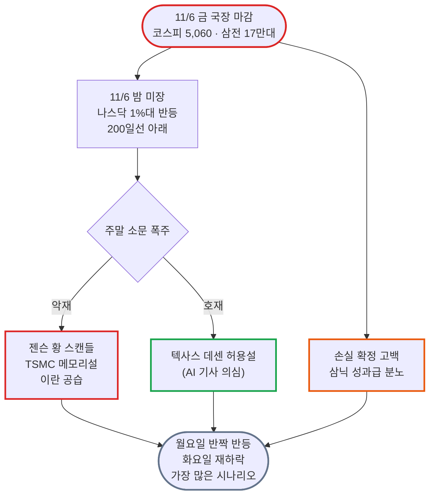

# 블라인드 주식·투자 24시간 브리핑: "장이 쉬자 분노가 남았다, 성과급 난타전과 '월요일 롱 화요일 숏'"

- **작성일**: 2026-11-08
- **수집 기간**: 2026년 11월 7일(토) 12:52 ~ 11월 8일(일) 12:50 (KST)
- **수집 규모**: 최근 24시간 게시글 402개 전수 수집 (본문·댓글 정밀 분석 137개, 상세 수집 댓글 470개, 목록 미리보기 분석 265개)

!!! warning "주의사항"
    아래 내용은 모두 블라인드 익명 사용자들의 날것의 주장과 여론이다. 수치, 인용 기사, 소식은 따로 검증하지 않았다. "속보", "뉴스에 나왔다" 같은 표현이 붙은 글도 출처가 없거나 AI가 쓴 기사로 의심되는 경우가 있으므로, 투자 판단에 쓰기 전에 원문 기사나 공시를 직접 확인해야 한다. 작성자 소속은 블라인드에 표시된 회사명이며 실제 재직 여부는 확인할 수 없다. "언급 글 수"는 `entities.js`로 제목, 본문, 댓글에 종목명이나 별칭이 들어간 글을 센 값이다. 이번 수집 기간에는 국내 정규장이 열리지 않았다.


## 📊 블라인드 개미 공포·탐욕 지수 (Fear & Greed Index)

장이 쉬어도 공포는 풀리지 않았다. 지수는 **22점**(극단적 공포)으로 직전 11/7보다 2점 오르는 데 그쳤다. 비명이 줄어든 자리를 "누구 탓이냐"는 분노가 채웠다. 반응 상위 10개 글 중 5개가 삼성전자·SK하이닉스 성과급 싸움이었다. 손실 고백은 금액이 더 커졌다. "올해 -2.2억", "빚이 7억", "-12억"이 나왔다. "삼전 20만은 지켜줄 것"이라며 분할 매수를 선언한 글이 조금 늘었지만, "찐바닥은 아무도 바닥 소리 못한다"는 반박이 훨씬 많았다.

<div class="kb-portfolio-metrics">
  <div class="kb-portfolio-metric-card">
    <span class="label">당일 공포·탐욕 지수</span>
    <span class="value">22점 (극단적 공포)</span>
    <span class="sub">이틀 연속 극단적 공포 구간</span>
  </div>
  <div class="kb-portfolio-metric-card">
    <span class="label">직전 브리핑 대비</span>
    <span class="value">+2p 제자리</span>
    <span class="sub">11/7 20점(극단적 공포) ➔ 11/8 22점(극단적 공포)</span>
  </div>
  <div class="kb-portfolio-metric-card">
    <span class="label">지배적 개미 분위기</span>
    <span class="value">성과급 분노 · 예측 난타전</span>
    <span class="sub">주주 vs 삼닉 직원, "월요일 롱이냐 숏이냐"</span>
  </div>
  <div class="kb-portfolio-metric-card">
    <span class="label">역발상 수급 시그널</span>
    <span class="value">항복 아닌 관망</span>
    <span class="sub">매수 대기 가격만 쌓이고 실제 매수는 소수</span>
  </div>
</div>

```vegalite
{
  "$schema": "https://vega.github.io/schema/vega-lite/v5.json",
  "background": "transparent",
  "width": "container",
  "height": 220,
  "padding": {"top": 8, "bottom": 4, "left": 4, "right": 8},
  "data": {
    "values": [
      {"metric": "종합 공포·탐욕 지수", "score": 22, "max": 100, "zone": "극단적 공포", "label": "22점 (극단적 공포 · +2p)", "desc": "장 휴장 속 비명은 줄고 성과급·정부 분노가 확산"},
      {"metric": "① 체감 손익·계좌 심리", "score": 12, "max": 100, "zone": "극단적 공포", "label": "12점 (극단적 공포)", "desc": "올해 -2.2억, 빚 7억, -12억 등 손실 금액 확대"},
      {"metric": "② 매수·투매 수급 태도", "score": 30, "max": 100, "zone": "공포", "label": "30점 (공포)", "desc": "삼전 20만 분할매수 vs 선물 820 돌파 전 매수 보류"},
      {"metric": "③ 반도체·업황 신뢰도", "score": 17, "max": 100, "zone": "극단적 공포", "label": "17점 (극단적 공포)", "desc": "D램 심리 프리미엄론, TSMC 메모리설, 키옥시아 -77%"},
      {"metric": "④ 지수 지지선 신뢰도", "score": 20, "max": 100, "zone": "극단적 공포", "label": "20점 (극단적 공포)", "desc": "5천은 이제 저항선, 4천대 지지시험, 연초 3200"},
      {"metric": "⑤ 역발상 바닥 기대감", "score": 31, "max": 100, "zone": "공포", "label": "31점 (공포)", "desc": "나스닥 바닥 확률 70%론, 버리 풋 25% 정리 vs 찐바닥 아님"}
    ]
  },
  "encoding": {
    "y": {
      "field": "metric",
      "type": "nominal",
      "sort": null,
      "axis": {"title": null, "labelFontWeight": 500, "labelFontSize": 12, "labelLimit": 180, "ticks": false, "domain": false, "labelPadding": 12}
    }
  },
  "layer": [
    {
      "mark": {"type": "bar", "cornerRadius": 7, "height": 14, "color": "#94a3b8", "opacity": 0.14},
      "encoding": {
        "x": {
          "field": "max",
          "type": "quantitative",
          "scale": {"domain": [0, 118]},
          "axis": {
            "title": "블라인드 개미 심리 스펙트럼 (0~24 극단적 공포 · 25~44 공포 · 45~55 중립 · 56~74 탐욕 · 75~100 극단적 탐욕)",
            "values": [0, 25, 50, 75, 100],
            "labelExpr": "datum.value == 0 ? '0 (극단적 공포)' : datum.value == 25 ? '25 (공포)' : datum.value == 50 ? '50 (중립)' : datum.value == 75 ? '75 (탐욕)' : '100 (극단적 탐욕)'",
            "grid": false
          }
        }
      }
    },
    {
      "data": {"values": [{"x": 25}, {"x": 45}, {"x": 55}, {"x": 75}]},
      "mark": {"type": "rule", "strokeDash": [2, 4], "color": "#94a3b8", "opacity": 0.5},
      "encoding": {"x": {"field": "x", "type": "quantitative"}, "y": {"value": 0}, "y2": {"value": "height"}}
    },
    {
      "mark": {"type": "bar", "cornerRadius": 7, "height": 14},
      "encoding": {
        "x": {"field": "score", "type": "quantitative"},
        "color": {
          "field": "zone",
          "type": "nominal",
          "scale": {
            "domain": ["극단적 공포", "공포", "중립", "탐욕", "극단적 탐욕"],
            "range": ["#dc2626", "#ea580c", "#64748b", "#16a34a", "#2563eb"]
          },
          "legend": null
        },
        "tooltip": [
          {"field": "metric", "title": "심리 지표"},
          {"field": "label", "title": "점수 및 구간"},
          {"field": "desc", "title": "핵심 진단"}
        ]
      }
    },
    {
      "mark": {"type": "text", "align": "left", "dx": 10, "fontWeight": 600, "fontSize": 12},
      "encoding": {
        "x": {"field": "score", "type": "quantitative"},
        "text": {"field": "label", "type": "nominal"}
      }
    }
  ],
  "config": {"view": {"stroke": "transparent"}}
}
```


## 1. 24시간 핵심 요약: 휴장 속 분노와 월요일 예측

주말이라 국장은 열리지 않았다. 게시판이 붙잡은 건 금요일 성적표다. 코스피는 6월 최고 종가 9,114에서 11월 6일 5,060까지 내려왔다. 고점 대비 -44.5%다. 삼성전자는 목요일까지 20만 원 근처를 버티다 금요일에 17만 원대로 시작했다. SK하이닉스는 넥스트레이드에서 107만 원까지 찍었다.

금요일 밤 미국장은 나스닥이 1%대 반등했다. 그래도 200일선 아래다. "거래량이 안 실린 반등"이라는 평가가 많았다. 주말에는 소문이 몰려왔다. 젠슨 황 스캔들, 텍사스 데이터센터 허용설, TSMC 메모리 진출설, 미군의 이란 공습이다. 그리고 반응 상위를 휩쓴 건 성과급 난타전이었다.



| 구분 | 핵심 내용 | 투심 기류 |
| :--- | :--- | :--- |
| **핵심 여론** | 성과급 난타전, 확정 손실 고백, 월요일 롱·숏 예측 | 비명이 분노로 바뀜 |
| **최대 분노 대상** | 삼닉 성과급, 정부·국민연금 | "주주는 거지, 직원은 수억" |
| **가장 큰 쟁점** | 5,000선이 지지선이냐 저항선이냐 | "5천은 차주부터 강력한 저항" 우세 |
| **업황 논리 변화** | 가격 피크론에 TSMC·키옥시아·낸드 과잉론 추가 | 비관 근거가 늘어남 |
| **다음 주 관전점** | 11/9(월) 반등 강도, 선물 820선, 나스닥 200일선 | "월요일 롱 화요일 숏"이 다수설 |

표에서 볼 것은 첫 줄이다. 장이 쉬는 동안 공포는 "누구 탓이냐"로 옮겨 갔다. 바닥에서 나오는 체념이 아니라 아직 분노 단계다.

---

## 2. 🎭 블라인드 명예의 전당: 주말 레전드 글

### 🏆 레전드 1. "현대가 답이 없는 이유" (이번 범위 추천 1위)

주식 글이 아닌데 추천 1위를 찍었다. 현대차 소속 작성자의 내부 고발성 글이다. 하락장의 화풀이가 자기 회사로 번졌다.

> **"현대가 답이 없는 이유"** (현대자동차 | 👍38 · 💬39 · 👁3,398)
> "모든 중요 의사 결정 단계에 엔지니어가 없음…연구소는 개찬밥신세, 모든 책임의 쓰레기통으로 치부되어, 에이스들 다 떠나거나 월급루팡 모드로 돌아섬…하 한때 사랑했던 회사인데"
>
> - **최다 추천 댓글 (👍29)**: "독일 업계사람들 말들어보니 독일 자동차 업계망한게 비슷한 절차였다고 하더라. 엔지니어 열외. 문과충들의 집권"
> - **공감 댓글 (👍30)**: "이건 현대만의 문제는 아닌듯.."
> - **한 줄 평 (👍15)**: "경영층 지시사항이 구전으로 떠도는 미친 회사 ㅋ"

같은 날 "금욜에 삼성전기랑 현차 샀는데"(현차 278,000원 매수)에는 "현대차는 절대사지마라", "현차는 버려 차라리 기아가 낫다"가 몰렸다. 직원 글과 투자자 반응이 같은 방향이다.

### 💰 레전드 2. 삼닉 성과급 난타전: "편의점 알바가 영업이익 15%를 달라면?"

이번 주말의 진짜 주인공이다. 공무원·증권사·계열사 소속은 성과급을 공격했고, 반도체 재직자는 "시기·질투"라고 받아쳤다.

> **"동네에 축제가 열려서 동네 편의점이 대박이 났어."** (삼성디스플레이 | 👍18 · 💬22)
> "근데 그 편의점 알바가 영업 이익의 15%를 달라고 하면 주는게 맞는걸까?…주총에서 다시 원점 논의 후 결정해야한다."
>
> - **반박 댓글**: "엔비디아 성과급 10억은 괜찮고 삼전 성과급 7억은 너무하고? 삼전 영익은 전세계 1위인데?"
> - **역공 댓글**: "성과금 합의랑 영익 터지기전에 회사 힘들때 투자하신 투자자님들은 이미 10배도 넘게 주가 올랏는데요"

> **"성과급 얘기에 대해서"** (삼성전자 | 👍18 · 💬27 · 👁2,261)
> "EVA기준으로도 영업이익 10%이상의 보상이 되어왔음…30 ~ 40조 벌때 3 ~ 4조가량 보상…이제 400조를 벌면 10%인 40조 떼고…300조 이상은 남을건데 기존 인프라 투자 비용 대비 10배의 투자가 가능"
>
> - **최다 추천 댓글 (👍21)**: "사실 다 개소리고 그냥 하이닉스가 쏘아올린 공이지"
> - **재직자 편 댓글 (👍12)**: "애초에 주주환원 잘 하지도 않은 주식 알고도 사가지고 지금와서 배아프니까"
> - **양쪽 다 인정한 댓글 (👍11)**: "성과급받는거 좋은데 주주환원이 우선시되지 않는게 안타까울뿐"

재직자 안에서도 "주주환원이 부족하다"는 말엔 반박이 없었다. 성과급이 자사주로 나간다는 점이 핵심이다. 주가가 빠질수록 주주만 손해를 본다는 논리가 퍼졌다.

### 🤡 레전드 3. "솔직히 죽는소리 다 오바아님?"

> **"솔직히 죽는소리 다 오바아님?"** (공무원 | 👍6 · 💬54 · 👁1,505)
> "주식에 몇억씩 넣고 마이너스 3 ~ 40퍼가 있어? 대부분 감당가능한 3 ~ 5천이내로 주식하잖아 다들 오바가 심하네"
>
> - **최다 추천 댓글 (👍28)**: "공무원씨드랑 같냐?"
> - **역공 댓글 (👍8)**: "공무원들은 왤케…사회화가 안돼있는거같냐"
> - **작성자 반격**: "가정있고 대출금많은데도 몇억씩 굴려서 물리고 죽는소리하는사람은 그냥 카지노도박을한거고"

같은 공무원 소속이 "삼전닉스 성과급주는거맞아?"(👍26)에도 불을 붙였다. 댓글은 정확했다. "왜 이런글은 항상 공무원이냐"(👍8), 답은 "공공기관 특이야 돈은 없고 시간은 많거든".

### 💸 레전드 4. 자발적 반대매매: "금요일에 -9600 손절"

정부가 담보비율 유지 의무를 면제했는데도 스스로 잘라낸 사람이 있었다. 월요일 반대매매가 무서워서다.

> **"금요일에 -9600 손절"** (한국항공우주산업 | 👍11 · 💬26 · 👁1,435)
> "신용 담보 부족떠서 월요일 반대매매 나가는 거 막으려고 신용 종목 손절+보유 마이너스 종목 손절로 -9600 날아갔네.. 이로써 올해 -2.2억 날렸다. 잠이 안온다. 캐피탈 대출 1.1억은 어떻게 갚지."
>
> - **댓글**: "나도 이번주 반대매매를 끝으로 작년올해 -1.8억 원금날렸네..시드 2억으로 10까지불렸었는데"
> - **댓글**: "속슬 100불대에 2억드갔는데 ㄹㅇ망해따"
> - **위로 댓글**: "똥밭에 굴러도 저승보단 이승이야. 인생 리셋됐다 생각하고 다시 시작하자 사우님"

손실 고백은 이것 말고도 줄을 이었다.

- **"주식망해서 빚만 있는데 어쩌지?"** (한국남동발전): "빚이 7억인데 주식이 5.5억이야…순자산이 마이너스 1.5억"
- **"도저히 버티기힘드네"** (농협중앙회 | 👍6): "5월만 신용포함 10억굴렸는데 빚만 3억넘게 남았어"
- **"11월 무슨 마가꼈나"** (변호사 | 💬23): "-12억에…차 에어서스 터지고"

### 😂 레전드 5. 블랙 유머 3종

> **"내년 꼬꼬무 예상"** (LG전자 | 👍11)
> "이 비극은 2025년 10월 30일 서울 삼성동의 어느 치킨집에서 시작됐어"
>
> - **댓글**: "ㅋㅋㅋㅋㅋ 해학의 민족"

> **"현재 물린 사람들이 대단한 이유"** (POSCO | 👍14)
> "서브프라임, 닷컴버블같은 역사의 한페이지를 장식한것도 모자라서 최고층에 물린 역사의 산증인"

> **"안녕하세요 최태원입니다"** (새회사)
> "주주분들이 십시일반 하이닉스 주식 사주신 덕분에 위자료 낼수있었습니다 정말 감사드립니다^^"

웃음의 표적이 오너와 손실자 자신이다. 자조가 많다는 건 체념이 시작됐다는 뜻이다. 그런데 아직 분노가 더 크다.

---

## 3. 📊 시장 지표와 지지선 매트릭스

### 3.1 국내외 핵심 수치 (원문 그대로)

| 항목 | 원문 수치 | 출처 글 |
| :--- | :--- | :--- |
| **코스피 고점·종가** | "6월 최고 종가 9,114 → 11월 6일 5,060 전고점 대비 -44.5%" | "코스피 -44%? 진짜 무서운 건 하락률이 아니라 이거임" |
| **코스피200 선물** | "760선까지 급락한 이후 일부 반등" | "[파생] 미국 나스닥 200일선 회복이 중요한 이유" |
| **나스닥** | "약 1%대 반등했지만 여전히 200일선 아래" | 같은 글 |
| **S&P500** | "125일선을 뚫고내려 갔음…7600정도" | "지금은 아직 많이 위험한 상태" |
| **VIX** | "VIX 28.5: 자신의 약세장 경고 기준에 도달" | "마크 미너비니 추가하락 예고함" |
| **12월 금리** | "금리인상 확률 80%" | "반등은 데드캣, 시장엔 악재만 남았음." 댓글 |
| **외국인 보유** | "올해 6월 고점 41%에서 이제 38%" | "하이닉스 외국인은 왜 계속팔까?" 댓글 |
| **삼성전자** | "20만부근에서…금요일에 17로시작" | "목요일에 삼성전자" |
| **SK하이닉스** | "금욜날 넥장에서 107 찍어줬네" | "예전에 하닉 106온다햇던 사람인디" |
| **SOXL** | "107불에서…일주일만에 38불찍었어" | "반도체 시즌종료 다음주 속슬 15불 간다" |

코스피가 반 토막에 가깝다. 이 숫자가 왜 무서운지는 한 줄로 설명된다. 44.5% 빠진 지수가 제자리로 가려면 44.5%가 아니라 약 80%가 올라야 한다. 100만 원이 55만 원이 되면, 다시 100만 원이 되려면 45만 원을 벌어야 하는 셈이다.

### 3.2 역사가 알려주는 회복 기간

"코스피 -44%? 진짜 무서운 건 하락률이 아니라 이거임"(한국농어촌공사 | 👁751)이 역대 폭락장을 정리했다. 일부만 옮긴다.

| 폭락 구간 | 낙폭 | 전고점 회복까지 | 원인 |
| :--- | :---: | :--- | :--- |
| 1994.11 → 1998.06 | -75.4% | 2,640일 | IMF 외환위기 |
| 2007.10 → 2008.10 | -54.5% | 801일 | 글로벌 금융위기 |
| **2026.06 → 2026.11** | **-44.5%** | **아직 바닥 안나옴** | AI 투자 불확실성·반도체 매도 |
| 2018.01 → 2020.03 | -43.9% | 249일 | 미중 무역분쟁·코로나 |
| 2011.05 → 2011.09 | -25.9% | 2,047일 | 유럽 재정위기 |

얼마나 빠졌는지보다 그다음이 중요하다. 2011년은 26%만 빠졌는데 회복에 5년 넘게 걸렸다. 코로나 때는 44% 빠지고도 1년이 안 돼 돌아왔다. 작성자도 "과거에 전부 회복했다고 이번에도 금방 회복한다는 보장은 없음"이라고 적었다.

### 3.3 개미들이 제시한 지지선·목표가 매트릭스

| 종목/지수 | 낙관·지지 | 비관·하단 | 근거 글 |
| :--- | :--- | :--- | :--- |
| **코스피** | "5500 한 번 찍고", "12월부터 28년초까지 풀롱" | "4천대 지지시험", "4500피", "연초 3200", "3천 깨진다" | "개인적인 코스피 전망", "차주는 4천대 지지시험" |
| **코스피200 선물** | 820선 돌파 시 분할매수 | 760 ~ 820 박스권, "선물기준 630선" | "[파생] 미국 나스닥 200일선…" |
| **삼성전자** | "최소 20만원은 지켜줄 것", "23만원만 와주면 튈건데" | "16만원", "13만", "15만원 아래도 열려 있긴" | "어찌저찌 됐든", "삼전 23만 언제 와?" |
| **SK하이닉스** | "100만원 살짝 깼다가 반등…찐 바닥" | "그 밑은 82만원", "하닉 80", "77만", 장기 "50만원 전후" | "예측", "예전에 하닉 106온다햇던 사람인디" |
| **SOXL** | "속슬 43 들어가뿟다" | "15불 찍고…한 자리", "25까지는 내릴거같아" | "다음주 속슬 15불 무조건간다" |
| **나스닥** | "1년 이동평균선…바닥일 가능성 약 70%" | "여기서 30% 이상 조정" | "나스닥 바닥 근처임" |

비관 쪽 숫자가 한 단계씩 내려갔다. 11/7엔 삼성전자 하단이 12 ~ 14만 원, SK하이닉스 하단이 100만 원 이탈이었다. 이번엔 13만 원, 80만 원대가 기본값이 됐다.

### 3.4 다음 거래일(11/9 월) 예상: "월요일 롱 화요일 숏"

가장 많이 나온 시나리오는 하나다. 월요일 반짝 반등, 화요일 재하락이다.

> **"예언 하나 한다"** (국민건강보험공단 | 👍3)
> "월요일 롱 화요일 숏 화요일 가격은 금요일 보다 낮다 다들 하루살이도 아니고 월요일만 걱정하는게 참 이해가 안되네"

> **"차주는 4천대 지지시험"** (글래드호텔앤리조트 | 💬20)
> "만에하나 월요일 오르더라도 화요일은 크게 하락할 수 밖에 없음. 결론적으로 5천역시 차주부터는 강력한 저항이 되고 향후 수년간 넘기힘든 지수가 될 것"

반대로 "월요일 부터 반도체 반등 옵니다."(공무원 | 👍13 · 👁1,649)와 "월요일 나스닥 불장은 이미 확정됐음"(새회사 | 💬32)은 데이터센터 허용설을 근거로 들었다. 두 글 다 근거 기사가 흔들린다(5.1 참조). "하... 월요일 롱이라고 했던거 정정한다"는 금요일 인버스 수급을 근거로 숏을 외쳤다. 그러자 "기관이라고 나와있는 거래의 상당수가 lp들이다"라는 반박이 달렸다. ETF 유동성 공급자가 개인과 반대로 움직이는 걸 기관 베팅으로 착각했다는 지적이다.

---

## 4. 💣 시장 핵심 쟁점과 여론 분열

| 주제 | 핵심 논점 | 대립 구도 |
| :--- | :--- | :--- |
| **① 삼닉 성과급** | 영업이익 연동 성과급의 자사주 지급 | "주주는 거지" vs "시기·질투" |
| **② 데이터센터 규제** | 블루웨이브 뒤 텍사스 데센 향방 | "공화당 상원이 막는다" vs "그럼 시장은 왜 빠지나" |
| **③ 메모리 가격 피크론** | D램 10배 상승 중 심리 프리미엄 | "8.78배는 거품" vs "HBM 때문에 더 부족" |
| **④ 헤지펀드 청산** | 레버리지 펀드 연쇄 청산 | "곧 안정화" vs "남은 물량을 모른다" |
| **⑤ 국민연금·정부 개입** | 사모펀드 경유 매수설 | "노후를 베팅했다" vs 근거 부족 |
| **⑥ 젠슨 황 스캔들** | 중국 스파이 의심 인물과의 관계 | "GPU 주문 취소되겠냐" vs "규제 카드" |

### 4.1 성과급: 주주와 직원이 서로를 "공산주의"라 부르다

양쪽이 같은 단어로 싸웠다. 주주는 "로동자가 영익 %떼가는게 민주주의임? 공산주의 아니고?"라고 했다. 직원은 "성과급 까내리는 공산주의 거지근성들"이라고 받았다.

진짜 쟁점은 따로 있다. 성과급이 자사주로 나간다는 점이다. "성과급 주지마라 이런 말은 왜함?"(세아제강 | 💬39) 댓글이 정리했다.

> "영업이익의 10%를 OPI외 특별경영성과급으로 한도제한 없이 달라고 한거고 그걸 결국 자사주로 주겠다고 결정난건데, 주가가 떨어지나 오르나 어차피 직원은 10%에 딱 맞게 주식을 지급받게 되는거고 주주는 그만큼의 환원정책이 없는 이상 주가가 떨어지면 더 큰 피…"

부동산으로 번진 논쟁도 있었다. "인기글에 성과급 얘기나와서 궁금한거"(새회사)는 "대충 100조가 부동산에 들어간다 치고 집 하나당 10억으로 잡아도…10만개의 주택이 사라짐"이라고 했다. 삼성전자 직원 답은 짧았다. "우리좀 냅두세요... 성과급의 50%가 세금이에요..."

### 4.2 데이터센터: "그 말이 맞다면 시장은 왜 빠지나"

교포 출신이라는 NC 소속 작성자(👍5 · 👁990)가 구조를 설명했다. 데이터센터 규제는 주 의회 상·하원을 둘 다 통과해야 한다. 텍사스 주 상원은 "61%가 공화당"이라 막힐 수 있다. 당선인 발언도 "2027, 2028년까지는 원래대로 계속 진행"이라는 얘기였다고 했다.

최다 추천 댓글(👍3)은 한 줄이었다. "그말이 맞다고 치자. 그럼 시장은 왜 그렇게 반응하는건데?" 불확실성 자체가 악재라는 뜻이다. "27년초 규제법안 나오기 전까진 보류라서 27년초까지 조정국면 확정"이라는 댓글도 나왔다.

### 4.3 메모리 가격: 10배 오른 D램, 수요는 1.22배

"반도체 공급부족이라고 가격이 안떨어지는 것은 아니다"(인천교통공사 | 👍10)가 이번 주말 가장 깔끔한 비관론이었다.

> "작년 하반기부터 디램가격이 10배 올랐다. 수요가 10 배올라서 가격이 10배 오른것인가? 아니다. 수요는 올해 22% 증가했다 즉 1.22배였다는 것이다. 나머지 8.78배는 심리 프리미엄이 올린 것이라는 뜻이다."

글쓴이 논리대로면 1,000원짜리가 1만 원이 됐는데, 실제 수요 증가로 설명되는 건 1,220원까지라는 얘기다. 나머지는 "더 오를 것"이라는 기대값이라는 거다. 이 계산은 틀렸다. 아래 팩트체크에서 다룬다. 게시판 반론도 있었다. "hbm 생산이 늘어나니 22퍼 부족한게 아니라 훨씬 더 부족해지는거(hbm 66퍼 증가 예상치)". HBM이 D램 생산 능력을 잡아먹으니 범용 D램은 더 모자란다는 논리다.

LTA(장기공급계약)도 도마에 올랐다. 삼성전자 소속 "또 한 5년 존버각이구나"는 "고객사 입장에서 메모리 가격 떨어지면 LTA는 파기하면 그만이다"라고 전했다. 댓글은 "슬롯 부킹에 매년마다 예치금 들어가고 파기하면 남은기간 위약금으로 토해야하는데"라고 반박했다.

!!! note "팩트체크 ① 가격 10배, 수요 22%는 맞나"
    결론부터 말하면 가격 10배는 과장이고, 수요 22%는 대체로 맞는 범위다. 다만 22%는 "초과수요"가 아니라 "수요 증가율"이다.

    TrendForce 수치를 인용한 보도를 보면 2026년 범용 D램 계약가는 분기마다 이렇게 올랐다.

    | 분기 | 전 분기 대비 계약가 |
    | :--- | :--- |
    | 2026년 1분기 | +90 ~ 95% (집계 이래 최대) |
    | 2026년 2분기 | +58 ~ 63% |
    | 2026년 3분기 | +13 ~ 18% (전망) |
    | 2026년 4분기 | +10 ~ 15% (일부 보도 +3 ~ 8%) |

    중간값을 곱하면 2026년 한 해에 약 4배다. Gartner는 2026년 D램 가격 상승률을 199%, 약 3배로 본다. 작년 4분기 상승분을 더하면 배수가 커지지만, 업계 평균 계약가로 10배를 뒷받침하는 자료는 없다. 소매 DDR5 키트처럼 특정 제품이라면 그런 숫자가 나올 수 있다.

    수요 쪽은 SK하이닉스가 2026년 D램 수요 증가율을 20%대 중반으로 봤다는 보도가 있다. 공급 증가율은 IDC가 16%, 마이크론이 20%대 초중반으로 봤다. 실제 부족 폭은 한 자릿수다. Gartner는 6.9%, TrendForce는 1 ~ 2%로 본다.

    "8.78배는 심리 프리미엄"이라는 계산은 성립하지 않는다. 배수는 빼는 게 아니라 나누는 거다. 더 근본적인 문제도 있다. 메모리는 당장 다른 물건으로 바꿔 쓸 수 없다. 이런 상품은 수요가 공급보다 몇 %만 많아도 가격이 몇 배씩 뛴다. 그래서 가격 상승폭을 수요 증가율과 직접 비교하는 것부터가 맞지 않는다.

    그래도 글쓴이의 결론은 일리가 있다. 공급이 부족해도 가격은 꺾일 수 있다. Gartner는 2027년에도 3.6% 공급 부족이 이어진다고 보면서, 가격 상승률은 2%로 거의 멈춘다고 전망한다. 부족 폭이 줄기만 해도 가격은 힘을 잃는다는 얘기다.

!!! note "팩트체크 ② LTA 위약금은 얼마이고, 가격이 폭락하면 LTA 가격도 내려가나"
    위약금 금액과 해지 조항은 공개된 적이 없다. SK하이닉스의 미국 증권 당국 제출 서류도 장기 공급 계약을 일반적으로만 언급한다. 대신 위약금 구실을 하는 조건은 보도됐다.

    | 조건 | 보도 내용 | 출처 |
    | :--- | :--- | :--- |
    | 계약 기간 | 삼성은 신규 계약에 최소 3년, 보통 5년으로 시작해 매년 1년씩 연장 | TrendForce, 코리아헤럴드 |
    | 선급금 | SK하이닉스와 MS·구글 계약에 총액의 약 10 ~ 30% 선급금 | TrendForce |
    | 예치금 수령 | 삼성은 약정 예치금의 약 4분의 1을 받은 상태 | 코리아헤럴드 |
    | 최저가격 | 일부 계약에 가격 하한 조항 | TrendForce, 코리아헤럴드 |
    | 가격 상한 | SK하이닉스는 새 LTA에서 상한 삭제, 마이크론은 유지 | TrendForce |

    계약을 깨는 고객사는 최소한 선급금이나 예치금을 날릴 가능성이 크다. 계약 구조에서 미루어 본 것이고, 실제 해지 조항은 확인되지 않았다.

    더 중요한 질문은 따로 있다. 일부 고객사가 주문을 취소해 가격이 폭락하면, 기존 LTA 고객의 가격도 내려가나. 대체로 내려간다. 올해 LTA는 가격을 고정하는 계약이라기보다 물량을 묶는 계약이기 때문이다. 북미 빅테크 계약에는 납품 뒤 그때 시세로 값을 매기는 "사후 정산" 조항이 들어갔다. 시세가 오를 때 공급사에 유리했던 이 구조는, 시세가 떨어질 때는 고객사에 유리하게 돌아간다.

    | 계약 유형 | 가격 폭락 시 LTA 가격 | 공급사에 미치는 영향 |
    | :--- | :--- | :--- |
    | 시장 연동형 (사후 정산, 상한 없음) | 시세를 따라 바로 하락 | 물량은 지키지만 단가는 그대로 떨어짐 |
    | 최저가격 조항 계약 | 최저가격까지만 하락 | 하락폭이 일부 막힘 |
    | 전통 분기 협상형 (±10%) | 분기마다 조금씩 하락 | 하락이 늦게, 나눠서 반영됨 |

    정리하면 LTA는 판매량이 한꺼번에 사라지는 걸 막는다. 지금 같은 높은 마진을 지켜 주지는 못한다. 게시판의 "LTA는 파기하면 그만"도, "LTA 독소조항때문에 올해보다 적을수가 없음"도 모두 지나치다.

    아직 모르는 것도 있다. 시세가 최저가격보다 한참 낮아지면 고객사는 시세보다 비싸게 사는 셈이 된다. 그때 재협상을 요구할지, 선급금을 버리고 계약을 깰지는 아무도 모른다. 3 ~ 5년짜리 LTA는 대부분 2025 ~ 2026년에 생겨서 하락장을 한 번도 겪지 않았다. 마이크론 공시를 보면 2022 ~ 2023년 하락장 때도 LTA 재협상 기록은 없다.

    참고 자료: [TrendForce 2026년 D램 계약가 전망](https://www.trendforce.com/presscenter/news/20251029-12758.html), [Gartner D램 수급 전망 2Q26](https://www.gartner.com/en/documents/8042733), [IDC 메모리 부족 분석](https://www.idc.com/resource-center/blog/global-memory-shortage-crisis-market-analysis-and-the-potential-impact-on-the-smartphone-and-pc-markets-in-2026/), [TrendForce 3 ~ 5년 LTA 전환 보도](https://www.trendforce.com/news/2026/04/09/news-from-annual-deals-to-3-5-year-ltas-samsung-and-sk-hynix-reportedly-reset-big-tech-memory-contracts/), [TrendForce LTA 선급금 보도](https://www.trendforce.com/news/2026/05/04/news-samsung-sk-hynix-deepen-ltas-as-buyers-pay-premiums-to-secure-supply-may-drive-memory-prices-higher/), [TrendForce SK하이닉스 가격 상한 삭제 보도](https://www.trendforce.com/news/2026/07/02/news-sk-hynix-reportedly-removes-price-cap-in-memory-long-term-agreements-diverging-from-micron/), [TrendForce 사후 정산 계약 보도](https://www.trendforce.com/news/2026/02/06/news-samsung-sk-hynix-micron-reportedly-shift-to-short-term-post-settlement-deals-for-north-american-big-tech/), [코리아헤럴드 장기 공급 계약 보도](https://www.koreaherald.com/article/10828101), [마이크론 2023 회계연도 연차보고서](https://www.sec.gov/Archives/edgar/data/723125/000072312523000054/mu-20230831.htm)

### 4.4 헤지펀드 청산: "희망회로를 비브라늄으로 만들었네"

"미국 헤지펀드 엄청 청산됐다고 하는데 이게 원인인듯함"(새회사 | 👍5 · 👁1,043)은 레버리지 과한 펀드가 정리되면 곧 안정될 거라고 봤다. "국채금리나 유가는 좋아지고 있는데 여전히 cds 프리미엄이 문제"(👍5)라는 동조가 붙었다. 반박은 날카로웠다. "와 희망회로 비브라늄으로 만들었네", "문제는 아직 얼만큼 청산물량이 남았는지를 모른다는것".

작성자의 고백이 더 많은 걸 말해 준다. "요몇달사이에 30억빨렸는데"라는 댓글에 "이번주 특히 밥도 못먹고 힘들었다가 어제 폭식하고 탈나서 앓아누움"이라고 답했다. 낙관론을 쓰는 사람도 몸이 버티지 못하고 있다.

### 4.5 국민연금: "노후를 베팅했는데 언론이 조용하다"

"국민연금을 쌈짓돈처럼 쓰는 정부"(현대자동차 | 👍29 · 💬29)가 이번 범위 추천 3위였다. 주장은 이렇다. 국민연금이 투자한 사모펀드의 90%가 외국계라서, 이 돈으로 코스피를 사면 외국인 매수로 찍힌다는 것이다. 손실도 "10월 이전 손실액 182조+10월 손실액"에 추적 안 되는 돈까지 더해야 한다고 했다.

근거는 사모펀드 내역이 비공개라는 사실 하나다. 실제 매수 경로를 보여 주는 자료는 없다. 그래도 "이런 상황에서도 다들 관심없고, 언론도 조용한게 아이러니함.. 국민들 노후를 배팅했는데"(👍6)가 공감을 얻었다. 연기금 지지를 믿지 않는 분위기가 그만큼 깊다.

---

## 5. 🕵️ 찌라시와 미확인 소식: 신뢰도 등급 카드

주말에 퍼진 8대 소식이다. ⚠️는 월요일 수급에 직접 영향이 큰 소식이다.

### 5.1 ⚠️ [AI 기사 의심] 텍사스 주지사 데이터센터 허용설

- **신뢰도**: **하**
- **원문 주장**: "속보) 텍사스 주지사 데센 허용"(한국수력원자력 | 👍10 · 👁1,252): "기존 허거 건설건 뿐만아니라 신규건도 건설 완료되도록 법안 통과시킬 예정 특히 구글 아마존 같은 기업들이 큰 수혜"
- **팩트체크 및 반박**:
    - "이거 발언의 출처가 Tokenpost란 곳이고…공식 언론사가 아닌 것으로 보임"
    - "토큰포스트거면 거기 ai로기사올리는데라부정확해!"
    - "텍사스 데센기사 찾아봤는데"(희성촉매): "이미 공사들어간 데센만 그냥진행이고 나머지는 싹다보류"
    - "공약 내걸어서 당선된 사람이 하루만에 공약을 째로 뒤엎는 행동을 하겠냐?"
- **투자 관점 핵심 체크포인트**: 지난주 폭락은 "데센 사업 중단" 발언에서 시작됐다. 이 발언이 뒤집히면 반도체 반등 재료다. 반대로 가짜로 판명되면 월요일에 실망 매물이 나올 수 있다. 공식 언론의 원문 보도를 먼저 확인해야 한다.

### 5.2 ⚠️ [보도 인용] 젠슨 황 중국 스파이 의심 인물과의 관계

- **신뢰도**: **중 (FT 링크 제시)** / 파생 주장은 **하**
- **원문 주장**:
    - "미국 정보당국, 젠슨 황이 중국 스파이 의심 인물과 연인 관계였다고 판단"(새회사 | 👁894)
    - "젠슨도 바람났네"(제때 | 👁1,336): "원출처는 위 FT기사임"
    - "젠슨황 스캔들.. 정보유출 했냐 안했냐가 중요한게 아닌것같다"(LG전자): "1년전부터 트럼프는 보고 받았었다 했는데…이제와서 갑자기 이 카드를 꺼낸 의도를 알아야할것같다. 정보: 트럼프는 몇일전에 비트코인 대부분을 현금화했다."
- **팩트체크 및 반박**: "젠슨황이 불륜햤다고"(LG전자 | 👍6)는 "GPU 주문이 취소되겠냐…뭔 호들갑이야"라고 했다. 댓글은 "불륜이문제가 아니라 스파이일수잇으니까", "트럼프가 또 꼬투리 잡아서 대중 무역 규제 걸겠지"였다. 트럼프 비트코인 현금화, 딸 방한 취소는 출처가 없다.
- **투자 관점 핵심 체크포인트**: 스캔들 자체보다 미 정부가 이걸 엔비디아 압박이나 대중국 규제 카드로 쓰는지가 핵심이다. 엔비디아가 흔들리면 SK하이닉스 HBM 심리도 같이 흔들린다.

### 5.3 ⚠️ [출처 없음] TSMC 메모리 사업 진출 고려

- **신뢰도**: **하 (본문 "고려 중" 한 줄)**
- **원문 주장**: "비상! TSMC 메모리 사업 진출"(ex-SK | 💬9 · 👁769)
- **팩트체크 및 반박**: 진출 여부보다 해석이 더 주목받았다.
    - "고객사들이 다른 데다가 메모리 만들어달라고 요청하는 이유는…단가에도 문제가 있다는 걸 의미함"
    - "미국이 램 가격 안 깎으면 tsmc에 기술 유출이라도해서 발주줄테니까 가격 깎아와하는 상황"(👍2)
    - 반론(👍3): "Tsmc가 그동안 기술이 없어서 안만든게 아니라…사이클 산업이라…재미없을거같아서임"
- **투자 관점 핵심 체크포인트**: 진짜 메시지는 "메모리 가격 협상력이 고객사로 넘어간다"는 것이다. 공식 발표가 나오면 "진출만 해도 국장 발작"이라는 댓글처럼 국내 메모리주에 바로 충격이다.

### 5.4 ⚠️ [추측] 미군 케슘섬·자스크 공습과 혁명수비대 반격

- **신뢰도**: **중**
- **원문 주장**:
    - "혁수대: 반격 강도 높이겠다"(삼성SDI): "미군의 케슘섬과 자스크쪽 공습에 대한 반응ㅇㅇ 확전은 필연임 오일쇼크는 이미 진행중"
    - "선거 패배원인이 전쟁이라고"(공무원): "9일에 공습 검토하는데 그 이유가 초승달때문에 달빛이 없어서 야간작전에 유리하기 때문"
- **팩트체크 및 반박**: 같은 작성자가 여러 글을 올렸다. "숏잡고 기우제 잘지내네 ㅋㅋ 티가 졸라나"라는 댓글이 달렸다.
- **투자 관점 핵심 체크포인트**: 유가가 이미 높다. 확전은 물가와 금리 인상 확률을 함께 밀어 올린다. 거꾸로 종전 소식은 급반등 재료다. "이란전쟁 종결은 아직도 주가 반응함(유가때문)"이라는 글이 있다.

### 5.5 [뉴스 일부 확인] 마이클 버리 반도체 풋옵션 25% 정리

- **신뢰도**: **중**
- **원문 주장**: "마이클버리 반도체 풋옵션 25프로 정리"(신한회계법인 | 💬7): "마이클버리 반도체 풋 차익실현은 호재."
- **팩트체크 및 반박**: "뉴스 찾아보니까 풋옵션 25퍼 팔긴 했네". 다만 "근데25퍼만해꾼", "저건 이제부터 장대 음봉 나오면 수익실현 하겠다는 신호"라는 반응이 붙었다.
- **투자 관점 핵심 체크포인트**: 하락에 건 돈의 4분의 1만 거뒀다. 4분의 3은 아직 하락에 걸려 있다.

### 5.6 [루머] 레오폴드 아셴브레너 펀드 청산설 vs 콜옵션 보유설

- **신뢰도**: **하 ~ 중**
- **원문 주장**:
    - "레오폴드 아센브레너도 청산당했는데"(LG디스플레이): "헤지펀드들 순차적으로 청산당하면 쏙슬 10불도 말 안되는일 아닌거같은데?"
    - "레오폴드 콜옵션.."(새회사 | 👁763): "9월초 AMD, 샌디, 인텔, 하닉, 코어위브, 블룸에너지 콜옵션 3억1,500만 달러 매수 만기가 27년 1월임 콜옵션이라 청산은 없고 27년 1월까지 반등 못하면 0원됨"
- **투자 관점 핵심 체크포인트**: 댓글이 짚은 대로 "다음주 코어위브 실발"이 다음 변수다. AI 인프라 신용 리스크가 커지는지 볼 수 있는 자리다.

### 5.7 [추론] 국민연금 사모펀드 경유 코스피 매수설

- **신뢰도**: **하**
- **원문 주장**: 4.5 참조.
- **투자 관점 핵심 체크포인트**: 사실이라면 외국인 매수 일부가 연기금이라는 뜻이라 수급 해석이 달라진다. 사실이 아니어도 이 글이 👍29를 받았다는 것 자체가 연기금 지지에 대한 불신의 크기다.

### 5.8 [풍문] 삼성전자 주총에서 성과급 자사주 지급 저지

- **신뢰도**: **확인 불가**
- **원문 주장**: "삼성전자 주주총회로 성과급 못주게 막겠다는데"(삼성전기 | 👍16 · 💬15): "현실성이 있어요? 과반 먹는게 되나?"
- **팩트체크 및 반박**:
    - "성과급을 줄까말까가 아니고…자사주로 지급을 할지말지가 안건인거야"(👍8)
    - "블랙록이 거부 하면 답 없긴함"(👍5)
    - "협약에…'주식으로 준다'라고 되어있어서…주총에서 못 주게 막아버리면…'이행불능'"
- **투자 관점 핵심 체크포인트**: 소액주주 쪽 움직임의 실체는 확인되지 않았다. 실제 표결로 가면 외국인 대주주의 표가 지배구조 이슈로 떠오른다.

!!! note "출처 없는 숫자 두 가지"
    "26년 3분기 주식투자자 수익현황"(새회사)은 "수익본 사람이 82%"라고 했지만 출처가 없다. 댓글 반응은 "진짜 대가리 깨지지 않고선 저걸 누가 믿노"(👍4)였다. "삼전닉스 평단가 힘들게 구한자료 공개 [삭제예정]"(👁1,361)은 공매도 평균 단가 이미지를 올렸지만 "출처 없는 자료는 그냥 다 ai야 만들어줘 해서 만든거잖아"(👍3)라는 반박을 받았다.

---

## 6. 🔍 종목·섹터별 개인 투자자 심리와 전망

`entities.js`로 집계한 결과, 언급이 많은 상위 종목·섹터는 다음과 같다.

| 종목·섹터 | 언급 글 수 | 지배적 심리 | 대표 전망 (원문 인용) | 소수 반대 의견 |
| :--- | :---: | :--- | :--- | :--- |
| **SK하이닉스** | 61 | 성과급 분노 + 고점 물림 체념 | "내년 이맘때는 50만원 전후" | "고점 회복 못한적 단 한번도 없었음" |
| **국내 지수** | 52 | 불신 | "차주는 4천대 지지시험" | "12월부터 28년초까지 풀롱" |
| **미국 지수** | 45 | 바닥론 vs 추가 하락론 | "바닥일 가능성 약 70%" | "여기서 30% 이상 조정" |
| **반도체** | 43 | 피크론 우세 | "8.78배는 심리 프리미엄" | "램은 다 팔렸고 현물 시세 안 내리고" |
| **레버리지·인버스 ETF** | 36 | 후회와 경고 | "하루도 갖고 있어서는 안됨" | "레버리지 66승 4패" |
| **삼성전자** | 35 | 17만 원대 줍줍 vs 13만 원 하단론 | "최소 삼전 20만원은 지켜줄 것" | "삼전 13만" |
| **엔비디아** | 19 | 스캔들 불안 | "엔비디아 월요일 대폭락 가나?" | "GPU 주문이 취소되겠냐" |
| **채권·달러·환율** | 16 | 환차손 고통, 달러 대기 | "익절후 달러환전해서 대기중" | "환율 절대상승못함" |
| **SOXL** | 14 | 하단 예측 경쟁 | "다음주 속슬 15불 무조건간다" | "속슬 43 들어가뿟다" |
| **AI·빅테크** | 15 | 규제 장기화 우려 | "결국 빅테크다" | "AI버블은 아니고 램버블" |
| **부동산** | 11 | 손실자 조롱 수단 | "앞으로 부동산 계속 오를건데" | "부동산도 곧 온다" |

SK하이닉스가 국내 지수를 제치고 1위다. 주가보다 성과급 때문이다. 하이닉스가 "쏘아올린 공"으로 지목되며 분노의 표적이 됐다.

### 6.1 SK하이닉스: 150만 ~ 300만 원에 물린 사람들의 "데드캣 탈출" 대기

보유자 대부분이 한참 위에 물려 있다.

- **"-1억 너무 짜증나는데"** (삼성전자 | 💬32): "하닉 300만원일 때 1억으로 +1.1억이였고…지금 -4천"
- **"하이닉스 110만원 오면 산다는 애들아 샀어?"** 댓글: "사고 존나 쳐물림 평단 156"
- **"삼전닉스 평단가"** 댓글: "내주변은 다 하닉 180이상이야!", "250이상도 수두룩하다"
- **"난내 직감을 믿음 난 무조건 꼭지잡더라"** (한국남부발전 | 👍10): "참고참다가 하닉샀는데 그게 역사적 꼭지더라 난 진심으로500갈줄알았다"

심리는 체념과 자조다. "하닉오빠 제발 150 만들어줘 나 데드캣에 나갈게 진짜야"가 대표적이다. "예전 소개팅남"(한국가스공사 | 👍9)은 "하닉 600간다고…레버리지에 본인 전재산에 부모님 자금까지 넣었던" 사람을 떠올렸다. 댓글은 "한강 갔다네요~"였다.

하락론은 숫자를 들고 나왔다.

> **"주린이특강) 하이닉스 외국인은 왜 계속팔까?"** (KT | 👍4 · 👁936)
> "외국인은 현재 3억 5천만주(약414조)를 보유중이다…평단 5만원 ~ 10만 사이…20만원까지 패대기처도 수익구간이라고. 이제 왜 파는지 알겠쮸?"

> **"중장기적인 하닉 적정주가"** (글래드호텔앤리조트 | 💬14)
> "하닉은 내년 이맘때는 50만원 전후로 보고, 해당 주가가 장기균형가격이다…지금시점에 단기반등 먹으려고 하닉 들어가는 애들은 확률상 30프로 미만에 홀짝투자하는 거임."

같은 작성자가 매일 "틀린 적 없다"며 예측을 올린다는 지적도 받았다. "열받게하면 진짜 절필하는 수가 있다"는 작성자 답글에 조롱이 쏟아졌다.

상승론은 "하닉 100만원 간다 장중에 100만원 살짝 깼다가 거기서 반등 줌 이제 찐 바닥인거"(KOTRA), "이제까지 하닉이 고점 회복 못한적 단 한번도 없었음"이었다. 신규 매수는 "101에 산다", "넥장 107에서 살짝 매수"처럼 100만 원 초반에 몰려 있다.

결론은 이렇다. 물린 사람이 많아서 반등이 오면 "탈출 매물"이 두껍다. 100만 원 부근은 매수 대기가 몰린 심리적 지지선이다. 그러나 "깰확률 70프로"라는 글처럼 지지를 확신하는 사람은 적다. 아직 "아무도 안 사는" 항복이 아니라 "사고 싶지만 무섭다"는 관망이다.

### 6.2 국내 지수: "5천은 이제 저항선"

11/7엔 "5,000은 지켰다"는 안도가 섞였다. 주말 사이 그 5,000이 저항선으로 바뀌었다. 하단 전망은 "4천 초중반"에서 "3200 ~ 3500"까지 넓어졌다.

- **"개인적인 코스피 전망"** (삼성디스플레이): "외국인 다 팔고 나가는데 국민연금으로 5천 부양하고 있는중…5500 한 번 찍고 미국 금리발표 뒤 연초 3200까지 떨어졌다가 내년말 3700 ~ 4천으로 수렴"
- **"이거보고 느끼는거 없어?"** (상명대학교교직원 | 👁1,517): 하이먼 민스키 모델 이미지 → "모델에 의하면 바닥은 1500", "코스피는 고점대비 3토막정도…그럼 3100"
- **"코스피 개떡락해야된다"** (새회사 | 👍9): "3500까지 개폭락 해야된다 그래야 현 정권 물러난다"

가장 신중한 분석은 "[파생] 미국 나스닥 200일선 회복이 중요한 이유"(한전KPS | 👍9)였다. 코스피200 선물이 950 ~ 1,100에서 오래 거래됐다. 그 위에 물린 물량이 반등 때마다 매도로 나온다. 그래서 820선 돌파 전까지는 매수를 보류한다고 했다.

> "현재는 저점을 맞히기 위해 서둘러 매수할 시점이 아니라 하락 추세가 실제로 전환되는지를 확인해야 할 시점이라고 판단한다"

코스닥은 더 차갑다. "와 큰일났다 ㅋㅋㅋㅋ 코스닥 끝났네"(👁1,599)는 "코스닥 레버 최근 수급 개미만 왕창삼"이라고 했다. "코스닥은 진심으로 촉수엄금 시장임"이라는 댓글도 달렸다.

### 6.3 미국 지수: 1년 이동평균선 바닥론 vs 200일선 회복 확인론

지수 투자자도 손실 중이다. 환차손이 손실을 키웠다.

- **"울 아들 계좌"** (LG CNS): "snp500 -11% 나스닥100 -20% 총합 -14%"
- **"형들 내 포폴인데"** (NH농협): "달러론 7프로마이너스 환차손까지 14프로마이너스"
- **"슨피500 재미없어서 못하겠다"** (공무원): "연초에 2천넣고 매월 10주씩…20년 못해먹겠어서 그냥 다뺄란다"

바닥론을 가장 정량적으로 쓴 글은 "나스닥 바닥 근처임"(포스코퓨처엠 | 👁911)이다.

> "최근 20년간 일년 이동 평균선을 며칠 ~ 몇주 이내 지지하며 반등한 사례는 약 10회, 몇개월간 이탈한 상태로 하락장 맞이한게 약 4회 로 지금 바닥일 가능성이 약 70%라는 말임"

나머지 30%는 "금융 시스템 마비, 중앙은행의 강력한 긴축, 글로벌 경기 침체"였다. 문제는 지금 금리 인상 확률이 80%라는 점이다. 바닥론의 전제가 아직 검증되지 않았다.

반대편엔 마크 미너비니가 있다. "VIX 28.5", "나스닥 고점에서 20 ~ 25% 하락 조정을 예상"을 코스피에 대입해 "4300 ~ 4600선"을 제시한 글이 돌았다. "지금은 아직 많이 위험한 상태"(신한회계법인)는 S&P500이 125일선(약 7,600)을 회복해야 안심할 수 있다고 했다.

### 6.4 반도체: 비관 근거가 하나씩 늘어난다

11/7의 "메모리는 상반기가 고점"에 세 가지가 더해졌다. TSMC 메모리 진출설, 키옥시아 급락, 낸드 공급 과잉론이다.

- **"키옥시아 주가 보면"** (신한회계법인): "고점 대비 77프로 넘게 빠짐. PER도 10 수준…삼전닉스 아직 저점 아닌거 같음"
- **"낸드 회사는 끝난듯"** (공무원): "낸드는 디램이랑 다르게 개나소나 다만들어서 공급 과잉온다는데 샌디스크 이런건 반토막 더날듯"
- **"리트홀츠 CEO의 반도체 폭락의 이유"** (👁921): "그 누구도 반도체의 실적을 믿지않고 있다"

반론은 현물 가격에서 나왔다. 삼성전자 소속 "램은 다 팔렸고 현물 시세 안 내리고"는 "주식만 이렇게 내려가는 거니까 이건 그냥 사라고 대놓고 기회 주는 거 아닌지"라고 했다. 이 글의 댓글이 바닥 확인 기준을 가장 구체적으로 제시했다.

> "디램 시세가 떨어지고, 떨어진 시세 반영해서 애널들이 목표주가 줄하향하는데도 불구하고 거래량동반하면서 주가가 오르면 그때가 바닥확인하고 들어가는 타이밍"

나쁜 소식에도 주가가 오르는 날이 바닥이라는 얘기다. 재직자 사이에서도 의견이 갈린다. 같은 삼성전자 소속 글이 "5년 존버"와 "기회"로 나뉘었다.

### 6.5 삼성전자: "20만은 지킨다"가 깨진 다음 날

> **"목요일에 삼성전자"** (의사)
> "20만부근에서 잘안내려가길래 다들 역시 20은 지키는구나 역시 버티자!! 다들 그랬는데 금요일에 17로시작 ㅋㅋㅋㅋ"
>
> - **댓글 (👍3)**: "일주일 후 : 14-15는 진짜 사야될자리다"
> - **대댓글**: "10근처와도 사야될 자리라고 헛솔할거임ㅋㅋ"

지지선이 하나 깨질 때마다 "진짜 사야 할 자리"가 한 칸씩 내려간다. 이 댓글이 하락장의 심리를 정확히 그렸다.

그래도 매수 선언은 SK하이닉스보다 많았다.

- **"어찌저찌 됐든"** (인천국제공항공사 | 👍4): "최소 삼전 20만원은 지켜줄거라고 생각해서 내일부터 분할 매수시작해야겧다"
- **"걱정마"** (공무원): "이형 삼전 18 밑에서 크게 들어갔는데 넘 설렌다"
- **"지금 삼전닉스 할인하는데 안사?"** (POSCO): "이번주 신용대출도 해서 사게" → "응 너 마니사라"(👍5)

경고도 붙었다. "과거 실적 좀 믿지마…메모리는 근본적으로 commodity 성격이고 약간의 수요공급 미스매치로도 엄청난 가격 변동성이있다." 하단 전망은 "16만원", "13만", "15만원 아래도 열려 있긴"이다. 주총에서 성과급 자사주 지급이 다퉈지면 지배구조 이슈가 하나 더 붙는다.

### 6.6 레버리지·인버스 ETF: "레버리지는 장투하면 안 되네"

11/7의 "누가 레버리지 하래" 책임 공방이 주말엔 교훈 정리로 바뀌었다.

> **"3배 레버리지 무섭네"** (신한회계법인 | 👁872)
> "SOXX 1배는 5년전 대비 126.57프로 상승. SOXL 3배는 5년전 대비 32.41프로 하락. 레버리지는 장투하면 안되네."

반도체 지수는 5년간 두 배 넘게 올랐다. 그런데 그 3배짜리는 오히려 손실이다. 오르고 내릴 때마다 손실이 쌓이는 "음의 복리" 때문이다.

- **"하락장에서 깨달은거"** (국민건강보험공단): "레버는 초단타로 해야함 빨간거 보이자마자 나와야함 하루도 갖고 있어서는 안됨"
- **"주식을 알기전으로 돌아가고싶은 레버충 필독"** (한국수력원자력 | 👍5): "50%를 잃었다면 100%수익내야 원금 회복됨…15년은 지수에 넣어나야됨"
- **"곱버스나 soxs를 1주일 이상 보유하면 안되는 이유"** (👍3): "음의복리, 하락장에서도 숏스퀴즈가 빈번히 발생해서 숏 죽임, 하락장 오면 정부가 인위적 부양으로 갑자기 지수급등"

새 자금은 인버스로 향한다. "근데 지금 주식 고수들은 전부 .."(SC제일은행 | 👁857)는 "Soxs 코스피 곱버스 홀딩중이더라…텐베거 먹을때까지 무조건 쥐고있으래"라고 했다. 숏 쏠림이 커질수록 짧고 강한 반등에 취약해진다.

### 6.7 SOXL: 하단 예측이 "한 자리"까지 내려갔다

11/7의 "45불은 선관위급 요새", "38불은 든든무적국밥"이 모두 시험대에 올랐다.

> **"다음주 속슬 15불 무조건간다"** (SK E&S | 💬17)
> "다음주 50까지 살짝 반등주고 바로 밀어버릴거임 15불 찍고 반등 한번 더 주고 한 자리 감 빚투 + 레버 같이한애들 한강 갈 준비해"
>
> - **동조 댓글**: "나도 soxl 한자리는 몰라도 25까지는 내릴거같아"
> - **역지표 댓글 (👍2)**: "이렇게 개미들이 알고 있으면 반대로 가더라고.. Soxs가 털리겠네"
> - **도발 댓글**: "그렇게 자신 있으면 SOXS 몰빵 해"

신규 진입도 있었다. "난 일단속슬 43 들어가뿟다 이젠 기도메타", "Soxl 1억 드간다"(삼성전자). 극단적인 하단 예측이 공감을 얻는 건 공포 정점에 가깝다는 신호일 수 있다. 다만 아직 "포기했다"보다 "더 빠진다"는 글이 많다.

### 6.8 엔비디아·AI 빅테크: 펀더멘털 대신 정치가 주가를 움직인다

엔비디아 언급 19개 대부분이 스캔들 얘기였다. "젠슨황 애첩가로 나락가는거 같은데"(👍4)는 "다음주 엔비디아 주가 괜춘..?…젠슨황만 믿고 있는데ㅜ"라고 했다. "젠슨황 이혼 당하면 파장이 엄청 커질거 같아"(👁1,235)는 재산 분할로 주식이 쏟아질 걱정까지 했다.

더 무거운 건 신용 쪽이다. "만약 엔비디아가 신용리스크로 급락할수있을까"(NH농협은행)는 "코어위브 채권금리가 저렇게 많이오름…신용리스크증가→수요감소→과잉투자 순서로 붕괴될수도"라고 물었다.

빅테크 자체에 대한 믿음은 남아 있다. "이번 선거 후폭풍으로"(한국전력공사)는 "내년 상반기까진 질질끌리면서 반도체와 엔비디아 데이터센터관련기업 테슬라 스엑은 박살한번 날꺼 같고…결국 빅테크다"라고 정리했다. 수급 해석도 하나 나왔다. "블루웨이브는 핑계고 걍 앤트로픽 IPO 할려고 주식 빼는 거일 확률 90퍼". 새 대어의 상장 자금을 마련하려고 기존 AI주를 판다는 얘기다.

### 6.9 채권·달러·부동산: 피신처 찾기

- **"차주는 4천대 지지시험"** 댓글: "이미 잘하는형들은 익절후 달러환전해서 대기중이고 패잔병끼리 모여서 몰아주기하는거야 이젠"
- **"혹시 채권 하는 형들 있나"** (대한항공): "5억정도 담궈둘까하는데…안전한거 뭐있으려나"
- **"주식으로 억단위 잃은애들은 이제 ㅈ된거임"** (한국수력원자력 | 👍10): "앞으로 부동산 계속 오를건데…대출내서 매달 300 400씩 10년 20년을 갚아가며 노예생활"

부동산 정답론엔 처음으로 반론이 힘을 얻었다. "부동산은 시장금리 높은 상황에서 예외일것 같아?"(👍4), "부동산도 곧 온다"(👍3). 금리 인상 우려가 부동산까지 번지고 있다.

### 6.10 기타 종목·섹터

| 종목·섹터 | 핵심 여론 |
| :--- | :--- |
| **현대차** | 내부 고발 글이 추천 1위, 278,000원 매수자에게 "기아가 낫다" |
| **삼성전기** | 799,000원 매수에 "매출과 영익이 폭발적으로 상승…들고 가길 추천" |
| **양자컴퓨팅** | "지금이 찐 바닥" 5천만 원 보유 글 vs "비즈니스모델 나오기 전까진 살필요 없음" |
| **구글** | "구글은..지금도 -30퍼", QLD·TQQQ 동반 손실 "환차손 포함 4500손실" |
| **두산에너빌리티** | 45,000원 매수에 "35000봄", "민주당당선인데 원전주를사네" |
| **코어위브** | 채권금리 급등과 다음 주 실적 발표가 AI 인프라 신용의 시험대 |
| **낸드(샌디스크·키옥시아)** | 키옥시아 고점 대비 -77%, "샌디스크 반토막 더날듯" |
| **바이오** | "바이오주에 물럈어" → "바이오는 고수중에 고수 영역" |

언급이 적은 종목에서도 공통점이 보인다. 금요일에 산 사람들이 주말 내내 "더 빠지냐"를 묻고 있다. 저가 매수는 했지만 확신은 없다.

---

## 7. 🧠 대표 투자 의견과 멘탈 관리 조언

### 7.1 가장 체계적인 비관론: "악재만 남았다"

"반등은 데드캣, 시장엔 악재만 남았음."(한국남부발전 | 👍6)이 악재를 한 줄씩 늘어놨다.

> "고용지표 좋음. 금리인상 80% 빅테크 컴퓨팅 축소 움직임 민주당선거 승리로 데센 제제 전쟁 장기화로 물가압박 지속 정부의 시장개입으로 반대매매 수명 연장되었고 개인들이 더더더 빚내서 물타고 있음…나스닥이 이정도 폭락했는데 반등이 거래량도 안실리고 1% 도 못오른다? 바닥아님."

핵심은 마지막 두 문장이다. 개인이 빚을 더 내서 물타고, 반등엔 거래량이 없다. 댓글은 "내년은 어게인 2022일듯 완연한 금리인상 사이클이다"로 이어졌다. 같은 작성자의 "폭락장 특징"(👍9)도 "금요일도 대폭락 이후 첫 개장인데 0.5 선도 회복못함"이라며 같은 결론을 냈다.

### 7.2 낙관론: "버틸 시간"이라는 포트폴리오 공개

"지금은 버틸시간(-46%)"(현대퓨처넷 | 👁1,096)은 비중을 공개했다.

| 자산 | 비중 |
| :--- | :---: |
| QLD(나스닥 2배) | 30% |
| S&P500 | 20% |
| 반도체 IDM | 30% |
| 메리츠금융지주·NICE평가정보 | 10% |
| 삼성E&A | 5% |
| 셀트리온·CJ | 5% |

현금 비중은 "18% 남짓"이라고 따로 적었다. 근거는 "전국민이 주식투자중인 미국인들임을 감안했을때 미국 정치도 AI라는 대세는 거스를 수 없다"였다. 댓글은 차가웠다. "내년 이맘때에는…지금보다는 주가수준이 낮을 확률이 99프로", "지금은 롱도 숏도 무서운상태".

### 7.3 역발상 매수와 숏 포지션

매수 쪽은 두 갈래다. 확인 후 진입파는 코스피200 선물 820선 돌파, 나스닥 200일선 회복을 조건으로 건다. 즉시 매수파는 삼성전자 17 ~ 20만 원대에서 이미 들어갔다.

> **"저번주 파신분들 엄청난듯"** (새회사 | 👍6)
> "글들과 댓글이 전부 공포는 시작도 안했다는게 주류여서. 다들 폭락을 기대하고 있는 매수 대기자들. 그런데 그게 맞을수도"

게시판 전체가 "더 빠지면 산다"를 외친다는 관찰이다. 매수 대기자가 이렇게 많으면 바닥은 생각보다 높을 수도, 기다리는 사람이 많아 더 낮을 수도 있다.

숏 쪽은 인버스 보유 인증이 늘었다. "AI버블은 아니고 램버블이 맞음"(해양환경공단)은 "이거 빨리 인정 못하면 폐가망신 함 아 글고 난 숏침"이라고 했다. "일단 4500피는 간다"(삼성전자)는 "돈벌려면 인버스사라"고 했지만 댓글은 "데드캣으로 반등 나오면 쳐"로 타이밍을 늦추라고 조언했다.

### 7.4 대안 섹터 매트릭스

| 섹터 | 주장 | 반론과 주의점 |
| :--- | :--- | :--- |
| **미국 지수(QQQ·S&P500)** | "QQQ도 매수하기 좋은 위치" | 환차손 포함 시 손실 더 큼 |
| **양자컴퓨팅** | "대중 관심 다 죽어있는 지금이 찐 바닥" | "몇주뒤에 또 흘러내림" |
| **코스닥(2차전지·소부장·바이오)** | "코스닥에 활성화 정책이 들어갈 수 있음" | "코스닥은 진심으로 촉수엄금" |
| **신재생·태양광·건설** | "지수보다 종목장 위주 박스피" | 작성자 스스로 "뇌피셜" |
| **채권·달러·예금** | "익절후 달러환전해서 대기" | 급반등을 놓칠 위험 |
| **삼성전기** | "매출과 영익이 폭발적으로 상승" | "외국인이 공매도 엄청 치고 있어서 변동성" |

대안으로 꼽힌 섹터마다 반론이 바로 붙었다. 확신 있는 피신처가 없다는 뜻이다. 그래서 현금과 달러로 대기하는 사람이 늘고 있다.

### 7.5 뼈때리는 투자 태도 조언

> **"격차가 한 번 벌어지기 시작하면 걷잡을 수 없이 커진다..."** (ex-삼성E&A | 👍10)
> "누구는 1억을 벌고, 누구는 5천만원을 잃었다고 가정…세후 월500만원 버는사람은 250만원씩 저축한다고 가정을 해보면…60개월, 즉5년이 걸린다…천천히라도 앞으로 가는것이 정말 중요하다."
>
> - **댓글 (👍6)**: "30대에 원금 잃고 빚진다는 것은 사실상 인생 게임 종료지"
> - **댓글 (👍4)**: "1원칙. 잃지 않는 투자를 해라 2원칙. 1원칙을 절대 잊지 마라"

> **"팔지말고 냅두란건"** (NH농협은행 | 👍5)
> "상승장에서 하는말이구나…공포에 사라는거도 상승장에서 출렁일때 이야기같다 9000p에서 7000피도 공포였고 5500피도 공포였는데 이제 5000피네"

> **"15년동안 느낀거 확실한건"** (한국전력공사 | 👍7)
> "생각보다 더 오르고 생각보다 더 떨어지더라"

"레버리지 66승 4패"(간호사 | 💬25)에는 이번 장의 결론 같은 댓글이 달렸다. "선물, 레버리지로…1000억 번 대가들도 단 하루에 전재산날리는데…개인이 길게봐서 승리할수있는 방법은 지수투자뿐이다."

---

## 8. 🗓️ 향후 시장 핵심 10대 모니터링 체크포인트

1. **11/9(월) 코스피 5,000선과 선물 820선**: 다수설은 "월요일 반짝 반등, 화요일 재하락"이다. 종가가 5,000 아래로 마감하면 "5천은 저항선" 인식이 굳는다. 선물이 820선을 넘으면 관망파의 매수 조건이 충족된다.
2. **텍사스 데이터센터 발언의 공식 보도 확인**: "신규 건설 허용"이 공식 언론으로 확인되면 반도체 반등 재료다. AI 기사로 판명되면 실망 매물이 나올 수 있다.
3. **젠슨 황 스캔들의 후속 대응**: 미 정부가 수출 규제나 조사로 연결하는지가 핵심이다. 엔비디아가 흔들리면 SK하이닉스 HBM 심리도 같이 흔들린다.
4. **나스닥 200일선과 S&P500 7,600(125일선) 회복 여부**: 바닥론과 추가 하락론 모두 이 선을 기준으로 삼는다.
5. **이란 확전 여부와 유가**: "9일 공습 검토설"이 돈다. 확전은 금리 인상 확률을 높이고, 종전은 급반등 재료다.
6. **12월 금리 인상 확률(게시판 언급 80%)**: "어게인 2022" 시나리오의 실현 여부를 다음 물가 지표가 가른다. 나스닥 바닥론의 전제도 여기에 걸려 있다.
7. **SK하이닉스 100만 원, 삼성전자 17만 원 지지**: 매수 대기가 몰린 가격이다. 깨지면 "82만 원", "13 ~ 16만 원" 하단론에 힘이 실린다.
8. **D램 현물 가격과 TSMC 공식 발표**: "8.78배는 심리 프리미엄"과 "현물 시세는 안 내렸다"의 승부는 실제 가격이 가른다. 나쁜 소식에도 주가가 오르는 날이 나오는지 지켜봐야 한다. 분기 계약가가 하락으로 돌아서는 시점, 실적 발표에 "최저가격"과 "물량 보장"이 강조되는지, 고객사의 선급금 납입이 늦어진다는 보도가 나오는지도 함께 봐야 한다.
9. **코어위브 실적과 AI 인프라 채권 금리**: "코어위브 채권금리 급등"이 AI 인프라 신용 위험 논쟁으로 번지는지 확인해야 한다.
10. **삼성전자 성과급 자사주 지급 주총 이슈와 신용 잔고**: 소액주주 쪽 안건 상정 여부를 봐야 한다. 담보비율 면제 기간에 쌓인 신용 물량이 언제 매물로 나올지도 함께 봐야 한다.
