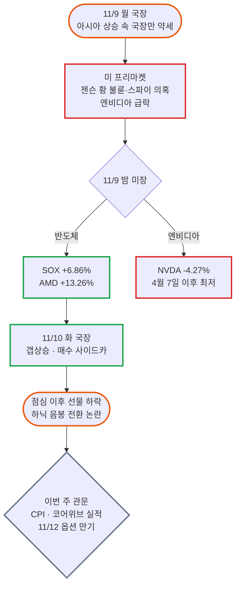

# 블라인드 주식·투자 24시간 브리핑: "젠슨 황 불륜에 웃고, 매수 사이드카에 설렜다"

- **작성일**: 2026-11-10
- **수집 기간**: 2026년 11월 9일(월) 16:15 ~ 11월 10일(화) 16:14 (KST)
- **수집 규모**: 최근 24시간 게시글 762개 전수 수집 (본문·댓글 정밀 분석 130개, 상세 수집 댓글 627개, 목록 미리보기 분석 632개)

!!! warning "주의사항"
    아래 내용은 모두 블라인드 익명 사용자들의 날것의 주장과 여론이다. 수치, 인용 기사, 소식은 따로 검증하지 않았다. "뉴스에 나왔다", "단독" 같은 표현이 붙은 글도 출처가 불분명하거나 본인의 추측을 섞은 경우가 많으므로, 투자 판단에 쓰기 전에 원문 기사나 공시를 직접 확인해야 한다. 작성자 소속은 블라인드에 표시된 회사명이며 실제 재직 여부는 확인할 수 없다. "언급 글 수"는 `entities.js`로 제목, 본문, 댓글에 종목명이나 별칭이 들어간 글을 센 값이다. 이번 범위에는 국내 정규장이 두 번 들어 있다. 11/9(월) 장 마감 직후부터 11/10(화) 장 마감 직후까지다.


## 📊 블라인드 개미 공포·탐욕 지수 (Fear & Greed Index)

공포가 한 칸 물러났다. 지수는 **33점**(공포)으로 직전 11/8의 22점보다 11점 올랐다. 이틀 연속 극단적 공포 구간을 벗어났다. 이유는 둘이다. 월요일 밤 미국 반도체 지수가 6.86% 뛰었고, 화요일 국장에는 매수 사이드카가 걸렸다. 그런데 반응 1 ~ 3위는 여전히 "인생 망한 30초", "정신과 가본 형", "인생 망한 거 배틀"이었다. 계좌는 아직 무덤인데, 게시판의 화제는 젠슨 황의 불륜으로 넘어갔다. 웃을 거리가 생겼다는 것 자체가 비명 단계가 지났다는 신호다.

<div class="kb-portfolio-metrics">
  <div class="kb-portfolio-metric-card">
    <span class="label">당일 공포·탐욕 지수</span>
    <span class="value">33점 (공포)</span>
    <span class="sub">3일 만에 극단적 공포 구간 탈출</span>
  </div>
  <div class="kb-portfolio-metric-card">
    <span class="label">직전 브리핑 대비</span>
    <span class="value">+11p 반등</span>
    <span class="sub">11/8 22점(극단적 공포) ➔ 11/10 33점(공포)</span>
  </div>
  <div class="kb-portfolio-metric-card">
    <span class="label">지배적 개미 분위기</span>
    <span class="value">손실 배틀 · 존슨황 조롱</span>
    <span class="sub">"인생 망한 배틀" vs "불륜 랠리 탑승했제?"</span>
  </div>
  <div class="kb-portfolio-metric-card">
    <span class="label">역발상 수급 시그널</span>
    <span class="value">"악재 다 나왔다" 등장</span>
    <span class="sub">바닥론이 처음 늘었지만 추격 매수 경고가 더 많음</span>
  </div>
</div>

```vegalite
{
  "$schema": "https://vega.github.io/schema/vega-lite/v5.json",
  "background": "transparent",
  "width": "container",
  "height": 220,
  "padding": {"top": 8, "bottom": 4, "left": 4, "right": 8},
  "data": {
    "values": [
      {"metric": "종합 공포·탐욕 지수", "score": 33, "max": 100, "zone": "공포", "label": "33점 (공포 · +11p)", "desc": "미국 반도체 급반등과 국장 매수 사이드카로 극단적 공포 탈출"},
      {"metric": "① 체감 손익·계좌 심리", "score": 18, "max": 100, "zone": "극단적 공포", "label": "18점 (극단적 공포)", "desc": "원금 3억+대출 2억 100% 손실, 빚 7천 등 손실 배틀이 반응 1~3위"},
      {"metric": "② 매수·투매 수급 태도", "score": 40, "max": 100, "zone": "공포", "label": "40점 (공포)", "desc": "엔비디아·QLD 줍줍 vs 하닉 5%에 추격 매수 금지"},
      {"metric": "③ 반도체·업황 신뢰도", "score": 30, "max": 100, "zone": "공포", "label": "30점 (공포)", "desc": "SOX +6.86% vs 스팟가격 피크론·LTA 취소설·목표가 하향설"},
      {"metric": "④ 지수 지지선 신뢰도", "score": 30, "max": 100, "zone": "공포", "label": "30점 (공포)", "desc": "5000 ~ 6000 박스권론 vs 4444·4000대 하단론"},
      {"metric": "⑤ 역발상 바닥 기대감", "score": 47, "max": 100, "zone": "중립", "label": "47점 (중립)", "desc": "악재 다 나왔다·기관 강제매도 되사기론 vs 계단식 하락론"}
    ]
  },
  "encoding": {
    "y": {
      "field": "metric",
      "type": "nominal",
      "sort": null,
      "axis": {"title": null, "labelFontWeight": 500, "labelFontSize": 12, "labelLimit": 180, "ticks": false, "domain": false, "labelPadding": 12}
    }
  },
  "layer": [
    {
      "mark": {"type": "bar", "cornerRadius": 7, "height": 14, "color": "#94a3b8", "opacity": 0.14},
      "encoding": {
        "x": {
          "field": "max",
          "type": "quantitative",
          "scale": {"domain": [0, 118]},
          "axis": {
            "title": "블라인드 개미 심리 스펙트럼 (0~24 극단적 공포 · 25~44 공포 · 45~55 중립 · 56~74 탐욕 · 75~100 극단적 탐욕)",
            "values": [0, 25, 50, 75, 100],
            "labelExpr": "datum.value == 0 ? '0 (극단적 공포)' : datum.value == 25 ? '25 (공포)' : datum.value == 50 ? '50 (중립)' : datum.value == 75 ? '75 (탐욕)' : '100 (극단적 탐욕)'",
            "grid": false
          }
        }
      }
    },
    {
      "data": {"values": [{"x": 25}, {"x": 45}, {"x": 55}, {"x": 75}]},
      "mark": {"type": "rule", "strokeDash": [2, 4], "color": "#94a3b8", "opacity": 0.5},
      "encoding": {"x": {"field": "x", "type": "quantitative"}, "y": {"value": 0}, "y2": {"value": "height"}}
    },
    {
      "mark": {"type": "bar", "cornerRadius": 7, "height": 14},
      "encoding": {
        "x": {"field": "score", "type": "quantitative"},
        "color": {
          "field": "zone",
          "type": "nominal",
          "scale": {
            "domain": ["극단적 공포", "공포", "중립", "탐욕", "극단적 탐욕"],
            "range": ["#dc2626", "#ea580c", "#64748b", "#16a34a", "#2563eb"]
          },
          "legend": null
        },
        "tooltip": [
          {"field": "metric", "title": "심리 지표"},
          {"field": "label", "title": "점수 및 구간"},
          {"field": "desc", "title": "핵심 진단"}
        ]
      }
    },
    {
      "mark": {"type": "text", "align": "left", "dx": 10, "fontWeight": 600, "fontSize": 12},
      "encoding": {
        "x": {"field": "score", "type": "quantitative"},
        "text": {"field": "label", "type": "nominal"}
      }
    }
  ],
  "config": {"view": {"stroke": "transparent"}}
}
```


## 1. 24시간 핵심 요약: 스캔들 다음 날의 반등

이번 24시간은 롤러코스터 두 번이다. 월요일 국장은 약했다. "아시아권 다 올라도 국장은 흐나미 40포인트 빠진건데 개별들 8%로 빠지는 이상한 장세"라는 글이 장 마감 직후 올라왔다. 같은 날 미국 프리마켓에서 엔비디아가 먼저 무너졌다. 젠슨 황이 중국 스파이로 의심받는 여성과의 불륜을 인정했다는 기사가 돌았다.

그런데 월요일 밤 미국장은 반대로 갔다. 다우 +2.15%, S&P500 +2.74%, 나스닥 +2.34%였다. 필라델피아 반도체지수는 +6.86%였다. 엔비디아 혼자 -4.27%였다. 화요일 국장은 이 반등을 받아 갭상승으로 열렸다. 오전 9시 반쯤 "매수사이드카ㅋㅋㅋ" 글이 줄줄이 올라왔다. 매수 사이드카는 선물이 급등할 때 프로그램 매수를 5분간 멈추는 장치다. 그런데 점심 무렵부터 "밥시간에 선물 내리 꽂는거 ㄹㅇ 띠껍네", "하이닉스 음봉전환은 뭐다?"가 올라왔다. 오른 폭을 일부 반납한 셈이다.



| 구분 | 핵심 내용 | 투심 기류 |
| :--- | :--- | :--- |
| **핵심 여론** | 손실 배틀, 젠슨 황 스캔들 조롱, 화요일 반등 | 비명이 자조와 농담으로 바뀜 |
| **최대 화제** | 엔비디아 (언급 글 120개) | "불륜 랠리" vs "2차 대폭락" |
| **가장 큰 쟁점** | 화요일 반등이 진짜냐 가짜냐 | "기관 되사기" vs "계단식 하락" |
| **업황 논리 변화** | 스팟 가격 피크론, LTA 취소설, 목표가 하향설 | 비관 근거 유지, 반박도 늘어남 |
| **다음 관전점** | 미국 10월 CPI, 코어위브 실적, 11/12 옵션 만기 | "이번 주가 결정타" |

표에서 볼 것은 두 번째 줄이다. 762개 글 중 106개가 젠슨 황, 불륜, 간첩 같은 단어를 담았다. 손실 이야기에서 남의 스캔들로 시선이 옮겨 갔다. 공포가 극에 달하면 남 얘기를 할 여유가 없다. 여유가 생겼다는 건 공포가 한 단계 내려왔다는 뜻이다.

---

## 2. 🎭 블라인드 명예의 전당: 이번 범위 레전드 글

### 🏆 레전드 1. "현실적으로 인생 망한 30초" (조회 1만 2천)

이번 범위에서 댓글이 가장 많았다. 주식보다 코인과 선물이 원인이었다.

> **"현실적으로 인생 망한 30초 (본인)"** (한미약품 | 👍27 · 💬145 · 👁11,952)
> "쉬었음 청년 아니고 존나 일했음 청년인데 코인/주식투자 잘못해서…현재 수중에 쓸 수 있는 현금은 단 돈 150만원이 전부고…알트코인투자 / 선물거래청산으로 이 꼬라지가 났으며…스스로 나는 도박과 투기에 중독된 ㅂㅅ이다 라고 선고 후 번 돈을 묶어두기로 결심함"
>
> - **최다 추천 댓글 (👍8)**: "아직 안늦었어 선물거래 한번 더 가자"
> - **동병상련 댓글 (👍7)**: "야야 난 91년생인데 신용 빚만 8600이다…시간이 다 해결해준다"
> - **작성자 답글**: "대기업 다니는 사람들이 몇천 잃었다는 말은 별로 위로가 안됩니다.. 형님은 1년일하면 멘징이지만 저는 아니거든요"
> - **원인 진단 댓글**: "일단 술을 끊어"

작성자의 답글이 진짜 핵심이다. 술을 마시면 "도파민이 펑펑 터져서" 주식창과 코인창을 열고 돈을 넣었다고 했다. 손실의 원인이 종목이 아니라 습관이었다는 고백이다.

### 💀 레전드 2. "투자로 인생 망한거 배틀하실분"

배틀 형식으로 손실을 겨뤘다. 웃기면서 무섭다.

> **"투자로 인생 망한거 배틀하실분"** (SK E&S | 👍29 · 💬89 · 👁8,251)
> "본인 원금 3억 + 대출 2억 손실 100% 손실원인 : 선물거래 강제청산 나이 : 37살 현재 통장잔고 450만원 집없음, 자동차 아반떼 보유 +) 미혼"
>
> - **도전자 (👍14)**: "원금 5억 + 대출 3억 손실 100% 손실원인 : 선물거래 강제청산 빚갚는중"
> - **도전자 (👍8)**: "원금 2억 + 대출 8천 손실 80% 손실원인 : 선물 1억청산 + 현물 -70%…기혼"
> - **위로인지 조롱인지 (👍11)**: "그래도 미혼인게 다행인부분" ➔ "2222기혼이었으면 마누라도 잃을뻔"
> - **촌철살인 (👍10)**: "+450이면 양호"

세 명 모두 손실 원인이 "선물거래 강제청산"이다. 레버리지는 방향이 맞아도 버티지 못하면 0이 된다. 같은 날 "코인으로 12억벌고 결국 빚7천 나이는 31살"(롯데케미칼)도 "선물러네"라는 댓글을 받았다.

### 🧠 레전드 3. "주식때문에 정신과 가본형있어?" (조회 1위)

> **"주식때문에 정신과 가본형있어?"** (NH농협은행 | 👍10 · 💬110 · 👁12,836)
> "어때 도움돼?"
>
> - **최다 추천 (👍43)**: "그런 나약한 멘탈로 무슨 주식을 하겠다고 ㅋㅋ"
> - **2위 (👍42)**: "내 친구 정신과 의사인데 걔도 주식 물려서 욕하더라 요즘"
> - **3위 (👍29)**: "진료비 낼돈 있는거보니까 덜 잃었네 마저 속슬에 밀어넣자"
> - **명의 등장 (👍22)**: "가봤는데 의사가 -60 물린거 보여줘서 치료됨"

한 줄짜리 질문에 조회 1만 2천이 붙었다. 장난처럼 넘겼지만 댓글 하나는 진지했다. "손떨리고 식은땀 줄줄나는 공황의심증세면 반드시 가야함."

### 🎬 레전드 4. 존슨황 대잔치

이번 범위의 진짜 주인공은 젠슨 황이다. 게시판은 그를 "존슨황"으로 부르기 시작했다.

> **"젠슨황 솔직히 멋있다"** (의사 | 👍13 · 💬8)
> "남들은 불륜걸려봤자 이혼소송인데 젠슨황은 불륜걸리니까 전세계 증시가 요동치네"
>
> - **댓글 (👍7)**: "발기디아ㄷㄷ"

> **"뷸륜은 롱이다"** (삼성전자 | 👍4)
> "과거가 증명함 제프 베조스 - 아마존 빌게이츠 - 마소 최태원 - 하이닉스 젠슨황 - 엔비디아???!! 뷸륜 랠리 간다"

> **"어제 반도체중 AMD가 유독 강했던 이유"** (새회사 | 👍2)
> "목욜 폭락 다 만회하고 더 오름 이유: 오너리스크 "0" 미인계 안먹힘 갓 리사수 박사 ㅎㅎ"

> **"주가 하락 참아줄수 있는데"** (쥴릭파마코리아 | 👍4)
> "실적 안좋았다 돈 많이썼다 등 경기안좋다 금리 올렸다 다 참아주는데 불륜이 뭐냐고 시부레"

웃음 뒤에 진짜 불안도 있다. "젠슨황... 불륜.... 미본토 반응"(공무원 | 👍18 · 👁2,497)의 "병렬처리 드립"이 웃음을 땄다. 그런데 "AMD 호재일까"(한양대학교교직원)에는 "가장 우려스러운데 존슨황 사퇴임. 이거 나옴 진짜 노답수"라는 댓글이 달렸다.

### 😂 레전드 5. 블랙 유머 3종

> **"와....또 짜장면에 이렇게 설레?"** (한국남부발전 | 💬10)
> "죽도록 쳐맞다가 고아원 가기 전 짜장면에 우리 엄마가 달라진것 같아서 기쁘고 설레? ㅋㅋ.,"
>
> - **댓글**: "비유 존나 잔인하네 ㄷㄷ"
> - **반격 댓글**: "5% 상승에 헐레벌떡 침 질질흘리는데 -50%는 어떻게 견뎠냐 ㅋㅋ"

> **"주식으로 부부합산 6억 날리고 얻은거"** (삼성디스플레이 | 👍6)
> "서로 같이 날린 동변상련처지가 되어 서로 의지하고 부부 관계가 개선됨."
>
> - **댓글**: "부부관계 개선에 6억이나 들다니"

> **"허경영 3번 외치면 손실이 사라지네요"** (한국자산관리공사 | 💬13)
> "허경영 3번 외치고 전량매도 했더니 손실이 다 사라졌어요"

짜장면 비유가 이번 범위를 가장 잘 요약한다. 화요일 반등을 진짜 회복으로 믿고 싶은 마음과, 또 속을까 두려운 마음이 같이 있다.

---

## 3. 📊 시장 지표와 지지선 매트릭스

### 3.1 국내외 핵심 수치 (원문 그대로)

| 항목 | 원문 수치 | 출처 글 |
| :--- | :--- | :--- |
| **미국 3대 지수 (11/9)** | 다우 +2.15%, S&P500 +2.74%, 나스닥 +2.34% | "11/9 미국증시" |
| **필라델피아 반도체** | +6.86% | 같은 글 |
| **엔비디아** | -4.27%, "4월 7일 이후 최저 수준" | 같은 글 |
| **SK하이닉스 ADR** | SKHY +5.53% | 같은 글 |
| **미 국채금리** | 10년물 4.87%, 30년물 5.26% | 같은 글 |
| **국제유가** | WTI $86.93, 브렌트 $92.79 | 같은 글 |
| **12월 금리** | "금리 인상 확률 80% 이상" | 같은 글 |
| **국장 (11/9)** | "흐나미 40포인트 빠진건데 개별들 8%로 빠지는" | "진짜 궁금하다 내일 국장" |
| **국장 (11/10)** | 매수 사이드카, "하닉 5%" | "매수사이드카ㅋㅋㅋ", "너무 뻔한 훼이크였는데" |
| **SOXL** | "3거래일동안 38%하락하고 12%, 22% 상승" | "음의 복리 무섭네." |

이 표에서 볼 것은 반도체지수와 엔비디아의 엇갈림이다. 반도체가 6.86% 오른 날 엔비디아만 4.27% 빠졌다. 시장은 젠슨 황 문제를 엔비디아 한 회사의 문제로 봤다는 뜻이다. 업종 전체의 악재로 보지 않았다.

### 3.2 미국 반도체 종목별 등락 (11/9)

"11/9 미국증시"(한국GM | 👍31 · 👁1,397)가 반도체 종목을 정리했다. 이번 범위에서 추천을 가장 많이 받은 정보 글이다.

| 종목 | 등락률 | 종목 | 등락률 |
| :--- | ---: | :--- | ---: |
| AMD | +13.26% | 램리서치 | +10.41% |
| AMAT | +11.37% | 마벨테크 | +9.49% |
| KLA | +9.31% | 브로드컴 | +8.78% |
| 마이크론 | +6.25% | ASML | +6.21% |
| 인텔 | +5.49% | TSMC | +3.51% |
| SNDK | +6.16% | WDC | +9.86% |
| **엔비디아** | **-4.27%** | 퀄컴 | +3.66% |

장비주(AMAT, 램리서치, KLA)가 10% 안팎으로 올랐다. 지난주 낙폭이 컸던 종목에 저가 매수가 들어왔다는 설명이 붙었다. 같은 글은 "모건스탠리·UBS, AI 관련 규제가 데이터센터 투자를 크게 위축시킬 가능성은 낮다고 평가"했다고 전했다.

### 3.3 개미들이 제시한 지지선·목표가 매트릭스

| 종목/지수 | 낙관·지지 | 비관·하단 | 근거 글 |
| :--- | :--- | :--- | :--- |
| **코스피** | "6000까지 빠르게 반등", "5000 ~ 6000 박스권" | "4444", "4500", "4000 한번 가야할거 같음" | "외국인 숏커버 개쩐다", "코스피 저점이 몇일까" |
| **코스피200 선물** | 양매도 하방 767.5 | 양매도 상방 797.5 | "[파생] 11월물 만기 D-2" |
| **삼성전자** | "30만원까지는 가야" | "16", "13만원", "8만원" | "맘 고생 많으셨습니다.", "호재 발생." |
| **SK하이닉스** | "하닉 142", "하닉 160만" | "80", "이번주 100 깰듯", "20만원" | "하닉 142", "옵션 만기 앞우고 하닉 110 횡보" |
| **엔비디아** | "떠 먹여주는 기회" | "140불까지 더 내려갈꺼야" | "아직 못 산 애들은 엔비디아 사", "미래에서 왔다." |
| **SOXL** | "속슬 40불은 안오는겨" | "25불", "30불 가면 한번 매수 고려" | "오늘밤 속슬 25불간다고", "진작에 티큐 할걸" |

낙관 쪽 숫자가 조금 올라왔다. 11/8에는 삼성전자 하단이 13만 원, SK하이닉스 하단이 80만 원대가 기본값이었다. 이번엔 "6000까지 반등", "하닉 160만" 같은 회복 목표가 같이 나왔다. 그래도 비관 쪽 숫자는 그대로다. 삼성전자 16만 원, 하이닉스 80만 원 주장은 오히려 근거를 붙여 반복됐다(6.4절 참조).

### 3.4 코스피 지수별 행동 지침: 자칭 30년 차의 마지막 글

"절필선언"(글래드호텔앤리조트 | 💬25 · 👁1,275)을 올린 작성자가 같은 날 "코스피 지수별 취해야할 행동"(💬11)을 남겼다.

| 코스피 구간 | 작성자 판정 |
| :--- | :--- |
| 4,200 이하 | 적극 매수 구간 ("빤스팔아 올인해도됨") |
| 4,200 ~ 4,600 | 분할 매수 구간 |
| 4,600 ~ 5,100 | 관망 구간 |
| 5,100 ~ 5,500 | 매도 구간 |
| 5,500 이상 | 숏 구간 |

이 작성자는 11/8 브리핑에서 "차주는 4천대 지지시험"을 외친 사람이다. 반응은 차가웠다. 절필 선언에는 "이걸로 안온다 어쩌고 네번째다"라는 댓글이 달렸다. 화요일 오후에는 "글래드<< 이색키 뭐 코스피내리면 환율내린다더니"(도쿄일렉트론코리아)라는 저격 글도 올라왔다. 그래도 이 표는 쓸모가 있다. 지금 코스피가 어디쯤인지에 따라 무엇을 할지 미리 정해 두는 방식이기 때문이다.

---

## 4. 💣 시장 핵심 쟁점과 여론 분열

| 주제 | 핵심 논점 | 대립 구도 |
| :--- | :--- | :--- |
| **① 젠슨 황 스캔들** | 중국 스파이 의심 여성과의 불륜 인정 | "구조적 악재 아님" vs "반역죄면 끝" |
| **② 화요일 반등의 정체** | 지난주 강제 매도의 되사기인가 | "당분간 회복장" vs "계단식 하락" |
| **③ 정부 책임론** | 대만은 증안펀드, 한국은 반대매매 유예 | "정부 탓 60%" vs "매수 버튼은 본인" |
| **④ 메모리 피크론** | 양산형 스팟 가격이 20배 뛴 거품 | "삼전 16 하닉 80" vs "장부가치 18만" |
| **⑤ 국장 탈출론** | 국장은 도박판, 미국 지수가 정답 | "S&P500 적립식" vs "미장도 하락 시작" |

### 4.1 젠슨 황: "GPU 수요가 사라져?"

업종이 아니라 사람의 악재다. 이 점에서 매수론자와 비관론자가 갈렸다.

매수론의 대표는 "아직 못 산 애들은 엔비디아 사"(KT | 👍7 · 👁1,023)다.

> "지금 엔비디아 악재는 구조적인 문제가 아니야 젠슨황이 털리면 GPU 수요가 사라져? GPU 못 만들어? 최악의 시나리오까지 가서 젠슨황 물러나고 선장교체 된다치자 그럼 GPU 못 팔아? 이런 악재는 진짜 떠 먹여주는 기회인거야"

바로 반박이 붙었다. "주식시장이 언제부터 그렇게 상식적이 됐나ㅎ위자료 100조털려면 엔비디아 주식 정리 해야하고." 이혼하면 젠슨 황 지분이 시장에 쏟아진다는 걱정이다.

비관론은 "스파이"라는 단어에 걸렸다. "존슨황 결국 인정"(NC)에 "이게 왜 폭락 재료가 되는거임?"이라고 묻자 "미국에서 반역죄 걸리면 진짜 디짐"이 답이었다. "그냥 불륜이 아니고 중국스파이랑 불륜"이라는 댓글도 달렸다. 11/9 미국증시 글에도 "미 하원 민주당, 국가안보 영향 전면 브리핑 요구"가 적혀 있었다.

가장 차분한 해석은 "젠슨황 불륜은 단순 불륜 문제가 아님"(새회사 | 👁1,230)이다.

> "젠슨 황 건은 그냥 빠르게 쓱 지나가는 거고 크게 보면 미국이 중국 압박을 협상 전까지 더 거세게 할 거라는 제스쳐임…삼성이나 특히 하이닉스도 중국에 납품하는 거 문제를 삼으면 삼을 수 있다는 거고, 그게 큰 그림에서 우리가 봐야 하는 리스크임."

스캔들 자체보다 미국의 대중국 압박이 국내 메모리로 번질 수 있다는 지적이다. 이번 범위에서 국내 투자자에게 가장 실용적인 분석이었다.

### 4.2 반등의 정체: "기관이 강제로 판 물량을 다시 산다"

"오늘 가격이 오르는 이유"(삼성전자 | 👍7 · 👁800)가 화요일 반등을 이렇게 설명했다.

> "이유 없음 그냥 저번주에 강제로 기관들이 자기 포지션 물량 줄인거 다시 사서 그럼…기관들은 미래의 전망과 별개로 가격자체가 일정수준 아래로 내려가면 물량 포지션을 줄이는 기계적 로직이 전부 존재함…저번주는 개미들도 물량을 받쳐주기는 커녕 같이 물량덤핑을 미친듯이 해버려서 그 임계점을 하필 건드려버린거임…강제 매도된 물량 천천히 다시 사들일거임 당분간 회복장이라고봄"

작성자는 "급폭등장은 당분간 안올듯합니다 오늘 말아올리는거 해봤자 지난달 폭락 반도 안됨"이라고 선을 그었다. 댓글은 "당분간 5000 ~ 6000 박스권 매매해야겠네요"로 받았다.

반대편은 "형들 아직도 잊었어?"(SK | 👍6 · 👁824)다. "오늘 잠깐 오르고 내일 다시 폭락이야…계단식 하락이라고 내가 몇번말해 ㅋㅎ 삼전 8만원 하닉 20만원 천천히 간다잇." 극단적인 숫자지만 "오늘 오른거 오늘 내리지만 않으면 감사합니다지"라는 맞장구가 붙었다.

### 4.3 정부 책임론: 대만과 나란히 놓다

"정부 vs 무정부 비교"(SK하이닉스 | 👍7)가 대만과 한국을 숫자로 비교했다.

| 구분 | 대만 | 한국 |
| :--- | :--- | :--- |
| **고점 대비 하락** | 20% | 46% |
| **공매도** | 물량 제한 30% ➔ 3%, 증거금률 90% ➔ 130% | 조치 없음 |
| **증시안정기금** | 투입 (약 50조 원 규모) | 없음 |
| **기타** | 없음 | 신용담보비율 의무 한시적 유예 |
| **결과** | +4.94% | -0.81% |

같은 내용의 "우리나라와 대만"(계양전기)에는 "국장은 버림받았어 정부가 아무것도 안해"(👍6)가 달렸다. "오눌같은날 증시안정기금 조성 기사내면 딱인데"(새회사 | 👍6)에는 찬반이 갈렸다. "정부가 시장에 손댈수록 더 안 좋은거임"(👍3)과 "9천에서 5천까지 나락가는동안 아무것도 안해서 문제인거다"가 맞섰다.

"하락이유의 60%를 정부탓이라고 한 점은"(인천교통공사 | 👍12)은 레버리지 ETF를 원인으로 꼽았다. "원스트레이트로 올리고 원스트레이트로 뺐거든. 원래 같았으면 조정이 중간중간 있으면서 털고가야할 매물들이 고점에 탁 물리게 정책을 펼쳐놨단 말이다." 반대로 "주식 남탓 ㅈㄴ하네"(SK이노베이션 | 💬42)는 "꼭지에 사놓고…정부탓 유튜버탓 증권사탓"이라고 했다. 이 글에는 "레버리지 내놓고 정부가 시장박살낸건 잘못했지ㅋㅋ 근데 투자는 본인이 잘못한거라니까"라는 절충안이 달렸다.

### 4.4 메모리 피크론: "5만원 메모리가 100만원이 됐다"

"이란 종전하면 삼성전자, SK하이닉스"(한국남부발전 | 💬8)의 작성자는 3개월째 같은 주장을 하고 있다고 했다.

> "지금 메모리 메이커 영업이익은 AI용 커스텀 하이엔드 메모리가 아니라 양산형에서 90%이상 나오고있음. 근데 양산형은 수요증가가 아닌 커스텀 하느라 생산을 안해서 쇼티지가 난거고 스팟 가격이 20배가 뜀. 5만원 양산형 메모리가 100만원이 되는 미친 상황이니까 그 돈을 번거고 당연히 유지될 확률은 0%임."

이 작성자는 목표가도 제시했다. "PBR 착시를 반영해서 1배 쳐준다고해도 삼전은 16, 하이닉스는 80임." PBR은 주가가 장부상 순자산의 몇 배인지를 나타낸다. 1배면 회사를 장부 가격 그대로 산다는 뜻이다. 다만 "그 가격 온다고 무조건 반등하는건 아님. 메모리는 스팟프라이스가 한번 꺽여서 저점을 형성해야 시장 투심이 좀 진정될듯"이라고 덧붙였다.

반론은 같은 숫자를 다르게 읽었다. "삼전 자산 장부가치"(ex-NEXON)는 "1주 당 18만원이고 28년도 램가격 -50프로되도 20만원 초반으로 오르는데 더 밑으로 갈수가있나?"라고 물었다. 답은 짧았다. "계속 램 가격이 하락할수 있는게 문제임." 장부가치가 바닥을 받쳐 준다는 쪽과, 이익이 줄면 장부가치도 의미가 없다는 쪽이 맞섰다.

### 4.5 국장 탈출론: "AI는 끝나지 않았다 국장만 끝났다"

국장과 미장을 가르는 목소리가 커졌다. "S&P 500 적립식 장기투자"(NC | 💬11)에는 맞장구가 쏟아졌다. "올 상반기에 반도체 불나방들이 조롱하던거 참기 진짜 힘들더라 ㅜㅜ 말이 쉽지, 지수적립투자도 결코 초보가 하기 쉬운것도 아님." 반도체 광풍 때 소외됐던 지수 투자자들이 이제 목소리를 낸다.

"주식을 도박과 착각하면 안됨"(충청남도교육청 | 👍13)은 "투자는 = 꾸준한 내돈 * 시간"이라고 정리했다. "미국의 401K라는 퇴직연금 처럼 매달 월급의 10 ~ 20%로씩 지수추종 ETF를 꾸준히 매수"하라는 조언이다. 그러자 "코스닥 맛좀 봐볼래?30년전보다낮음"이라는 댓글이 붙었다. 지수 투자도 미국이라서 통한다는 뜻이다.

반론도 있다. "국장은 양반이여 이제 미국장 하락이 시작된다면"(한국공항)은 "국장 빠져봐야 코스피 200,300포인트가 다일듯…미국. . . 하락장시작되면 22년도 기억나나?"라고 했다. "사실 qqq, s&p, schd 보면 얼마 안떨어짐"(LG에너지솔루션)에는 "Qqq 엄청떨어져써고점대비"와 "?... 13퍼?.."가 맞붙었다.

---

## 5. 🕵️ 찌라시와 미확인 소식: 신뢰도 등급 카드

| 소식 | 태그 | 신뢰도 | 수급 영향 |
| :--- | :--- | :---: | :---: |
| 젠슨 황, 中 스파이 의심 여성과 불륜 인정 | [보도 인용] | 상 | ⚠️ 큼 |
| 젠슨 황 12월 9일 이사회에서 해임 | [예언·농담] | 하 | 작음 |
| 빅테크 LTA 위약금 물고 계약 취소 | [출처 없음] | 하 | ⚠️ 큼 |
| 증권사 하이닉스 목표가 160만 원으로 하향 | [미확인] | 중 | 중간 |
| 트럼프 "이란 협상 가능성 낮다" | [해석 논란] | 중 | 중간 |
| 국민연금 사모펀드 경유 코스피 매수설 | [음모론] | 하 | 작음 |
| 11월물 양매도 구간 767.5 ~ 797.5 | [개인 분석] | 중 | 중간 |

### 5.1 ⚠️ [보도 인용] 젠슨 황, 중국 스파이 의심 여성과 불륜 인정

- **원문 주장**: "존슨황 결국 인정"(NC)이 연합뉴스 기사 링크를 붙였다. 제목은 "젠슨황, 中스파이 의심 여성과 불륜 인정…이사회 독립조사 착수(종합)"였다. "첩이지만"(타이코에이엠피)도 별도의 기사 링크를 붙였다.
- **신뢰도**: **상**. 언론 링크가 여러 개 붙었고, 엔비디아 -4.27%와 "미 하원 민주당, 국가안보 영향 전면 브리핑 요구"가 같은 날 미국증시 요약에 적혔다. 다만 "여자는 잠적", "중국돈받아먹은거 숨기는것" 같은 후속 이야기는 근거 없는 추측이다.
- **팩트체크 및 반박**: "본인이 인정까지했는데 또다른 음모론을 꺼내는 사람"이라는 댓글이 음모론을 눌렀다. "젠슨황 이혼은 확실히 안할듯"(삼성전자)은 "본인이 인정하고 사과함 - 이혼할 생각 없다는 뜻임"이라고 봤다.
- **투자 체크포인트**: 이사회 독립조사 결과와 미 의회 대응이 남은 변수다. 반도체지수가 6.86% 오르는 동안 엔비디아만 빠졌다. 시장이 이 문제를 회사 한 곳의 문제로 가둬 두고 있다는 뜻이다.

### 5.2 [예언·농담] 12월 9일 이사회에서 젠슨 황 해임

- **원문 주장**: "미래에서 왔다. 12월 9일을 기억해!"(LG전자 | 💬7)는 "엔비디아 주가는…140불까지 더 내려갈꺼야. 그리고 12월9일 이사회가 열리고 젠슨황은 CEO 자리에서 쫓겨나고"라고 썼다.
- **신뢰도**: **하**. 근거가 없다. "시간여행도 가능한 양반이 lg다니고있노 ㅋㅋ"가 최다 추천 댓글이었다.
- **투자 체크포인트**: 농담이지만 사임 가능성 자체는 게시판의 진짜 공포다. "가장 우려스러운데 존슨황 사퇴임"이라는 댓글이 다른 글에도 달렸다.

### 5.3 ⚠️ [출처 없음] 빅테크가 LTA 위약금을 물고 계약을 취소한다

- **원문 주장**: "반도체 전망 어떨 거 같음? (LTA)"(기아 | 👁834)가 "빅테크들이 LTA 위약금 물고 계약 취소할 수도 있다는 말도 있던데"라고 물었다. LTA는 메모리 회사와 고객이 맺는 장기 공급 계약이다. "하이닉스 계약 취소 조심"(ex-두나무)은 "취소 한 두건씩 나오면 하한가 바로 직행"이라고 했다.
- **신뢰도**: **하**. 출처가 없다. 최다 추천 댓글(👍6)이 "취소를 왜해 내가보기엔 말도안되는 찌라시인데 ㅋㅋ"였다.
- **팩트체크 및 반박**: 댓글 반박이 구체적이었다.
    - **(👍5)**: "위약금 엄청 세게 걸어놔서 취소보다는 발주를 뒤로 미룰 가능성이 높을거 같음"
    - **(👍1)**: "민주당도 스탠스가 주민 대책 세우고 데이터센터 세워라지, 데이터센터 이제 짓지마도 아니라서 LTA 위약금 내가며 취소할리는 없을거 같고"
    - **다른 글 댓글**: "LTA 계약조건엔 납기연기 가격조정은 기본으로 깔고 가는거지."
- **투자 체크포인트**: 취소보다 납기 연기와 가격 조정이 현실적인 시나리오라는 데 댓글이 모였다. 계약이 깨지지 않아도 가격이 조정되면 이익은 줄어든다.

### 5.4 [미확인] 증권사 애널리스트의 하이닉스 목표가 하향

- **원문 주장**: "반도체 잘보는 숀킴이 하이닉스 TP 내림"(NAVER | 💬5)은 "삼성 30 하닉 160 얘가 윈터이스 커밍 썼던애 물린애들은 손절쳐야.."라고 썼다. TP는 목표주가다.
- **신뢰도**: **중**. 특정 애널리스트의 이름과 숫자가 있지만 리포트 링크가 없다.
- **투자 체크포인트**: 사실이라면 의미가 있다. 이 애널리스트가 과거 메모리 하락을 경고했던 사람이라고 게시판은 기억한다. 원문 리포트로 목표가와 근거를 확인해야 한다.

### 5.5 [해석 논란] 트럼프 "이란 협상 가능성 낮다"

- **원문 주장**: "미장 마감 후 악재 발생"(삼성SDI | 👁899)은 트럼프가 "협상 준비완료 됐지만 그럴 기능성은 낮다고 x에 글 남김"이라며 "오늘 국장 상승하거나 반등줄때 인버스나 숏으로 대응하면 됨"이라고 했다.
- **신뢰도**: **중**. 발언 자체는 있었던 것으로 보이지만 해석이 갈렸다.
- **팩트체크 및 반박**: 댓글(👍1)이 바로 반박했다. "언제든 공격할 준비가 완료된 상태지만 그럴 가능성은 낮다 라고 봐야 할텐데~ 그 발언하고 나스닥 선물은 오히려 소폭 더 올랐고." 11/9 미국증시 글도 "트럼프, 이란 추가 대규모 공격 가능성 낮게 평가"로 적었다. "이란 합의 확률 매우 낮다고 본다"(인천교통공사)는 혁명수비대와 정부파의 권력 다툼을 근거로 합의 회의론을 폈다.
- **투자 체크포인트**: 같은 문장을 정반대로 읽고 반대 포지션을 권하는 글이 많다. 원문 발언을 직접 확인하고, 유가(WTI $86.93)의 방향으로 시장 해석을 확인하는 편이 낫다.

### 5.6 [음모론] 국민연금이 사모펀드로 코스피를 샀다

- **원문 주장**: "현 정부는 왜 국민연금을 무지성으로 코스피에 부었는가."(현대자동차 | 👍23 · 💬34)는 이번 범위에서 추천 3위다. 외국인이 "2025년 10월부터 삼성 53% 하이닉스 56%를 정점으로 쭉 매도해서 지금은 46% /48%"라고 했다. 국민연금이 "투자내역 비공개한 사모펀드를 이용해 외국 증시에 상장된 코스피 펀드를 매수"했다는 주장이다. 원인은 미국 사모대출 부실이라고 했다. "BIS(국제 결제 은행)가 집계한 사모 대출만 2조 달러 (3,000조 원)…연간 300조가 이자로 나간다"는 계산도 붙였다. 젠슨 황 폭로도 "앤트로픽 IPO 하려고 엔비디아 주식 팔아야 되서" 터뜨렸다고 봤다.
- **신뢰도**: **하**. 외국인 지분율 같은 확인 가능한 숫자와 확인할 수 없는 추론을 한 줄로 이었다. 사모펀드 경유 매수, 반도체 회사의 "가짜 영업이익" 주장은 근거가 없다. "사모 대출 금리는 대개 10%부터 시작"이라는 가정으로 이자를 계산한 것도 작성자의 추정이다.
- **팩트체크 및 반박**: "잊을만하면 와서 사실과 거짓을 교묘하게 섞어서 혹세무민하고 가네 ㅋㅋ 이글이 써있는 그대로 믿어지면 주식 그만 하세요"(👍2). "주가가 떨어지니 너의 말이 신빙성있게 보이는 사람들이 있는 것 같은데 너는 딱 타진요임." 그래도 "글 안 묻히게 추천 부탁함"(👍5)과 요약 댓글(👍4)도 붙었다.
- **투자 체크포인트**: 이런 글이 추천 상위에 오른다는 것 자체가 신호다. 손실이 길어지면 "누군가 꾸몄다"는 설명이 잘 팔린다. 11/8 브리핑의 "국민연금 사모펀드 경유 매수설"이 더 큰 음모론으로 자랐다.

### 5.7 [개인 분석] 11월물 옵션 만기, 양매도 구간 767.5 ~ 797.5

- **원문 주장**: "[파생] 11월물 만기 D-2"(한전KPS | 👍5)는 11월 12일 옵션 만기를 앞두고 "양매도 세력이 설정해 놓은 상방과 하방의 범위가 지나치게 타이트"하다고 했다. 양매도는 콜과 풋을 같이 팔아 주가가 범위 안에 머물면 수익을 내는 전략이다. 범위는 "상방 797.5, 하방 767.5 부근 불과 30포인트 정도"였다.
- **신뢰도**: **중**. 작성자의 포지션 분석이며 전체 헤지 구조는 보이지 않는다고 작성자 스스로 밝혔다.
- **팩트체크 및 반박**: 화요일 갭상승 뒤 "상방 넘겼어 형"이라는 댓글이 달렸다.
- **투자 체크포인트**: 상방 이탈이 사실이면 양매도 쪽이 포지션을 조정하며 변동성이 커질 수 있다. "옵션 만기 앞우고 하닉 110 횡보"(에이치케이이노엔)는 "이거 방어하겠다고 개별 종목들 다 파는 기관 연기금 등으로 인해 다른 종목들은 처참해질듯"이라고 봤다.

---

## 6. 🔍 종목·섹터별 개인 투자자 심리와 전망

`entities.js`로 집계한 결과, 언급이 많은 상위 종목·섹터는 다음과 같다.

| 종목·섹터 | 언급 글 수 | 지배적 심리 | 대표 전망 (원문 인용) | 소수 반대 의견 |
| :--- | :---: | :--- | :--- | :--- |
| **엔비디아** | 120 | 조롱 + 저가 매수 저울질 | "떠 먹여주는 기회" | "140불까지 더 내려갈꺼야" |
| **국내 지수** | 78 | 정부 불신, 탈출론 | "국장 탈출은 능지순" | "코스피 6000까지 빠르게 반등" |
| **미국 지수** | 65 | 적립식 예찬 | "S&P 500 적립식 장기투자가 최고" | "미국장 하락이 시작된다면" |
| **SK하이닉스** | 54 | 고점 물림, 반등 대기 | "하닉 142 살려주려나" | "삼전 8만원 하닉 20만원" |
| **SOXL** | 54 | 반등 환호 + 레버리지 후회 | "속슬 40불은 안오는겨" | "오늘밤 속슬 25불간다" |
| **반도체** | 54 | 바닥론 첫 등장 | "나올 수 있는 모든 악재가 다 나오고" | "반등이지 추세전환은 아님" |
| **레버리지·인버스 ETF** | 48 | 청산 공포, 숏 유혹 | "숏치면 돈복사" | "3배수를 헷지가 아닌 투자로 바라보면 금방 망해" |
| **삼성전자** | 32 | 물림 + 장부가치 하단론 | "30만원까지는 가야" | "삼전은 16" |
| **채권·달러·환율** | 26 | 피난처 탐색 | "3.1퍼짜리 파킹통장" | "개인이 채권을 대체 왜사는지" |
| **AI·빅테크** | 15 | 버블 논쟁 | "AI버블은 이미 터진것같아" | "AI 시대는 이제 시작" |
| **구글(알파벳)** | 11 | 과매도 매수 | "실적에 비해 너무 과매도" | "구글 쳐물려서 꼬라먹은거" |

엔비디아가 120개로 국내 지수(78개)를 크게 앞섰다. 11/8에는 SK하이닉스(61개)가 1위였다. 화제의 중심이 국내 성과급 싸움에서 미국 CEO 스캔들로 옮겨 갔다.

### 6.1 엔비디아: "떠 먹여주는 기회"인가, "더 깊은 지옥"인가

**보유자 상태.** 평단을 밝힌 글은 많지 않다. "이정도면 하락장에 잘 줍줍한건가..구글 엔비"(한국MSD)는 "엔비디아: 꽈ㅊ..리스크..아 아니 오너리스크랑 상관없이 가격이 너무 매력적이라 매수(평단177불)"라고 했다. "엔비디아 불륜 스캔들 하락이면"(HD현대오일뱅크)은 "엔비디아 사고는 싶었는데 200달러 위로는 손이 잘 안갔거든"이라고 했다. 보유자보다 대기자가 많다는 뜻이다.

**심리.** 조롱이 압도적이다. "존슨황", "발기디아", "엔비아그라" 같은 별명이 쏟아졌다. 그 밑에는 실망이 있다. "젠슨형 행복해야해ㅠ"(한국램리서치 | 👍9)는 "엔비디아와의 인연은 여기까지인것같아ㅠ"라며 매도를 알렸다. "엔비디아 프장 마오 떴네"(👁1,268)는 "기술유출까지 확인 되면 훨씬 더 깊은 지옥으로 떨어질거 같아"라고 했다. "다른 종목도 아니고 엔비디아가 이런 차트를 그리게 될줄이야"라는 탄식도 달렸다.

**전망.** 상승론은 "GPU 수요는 그대로"라는 논리다. "엔비디아 지금 바닥인가보다"(ex-KB캐피탈)는 "본장에서 더 쳐박진 않을거임. 그만큼의 초악재도 아니고. 6%도 많이 뺀거라 생각합니다"라고 했다. 하락론은 사임과 이혼 시나리오다. "140불까지 더 내려갈꺼야"(LG전자)와 "근데 젠슨황 와이프가 이혼요구하면 주가 나락갈 가능성 높은거 아님? 지분 공동재산 인정되면"(의사)이 대표적이다.

**행동 계획.** 저가 매수를 저울질하는 사람이 가장 많다. "지금 엔비 2배 들어가는거 어떻게 생각하세요"(삼성디스플레이)는 "삼성도 정보 유출 , 산업스파이 기사 연 1회정도는 보는거 같은데 엔비디아가 저 첩 한명에 회사 정보가 다 유출되고 무너진다고 생각"하지 않는다고 했다. 반대로 "기분이 더럽다"(새회사)는 "엔비디아든 구글이든 폭락한 m7 안주워 담을거다"라고 했다.

**업계 의견.** "AMD 호재일까"(한양대학교교직원)가 생태계 관점을 짚었다. "엔비디아의 투자에 기대고 있는 네오클라우드, AI 생태계 전체가 위험해질수있어." 엔비디아가 투자한 AI 클라우드 회사들까지 흔들릴 수 있다는 걱정이다. 이번 주 코어위브 실적이 주목받는 이유이기도 하다.

**어제 대비 변화.** 11/8에는 "젠슨 황 중국 스파이 의심 인물과의 관계"가 보도 인용 수준의 찌라시였다. 이번엔 본인 인정으로 사실이 됐다. 언급 글은 19개에서 120개로 늘었다.

**종합 판단.** 게시판은 이 사건을 비극보다 희극으로 소비하고 있다. 악재가 웃음거리가 되면 그 악재의 힘은 약해지는 경우가 많다. 다만 이사회 조사와 의회 대응에서 "기술 유출"이 확인되면 이야기가 달라진다. 지금은 "악재 확정"이 아니라 "악재 진행 중"이다.

### 6.2 국내 지수: "국장 탈출은 능지순"

**보유자 상태.** "4개월만에 - 44.5%"(👁824)에 "내 계좌랑 똑같네"가 달렸다. "주식 오래한 사람은 이번 폭락 다 피했지?"(공무원 | 💬15)에는 "지수가 -40프로인데…포지션들고 저 정도면 나름 선방"이라는 답이 붙었다. "당근빠따루 코스피 9천에 다팔고 들어갈 타밍 찾는중"이라는 댓글도 있었다.

**심리.** 불신과 분노다. "곧 닥칠 운명"(삼성전자 | 👍7 · 👁1,790)은 한 줄이었다. "국장 탈출은 능지순." 화요일 사이드카에도 냉소가 붙었다. "매도사이드카 매수사이드카"(한국가스공사)에는 "도박판 그자체"(👍3), "이정도 급등락이면 코인판이랑 다를바가 없네"가 달렸다. "이제 매수 매도사이드카 조정 좀 하자"(롯데웰푸드)는 "사이드카가 초인종이냐 이놈 저놈 지나가면서 다 눌러보네"라고 했다.

**전망.** 낙관론은 "외국인 숏커버 개쩐다"(LG전자)의 "코스피 6000까지 빠르게 반등 예상"이다. 숏커버는 공매도한 쪽이 주식을 되사는 것이다. 하지만 댓글이 바로 반박했다. "외인이 왜 숏커버야 다 수익권이지…외인 수익 무지좋아…다른 세력이 털리고 있는 중." 비관론은 "꼬라지가 6000 ~ 6500때랑 똑같네"(SK텔레콤)다. "6000 ~ 6500 비실거리다가 5000으로 곤두박질치고 6000이 고점됨 지금 무빙이 저때랑 완전 똑같음 5000 ~ 5500 비실거리다가 4000대 곤두박질치고 5000이 고점으로 자리 잡는 형국." "코스피는 삼풍백화점 같은거다"(SK시그넷)는 "지금 오르는 것도 아무 의미없는 반등이기 때문에 매매는 하루를 넘기면 안된다"고 했다.

**행동 계획.** 단타와 관망이 많다. "나 오늘 국장 레버리지 다 털었는데"(간호사 | 💬26)에는 "내일 다시 들어가먄 되는디", "드가자"가 이어졌다. "국장 어제 종가로 다판 내가 ㄷㅅ이다"(NEXON)에는 "???: 그가 팔았습니다"가 달렸다. 판 다음 날 올랐다는 사람이 여럿이다.

**어제 대비 변화.** 11/8에는 "5천은 이제 저항선"이 다수설이었다. 이번엔 "5000 ~ 6000 박스권"이 새로 나왔다. 저항선이던 5천이 지지선 후보로 올라왔다.

**종합 판단.** 지수가 올라도 분노는 그대로다. "주식은 진짜 재밌는듯"(한국남부발전)이 정확히 짚었다. "얼마전까지 삼전 19만원간다고하면 개쌍욕했는데 이제는 19만원까지 반등했다고 좋아하네 끓는물속 개구리가 되가는건가." 기대치가 낮아졌다. 낮아진 기대는 반등을 만드는 재료가 되기도 한다.

### 6.3 미국 지수: 반도체 불나방 대신 적립식이 이겼다

**보유자 상태.** 미국 지수 보유자는 비교적 여유롭다. "아 역시 미장이야"(KT)는 "몇달 물릴줄 알았는데 바로 양전해주네 물탔던 만큼 다시 팔면서 덤으로 2-3% 먹어주고"라고 했다. "바로 본전왔누.. 사라했제"(주한미군)는 "스닥이햄 전고가면 슨피로 바꾼다"고 했다.

**심리.** 자신감과 우월감이다. "S&P 500 적립식 장기투자"(NC)에 "그래 결국 S&P 500 적립식 장기투자자가 승리한다"가 이어졌다. "Snp500 장점은"(창조경제혁신센터)은 이렇게 정리했다. "망해도 난 혼자 망하는게 아니라 발목잡고 다같이 망하는게 장점인 거 같다."

**전망.** 바닥론과 추가 하락론이 공존한다. "아직 하락장은 아님"(한국조폐공사)은 "Soxx Qqq모두 300일선에 기가막히게 걸쳐있다. 여기서 구름대 뚫고 올라가면 V자 반등 가능"하다고 했다. 댓글은 "200일도 아니고 왠 300?"이었다. "진짜 폭락 한번 씨게 와야됨"(새회사)은 "나스닥이 얼마 떨어지지도 않음…1/3밖에 안빠짐"이라고 했다.

**행동 계획.** 분할 매수가 많다. "오늘이라도 사라"(ex-KB캐피탈 | 👍6 · 👁1,176)는 "숏같은거 사지말고, jepq같은 배당주도 괜찮다. Qld도 괜찮고"라고 했다. JEPQ는 나스닥 커버드콜 배당 ETF, QLD는 나스닥 2배 ETF다. 댓글은 "qld꽉꽉담앗습니다", "QQQI 아직 덜 모았는데"였다.

**종합 판단.** 국장 피로가 미국 지수 쏠림으로 바뀌고 있다. 그런데 "오늘이라도 사라"의 추천 목록에 2배 레버리지 ETF가 끼어 있다. 적립식 예찬과 레버리지 유혹이 같은 글에 섞여 있다.

### 6.4 SK하이닉스: 150만 ~ 300만 원 물린 사람들의 "살려주려나"

**보유자 상태.** 평단이 높다. "하이닉스 250층 삼전 30층은 나가 뒈져야함?"(삼표시멘트 | 💬23)에 "나도 하이닉스 240에 물려있는데", "저는 230에삼", "나 280층이야"가 줄을 섰다. "260층인데 물타서 150까지 내렸어 근데 150도 안올거같음"도 있었다. "하이닉스 팔고 속슬 갈까..."(한국GM)는 "지금 하닉 -50%"라고 했다. "삼전닉스 팔까말까"(한국철도공사)는 "평단은 삼전 30 닉스 200…오늘 기준 1억 손실"이었다. "하닉 300만원 할때..."(에스티엠)는 "계좌 13억 찍고 엄마 벤츠 사준다고 했는데 지금 5억"이라고 했다.

**심리.** 체념 속 희망이다. 숫자만 올린 제목이 많다. "하닉 142", "하닉160은 살려줄까?", "이번주 하닉 160만원", "하닉 150만 한번만 와주면 좋겠다ㅜ". 1차 목표가 본전이 아니라 "덜 잃는 것"으로 내려왔다.

**전망.** 비관론은 여전히 단단하다. "옵션 만기 앞우고 하닉 110 횡보"에는 "에이 이번주에 100깨지는건 모르는 사람 없지"가 달렸다. "하닉은 앞으로 오를 일 없음"(해외건설협회 | 👍5)은 "그동안 호재가 다 반영된 가격보다 더 오른 상태"라고 했다. 낙관론은 기억에 기댄다. "내가 삼전 8만전자 일때 사서 5만전자 때 안 팔고 버티니 30만까지 갔었음…이 때 기억갖고 버텨보려고."

**행동 계획.** 물타기와 관망으로 나뉜다. "조언부탁드랴여 ㅠㅠ"(샤넬코리아 | 💬11)는 "하닉 ..200층 ? …4주 보유중"이라고 했다. 댓글은 "4주면 물타세요 평단 금방 낮아집니다"(👍2)와 "냉정하게 5년 못기다릴거면 팔고 다른 데 넣는 거 추천. 국장 말고"(👍1)로 갈렸다. SOXL 갈아타기를 묻는 글에는 "괜히 레버리지로 갈아타서 더 꼴지말고 들고 있으셈"이 달렸다.

**현직자 의견.** SK하이닉스 소속 작성자의 "인생 왜케 잘 풀릴까"(👍7 · 👁1,070)가 눈에 띈다. "자사주 모았던 거 280에 다 털고 기회만 보다가 오늘 풀매수했는데 바로 떡상하네 ㄷㄷ." 280만 원에 팔고 바닥에서 다시 샀다는 자랑이다. 같은 회사 소속의 "하두 떨어져서"는 "이제 감흥이없어 ㅋㅋㅋ 스트레스도 안받고"라고 했다.

**어제 대비 변화.** 11/8에는 성과급 분노로 61개 글이 몰렸다. 이번엔 54개로 줄었고 성과급 얘기는 거의 사라졌다. 분노가 빠진 자리에 "살려주려나"라는 기도가 들어섰다.

**종합 판단.** 고점 물린 보유자가 너무 많다. 반등할 때마다 본전 근처에서 팔려는 물량이 기다린다는 뜻이다. 화요일 "음봉전환" 논란도 이 매물과 관련이 있다. "하이닉스 음봉전환은 뭐다?"(KT)는 "자사주 수급빨로 겨우 옆으로 기고 있다"고 했다.

### 6.5 반도체: "나올 수 있는 모든 악재가 다 나왔다"

**심리.** 바닥론이 처음으로 목소리를 냈다. "지금이 반도체 바닥권인듯"(LG화학 | 👁538)은 "중국반도체 유럽 경제 위기 미국 데이터센터 규제 젠슨황 등등 해서 안 좋은 뉴스로 도배가 되고 있습니다. 더 이상 나올 나쁜 뉴스가 없을 지경"이라고 했다. "난 반도체를 안사긴 한다만"(한국전력공사)도 "온갖 악재뉴스란 뉴스는 다나오는거보면 어느정도 단기저점은 다와가는거 같긴함"이라고 했다.

**반론.** 바로 반박이 붙었다. "CPI발표, 코어위브 결산이 이번주에 다시 한번 결정타 줄거 같은 분위기라 여기서 롱 들어가는 건 말리고 싶네." "반등이지 추세전환은 아님 2021 ~ 2022년 전기차붐, 배터리 붐하고 별 다를게 없음." "그냥 제3자 입장에서 객관적으로 생각해보면"(ex-삼성E&A)에는 이런 반론이 달렸다. "갑자기 중형 AI회사 하나가 최근 지속되는 높은 채권 금리로 돈없다고 망하면?ㅋ 악재가 예고하고 등장하니?"

**역사 비유.** "1920년대 최고 혁신 제품"(삼성증권 | 💬28)은 라디오를 꺼냈다. RCA 주가가 "1921년 1.5달러에서 1929년 549달러까지 올라갔대"라고 했다. 반박은 "라디오는 만드는 방법만 알면 누구나 만들 수 있음 반도체는 만드는 방법 알아도 아무나 못만듬"(👍2)이었다. "1929년에는 대부분 마진으로 주식살때라 반대매매 터져서 전 종목이 폭락한거 아냐?"라는 지적도 나왔다.

**종합 판단.** "악재가 다 나왔다"는 말이 나오기 시작하면 바닥 근처인 경우가 많다. 하지만 이번 주에 CPI와 코어위브 실적이라는 확인 절차가 남아 있다. 바닥론자도 "호재가 나오면 반등할 시기"라고 조건을 달았다.

### 6.6 SOXL과 레버리지: "음의 복리"를 몸으로 배우다

**보유자 상태.** 화요일 반등에 환호한 사람이 많다. "아.. 속슬 더 많이 살껄"(의사)은 "오늘 20% 오를것 같아서 😁"라고 했고 "하루만에 1억을 버시네"라는 댓글이 붙었다. "속쓰리네 .."(공무원)는 "정찰병으로 속쓸에 500달러 보냈구만 벌써 +39%"라고 했다. 반대로 "ㅋㅋㅋ soxs아까 낮에 +천만원이엿는데"(의사)는 "지금 -500만원"이 됐다.

**심리.** 후회와 교훈이 섞였다. "음의 복리 무섭네."(약사 | 💬17)는 "최근 soxl 3거래일동안 38%하락하고 12%, 22% 상승인데…실제로는 거의 20%올라야 목요일 종가임"이라고 했다. 댓글 하나가 바로잡았다. "38%하락 했으면 38%가 올라야 원금이 회복되는게 아니지. 이건 레버리지가 아니라 1배짜리 본주여도 똑같음." 다른 댓글이 핵심을 짚었다. "-+10%까지는 얼추 비슷하게 되는데 그 이상으로 갈수록 격차가 심해짐."

**숫자로 확인.** 원문 수치로 계산하면 이렇다. 100에서 38% 빠지면 62가 된다. 12% 오르면 69.44, 다시 22% 오르면 약 84.7이다. 원래 100으로 돌아가려면 여기서 약 18%가 더 올라야 한다. 작성자가 말한 "거의 20%"와 맞는다.

**전망과 행동.** 극단적인 숏 예언은 비웃음을 샀다. "오늘밤 속슬 25불간다고 10번 얘기했다"(SK E&S)는 "다음주되면 6불까지 떨어질거야"라고 했다가 "정신병원에서 탈출했네"(👍4)를 받았다. 가장 실용적인 조언은 "하이닉스 팔고 속슬 갈까..."의 댓글이었다. "레버리지는 니 하이닉스 수익이 100프로일 때 속스로 헷지, 니 하이닉스 손실이 -80 이상이면 속슬로 헷지…3배수를 헷지가 아닌 투자로 바라보면 금방 망해."

**종합 판단.** 손실 배틀의 주인공 대부분이 선물과 레버리지에서 나왔다. 반등하는 날 레버리지 수익 인증이 다시 늘었다. 이 조합은 위험하다. "와씨ㅜㅜㅜㅜ 진작에 티큐 할걸"(국민건강보험공단)은 "속슬하니까 한방에 골로 가는데 얘는 왤케 편안하냐"고 했다. 3배보다 2배가 낫다는 결론으로 가는 중이다.

### 6.7 삼성전자: 장부가치 18만 원이 하단인가

**보유자 상태.** "망했다"(삼성전자 | 💬21 · 👁1,203)는 "평가손실이 1억"이라며 "난 비반도체라 몇억대의 성과급 따위는 없다"고 했다. "솔직히 주식 잘 모른다"(삼성전자)는 "삼전30만원일때 1억 박았는데 다 녹았네"라고 했다. 30만 원대 진입자가 많다.

**심리.** 버티기다. "망했다"에 "어플 당장 지우고 6개월뒤 다시 깔아라"(👍1)가 달렸고 작성자는 "열심히 버틸려고!!"라고 답했다. "맘 고생 많으셨습니다."(LG화학)는 "반도체 영업 이익 기준 40퍼센트만 되도 삼전 기준 30만원까지는 가야 된다고 봅니다…한 주도 털지않고 버팁니다"라고 했다.

**전망.** 하단론이 둘로 갈렸다. "호재 발생."(한국남부발전)은 "삼성전자 16, 하이닉스 80 간다니까 개거품들 무셨잖아요"라고 했다. "삼전 자산 장부가치"는 "1주 당 18만원"을 근거로 그 밑은 어렵다고 봤다. "낼 코스피 4500가나"(삼성전자)는 "삼전 13만원에.아가리.벌리고잇음 되나"라고 했다. 13만 원을 매수 대기 가격으로 잡은 사람도 있다.

**종합 판단.** 11/8의 "최소 20만원은 지켜줄 것"이 깨진 뒤로 하단 논쟁이 "장부가치"로 옮겨 갔다. 화요일에 "19만원까지 반등했다고 좋아하네"라는 글이 나왔다. 20만 원 근처가 다시 저항선으로 바뀐 셈이다.

### 6.8 채권·달러·현금: "든든국밥"

**심리.** 현금을 가진 사람이 여유롭다. "오늘이 마지막 익절 손절 기회인듯"(NH농협은행)에 "현금 있어서 든든국밥"이 달렸다. "만약 1년이내 주택구매 의향이있으면"(서울특별시)은 "3.1퍼짜리 파킹통장에 박아두는게 맞징???"이라고 물었다.

**전망과 논쟁.** "이거 어떻함??"(ex-한화시스템 | 💬20)에는 채권 회의론이 나왔다. "개인이 채권을 대체 왜사는지 도무지 이해불가. 주식과 예금 두개만 투자해도 충분하다." "캐피탈 채권 위험해?"(현대렌탈케어)는 "5.25퍼센트인데 보통위험"인 상품에 수천만 원을 넣으려 했다.

**종합 판단.** 금리 5%대 캐피탈 채권에 관심이 생겼다. 주식 손실 뒤에 "확정 수익"을 찾는 움직임이다. 다만 캐피탈 채권은 발행 회사가 어려워지면 원금을 잃을 수 있다.

### 6.9 AI·빅테크와 구글: 버블 논쟁의 재점화

"이미 버블 터진듯..."(삼성증권 | 👁905)은 "버블붕괴 후 회복하는데까지 5년 ~ 15년 정도 소요됨"이라고 했다. "SK텔레콤이나 KT는 2000년도가 고점이었는데 아직도 회복 못함"을 예로 들었다. 반대편은 "AI는 끝나지 않았다 국장만 끝났다."(NC)였다. "AI 시대는 이제 시작이고 반도체 산업도 수요가 있는 한 계속 갈 거다. 하지만 국장은 아니다."

구글은 과매도 매수 대상으로 언급됐다. 한국MSD 작성자는 "구글 알파벳: 실적에 비해 너무 과매도(평단284불)"라고 했다. 11/9 미국증시 글은 "구글, TPU 신규 모델 공개. 총 4종으로 확대"를 전했다. TPU는 구글이 직접 만드는 AI 칩이다. 엔비디아 리스크가 커질수록 자체 칩을 가진 회사가 주목받는 흐름이다.

### 6.10 기타 종목·섹터

| 종목·섹터 | 언급 글 수 | 게시판 여론 요약 |
| :--- | :---: | :--- |
| **부동산** | 11 | "노원도 신고가 대폭등"과 "주식은 도박이고 부동산은 투자다"(SK하이닉스 소속) 조롱이 섞였다. |
| **코인** | 10 | "코인으로 12억벌고 결국 빚7천"처럼 손실 배틀의 원인으로 주로 등장했다. |
| **코어위브** | 9 | 이번 주 실적이 "결정타"라는 글과 "실발만 좋으면 V자 반등"이라는 글이 맞섰다. |
| **AMD** | 5 | 11/9 +13.26%로 반도체 중 가장 강했다. "오너리스크 0"이 농담 섞인 이유였다. |
| **마이크론·샌디스크** | 7 | "왜 내 마이크론이랑 샌디스크가 떨어지냐고오 ㅜㅜ 하씨 샌디 800불 깨지겠네"가 대표 반응이었다. |
| **SKT** | 2 | "주가대비 배당률 예적금보다 높고"라며 매수를 권했던 작성자가 "+9프로"를 자랑했다. 배당은 "830원임 11월말"이라는 댓글이 달렸다. |
| **배당주** | 4 | "12월 30일까지만 보유하면 배당이 5프로 정도"라는 코스닥 배당주 매수론이 나왔다. |
| **한화오션** | 1 | "54000원이면 속아도 사야된다"던 작성자가 "2만원까지가면 추매함"이라고 했다. |
| **현대차** | 4 | "신차 보다 사이드카를 더 많이 보네"(현대자동차 소속)라는 자조가 나왔다. 매수론은 "13년으로 돌아갈 수 있음"이었다. |

---

## 7. 🧠 대표 투자 의견과 멘탈 관리 조언

### 7.1 비관론: "계단식 하락"과 "삼풍백화점"

가장 체계적인 비관론은 메모리 피크론이다(4.4절). 양산형 메모리 가격이 수요가 아니라 공급 공백으로 올랐으니 유지될 수 없다는 논리다. 목표치도 "삼전은 16, 하이닉스는 80"으로 구체적이다. 여기에 "오늘 잠깐 오르고 내일 다시 폭락"(SK)과 "코스피는 삼풍백화점 같은거다"(SK시그넷)가 감정을 더했다.

화요일 아침에는 "너무 뻔한 훼이크였는데"(삼양사)가 경고했다. "하닉 5%에 또 눈돌아서 풀매수한 형들 없제? …추격매수 할 자리는 절대 아님." 같은 날 "오늘 주식 살거면 깔끔하게 접자."(삼성화재)도 올라왔다. "어제까지 못샀던 용기가 오늘 갑자기 솟아난다면, 그건 용기가 아니라 그냥 집단 심리에 쉽게 매몰된다는 뜻."

### 7.2 낙관론: "회복장"과 "악재 소진"

낙관론의 뼈대는 4.2절의 기관 되사기론이다. "유가, 금리, VIX 내려간다~~~"(ex-삼성E&A)는 이렇게 권했다. "반등하고 사지말고, 지금부터 분할로 들어갑시다!" 이 글에 "미친놈아 혼자죽어"가 달리자 다른 댓글이 받아쳤다. "이런사람 나오면 슬슬 매수 시작해도 된다. 단, 분할로."

같은 작성자의 "그냥 제3자 입장에서 객관적으로 생각해보면"은 호재 후보 6개를 꼽았다.

| 호재 후보 | 게시판 반론 |
| :--- | :--- |
| 러우전쟁 합의 진전 | 언급 없음 |
| 미국·이란 합의 진전 | "이란 합의 확률 매우 낮다" |
| 데이터센터 규제가 생각보다 약함 | "27년초까지 조정국면" (11/8) |
| AI 수요 오히려 가속 | "AI버블은 이미 터진것같아" |
| 젠슨 황이 엔비디아를 더 혁신적으로 이끎 | "존슨황 사퇴" 공포 |
| 12월 금리 인상 가능성 하락 | 11/9 기준 "80% 이상" |

호재 후보마다 반론이 붙어 있다. 아직 어느 쪽도 확인되지 않았다는 뜻이다.

### 7.3 역발상 매수: 곡소리 날 때 산 사람

"최근 몇개 정찰들어간거"(의사)는 "음전 1달하더니 결국 수익권 전환 곡소리 날때 좋은 주식 유명한 주식 사는게 답인 것 같긴해"라고 했다. "결국은 나는 이 시장에서 살아남았다."(포스코A&C)는 반대 방향의 성공담이다. "이번상승에도 엄청나게 수비적으로 매매했다. 덕분에 대세상승장에서 수익은 거의 못냈지만…하락장에서 계속해서 수익을 내고 있다. 올해는 씨드대비 20% 정도 벌었는데." 댓글이 핵심을 짚었다. "돌아보니 주식으로 부자되는 가장쉬운법은 적게 잃는거인듯."

"주식 오래한 사람은 이번 폭락 다 피했지?"에는 방어 포트폴리오도 나왔다. "9월부터 개별 기술주는 다 팔아서 현금화하고 슈드랑 개별 배당주는 비중을 늘린채로 홀딩…개별배당주는 국장은 db손보 미장은 마스터 카드." SCHD는 미국 배당 성장주 ETF다.

### 7.4 숏 포지션: "숏치면 돈복사"의 최후

숏 예찬이 반등일에 무너졌다. "딱봐도 젠슨황땜에 오늘 미장 나락가는게 보이는데"(LG디스플레이 | 💬19)는 "숏치믄 돈복사"라고 했지만 그날 밤 반도체지수가 6.86% 올랐다. "여기 댓들보니 당분간 숏이구만…인간지표님들 감사합니다"라는 조롱이 먼저 달려 있었다. "엌ㅋㅋㅋㅋㅋ 가만히 냅뚜믄 돈이 복사된다궄ㅋㅋㅋㅋㅋ"(새회사)는 "숏충이들 한강행"이라고 받아쳤다.

"숏칠 때 필수 팁 하나 줄게"(삼정KPMG)는 이렇게 경고했다. "일봉 RSI가 70넘으면 1주일내로 숏 폭락나오니까 촉수엄금임." RSI는 최근 상승 강도를 0 ~ 100으로 나타낸 지표로, 70을 넘으면 과열로 본다. 인버스 상품이 과열됐으니 숏 쪽이 위험하다는 뜻이다.

### 7.5 뼈때리는 투자 태도 조언

- **"주식을 도박과 착각하면 안됨"** (충청남도교육청 | 👍13): "주식으로는 투자는 = 꾸준한 내돈 * 시간…저기서 시간을 빨리로 바꾸면 리스크가 엄청 커짐"
- **"내가 코인 망하고 제일 잘했다고 느낀거"** (ex-하이프라자 | 👍8): "살아있는거…노가다판 들어가서 2년동안 6천 정리하고 워크아웃 시작해서 8천 갚아야되는데 2년동안 3천 갚았고"
- **"공무원인데 몇년치 연봉 날리니까"** (공무원): "5년차인데 3년을 급등주만 하다가 다 날렸네" ➔ 댓글: "돈도 돈인데 3년 날린게 참 크다"

마지막 글들이 이번 범위의 교훈을 요약한다. 손실을 키운 건 시장보다 레버리지, 급등주, 술이었다. 살아남은 사람은 적게 잃은 사람이었다.

---

## 8. 🗓️ 향후 시장 핵심 모니터링 체크포인트

1. **미국 10월 CPI (11/10 밤 발표)**: 게시판에서 이번 주 첫 관문으로 꼽혔다. "작년 셧다운으로 10월 CPI 비교군이 없어서 이번엔 전월 대비봄"이라는 댓글처럼 근원 물가의 전월 대비 수치를 봐야 한다. 12월 금리 인상 확률이 "80% 이상"이라 결과에 따라 반도체 반등의 지속 여부가 갈린다.
2. **코어위브 실적**: 엔비디아 투자에 기댄 AI 클라우드의 대표 기업이다. "실발만 좋으면 V자 반등"과 "코어위브 어닝때 싹 밀어버릴거임"이 정면으로 맞선다. 자금 조달 계획이 핵심이라는 댓글이 있었다.
3. **엔비디아 이사회 독립조사와 미 의회 대응**: "기술 유출" 확인 여부가 관건이다. 확인되면 회사 한 곳의 악재가 미국의 대중국 압박 강화로 번지고, 국내 메모리의 중국 납품까지 문제가 될 수 있다.
4. **11/12(목) 옵션 만기**: 양매도 구간으로 지목된 코스피200 767.5 ~ 797.5의 이탈 여부를 본다. 상방을 넘었다는 댓글이 있었으므로 만기 전후 변동성에 대비해야 한다.
5. **화요일 반등의 지속성**: "기관 되사기"론이 맞다면 반등이 며칠 이어지고, "계단식 하락"론이 맞다면 다시 밀린다. 삼성전자 19만 ~ 20만 원, SK하이닉스 100만 원이 게시판이 지목한 분기점이다.
6. **메모리 스팟 가격**: 피크론의 핵심 근거다. "스팟프라이스가 한번 꺽여서 저점을 형성해야 시장 투심이 좀 진정될듯"이라는 주장대로 가격이 바닥을 다지는지 확인해야 한다.
7. **증권사 목표가 조정**: 하이닉스 목표가 160만 원 하향설은 리포트 원문으로 확인해야 한다. 다른 증권사가 따라 내리는지가 다음 신호다.
8. **이란 협상과 유가**: WTI $86.93, 브렌트 $92.79에서 유가가 더 내려가면 금리 부담이 줄어든다. 트럼프 발언을 두고 해석이 정반대로 갈리므로 원문 발언과 유가 방향을 같이 본다.
9. **정부의 증시 대책**: 대만식 증안펀드나 공매도 제한이 나올지 지켜본다. "증시안정기금 조성 기사내면 딱인데"라는 요구와 "정부가 시장에 손댈수록 더 안 좋은거임"이라는 반론이 맞서고 있다.
10. **레버리지·선물 손실의 확산**: 손실 배틀 글의 공통 원인이 선물 강제청산이었다. 반등일에 레버리지 수익 인증이 다시 늘었으므로, 다음 하락 때 반대매매와 청산 물량이 얼마나 나오는지 확인해야 한다.
