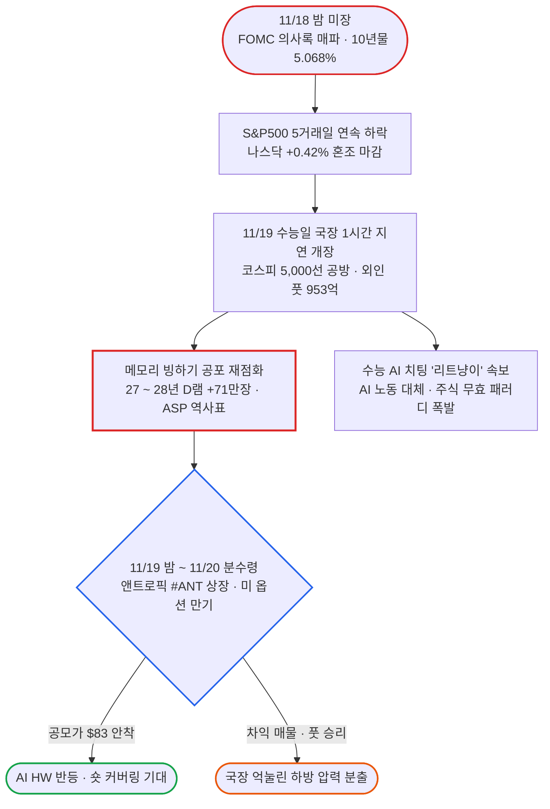

# 블라인드 주식·투자 24시간 브리핑: "수능 AI 치팅에 웃고, 하이닉스 세 토막에 울었다"

- **작성일**: 2026-11-19
- **수집 기간**: 2026년 11월 18일(수) 21:36 ~ 11월 19일(목) 21:35 (KST)
- **수집 규모**: 최근 24시간 게시글 493개 전수 수집 (본문·댓글 정밀 분석 115개, 상세 수집 댓글 594개, 목록 미리보기 분석 378개)

!!! warning "주의사항"
    아래 내용은 모두 블라인드 익명 사용자들의 날것의 주장과 여론이다. 수치, 인용 기사, 소식은 따로 검증하지 않았다. "뉴스에 나왔다", "단독" 같은 표현이 붙은 글도 출처가 불분명하거나 추측을 섞은 경우가 많다. 투자 판단에 쓰기 전에 원문 기사나 공시를 직접 확인해야 한다. 작성자 소속은 블라인드에 표시된 회사명이며 실제 재직 여부는 확인할 수 없다. "언급 글 수"는 `entities.js`로 제목, 본문, 댓글에 종목명이나 별칭이 들어간 글을 센 값이다. 이번 범위에는 2027학년도 수능일(11/19)에 따른 국내 증시 1시간 지연 개장과 미국 앤트로픽(`#ANT`) 나스닥 상장 전야가 함께 들어 있다.


## 📊 블라인드 개미 공포·탐욕 지수 (Fear & Greed Index)

공포가 다시 깊어졌다. 지수는 **29점(공포)**으로 직전 11/10의 33점보다 4점 내려왔다. 9일 전 매수 사이드카로 한숨 돌렸던 개미들이 다시 지하실 공포에 갇혔다. 코스피는 5,000선 붕괴를 코앞에 두고 흔들렸다. SK하이닉스 260만 ~ 300만 원대에 물린 투자자들은 세 토막 난 계좌 앞에서 묵념했다. 게시판은 7억 7천만 원·15억 원 손실 비명과 수능 AI 부정행위('리트냥이') 패러디가 뒤엉켜 블랙코미디를 연출했다. 유일한 희망 회로는 오늘 밤 나스닥에 상장하는 앤트로픽(`#ANT`, 공모가 $83)과 한한령 해제 테마주뿐이다.

<div class="kb-portfolio-metrics">
  <div class="kb-portfolio-metric-card">
    <span class="label">당일 공포·탐욕 지수</span>
    <span class="value">29점 (공포)</span>
    <span class="sub">0 극단적 공포 ~ 100 극단적 탐욕</span>
  </div>
  <div class="kb-portfolio-metric-card">
    <span class="label">직전 브리핑 대비</span>
    <span class="value">-4p 하락</span>
    <span class="sub">11/10 33점(공포) ➔ 11/19 29점(공포)</span>
  </div>
  <div class="kb-portfolio-metric-card">
    <span class="label">지배적 개미 분위기</span>
    <span class="value">지하실 공포 · AI 치팅 풍자</span>
    <span class="sub">"계좌는 세 토막, 게시판은 리트냥이 패러디"</span>
  </div>
  <div class="kb-portfolio-metric-card">
    <span class="label">역발상 수급 시그널</span>
    <span class="value">손절 인증 · SOXL 물타기 공존</span>
    <span class="sub">국장 탈출·현금화 vs 앤트로픽·코스닥 바닥론</span>
  </div>
</div>

```vegalite
{
  "$schema": "https://vega.github.io/schema/vega-lite/v5.json",
  "background": "transparent",
  "width": "container",
  "height": 220,
  "padding": {"top": 8, "bottom": 4, "left": 4, "right": 8},
  "data": {
    "values": [
      {"metric": "종합 공포·탐욕 지수", "score": 29, "max": 100, "zone": "공포", "label": "29점 (공포 · -4p)", "desc": "코스피 5천선 위협과 메모리 버블론 재점화로 공포 심화"},
      {"metric": "① 체감 손익·계좌 심리", "score": 20, "max": 100, "zone": "극단적 공포", "label": "20점 (극단적 공포)", "desc": "-15억·-7.7억·-2.5억 등 거액 손실 비명과 소주 맛 사라진 한탄"},
      {"metric": "② 매수·투매 수급 태도", "score": 32, "max": 100, "zone": "공포", "label": "32점 (공포)", "desc": "물량 60% 손절·현금화 vs SOXL 48~54불 추매·코스닥 바닥 매수"},
      {"metric": "③ 반도체·업황 신뢰도", "score": 24, "max": 100, "zone": "극단적 공포", "label": "24점 (극단적 공포)", "desc": "27~28년 D램 71만장 증설·ASP 하락 역사표 등 빙하기 공포 재점화"},
      {"metric": "④ 지수 지지선 신뢰도", "score": 26, "max": 100, "zone": "공포", "label": "26점 (공포)", "desc": "코스피 5000 붕괴·4500~2000론 vs 나스닥 아직 10~12%밖에 안 빠짐"},
      {"metric": "⑤ 역발상 바닥 기대감", "score": 42, "max": 100, "zone": "공포", "label": "42점 (공포)", "desc": "앤트로픽 공모가 83불 흥행·젠슨황 복귀 기대 vs 본격 하락장 경계"}
    ]
  },
  "encoding": {
    "y": {
      "field": "metric",
      "type": "nominal",
      "sort": null,
      "axis": {"title": null, "labelFontWeight": 500, "labelFontSize": 12, "labelLimit": 180, "ticks": false, "domain": false, "labelPadding": 12}
    }
  },
  "layer": [
    {
      "mark": {"type": "bar", "cornerRadius": 7, "height": 14, "color": "#94a3b8", "opacity": 0.14},
      "encoding": {
        "x": {
          "field": "max",
          "type": "quantitative",
          "scale": {"domain": [0, 118]},
          "axis": {
            "title": "블라인드 개미 심리 스펙트럼 (0~24 극단적 공포 · 25~44 공포 · 45~55 중립 · 56~74 탐욕 · 75~100 극단적 탐욕)",
            "values": [0, 25, 50, 75, 100],
            "labelExpr": "datum.value == 0 ? '0 (극단적 공포)' : datum.value == 25 ? '25 (공포)' : datum.value == 50 ? '50 (중립)' : datum.value == 75 ? '75 (탐욕)' : '100 (극단적 탐욕)'",
            "grid": false
          }
        }
      }
    },
    {
      "data": {"values": [{"x": 25}, {"x": 45}, {"x": 55}, {"x": 75}]},
      "mark": {"type": "rule", "strokeDash": [2, 4], "color": "#94a3b8", "opacity": 0.5},
      "encoding": {"x": {"field": "x", "type": "quantitative"}, "y": {"value": 0}, "y2": {"value": "height"}}
    },
    {
      "mark": {"type": "bar", "cornerRadius": 7, "height": 14},
      "encoding": {
        "x": {"field": "score", "type": "quantitative"},
        "color": {
          "field": "zone",
          "type": "nominal",
          "scale": {
            "domain": ["극단적 공포", "공포", "중립", "탐욕", "극단적 탐욕"],
            "range": ["#dc2626", "#ea580c", "#64748b", "#16a34a", "#2563eb"]
          },
          "legend": null
        },
        "tooltip": [
          {"field": "metric", "title": "심리 지표"},
          {"field": "label", "title": "점수 및 구간"},
          {"field": "desc", "title": "핵심 진단"}
        ]
      }
    },
    {
      "mark": {"type": "text", "align": "left", "dx": 10, "fontWeight": 600, "fontSize": 12},
      "encoding": {
        "x": {"field": "score", "type": "quantitative"},
        "text": {"field": "label", "type": "nominal"}
      }
    }
  ],
  "config": {"view": {"stroke": "transparent"}}
}
```

---

## 1. 24시간 핵심 요약: 수능일 AI 치팅과 5,000선 공방

이번 24시간은 공포와 블랙코미디가 뒤섞인 하루였다. 수요일 밤 10월 FOMC 의사록이 공개됐다. 거의 모든 위원이 추가 금리 인상을 언급했고, 10년물 국채금리는 **5.068%**까지 치솟았다. S&P500은 5거래일 연속 내렸다. 반면 나스닥은 앤트로픽 IPO 흥행 기대감에 **+0.42%**로 겨우 버텼다.

목요일 아침 국내 증시는 수능일이라 1시간 늦게 열렸다. 프리장 나스닥 선물 반등 덕에 코스피 5,000선을 간신히 방어했다. 하지만 게시판의 온도는 얼음장이다. SK하이닉스는 260만 ~ 300만 원에 물린 직장인들 앞에서 115만 원대까지 주저앉았다. 외국인들은 위클리 만기일 풋옵션을 **953억 원** 순매수하며 변동성을 키웠다.

기묘한 풍경도 벌어졌다. 수능 공개 검증을 예고했던 '리트냥이'(이진우 씨)가 잠적 끝 심정지로 발견됐다는 속보가 터졌다. 그러자 주식 채널이 온통 AI 부정행위 패러디로 뒤덮였다. "챗지피티한테 물어보고 주식 샀으니 무효 처리해 달라"는 자조가 쏟아졌다.



| 구분 | 핵심 내용 | 투심 기류 |
| :--- | :--- | :--- |
| **핵심 여론** | 거액 손실 비명, 수능 AI 치팅 풍자, 국장 탈출론 | 2022년보다 희망 없다는 절망감 |
| **최대 화제** | 미국 지수(52개) · AI·빅테크(50개) · 앤트로픽(45개) | 적립식 본전 붕괴 + IPO 대격돌 |
| **가장 큰 쟁점** | 메모리 슈퍼사이클 종료인가, 과매도인가 | "27~28년 71만장 증설" vs "영익 200조" |
| **수급 특이점** | 한국인 SOXL 37% 보유 경고 · 외인 풋 953억 | 3배 레버리지 청산 공포 vs 줍줍 |
| **다음 관전점** | 앤트로픽(`#ANT`) 상장 첫날 · 11/20 미 옵션 만기 | "오늘 밤 본장이 진짜 분수령" |

---

## 2. 🎭 블라인드 명예의 전당: 이번 범위 레전드 글

### 🏆 레전드 1. "나는 리트냥이가 찐천재라고 생각한다" (조회 2만 7천 · 댓글 180)

이번 24시간 압도적 반응 1위다. 수능 공개 검증 직전 잠적·심정지 속보가 터지며 게시판 전체가 AI 치팅 밈으로 물들었다.

> **"나는 리트냥이가 찐천재라고 생각한다"** (ex-스타벅스커피코리아 | 👍22 · 💬180 · 👁27,628)
> "책 사서 읽어봤는데 이건 찐이라고 생각함…뇌과학 관점에서 체계적으로 주장함. 대한민국 특유의 마녀사냥은 중단되어야 한다."
>
> - **최다 추천 댓글 (👍34)**: "리트냥이가 언제부터 뇌과학자였음?"
> - **직격탄 (👍30)**: "이런 사람들이 사이비에 빠지는 거지?"
> - **실시간 중계 (👍29)**: "지금 현재 런치셨다는데 아직도 천재라고 생각하쇼?"
> - **작성자 자수 (👍0)**: "쓰읍.. 책 내용은 맞는데 판단을 잘못했군.. 당했노.."

이 여파는 곧바로 주식 개미들의 자조 패러디로 번졌다.

> **"그래요 자백할게요 저 AI 썼어요"** (새회사 | 👍3 · 💬9 · 👁376)
> "챗지피티한테 물어보고 주식 샀습니다. 그니까 잡아가시고 무효 처리 해주세요."
>
> - **댓글 티키타카**: "나 챗지피티인데 얘 물어보고 산 거 맞다 ㅇㅇ" ➔ "증거 채택됐습니다" ➔ "AI가 수능은 풀어도 주식은 못 푸는 건가🥲"

"제미나이가 추천했다고 구글 이거 취소 좀 해줘", "저도 AI 치팅했으니 경찰서 조사 성실히 임할 테니 무효 처리 부탁한다"는 글이 줄줄이 올라왔다. 계좌의 고통을 웃음으로 승화하는 전형적인 하락장 풍경이다.

### 📉 레전드 2. "S&P500 장투가 쉬운 줄 아는 사람들이 많네" (추천 1위)

가장 많은 추천(👍29)을 받은 글이다. 지수 적립식조차 버티기 힘든 장세가 왔다는 반증이다.

> **"S&P500 장투가 쉬운 줄 아는 사람들이 많네"** (한국예탁결제원 | 👍29 · 💬56 · 👁8,191)
> "지수를 사는 건 누구나 할 수 있다. 지수를 끝까지 보유하는 건 아무나 못 한다. 지수투자는 무지한 사람을 위한 투자가 아니라, 시장을 제대로 이해한 사람이 선택하고 장기 보유가 가능한 투자다."
>
> - **시니컬 반격 (👍13)**: "알아 왜 뻔한 소리를??" · "술담배가 몸에 나쁘다는 건 다 알지"
> - **현실 요약 (👍3)**: "떨어지면 이런 글 올라오고 오르면 지수가 답이라고 지수 찬양함. 그냥 매번 똑같지"

바로 옆에는 3년 적립식 투자자의 비명이 나란히 걸렸다.

> **"ㅅㅂ 3년 넘게 월 50만 원씩 슨피 넣었는데 수익률 0.7%임"** (새회사 | 👍2 · 💬26 · 👁1,602)
> "장난하나."
>
> - **동병상련**: "연저펀 나스닥 넣고 마이너스임" · "배운 대로 하니까 자꾸 돈이 사라져"
> - **사이다 조롱 (👍2)**: "그럼 내가 지금부터 넣으면 3년을 버는 거네?" ➔ "어.. 축하한다"

### 🤖 레전드 3. "AI가 끝장났다고 보는 이유~" (댓글 92 · 뭇매 1위)

공기업 직원이 "AI는 오탈자 검토나 야한 사진 만드는 데밖에 쓸 데가 없다"며 AI 거품론을 폈다가 현업 직장인들에게 92개 댓글로 융단폭격을 맞았다.

> **"AI가 끝장났다고 보는 이유~"** (한국남동발전 | 👍6 · 💬92 · 👁8,291)
> "주변에 업무로 AI 활용하는 경우가 거의 없어…도대체 무슨 생산성이 있다는 거야? AI 관련주는 당장 파는 거 추천해."
>
> - **최다 추천 (👍43)**: "진짜 공기업 가면 시야가 좁아지는구나. 얼마나 많이 쓰는데"
> - **언어유희 (👍39)**: "니가 그래서 발전이 음다이가"
> - **명언 등장 (👍20)**: "남들 핸드폰 쓰는데 혼자 봉화로 소식 알리는 소리하네"
> - **현업 증언 (👍13)**: "AI 나오기 전이랑 비교해서 요구 생산성이 2배는 늘어난 거 같은데" ➔ "처리할 수 있는 업무량은 늘었는데 그냥 일이 더 많아짐"

재미있는 지점이다. AI 관련 주가는 폭락하고 있지만, 정작 직장인들은 "AI 때문에 업무 강도가 2배 늘었다"며 기술의 파급력만큼은 누구보다 생생하게 체감하고 있다.

### 💸 레전드 4. 거액 손실 인증과 신체 이상: "-15억, 7.7억, 10억 수업료"

단순한 푸념을 넘어 신체 이상과 가족에 대한 죄책감까지 쏟아졌다.

| 게시글 / 작성자 | 손실 규모 · 상태 | 핵심 원문과 반응 |
| :--- | :--- | :--- |
| **미장하는 형들 괜찮음?** (LG전자) | 댓글 **-15억 원** | "주가 폭락에 환율까지 쳐맞음" ➔ 댓글 "-15억 ㅋㅋㅋ 이젠 아프지도 않다" |
| **퇴학처리 인증** (ex-오스템임플란트) | **10억 원** 수업료 | "세금 낼 거 다 내고 남은 건 정신병 하나. 퇴학합니다" ➔ "어차피 일주일 내로 돌아온다" |
| **난 7억 7천 잃었다** (새회사) | **-7억 7천만 원** | "인증은 생략한다 진짜라서ㅜㅜ 내 10년" ➔ "700 더 잃고 럭키 777 가자!" |
| **올해 고점 대비 얼마나 빠졌어?** | **-2억 5천만 원** | "왜 2배 레버리지를 해가지고…주변 고수들도 많이 당했더라" |
| **3억으로 시작해 12억 갔다가** | **+9억 전액 반납** | "다시 3억 됨. 대충 노옵 아반떼 정도 벌고 청산하네" |
| **이럴 줄 알았으면 펑펑 쓸걸** (DELL) | 가족 죄책감 | "맛있는 거 먹고 여행 다니며 좋은 아빠 될걸" ➔ "남편 포르쉐 사줄걸", "미안해 딸" |
| **손실이 너무 커서** · **소주가 안 달다** | 신체화 증상 | "하루 종일 아랫배가 '끙' 긴장 상태", "밥 먹어도 허하고 잠만 자고 싶다" |

### 😂 레전드 5. 블랙 유머 3종 세트

> **"삼성라이온즈 우승 할인 혜택"** (한국전력공사 | 👍4 · 💬3)
> "삼성전자 38 -> 19 약 50% 할인 / 삼성전기 240 -> 88 약 65% 할인 / 삼성생명 51 -> 25 약 50% 할인 / 삼성중공업 35 -> 16 약 55% 할인. 이외 다양한 상품 할인 중이니 둘러보세요~"

> **"이런 극악무도한 반도체 레버리지 상품을 승인한 정부는 책임져라"** (11번가 | 👍5 · 💬11)
> "한국인이 SOXL에 38억 달러 쏟아부어 미 연준조차 경고한다. 무려 3배짜리라니 미국 정부는 책임지고 환불하라. 정부 탓 많길래 나도 정부 탓해봤음."
>
> - **댓글 (👍3)**: "속슬 책임져라" · "맞아 6개월 만에 85% 빠지는 상품 출시한 미국 나쁘다"

> **"엘지전자는 망합니다."** (LG전자 | 👍9 · 💬24 · 👁1,309)
> "내부 사정을 가장 잘 안다. 가전·TV는 중국에 잡혔고 전장·로봇은 시작부터 중국이 더 잘한다. 다 팔고 시한부 많이 남은 메모리로 갈아타라."
>
> - **댓글 반격 (👍4)**: "10년 전부터 이 얘기함. 삼전 3만 간다, 두산 망했다, 조선 끝났다…한국엔 대마불사 논리가 있다"
> - **체념 (👍6)**: "원래부터 안 샀는데요"

---

## 3. 📊 시장 지표와 지지선 매트릭스

### 3.1 국내외 핵심 수치 (원문 그대로)

| 항목 | 원문 언급 수치 | 출처 게시글 |
| :--- | :--- | :--- |
| **미국 3대 지수 (11/18)** | 다우 -1.11%, S&P500 -0.23%(5거래일 연속 하락), 나스닥 +0.42% | `11/18 미국증시` (한국GM) |
| **필라델피아 반도체** | +0.1% (AMD +5.31%, 브로드컴 +3.64% vs 퀄컴 -4.12%) | 같은 글 |
| **미국 국채 금리** | 10년물 **5.068%**, 30년물 **5.411%** | 같은 글 |
| **국제유가 · 비트코인** | WTI $82.1, 브렌트유 $91.67, 비트코인 $62,243선 | 같은 글 |
| **앤트로픽 IPO (`#ANT`)** | 공모가 $70 ~ 78에서 **$83으로 상향** (11/19 나스닥 거래, 시총 2,000조 언급) | `11/18 미국증시` · `앤트로픽이 왜 싸다는거?` |
| **코스피 외인 옵션 (11/19)** | 풋옵션 **953억 원** 순매수, 콜옵션 **203억 원** 순매수 (위클리 만기일) | `[경악] 금일 코스피 외인 풋옵션` |
| **한국인 SOXL 비중** | 전체 순자산의 **37%** (약 38억 달러, 일부 글에서는 40% 언급) | `SOXL 전체 순자산의 37%` |
| **안전자산 하락폭** | 금 고점 대비 약 -36%, 엔화 추가 -14%, 미국채(TLT) 4년간 -46% | `안전자산이라 생각했던것들` |

### 3.2 11/18 미국 증시 섹터별 등락

`11/18 미국증시`(한국GM | 👍23 · 👁874)에 정리된 종목별 등락을 섹터별 탭으로 나눴다. 지수는 혼조였으나 종목 간 온도 차가 극심했다.

=== "반도체 · 소부장"

    | 종목 | 등락률 | 종목 | 등락률 |
    | :--- | ---: | :--- | ---: |
    | **AMD** | **+5.31%** | 퀄컴 | **-4.12%** |
    | **브로드컴** | **+3.64%** | 마벨테크 | -2.15% |
    | ASML | +0.88% | TXN | -1.16% |
    | TSMC | +0.81% | 마이크론 | -1.00% |
    | 램리서치 | +0.47% | 인텔 | -0.91% |
    | KLA | +0.22% | AMAT | -0.88% |
    | 필라델피아 반도체 | +0.10% | ARM | -0.34% |

=== "M7 · 빅테크"

    | 종목 | 등락률 | 종목 | 등락률 |
    | :--- | ---: | :--- | ---: |
    | **아마존** | **+3.82%** | 메타 | -0.40% |
    | **SPCX** | **+1.27%** | 팔란티어 | +0.07% |
    | 알파벳 | +0.80% | 애플 | +0.15% |
    | 마이크로소프트 | +0.40% | 넷플릭스 | +0.23% |

=== "원전 · 전력 · 양자 · 헬스케어"

    | 섹터 | 종목 | 등락률 | 비고 |
    | :--- | :--- | ---: | :--- |
    | **헬스케어** | **UNH** | **-10.21%** | 미 정부 메디케어 어드밴티지 감사 강화 우려 |
    | **양자** | 아이온큐 / 리게티 | -5.48% / -1.50% | 테마 전반 약세 |
    | **원전** | SMR / 오클로 | -4.40% / -2.55% | UEC -2.47%, 비스트라 -1.23% |
    | **전력** | 서던 / 콴타서비스 | +0.87% / +0.68% | 넥스트에라 +0.43%, 듀크에너지 +0.16% |

### 3.3 개미들이 제시한 지지선·목표가 매트릭스

| 종목 / 지수 | 현재 · 언급 구간 | 1차 지지 · 낙관 목표 | 극단적 비관치 | 게시판 주요 근거 |
| :--- | :--- | :--- | :--- | :--- |
| **코스피** | 5,000선 턱밑 공방 | 5,000선 방어 · 4,500선 | 2,000선 · 1,100 ~ 1,300선 | "7천-6천-5천 수순", 1,100설은 댓글 조롱 |
| **코스피200 선물** | 양매도 가두리 | 763 ~ 765 (1차 지지) · 750 세력선 | — | `770 ~ 790` 양매도 (770↓ 연기금, 790↑ 금투+개인) |
| **코스닥** | 600 ~ 700대 언급 | **PBR 1.4배** (10년 하단) | — | 3년에 한 번 오는 담배꽁초 자리, +20 ~ 30% 노림 |
| **나스닥** | 고점 대비 -10 ~ 12% | 전저점 **21,000선** | **10,000대** (월봉 60일선) | "미장은 아직 빠진 것도 아니다" |
| **S&P 500** | 5거래일 연속 하락 | 7,000 ~ 7,100 (연말 컨센) | 5,500선 | 12월 금리 인상 본격화 시 추가 조정 우려 |
| **SK하이닉스** | 115만 원대 (260~300 대비 1/3) | 100만 원 · 연말 180만 원 | **80만 원** | 일 30만 주 자사주 종료 후 외인 매도 지속 시 |
| **삼성전자** | 19만 원대 (38 대비 반토막) | 연말 25만 원 · 1월 주주환원 | 9만 원 | 포워드 PBR 1.8 ~ 2.4배 부담론 vs 배당 매력 |
| **SOXL** | $48 ~ 54 구간 | $48 추매선 · 단기 $70 반등 | **$1 언더** (액면병합설) | 한국인 37 ~ 40% 보유로 세력 청산 타깃 우려 |

### 3.4 다음 거래일(11/20 금) 분수령: 미국 옵션 만기 × 앤트로픽 상장

파생 전문 글을 올린 `한전KPS`(👍2 · 💬6)와 `HD현대중공업`(👍5 · 💬10)은 내일 장을 가를 핵심 변수로 **미국 11월 옵션 만기일**과 **앤트로픽 상장 첫날 본장 흐름**을 꼽았다.

!!! failure "비관 시나리오 (풋 세력 승리 · 하방 압력 분출)"
    그동안 프리장 나스닥 선물 강세에 기대어 버텼던 국장이다. 오늘 본장에서 앤트로픽이 오르다 밀리고 나스닥이 상승분을 반납하면, 풋 세력이 승리하면서 내일 국장이 억눌렸던 하락 압력을 한꺼번에 맞을 수 있다. 이 경우 월요일 한 번 더 투매를 유도한 뒤 외국인이 받아먹는 그림을 예상한다(`한전KPS`).

!!! tip "낙관 시나리오 (앤트로픽 흥행 · 숏 커버링 3일 랠리)"
    SOXX와 NVDA 옵션에 풋(숏) 베팅이 압도적으로 몰려 있다. 앤트로픽이 공모가 $83 위에서 강하게 버티고 엔비디아 자사주 매입이 맞물리면 숏 포지션이 강제 청산된다. "숏이 무력화되면 3일간 연속 숏 스퀴즈, 국장 20일선 직행" 시나리오다(`HD현대중공업` · `한전KPS` 댓글).

---

## 4. 💣 시장 핵심 쟁점과 여론 분열

| 주제 | 핵심 논점 | 대립 구도 |
| :--- | :--- | :--- |
| **① 연준 FOMC · 고금리** | 10월 의사록 추가 인상 언급, 10년물 5.068% | "이미 선반영 · 25bp" vs "50bp · 현금이 답" |
| **② 메모리 공급과잉** | 27 ~ 28년 D램 +71만장 증설 · 창신 DDR5 | "과거 ASP -94% 빙하기" vs "ASP 반토막도 영익 200조" |
| **③ 앤트로픽(`#ANT`) 상장** | 공모가 $83 상향 · 시총 2,000조 원 | "AI 금융경색 해소" vs "보호예수 엑시트 폭탄" |
| **④ SOXL 37% 쏠림** | 한국인 38억 달러 보유에 연준 경고 보도 | "세력 청산 · $1 병합" vs "$48 ~ 54 줍줍 풀롱" |
| **⑤ 한한령 vs 국장 탈출** | 중국 한한령 해제 급등 · 코스피 5천선 붕괴 위기 | "코스닥·화장품 순환매" vs "국장 탈출은 지능순" |
| **⑥ AI 노동 대체 공포** | 수능·리트 AI 만점 사태로 전문직 무용론 폭발 | "독보적 주식·자산 사야" vs "책임지는 전문직 생존" |

### 4.1 연준 10월 FOMC와 5%대 국채금리: "25bp냐 50bp냐"

`형들 금리인상 해야한다네`(인천공항시설관리 | 👍5 · 💬9 · 👁1,365)가 불을 지폈다. "FOMC 의사록 피셜 50bp 인상이 정배인 듯. 스닥이 벌써 질질 샌다"고 경고했다.

반론은 두 갈래다. 하나는 "이미 저번 주부터 굳어졌고 FedWatch에 다 반영됐다. 유가($82.1) 급락이라 25bp거나 동결할 수도 있다"는 선반영론이다. 다른 하나는 "오히려 50bp 팍팍 올리고 그만하겠다는 말이 나오는 게 낫다"는 매파 조기 종료론이다.

하지만 가장 뼈아픈 댓글은 따로 있었다.

> **"금리 인상도 문제없음? ㅋㅋㅋ 어떻게 투자하면서 금리를 무시하지. 고금리가 중요한 게 아니고 방향이 인상일 때는 현금이 제일 좋은 투자임."**

### 4.2 메모리 공급과잉 공포: "27 ~ 28년 71만 장 증설 + ASP 역사표"

오늘 반도체 투심을 결정적으로 얼려버린 건 삼정KPMG 소속 작성자의 데이터 2건이다.

> **"D램 생산능력"** (삼정KPMG | 💬4 · 👁264)
> "현재 웨이퍼 투입 기준 4개 회사 생산능력은 195만 장인데, 27 ~ 28년 추가 증설만 **71만 장**이다. 16 ~ 18년 클라우드 때 늘어난 13.8만 장의 **5배**다. 거기다 창신메모리가 커져서 감산도 쉽지 않다."

같은 작성자는 `Winter is coming`(👍2)에 40년 치 D램 평균판매가격(ASP) 하락 역사를 표로 띄웠다.

| 하락 사이클 | 하락 기간 | D램 ASP 하락률 | 하락 사이클 | 하락 기간 | D램 ASP 하락률 |
| :--- | :---: | ---: | :--- | :---: | ---: |
| 1980 ~ 1981 | 5분기 | -64% | 2000 ~ 2003 | 11분기 | **-89%** |
| 1985 | 3분기 | -73% | 2007 ~ 2009 | 9분기 | **-87%** |
| 1989 ~ 1990 | 6분기 | -63% | 2010 ~ 2012 | 8분기 | -69% |
| 1996 ~ 1998 | 10분기 | **-94%** | 2015 ~ 2016 | 5분기 | -38% |
| 2018 ~ 2020 | 6분기 | -53% | — | — | — |

삼성전자 소속 작성자의 `디램 현물가가 떨어지기 시작하면 생기는 일`(👍6)도 공포를 거들었다. "22년 3분기 역대급 실적에도 컨콜에서 다운턴을 언급하자 10만 전자가 5만 전자로 갔다"는 회상이다. `한국남부발전`(💬15)은 "중국이 장비 없이 DDR5 양산까지 도달했다. 지금 실적이 아니라 2년 뒤를 보면 비싸다"고 못 박았다.

반론도 만만치 않았다. 댓글에서는 "창신은 중국 내수용일 뿐 경쟁 상대로 보는 것부터 공부 다시 하라", "데이터센터·소버린 AI·로봇·스마트안경 등 수요처가 신설돼 **ASP가 -50% 빠져도 삼성전자 영업이익이 200조**"라고 맞섰다.

### 4.3 앤트로픽(`#ANT`) 상장: "AI 구원투수인가, 2,000조 엑시트인가"

오늘 밤 나스닥에 상장하는 앤트로픽(`#ANT`)이 최대 승부처다. 공모가가 $70 ~ 78에서 **$83**으로 상향되며 청약 경쟁률이 6배에 달했다는 소식이 전해졌다.

- **흥행 기대파**: "지금 시장이 빠지는 이유 중 하나가 AI 금융경색이다. 앤트로픽이 공모가 위에서 안착하면 AI 인프라 투자금이 쏟아지며 하드웨어 섹터까지 반등한다"(`일단 앤트로픽상장 공모가는 흥행했네`).
- **거품·물량 경계파**: `앤트로픽 상장과 주식 향방에 관해서`(새회사)는 "공모 6배는 실제 매수세를 보장하지 않는다. 상장 첫날 상승률이 아니라 향후 1 ~ 6개월 내부자 매도량과 보호예수 해제 일정을 보라"고 경고했다. 댓글도 "27년 말까지 보호예수·신규발행이 폭탄처럼 풀린다. 엑시트하기 좋은 구조"라며 동의했다.
- **밸류에이션 의문**: `이마트`(💬8)는 "구글 4,000조, 테슬라 2,000조, 삼전 1,000조, 하이닉스 800조인데 앤트로픽 시총 2,000조가 싼 거 맞냐"고 물었다. 댓글에서는 "삼전·하닉·콜라 다 줘도 앤트로픽 안 판다"와 "팔 것 같은데"가 정면충돌했다.

### 4.4 한국인 SOXL 37% 쏠림과 파생 수급 전쟁

한국인이 반도체 3배 레버리지 ETF(SOXL) 순자산의 **37%(약 38억 달러)**를 들고 있다는 소식이 충격을 줬다. `도쿄일렉트론코리아`(👍2)는 "두 번 폭등 학습시켜 한국 개미에게 40% 가까이 떠넘겼다. 며칠 횡보시키며 하락하면 음의 복리로 녹아 **$1 언더 액면병합** 가도 안 이상하다"고 경고했다.

국내 파생시장도 과열이다. 외국인이 11/19 하루에만 **코스피 풋옵션 953억 원, 콜옵션 203억 원**을 순매수하자 게시판이 술렁였다. 다만 파생 숙련자들은 "오늘 목요일 위클리 만기일이라 판돈이 커진 것. 12월물인지 내년 물량인지 확인해야 하며, 내년 물량이면 투매 유도용 페이크"라고 진정시켰다(`한전KPS`).

### 4.5 한한령 해제 테마 vs 국장 탈출론

반도체가 무너지는 사이 중국의 한한령 해제 소식이 전해지며 스튜디오드래곤이 상한가를 쳤다. "한국 민주당 + 미국 민주당 + 중국 = 코스닥. 엔터·여행·화장품·바이오로 돈이 들어온다"는 순환매 주장이 고개를 들었다.

반면 국장 대형주에 데인 투자자들의 냉소는 극에 달했다.

> **"현 정부가 잘한 경제정책 알려줌"** (새회사 | 👍6 · 💬2)
> "1. 국장 탈출은 지능순임을 깨닫게 해줌. 2. 서울 부동산은 불패임을 증명함. 코스피 9천에서 5천까지 폭락해도 방치된다. 미장 줄이고 정부 믿고 국장 들어온 내 스스로 매일 자책 중."

### 4.6 AI 치팅 사태가 쏘아 올린 "노동 가치 0원" 논쟁

리트냥이·세무냥이 사건은 주식 채널을 철학적 논쟁으로 끌고 갔다.

- **대체 가속론**: `ex-삼성E&A`(👍7)는 "아스트라·Fable 같은 모델을 극소수만 써봐서 대중은 AI가 얼마나 무서운지 모른다. 지식의 가치는 0이 되고 전문직도 대체된다"고 했다. `SK하이닉스`(👍4)도 "노동 가치는 없어진다. 독보적 회사 주식을 사서 배당받는 것만이 살길"이라고 거들었다.
- **실무 생존론**: `서울특별시`(💬16)는 "녹취록은 클로바노트가 있어도 법원에는 속기사 서명이 필요하다. 결국 '책임'을 지는 전문직은 남는다"고 반박했다. 하지만 댓글에서는 "전문직 100명이 할 일을 1명이 하게 되니 망한 건 매한가지"(👍4)라는 반격이 더 큰 공감을 얻었다.

---

## 5. 🕵️ 찌라시와 미확인 소식: 신뢰도 등급 카드

| 소식 | 태그 | 신뢰도 | 수급 영향 |
| :--- | :---: | :---: | :---: |
| 미 연준, 한국인 SOXL 37%(38억 달러) 경고 | `[보도/풍자]` | **중** | ⚠️ 큼 |
| SK하이닉스, 미국 주주에게 급락 보상 피소 | `[미확인]` | **하** | 작음 |
| 스페이스X 유상증자 설 · 중국의 엔비디아 이사회 장악설 | `[풍문/음모론]` | **하** | ⚠️ 큼 |
| 중국 한한령 즉시 해제 vs 단계적 해제 | `[보도/해석 논란]` | **중** | 중간 |
| 코인 관련주 '비트플래닛' 부대표 해고·대표 런 직전 | `[미확인]` | **하** | 작음 |

### 5.1 ⚠️ [보도/풍자] 미 연준, 한국인 SOXL 37%(38억 달러) 보유 경고

!!! warning "신뢰도: 중 — 외신(Benzinga) URL 첨부, 정부 책임론은 반어적 풍자"
    **원문 주장**: `11번가`(👍5 · 💬11)가 Benzinga 기사(`fed-sounds-alarm-on-leveraged-etfs-as-south-korean-investors-pour-3-8b-into-soxl`)를 인용하며 "미국 정부는 환불하라"고 풍자했다. `SK이노베이션`(👍3)과 `도쿄일렉트론코리아`(👍2)도 한국인 보유 비중을 37 ~ 40%로 언급했다.

    **팩트체크 및 반박**: SOXL은 미국 운용사 상품이므로 국내 정부 승인 이슈가 아니다. 작성자 역시 "정부 탓이 많길래 나도 해봤다"고 밝혔다. 댓글은 "세력이 청산 한 번 시키고 올리겠네"라며 수급 쏠림 자체를 경계했다.

    **투자 체크포인트**: 단일 국가 개인이 3배 레버리지 물량의 40% 가까이를 쥐고 있으면, 하락장 반대매매와 음의 복리가 겹쳐 회복 불능의 변동성에 노출된다.

### 5.2 ⚠️ [미확인] SK하이닉스, 미국에서 주주에게 급락 보상 피소?

!!! danger "신뢰도: 하 — 소송 주체·법원·사건 번호·기사 링크 전무"
    **원문 주장**: `하닉 미국에서 주주한테 고소미 먹음`(경동나비엔 | 👁31)에서 "급락 보상하라고 소송의 나라답다. 한국도 이제 이렇게 해야 한다"고 적었다.

    **팩트체크 및 반박**: 관련 외신 보도나 공시가 전혀 첨부되지 않았다. 단순 주가 하락만으로 미국 법원에서 보상을 받기 어렵다. 댓글도 "재용이 형이 그래서 그짝 동네 상장 안 시킨 거"라며 가볍게 넘겼다.

    **투자 체크포인트**: 확인된 사실이 없으므로 수급 판단에 쓰지 말고, 공식 공시 여부를 먼저 확인해야 한다.

### 5.3 [풍문·음모론] 스페이스X 유상증자 설 & 중국의 엔비디아 이사회 장악설

!!! danger "신뢰도: 하 — 출처 없는 커뮤니티 카더라 및 추측"
    **원문 주장**: `줴줴이야` 글에서 "월러 금리, 이스라엘 가자지구, 스엑 유상증자 가지가지 한다"고 적었다. 또한 `삼성디스플레이`(👍2)는 "앨리스 황의 진짜 목표가 엔비디아에서 젠슨 황을 몰아내는 것 아니었을까"라는 음모론을 올렸다.

    **팩트체크 및 반박**: 스페이스X 유상증자 관련 공시나 기사 링크는 없다. 엔비디아 음모론에는 "젠슨 황은 대만 사람이다", "로스차일드가 움직인 거임"이라며 농담으로 받아쳤다.

    **투자 체크포인트**: 두 종목 모두 서학개미 비중이 높아 확인되지 않은 루머에도 프리장 변동성이 크다. 반드시 미국 SEC 공시와 1차 외신으로 교차 검증해야 한다.

### 5.4 [보도/해석 논란] 중국 한한령 즉시 해제 vs 단계적 해제

!!! warning "신뢰도: 중 — MTN·뉴스1 기사 링크 첨부, 해제 범위 해석 충돌"
    **원문 주장**: `NC`(👍2 · 💬21) 소속 작성자가 MTN 뉴스 링크(`2026111815584373811`)를 걸며 "중국이 한한령을 전부 해제하고 최혜국 대우한다. 아이온2 중국 출시하니 지금 사라"고 홍보했다. `새회사`(👍2 · 💬10)도 뉴스1 링크(`0009297106`)와 함께 엔터주 2배 상승을 물었다.

    **팩트체크 및 반박**: 댓글의 반격이 매서웠다. "전부 해제가 아니라 단계적 해제다", "엔터는 확정 아니고 화장품·미디어가 확정", "NC는 아직도 리니지가 매출 50%(작년 62%)인데 뭔 소리냐. 진짜 수혜주는 호텔신라·롯데관광·아모레퍼시픽"이라며 자사주 홍보를 차단했다.

    **투자 체크포인트**: 반도체 하락장의 반사이익으로 단기 테마 수급이 쏠렸다. 실제 판호 발급·수출 실적이 확인되는 업종과 단순 테마 급등주를 구분해야 한다.

### 5.5 [미확인] 비트코인 관련주 '비트플래닛' 부대표 해고·대표 런 직전설

!!! info "신뢰도: 하 — 내부자 확인 불가한 풍문성 글"
    **원문 주장**: `비트코인 회사 주식 망함` 글에서 "3,000원에 들어갔다가 1,700원. 부대표 잘렸고 대표도 런치기 직전이며 돈 없고 채굴도 망했다"고 주장했다.

    **투자 체크포인트**: 비트코인이 $62,243선까지 밀리면서 중소형 코인·채굴 관련주 전반에 재무 부실 공포가 확산되고 있음을 보여주는 정황이다.

---

## 6. 🔍 종목·섹터별 개인 투자자 심리와 전망

`entities.js` 재집계 기준, 언급 글 수 상위 11개 종목·섹터는 아래와 같다.

| 종목·섹터 | 언급 수 | 지배적 심리 | 대표 전망 (원문 인용) | 소수 반대 의견 |
| :--- | :---: | :--- | :--- | :--- |
| **미국 지수(나스닥·S&P)** | 52 | 실망 · 추가 하락 경계 | "미장은 아직 빠진 것도 아님. 21,000선 가면 태초 마을" | "악재 다 나왔다. 연말 S&P 7천 후반 컨센" |
| **AI·빅테크** | 50 | 기술 확신 vs 주가 냉소 | "AI로 전문직 대체는 시간문제, 독보적 기업 주식 사야" | "최적화로 컴퓨팅 수요 줄어 인프라 추정치 하향" |
| **국내 지수(코스피·코스닥)** | 48 | 극단적 비관 vs 담배꽁초론 | "코스피 5천 깨지면 4,500. 국장 탈출은 지능순" | "코스닥 PBR 1.4배는 3년에 한 번 오는 바닥" |
| **앤트로픽 (`#ANT`)** | 45 | 흥행 기대 vs 엑시트 경계 | "공모가 $83 흥행하면 AI HW 섹터 반등" | "시총 2,000조 고평가. 보호예수 물량 폭탄" |
| **반도체 (업황)** | 45 | 빙하기 공포 재점화 | "27~28년 D램 71만장 증설 · 창신 DDR5로 감산 불가" | "ASP -50% 가도 삼전 영익 200조" |
| **SK하이닉스** | 34 | 고점 물림 절망 · 체념 | "260층 세 토막. 자사주 매입 끝나면 80만 원" | "평단 10만 원이라 2배. 115만 원 단타 재매수" |
| **삼성전자** | 30 | 자조 · 배당 기대 | "삼성라이온즈 우승 50% 할인 세일 중" | "내년 1월 주주환원 발표 · 미장보다 클 것" |
| **레버리지·인버스 ETF** | 25 | 투매 vs 단타 도박 | "레버리지 물려 의욕 상실. 인버스·곱버스 가자" | "숏 스퀴즈 터지면 SOXX·정배 대박" |
| **채권·달러·환율** | 24 | 대피처 상실 혼란 | "금·주식·코인·채권 다 빠지는데 돈 어디로 가냐" | "금리 인상 방향일 때는 달러·현금이 답" |
| **SOXL (반도체 3배)** | 23 | 청산 공포 vs 역발상 물타기 | "한국인 37~40% 보유, $1 액면병합 가도 안 이상함" | "$54 줍고 $48 추매. 결국 풀롱" |
| **엔비디아 (`NVDA`)** | 22 | 리더십 공백 실망 | "호실적(BEAT) 치고 찔끔 오름" | "자사주 매입 · 젠슨 황 복귀 시사가 터닝포인트" |

### 6.1 미국 지수(나스닥·S&P): 적립식마저 본전 깨지다 (언급 52개)

**보유자 상태.** "3년 넘게 월 50만 원씩 S&P 넣었는데 수익률 0.7%", "연저펀 나스닥 넣고 마이너스", "적립식 S&P·나스닥100 모았는데 마이너스 구간 진입" 등 가장 안전하다고 믿던 적립식 보유자들까지 본전이 흔들린다.

**심리.** 2022년보다 희망이 없다는 공포다. `한국전자통신연구원`(👍9)은 "22년은 경제가 다 안 좋아 바닥 다지는 느낌이었는데 지금은 지하실 밑에 지하실이 있을 것 같다"고 썼다.

=== "하락 · 비관론"

    - 댓글 최다 추천(👍4): "문제는 **나스닥 이제 10% 빠짐**. 우리는 40% 넘게 빠졌고 나스닥 전저점 **21,000선**까지 빠지면 우리는 태초 마을 간다."
    - `삼보모터스`(👁1,422): "나스닥 월봉 20일선 깨지면 60일선도 간다." 댓글에서는 "**1만 대** 가능해 보인다"며 현금화를 다짐했다.
    - FOMC 금리 인상 본격화 시 S&P500 **5,500**까지 본다는 극단론도 달렸다.

=== "상승 · 장투론"

    - `한국예탁결제원`(👍29): "반토막 나도 자본주의 구조를 믿고 10년 버티는 사람만 지수투자가 가능하다."
    - `새회사`(👍3): "월가 연말 S&P 컨센서스 **7,000 후반**이고 나올 이슈 다 나왔다."
    - 댓글 반응: "지금부터 넣으면 3년을 버는 셈"이라며 적립식 유지를 다짐하는 목소리도 있다.

**직전(11/10) 대비 변화.** 9일 전에는 국장 피로감에 미국 지수 예찬이 지배적이었으나, 5거래일 연속 하락과 FOMC 의사록 이후 '미국 예외주의' 피난처마저 의심받기 시작했다.

!!! tip "종합 판단"
    적립식 투자자까지 비명을 지르기 시작했다는 점은 투심이 상당히 식었다는 신호다. 다만 "미장은 아직 10 ~ 12%밖에 안 빠졌다"는 경계심이 남아 있어 완전한 투매 바닥으로 보기는 이르다.

---

### 6.2 AI·빅테크: "기술은 진짜, 인프라 주가는 글쎄" (언급 50개)

**보유자 상태.** "엔비디아 본전만 찾고 탈출함. 빅테크는 내 성향과 안 맞는다", "균등하게 10% 까먹어 당분간 물도 아껴 마셔야겠다" 등 지친 개인들이 늘었다.

**심리.** 수능 AI 치팅 사태를 계기로 기묘한 분열이 생겼다. **"AI 기술은 인류 문명을 바꿀 진짜"**라는 확신은 더 강해졌는데, **"AI 인프라 주가가 계속 오를 것인가"**에는 의구심이 커졌다.

**전망과 논리.** 긍정론은 "AI가 수능·리트 만점을 증명했다. 노동 가치는 0이 되므로 독보적 기업 주식을 사야 한다"(`SK하이닉스` · `ex-삼성E&A`)는 주장이다. 반면 `인천교통공사`는 **"앤트로픽 매출 8배 늘 때 컴퓨팅 사용량은 3배만 늘었다. 클라우드 때도 가상서버가 하드웨어 수요를 반토막 냈다"**며 AI 인프라 추정치 하향 위험을 짚었다. 댓글에서는 "토큰 가격이 일정하지 않으니 틀린 논리"라고 반박했다.

**직전 대비 변화.** 지난주 '젠슨 황 불륜' 가십에서 벗어나 'AI의 노동 대체'와 '앤트로픽 IPO'라는 산업 본질 논쟁으로 무게중심이 옮겨갔다.

---

### 6.3 국내 지수(코스피·코스닥): 코스피 혐오 vs 코스닥 담배꽁초론 (언급 48개)

**보유자 상태.** "코스피 5000선 깨지고 -30% 손절 후 현금 보유"(`KT` | 👍4), "정부 믿고 국장 들어온 내 스스로 매일 자책 중"(`새회사` | 👍6) 등 투매와 후회가 쏟아진다.

**심리.** 코스피는 극단적 혐오("국장 탈출은 지능순")에 휩싸인 반면, 코스닥은 3년 만의 저점 매수 심리가 고개를 들며 극명히 엇갈렸다.

=== "코스피 비관론"

    - "7천 - 6천 - 5천 정확한 수순대로 빠진다. 5,000 위는 푸근한 숏 자리."
    - `KT`: "4,500 찍고 주말 미·이란 확전하면 돌아올 수 없는 강. 상승세 붙으면 그때 탄다."
    - `SC제일은행`: "2,000? 1,500도 장담 못 한다. **1,100 ~ 1,300**이 저점." (댓글에서는 "1,100 가려면 2,000을 찍어야 가지"라며 조롱)

=== "코스닥 담배꽁초 바닥론"

    - `현대모비스`(👍3 · 💬15): "코스닥이 구데기인 건 맞다. 하지만 10년 내 코로나급 제외 **PBR 하단은 1.4배**다. 3년에 한 번 오는 자리니 분할로 담아 1년 내 **20 ~ 30%**만 먹고 나와라."
    - `공무원`(💬10): "남들 조롱할 때 사는 거다. 코스닥 150 1배에 일단 3천 박아놨다. 떨어지면 더 산다."

**직전 대비 변화.** 11/10 매수 사이드카 직후 등장했던 "5,000 ~ 6,000 박스권" 기대가 9일 만에 다시 5,000선 붕괴 공포로 급랭했다.

---

### 6.4 앤트로픽(`#ANT`): 2,000조 IPO, 구원투수냐 폭탄이냐 (언급 45개)

**보유자 상태.** 오늘(11/19) 나스닥 상장 첫날을 앞두고 개미들의 시선이 가장 뜨겁게 쏠린 신규 종목이다.

**심리.** "800달러도 싼데 공모가 $83? 풀매수하고 1년 뒤 래미안 원베일리에서 만나자"는 광기와, "티커부터 ANT(개미)라 불길하다. 개미 돈 한탕 해먹으려는 것"(`한국자산관리공사`)이라는 냉소가 충돌한다.

=== "흥행 · 상장 매수론"

    - 공모가 $70 ~ 78에서 **$83으로 상향**된 것은 기관 수요가 견조하다는 증거다.
    - 상장 성공으로 AI 금융경색 우려가 풀리면 AI 하드웨어·반도체까지 동반 반등할 수 있다.
    - "오늘 앤트로픽 사 말아?" 글에는 "무조건 사야지", "풀매", "영끌해라" 댓글이 줄을 이었다.

=== "고평가 · 엑시트 경계론"

    - `새회사`: "청약 6배는 실제 매수세를 보장하지 않는다. 핵심 위험은 막대한 기업가치, 기존 주주 매도, 인프라 자금 조달 능력 세 가지다."
    - 댓글: "27년 말까지 보호예수·신규발행 수십억 주가 폭탄처럼 풀린다. 공모가 아래로 떨어지면 매수하라."
    - `이마트`: "구글 4,000조, 삼전 1,000조, 하이닉스 800조인데 앤트로픽 시총 **2,000조**가 싼 거 맞냐."

!!! tip "종합 판단"
    단순 개별주 상장이 아니다. 얼어붙은 AI 섹터 전체가 시장에서 여전히 거액의 자금을 끌어올 수 있는지 증명하는 리트머스 시험지다.

---

### 6.5 반도체 업황: "스팟 피크론"에서 "71만 장 공급과잉론"으로 (언급 45개)

**보유자 상태.** 메모리 본주·소부장 보유자 대부분이 고점 대비 큰 평가손실을 안고 버티거나 손절을 고민 중이다.

**심리.** **극단적 공포**다. 4.2절에서 다룬 삼정KPMG 작성자의 `27 ~ 28년 D램 +71만 장 증설` 및 `40년 D램 ASP 하락률 표`가 퍼지며 "이번엔 진짜 빙하기"라는 공포가 번졌다. "닷컴버블 시스코처럼 돈을 잘 벌어도 고점 회복에 25년 걸리는 것 아니냐"(`새회사`)는 불안까지 나왔다.

**현직자·업계 반응.** `한국남부발전` 글 댓글에 "반도체 현업에서 뛰는 동생은 수요 많고 공급 부족하다며 계속 산다"는 증언이 달렸지만, 작성자는 "하닉 300일 때 계속 사라던 애들 대부분이 현직자였다"고 차갑게 맞받았다.

**직전 대비 변화.** 지난주 추상적이었던 '피크아웃 우려'가 구체적인 증설 물량(71만 장)과 중국 창신 DDR5 양산이라는 장기 공포로 진화했다.

---

### 6.6 SK하이닉스: 260만 ~ 300만 원 물린 개미들의 "처절한 암흑" (언급 34개)

**보유자 상태.** 천국과 지옥으로 극단 양극화됐다.

- **고점 물림**: "260층인데 절망적이다"(`기업은행`), "평단 265만 원", "270에 124개", "200에 500주(10억 투입 → 6억)", "300에서 세 토막(-65%)".
- **저평단 · 단타**: "평단 10만 원에 300주 넘음(20만 원 돼도 2배)", "평단 80만 원에 50주", "180짜리 162 손절 후 종가 전 115만 1,000원에 482주(5억 5천) 재매수".

**심리.** 260층 보유자(`기업은행` | 💬11)의 토로가 오늘 하이닉스 민심을 대변한다.

> **"110만 원짜리가 80이 될지 150이 될지 300이 될지 아무도 모른다. 절반 이상 잃은 상황에서 이 지독한 암흑 속에 있다는 사실이 뼈에 사무치게 두렵다."**

`타이코에이엠피` 댓글도 뼈아프다. "불과 몇 달 전엔 하닉 180 오면 무조건 줍는다더니, 이젠 180도 희망 도돌이 노래로 들린다."

**전망과 수급 쟁점.** 비관론의 핵심은 **자사주 매입 종료 이후**다. `기업은행`(👍2)은 "지금 일 30만 주 이상 자사주로 사주는데도 이 모양이다. 외인은 돌아올 기미가 없고 자사주 끝나면 **80만 원 지옥도**"라고 경고했다. `한국남부발전`(👍3)은 "최태원도 140에 물렸다"며 현직자 램혁수들의 침묵을 조롱했다. 반대로 낙관론은 "연말 180만 원 트라이", "내일 앤트로픽 덕에 8% 오른다"며 반등을 기다린다.

!!! tip "종합 판단"
    고점 매물대가 겹겹이 쌓인 데다 자사주 매입 종료 후 수급 공백 공포까지 겹쳤다. 단기 반등이 나와도 본전 탈출 매물이 쏟아질 구조라 외국인 수급 전환 확인이 필수다.

---

### 6.7 삼성전자: "50% 할인 세일" 자조 속 내년 1월 주주환원 기대 (언급 30개)

**보유자 상태.** "38만 원 → 19만 원 반토막", "삼성전자 23층 물림" 등 반토막 보유자가 다수다.

**심리.** 하이닉스만큼 처절한 비명은 덜하지만 "삼성라이온즈 우승 50% 할인" 같은 자조가 깊다.

**전망과 행동.** 하락론은 "삼전 9만 원에 입 벌리면 되냐", "과거 저점 PER과 2028년 포워드 PBR 1.8 ~ 2.4배를 보면 손이 안 나간다"(`NH농협은행`)고 본다. 반면 보유파는 **"내년 1월 주주환원 발표"**와 "자사주 소각해도 주가 빠질 바에 현금배당이 낫다"며 배당을 방패 삼아 버티는 분위기다. "1 ~ 3년으로 보면 미장보다 삼하닉이 주주환원을 더 많이 할 것"(`LG전자` 댓글)이라는 반론도 나왔다.

---

### 6.8 레버리지·인버스 ETF: "의욕 상실 물림" vs "변동성 7,800만 수익" (언급 25개)

**보유자 상태.** 양극단이 뚜렷하다. 한쪽은 "레버리지 물려서 의욕을 다 잃고 공모주도 까먹었다. 그냥 다 끝내고 싶다"(`한전KDN`)며 무너졌다. 다른 쪽은 "이번 달 변동성이 너무 맛돌이라 SOXS·SOXL로 실현 7,800만·평가 2,200만 먹었다"(`우리은행`)며 수익을 자랑했다.

**행동 계획.** "요즘 장은 2% 이상 오르면 바로 매도·숏. 줄 때 안 먹으면 99% 손실 본다"는 극단적 초단타와 곱버스·SOXS 베팅 유혹이 강해졌다.

---

### 6.9 채권·달러·환율: "안전자산 다 박살, 돈 어디로 갔냐" (언급 24개)

**보유자 상태.** `롯데웰푸드`(👍2)는 "금 -36%, 엔화 추가 -14%, 미국채 TLT 4년간 -46%. 안전자산이라 믿었는데 다 박살"이라고 한탄했다. `서울특별시교육청`(💬28)도 "금·주식·코인·부동산 다 빠지는데 돈이 어디로 간 거냐"며 분산 투자의 무력감을 토로했다. "1,400 초반에 미국 ETF 사서 환차손만 1 ~ 2천만 원"이라는 서학개미 호소도 있었다.

**전망.** 10년물 국채금리가 5.068%까지 오르며 채권 반등 기대가 꺾였고, "금리 인상 국면에서는 결국 달러와 현금밖에 없다"는 결론으로 모였다.

---

### 6.10 SOXL (반도체 3배 ETF): "$1 병합설" vs "$48 추매 풀롱" (언급 23개)

**보유자 상태.** "평단 $87에 물려 70 반등만 기다린다", "$71에 사서 $54 넘었다", "방금 1,200만 원 샀다"는 물림·물타기파와 "270불에 설거지하고 50불대 보니 반찬이 필요 없다"는 탈출파의 조롱이 교차한다.

**심리와 전망.** 한국인 37 ~ 40% 보유 소식에 "세력이 한국 개미 다 죽이고 $1 액면병합 간다"(`도쿄일렉트론코리아`)는 공포가 퍼졌다. 반대로 `현대자동차`(👍4) 작성자는 "어제 $54 줍고 $48 추매했다. 앤트로픽 상장 때 하루 내려도 결국 풀롱"이라며 1년 묵히기를 선언했다.

---

### 6.11 엔비디아(`NVDA`): 호실적에도 찔끔, 젠슨 황 공백의 그림자 (언급 22개)

**보유자 상태.** "평단 $120에 500주 들고 있는데 100% 찍었다가 수익 쪼금 남았다. 팔까 홀딩할까"라며 고민하는 장기 보유자와, 반등 시 본전만 찾고 탈출한 단타파가 섞여 있다.

**심리와 전망.** "호실적(BEAT) 치고 별로 못 오른다"는 실망감이 크다. `ex-귀뚜라미`(👍8)는 "젠슨 황은 일론 머스크급이라 몇 주 쉬다 무조건 복귀한다"고 확신했고, `HD현대중공업`은 "장 시작 30분 후 자사주 매입으로 숏 스퀴즈가 터진다"고 봤다. 반면 댓글에서는 "젠슨 황이 다시 돌아오면 회사가 어렵다는 뜻이라 오히려 악재"라고 반박했다.

---

### 6.12 기타 종목·섹터 (언급 1 ~ 10개)

| 종목·섹터 (언급 수) | 게시판 여론 요약 |
| :--- | :--- |
| **네이버 (10개)** | "투자자에게 지속적 실망감을 안겨 주가 바닥을 깨는 중. 최수연·외인·기관 욕할 수도 없다"는 장기 소외 원성 |
| **부동산 (9개)** | 주식·금·채권·코인 다 빠지자 "결국 서울·경기 남부 아파트가 나스닥보다 우량하다. 나라가 멱살 잡고 살려준다"(`삼성증권` 👍6) |
| **코인 (8개)** | 비트코인 $62,243선 하락. "스트래티지 사태 터지면 쭉 빠진다", "비트플래닛 3,000 → 1,700 폭락" 등 매도세 경계 |
| **현대차 (7개)** | "오늘 같은 날 상승 많이 했다"는 안도 vs "4천 넘는 아반떼 팔아 망했다. 로봇 가격 5억이라 현장에 언제 투입되냐" 현직자 자조 |
| **로봇 (7개)** | 중국 완성차(BYD·샤오펑·지커)가 휴머노이드 투입 후 경제성·내구성 의문 제기 기사(한경) 공유되며 거품 경계 |
| **바이오·제약 (5개)** | 알테오젠 38층·코오롱티슈진 존버 한탄, '아리바이오랩 치매 3상 시나리오'(기존 치료제 미복용 대상 성공) 추측 |
| **삼성SDI · 2차전지 (3개)** | LS증권 목표가 하향 소식에 "ESS·전고체 좋다더니 4분기 적자냐, 배터리는 다 망했다"며 물린 주주 망연자실 |
| **LG전자 (2개)** | 현직자의 "가전·로봇 중국에 밀려 망한다" 폭로글과 "자사주 소각 결정!!" 속보가 동시에 올라오며 혼조 반응 |
| **한한령 · 내수주 (다수)** | 스튜디오드래곤 상한가, 호텔신라·롯데관광·아모레퍼시픽 수혜론, "진짜 빈집은 중국인이 환장하는 쿠쿠홀딩스" 주장 |

---

## 7. 🧠 대표 투자 의견과 멘탈 관리 조언

### 7.1 비관·현금화파: "나스닥은 아직 시작도 안 했다"

가장 설득력을 얻은 비관론은 **국장과 미장의 하락 시차**다. `한국전자통신연구원`(👍9)과 `삼보모터스`는 코스피가 이미 40% 넘게 빠졌는데 나스닥은 고점 대비 10 ~ 12% 조정받았을 뿐이라고 지적한다. 나스닥이 21,000선이나 월봉 60일선으로 내려오면 국장은 2차 충격이 불가피하다. `삼정KPMG`의 D램 71만 장 증설 논리까지 더해져 "상승 추세가 붙기 전까지는 현금 보유가 최선"(`KT`)이라는 보수론이 힘을 얻었다.

### 7.2 낙관·역발상파: "악재 다 나왔다"와 호재 7종 검증표

`현재시장 감정 다 빼고 객관적으로 생각해보면?`(ex-삼성E&A | 👍4)과 `모든 시계열은 이제 상승을 가리키고 있다`(공무원 | 👍4)는 악재 소진과 호재 전환을 주장했다. 하지만 게시판의 반론도 즉각 따라붙었다.

| 낙관파가 꼽은 호재 7종 | 게시판의 현실 반박 |
| :--- | :--- |
| ① 러우·미이란 전쟁 합의 진전 | "주말 미·이란 확전하면 돌아올 수 없는 강" (`KT`) |
| ② 데이터센터 대출 규제 약화 | "데이터센터 규제 + 빅스텝으로 SOXS 풀매수" (`삼성SDS`) |
| ③ AI 수요 오히려 가속 | "소프트웨어 최적화로 컴퓨팅 수요 둔화" (`인천교통공사`) |
| ④ 젠슨 황 복귀 가능성 | "돌아오면 회사가 어렵다는 뜻이라 악재" |
| ⑤ 12월 금리 인상 기 반영 (동결 가능) | "12월 동결? FedWatch도 모르고 쓴 글이라 스크롤 내림"(👍6) |
| ⑥ 유가 하락 지속 | "유가는 내려도 유조선 운임은 계속 오르는 중" |
| ⑦ 앤트로픽 상장 예상보다 흥행 | "시총 2,000조 고평가 · 보호예수 해제 물량 폭탄" |

### 7.3 코스닥 PBR 1.4배 담배꽁초론과 단타 생존법

현실적인 매매 전략으로는 두 가지가 호응을 얻었다.

- **가치평가 기반 역발상 (`현대모비스`)**: 코스닥이 저평가(PBR 1.4배)일 때 3년에 한 번 오는 자리로 보고 분할 매수해 1년 내 20 ~ 30% 수익을 노린다.
- **철저한 단타·손절 원칙**: "2% 이상 오르면 곧바로 매도하라. 요즘 장은 줄 때 안 먹으면 99% 손실 본다" · "신용 스칼핑으로 50만 원 물렸는데 하루 이자 7천 원"처럼 레버리지의 위험을 경고하는 글도 이어졌다.

### 7.4 대안 섹터 매트릭스

| 대안 섹터 | 매수 논리 | 반론과 주의점 |
| :--- | :--- | :--- |
| **코스닥 150 · 지수** | 10년 내 코로나 제외 PBR 1.4배 바닥권 | "온갖 쓰레기만 남는 곳. 나스닥과 같은 닥이 아니다" |
| **화장품 · 미디어 · 엔터** | 중국 한한령 해제 수혜, 스튜디오드래곤 상한가 | "엔터는 미확정. 오늘 도박장 물릴 흑염소 모집 주의" |
| **필수소비재 · 배당주(SCHD)** | AI 시대 노동 가치 하락 시 배당 현금흐름이 방패 | "코카콜라도 PER 30이라 밸류 부담. 고금리엔 매력 반감" |
| **AI 보안 (WIPS 등)** | AI 치팅·딥페이크 확산으로 보안 수요 확대 | 이미 한 달 전부터 지슨 등이 2배 올라 추격 매수 부담 |
| **서울 부동산** | 주식·금·채권·코인 다 빠져도 서울 아파트는 생존자산 | 한은 금리 인상 시 대출 이자 부담 및 급매 변수 |

### 7.5 뼈때리는 투자 태도 조언

- **분할 매수 원칙 (`한화오션` 댓글 👍4)**: "종목 추천보다 제발 한 번에 들어가지 말고 분할로 들어가라. 한 달에 한두 번, 최소 1년 길게 봐라. 지금 장은 변동성이 너무 심하다."
- **수면이 돈이다 (`한국자산관리공사` 👍8)**: "이런 장에서 뭐 사야 하는지 알려준다. 쿠팡에서 멜라토닌 사서 2알씩 먹고 그냥 자라. 차트 쳐다보느니 자는 게 돈 버는 거다."
- **남 탓 금지 (`SK이노베이션` 💬13)**: "위에서 매수 버튼 누르고 제때 매도 못 누른 건 본인 잘못이다. 원금 보장을 원하면 예적금을 해라."

---

## 8. 🗓️ 향후 시장 핵심 모니터링 체크포인트

1. **오늘 밤(11/19 ~ 11/20 새벽) 앤트로픽(`#ANT`) 나스닥 상장 첫날 종가**: 공모가 **$83**을 강하게 돌파해 안착하는지, 아니면 초기 차익 매물로 공모가 아래로 밀리는지가 얼어붙은 AI·반도체 섹터의 단기 방향을 결정한다.

2. **11/20(금) 미국 11월 옵션 만기일 수급 전쟁**: SOXX와 NVDA에 몰린 풋 포지션이 숏 커버링으로 터질지, 반대로 풋 세력이 승리해 나스닥을 끌어내려 금요일 국장 하방 압력으로 번질지 확인해야 한다.

3. **SK하이닉스 자사주 매입(일 30만 주) 지속 여부와 외국인 수급**: 자사주 매입이 끝나는 시점에 외국인 매도세가 이어지면 100만 원선 방어 시험대에 오를 수 있다.

4. **미국 10년물 국채금리(5.068%)와 12월 FOMC 25bp vs 50bp 확률**: 월러 이사 발언 이후 연준 위원들의 추가 매파적 코멘트가 나오며 국채금리가 5.1%를 뚫는지 주시해야 한다.

5. **나스닥 전저점 21,000선 및 코스피 5,000선 방어 여부**: "나스닥은 아직 10 ~ 12%밖에 안 빠졌다"는 공포가 현실화할지, 아니면 옵션 만기 이후 반등으로 5,000선을 다질지가 핵심 분기점이다.

6. **한한령 해제 후속 공식 발표와 수혜 업종 실체 확인**: 중국 측의 단계적 해제인지 즉시 해제인지, 화장품·미디어·엔터·게임 중 실제 수출 실적으로 이어지는 업종이 어디인지 원문 보도로 팩트 체크해야 한다.

7. **한국인 SOXL 37% 쏠림 및 레버리지 반대매매 동향**: $48 ~ 54 구간에서 개인들의 추가 물타기가 늘어나는 가운데, 변동성 확대 시 연쇄 청산 물량이 반도체 지수 하방을 키우는지 살펴야 한다.
