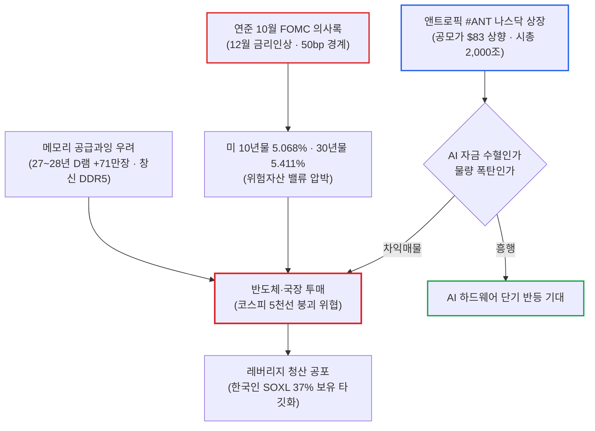

# 블라인드 주식·투자 24시간 브리핑: "수능 AI 치팅에 웃고, 하이닉스 세 토막에 울었다"

- **작성일**: 2026-11-19
- **수집 기간**: 2026년 11월 18일(수) 21:36 ~ 11월 19일(목) 21:35 (KST)
- **수집 규모**: 최근 24시간 게시글 493개 전수 수집 (본문·댓글 정밀 분석 115개, 상세 수집 댓글 594개, 목록 미리보기 분석 378개)

!!! warning "주의사항"
    아래 내용은 모두 블라인드 익명 사용자들의 날것의 주장과 여론이다. 수치, 인용 기사, 소식은 따로 검증하지 않았다. "뉴스에 나왔다", "단독" 같은 표현이 붙은 글도 출처가 불분명하거나 본인의 추측을 섞은 경우가 많으므로, 투자 판단에 쓰기 전에 원문 기사나 공시를 직접 확인해야 한다. 작성자 소속은 블라인드에 표시된 회사명이며 실제 재직 여부는 확인할 수 없다. "언급 글 수"는 `entities.js`로 제목, 본문, 댓글에 종목명이나 별칭이 들어간 글을 센 값이다. 이번 범위에는 2027학년도 수능일(11/19)에 따른 국내 증시 1시간 지연 개장과 미국 앤트로픽(`#ANT`) 나스닥 상장 전야가 함께 들어 있다.


## 📊 블라인드 개미 공포·탐욕 지수 (Fear & Greed Index)

공포가 다시 깊어졌다. 지수는 **29점**(공포)으로 직전 11/10의 33점보다 4점 내려왔다. 9일 전 매수 사이드카로 한숨 돌렸던 개미들이 다시 지하실 공포에 갇혔다. 코스피는 5,000선 붕괴를 코앞에 두고 흔들렸고, SK하이닉스 260만 ~ 300만 원대에 물린 투자자들은 세 토막 난 계좌 앞에서 묵념했다. 게시판은 7억 7천만 원·15억 원 손실 비명과 수능 AI 부정행위('리트냥이') 패러디가 뒤엉켜 블랙코미디를 연출했다. 유일한 희망 회로는 오늘 밤 나스닥에 상장하는 앤트로픽(`#ANT`, 공모가 83달러)과 한한령 해제 테마주뿐이다.

<div class="kb-portfolio-metrics">
  <div class="kb-portfolio-metric-card">
    <span class="label">당일 공포·탐욕 지수</span>
    <span class="value">29점 (공포)</span>
    <span class="sub">0 극단적 공포 ~ 100 극단적 탐욕</span>
  </div>
  <div class="kb-portfolio-metric-card">
    <span class="label">직전 브리핑 대비</span>
    <span class="value">-4p 하락</span>
    <span class="sub">11/10 33점(공포) ➔ 11/19 29점(공포)</span>
  </div>
  <div class="kb-portfolio-metric-card">
    <span class="label">지배적 개미 분위기</span>
    <span class="value">지하실 공포 · AI 치팅 풍자</span>
    <span class="sub">"계좌는 세 토막, 게시판은 리트냥이 패러디"</span>
  </div>
  <div class="kb-portfolio-metric-card">
    <span class="label">역발상 수급 시그널</span>
    <span class="value">손절 인증 · SOXL 물타기 공존</span>
    <span class="sub">국장 탈출·현금화 vs 앤트로픽·코스닥 바닥론</span>
  </div>
</div>

```vegalite
{
  "$schema": "https://vega.github.io/schema/vega-lite/v5.json",
  "background": "transparent",
  "width": "container",
  "height": 220,
  "padding": {"top": 8, "bottom": 4, "left": 4, "right": 8},
  "data": {
    "values": [
      {"metric": "종합 공포·탐욕 지수", "score": 29, "max": 100, "zone": "공포", "label": "29점 (공포 · -4p)", "desc": "코스피 5천선 위협과 메모리 버블론 재점화로 공포 심화"},
      {"metric": "① 체감 손익·계좌 심리", "score": 20, "max": 100, "zone": "극단적 공포", "label": "20점 (극단적 공포)", "desc": "-15억·-7.7억·-2.5억 등 거액 손실 비명과 소주 맛 사라진 한탄"},
      {"metric": "② 매수·투매 수급 태도", "score": 32, "max": 100, "zone": "공포", "label": "32점 (공포)", "desc": "물량 60% 손절·현금화 vs SOXL 48~54불 추매·코스닥 바닥 매수"},
      {"metric": "③ 반도체·업황 신뢰도", "score": 24, "max": 100, "zone": "극단적 공포", "label": "24점 (극단적 공포)", "desc": "27~28년 D램 71만장 증설·ASP 하락 역사표 등 빙하기 공포 재점화"},
      {"metric": "④ 지수 지지선 신뢰도", "score": 26, "max": 100, "zone": "공포", "label": "26점 (공포)", "desc": "코스피 5000 붕괴·4500~2000론 vs 나스닥 아직 10~12%밖에 안 빠짐"},
      {"metric": "⑤ 역발상 바닥 기대감", "score": 42, "max": 100, "zone": "공포", "label": "42점 (공포)", "desc": "앤트로픽 공모가 83불 흥행·젠슨황 복귀 기대 vs 본격 하락장 경계"}
    ]
  },
  "encoding": {
    "y": {
      "field": "metric",
      "type": "nominal",
      "sort": null,
      "axis": {"title": null, "labelFontWeight": 500, "labelFontSize": 12, "labelLimit": 180, "ticks": false, "domain": false, "labelPadding": 12}
    }
  },
  "layer": [
    {
      "mark": {"type": "bar", "cornerRadius": 7, "height": 14, "color": "#94a3b8", "opacity": 0.14},
      "encoding": {
        "x": {
          "field": "max",
          "type": "quantitative",
          "scale": {"domain": [0, 118]},
          "axis": {
            "title": "블라인드 개미 심리 스펙트럼 (0~24 극단적 공포 · 25~44 공포 · 45~55 중립 · 56~74 탐욕 · 75~100 극단적 탐욕)",
            "values": [0, 25, 50, 75, 100],
            "labelExpr": "datum.value == 0 ? '0 (극단적 공포)' : datum.value == 25 ? '25 (공포)' : datum.value == 50 ? '50 (중립)' : datum.value == 75 ? '75 (탐욕)' : '100 (극단적 탐욕)'",
            "grid": false
          }
        }
      }
    },
    {
      "data": {"values": [{"x": 25}, {"x": 45}, {"x": 55}, {"x": 75}]},
      "mark": {"type": "rule", "strokeDash": [2, 4], "color": "#94a3b8", "opacity": 0.5},
      "encoding": {"x": {"field": "x", "type": "quantitative"}, "y": {"value": 0}, "y2": {"value": "height"}}
    },
    {
      "mark": {"type": "bar", "cornerRadius": 7, "height": 14},
      "encoding": {
        "x": {"field": "score", "type": "quantitative"},
        "color": {
          "field": "zone",
          "type": "nominal",
          "scale": {
            "domain": ["극단적 공포", "공포", "중립", "탐욕", "극단적 탐욕"],
            "range": ["#dc2626", "#ea580c", "#64748b", "#16a34a", "#2563eb"]
          },
          "legend": null
        },
        "tooltip": [
          {"field": "metric", "title": "심리 지표"},
          {"field": "label", "title": "점수 및 구간"},
          {"field": "desc", "title": "핵심 진단"}
        ]
      }
    },
    {
      "mark": {"type": "text", "align": "left", "dx": 10, "fontWeight": 600, "fontSize": 12},
      "encoding": {
        "x": {"field": "score", "type": "quantitative"},
        "text": {"field": "label", "type": "nominal"}
      }
    }
  ],
  "config": {"view": {"stroke": "transparent"}}
}
```

---

## 1. 전체 분위기

### 한 줄 요약

코스피 5,000선 턱밑에서 반도체의 끝없는 추락에 절망하는 한편, "AI로 주식 샀으니 무효 처리해 달라"는 수능 부정행위 패러디로 슬픔을 달래는 하루다.

### 게시판을 채운 글의 성격

지난 24시간 블라인드 주식·투자 채널은 크게 세 갈래로 갈렸다. 계좌 박살 난 개미들의 손실 비명, AI 치팅('리트냥이') 사건을 주식에 빗댄 자조적 풍자, 그리고 앤트로픽 상장·코스닥 PBR 바닥론을 쥔 역발상 매수론이다.

#### ① 손실 고백과 멘탈 붕괴 (지배적 기류)

단순한 푸념을 넘어 신체 이상과 가족에 대한 죄책감까지 쏟아진다. "이번 하락장은 2022년보다 희망이 없다"는 공포가 짙다.

> **"3년 넘게 월 50만 원씩 S&P 넣었는데 수익률 0.7%임. 장난하나"** (새회사 | 👍2 · 💬26 · 👁1,602)
>
> - 댓글 반응: "연저펀 나스닥 넣고 마이너스임" · "그럼 내가 지금부터 넣으면 3년을 버는 거네?" · "원래 10년 봐야 돼"

- **"-15억 ㅋㅋㅋ 이게 몇 달 만에 된다고??"** (`미장하는 형들괜찮음?`, LG전자 | 👍2 · 💬18): 작성자가 주가 폭락과 환율 하락을 동시에 맞았다고 하소연하자, 댓글에 15억 손실 인증이 달렸다.
- **"난 7억 7천 잃었다. 내 10년"** (`난 7억7천 잃었다`, 새회사 | 👍6 · 💬9): 인증은 생략한다며 10년 모은 자산을 날렸다고 토로했다.
- **"올해 2억 5천 빠짐... 왜 2배 레버리지를 해가지고"** (`올해 주식 고점대비 각자 얼마나 빠졌어?`, 👍1 · 💬9): 주변 고수들도 이번 장에 대거 당했다며 뼈아파했다.
- **"3억으로 시작해 12억까지 갔다가 다시 3억 됨"** (`3억으로시작해 12억까지갔다가`, 👍0): "대충 노옵 아반떼 정도 벌고 청산하네"라며 허탈감을 드러냈다.
- **"계속 힘을 풀려고 해도 아랫배가 긴장 상태"** (`손실이 너무 커서`, 👍0): "밥을 먹어도 배고프고 잠만 자고 싶다"(현실 도피), "소주가 예전처럼 안 달다" 등 우울감 호소가 잇따랐다.

#### ② 블랙코미디와 자조적 풍자 (커뮤니티 에너지)

수능일(11/19) 당일 공개 검증을 예고했던 '리트냥이'(이진우 씨)의 잠적·심정지 속보가 터지자, 주식 채널까지 AI 치팅 밈으로 도배됐다.

> **"챗지피티한테 물어보고 주식 샀습니다. 그니까 잡아가시고 무효 처리 해주세요"** (새회사 | 👍3 · 💬9 · 👁376)
>
> - 댓글 티키타카: "나 챗지피티인데 얘 물어보고 산 거 맞다 ㅇㅇ" → "증거 채택됐습니다" → "AI가 수능은 풀어도 주식은 못 푸는 건가"

- **"삼성라이온즈 우승 할인 혜택"** (한국전력공사 | 👍4 · 💬3): "삼성전자 38 -> 19 약 50% 할인, 삼성전기 240 -> 88 약 65% 할인, 삼성생명 51 -> 25 약 50% 할인, 삼성중공업 35 -> 16 약 55% 할인"이라며 삼성 계열사 주가 반토막을 쇼핑몰 세일로 비꼬았다.
- **"이런 극악무도한 반도체 레버리지 상품을 승인한 정부는 책임져라"** (11번가 | 👍5 · 💬11): 한국인이 SOXL에 38억 달러(순자산 37%)를 쏟아붓자 미 연준이 경고했다는 Benzinga 기사를 인용하며 "미국 정부는 환불하라"고 정부 탓 세태를 비틀었다.
- **"내부 사정 잘 안다. 엘지전자는 망합니다"** (LG전자 | 👍9 · 💬24): 가전·TV는 중국에 잡혔고 전장·로봇도 중국이 더 잘하니 메모리로 갈아타라고 적자, 댓글에서 "10년 전부터 삼전 3만 간다, 조선 끝났다 하던 대마불사 레퍼토리"라며 반박이 붙었다.

#### ③ 역발상 매수와 바닥론 (소수 강성)

남들이 공포에 질려 던질 때 오히려 베팅에 나서는 흐름도 포착됐다.

- **"어제 속슬 54달러 줍고 48달러에 추매했다"** (현대자동차 | 👍4 · 💬4): 앤트로픽 상장 이후 한 번 더 떨구더라도 결국 풀롱이라며 국민연금 수급을 믿고 가자고 외쳤다.
- **"코스닥 150 1배에 일단 3천 박아놨다"** (공무원 | 👍0 · 💬10): 남들이 조롱할 때 사는 거라며 떨어지면 더 사겠다고 선언했다. "코스닥 PBR 1.4배는 10년 내 코로나급 제외 바닥"(현대모비스 | 👍3 · 💬15)이라는 가치평가 글도 호응을 얻었다.

### 게시판에 등장한 시장 수치

| 항목 | 원문 언급 수치 | 출처 게시글 |
| :--- | :--- | :--- |
| 미국 3대 지수 (11/18) | 다우 -1.11%, S&P500 -0.23%(5거래일 연속 하락), 나스닥 +0.42% | `11/18 미국증시` (한국GM) |
| 필라델피아 반도체 (11/18) | +0.1% (TSMC +0.81%, 브로드컴 +3.64%, AMD +5.31%, 마이크론 -1%, 퀄컴 -4.12%) | `11/18 미국증시` (한국GM) |
| 미국 국채 금리 | 10년물 5.068%, 30년물 5.411% | `11/18 미국증시` (한국GM) |
| 국제유가 · 비트코인 | WTI $82.1, 브렌트유 $91.67, 비트코인 $62,243선 | `11/18 미국증시` (한국GM) |
| 앤트로픽 IPO (`#ANT`) | 공모가 $70 ~ 78에서 $83으로 상향 (11/19 나스닥 거래 시작, 시총 2,000조 언급) | `11/18 미국증시` · `앤트로픽이 왜 싸다는거?` |
| 코스피 외인 옵션 (11/19) | 풋옵션 953억 순매수, 콜옵션 203억 순매수 (위클리 만기일) | `[경악] 금일 코스피 외인 풋옵션` (새회사) |
| 한국인 SOXL 보유 비중 | 전체 순자산의 37%(약 38억 달러, 일부 글에서는 40% 언급) | `SOXL 전체 순자산의 37%` · `이런 극악 무도한...` |
| 안전자산 하락폭 (작성자 기준) | 금 고점 대비 약 -36%, 엔화 추가 -14%, 미국채(TLT) 4년간 -46% | `안전자산이라 생각했던것들` (롯데웰푸드) |

### 다음 거래일 예상과 지수·종목 지지선 매트릭스

내일(11/20 금)은 **미국 11월 옵션 만기일**이자 **앤트로픽(`#ANT`) 상장 첫날 성적표**가 한국 장에 반영되는 분수령이다.

- **비관 시나리오 (하방 압력)**: 프리장 나스닥 선물 반등으로 국장이 버텼으나, 본장에서 앤트로픽이 오르다 밀리거나 풋 세력이 승리하면 내일 국장이 억눌렸던 하락 압력을 한꺼번에 받을 수 있다(`한전KPS`).
- **낙관 시나리오 (숏 커버링)**: 앤트로픽 공모가 $83 이상 안착으로 AI 자금경색 우려가 풀리고, SOXX·NVDA에 몰린 풋 포지션이 청산되면 3일간 연속 숏 스퀴즈가 나올 수 있다(`HD현대중공업` · `한전KPS`).

| 종목 / 지수 | 현재 위치 · 언급 구간 | 1차 지지선 / 기준선 | 극단적 비관치 | 주요 근거 |
| :--- | :--- | :--- | :--- | :--- |
| **코스피** | 5,000선 턱밑 공방 | 5,000선 (방어선) · 4,500선 | 2,000선 · 1,100 ~ 1,300선 | "7천-6천-5천 수순대로 깨짐", 1,100설은 댓글에서 비현실적이라 조롱받음 |
| **코스닥** | 600 ~ 700대 언급 | PBR 1.4배 (10년 하단) | — | 3년에 한 번 오는 담배꽁초 자리, 1년 내 20 ~ 30% 반등 노림 |
| **나스닥** | 고점 대비 -10 ~ 12% | 21,000선 (전저점) | 10,000대 (월봉 60일선) | "미장은 아직 빠진 것도 아니다. 21,000 가면 국장은 태초 마을" |
| **S&P 500** | 5거래일 연속 하락 | 7,000 ~ 7,100 (낙관론) | 5,500선 | 연말 7천 후반 컨센 vs 금리인상 본격화 시 5,500 추락론 |
| **SK하이닉스** | 115만 원대(260 ~ 300 대비 1/3) | 100만 원 | 80만 원 (자사주 종료 후) | 일 30만 주 자사주 매입 종료 후 외인 매도 지속 시 80만 원 붕괴 우려 |
| **SOXL** | $48 ~ 54 구간 | $48 (단기 추매선) | $1 언더 (액면병합설) | 한국인 37 ~ 40% 보유로 세력 청산 타깃, 반등 시 70달러 목표 |

### 미국 증시 상세 정리 (11/18 마감 기준)

한국GM 작성자가 정리한 `11/18 미국증시`(👍23)에 따르면, 10월 FOMC 의사록에서 거의 모든 위원이 추가 금리 인상을 언급하고 월러 이사가 공격적 물가 대응을 강조하며 S&P500이 5거래일 연속 하락했다. 반면 나스닥은 앤트로픽 IPO 기대감에 +0.42% 소폭 반등했다.

- **M7 및 빅테크**: 아마존(+3.82%), SPCX(+1.27%), 알파벳(+0.8%), 마이크로소프트(+0.4%), 애플(+0.15%), 메타(-0.4%), 팔란티어(+0.07%), 넷플릭스(+0.23%).
- **반도체 및 소부장**: AMD(+5.31%), 브로드컴(+3.64%), ASML(+0.88%), TSMC(+0.81%), 램리서치(+0.47%), KLA(+0.22%)가 올랐고, 퀄컴(-4.12%), 마벨테크(-2.15%), 마이크론(-1%), 인텔(-0.91%), AMAT(-0.88%), TXN(-1.16%), ARM(-0.34%)은 내렸다.
- **테마주 (원전·전력·양자·헬스케어)**: 원전(SMR -4.4%, 오클로 -2.55%, UEC -2.47%, 비스트라 -1.23%)과 양자(아이온큐 -5.48%, 리게티 -1.5%)가 약세를 보였고, 전력(콴타서비스 +0.68%, 서던 +0.87%)은 강보합이었다. 헬스케어 대장주 **UNH는 메디케어 어드밴티지 감사 강화 우려로 -10.21% 급락**했다.

---

## 2. 원인 분석



| 주제 | 주장 내용과 근거 | 게시판 반응 |
| :--- | :--- | :--- |
| **1. 연준 금리인상과 고금리 공포** | 10월 FOMC 의사록에서 대부분 위원이 추가 인상을 언급했고 일부는 50bp 가능성까지 열어뒀다. 10년물 국채금리가 5.068%까지 치솟으며 유동성 축소 공포가 커졌다. | "이미 FedWatch에 다 반영됐다"는 낙관론과 "금리 방향이 인상일 때는 현금이 최고"라는 보수론이 맞선다. 유가($82.1) 하락으로 25bp에 그칠 거란 반론도 있다. |
| **2. 메모리 슈퍼사이클 종료와 공급과잉** | 2027 ~ 2028년 D램 추가 증설 캐파가 71만 장(16 ~ 18년 클라우드 사이클의 5배)에 달하고, 창신메모리 DDR5 양산으로 감산도 어렵다는 분석이 나왔다. 과거 D램 ASP -38% ~ -94% 하락 표까지 등장했다. | SK하이닉스 260 ~ 300층 보유자들은 패닉에 빠졌다. 반면 "데이터센터·로봇·소버린 AI 수요로 ASP가 반토막 나도 삼전 영익 200조"라는 반론도 남아 있다. |
| **3. 앤트로픽(`#ANT`) 나스닥 상장** | 공모가가 $70 ~ 78에서 $83으로 상향되며 흥행 조짐을 보였다. AI 금융경색을 뚫어줄 구원투수라는 기대와, 시총 2,000조 원 고평가 및 보호예수 물량 폭탄 우려가 충돌한다. | "공모가 위로 지켜주면 AI HW 섹터 반등한다" vs "보호예수 풀리는 기간이 짧아 기존 주주 엑시트용"으로 팽팽하다. |
| **4. 한국인 SOXL 37% 쏠림과 파생 수급** | 한국인이 SOXL 순자산의 37%(38억 달러)를 들고 있어 미 연준까지 경고했다는 소식이 퍼졌다. 국장에서는 외인이 위클리 만기일 풋옵션을 953억 원 순매수하며 변동성을 키웠다. | "한국 개미 털어먹기 딱 좋은 3배 레버리지 구조라 1달러 병합 갈 수도"라는 경고와 "54불·48불에 줍줍했다"는 용감한 물타기가 공존한다. |
| **5. 한한령 해제 테마와 국장 외면** | 중국의 한한령 해제 뉴스로 스튜디오드래곤 등 엔터·화장품·관광주가 상한가·급등을 연출했다. 반면 정부 정책에 실망한 개인들은 "국장 탈출은 지능순, 서울 부동산이 답"이라며 냉소를 보냈다. | "엔터는 미확정이고 화장품이 진짜" · "빈집은 쿠쿠홀딩스" 등 테마주 옥석 가리기가 한창이나, "결국 도박장 물릴 흑염소 모집"이라는 경계도 강하다. |
| **6. 젠슨 황 사퇴 여진과 이사회 갈등** | 젠슨 황이 물러난 뒤 엔비디아 주가와 투심이 흔들리자 "몇 주 쉬다 복귀할 것"이라는 기대감과 "중국계 이사(앨리스 황)가 몰아낸 것 아니냐"는 음모론까지 돌았다. | "젠슨 황이 돌아오면 오히려 회사가 어려워서 온다는 악재"라는 냉정한 반박과 "젠슨 황 1명이 SKY 공대 1,000명보다 낫다"는 숭배가 엇갈린다. |

---

## 3. 찌라시와 미확인 소식 (확인 필요)

### ⚠️ [보도/과장 주의] 미 연준, 한국인 SOXL 37%(38억 달러) 보유에 레버리지 경고

- **신뢰도**: **중간** (Benzinga URL을 직접 첨부했으나, 3배 레버리지 상품 자체는 미국 운용사 상품이므로 국내 정부 책임론은 게시글 내 풍자)
- **원문 내용**: `이런 극악 무도한 반도체 레버리지상품을 승인한 정부는 책임져라` (11번가 | 👍5 · 💬11)에서 `fed-sounds-alarm-on-leveraged-etfs-as-south-korean-investors-pour-3-8b-into-soxl` 기사를 인용했다. 또 다른 글 `SOXL 전체 순자산의 37%를 한국인이 보유중이래` (SK이노베이션 | 👍3 · 💬6)와 `Soxl은 이번에 병합가격가도 안이상함` (도쿄일렉트론코리아 | 👍2 · 💬1)에서도 한국인 비중이 37 ~ 40%라고 언급했다.
- **왜 중요한가**: 특정 국가 개인 투자자에게 단일 3배 레버리지 ETF 물량이 40% 가까이 쏠려 있으면, 하락장에서 변동성 끌기(음의 복리)와 반대매매·투매가 겹쳐 수급 붕괴 속도가 극단적으로 빨라진다.
- **현직자·댓글 반박**: "미국 정부가 출시한 상품인데 왜 한국 정부 탓을 하냐(본문은 정부 탓 세태를 비꼰 반어법)" · "세력이 청산 한 번 시키고 올리겠네"라는 냉소가 이어졌다.

### ⚠️ [미확인] SK하이닉스, 미국에서 주주에게 급락 보상 집단소송 당했다?

- **신뢰도**: **낮음** (구체적 소송 주체, 법원, 사건 번호, 기사 링크 전혀 없음)
- **원문 내용**: `하닉 미국에서 주주한테 고소미 먹음` (경동나비엔 | 👍0 · 💬1 · 👁31)에서 "급락 보상 하라고 여윽시 소송의 나라. 소수가 됐던 해프닝이던 한국도 이제 이렇게 해야함"이라고 적었다.
- **왜 중요한가**: 사실이라면 ADR이나 해외 기관 투자자와의 법적 분쟁 리스크로 번질 수 있으나, 주가 하락 자체만으로 미국 법원에서 보상을 받아내기는 어렵고 확인된 공시나 외신 보도도 없다.
- **댓글 반응**: "재용이 형이 그래서 그짝 동네에 상장시키는 거 아니랬다"며 가볍게 넘기는 분위기다.

### [풍문] 스페이스X 유상증자 설 & 중국의 엔비디아 이사회 장악설

- **신뢰도**: **낮음** (커뮤니티 내 카더라 및 추측성 글)
- **원문 내용**: `줴줴이야` 글(미리보기)에서 악재를 나열하며 "월러 금리, 이스라엘 가자지구, 스엑 유상증자"를 언급했다. 또한 `이 정도면 중국이 AI 먹으려고 엔비디아 이사회도 장악한거 아님?` (삼성디스플레이 | 👍2 · 💬2)에서는 "애초에 앨리스 황 목표가 엔비디아에서 젠슨 황을 몰아내려는 계획 아니었을까?"라는 음모론을 제기했다.
- **왜 중요한가**: 스페이스X(`SPCX`)와 엔비디아 모두 서학개미 보유 비중이 최상위권인 종목이라, 증자나 거버넌스 루머만으로도 프리장·본장 투심이 크게 출렁인다.
- **댓글 반박**: 엔비디아 음모론에는 "젠슨 황은 대만 사람이다" · "로스차일드가 움직인 거임"이라며 농담으로 받아쳤다.

### [확인 필요] 중국 한한령 즉시 해제 vs 단계적 해제 논쟁

- **신뢰도**: **중간** (MTN 뉴스 링크 `2026111815584373811` 및 뉴스1 링크 `0009297106` 첨부)
- **원문 내용**: `저희 회사 주식 빨리 사십시오. 지금이 저점입니다.` (NC | 👍2 · 💬21)에서 중국 한한령 전부 해제 및 최혜국 대우 뉴스가 떴다며 아이온2 중국 출시 수혜를 주장했다. `이거 진짜냐?` (새회사 | 👍2 · 💬10)에서도 엔터주 2배 상승 가능성을 물었다.
- **왜 중요한가**: 반도체가 무너지는 장세에서 유일하게 상한가(스튜디오드래곤 등)가 쏟아지며 단기 수급이 쏠리는 섹터다.
- **댓글 반박**: "전부 해제 아니고 단계적 해제임", "엔터는 확정 아니고 화장품·미디어가 확정", "NC는 아직도 리니지 매출이 50%인데 뭔 소리냐. 한한령 수혜주는 호텔신라·롯데관광·아모레퍼시픽"이라며 글쓴이의 자사주 홍보를 매섭게 쳐냈다.

### [미확인] 비트코인 채굴·투자사 '비트플래닛' 부대표 해고 및 대표 런 직전설

- **신뢰도**: **낮음** (근거 자료 없는 내부 풍문성 글)
- **원문 내용**: `비트코인 회사 주식 망함` 글(미리보기)에서 "비트코인 떡상할 줄 알고 3,000원에 들어갔다가 1,700원. 여기 부대표 잘렸고 대표도 런치기 직전이고 돈 없고 채굴도 망했다"고 적었다.
- **왜 중요한가**: 비트코인이 $62,243선까지 밀리며 코인 관련주 전반에 부실·유동성 리스크가 번지고 있음을 보여준다.

---

## 4. 종목·섹터별 개인 투자자 심리와 전망

이번 24시간(`entities.js` 재집계 기준)에는 **미국 지수(나스닥·S&P)**(52개), **AI·빅테크**(50개), **국내 지수(코스피·코스닥)**(48개), **앤트로픽**(45개), **반도체**(45개)가 최상위권을 휩쓸었다.

| 종목·섹터 | 언급 글 수 | 지배적 심리 | 대표 전망 (원문 인용) | 소수 반대 의견 |
| :--- | :---: | :--- | :--- | :--- |
| **미국 지수(나스닥·S&P)** | 52개 | 실망·추가 하락 경계 | "미장은 아직 빠진 것도 아님. 21,000선 가면 태초 마을" | "악재 다 나왔다. 연말 S&P 7천 후반 컨센" |
| **AI·빅테크** | 50개 | 기대와 거품론 충돌 | "AI로 전문직 대체는 시간문제, 독보적 기업 주식 사야" | "최적화로 컴퓨팅 수요 줄어 AI 인프라 추정치 하향" |
| **국내 지수(코스피·코스닥)** | 48개 | 극단적 비관 vs 담배꽁초론 | "코스피 5천 깨지면 4,500 간다. 국장 탈출은 지능순" | "코스닥 PBR 1.4배는 3년에 한 번 오는 바닥" |
| **앤트로픽 (`#ANT`)** | 45개 | 흥행 기대 vs 엑시트 경계 | "공모가 $83 흥행하면 AI HW 섹터 반등한다" | "시총 2,000조 고평가. 보호예수 풀리면 물량 폭탄" |
| **반도체 (업황)** | 45개 | 빙하기 공포 재점화 | "27~28년 D램 71만장 증설·창신 DDR5로 감산도 불가" | "ASP -50% 가도 삼전 영익 200조 나온다" |
| **SK하이닉스** | 34개 | 고점 물림 절망·체념 | "260층인데 세 토막. 자사주 매입 끝나면 80만 원" | "평단 10만 원이라 20만 원 돼도 2배. 115만 원 추매" |
| **삼성전자** | 30개 | 자조·배당 기대 | "삼성라이온즈 우승 50% 할인 세일 중" | "내년 1월 주주환원 발표·1~3년 뒤엔 미장보다 클 것" |
| **레버리지·인버스 ETF** | 25개 | 투매 vs 단타 도박 | "레버리지 물려서 의욕 상실. 인버스·곱버스 가자" | "이번 주 숏 스퀴즈 터지면 SOXX·정배가 대박" |
| **채권·달러·환율** | 24개 | 대피처 상실의 혼란 | "금·주식·코인·채권 다 빠지는데 돈 어디로 가냐" | "금리 인상 방향일 때는 달러·현금이 최고 투자" |
| **SOXL (반도체 3배)** | 23개 | 청산 공포 vs 역발상 물타기 | "한국인 37~40% 들고 있어 1달러 액면병합 가도 안 이상함" | "54불에 줍고 48불 추매했다. 결국 풀롱" |
| **엔비디아 (`NVDA`)** | 22개 | 불확실성·리더십 공백 우려 | "젠슨 황 사퇴 후 실적 비트해도 찔끔 오름" | "12시부터 자사주 매입·젠슨 황 복귀 시사 터닝포인트" |

### 1. 미국 지수(나스닥·S&P) — 언급 52개

- **보유자 상태**: "3년 넘게 월 50만 원씩 S&P 넣었는데 수익률 0.7%", "연저펀 나스닥 넣고 마이너스", "적립식 S&P·나스닥100 모았는데 마이너스 구간 진입" 등 장기 적립식 투자자들까지 본전 붕괴를 겪고 있다.
- **심리**: 공포와 회의감이 번졌다. "2022년보다 희망이 없다. 나스닥은 이제 10 ~ 12% 빠졌을 뿐"(한국전자통신연구원)이라는 추가 하락 공포가 지배적이다.
- **전망과 목표가·지지선**:
    - **하락론**: 나스닥 전저점 **21,000선** 이탈 시 국장은 태초 마을, 월봉 20일선 깨지면 60일선과 **10,000대**까지 열린다(`삼보모터스`). FOMC 금리 인상 본격화 시 S&P500 **5,500**까지 본다는 극단론도 있다.
    - **상승론**: 한국예탁결제원(👍29)은 "S&P500 장투는 폭락장에 반토막 나도 자본주의 구조를 믿고 버티는 사람만 가능하다"며 장기 회복력을 강조했다. 연말 S&P 컨센서스 **7,000 후반**을 믿는 낙관론(`새회사`)도 있다.
- **행동 계획**: "지금부터 넣으면 3년을 버는 셈"이라며 적립식 유지를 다짐하는 쪽과, "퇴직연금 본전일 때 매도할까" 고민하는 쪽으로 갈린다.
- **직전 브리핑(11/10) 대비 변화**: 지난주에는 미국 반도체 급반등에 안도했으나, 10월 FOMC 의사록과 S&P 5거래일 연속 하락으로 '미국 예외주의' 피난처마저 흔들리는 분위기다.
- **종합 판단**: 적립식 지수 투자자까지 비명을 지르기 시작했다는 점은 투심이 상당 부분 냉각됐음을 시사하지만, "미장은 아직 12%밖에 안 빠졌다"는 경계감이 남아 있어 바닥 확신까지는 이르다.

### 2. AI·빅테크 — 언급 50개

- **보유자 상태**: 빅테크 투자자들은 "본전만 찾고 탈출함", "균등하게 10% 까먹어 물도 아껴 마셔야겠다"며 피로감을 호소한다.
- **심리**: 오늘 수능 AI 치팅 사태를 계기로 **"AI 기술 자체는 인류를 바꿀 진짜"**라는 확신과 **"AI 인프라 주가는 별개"**라는 냉소가 기묘하게 공존한다.
- **전망과 논리**:
    - **긍정론**: "AI가 수능·리트 만점을 찍어 전문직 대체가 증명됐다. 결국 노동 가치는 0이 되고 독보적 기업 주식을 사서 배당받는 자만 살아남는다"(SK하이닉스 · ex-삼성E&A).
    - **부정론**: "주변 공기업에서 오탈자나 고치는 게 다다. AI는 거품"(한국남동발전 | 👍6 · 💬92)이라는 글은 댓글에서 뭇매를 맞았으나, "앤트로픽 매출 8배 늘 때 컴퓨팅 사용량은 3배만 늘었다. 소프트웨어 최적화로 하드웨어 수요는 줄 것"(인천교통공사)이라는 구조적 의문도 제기됐다.
- **행동 계획**: 단기적으로는 오늘 밤 앤트로픽 상장 결과를 보고 빅테크 비중을 조절하려는 관망세가 강하다.
- **직전 브리핑 대비 변화**: 이전에는 '젠슨 황 불륜·사퇴' 가십이 중심이었다면, 오늘은 'AI의 노동 대체'와 '앤트로픽 IPO'라는 산업 본질 논쟁으로 옮겨갔다.
- **종합 판단**: AI 기술에 대한 믿음은 오히려 공고해졌으나, 그 과실이 하드웨어·인프라 주식의 무한 상승으로 이어질지에 대해서는 의구심이 커졌다.

### 3. 국내 지수(코스피·코스닥) — 언급 48개

- **보유자 상태**: "미장 줄이고 정부 믿고 국장 들어온 내 스스로 매일 자책 중"(새회사 | 👍6), "코스피 5000 깨지고 -30% 손절 후 현금화"(KT | 👍4) 등 국장 보유자들의 좌절감이 극에 달했다.
- **심리**: 코스피는 극단적 불신("국장 탈출은 지능순"), 반면 코스닥은 뜻밖의 저가 매수 유입이 나타나며 대조를 이룬다.
- **전망과 목표가·지지선**:
    - **코스피 하락론**: "7천 - 6천 - 5천 정확한 수순대로 빠진다. 5,000 위는 푸근한 숏 자리" · "4,500 찍을 것" · 심지어 "1,500도 장담 못 하고 1,100 ~ 1,300이 저점"(SC제일은행)이라는 극단적 비관론까지 나왔다.
    - **코스닥 바닥론**: 현대모비스(👍3 · 💬15)는 "코스닥이 구데기인 건 맞지만 PBR 1.4배는 10년 내 코로나급 제외 하단이다. 3년에 한 번 오는 20 ~ 30% 먹을 자리"라며 분할 매수를 권했다.
- **행동 계획**: 코스피는 손절·현금화·인버스 접근이 늘어난 반면, 코스닥 150(1배) 및 한한령 수혜주(화장품·미디어·엔터)로 소액·분할 매수 자금이 이동하고 있다.
- **직전 브리핑 대비 변화**: 11/10 매수 사이드카 직후의 반등 기대감이 9일 만에 5,000선 붕괴 공포로 급랭했다.
- **종합 판단**: 대형주(삼전·하닉)에 대한 혐오가 극에 달하면서 역설적으로 코스닥·중소형 테마주에 단기 빈집 털이 심리가 작동하고 있다.

### 4. 앤트로픽 (`#ANT`) — 언급 45개

- **보유자 상태**: 오늘(11/19) 나스닥 상장 첫날을 앞두고 개인들의 이목이 가장 쏠린 신규 종목이다.
- **심리**: "무조건 풀매수, 래미안 원베일리에서 만나자"는 도파민 매수파와 "공모가 $83(시총 2,000조)은 기존 주주 엑시트용 거품"이라는 경계파가 정면 충돌한다.
- **전망과 핵심 논점**:
    - **긍정론**: 공모가가 $70 ~ 78에서 $83으로 상향된 것은 기관 수요가 탄탄하다는 증거다. 상장 흥행으로 AI 금융경색 우려가 풀리면 AI HW 섹터까지 동반 반등할 수 있다.
    - **부정론**: `앤트로픽 상장과 주식 향방에 관해서`(새회사)는 "청약 6배는 실제 매수세를 보장하지 않으며, 2027년 말까지 풀리는 보호예수·신규발행 물량과 막대한 AI 인프라 투자비가 최대 리스크"라고 경고했다. "구글 4,000조, 삼전 1,000조, 하이닉스 800조인데 앤트로픽 2,000조가 싸냐"(이마트)는 밸류 의문도 크다.
- **행동 계획**: "공모가 아래로 떨어지면 매수"(댓글) · "상장 첫날 오르다 밀리면 숏" 등 단기 변동성 매매 전략이 주류다.
- **종합 판단**: 단순 한 종목의 상장을 넘어, 얼어붙은 AI 섹터 전체의 자금 조달 능력을 시험하는 리트머스 시험지 역할을 하고 있다.

### 5. 반도체 (업황) — 언급 45개

- **보유자 상태**: 반도체 본주 및 소부장 보유자들은 고점 대비 큰 폭의 평가손실을 안고 버티거나 일부 손절 중이다.
- **심리**: **극단적 공포**다. 지난주까지만 해도 "실적은 좋다"며 버티던 기류가 오늘은 "공급과잉과 사이클 종료"라는 구체적 숫자 앞에서 무너졌다.
- **전망과 근거**:
    - **빙하기론**: 삼정KPMG 작성자는 `D램 생산능력`에서 "현재 4사 캐파 195만 장에 27 ~ 28년 71만 장이 추가 증설된다(16 ~ 18년 클라우드 때 13.8만 장의 5배). 창신메모리 때문에 감산도 어렵다"고 분석했다. 또 다른 글 `Winter is coming`에서는 1980 ~ 2020년 D램 ASP 하락률(-38% ~ -94%) 표를 띄우며 주가 1년 선행 하락을 경고했다.
    - **반론**: 댓글에서는 "데이터센터·소버린 AI·로봇·스마트안경 등 신규 수요처가 생겨 ASP가 -50% 빠져도 삼성전자 영익이 200조"(삼정KPMG 글 댓글)라며 반박했다.
- **직전 브리핑 대비 변화**: '스팟가격 피크아웃 설'에서 '27~28년 대규모 캐파 증설 및 시스코식 장기 침체 비교'로 공포의 논리가 한층 구체화·장기화됐다.
- **종합 판단**: 현업·회계법인 소속 작성자들까지 공급과잉 데이터를 들고나오며 비관론이 우세해졌다.

### 6. SK하이닉스 — 언급 34개

- **보유자 상태**: **양극화가 극심하다.** "평단 10만 원에 300주", "평단 80만 원에 50주", "115만 1,000원 종가 전 재매수 482주(5억 5천)" 같은 저평단·단타파가 있는 반면, "260층인데 절망적", "265만 원", "270에 124개", "300에서 세 토막(-65%)" 등 고점 물린 직장인들이 수두룩하다.
- **심리**: 260 ~ 300층 보유자들은 공황과 체념 상태다. "불과 몇 달 전엔 180 오면 무조건 줍는다더니 이젠 180도 희망 도돌이 노래로 들린다"(타이코에이엠피)는 한탄이 뼈아프다.
- **전망과 목표가·지지선**:
    - **비관론**: 기업은행 작성자는 "현재 일 30만 주 이상 자사주 매입으로 버티고 있는데도 이 모양"이라며 **"자사주 매입이 끝나면 80만 원까지 지옥도"**가 열릴 것으로 봤다. `안타깝다. 이젠 끝이네...`(한국남부발전)는 "고점에 사라던 현직자 램혁수들이 세 토막 나자 싹 묵념했다"고 조롱했다.
    - **낙관론**: "연말 180만 원 트라이" · "내일 앤트로픽 때문에 8% 오른다"(공무원) · "하이닉스가 내 차 사줬다"는 반론도 여전히 살아 있다.
- **행동 계획**: 고점 보유자는 "10년 묵히면 원금 오겠지"라며 사실상 비자발적 장투에 들어갔고, 단타파는 115만 원대에서 사팔사팔로 대응 중이다.
- **종합 판단**: 자사주 매입 종료 이후 수급 공백에 대한 공포가 시장을 짓누르고 있다.

### 7. 삼성전자 — 언급 30개

- **보유자 상태**: "38만 원 -> 19만 원 반토막", "삼성전자 23층 물림" 등 고점 대비 반토막 난 보유자가 많다.
- **심리**: 하이닉스만큼 처절한 비명은 덜하지만, 자조적인 패배감("삼성라이온즈 우승 50% 할인")이 깔려 있다.
- **전망과 목표가·지지선**:
    - **하락·관망론**: "삼전 9만 원에 입 벌리면 되냐" · "시스코처럼 고점 회복에 오래 걸리는 것 아니냐" · "2028년 컨센 기준 포워드 PBR 1.8 ~ 2.4배라 과잉공급 시 더 내릴 수 있다"(NH농협은행 댓글).
    - **상승론**: "내년 1월 주주환원 발표 기준으로 좋아질 것" · "1 ~ 3년으로 보면 미장보다 주주환원 더 많이 할 것"(LG전자 댓글) · "연말 25만 원 트라이".
- **행동 계획**: "자사주 소각해도 주가 꼴아박을 바에 현금배당이 낫다"며 배당 수익률을 위안 삼아 버티는 심리가 강하다.

### 8. 레버리지·인버스 ETF — 언급 25개

- **보유자 상태**: 레버리지 장기 물림("의욕 다 잃고 공모주도 까먹음", "다 끝내고 싶다")과 단타 고수("이번 달 변동성 맛돌이라 실현 7,800만·평가 2,200만")가 공존한다.
- **심리**: 2배·3배 레버리지에 대한 후회("왜 2배 레버리지를 해가지고 -2억 5천")가 쏟아지는 한편, 변동성을 노린 인버스·곱버스·SOXS 베팅 유혹도 크다.
- **행동 계획**: "줄 때 안 먹으면 99% 손실 본다. 2% 이상 오르면 바로 매도·숏" 같은 극단적 단타 전략이 공유된다.

### 9. 채권·달러·환율 — 언급 24개

- **보유자 상태**: "금 -36%, 엔화 추가 -14%, 미국채 TLT 4년간 -46% 폭락. 안전자산이라 믿었는데 다 박살"(롯데웰푸드), "1,400 초반·1,300 중후반에 미국 ETF 사서 환차손만 1~2천만 원" 등 자산 배분 실패 호소가 늘었다.
- **심리**: "금, 주식, 코인, 부동산 다 빠지는데 내 돈 어디로 간 거냐"며 분산 투자의 무력감에 빠졌다.
- **전망**: 10년물 5.068%, FOMC 추가 인상 우려 때문에 채권(TLT) 반등 기대감도 꺾였고, "금리 인상 방향일 때는 결국 달러·현금이 답"이라는 의견이 우세하다.

### 10. SOXL (반도체 3배 ETF) — 언급 23개

- **보유자 상태**: "평단 $87에 물림", "$71에 사서 $54 넘었네요", "방금 1,200만 원 매수" vs "270불에 설거지하고 50불대 구경하니 기분 째짐" 등 천국과 지옥이 교차한다.
- **심리**: 한국인 순자산 37 ~ 40% 보유 뉴스로 인해 "세력이 한국 개미 다 죽이고 $1 액면병합 갈 것"이라는 극단적 공포와, "$48 ~ 54 구간에서 줍줍하면 단기 $70 반등 먹는다"는 야수의 심장이 맞붙었다.

### 11. 엔비디아 (`NVDA`) — 언급 22개

- **보유자 상태**: "평단 $120에 500주 들고 있는데 100% 찍었다가 수익 쪼금 남음. 팔까?"라며 익절 고민을 하는 초기 진입자부터, 최근 반등에 본전 탈출한 단타파까지 다양하다.
- **심리**: 실적 호조(BEAT)에도 주가가 찔끔 오르는 모습에 실망감이 크며, 젠슨 황 사퇴 이후 이사회 리더십에 대한 불신이 짙다.
- **전망**: "젠슨 황 복귀가 터닝포인트" · "장 시작 30분 후 자사주 매입으로 숏 스퀴즈 날 것"(HD현대중공업) vs "복귀하면 회사가 어렵다는 뜻이라 악재"로 의견이 갈린다.

### 기타 종목·섹터 (언급 1 ~ 10개)

| 종목·섹터 (언급 수) | 핵심 여론 및 동향 |
| :--- | :--- |
| **네이버 (10개)** | "투자자들에게 지속적인 실망감을 안겨주며 주가 바닥을 깨는 중. 최수연·외인·기관 탓" 등 장기 소외에 대한 원성이 높다. |
| **부동산 (9개)** | 주식·금·채권·코인 다 빠지자 "결국 서울·경기 남부 아파트가 나스닥보다 우량하다. 나라가 멱살 잡고 살려준다"는 부동산 불패론이 재부상했다(삼성증권 👍6). |
| **코인 (8개)** | 비트코인 $62,243선 하락. "스트래티지 사태 터지면 쭉 빠질 것", "비트플래닛 3,000원 -> 1,700원 폭락" 등 매도세 경계가 크다. |
| **현대차 (7개)** | "오늘 같은 날 상승 많이 했다"는 안도감과 "4천 넘는 아반떼 팔아 망했다. 로봇 가격 5억이라 현장에 언제 투입되냐"는 현직자 자조가 공존한다. |
| **로봇 (7개)** | 중국 완성차 업체들이 휴머노이드를 투입해 봤으나 경제성·내구성 의문이 생겼다는 기사(한경)가 공유되며 거품 경계론이 나왔다. |
| **삼성SDI·2차전지 (3개)** | LS증권의 삼성SDI 목표가 하향 소식에 "ESS·전고체 좋다더니 4분기 적자냐, 배터리는 다 망했다"며 물린 주주들이 망연자실했다. |
| **LG전자 (2개)** | 현직자의 "가전·로봇 중국에 밀려 망한다" 폭로글과 별개로 "자사주 소각 결정!!" 소식이 동시에 올라오며 엇갈린 반응을 보였다. |
| **바이오·제약 (5개)** | 알테오젠 38층·코오롱티슈진 주주들의 존버 한탄과 함께, '아리바이오랩 치매 3상 시나리오'(미리보기) 등 테마성 추측이 돌았다. |
| **한한령 수혜·내수 (다수)** | 중국 한한령 해제 기대감에 스튜디오드래곤 상한가, 화장품·관광(호텔신라·롯데관광·아모레), "빈집은 쿠쿠홀딩스" 등 순환매 논쟁이 붙었다. |

---

## 5. 대표 투자 의견

### 비관·현금화파: "나스닥은 아직 시작도 안 했다"

한국전자통신연구원(👍9 · 💬9)과 삼정KPMG 작성자들은 이번 하락장이 2022년과 다르다고 진단한다. 2022년은 매크로 전체가 눌렸다가 바닥을 다졌지만, 지금은 **코스피가 이미 40% 넘게 빠진 상태에서 나스닥은 이제 겨우 10 ~ 12% 조정받았을 뿐**이라는 지적이다. 나스닥이 전저점 21,000선까지 밀리면 국장은 2차 충격이 불가피하므로 현금 비중을 늘리고 관망해야 한다는 주장이다.

### 낙관·역발상파: "악재 다 나왔고, 남들 조롱할 때 산다"

`현재시장 감정 다 빼고 객관적으로 생각해보면?`(ex-삼성E&A | 👍4)과 `모든 시계열은 이제 상승을 가리키고 있다`(공무원 | 👍4)는 **① 러우·미이란 전쟁 합의 가능성, ② 12월 금리인상 기 반영, ③ 앤트로픽 상장 흥행**을 근거로 단기 상승 반전을 점쳤다. 특히 코스닥 PBR 1.4배 진입론(현대모비스)은 "남들이 쓰레기라고 조롱할 때 분할로 담가 1년 내 20 ~ 30% 먹고 나오는 것"이라며 정석적인 역발상 매수를 제안했다. 다만 "12월 금리 동결 가능성"까지 적은 대목은 댓글에서 "FedWatch도 모르고 쓴 글"이라며 매섭게 걸러졌다.

### 대안 섹터 요약

| 대안 섹터 | 주장 내용 | 반론과 주의점 |
| :--- | :--- | :--- |
| **코스닥 150 · 지수** | 10년 내 코로나 제외 PBR 1.4배 바닥권. 3년에 한 번 오는 자리 | "온갖 쓰레기만 남는 곳. 나스닥이랑 같은 닥이 아니다" |
| **화장품 · 미디어 · 엔터** | 중국 한한령 해제 수혜로 스튜디오드래곤 상한가 등 순환매 유입 | "엔터는 미확정. 오늘 도박장 물릴 흑염소 모집일 수도" |
| **필수소비재 · 배당주** | AI 기술 발전으로 노동 가치 하락 시 독보적 배당주·슈드(SCHD)가 답 | "코카콜라도 PER 30이라 밸류 부담. 고금리엔 배당 매력 반감" |
| **보안(AI 보안)** | AI 치팅·딥페이크 확산으로 WIPS·AI 보안 수요 증가 기대 | 이미 한 달 전부터 지슨 등이 2배 올라 추격 매수 위험 |
| **서울 부동산** | 주식·금·채권·코인 다 빠져도 서울 아파트는 정부가 지켜주는 생존자산 | 한은 금리 인상 시 대출 이자 부담 및 급매 출회 변수 |

### 투자 태도 조언 (게시판 내 공감대)

- **원칙 없는 분할·레버리지 금지**: "한 번에 들어가지 말고 최소 1년 길게 보고 분할로 들어가라"(한화오션 댓글 👍4), "레버리지로 물려 의욕 잃고 뇌동매매하는 순간 계좌는 0으로 간다"는 자성이 쏟아졌다.
- **줄 때 먹는 단타·현금 확보**: "요즘 장은 줄 때 안 먹으면 99% 손실" · "현금 비중이 없으면 아무리 좋은 안전마진 구간이 와도 구경만 한다"(ex-삼성E&A 글 댓글).

---

## 6. 다음 체크포인트

1. **오늘 밤(11/19 ~ 11/20 새벽) 앤트로픽(`#ANT`) 나스닥 상장 첫날 종가**: 공모가 $83을 강하게 돌파해 안착하는지, 아니면 초기 물량 출회로 공모가 아래로 밀리는지가 AI·반도체 섹터 단기 투심을 결정한다.

2. **11/20(금) 미국 11월 옵션 만기일 수급 전쟁**: SOXX와 NVDA에 몰린 풋 포지션이 숏 커버링으로 터질지, 반대로 풋 세력이 승리해 나스닥을 끌어내려 금요일 국장 하방 압력으로 이어질지 확인해야 한다.

3. **SK하이닉스 자사주 매입(일 30만 주) 지속 여부와 외국인 수급**: 자사주 매입이 멈추는 시점에 외국인 매도세가 이어지면 100만 원선 방어 시험대에 오를 수 있다.

4. **미국 10년물 국채금리(5.068%) 및 12월 FOMC 25bp vs 50bp 확률 변화**: 월러 이사 발언 이후 연준 위원들의 추가 매파적 코멘트가 나오며 국채금리가 5.1%를 넘어서는지 주시해야 한다.

5. **한한령 해제 후속 공식 발표 및 수혜 섹터 연속성**: 중국 측의 단계적 해제인지 즉시 해제인지, 그리고 화장품·미디어·게임 중 실제 실적과 수출로 이어지는 업종이 어디인지 팩트 체크가 필요하다.
