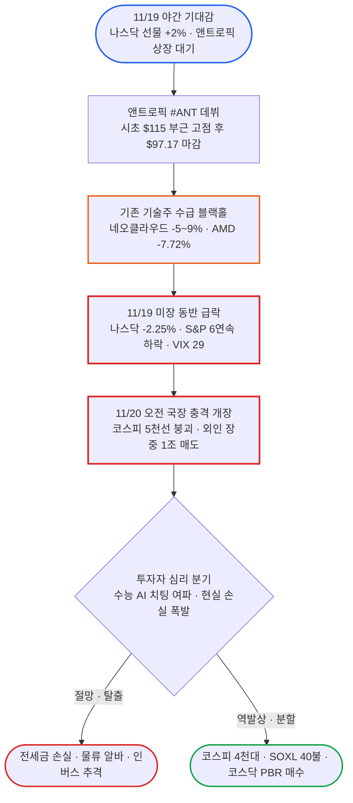

# 블라인드 주식·투자 24시간 브리핑: "앤트로픽에 수급 빨리고 코스피 5,000선 뚫렸다…블랙프라이데이 극단적 공포 진입"

- **작성일**: 2026-11-20
- **수집 기간**: 2026년 11월 19일(목) 11:27 ~ 11월 20일(금) 11:23 (KST)
- **수집 규모**: 최근 24시간 게시글 687개 전수 수집 (본문·댓글 정밀 분석 212개, 상세 수집 원댓글 982개·대댓글 401개 총 1,383개, 목록 미리보기 분석 475개 · 직전 브리핑 이후 신규 글 500개)

!!! warning "주의사항"
    아래 내용은 모두 블라인드 익명 사용자들의 날것의 주장과 여론이다. 수치, 인용 기사, 소식은 따로 검증하지 않았다. "뉴스에 나왔다", "유출 정보" 같은 표현이 붙은 글도 출처가 불분명하거나 추측을 섞은 경우가 많다. 투자 판단에 쓰기 전에 원문 기사나 공시를 직접 확인해야 한다. 작성자 소속은 블라인드에 표시된 회사명이며 실제 재직 여부는 확인할 수 없다. "언급 글 수"는 `entities.js`로 제목, 본문, 댓글에 종목명이나 별칭이 들어간 글을 센 값이다. 이번 범위에는 11월 19일 밤 앤트로픽(`#ANT`) 나스닥 상장 첫날 본장 흐름과 11월 20일 오전 국내 증시 5,000선 붕괴 충격이 함께 들어 있다.


## 📊 블라인드 개미 공포·탐욕 지수 (Fear & Greed Index)

극단적 공포 구간으로 내려앉았다. 당일 지수는 **23점(극단적 공포)으로** 직전 11월 19일의 29점보다 **6점** 더 떨어졌다. 11월 10일 33점에서 열흘 만에 10포인트나 밀린 3연속 하락이다. 간밤 AI 구원투수로 기대를 모았던 앤트로픽(`#ANT`) 상장은 기존 빅테크와 AI 인프라 자금을 빨아들이는 블랙홀로 변했다. 여기에 미국 증시 급락과 금요일 아침 코스피 5,000선 붕괴, SK하이닉스 100만 원선 위협이 겹치며 전세금 탕진과 주말 물류 알바 행렬까지 현실 고통이 수면 위로 터져 나왔다.

<div class="kb-portfolio-metrics">
  <div class="kb-portfolio-metric-card">
    <span class="label">당일 공포·탐욕 지수</span>
    <span class="value">23점 (극단적 공포)</span>
    <span class="sub">0 극단적 공포 ~ 100 극단적 탐욕</span>
  </div>
  <div class="kb-portfolio-metric-card">
    <span class="label">직전 브리핑 대비</span>
    <span class="value">-6p 하락</span>
    <span class="sub">11/10 33점 ➔ 11/19 29점 ➔ 11/20 23점</span>
  </div>
  <div class="kb-portfolio-metric-card">
    <span class="label">지배적 개미 분위기</span>
    <span class="value">5,000선 붕괴 · 현실고통 폭발</span>
    <span class="sub">"앤트로픽 수급 블랙홀 + 2주 연속 블랙프라이데이"</span>
  </div>
  <div class="kb-portfolio-metric-card">
    <span class="label">역발상 수급 시그널</span>
    <span class="value">적립식 음전 · 반등 기대 축소</span>
    <span class="sub">SOXS·현금 대피 급증 vs 코스피5천·SOXL40불대 하따</span>
  </div>
</div>

```vegalite
{
  "$schema": "https://vega.github.io/schema/vega-lite/v5.json",
  "background": "transparent",
  "width": "container",
  "height": 220,
  "padding": {"top": 8, "bottom": 4, "left": 4, "right": 8},
  "data": {
    "values": [
      {"metric": "종합 공포·탐욕 지수", "score": 23, "max": 100, "zone": "극단적 공포", "label": "23점 (극단적 공포 · -6p)", "desc": "앤트로픽 상장 역풍과 코스피 5천선 붕괴로 10일 만에 10p 하락"},
      {"metric": "① 체감 손익·계좌 심리", "score": 16, "max": 100, "zone": "극단적 공포", "label": "16점 (극단적 공포)", "desc": "전세금 손실 이혼 위기, 쿠팡 물류 알바 만석, S&P 적립식 음전"},
      {"metric": "② 매수·투매 수급 태도", "score": 28, "max": 100, "zone": "공포", "label": "28점 (공포)", "desc": "SOXS·인버스 추격과 현금화 속출 vs SOXL 40불대·코스피 4천대 분할매수"},
      {"metric": "③ 반도체·업황 신뢰도", "score": 18, "max": 100, "zone": "극단적 공포", "label": "18점 (극단적 공포)", "desc": "하닉 100만 붕괴 공방·AMD 공매도 보고서·범용 스팟 럭키머니론 확산"},
      {"metric": "④ 지수 지지선 신뢰도", "score": 20, "max": 100, "zone": "극단적 공포", "label": "20점 (극단적 공포)", "desc": "코스피 4,900 붕괴 및 2,700~4,500설, 나스닥 2만 붕괴·QQQ 300~500불론"},
      {"metric": "⑤ 역발상 바닥 기대감", "score": 33, "max": 100, "zone": "공포", "label": "33점 (공포)", "desc": "앤트로픽 구원투수 실패로 실망 커졌으나 다음주~2주내 턴어라운드파 잔존"}
    ]
  },
  "encoding": {
    "y": {
      "field": "metric",
      "type": "nominal",
      "sort": null,
      "axis": {"title": null, "labelFontWeight": 500, "labelFontSize": 12, "labelLimit": 180, "ticks": false, "domain": false, "labelPadding": 12}
    }
  },
  "layer": [
    {
      "mark": {"type": "bar", "cornerRadius": 7, "height": 14, "color": "#94a3b8", "opacity": 0.14},
      "encoding": {
        "x": {
          "field": "max",
          "type": "quantitative",
          "scale": {"domain": [0, 118]},
          "axis": {
            "title": "블라인드 개미 심리 스펙트럼 (0~24 극단적 공포 · 25~44 공포 · 45~55 중립 · 56~74 탐욕 · 75~100 극단적 탐욕)",
            "values": [0, 25, 50, 75, 100],
            "labelExpr": "datum.value == 0 ? '0 (극단적 공포)' : datum.value == 25 ? '25 (공포)' : datum.value == 50 ? '50 (중립)' : datum.value == 75 ? '75 (탐욕)' : '100 (극단적 탐욕)'",
            "grid": false
          }
        }
      }
    },
    {
      "data": {"values": [{"x": 25}, {"x": 45}, {"x": 55}, {"x": 75}]},
      "mark": {"type": "rule", "strokeDash": [2, 4], "color": "#94a3b8", "opacity": 0.5},
      "encoding": {"x": {"field": "x", "type": "quantitative"}, "y": {"value": 0}, "y2": {"value": "height"}}
    },
    {
      "mark": {"type": "bar", "cornerRadius": 7, "height": 14},
      "encoding": {
        "x": {"field": "score", "type": "quantitative"},
        "color": {
          "field": "zone",
          "type": "nominal",
          "scale": {
            "domain": ["극단적 공포", "공포", "중립", "탐욕", "극단적 탐욕"],
            "range": ["#dc2626", "#ea580c", "#64748b", "#16a34a", "#2563eb"]
          },
          "legend": null
        },
        "tooltip": [
          {"field": "metric", "title": "심리 지표"},
          {"field": "label", "title": "점수 및 구간"},
          {"field": "desc", "title": "핵심 진단"}
        ]
      }
    },
    {
      "mark": {"type": "text", "align": "left", "dx": 10, "fontWeight": 600, "fontSize": 12},
      "encoding": {
        "x": {"field": "score", "type": "quantitative"},
        "text": {"field": "label", "type": "nominal"}
      }
    }
  ],
  "config": {"view": {"stroke": "transparent"}}
}
```

---

## 1. 24시간 핵심 요약: 앤트로픽 역풍과 코스피 5,000선 붕괴

희망 회로가 하룻밤 만에 박살났다. 11월 19일 저녁까지만 해도 나스닥 선물이 +2%대 강세를 보였고, 국장은 코스피 5,000선 턱밑을 지키며 마감했다. 게시판에는 "앤트로픽 상장만 성공하면 숏 스퀴즈가 터진다"는 기대가 번졌다. 하지만 밤사이 열린 미국 본장은 정반대로 움직였다.

앤트로픽(`#ANT`)은 공모가 $83 대비 **17.1% 상승한 $97.17**로 상장을 마쳤다. 겉으로는 성공이다. 그러나 개장 초 **$110 ~ 115** 부근에서 추격 매수한 개인들은 장중 밀림에 물렸고, 기존 기술주와 AI 인프라 자금이 앤트로픽 한 곳으로 쏠리며 나스닥(**-2.25%**)과 S&P500(**-2.02%**, 6거래일 연속 하락), 필라델피아반도체(**-2.42%**)가 일제히 무너졌다.

그 여파는 11월 20일 오전 국장을 직격했다. 코스피 야간선물이 **-3.6%** 안팎까지 밀린 뒤 아침 개장과 동시에 5,000선이 무너져 **4,000대**로 내려앉았다. 장중 외국인 매도세가 1조 원을 넘어서며 "2주 연속 블랙프라이데이"라는 비명이 게시판을 덮쳤다.



게시판을 채운 글의 온도는 어제와 또 다르다. 어제가 '지하실 공포'와 '리트냥이 풍자'의 공존이었다면, 오늘은 **생활고와 적립식 붕괴의 실감**이다. 2 ~ 3년째 S&P500을 적립 매수한 투자자들이 마이너스로 돌아섰고, 전세금을 날려 이혼 위기에 몰린 사연과 주말 쿠팡 물류센터 알바 버스가 주식 물린 사람들로 만석이라는 증언이 올라왔다. "지금은 2022년보다 원웨이 하락이 더 무섭다"는 체념 속에, 일부 고수들만 코스피 5천 하회·코스닥150 660선·SOXL $40 초반대를 기계적으로 받아내는 구도다.

| 구분 | 핵심 내용 | 투심 기류 |
| :--- | :--- | :--- |
| **핵심 사건** | 앤트로픽(`#ANT`) $97.17 마감(시초 $115 대비 급락) + 미장 -2%대 투매 | "구원투수인 줄 알았는데 수급 빨대였다" |
| **최대 화제** | 미국 지수(88개) · AI·빅테크(86개) · 앤트로픽(80개) · 국내 지수(80개) | 지수·반도체·IPO 삼중 충격에 말문 막힘 |
| **오전 국장 충격** | 코스피 5,000선 붕괴·4,000대 개장, SK하이닉스 100만 원선 방어전 | "연기금 방어도 끝났나, 2주 연속 블랙프라이데이" |
| **생활고 · 손실** | 전세금 탕진 이혼 위기, 물류센터 알바 만석, 적립식 2 ~ 3년차 음전 | 유머조차 사라지기 직전이라는 자조 확산 |
| **다음 관전점** | 오늘 밤(11/20) 미국 11월 옵션 만기일 · 유가($83.16) · 금리(5.052%) | "오늘 미 본장 마감까지 손 대지 마라" |

---

## 2. 🎭 블라인드 명예의 전당: 이번 범위 레전드 글

### 🏆 레전드 1. "수능 수학 1-4번 문제" & "AI 치팅" 블랙 유머 (조회 1.4만 · 댓글 106)

이번 24시간 압도적 반응 1위는 엉뚱하게도 수능 문제였다. 리트냥이(이진우 씨) 심정지 속보 직후 올라온 수학 1 ~ 4번 문제 풀이에 직장인 106명이 몰려들어 잠시 계좌의 고통을 잊고 웃었다.

> **"수능 수학 1-4번 문제"** (대구경북첨단의료산업진흥재단 | 👍8 · 💬106 · 👁14,119)
>
> - **최다 추천 댓글 (👍30)**: "와 하나도 모르겠다" ➔ "수의사샘.."
> - **노안 탄식 (👍5)**: "풀고 싶은데 글씨가 작아서 안 보인다. 머리가 아니라 노안이 문제였나"
> - **현실 일침 (👍2)**: "개웃기네. 수학 계통 아닌 이상 이걸 아직도 기억하는 사람이 있나?" ➔ "원래 커뮤에선 설대도 지잡대고 강남도 슬럼가임"

이 열기는 어김없이 주식 손실 자조 패러디로 이어졌다. "챗지피티한테 물어보고 주식 샀으니 무효 처리해 달라"(새회사 | 👍5 · 💬10), "제미나이가 추천했다고 구글 취소 좀 해줘"(공무원 | 👍2 · 💬8)에 더해 수리영역 AI 성적표까지 밈이 됐다. `수협은행`(👍3 · 💬5)이 공유한 표에서 **Claude Haiku 5.5가 단돈 47원에 수리영역 100점 만점**을 받았다는 소식에 "47원 ㅋㅋㅋ 폭력적", "코딩할 때 댕청 그 자체인 하이쿠가 만점이면 수능 수리영역이 얼마나 하찮은 거냐"는 감탄이 쏟아졌다. 반대로 `LG전자` 작성자가 올린 **"황제 LG라 불러라"**(👍1 · 💬3)에서는 K-EXAONE 2.5 바로 위가 앤트로픽 구 모델이라며 국산 AI를 치켜세우다 "치어리더 예쁜 기업 LG"까지 나가자 댓글이 "치어리더 전까지가 좋았다", "그만해…"로 선을 그어 폭소를 자아냈다.

### 💸 레전드 2. 현실 생활을 덮친 손실: 전세금, 물류센터 알바, 10년 차 차 수리

밤사이 미장 급락과 11월 20일 오전 코스피 5,000선 붕괴가 겹치면서 농담 뒤에 숨은 진짜 생활 고통이 줄줄이 올라왔다.

| 게시글 / 작성자 | 손실 · 현실 상황 | 핵심 원문과 게시판 반응 |
| :--- | :--- | :--- |
| **이제 희망 조차 보이지 않는다** (`LG이노텍`) | 전세금 탕진 · 이혼 위기 | "전세금으로 장난치다 다 날리고 이혼 위기까지 왔다" ➔ "왜 남의 돈으로 도박하냐"(👍7) 질타 |
| **근데진짜 전재산으로 주식 하는 사람이 있어?** (`서울특별시`) | 전세보증금 -1.2억 손실 | 댓글: "전세 주고 보증금+대출로 하다 -1억 2천만 원. 2년 6개월 내 복구 못 하면 집 경매 당할 수도" |
| **난 빚때문에 3년동안 꾸준히 주말 쿠팡 물류센터가는데** (`네이버웹툰`) | 알바 버스 만석 현상 | "요즘 물류센터 버스에 사람 바득바득 차고 떨어질 때도 있다. 주식 물린 형들 많이 오는 듯" |
| **10년차 내 붕붕이 올수리했다** (`LG전자`) | 신차 포기 · 정비 선택 | "올해 말 차 바꾸려 했는데 주식 하락으로 신차 샀다 치고 타이어 4짝·브레이크 등 올수리" |
| **아 반토막남** (`한양이엔지`) | 20대 반토막 · 댓글 -2억 | "20대 중반 놀러 갈걸" ➔ 댓글 "2억 잃고 보니 1.3억짜리 롤렉스 살걸", "티파니 반지 1,500 대신 다 잃음" |
| **연봉 3년치... 날아감** (`희성촉매`) | 약 3억 원 손실 추정 | "원천 1 ~ 1.2억 정도인데 3년 더 일하면 되겠지?" ➔ "그 사이에 집값은 따따블" |
| **유나헬 주주입니다** (`기아`) | 3일 만에 EV9 1대 증발 | 유나이티드헬스(-10.21% 이어 추가 -5%)에 "3일 만에 EV9 한 대 사라짐", "너와 나 모두 지옥" |

### 😂 레전드 3. 적립식 붕괴와 현직자·투자자의 뼈아픈 티키타카

가장 뼈아픈 장면은 "안전하다던 S&P500 적립식"마저 흔들린 대목이다.

> **"아 너무 힘들다 ㅠ"** (공무원 | 👍5 · 💬11 · 👁695)
> "S&P500 안전하다고 해서 샀는데 숨이 안 쉬어진다 ㅠㅠㅠ 본전 올까요?"
>
> - **현실 동료 등판**: "이분 제 옆자리 동료예요. 그래도 이상한 애는 아니니 뭐라 하지 말아 주세요. 애는 착해요" ➔ "관리 좀 해라 이런 글 쓰게 하지 말고"

`삼성전자`(👍1 · 💬10)의 **"작년부터 주식 하던 형들은 아직 대부분 수익이야?"** 글에서도 작성자가 원금 대비 -15%(-6,500만 원)를 고백하자 "S&P 2년간 적립식으로 모았는데 마이너스(-3%)다", "원금에서 -50%", "대부분 꼻았다"는 답글이 이어졌다.

직업과 계좌를 건 날선 설전도 잦아들지 않았다. `LG전자` 직원이 올린 **"엘지전자는 망합니다."**(👍12 · 💬24 · 👁1,374)는 이틀 연속 화제를 끌었고, `한국남부발전` 작성자가 260만 원부터 외친 **"메모리 거품론은 그만 쓰겠다"**(👍6 · 💬6 · 👁1,699) 글에는 현업 스트레스를 찌르는 댓글이 폭발했다.

> **"이젠 진짜 다들 안좋은 선택할것 같아서"** (한국남부발전 | 👍6 · 💬6 · 👁1,699)
> "SK하이닉스 260부터 써온 메모리 거품론은 그만 쓰겠습니다…지나고 보면 반박한 놈들 다 시체가 되어버림."
>
> - **돌직구 반격 (👍8)**: "발전기나 돌려 ㅋㅋㅋ 네가 뭘 알아"
> - **교대근무 저격 (👍5)**: "어이 김씨 교대 끝냈으면 그만 퇴근해야지 또 집에 들어가기 싫은 거야?"
> - **인증 요구 (👍4)**: "그 정도 확신이면 숏 쳐서 100억 부자 됐을 텐데 계좌 인증 좀 하고 똥글 싸세요~"

---

## 3. 📊 시장 지표와 지지선 매트릭스

### 3.1 국내외 핵심 수치 (원문 그대로)

| 항목 | 원문 언급 수치 | 출처 게시글 |
| :--- | :--- | :--- |
| **미국 3대 지수 (11/19)** | 다우 **-2.19%**, S&P500 **-2.02%**(6거래일 연속 하락), 나스닥 **-2.25%** | `11/19 미국증시` (`한국GM`) |
| **고점 대비 지수 낙폭** | 국장 **-44%**, 나스닥 **-13 ~ -15.4%**, 다우 **-10%**, S&P **-8.4 ~ -8.5%** | `전고대비 국장 -44%` · `미장 지금이니!!!!` |
| **공포지수(VIX) · 필반** | VIX **29 근접**(지난 3월 이후 최고), 필라델피아반도체 **-2.42%** | `11/19 미국증시` (`한국GM`) |
| **앤트로픽 (`#ANT`) 첫날** | 공모가 **$83** 대비 **+17.1%** 상승, **$97.17 마감** (시초 $110 ~ 115대 언급) | `11/19 미국증시` · `ANT 110 ㅈㄴ 오바아님?` |
| **네오클라우드 · AMD** | 네비우스 **-9.4%**, 코어위브 **-6.1%**, 아이렌 **-5.45%**, AMD **-7.72%** | `11/19 미국증시` (`한국GM`) |
| **미국 국채 금리 · FedWatch** | 10년물 **5.052%**, 30년물 **5.407%**, 12월 0.25%p 인상 확률 **96.4%** | `11/19 미국증시` (`한국GM`) |
| **국제유가 · 비트코인** | WTI **$83.16**, 브렌트유 **$92.73**, 비트코인 **$61,621선** | `11/19 미국증시` (`한국GM`) |
| **11/20 오전 국장 쇼크** | 코스피 야선 **-3.6 ~ -4%**, 개장 후 5,000선 붕괴, 외인 장중 **1조 매도** | `코스피 야선 -3.6%` · `사이드카 떴었어?` |
| **국내 증시 손실 보도** | 기사 인용 "인당 1,000만 원 손실 · 외국인 250조 원 이익실현" | `미친거아니냐진짜 인당 천만원ㅋㅋ` |

### 3.2 11/19 미국 증시 섹터별 등락

`11/19 미국증시`(`한국GM` | 👍14 · 💬5 · 👁1,477)에 정리된 마감 수치다. 전날(+0.42%) 반등했던 나스닥이 앤트로픽 수급 쏠림과 데이터센터 수익성 의구심을 맞고 하루 만에 다시 -2%대로 꺾였다.

=== "반도체 · 소부장"

    | 종목 | 등락률 | 종목 | 등락률 |
    | :--- | ---: | :--- | ---: |
    | **인텔** | **+1.92%** | **AMD** | **-7.72%** |
    | **퀄컴** | **+1.38%** | 마벨테크 | -4.86% |
    | WDC | **+2.98%** | 램리서치 | -3.77% |
    | 필라델피아 반도체 | -2.42% | AMAT | -3.65% |
    | 브로드컴 | -2.09% | 엔비디아 | -3.30% |
    | 마이크론 | -2.10% | ARM | -3.06% |
    | TXN | -2.28% | TSMC | -2.90% |
    | KLA | -2.35% | ASML | -2.80% |
    | SKHY (하이닉스 ADR) | -2.67% | SNDK (샌디스크) | -2.71% |

=== "M7 · 빅테크 · 네오클라우드"

    | 섹터 | 종목 | 등락률 | 비고 |
    | :--- | :--- | ---: | :--- |
    | **AI 신규 상장** | **앤트로픽 (`#ANT`)** | **+17.1%** | 공모가 $83 ➔ $97.17 마감(시초 $115대 대비 하락) |
    | **네오클라우드** | 네비우스 / 코어위브 / 아이렌 | **-9.4% / -6.1% / -5.45%** | 데이터센터 비용 상승 · 수익성 우려 직격 |
    | **빅테크 (M7)** | 아마존 / SPCX / 알파벳 | **-3.87% / -3.53% / -3.46%** | 구글 캐나다달러 채권 발행 추진 |
    | **빅테크 (M7)** | 메타 / MS / 애플 | **-3.27% / -1.78% / -0.92%** | 애플 자체 AI 에이전트 개발(블룸버그) |
    | **SW · 플랫폼** | 넷플릭스 / 팔란티어 | -2.27% / -1.91% | 위험자산 동반 차익실현 |

=== "원전 · 전력 · 양자 · 전기차"

    | 섹터 | 종목 | 등락률 | 비고 |
    | :--- | :--- | ---: | :--- |
    | **원전** | 오클로 / UEC / SMR / 비스트라 | **-4.40%** / -2.70% / -2.56% / -1.14% | 전일 이어 이틀 연속 약세 |
    | **전력** | 콴타서비스 / 서던 / 넥스트에라 / 듀크 | -2.52% / -1.19% / -1.17% / -0.92% | 방어주 동반 하락 |
    | **양자** | 퀀티넘 / 디웨이브 / 아이온큐 / 리게티 | **-12.60%** / -4.94% / -3.28% / -3.24% | 퀀텀컴퓨팅 -4.31%, IBM -2.03% |
    | **전기차** | 루시드 / 리비안 / 테슬라 | **-5.26%** / -4.32% / -2.43% | 고금리 부담 재확대 |

### 3.3 개미들이 제시한 지지선·목표가 매트릭스

어제까지만 해도 "코스피 5,000선 방어"를 전제로 하던 지지선 눈높이가 하루 만에 **4,800선 · 4,500선 · 4,000선 초반 · 2,700 ~ 3,500선**까지 급격히 내려왔다.

| 종목 / 지수 | 현재 · 언급 구간 | 1차 지지 · 낙관 목표 | 극단적 비관치 | 게시판 주요 근거 |
| :--- | :--- | :--- | :--- | :--- |
| **코스피** | **5,000선 붕괴** (4,000대 진입) | 4,800(떡벽) · 4,400 ~ 4,500 | **2,700 ~ 3,500** (자이언트스텝 시 2,500) | 4,900 쌍바닥 뚫리면 다음 지지선 4,200(`삼정KPMG`) · 4천 초반 풀매수 |
| **코스닥 · 150** | "10년 내 최저치" 호소 | 코스닥150 **660선** 1차 진입 | — | "코스피는 YTD +20%라 가짜 공포, 코스닥이 진짜 공포"(`현대모비스`) |
| **나스닥 · QQQ** | 고점 대비 **-13 ~ 15.4%** | 전저점 20,000 · 20월선 지지 | QQQ **500중반 ~ 300불**, 나스닥 **1만 ~ 5천** | "지수가 200일선 밑은 몇 년에 한 번 찬스" vs "내년 4월까지 하락" |
| **S&P 500** | 고점 대비 **-8.4 ~ 8.5%** | 단기 지지 후 연말 7,000대 | 고점 대비 **-30%** 대기 · **5,500** | "아직 -10% 조정도 안 왔다. 20 ~ 30% 빠져야 출발" |
| **SK하이닉스** | **100 ~ 110만 원** 공방 | 110만 깨지면 매수 ➔ **120만** | **70 ~ 80만 원** · 이주완 **20만 원** | "자사주 끝나면 80만" · "모든 차트쟁이가 70만 본다" vs "주당 2만 배당" |
| **삼성전자** | **18 ~ 19만 원대** 진입 | 17만 · 삼전우 **15만 초반** | 이주완 **7만 원** · **9만 원** | "1월 주주환원 발표" · "17만 보러 가자" |
| **SOXL (3배)** | **$40 초반 ~ $49** ($30대 목전) | $40 ~ 42 분할 · 30극초반 대기 | **$7 ~ $15(SOXX 기준)** · **$4** · **$0.5** | "어제 $47 걸어놨다 마이너스" · "30대 보인다, SOXX 15불 열어둠" |
| **앤트로픽 (`#ANT`)** | 공모 $83 ➔ **$97.17** (시초 $115) | 공모가 **$83** 하회 시 매수 | 월요일 숏 **-30%** 예상 | "$112 물렸다", "스페이스X처럼 초기 설거지 후 공모가 밑 대기" |
| **네이버 · 현대차** | 동반 바닥권 | 네이버 **16.1만**, 현대차 **20만 하회** | 현대차 **11만 원** | "네이버 16 초반 진입" vs "차라리 데이터센터 수익 확인 후" |

### 3.4 11/20(금) 장중 붕괴와 미국 11월 옵션 만기일 시나리오

`한전KPS`(`mf03tyo1` | 👍9 · 💬7)가 어제 예고했던 "미 본장 하락 시 국장의 억눌린 하방 압력 일괄 분출" 시나리오가 금요일 오전 정확히 현실화됐다. 프리장 +2%대에 취해 있던 개인들이 아침 8 ~ 9시 창을 열어보자마자 코스피 5,000선 붕괴와 외국인 1조 원 이상 순매도를 맞닥뜨렸다.

- **단기 추가 투매 경계파**: `변호사`(👍1 · 💬2)는 "외인이 아침부터 1조 또 던진다. 장 마감하면 2조 넘게 던질 것"이라며 사이드카 발동을 우려했다. `한전KPS` 댓글에서는 "미 본장 옵션 만기 풋 승 ➔ 월요일 세력이 한 번 더 밀어 투매 유도한 뒤 외국인이 받아먹는 그림"을 다음 주 초 경로로 짚었다.
- **2주 내 턴어라운드 반격파**: `COUPANG`(`syor0b2n` | 💬20)은 "속슬 던지라고 맨날 얘기했던 내가 본다. 이제 바닥 거의 다 왔다. 늦어도 2주 안에 돌아서며 턴어라운드는 다음 주"라고 선언했다. 다만 오늘 밤(11/20 미국 시간) 미국 11월 옵션 만기일 본장 결판을 보기 전까지 성급한 추격 매수는 금물이라는 신중론이 다수다.

---

## 4. 💣 시장 핵심 쟁점과 여론 분열

| 주제 | 핵심 논점 | 대립 구도 |
| :--- | :--- | :--- |
| **① 앤트로픽 IPO 역풍** | $97.17(+17.1%) 마감에도 시초 $115대 대비 하락 | "역대급 IPO로 수급 싹 빨아감" vs "기관 엑시트 · 기존주 설거지" |
| **② 코스피 5천선 붕괴** | 개장 직후 5천 깨지고 외인 장중 1조 이상 매도 | "연기금 방어도 끝, 4천 초반" vs "개미가 외인·기관 물량 받아냄" |
| **③ 메모리 럭키머니론** | 하닉 100만 위협 속 "DDR4~5 스팟 운빨" 주장 | "증설·중국으로 빙하기 불가피" vs "MAX CAPA · 영익 20만 불가능" |
| **④ 12월 금리 인상 공포** | 연준 인사들 50bp 가능성 · FedWatch 25bp 96.4% | "12월 자이언트/빅스텝 지옥" vs "12월이 정점, 이미 선반영" |
| **⑤ AI 노동 가치 소멸** | 수능 만점·사내 개발 전 과정 AI 대체 경험담 확산 | "신입·전문직 소멸, 주식만 답" vs "책임지는 인간·규제는 남는다" |
| **⑥ 공매도 · 정책 책임론** | "연기금 포지션 노출" 분노 vs "공매도 금지 안 돼" | "정부 방치 · 국장 탈출이 답" vs "공매 금지하면 선진국 지수 영원히 탈락" |

### 4.1 앤트로픽(`#ANT`) 상장: 구원투수가 아니라 수급 블랙홀이었다

기대했던 "AI 랠리 점화"는 없었다. 오히려 앤트로픽 상장이 기존 기술주와 반도체의 숨통을 끊었다는 평가가 지배적이다.

- **시초가 물림과 수급 빨대 현상**: `한국GM`(👍14)은 "역대 최대 규모 IPO에도 투자자들이 기존 기술주를 매도하고 앤트로픽으로 자금을 이동했다"고 전했다. 댓글은 더 냉정했다. "앤트로픽도 **115달러** 시작한 거라 사실상 개처박은 것"(👍3), "기대에 비해 너무 안 올랐네"(👍2)라는 반응이 달렸다. `간호사`(`ANT 110 ㅈㄴ 오바아님?`), `공무원`(`앤트로픽 112에 물렸는데 오똑해요?`), `LG화학`(`89불에 물량 받아서 시초가에 개미들한테 싹다 넘긴 사기꾼`) 등 개미들 사이에서 즉각 'IPO 설거지' 성토가 터졌다.
- **스톡옵션 580억 원과 보호예수 공포**: `삼성전자`(`ysmxzm71` | 👍1 · 💬8)는 "앤트로픽 직원 5천 명 평균 주식 평가액이 580억 원, 초기 직원 400명은 인당 1억 달러, 창업 멤버는 26조 원"이라고 전했다. 댓글에서는 **"락업 걸고 처음에 10%는 팔게 해줬다는데 무조건 팔 테니 인당 50억 현금 확보네. 그래서 첫날 무너졌던 거군"이라며** 초기 물량 출회 배경을 해석했다.
- **반격 논리**: 반면 `NAVER`(`xz40lepp` | 👍3 · 💬5)는 "클로드 써본 사람은 안 살 수가 없다"며 장기 확신을 유지했고, `새회사`(`2pk0wnqh`)는 "상장 첫날이 아니라 향후 1 ~ 6개월 보호예수 해제 일정과 현금 조달 능력을 확인한 뒤 공모가 $83 아래서 담아라"고 조언했다.

### 4.2 코스피 5,000선 붕괴와 외국인·연기금 공방

금요일 아침 코스피 5,000선 붕괴는 국장 투자자들의 마지막 심리적 마지노선을 무너뜨렸다.

- **연기금 방어 실패와 정권 책임론**: `변호사`(👍3 · 💬4)는 "이제 5,000 방어도 못 하네. 지지쳤냐"고 조롱했고, `삼성전자`(👍2 · 💬3)는 "5,000선이 연기금 우주방어선 아니었음? 지금 이 꼴 났는데 뭐 하냐"고 분통을 터뜨렸다. `국가철도공단`(👍3 · 💬3)은 "국민연금 포지션이 노출돼 외국인들만 신난 게 제일 큰 문제"라며 정책 당국을 겨냥했다.
- **외국인 250조 이익실현 & 전투개미 논쟁**: `파이낸셜뉴스` 기사("인당 천만 원 손실 · 외국인 250조 이익실현")를 공유한 `삼성전자`(👍4 · 💬6)와 `타이코에이엠피`(👍3 · 💬8) 글에는 "손실 천만 원이면 너무 행복할 듯"(👍10), "신종 양털 깎기" 댓글이 빗발쳤다. 반대로 `경기도청`(👍3 · 💬1)과 `스태츠칩팩`(👍1 · 💬1)은 "외국인·기관 물량을 개인이 다 받아내고 있다. 우리나라 개미들은 전투개미"라고 버텼으나, `현대모비스`와 `비바리퍼블리카` 작성자들은 "개미만 붙는 상황에서 무슨 개미털기냐. 누울 자리는 보고 들어가라"고 맞받았다.

### 4.3 메모리 업황 논쟁: "범용 스팟 럭키머니" vs "최대 캐파 · 이익 설명 불가"

어제 `삼정KPMG`의 "27 ~ 28년 D램 71만 장 증설" 쇼크에 이어, 오늘은 메모리 본질 가치를 부정하는 글이 추가 파장을 일으켰다.

- **범용 스팟 럭키머니론 (`한국남부발전` `vl00da0h` | 👍2 · 💬4)**: "AI가 터지면서 범용 쇼티지로 스팟 프라이스가 급등해 운 좋게 번 럭키 머니다. 사업보고서 보면 늘 만들던 DDR4 ~ 5 영업이익이 대부분이다. 한국·미국·중국이 범용 대규모 증설 중이라 스팟이 꺾이면 무섭게 추락한다"고 공격했다. 한 댓글도 "판 수량 증가 없이 파는 가격만 높아졌다"며 거들었다.
- **반론과 현업 방어**: 다른 댓글은 "공장에서 MAX CAPA로 찍어내고 있으니 수량 증가가 없는 거다. 중국은 3 ~ 4년 뒤면 몰라도 1 ~ 2년 안에 못 따라잡는다"고 반박했다. `LG화학`(👍1 · 💬5)이 올린 "이주완(삼전 7만 원 · 하닉 20만 원론)이 정말 맞는 걸까요?" 질문에도 최다 추천 댓글(👍4)은 **"맞겠냐. 영업이익 설명이 안 됨"이라며** 극단적 저평가론을 일축했다. 다만 또 다른 댓글은 "영익을 노동자에게 배당하는데 뭔 미래가 있냐"며 성과급 노사 갈등을 꼬집었다.

### 4.4 연준 12월 빅스텝 우려와 5%대 장기 금리

간밤 10년물 국채금리는 **5.052%**, 30년물은 **5.407%로** 고공행진을 이어갔고, WTI($83.16)·브렌트유($92.73)까지 다시 오르며 인플레 공포를 자극했다. `한국GM`은 "연준 인사들이 12월 0.5%p 인상 가능성에 무게를 두고 있으며 페드워치 0.25%p 인상 확률은 96.4%"라고 전했다. `새회사`(👍2 · 💬1)는 "12월 자이언트스텝 갈기면 코스피 2,500 간다"며 공포를 키웠고, `ex-귀뚜라미`는 "인상은 빼박 확정이고 11 ~ 2월은 횡보하락 확정"이라 단언했다. 반면 `서울교통공사` 댓글에서는 "금리는 12월이 정점이고 내년부터 YoY 물가 지표 하방"이라는 소수 반론과 "FedWatch 보면 내년까지 0.75% 인상인데 무슨 인하냐"는 재반박이 맞붙었다.

### 4.5 AI 노동 대체 논쟁: "토큰 떨어지면 업무 종료" vs "책임지는 전문직 생존"

수능 AI 부정행위 여파는 주식 투자자들의 거시적 세계관까지 흔들었다.

- **실무 AI 전면화 증언 (`라인플러스` `asf8k050` | 👍4 · 💬5)**: "AI로 짜면 동료가 AI로 리뷰해 주고 QA도 AI, 보안팀도 AI, 문서 작성도 AI로 한다. 다른 팀 문서도 AI로 짜서 읽기 힘드니 다시 AI 보고 요약해 달라고 한다. 그리고 **토큰 떨어지면 업무 종료**"라는 글이 큰 공감을 얻었다.
- **자본주의 양극화와 전문직 생존 논쟁**: 익명 작성자(`4kbdlcac` | 👍8 · 💬26)는 "AI와 로봇이 근로자를 대체하면 중상계층이 전멸하고 소득 재분배·체제 전환 논의가 불가피하다"고 토로했다. 이에 `서울특별시`(`zrx8xzxn` | 👍1 · 💬16)는 "법원 녹취록에 클로바노트가 아니라 속기사 서명이 들어가듯, 책임질 수 있는 전문직은 살아남는다"고 반박했다. 그러나 **"전문직 100명이 할 일을 1명이 하면 망한 건 매한가지"**(👍5)라는 반격과 "결국 노동 가치는 0이 되니 독보적 기업 주식을 사야 한다"(`SK하이닉스` 👍4)는 결론으로 수렴했다.

### 4.6 공매도 금지 논쟁과 개미들의 제도 불신

하락이 깊어지자 공매도·대차거래 금지 요구가 다시 고개를 들었지만 게시판 여론은 의외로 냉정했다. `새회사`(`cid0xt4h` | 👍2 · 💬5)는 "대만·일본 공매 세력이 몰려와 고통스럽지만 공매 금지를 다시 거는 순간 한국 금융시장은 다시는 선진국 지수에 합류 못 한다. 제도 탓하지 말고 버텨라"고 주장했고, 댓글에서도 "이거 건들면 영원히 저평가 변동성 장에서 못 벗어난다", "선진국 편입 업적 때문에 정부도 못 건다"는 동의가 주를 이뤘다.

---

## 5. 🕵️ 찌라시와 미확인 소식: 신뢰도 등급 카드

| 소식 | 태그 | 신뢰도 | 수급 영향 |
| :--- | :---: | :---: | :---: |
| AMD 중국 수출통제 위반 의혹 공매도 보고서 급락(-7.72%) | `[보도/팩트체크]` | **하** | ⚠️ 큼 |
| 하이브리드 본딩부터 중국(Xtacking) IP 로열티 필요설 | `[풍문/미확인]` | **하** | 중간 |
| SK에코플랜트 공개매수 저가 논란 & 대기업 주가조작 경고 | `[미확인/제보]` | **중 ~ 하** | 작음 |
| 앤트로픽 직원 5천 명 평균 스톡옵션 580억 · 락업 10% 해제설 | `[풍문/해석 논란]` | **중** | ⚠️ 큼 |
| 한강 투신 다수 언론 통제설 & 이코노미스트 2027 전쟁 그림 | `[루머/음모론]` | **하** | 작음 |
| 파이낸셜뉴스 "인당 1,000만 원 손실 · 외국인 250조 이익실현" | `[보도/해석 논란]` | **중** | 중간 |

### 5.1 ⚠️ [보도/팩트체크] AMD 중국 수출통제 위반 공매도 보고서 (-7.72% 급락)

!!! danger "신뢰도: 하 — 공매도 리포트의 기술적 사실관계가 블라인드 IT 현직자들에 의해 조롱받음"
    **원문 주장**: `한국GM`(`11/19 미국증시`)은 "AMD(-7.72%)가 중국 수출통제 위반 의혹을 제기한 공매도 업체 보고서 여파로 급락했다"고 전했다. `한국원자력연구원`(`ve2g35pc` | 👍7)은 "헤지펀드가 반도체 숏 잡고 뉴스 흘리는 거 지겹다"고 분노했다.

    **팩트체크 및 현직자 반박**: `스타트업`(`1k8b2trl` | 👍4 · 💬1 · 👁633) 작성자는 공매도 보고서 원문을 읽은 뒤 **"칩이 아니라 AMD의 최신 펌웨어 소프트웨어가 중국에서 발견됐다고 쓴 거다. 펌웨어가 뭔지도 모르고 쓴 건가. 그냥 AMD 홈페이지 가서 누구나 다운로드받을 수 있는 걸 가지고 물고 늘어진 무식한 보고서"라고** 직격했다. 댓글(`ve2g35pc`)도 "AMD 뉴스 어이없음"이라며 허위·과장 공매도 리포트에 동의했다.

    **투자 체크포인트**: 약세장에서는 펀더멘털과 무관한 엉터리 공매도 리포트에도 주가가 -7% 이상 흔들린다. 단기 급락이 칩 밀수 같은 실체적 제재인지, 공개 소프트웨어 다운로드 같은 노이즈인지 구분해 투매에 동참하지 않도록 경계해야 한다.

### 5.2 ⚠️ [풍문/미확인] 하이브리드 본딩 중국 Xtacking IP 로열티 지불설

!!! danger "신뢰도: 하 — 소문의 출처와 특허 범위 미확인, 국내 공급 기사와 상충"
    **원문 주장**: `새회사`(`wrl12y8i` | 👍1 · 💬3)가 "하이브리드 본딩부터는 중국 IP 로열티가 필요하다는데 삼전·하닉·장비 전략실 분들 아시냐"며 "xtacking인가 뭔가 그게 하이브리드 본딩인데 원천특허가 중국이라는 소문을 들었다"고 적었다.

    **팩트체크 및 현직자 반박**: 업계 전략실 관계자의 확인 댓글은 달리지 않았다. 오히려 같은 날 `새회사`(`aqsi65d6` | 👍1)는 문화일보 기사(`11632525`)를 인용해 **"한화세미텍 20단 하이브리드본더 공급"** 소식을 전했다.

    **투자 체크포인트**: 차세대 HBM 패키징(하이브리드 본딩)은 한미반도체·한화세미텍 등 장비주 밸류에이션의 핵심이다. 커뮤니티 카더라를 곧이곧대로 믿기 전에 공식 특허 분쟁이나 장비사 공시 여부를 확인해야 한다.

### 5.3 [풍문/해석 논란] 앤트로픽 직원 평균 580억 스톡옵션 · 초기 10% 락업 해제설

!!! warning "신뢰도: 중 — IPO 첫날 주가 하락 원인으로 지목되나 수치의 정확성 교차 검증 필요"
    **원문 주장**: `삼성전자`(`ysmxzm71` | 👍1 · 💬8)는 "앤트로픽 상장으로 직원 5천 명 평균 주식 평가액이 580억 원, 초기 직원 400명은 인당 1억 달러, 창업 멤버는 26조 원"이라고 적었다. 댓글에서는 "락업 걸고 처음에 10%는 팔게 해줬다는데 무조건 팔 테니 인당 50억 현금 확보"라고 해석했다.

    **팩트체크 및 반박**: 시가총액 1.5조 달러(약 2,000조 원) 언급을 직원 수로 단순 나눈 추정치일 가능성이 크다. 다만 실제 첫날 $110 ~ 115 부근에서 출발해 $97.17로 밀려난 흐름과 맞물려 게시판에서는 사실처럼 받아들여졌다.

    **투자 체크포인트**: 실제 SEC 상장 서류(S-1)상 구주 매출 비율과 1 ~ 6개월 보호예수(Lock-up) 해제 물량 일정을 확인하기 전까지 초창기 급등 추격은 위험하다.

### 5.4 [미확인/제보] SK에코플랜트 공개매수 저가 논란 & 대기업 주가조작 경고

!!! info "신뢰도: 중 ~ 하 — 재직자·소액주주 불만 제기와 익명 저격 글"
    **원문 주장**: `NH농협은행`(`mvmzp5f5`)은 "SK에코플랜트 26년 3분기 매출·영업이익이 나왔는데 공개매수가가 몇 년 전 적자 때보다 낮고, 장외라 양도세도 22% 나온다. 완전자회사 되면 배당을 왕창 하겠지"라고 비판했다. 한편 `해외건설협회`(`kgtf5fkq` | 👍2 · 💬2)는 "어떤 기업은 주가조작을 우습게 여기네. 일반인 한 번 더 엮으시면 고소한다"고 경고했고 댓글에서 "하이트진로?" 등의 추측이 나왔다.

    **투자 체크포인트**: 비상장사 공개매수·완전자회사 편입 이슈는 상장 계열사 거버넌스 불신으로 번질 수 있으며, 기업명이 특정되지 않은 저격 글은 투자 참고 가치가 없다.

### 5.5 [루머/음모론] 한강 투신 다수·언론 통제설 & 이코노미스트 2027 음모론

!!! danger "신뢰도: 하 — 근거·기사 전무한 공포 조장성 게시글"
    **원문 주장**: `NAVER`(`8nl5gq01`)는 "뉴스에는 안 나오지만 한강 간 사람 많다는데 진짜냐"고 물었고 댓글에는 "정부에서 언론 통제 지침 내림"이라는 농담성 답글과 "아무도 안 가", "한강버스 사람 많지 않음?" 반박이 달렸다. `현대모비스`(`6jbpqyx5`)는 이코노미스트 2027 표지 그림을 들며 "칩 가격 폭락과 한반도 전쟁 예언"이라고 주장했으나, 댓글에서는 "뭘 칩으로 보는 거냐"며 시큰둥했다.

    **투자 체크포인트**: 하락장 절정기마다 등장하는 전형적인 확인 불가 괴담이므로 심리적 흔들림에 유의해야 한다.

### 5.6 [보도/해석 논란] "인당 1,000만 원 손실 · 외국인 250조 이익실현"

!!! warning "신뢰도: 중 — 파이낸셜뉴스 기사 링크 첨부, 산출 기준 확인 필요"
    **원문 주장**: `삼성전자`(`jeiiyte8` | 👍4 · 💬6)와 `타이코에이엠피`(`05o2ocwf` | 👍3 · 💬8)가 파이낸셜뉴스 기사(`014/0005607174`)를 올리며 "인구수로 대충 나눠도 인당 천만 원 손실이면 실제 투자자는 어마어마하다", "외국인 250조 원 이익실현 꺼어어억"이라며 분노했다.

    **투자 체크포인트**: 시가총액 감소분을 전체 인구로 나눈 단순 환산치와 실제 확정 실현손실은 전혀 다르므로 자극적인 헤드라인에 매몰될 필요는 없다.

---

## 6. 🔍 종목·섹터별 개인 투자자 심리와 전망

`entities.js` 사전 보강 후 재집계 기준, 전체 687개 글 중 상위 언급 종목·섹터는 **미국 지수(88개) · AI·빅테크(86개) · 앤트로픽(80개) · 국내 지수(80개) · SK하이닉스(64개) · 반도체 업황(63개)** 순이다. 전일 대비 **미국 지수**와 **앤트로픽**의 비중이 크게 치솟았고, 오전 장중 코스피 5,000선 붕괴로 **국내 지수** 언급도 80개까지 뛰었다.

| 종목·섹터 | 언급 수 | 지배적 심리 | 대표 전망 (원문 인용) | 소수 반대 의견 |
| :--- | :---: | :--- | :--- | :--- |
| **미국 지수(나스닥·S&P)** | 88 | 배신감 · 적립식 흔들림 | "적립식 마이너스, 12 ~ 4월 하락·QQQ 500중반" | "200일선 밑은 몇 년 만의 찬스, 1년 뒤엔 상승" |
| **AI·빅테크** | 86 | 기술 확신 vs 인프라 투매 | "네오클라우드·설비투자 수익성 의심, 원웨이 하락" | "실적·PER 10~20배라 버블 이미 다 터졌다" |
| **앤트로픽 (`#ANT`)** | 80 | 수급 블랙홀 원망 · 시초 물림 | "시초 $115 고점 설거지, 락업·스톡옵션 물량 주의" | "클로드 써본 사람은 안 살 수 없다. 공모가 밑 매수" |
| **국내 지수(코스피·코스닥)** | 80 | 5,000선 붕괴 패닉 · 환멸 | "4,900 깨지면 4,200 ~ 4,500, 국장은 홀짝 도박장" | "코스피 5천 밑 · 코스닥150 660 밑은 기계적 매수" |
| **SK하이닉스** | 64 | 100만 붕괴 공포 · 체념 | "자사주 끝나면 80만, 차트쟁이 다 70만 본다" | "110만 깨지면 매수 120만 매도, 주당 2만 배당" |
| **반도체 (업황)** | 63 | 빙하기·2차전지화 공포 | "범용 DDR4~5 럭키머니 끝, 코로나 시즌2" | "실제 MAX CAPA 가동 중, 이미 다운턴 선반영" |
| **삼성전자** | 35 | 반토막 자조 · 주가 불신 | "18 ~ 19만 원서 17만 간다, 이주완 7만 원 맞냐" | "내년 1월 주주환원 발표, 삼전우 15만 초반 매수" |
| **채권·달러·환율** | 34 | 양빵 타격 · 대피처 상실 | "금·주식·코인·장기채 다 빠지는데 환차손까지" | "단기채·현금·달러 저점 다지기, 환전 대기" |
| **레버리지·인버스 ETF** | 33 | 숏 추격 vs 물림 마비 | "TQQQ·SQQQ 가격 역전, 22년에도 더 빠졌다" | "어줍잖게 치킨값 숏 치지 마라, 롱으로 죽어야 회복" |
| **SOXL (반도체 3배)** | 29 | 30달러대 공포 vs 물타기 | "$47 ~ 49 걸어놓자마자 물림, SOXX 15불 열어둠" | "한자리수 물타기 경험으로 다시 매수, 다음 주 반등" |
| **엔비디아 (`NVDA`)** | 21 | 고점 -40% 실망 · 불안 | "142불 물림, 일봉 살벌, 젠슨 황 공백 리스크" | "AI 호실적 · PER 10~20배, M7이라 버틴다" |
| **부동산** | 19 | 주식 패배 후 부동산 회귀 | "결국 서울·경기 남부 아파트가 진리, 8 ~ 9억 저점" | "핵심지·강남 빠지고 한강벨트 하락, AI 실업 변수" |

### 6.1 미국 지수(나스닥·S&P500): 적립식 음전 전환과 "조정인가 하락장인가" (언급 88개)

**보유자 상태.** 미국 지수가 피난처라는 믿음이 깨졌다. `삼성전자`(👍1 · 💬10) 글에 **"S&P500 2년간 적립식으로 모았는데 마이너스(-3%)"라는** 고백이 달렸고, `수의사`(👍2 · 💬2)는 "ISA에 S&P로만 1억 채웠는데 수익률이 처참해 앱 삭제를 고민 중"이라고 적었다. `변호사`는 "S&P·QQQ만 샀는데도 3천만 원 수익이 -3,000원이 됐다"며 본전 붕괴를 인증했고, `LG전자`(`adie667k` | 👍1 · 💬8) 작성자는 올해 6월 두 자녀에게 2,000만 원씩 증여해 S&P500·나스닥100·로봇·양자·우주 ETF를 사줬다가 벌써 **-25%를** 맞았다며 고민을 토로했다.

**심리.** 배신감과 체감 공포가 2022년보다 크다. `정보통신기획평가원`(💬22 · 👁1,836)은 **"2022년에는 오르내리면서 빠졌는데 이번엔 원웨이 하락이라 더 무섭다"고** 호소했고, `한국전자통신연구원`(👍3 · 💬7)은 "나스닥 겨우 고점 대비 -13%인데 왜 겪어본 하락장 중 가장 지옥 같을까"라고 반문했다. `새회사`(👍5 · 💬19)는 "수십 년간 닷컴버블·18년·22년 빼면 이런 하락은 흔치 않았다"며 의아해했고, `NAVER` 작성자는 "S&P -10%부터 조정장이라는데 아직 조정도 아니면서 사람은 다 죽어간다"고 한탄했다.

**전망과 목표가·지지선.**

- **하락·장기 침체파**:
    - **"거봐 내 말이 결국 맞았잖아."** (`NC` | 💬9): 12월부터 내년 4월까지 계속 빠져 **QQQ 500달러 중반**까지 내려갈 것이라 단언했다. 댓글에서는 "숏 인증하면 믿겠다"며 냉소했다.
    - **"에센피 500은 무지성 적립투자보단"** (`한국철도공사` | 👍1 · 💬8): 2020년 3월 절반 매수 후 지금까지 현금을 쥐고 버티며 **고점 대비 -30% 하락** 시점을 기다린다고 적었다.
    - **"나스닥 -50%"** (`ex-스타벅스커피코리아` | 👍1 · 💬9) 및 **"나스닥지수 1만까지 떨어진다는데"** (`삼성바이오로직스` | 👍1 · 💬4) 등 극단론이 늘었고, `삼정KPMG` 글 댓글에는 **QQQ 300달러 진입**을 예고하는 글도 달렸다. `약사`는 "TQQQ랑 SQQQ 가격이 역전됐다. 22년 하락기에도 이러고 한참 더 빠졌다"고 경고했다.
- **분할 매수·장투 방어파**:
    - **"미장 지금이니!!!!"** (`공무원` | 👍5 · 💬7): S&P 고점 대비 **-8.4%**, 나스닥 고점 대비 **-15.4%**, 지수 200일선 하회 및 환율 저점까지 겹쳐 "몇 년에 한 번 오는 절호의 찬스"라며 대출 매수까지 고민한다고 밝혔다.
    - **"미장은 신이라면서요?."** (`상상인저축은행` | 👍1 · 💬9) 댓글에서는 부동산 포함 순자산 35억 원이라는 39세 투자자가 등판해 "18년 12월·코로나·22년 다 겪어봤지만 이 정도는 큰 하락이 아니다. 믿고 나스닥 분할 매수하라"고 다독였다.
    - **"미국 지수투자중인데"** (`ex-딜로이트안진` | 👍3 · 💬5): 중간선거 후 1년 뒤에는 트럼프 1기 정도를 빼면 대부분 올랐다는 통계를 들었고, 댓글에서는 "12월 초부터 들어가라"고 권했다.

**행동 계획.** 신규 진입자들은 "나스닥 전고점 대비 -15% 이상 빠진 지금부터 분할 매수"와 "12월 FOMC·옵션 만기일 지나고 12월 초 진입"으로 나뉘었다. 자녀 계좌 -25% 고민 글에는 "로봇·양자·우주 같은 꿈 주식은 버리고 지수(S&P·나스닥100)만 물 타라"는 조언이 최다 공감을 얻었다.

**직전(11/19) 대비 변화.** 어제까지는 S&P500 적립식의 0.7% 턱걸이 수익과 "미장은 아직 10%밖에 안 빠졌다"는 경계가 주류였으나, 밤사이 -2%대 추가 하락이 덮치면서 **2~3년 적립식 본전 음전** 사례와 "미장도 국장과 다를 바 없다"는 배신감이 본격 확산됐다.

!!! tip "종합 판단"
    전체 언급 1위(88개)는 미국 지수에 쏠린 개인들의 믿음이 처음으로 흔들리고 있음을 보여준다. 다만 댓글 곳곳에서 "이건 아직 조정도 아니다(22년은 하루 글 20개였다)"는 반박이 팽팽해 완전한 투항 단계는 아니다.

---

### 6.2 AI·빅테크: "현업은 토큰 떨어질 때까지 쓰는데 주가는 버블 붕괴" (언급 86개)

**보유자 상태.** 네오클라우드와 AI 인프라 투자자들이 직격탄을 맞았다. `공무원`(`sko0cnir` | 👍1 · 💬1)은 "어제 +5% 보고 잤는데 일어나니 -9%. **네비우스 108달러 몰빵 물림**"이라며 절반 손절을 고민했고, `삼정KPMG`(`b0csd5rq` | 👍2 · 💬16)는 엔비디아(-40%)·샌디스크(-68%)·알파벳(-33%)·아이렌(-81%) 등 고점 대비 폭락 폭을 나열하며 "이미 버블이 다 터진 것 아니냐"고 되물었다. `한국MSD` 작성자도 M7인 엔비디아와 구글에 떨어지는 칼날을 잡았다가 손절을 고민 중이다.

**심리.** 현장 체감과 주가 괴리에 따른 극심한 인지부조화다. `SK하이닉스` 직원은 "AI로 다 대체된다는데 왜 주가만 빠지냐"고 답답해했고, `라인플러스` 개발자는 개발·리뷰·QA·보안·문서 요약을 전부 AI로 돌린다고 증언했다.

**전망과 논리 대립.**

- **컴퓨팅 수요 축소·데이터센터 회의론**:
    - **"AI랑 컴퓨팅 수요랑 별개임"** (`인천교통공사` | `t5viyvrg`): 앤트로픽 매출이 8배 오를 때 컴퓨팅 사용량은 3배만 올랐고, 클라우드 가상서버처럼 소프트웨어 최적화가 하드웨어 수요를 줄인다고 지적했다. 댓글은 "토큰 가격이 일정하지 않아 틀린 논리"라고 반박했다.
    - **`11/19 미국증시`** (`한국GM`): 막대한 데이터센터 설비투자의 수익성 의구심과 건설 비용 상승·공사 지연 우려로 **코어위브(-6.1%)·네비우스(-9.4%)·아이렌(-5.45%)이** 동반 급락했다고 짚었다.
- **실적·저PER 근거 버블 부정론**:
    - **"버블이라고 외치는데 이게 뭔 버블?"** (`삼정KPMG` | 👍2 · 💬16): "마이크론·엔비디아 PER이 10 ~ 20 사이에서 빌빌거리는데 월마트 PER이 45"라며 주가 거품론을 반박했다. 이에 댓글은 "그래도 3년 차트 보면 너무 높다", "월가가 내리고 싶으면 내린다"고 맞섰고, 다른 댓글은 "닷컴버블 때는 시총이 20조 늘었지만 이번 AI 랠리는 50조 증가"라며 실질 시총 증가폭을 경계했다.

**직전(11/19) 대비 변화.** 앤트로픽 상장 당일 실제 네오클라우드(-5 ~ 9%) 투매와 AMD 공매도 리포트 급락이 터지면서 추상적인 "AI 거품론"이 **"데이터센터 수익성과 CAPEX 지연"이라는** 구체적 숫자의 공포로 옮겨갔다.

---

### 6.3 앤트로픽(`#ANT`): "인생 걸었다" 광기 하루 만에 "$112 물림 · 수급 블랙홀" 원성 (언급 80개)

**보유자 상태.** 공모가 $83에서 상장 첫날 시초가 $110 ~ 115 부근에 뛰어들었다가 종가 $97.17로 밀리면서 단타 물림이 속출했다. `공무원`(`kjk1rz47`)은 **"앤트로픽 112에 물렸는데 어떡하냐, 본전 오냐"고** 호소했고, `수협은행`(`dzd7wd36`)과 `일진하이솔루스`(`vttyuufe`)는 장 전 호가(NOII)와 토스증권 대기 물량이 안 보인다고 당황했다.

**심리.** 상장 전 "800달러도 싸다, 풀매수하고 1년 뒤 래미안 원베일리에서 만나자"던 열기가 하룻밤 만에 원망으로 식었다. `크래프톤`(👍2 · 💬2)은 **"스페이스엑스보다 힘 못 쓰네. 개거품이었네. 진짜 설거지 개웃김"이라고** 비웃었고, `대한전선`(👍1 · 💬1)은 "무리하게 상장 강행할 때부터 알아봤다"고 날을 세웠다. `약사`(`ovstsj8m`) 글 댓글에는 **"앤트맨이 수급 싹 빨아감"이라며** 기존 보유 종목까지 같이 망가졌다는 원성이 가득했다.

**전망과 논리.**

- **부정론(단기 설거지·물량 폭탄)**: `LG화학`(👍1 · 💬1)은 "89불에 물량 받아서 시초가에 개미들한테 싹 다 넘긴 것"이라며 기관 엑시트를 비판했고, 댓글은 "5년간 4만 5천% 오른 걸 개미들이 다 받아줬다"고 혀를 찼다. `새회사`(`cv6ij7yx`) 댓글은 **"월요일에 앤트 풀숏 때려라. 일주일 내 최소 30% 먹는다"고** 외쳤다. `이마트`(👍2 · 💬8)는 구글(4,000조)·테슬라(2,000조)·삼전(1,000조)·하닉(800조)과 비교해 시총 2,000조가 싸냐고 의문을 제기했다.
- **긍정론(유일한 AI 승자)**: `NAVER`(`xz40lepp` | 👍3 · 💬5)는 "클로드 써본 사람은 안 살 수가 없다"고 옹호했고, `AhnLab`(`lek60rjt`)은 "주가와 상관없이 그냥 찐이다. 일자리의 50%를 없앨 것"이라고 평가했다. `한국램리서치`(👍1 · 💬2)는 "부자가 될 마지막 사다리인 앤트로픽 레버리지 언제 나오냐"고 묻기도 했다. 한편 `한양대학교교직원`(`f8a1i4ht`)은 "Anthropic이 Fable 5.2와 Opus 5.5로 정상에 있어 Fable 5.5·Opus 5.6 출시를 서두를 이유가 없으며 이미 Foundation Model 5로 옮겨갔다"는 유출 정보를 올려 눈길을 끌었다.

**직전(11/19) 대비 변화.** 상장 전날 "공모 흥행 ➔ AI HW 동반 랠리" 기대가 상장 첫날 "기존 기술주 매도 ➔ 앤트로픽 편중 ➔ 시초가 대비 하락"이라는 정반대 결과로 끝나며 시장 전체의 단기 희망 촉매가 사라졌다.

---

### 6.4 국내 지수(코스피·코스닥): 5,000선 붕괴와 "국장 탈출은 지능순" 절규 (언급 80개)

**보유자 상태.** 11월 20일 아침 개장 직후 코스피가 4,000대로 내려앉자 패닉이 덮쳤다. `새회사`(👍1 · 💬2)는 "개장하자마자 4,000대로 시작이네. 이제 5,000선 돌파도 어렵냐"고 물었고, `변호사`(👍3 · 💬4)는 "5,000 방어도 못 하네"라며 좌절했다. `NC`(👍2 · 💬5)는 "-63% 파멸적 하락, 도박장 국장 진짜 끝남"을 외쳤다.

**심리.** 분노의 화살이 외국인과 연기금, 정부 정책에 집중됐다. `한국생산기술연구원`(djkb1orc | 👍24 · 💬1)의 **"솔직히 코스피 5000 자꾸 지키는 거 역겨웠으면 개추 ㅋㅋ"가** 추천 24개를 받으며 "오늘 시원하게 뚫자"는 자포자기 심리를 대변했다. `한국국토정보공사`는 "국장냥이들 오늘 다들 MTS 끄고 1층에서 최고층까지 계단으로 뛰어 올라가자"며 현실 도피를 제안했다.

**전망과 지지선 논쟁.**

- **비관론**: `LG디스플레이`(👍1 · 💬7)의 "4,900 깨질 것 같은데 4,700까진 안 오겠지?" 질문에 댓글은 **4,000 · 2,800 · 2,700**까지 하단을 열었다. `HD현대이엔티`는 코스피 적정선을 **2,900 ~ 3,200**으로 봤고, `써모피셔사이언티픽코리아`는 **4,400 ~ 4,500**을 예상했다. `글래드호텔앤리조트`는 "7천 - 6천 - 5천 정확한 수순대로 빠진다. 1년간 롱 잡지 마라"고 경고했고 댓글은 "틀리면 글 삭제하는 사람"이라며 반신반의했다.
- **저가 매수·코스닥 역발상**: `삼성SDS`(👍1 · 💬2)는 "오늘 5천 아래로 처박으면 **4천 초반**에 풀매수"를 대기했고, `삼성화재` 작성자는 **코스피100 ETF는 5천 깰 때, 코스닥150 ETF는 660 깰 때** 기계적 진입을 제시했다. `현대모비스`(👍1 · 💬3)도 "코스피는 YTD +20%라 가짜 공포고, 코스닥이 진짜 공포"라며 3,000만 원 매수를 선언했다. 반면 `LG전자` 작성자는 "코스닥 10년 내 최저치인데 더 빠질 게 있다는 게 기괴하다"며 혀를 찼다.

**직전(11/19) 대비 변화.** 전날까지 5,000선 위에서 버티던 방어선이 11월 20일 오전 실제 붕괴되면서 "5,000 위는 숏 자리"라던 비관론자들의 목소리가 커지고 연기금 원망이 격화됐다.

---

### 6.5 SK하이닉스: 100만 원 방어전과 "자사주 끝나면 70 ~ 80만 원" 공포 (언급 64개)

**보유자 상태.** 260만 ~ 300만 원대 고점 물림의 상처가 아물기도 전에 100만 원선 붕괴 위기를 맞았다. `기업은행`(👍1 · 💬12)의 **"110만 원짜리가 80이 될지 150이 될지 300이 될지 아무도 모르는 지독한 암흑"** 호소에 이어, `새마을금고중앙회` 글 댓글에는 **"난 심지어 하이닉스 280만 원"**, `스타트업` 글에는 **"300만 원 상승 믿고 쏜 바로 나!"**, `SK하이닉스` 직원(`c7zpm030`)은 **"렉서스 한 대 날아갔네"가** 올라왔다. `한국가스기술공사`(👍3 · 💬5)는 "평단 98인데 진짜 후회스럽다"며 아직 플러스권에서도 매도 타이밍을 놓친 것을 자책했다.

**심리.** 100만 원이라는 상징적 숫자가 깨질지 여부에 신경이 곤두서 있다. `삼성웰스토리`(👍4 · 💬1)는 **"드디어 하이닉스 100 깨진다! 80 가자!"라며** 환호했고, `에이치케이이노엔`은 "내년부터는 닉스 100 돌파를 목표로 하는 우리들의 모습이 보인다"고 비꼬았다. `한국자산관리공사`가 "110만 원 든든국밥이네"라고 쓰자마자 댓글은 **"바로 밀림 ㅋㅋㅋ 고지전 눈물 난다"고** 실시간 중계했다.

**전망과 지지선·행동 계획.**

- **70 ~ 80만 원 붕괴론**: `기업은행`은 "일 30만 주 자사주 매입이 끝나고 외국인 매도가 이어지면 80만 원 지옥도"라고 경고했고, `도쿄일렉트론코리아`(👍1 · 💬4)는 **"모든 차트쟁이가 70만 원대를 본다. 70을 확 뚫고 내려가거나 80 ~ 90대에서 반등할 것"이라고** 분석했다. `코람코자산신탁`은 "80은 필연적"이라 못 박았고, `GS칼텍스` 댓글에서는 "올해가 아니라 다음 주 100 이하" · "20 아래 회귀" 조롱까지 나왔다.
- **110만 원 스윙·배당 방어론**: `삼성화재` 작성자는 "110만 원 깨지면 살포시 들어가 120만 원 언저리에 파는 밴드 매매"를 추천하며 **"주당 2만 원 배당을 주니 겁먹지 말라"고** 근거를 댔다. `기업은행` 글 댓글에서도 "자사주 끝나면 FCF 50% 이상 환원이라 매 분기 자사주 또 할 것"이라며 반박했다.
- **재벌 회장님 매수가 언급**: `한국철도공사`(qnztkrjc)는 "최태원 회장이 **140만 원**에 샀는데 발목인 줄 알았으나 그 발목이 엄청 길다"며 재벌도 바닥을 못 맞춘다고 썼고, 댓글은 "그 정도 손실은 몇 년 묻어도 상관없어 타격 없다"고 짚었다.

**현직자·업계 반응.** `SK하이닉스` 소속 작성자(`4t28bj1v`)는 "고점이고 버블이고 AI 기술은 진짜니 독보적 회사 주식을 사서 배당받으라"고 썼으나, 정작 다른 작성자가 "배당 구데기인 하이닉스는 아니네"라고 쏘아붙이자 **"국장은 사지 마 ㅎ"라며** 자사주 대신 미장 투자를 권하는 아이러니를 보였다. `새회사` 글(`하이닉스 다니는데 물린 사람 있어?`)에는 "현일(HD현대일렉트릭) 다니는데 다들 개처물림"이라는 타사 현직자 인증이 달렸다.

**직전(11/19) 대비 변화.** 전날 115만 원대에서 버티며 "연말 180만 원 트라이" 기대가 남아 있던 분위기가, 11월 20일 오전 **100 ~ 110만 원 붕괴 공방**과 "내년 100 돌파 목표" 조롱으로 한 단계 더 주저앉았다.

---

### 6.6 반도체 업황: "반도체 = 2차전지" 빙하기 공식화 vs "실적 기반 선반영" (언급 63개)

**심리.** 극단적 비관이 시장을 지배한다. `새회사`(👍5)는 **"반도체=2차전지. 아직도 붙잡고 있는 사람들은 정신과 진료 추천"이라고** 단언했고, `현대모비스`(`vx85u3xp`)는 **"코로나 시즌2네 ㅋㅋㅋ 더 무서운 사실: 지금도 3배 이상 오른 가격"이라며** 차익 매물이 끝없다고 경고했다. `삼성전자`(`mu66glvi` | 👍7)의 "22년 3분기 역대급 실적에도 컨콜 한마디에 10만 ➔ 5만 전자 갔다"는 글과 `삼정KPMG`의 "27 ~ 28년 71만 장 증설" 글이 겹쳐 "호실적이 나와도 주가는 내린다"는 학습효과가 완성됐다.

**전망과 반론.** `NC` 작성자는 "반도체는 미래의 땅이고 쌀이니 개미털기에 물량 주지 마라"고 외쳤다가 댓글에서 "판교 한 바퀴 돌고 정신 차려 형", "개미만 산다"며 뭇매를 맞았다. 반면 `공무원`(`ldg006ar`)은 "코로나·한자리수 하락장 때는 실적 없이 맨몸으로 맞았지만, 지금은 **적어도 실적과 배당이 뒷받침**된다"며 버텼고, `현대모비스` 글 댓글에서는 "정배는 돈 못 벌 때 사이클 바닥에서 모으는 것"이라는 신중론이 나왔다.

---

### 6.7 삼성전자: "18만 원 · 17만 원 보러 가자" 속 내년 1월 주주환원 버티기 (언급 35개)

**보유자 상태.** "38만 ➔ 19만 반토막"에 이어 11월 20일 오전에는 **"삼전 18만 원 ㅋㅋㅋ 17만 원 보러 가자"**(`새회사`)는 글이 올라왔다. `DL건설` 작성자는 "삼전 물 타고 물 타서 -3,700만 원 상태"라며 정신이 혼란하다고 호소했고, `동아제약` 작성자는 "평단 5에서 불타기해 13이 됐는데 수익 반의 반토막 나니 인내심이 한계"라고 적었다. `현대건설` 작성자조차 "재미 삼아 소액으로 25만 원에 4주 샀다 또 30만 원 물렸다"며 혀를 내둘렀다.

**심리·전망.** `새회사`는 "삼전 주주환원 발표 미루고 이재용 챙겨주느라 주주들 나락 간다"고 분노했고, `한국철도공사`는 "이재용이 홍라희에게 **25만 원**, 노태문이 **21만 원**에 샀는데 발목이 이렇게 길 줄 몰랐다"고 꼬집었다. 반면 방어파는 `현대자동차`(`sy3d6bsq`)와 `삼성화재`(`a78p2aw5`)처럼 **"내년 1월 주주환원 발표"를** 유일한 반등 카드로 꼽았다. 특히 `삼성화재`는 본주보다 배당수익률이 높은 **삼전우 15만 원대 초반(또는 하회) 분할 매수**를 구체적 대안으로 제시했다.

---

### 6.8 채권·달러·환율: "안전자산 다 박살 + 환차손 양빵" (언급 34개)

**보유자 상태.** 금(-36%)·엔화(-14%)·미국채 TLT(4년간 -46%)에 이어 서학개미들을 덮친 건 **환차손**이다. `ex-딜로이트안진`(👍3 · 💬2)은 "지수 하락 자체보다 환율까지 쳐맞은 게 크다"고 토로했고, `LG전자` 자녀 계좌 글 댓글에서도 "6월 매수분은 환차손까지 맞고 있다"고 공감을 표했다. `LG에너지솔루션` 작성자도 "올해 장은 환율까지 양빵으로 맞아 머리가 뜨겁다"고 썼다.

**심리·전망.** "금·주식·코인·장기채가 한 바구니처럼 다 같이 박살 나는데 대체 어디에 분산해야 하냐"(`서울특별시교육청` | 💬28)는 혼란이 깊다. `대성산업`은 "코스피가 이렇게 박는데 환율은 왜 그대로냐"고 의아해했고, 반대로 `약사`(👍4)는 "환율이라도 올라서 미장 손실 복구하자"고 호소했다. `삼성전자`(`bt8kjckq`) 작성자는 "USDT 테더 5 ~ 10억 원을 김프 3% 껴서 원화로 바꿨다가 달러 오르기 전에 다시 달러 선물(1.9%) 등에 노출시키려 한다"며 환율 반등을 노렸다. `국민연금공단` 직원도 "지금 환율이 저점 다지기 오래된 것 같아 환전만 더 해둘까 고민 중"이라고 전했다.

---

### 6.9 레버리지·인버스 ETF(33개) & SOXL(29개): "TQQQ·SQQQ 가격 역전, 앞자리 30불 목전"

**보유자 상태.** 레버리지와 인버스 간 희비가 극명하게 갈렸다.

- **SOXL · 레버리지 고통파**: `약사`(`p40kiabj` | 👍1 · 💬9)는 "속쓸 49달러에 물렸는데 40% 시드 남았다. 손절할까 존버할까" 고민했고, `LG디스플레이`는 "50층 어제 소량 담았는데 바로 물렸다"며 4달러·0.5달러 조롱 댓글을 받았다. `새회사`(`cv6ij7yx`)는 **"속슬 47불 걸어놓고 잤는데 매수된 것도 문제인데 마이너스 박혀 있다"며** 밤사이 급락을 체감했다. `삼성전자`(`fi0dnjen`)는 "하닉 단일종목 레버리지 고점 보유자는 10분의 1 났는데 일상생활 가능하냐"고 물었고, `공무원`은 "단일종목 레버는 원래 출시되면 반대로 간다"고 짚었다. `무신사` 작성자도 3달 전 레버리지로 관세빔 때 번 돈을 다 날렸다고 고백했다.
- **SOXS · 인버스 수익 인증파**: `공무원`(`br3hjwnb`)은 **"어제 SOXS 54불에 5천만 원 갖고 프리장에서 떨다 59불에 던졌는데 자고 일어나니 65불 됐다"며** 숏 길게 가져가는 깡을 부러워했다. 댓글 작성자 중 한 명은 **"하닉 80 찍으면 팔까 생각 중인데 1만 5천 주를 오를 때마다 몇 천 주씩 모았다"고** 인증해 눈길을 끌었다. `우리은행`(2uy1gexq)은 SOXS·SOXL 변동성 단타로 이달 실현 7,800만·평가 2,200만 원 수익을 냈다.

**전망과 행동.** `SK E&S`(👍5 · 💬6)는 **"속슬 앞자리 벌써 30대 보인다. 270불에 맛나게 먹었으니 18불 오면 받아먹는다"며** 조롱했고, `새회사`는 "30 후반 오면 담으려 했는데 벌써 40초까지 떨어져 유혹한다"고 적었다(댓글: "차트 보니 하락세라 30 극초반까지 참아라"). `SK하이닉스시스템아이씨` 작성자는 "속슬 7불 저점이 국룰이면 SOXX는 15달러까지 열어두고 있다"고 봤다. 반면 `공무원`(`ldg006ar`)은 한자리수에서 300불까지 먹어본 경험을 들어 다시 하락 분할 매수를 선언했다.

---

### 6.10 엔비디아(`NVDA`): -3.3% · 고점 대비 -40%, "142불 물림"과 젠슨 황 공백 (언급 21개)

**보유자 상태.** 간밤 **-3.30%** 하락으로 고점 대비 약 -40% 구간까지 밀리면서 장기 보유자와 물타기 투자자 모두 흔들리고 있다. `공무원`(`sktqmt51` | 💬8 · 👁843)은 "미장 1년 반 결과가 -11%, 전체 계좌 -44%(-1,700만 원). 엔비디아 평단 142인데 여기까지 올 줄 몰랐다"고 한탄했다. `NAVER` 직원은 NVDL(엔비디아 2배) -30%를 인증했고, `새회사`(`q7q1vw7f`)는 퇴직금 몰빵 포트폴리오 4개 안(A~D) 모두에 엔비디아를 50 ~ 60% 담겠다며 조언을 구했다(댓글: "그냥 나스닥 사라", "퇴직금을 왜 몰빵하냐").

**심리·전망.** `한국전자통신연구원` 글 댓글은 "엔비디아 일봉만 봐도 살벌하다"며 단기 추세 붕괴를 우려했다. `쥴릭파마코리아`(👍9 · 💬10) 글에서는 머스크와 대조하며 "젠슨 황도 복귀해야 한다. 이사회 꼬라지가 다 존문가다. 지금 임원들은 돈 안 된다고 게임용 그래픽카드도 안 만들 것 같다"며 리더십 공백에 대한 불안을 드러냈다. 다만 `한국GM`이 전한 **엔비디아-MS 기업용 AI 협력 확대** 소식과 "엔비디아 PER이 10 ~ 20배 수준"(`삼정KPMG`)이라는 밸류 근거 덕분에 "존버한다"(`새회사`), "M7은 결국 회복한다"는 믿음도 남아 있다.

---

### 6.11 부동산: 주식 폭락이 쏘아 올린 "결국 서울 아파트가 진리" (언급 19개)

**심리.** 주식·금·채권·코인이 동시에 녹자 부동산 찬양론이 다시 폭발했다. `LG전자`(`r27pkw56` | 👍11 · 💬8)는 **"아파트·부동산 끝났다고 가스라이팅 당하고 개박살은 주식만 났다. 다음 사이클 저점은 8 ~ 9억이 될 것"이라고** 단언했고, `스태츠칩팩`(`t4nadjfw` | 👍7)은 "이번엔 반대로 주식 팔고 집 샀는데 성공할 것 같다"고 적었다. `삼성전자`(lxlfhx1c | 👍3 · 💬8) 작성자는 "6월에 주식 2.1억 수익 내고 다 털었는데 이미 동탄 실거주 집값도 2배 됐다"며 부러움을 샀다.

**반론과 균열.** 그러나 `LG전자`(`sxatk0kr`) 글 댓글에서는 **"강남 내린 지 좀 됐고 한강벨트도 하락, 하급지만 전월세 폭등으로 매수 중"이라며** 지역별 온도 차를 짚었다. `한국생산기술연구원`의 "아파트 급매 나오냐"는 질문에도 "핵심지부터 빠지고 있으며, AI로 기업들이 신입 채용을 줄여 신규 매수층 구매력이 약화될 것"이라는 거시적 경고(👍1)가 달렸다.

---

### 6.12 네이버(13개) · 코인(13개) · 로봇(10개)

- **네이버 (13개 | 냉소 극대 vs 16만 초반 저점 매수)**: `GS건설`(`04m4nfq1` | 👍3 · 💬5)은 **"최수연 대표 내려와라. 중요한 시기에 재택근무하다 실적 실망만 안긴다"고** 직격했고, 댓글은 "대표 보고 주식 사야 함을 깨달았다", "1년만 버텨도 30억 꿀꺽"이라며 동조했다. `롯데쇼핑`(`8qt2g85f`)이 "엔비디아·두나무 연결고리 있고 매출도 괜찮은데 사도 되냐"고 묻자 **"차라리 카카오 사라" ➔ "어떻게 카카오를 추천하냐"는** 농담과 함께 **"16.1(16만 1,000원)에 걸어놓음"**, **"16 초반부터 진입"**, "내년에 데이터센터 수익 나오는 것 보고 들어가라"는 구체적 가격대가 제시됐다.
- **코인 (13개 | $61,621선 하락, 테더 김프 스왑)**: 비트코인이 전일 $62,243선에서 **$61,621선**까지 추가 하락했다. `새회사`는 "수량 제한 있어 가치보존 된다던 비트코인이 나락 갔다"고 한탄했고, `새회사`(`nt7kfk23`) 댓글에서는 "주식 어플 안 보고 업비트 켠다" ➔ "코인이 더 나락인데" 자조가 오갔다. `삼성전자` 작성자만 비트코인 하락에 테더(USDT) 김프 3% 차익을 실현하고 원화로 바꿔 달러 재진입을 노리는 실전 차익거래를 공유했다.
- **로봇 (10개 | 중국 휴머노이드 회의론 vs 피지컬 AI 저점 매수)**: `NC`(`x0d6gcqa` | 👍2 · 💬11)가 한경 기사를 인용해 "중국 BYD·샤오펑·지커·체리가 휴머노이드를 투입해 보니 기존 2,000만 원짜리 산업용 로봇(300kg ~ 1톤)보다 아틀라스(2억 원, 60kg)의 경제성·내구도가 안 나온다더라"고 꼬집었다. 댓글에서는 "택배 상자나 가사노동 2만 달러부터 풀어야 한다" vs "의장 라인 대체용이라 다르다"가 맞섰다. 한편 `삼성전자`(`ynm1ss60`)는 "코스닥 기관이 저점 매수하는 로봇주가 피지컬 AI 하방경직 구간"이라며 매수를 권했다.

### 6.13 기타 종목·섹터 (언급 1 ~ 8개)

| 종목·섹터 (언급 수) | 게시판 여론 요약 |
| :--- | :--- |
| **테슬라 (8개)** | 간밤 -2.43%. `현대자동차` 작성자 "5년째 보유 중인데 수익률 별로, 단타가 답"(👍3). `스타트업`은 머스크 정치자금 후회 기사 공유, `쥴릭파마코리아`는 스타십 복귀 점검 열정에 찬사 |
| **마이크론 · 샌디스크 · WDC (7 · 5개)** | 마이크론 -2.1%, 샌디스크(SNDK) -2.71%(고점 대비 -68%), WDC 홀로 +2.98% 선방. `공무원`은 "델타 찐반등 조건은 마이크론 +15%, 샌디스크 +15%, 나스닥 +3%" 제시 |
| **구글 · 알파벳 (7개)** | 간밤 -3.46%(고점 대비 -33%), 캐나다 달러 채권 발행 추진. 제미나이 수능 성적 조롱("인서울 못하겠는데") 속 M7 분할매수 후보로 여전히 거론 |
| **현대차 · 현대모비스 (6개)** | 현직자·댓글 "4천 넘는 아반떼 팔고 차가 안 팔려 일이 없다", "로봇 5억이라 언제 투입되냐". 반면 `SK에코플랜트` 글 댓글은 **"20만 밑에서 사면 항상 5% 먹었다"** vs **11만 원**, 모비스는 원가 납품 자조 |
| **AMD (5개)** | 중국 수출통제 위반 공매도 보고서로 **-7.72%**. IT 현직자들이 "홈페이지 공개 펌웨어 가지고 쓴 무식한 보고서"라며 헤지펀드 숏 공작 비난 |
| **삼성전기 (4개)** | 평단 116에 물린 `현대카드` 글에 "전기 빼고 복구 가능" 비관 vs `삼성화재`의 "기판 판가 인상·빅테크 수주·3분기 영업레버리지 양호" 호평. `LG전자` 직원은 "삼성전기 탈출, 국장 다시 안 한다" |
| **2차전지 · 삼성SDI (4개)** | `새회사`는 "반도체=2차전지"로 묶어 비관. `연세대학교의료원`은 "에코프로 연말까지 코스닥 오를 일 없냐" 체념, `LG디스플레이`는 LS증권 삼성SDI 목표가 하향·4분기 적자설에 망연자실 |
| **LG전자 (3개)** | 현직자의 "가전·로봇 중국에 밀려 망한다"(👍12) 글과 **1,000억 자사주 소각 결정** 소식 교차. "0.4%면 작은 비중 아닌데 주가 보면 피식 웃음", "화광반조였다" 냉소 |
| **한한령·엔터·게임 · 면세 (3개+)** | 스튜디오드래곤 상한가에 이어 `공무원`이 게임주 추천 묻자 "중국이 게임 더 잘 만들어 경쟁력 없다, 그나마 PC겜" 차단. `기업은행`은 **글로벌텍스프리**(연말 외국인·올다무·일본 실적) 호재 공유 |
| **바이오 · 유나이티드헬스 (3개+)** | 유나헬(UNH) 이틀 급락에 `기아`("3일 만에 EV9 1대 증발"), `약사`("어제 10% 오늘 5%"). 알테오젠 38층·코오롱티슈진 한탄과 "금리 오르는데 무슨 국장 바이오냐" 냉소 |
| **공모주 (하나에어로다이내믹스)** | 11월 20일 단독 상장(공모가 5,700원, 경쟁률 1,051:1, 확약 4.16% ➔ 72.69%, 시총 1,011억, 유통 175억) 정보 공유 |

---

## 7. 🧠 대표 투자 의견과 멘탈 관리 조언

### 7.1 가장 체계적인 실전 매매 글: "스윙 투자 소박한 노하우 공유" (`삼성화재`)

오늘 687개 글 가운데 가장 구체적인 가격 밴드, 실적 근거, 시드 배분 원칙을 모두 갖춘 글은 `삼성화재` 작성자의 스윙 매매 복기(`a78p2aw5` | 👍1 · 💬2)였다.

작성자는 작년 6월 투자 비중을 늘렸다가 절반은 적정 시점에 익절했으나 나머지 절반이 물린 상태다. 그는 무작정 물타기로 시간을 허비하는 대신, 남은 현금으로 **밴드 상하단 스윙 매매를 돌려 3개월 반 동안 1,000만 원 이상(월 500만 원 목표)을** 꾸준히 벌었다고 밝혔다. 승률은 7할 안팎이다.

| 공략 대상 | 구체적 진입 · 청산 밴드 | 핵심 투자 근거 |
| :--- | :--- | :--- |
| **지수 ETF** | 코스피100 **5,000 깰 때** · 코스닥150 **660 깰 때** ➔ **5 ~ 10% 수익 실현** | 하방은 제한적이고 상방은 열려 있는 구간 반복 공략 |
| **삼성전자우** | **15만 원대 초반** 또는 살짝 깰 때 진입 | 물려도 배당수익률이 높고 내년 1월 주주환원 발표 기대 |
| **SK하이닉스** | **110만 원 깨지면** 진입 ➔ **120만 원 언저리** 매도 | 반도체 원툴 베타 공략, 주당 2만 원 배당이 안전판 |
| **삼성전기** | 최근 변동성 조정 구간(펀더멘털 대비 저PER) | 기판 판가 인상, 빅테크 직접 수주, 3분기 영업레버리지 확인 |
| **미국 금융주** | 뱅크오브아메리카(**BAC**) **$50 전후 지지선** | 버크셔는 이미 많이 올라 부담, 배당 겸 미장 은행·보험주 분할 |

작성자는 이를 실행하려면 최소 시드 1억 원(종목당 2,000 ~ 3,000만 원)이 필요하며 가장 안정적인 것은 지수 ETF라고 짚었다. 특히 **"분할 매수 필수, 무개념 물타기 금지, 손절가 정하기"를** 3대 철칙으로 걸고, 내년 준비를 위한 시드 모으기 기간으로 삼으라고 조언했다.

### 7.2 "한자리수 SOXL 경험자"의 하따론 vs "이번주 숏 적중" 보수론

- **하따론 (`공무원` `ldg006ar` | 👍2 · 💬4)**: SOXL을 한자리수 달러에 사서 300달러에 던졌던 작성자는 "속슬 몇십 달러, 삼전 30, 하닉 250에 주운 사람들이 가치투자를 논하는 게 웃기다"며 일침을 놨다. 그러면서도 **"그땐 실적 없이 맨몸으로 맞았지만 지금은 적어도 실적과 배당이 있으니 한 번 더 바닥에서 받아본다"며** 역발상 매수를 선언했다.
- **유튜버·비관론 적중 언급**: `새회사`(`2ug4wy2i`)가 하락장에 당황해 "알상무 긴급방송 기다린다"고 쓰자 댓글(👍1)은 **"알상무는 이미 이번 주 숏이고 현금 비중 늘리라고 주구장창 말했는데 말 안 듣고 이제 와서 왜 그러냐"고** 일갈했다. `SK이노베이션`과 `ex-COUPANG`에서는 **"마이클 버리 20년 횡보 약세장 경고"가** 공유되며 "2008년 어게인" 공포와 "2020년부터 계속 숏 외치던 고장 난 시계" 반박이 충돌했다.

### 7.3 대안 섹터 매트릭스

| 대안 섹터 | 매수 논리 | 반론과 주의점 |
| :--- | :--- | :--- |
| **지수 ETF (코스피100·코스닥150)** | 코스피 5,000 하회·코스닥150 660선 밴드 하단 스윙(+5 ~ 10%) | 코스닥은 "쓰레기만 남았다"는 구조적 불신, 미장 급락 시 동반 하방 |
| **배당주 (SCHD · 삼전우 · 은행주)** | 1월 주주환원 기대, 고배당 현금흐름이 하락장 심리 방어 | SCHD 매커니즘 오해("S&P500과 같다" ➔ 댓글 "패시브 리밸런싱만 같을 뿐"), 코카콜라 PER 30 부담 |
| **AI 보안 (지슨 등 WIPS) · 방산** | AI 치팅·해킹 확산으로 한 달 새 2배 급등한 WIPS 관련주 주목 | 이미 단기 급등해 추격 매수 부담, 테마 변동성 큼 |
| **서울·경기 남부 부동산** | 주식·금·채권·코인 다 빠져도 실거주·전월세 상승으로 가격 방어 | 강남·한강벨트 약세 조짐 및 한은 금리 인상·AI 고용 감소 변수 |
| **달러 · 단기채 · 원화채굴** | 미 금리 인상 국면에서 현금과 단기채·근로소득이 최강의 방패 | 환차손 및 원화 약세 변동성 관리 필요 |

### 7.4 뼈때리는 생존 원칙과 멘탈 관리 조언

- **숏 치킨값 금지 (`써모피셔사이언티픽코리아` 👍2 · 💬11)**: "아무리 하락장이어도 치킨값 벌겠다고 어줍잖게 숏 잡지 마라. 죽어도 롱으로 죽어야 회복 가능성이라도 남는다(레버리지 제외). 개인에게 최고의 숏은 현금이다."
- **계좌보다 원칙이 먼저 (`컬리` 댓글)**: "수익보다 중요한 게 원칙 지키기다. 오르든 떨어지든 버는 방법을 정해두고, 믿는 만큼만 비중을 조절하라."
- **현생·원화채굴로 시선 돌리기**: `새회사`(`h7opyvhf`)는 "리트냥이 따라가지 말고 개도국 여행이라도 월 200만 원으로 다녀오라"고 권했고, `ex-스타벅스커피코리아`는 "HTS 끄고 밖에 나가자"고 했다. `네이버웹툰` 작성자의 "물류센터 버스가 주식 물린 형들로 꽉 찼으니 방한용품 챙겨 오라"는 현실 조언과 `LG전자`의 10년 차 차량 올수리 후기도 과소비·뇌동매매를 멈추라는 경고로 읽힌다.

---

## 8. 🗓️ 향후 시장 핵심 모니터링 체크포인트

1. **오늘 밤(11/20 금 미국 본장) 11월 옵션 만기일 수급 결판**: SOXX와 엔비디아 등에 몰린 풋 포지션이 그대로 승리해 주말을 앞두고 추가 투매를 부를지, 아니면 만기 직전 숏 커버링이 나오며 다음 주 턴어라운드의 불씨를 살릴지 확인해야 한다.

2. **앤트로픽(`#ANT`) 상장 2일 차 흐름과 기술주 수급 정상화 여부**: 첫날 $97.17(+17.1%) 마감 과정에서 발생한 기존 빅테크·네오클라우드(네비우스 -9.4%, 코어위브 -6.1%) 자금 이탈이 진정되는지, 시초가 $115 부근 물량을 받아낸 뒤 공모가 $83을 지켜내는지가 핵심이다.

3. **코스피 4,800 ~ 5,000선 공방과 외국인 순매도 규모(2조 원 돌파 여부)**: 오늘(11/20) 장중 1조 원을 넘긴 외국인 매도세가 마감까지 얼마나 확대되는지, 연기금이나 기관의 저가 매수 유입 및 사이드카 발동 여부가 다음 주 초 지수 하단을 결정한다.

4. **SK하이닉스 100만 원선 방어 및 자사주 매입 종료 시점**: 개인들이 1차 마지노선으로 보는 100만 ~ 110만 원 구간이 깨지고 80만 ~ 90만 원대로 밀리는지, 일일 자사주 매입 소진 이후 외국인 수급이 돌아서는지를 반드시 점검해야 한다.

5. **미국 10년물 국채금리(5.052%) 및 12월 FOMC 빅스텝(50bp) 현실화 여부**: 페드워치 25bp 확률(96.4%)에도 불구하고 연준 인사들의 50bp 발언이 잦아지고 있어, 국제유가(WTI $83.16 · 브렌트유 $92.73) 상승과 맞물려 금리가 5.1%를 뚫고 오르는지 주시해야 한다.

6. **SOXL $30 ~ 40대 지지 및 레버리지 강제 청산(마진콜) 리스크**: 전일 보도된 한국인 SOXL 37% 쏠림 상태에서 지수가 30달러대로 내려앉으면 반대매매와 음의 복리 훼손이 가속화될 수 있어 반도체 지수 변동성을 주의 깊게 봐야 한다.

7. **지정학 변수(트럼프-이란 타격 검토 · 미중 정상 합의설)**: 주말 사이 미국-이란 무력 충돌이 현실화할 경우 유가 급등과 함께 지수 추가 하방 압력이 커질 수 있으므로 주말 뉴스 플로우를 확인한 뒤 다음 주 포지션을 결정해야 한다.
