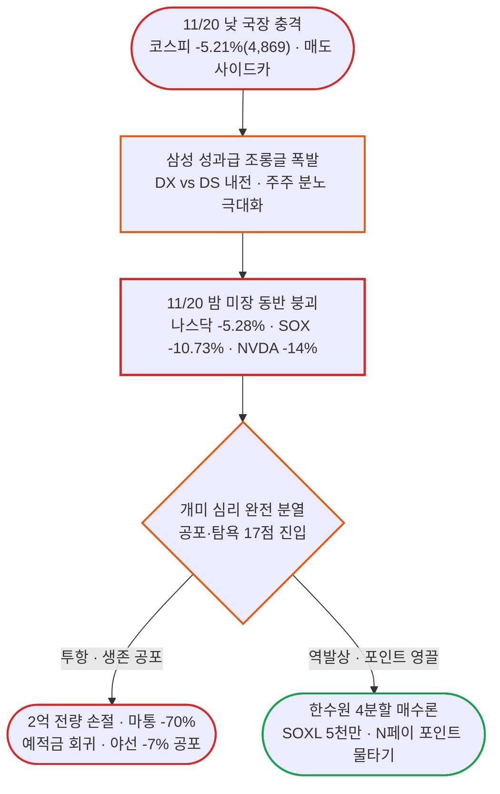

<div class="kb-briefing" markdown="1">

# 블라인드 주식·투자 24시간 브리핑: <span class="kb-heading-detail">"나스닥 -5.28%·코스피 4,869 붕괴…공포·탐욕 17점, 생존과 물타기의 갈림길"</span> { #블라인드-주식투자-24시간-브리핑-나스닥--528코스피-4869-붕괴공포탐욕-17점-생존과-물타기의-갈림길 }

<div class="kb-points kb-points--grid" markdown>

<div class="kb-point" markdown>
<p class="kb-point__label" markdown>작성일</p>

2026-11-21

</div>

<div class="kb-point" markdown>
<p class="kb-point__label" markdown>수집 기간</p>

2026년 11월 20일(금) 13:41 ~ 11월 21일(토) 09:27 (KST)

</div>

<div class="kb-point" markdown>
<p class="kb-point__label" markdown>수집 규모</p>

최근 24시간 게시글 1,236개 전수 수집 (본문·댓글 정밀 분석 119개, 상세 수집 원댓글 612개·대댓글 354개 총 966개, 목록 미리보기 분석 1,117개)

</div>

</div>

!!! warning "주의사항"
    아래 내용은 모두 블라인드 익명 사용자들의 날것의 주장과 여론이다. 수치, 인용 기사, 소식은 따로 검증하지 않았다. "속보", "엠바고", "리포트" 같은 표현이 붙은 글도 출처가 불분명하거나 추측과 풍자를 섞은 경우가 많다. 투자 판단에 쓰기 전에 원문 기사나 공시를 직접 확인해야 한다. 작성자 소속은 블라인드에 표시된 회사명이며 실제 재직 여부는 확인할 수 없다. "언급 글 수"는 `entities.js`로 제목, 본문, 댓글에 종목명이나 별칭이 들어간 글을 센 값이다. 이번 범위에는 11월 20일 오후 코스피 5.21% 폭락(4,869.96, 매도 사이드카)과 같은 날 밤 미국 본장 나스닥 -5.28%·엔비디아 -14.01% 추락 충격이 함께 들어 있다.

<div class="kb-briefing-section kb-briefing-section--dashboard" markdown="1">

## 📊 블라인드 개미 공포·탐욕 지수 (Fear & Greed Index)

극단적 공포의 심연으로 한 단계 더 떨어졌다.

당일 종합 지수는 **17점(극단적 공포)으로** 직전 11월 20일의 23점보다 **6점** 추가 하락했다.

11월 10일 33점 이후 11월 19일 29점, 11월 20일 23점을 거쳐 4연속 추락이다.

금요일 낮 코스피가 5.21% 급락해 4,869.96까지 밀리며 양대 시장 매도 사이드카가 발동된 데 이어, 밤사이 미국 본장에서 나스닥(-5.28%)과 필라델피아 반도체지수(-10.73%), 엔비디아(-14%)가 연쇄 붕괴하자 게시판은 완전히 얼어붙었다.

원금 50% ~ 93% 손실 고백과 마통·결혼자금 파탄, 지인 극단적 선택 부고까지 터지며 "월요일 국장 문 닫는다"는 비명이 지배한다.


<div class="kb-portfolio-metrics">
  <div class="kb-portfolio-metric-card">
    <span class="label">당일 공포·탐욕 지수</span>
    <span class="value">17점 (극단적 공포)</span>
    <span class="sub">0 극단적 공포 ~ 100 극단적 탐욕</span>
  </div>
  <div class="kb-portfolio-metric-card">
    <span class="label">직전 브리핑 대비</span>
    <span class="value">-6p 추가 하락</span>
    <span class="sub">11/10 33점 ➔ 11/19 29점 ➔ 11/20 23점 ➔ 11/21 17점</span>
  </div>
  <div class="kb-portfolio-metric-card">
    <span class="label">지배적 개미 분위기</span>
    <span class="value">사이드카 · 생존 공포 극대화</span>
    <span class="sub">"코스피 4,869 붕괴 + 미장 -5.28% 이중 충격"</span>
  </div>
  <div class="kb-portfolio-metric-card">
    <span class="label">역발상 수급 시그널</span>
    <span class="value">투항 매도 vs 포인트 영끌 물타기</span>
    <span class="sub">엔비디아 패닉셀·손절 속출 vs 한수원 4분할 매수론</span>
  </div>
</div>

```vegalite
{
  "$schema": "https://vega.github.io/schema/vega-lite/v5.json",
  "background": "transparent",
  "width": "container",
  "height": 220,
  "padding": {"top": 8, "bottom": 4, "left": 4, "right": 8},
  "data": {
    "values": [
      {"metric": "종합 공포·탐욕 지수", "score": 17, "max": 100, "zone": "극단적 공포", "label": "17점 (극단적 공포 · -6p)", "desc": "코스피 매도 사이드카와 나스닥 -5.28% 연쇄 붕괴로 4연속 하락"},
      {"metric": "① 체감 손익·계좌 심리", "score": 12, "max": 100, "zone": "극단적 공포", "label": "12점 (극단적 공포)", "desc": "시드 1억➔700만, 마통 9천 -70%, 결혼자금 탕진, 지인 부고 충격"},
      {"metric": "② 매수·투매 수급 태도", "score": 22, "max": 100, "zone": "극단적 공포", "label": "22점 (극단적 공포)", "desc": "2억 전량 손절·예적금 회귀·인버스 전환 vs N페이·M포인트 물타기"},
      {"metric": "③ 반도체·업황 신뢰도", "score": 14, "max": 100, "zone": "극단적 공포", "label": "14점 (극단적 공포)", "desc": "SEC 회계조사설, BNK 28년 하닉 영익 34조 리포트, 삼전 성과급 내전"},
      {"metric": "④ 지수 지지선 신뢰도", "score": 16, "max": 100, "zone": "극단적 공포", "label": "16점 (극단적 공포)", "desc": "코스피 3,000 ~ 4,000설, 외인 220조 매도 공포, 닷컴버블 재현론"},
      {"metric": "⑤ 역발상 바닥 기대감", "score": 21, "max": 100, "zone": "극단적 공포", "label": "21점 (극단적 공포)", "desc": "엔비디아 5년 장기보유자 패닉셀, 한수원 4분할 매수론 외엔 관망 우세"}
    ]
  },
  "encoding": {
    "y": {
      "field": "metric",
      "type": "nominal",
      "sort": null,
      "axis": {"title": null, "labelFontWeight": 500, "labelFontSize": 12, "labelLimit": 180, "ticks": false, "domain": false, "labelPadding": 12}
    }
  },
  "layer": [
    {
      "mark": {"type": "bar", "cornerRadius": 7, "height": 14, "color": "#94a3b8", "opacity": 0.14},
      "encoding": {
        "x": {
          "field": "max",
          "type": "quantitative",
          "scale": {"domain": [0, 118]},
          "axis": {
            "title": "블라인드 개미 심리 스펙트럼 (0~24 극단적 공포 · 25~44 공포 · 45~55 중립 · 56~74 탐욕 · 75~100 극단적 탐욕)",
            "values": [0, 25, 50, 75, 100],
            "labelExpr": "datum.value == 0 ? '0 (극단적 공포)' : datum.value == 25 ? '25 (공포)' : datum.value == 50 ? '50 (중립)' : datum.value == 75 ? '75 (탐욕)' : '100 (극단적 탐욕)'",
            "grid": false
          }
        }
      }
    },
    {
      "data": {"values": [{"x": 25}, {"x": 45}, {"x": 55}, {"x": 75}]},
      "mark": {"type": "rule", "strokeDash": [2, 4], "color": "#94a3b8", "opacity": 0.5},
      "encoding": {"x": {"field": "x", "type": "quantitative"}, "y": {"value": 0}, "y2": {"value": "height"}}
    },
    {
      "mark": {"type": "bar", "cornerRadius": 7, "height": 14},
      "encoding": {
        "x": {"field": "score", "type": "quantitative"},
        "color": {
          "field": "zone",
          "type": "nominal",
          "scale": {
            "domain": ["극단적 공포", "공포", "중립", "탐욕", "극단적 탐욕"],
            "range": ["#dc2626", "#ea580c", "#64748b", "#16a34a", "#2563eb"]
          },
          "legend": null
        },
        "tooltip": [
          {"field": "metric", "title": "심리 지표"},
          {"field": "label", "title": "점수 및 구간"},
          {"field": "desc", "title": "핵심 진단"}
        ]
      }
    },
    {
      "mark": {"type": "text", "align": "left", "dx": 10, "fontWeight": 600, "fontSize": 12},
      "encoding": {
        "x": {"field": "score", "type": "quantitative"},
        "text": {"field": "label", "type": "nominal"}
      }
    }
  ],
  "config": {"view": {"stroke": "transparent"}}
}
```

---


</div>

<nav class="kb-briefing-nav" aria-label="브리핑 주요 주제" markdown="1">

**주제 바로가기**

- [1. 전체 분위기](#1-전체-분위기-코스피-4869-붕괴에-미장--5-겹타격)
- [2. 원인 분석](#2-원인-분석-대중이-지목한-폭락의-5대-뇌관)
- [3. 찌라시와 미확인 소식 (확인 필요)](#3-찌라시와-미확인-소식-확인-필요)
- [4. 종목·섹터별 개인 투자자 심리와 전망](#4-종목섹터별-개인-투자자-심리와-전망)
- [5. 대표 투자 의견](#5-대표-투자-의견)
- [6. 다음 체크포인트](#6-다음-체크포인트)

</nav>


<div class="kb-briefing-section" markdown="1">

## 1. 전체 분위기: 코스피 4,869 붕괴에 미장 -5% 겹타격

게시판의 공기가 완전히 바뀌었다.

어제까지만 해도 "앤트로픽 상장이면 살아날까", "국장만 빠지고 미장은 버티지 않을까"라는 실낱같은 기대가 남아 있었다.

그러나 20일 낮 코스피가 5.21% 폭락하며 4,869.96(1월 20일 이후 최저)으로 주저앉고 양 시장 매도 사이드카가 터진 데 이어, 밤사이 미국 본장마저 나스닥 -5.28%, 필라델피아 반도체지수 -10.73%, 엔비디아 -14%로 무너지자 모든 도피처가 사라졌다는 절망감이 게시판을 덮었다.




글의 성격은 세 갈래로 갈렸다.

첫째는 **생존 고통과 현실 파탄의 고백**이다.

20 ~ 30대 직장인뿐 아니라 퇴직금을 뺀 40 ~ 60대 은퇴 예정자까지 억 단위 손실에 갇혔다는 목격담과 실제 지인 부고 소식이 올라왔다.

둘째는 **삼성전자·SK하이닉스 성과급을 둘러싼 분노와 조롱**이다.

주가 폭락 속에서 삼성전자 직원이 "주가가 5만 원까지 떨어져야 성과급 주식을 15,000주 받는다"고 올린 글이 불을 지르며 타사 직장인들의 "성과급 압수" 여론을 폭발시켰다.

셋째는 **블랙 유머와 역발상 논쟁**이다.

앤트로픽이 리만가설을 증명했다는 자조 밈("계좌는 리먼브라더스")과 현금·단기채를 쥐고 분할 매수 타점을 재는 소수 고수들의 글이 교차했다.


<div class="kb-briefing-topic" markdown="1">

### 블라인드 명예의 전당: 레전드 글과 티키타카

#### 성과급 내전: <span class="kb-heading-detail">"주가 5만 원 가야 15,000주 받는다" vs "성과급 압수해 배당 돌려라"</span> { #성과급-내전-주가-5만-원-가야-15000주-받는다-vs-성과급-압수해-배당-돌려라 }

<div class="kb-feed" markdown>

<div class="kb-post" markdown>
<p class="kb-post__title" markdown>직원 입장에서 삼전 주가 5만기원합니다</p>
<div class="kb-post__meta"><span class="kb-chip">삼성전자</span><span class="kb-stat">추천 <b>12</b></span><span class="kb-stat">댓글 <b>75</b></span><span class="kb-stat">조회 <b>3,053</b></span></div>

올해 삼성전자 영업이익 370조 원의 10.5%면 메모리 인당 7억 5,000만 원이 꽂히는데, 주가가 25만 원이면 3,000주지만 5만 원까지 박으면 15,000주를 받는다고 계산했다.

2028년 10월 PSU(주가 18만 원 이상 시 지급)를 포기하고 주가 하락으로 성과급 주식 수를 복사하는 게 이득이라는 주장에 댓글이 폭발했다.


</div>

<div class="kb-post kb-post--note" markdown>
<p class="kb-post__title" markdown>현직자 반박과 분노 폭발</p>

같은 회사 소속으로 추정되는 댓글러(추천 25)는 "이런 염장글은 성과급과 무관한 DX 부문이 욕받이 시키려 쓰는 것, DS에선 이런 글 안 쓴다"고 선을 그었다.

그러나 타사 직장인들은 "와 지금 물린 사람은 뒤지라는 거냐", "소송에서 져서 수백조 뱉어내길 바란다"며 분노를 쏟아냈고, 곧바로 **"삼전,하닉 성과급 압수 마려우면 개추"**(서울교통공사 | 추천 42· 댓글 5), **"이제 삼하 성과급은 반드시 취소해야한다."**(삼성디스플레이 | 추천 38· 댓글 14), **"일단 삼전하닉 성과금 뺏어서 배당으로 돌리자"**(현대모비스 | 추천 23· 댓글 4)가 추천 상위권을 휩쓸었다.


</div>

</div>

#### 생존 고통과 극단적 선택 충격: <span class="kb-heading-detail">"결혼자금 4천 남았다", "마통 9천 -70%"</span> { #생존-고통과-극단적-선택-충격-결혼자금-4천-남았다-마통-9천--70 }

<div class="kb-feed" markdown>

<div class="kb-post" markdown>
<p class="kb-post__title" markdown>주변에 투자실패로 ㅈㅅ함</p>
<div class="kb-post__meta"><span class="kb-chip">라이온하트스튜디오</span><span class="kb-stat">추천 <b>9</b></span><span class="kb-stat">댓글 <b>14</b></span><span class="kb-stat">조회 <b>1,578</b></span></div>

작년부터 수익을 크게 보고 회사까지 그만뒀던 지인 형이 주담대 빚투 실패로 극단적 선택을 했다는 부고 소식이 올라왔다. "애도 셋이나 있는데… 화면에 찍힌 미실현 수익을 원금으로 착각했을 것"이라는 댓글에 게시판이 숙연해졌다.

</div>

<div class="kb-post" markdown>
<p class="kb-post__title" markdown>이번에는 주식시장 극단적선택이 많을듯..</p>
<div class="kb-post__meta"><span class="kb-chip">현대자동차</span><span class="kb-stat">추천 <b>11</b></span><span class="kb-stat">댓글 <b>9</b></span><span class="kb-stat">조회 <b>1,099</b></span></div>

코로나 때는 2030 천만 원대 손실이었지만 이번엔 퇴직금·커버드콜에 억 단위를 넣은 40 ~ 60대 손실이 커 충격이 다르다고 진단했다. 댓글에는 "정년 3년 남은 부장님이 요즘 줄담배를 태운다"(추천 4)는 현장 증언이 달렸다.

</div>

<div class="kb-post kb-post--note" markdown>
<p class="kb-post__title" markdown>실전 손실 고백과 물타기 현주소</p>

"2억 넣었는데 1억 이하로 떨어져 장 막판 전량 손절"(현대자동차 | 추천 11· 댓글 25· 조회 5,426)에는 "진짜 형 같은 사람 때문에 내가 돈 벌어"(추천 1)라는 냉소와 "곧 반등 나오겠네"(추천 20)라는 반응이 엇갈렸다.

이외에도 "8년 모은 돈 절반 증발"(국민은행 | 추천 12· 댓글 14,댓글엔 "2.4억 중 1.5억 날렸다" 추천 6),

"원금 1.8억➔2.3억➔1억"(공무원 | 추천 2· 댓글 19),

"시드 1억➔700만 원 남음(-90% 이상)"(서울주택도시개발공사 | 추천 2· 댓글 14),

"와이프 몰래 마통 9천 -70%"(LIG디펜스&에어로스페이스 | 댓글 14),

"26여 결혼자금 3억 목표였는데 -8천 빠져 4천 남음"(새회사 | 추천 2· 댓글 14),

"물 탈 돈 없어서 네이버페이·M포인트 전환해 물 탔는데 또 물림"(새회사 | 추천 4· 댓글 9)까지 처절한 사연이 이어졌다.


</div>

</div>

#### 블랙 유머: <span class="kb-heading-detail">"앤트로픽 리만가설 증명" & "엔비디아 닷컴버블 시스코"</span> { #블랙-유머-앤트로픽-리만가설-증명--엔비디아-닷컴버블-시스코 }

<div class="kb-feed" markdown>

<div class="kb-post" markdown>
<p class="kb-post__title" markdown>"앤트로픽 리만가설증명" 시리즈</p>
<div class="kb-post__meta"><span class="kb-chip">수협은행·삼성전자</span></div>

AI가 돈은 못 벌고 수학 난제만 푼다는 자조 밈이 퍼졌다. "그거 풀면 리먼이 살아돌아와 앤트로픽 사주냐", "근데 계좌는 왜 리먼브라더스인가요"라는 대댓글이 폭소를 자아냈다.

</div>

<div class="kb-post" markdown>
<p class="kb-post__title" markdown>🚨 [월가발 긴급 속보] 반도체주 급락의 숨겨진 배후는 RTX 5090과 RAM 가격?</p>
<div class="kb-post__meta"><span class="kb-chip">LG전자</span></div>

월가 직원이 그래픽카드와 램 가격 폭등에 화가 나 반도체 주식을 던졌다는 풍자글에 "하도 장이 ㅈㄹ같으니 웃자고 쓴 거지?", "GTA6의 파급력"이라는 반응이 달렸다.

</div>

</div>


</div>

<div class="kb-briefing-topic" markdown="1">

### 블라인드 인용 시장 수치

| 항목 | 블라인드 내 인용 수치 | 출처 글 (작성자 소속) |
| :--- | :--- | :--- |
| **코스피 (11/20 종가)** | 4,869.96 (-5.21%, 매도 사이드카) | 공포에 사자, 천천히 사야할 때 (`한국수력원자력`) |
| **코스피 외국인·기관·개인 (11/20)** | 외인 -1조 1천억 · 기관 -9,500억 · 개인 +1조 6천억 | 공포에 사자, 천천히 사야할 때 (`한국수력원자력`) |
| **삼성전자 · SK하이닉스 (11/20 종가)** | 삼성전자 18만 3,100원(-49.5%) · 하이닉스 111만 3,000원(-62%) | 공포에 사자, 천천히 사야할 때 (`한국수력원자력`) |
| **미국 3대 지수 (11/20 마감)** | 다우 -1.93% · S&P500 -3.70%(7거래일 연속 하락) · 나스닥 -5.28% | 11/20 미국증시 (`한국GM`) |
| **필라델피아 반도체 · VIX** | 필라델피아반도체 -10.73% · VIX 19.3 ➔ 38.50 (글 작성 시점 인용) | 11/20 미국증시 (`한국GM`) |
| **미국 M7 등락률 (11/20)** | 애플 -2.06% · MS -3.08% · 알파벳 -3.46% · 아마존 -4.25% · 메타 -6.07% · 테슬라 -7.91% · SPCX -7.79% | 11/20 미국증시 (`한국GM`) |
| **미국 반도체·스토리지 등락률** | 엔비디아 -14% · TSMC -9.48% · 브로드컴 -12.19% · AMD -13.25% · 마이크론 -13.89% · SKHY -13.97% · SNDK -16.48% · WDC -12.02% | 11/20 미국증시 (`한국GM`) |
| **원전·전력·비트코인·금리·유가** | UEC -7.99% · 비스트라 -7.17% · SMR -11.81% · 듀크 +0.71% · BTC $58,590선 · 미 10년물 4.936% · WTI $82.4 · 브렌트 $92.49 | 11/20 미국증시 (`한국GM`) |


</div>

<div class="kb-briefing-topic" markdown="1">

### 다음 거래일 예상: <span class="kb-heading-detail">"월요일 국장 지옥" vs "단기 과매도 선방"</span> { #다음-거래일-예상-월요일-국장-지옥-vs-단기-과매도-선방 }

<div class="kb-points kb-points--grid" markdown>

<div class="kb-point" markdown>
<p class="kb-point__label" markdown>지배적 비관론</p>

20일 밤 미국 반도체가 10 ~ 16%대 추가 폭락하고 코스피 야간선물이 -7%까지 밀린 만큼, 월요일 국내 증시 개장과 동시에 하이닉스 100만 원 붕괴·삼성전자 15만 원선 추락이 불가피하다는 공포가 압도적이다.

"오늘 빠진 것의 3배는 빠져야 맞다"(현대모비스),

"유예된 반대매매 풀릴 때까지 저점 안 잡힌다"(ASML)는 경고가 주를 이룬다.


</div>

<div class="kb-point" markdown>
<p class="kb-point__label" markdown>소수 반론</p>

"코스피는 이미 먼저 쳐맞을 대로 쳐맞아 금요일 나스닥이 빠져도 월요일에 의외로 선방하거나 야선이 주말 사이 희석될 수 있다"(아이파킹), "주요 지표 과매도 구간이라 숏 먹을 자리가 얼마 안 남았다"(스타트업, 숏 4천만 원 수익자)는 신중론도 일부 존재한다.

</div>

</div>


</div>

<div class="kb-briefing-topic" markdown="1">

### 지수·종목 지지선 매트릭스

| 종목 / 지수 | 현재가 / 위치 (원문 기준) | 1차 지지선·매수 고려대 | 극단적 비관치 (공포 타겟) | 주요 근거 (게시판 여론) |
| :--- | :--- | :--- | :--- | :--- |
| **코스피** | 4,869.96 (-5.21%) | 4,500 ~ 4,800 (분할 시작) | 2,700 ~ 4,000 (3천대 10년 박스피) | 외인 연중 203 ~ 220조 매도 공포, 4,220 반등 후 3천대설 |
| **삼성전자** | 18만 3,100원 | 15만 ~ 16만 원대 (3차 매수) | 5만 ~ 10만 원 (7만 원설) | 선행 PER 3.3배 저평가론 vs 직원 "5만원 가야 성과급 15,000주" |
| **SK하이닉스** | 111만 3,000원 | 80만 ~ 98만 원 (단기 반등·3차) | 20만 ~ 40만 원 (이주완 20만설) | BNK 28년 영익 34조 리포트 vs 20조 자사주·배당 14조 방어 |
| **SOXL** | 39달러대 붕괴 위협 | 30 ~ 35달러 (단기 분할) | 10 ~ 20달러 (적정가 10달러설) | 상위 종목 -12%대 추종 괴리, "15달러까지 빠질 자리 남음" |
| **엔비디아** | 130달러 초반(장중 14% 급락) | 131달러 이탈로 관망 | 100달러 하회 | SEC 회계조사설·12/1 청문회·닷컴 시절 시스코 비교 |
| **비트코인** | $58,590 ~ $61,300선 | $55,000 ~ $57,000 | 추가 강제청산 구간 | 숏 수익자 단기반등 타점 제시 vs 주식·금 동반 투매 |

---


</div>


</div>

<div class="kb-briefing-section" markdown="1">

## 2. 원인 분석: 대중이 지목한 폭락의 5대 뇌관

| 주제 | 핵심 논점 | 팽팽한 대립 구도 | 결론 |
| :--- | :--- | :--- | :--- |
| **① 엔비디아 SEC·스캔들** | 젠슨 황 사임 후 SEC 회계조사설까지 겹쳐 -14% 추락 | "불륜·스캔들 핑계 댄 닷컴 시스코급 붕괴" vs "실적 1,158억 달러와 비교 불가" | 12/1 의회 청문회 전까지 경영·규제 불확실성 해소 난망 |
| **② 앤트로픽 IPO·순환금융** | 역대 최대 IPO가 수급 블랙홀 및 AI 수익성 회의감 촉발 | "2,000조 넣고 2조 버는 버블, AT&T 닷컴 정점 판박이" vs "인프라 초기 적자 당연" | IPO 조달 자금의 HBM 환류 기대보다 단기 수급 이탈 충격이 큼 |
| **③ 정부 정책·연기금 노출** | 연기금 포지션 공개·단일종목 레버리지 허용에 외인 역이용 | "외인 연 203 ~ 220조 매도 ATM기 전락, 정부 책임" vs "투자 책임은 본인 몫" | 얇아진 호가창(14.2조) 속 외인 매도와 정치 불신이 투심 악화 |
| **④ 금리 인상·빅스텝 공포** | 12월 금리 인상 및 빅스텝 우려로 부자 자금 채권 이탈 | "빅스텝 선반영 중" vs "오늘 증시 폭락으로 금리 동결 확률 부활" | 물가(12/10 발표)·유가($82대) 둔화 여부가 12월 FOMC 분수령 |
| **⑤ 메모리 피크아웃 우려** | 2028년 공급과잉·중국 증설·발주 취소 가능성 부각 | "BNK 28년 영익 88% 급감, LTA 무용지물" vs "14개사 LTA·재고 10일 미만" | 단기 주가는 공포 선반영 상태이나 장기 마진 지속성 검증 필요 |

<div class="kb-briefing-topic" markdown="1">

### ① 엔비디아 SEC 회계조사설과 '시스코' 데자뷰

<div class="kb-points" markdown>

<div class="kb-point" markdown>
<p class="kb-point__label" markdown>엔비디아(-14%) 추락을 둘러싼 논쟁</p>

`한국GM`의 미국증시 요약에서 "SEC, 엔비디아의 회계처리 관행 관련 조사"가 인용되자, `하이브아이엠` 작성자가 "분식회계냐"며 경악했다. 댓글에서는 "실적 보고 글 쓰냐, 연 수백조를 버는데"라는 반박과 "시스코도 당시 실적은 좋았다", "월가가 이유 없이 반토막 내겠냐, 스파이 불륜은 사형감(공식 발표는 스파이 증거 없음·직원 불륜)"이라는 논쟁이 붙었다. `삼성전자` 작성자(`eh1zzrl5`)는 "불륜 때문에 빠지는 게 아니라 엔비디아를 쳐박으려고 이 타이밍에 불륜을 터뜨린 것"이라고 해석했다.

</div>

</div>


</div>

<div class="kb-briefing-topic" markdown="1">

### ② 앤트로픽 상장 역풍과 닷컴버블 비교

<div class="kb-points" markdown>

<div class="kb-point" markdown>
<p class="kb-point__label" markdown>닷컴버블·서브프라임 합체론</p>

`현대자동차` 작성자(`z52dtu42`)는 2000년 3월 나스닥 고점 직후 AT&T가 역대 최대 IPO(약 106억 달러)를 한 뒤 폭락 랠리가 시작된 사례를 들며, 엔비디아=시스코, 앤트로픽=AT&T 구도로 폭락 가속을 점쳤다. `현대모비스`(`d2nb1dtj`) 역시 "반도체는 미래 희망 펌핑, AI는 돈 못 벌고 IPO 엑싯, 빅테크는 코인 채굴업체 보증 순환금융"이라며 닷컴버블+서브프라임을 합친 구조라고 쏘아붙였다.

</div>

<div class="kb-point" markdown>
<p class="kb-point__label" markdown>반론과 자조</p>

댓글에서는 "닷컴버블은 돈 못 버는 회사들이 계약만 해놓고 파산해 시스코 재고가 쌓인 것", "인터넷·전기차도 초기엔 수지타산이 안 맞았다"는 반론이 맞섰다. 한편 `현대케피코` 작성자는 "최근 인기글에서 앤트로픽 초기엔 오른다더니 현대제철 형님 말에 낚일 뻔했다"며 허탈해했다.

</div>

</div>


</div>

<div class="kb-briefing-topic" markdown="1">

### ③ 정부 정책 책임론과 국민연금·외국인 220조 매도

<div class="kb-points" markdown>

<div class="kb-point" markdown>
<p class="kb-point__label" markdown>정치권·연기금 성토 폭주</p>

`NH농협`(`oazunnby`), `코난테크놀로지`(`zbymqroq`), `서울교통공사`(`bru8jtlu`), `LG전자`(`swf8725p`) 등 다수의 글이 "국민연금 포지션을 공개하고 삼전·하닉 단일종목 레버리지·인버스까지 허용해 외국인의 글로벌 ATM기로 전락했다"고 성토했다. `삼성전자`(`87yrnkhh`)는 "2020년 외인 역대 최대 순매도가 24조 원이었는데 올해 벌써 220조 원을 팔고 있다"(`한국수력원자력` 글에서는 10월 중순까지 약 203조 원 순매도로 언급)며 향후 10년간 코스피 6,000은 꿈의 숫자라고 한탄했다. `DB증권`(`eweijz6o`)은 대만처럼 공매도 금지를 못 하는 이유로 "MSCI 선진국지수 편입 업적 욕심"을 지목했다.

</div>

</div>


</div>

<div class="kb-briefing-topic" markdown="1">

### ④ 금리·물가·유가와 스태그플레이션 논쟁

<div class="kb-points" markdown>

<div class="kb-point" markdown>
<p class="kb-point__label" markdown>금리 공포 vs 채권시장 시그널</p>

`SK바이오텍`(`fcqaopkb`)은 9월 FOMC 인상과 12월 빅스텝 발언 때문에 부자들이 주식에서 빠져 채권으로 이동했다고 봤다. 반면 댓글에는 "지금 다시 금리 동결 확률이 생겼다"는 반박이 달렸고, `한국수력원자력`(`s1ct6tlo`)은 WTI 81.47달러(-16.8%/월)·미국 휘발유 3.72달러(-23%) 하락과 자산 가격 감소로 11월 CPI 전월비가 0.07%까지 꺾인다고 분석했다. `ex-삼성E&A`(`g1uucavd`)는 유가·금리 하락 속 나스닥 급락을 두고 "디플레 아니면 스태그플레이션 공포"라고 의문을 제기했고 댓글엔 "스테고사우르스"라는 허탈한 농담이 달렸다.

</div>

</div>


</div>

<div class="kb-briefing-topic" markdown="1">

### ⑤ 메모리 피크아웃과 LTA 무용론

<div class="kb-points" markdown>

<div class="kb-point" markdown>
<p class="kb-point__label" markdown>공급과잉·발주 취소 경고</p>

`비테스코테크놀로지스코리아`(`7ftorvou`)는 데이터센터 계약을 맞추려면 가구당 월 30만 원 AI 구독이나 대규모 해고, 원전 100개가 필요하다며 "메모리 발주 취소가 장난 아닐 것이고 LTA(장기계약)도 갑질 앞엔 소용없다"고 주장했다. `한국남부발전`(`v41mzhpk`)은 "제조업 영업이익률 80%가 지속 가능하냐, 중국이 번 돈으로 역대급 증설 중"이라며 다음 주 월 ~ 화요일 삼전·하닉 적정가 도달을 예고했다.

</div>

</div>

---


</div>


</div>

<div class="kb-briefing-section" markdown="1">

## 3. 찌라시와 미확인 소식 (확인 필요)

<div class="kb-briefing-topic" markdown="1">

### ⚠️ [루머/뉴스 인용] 엔비디아 SEC 회계부정 조사 착수설
<div class="kb-rumor" data-trust="high" markdown>
<div class="kb-rumor__head" markdown="span"><span class="kb-rumor__level">신뢰도 중상</span><span class="kb-meter" aria-hidden="true"><i class="on"></i><i class="on"></i><i class="on"></i><i class="on"></i><i></i></span><span>외신 인용 게시글 다수 존재, 구체적 혐의 내용은 미확인</span></div>
<div class="kb-rumor__row" markdown>
<p class="kb-rumor__label">원문 주장</p>
<div markdown>

`한국GM`(`mdfy3m8q`)의 시황 요약에 "엔비디아 -14% SEC, 엔비디아의 회계처리 관행과 관련 조사 (로이터)"가 실렸고, `하이브아이엠`(`nbuwlojj`)이 "분식회계???"라며 글을 올렸다.

</div>
</div>
<div class="kb-rumor__row" markdown>
<p class="kb-rumor__label">팩트체크 및 현직자 반박</p>
<div markdown>

댓글에서는 "분식회계는 과장이고 SEC 회계부정 조사 착수라는 카더라 뉴스", "미국은 분식하면 형사 처벌에 증시 퇴출인데 저렇게 돈 잘 버는 회사가 그랬겠냐"는 반론과 "돈 잘 버는 거랑 회계부정은 별개", "사실 여부보다 악재로 끌어내리는 기조가 중요하다"는 반응이 엇갈렸다.

</div>
</div>
<div class="kb-rumor__row kb-rumor__row--key" markdown>
<p class="kb-rumor__label">체크포인트</p>
<div markdown>

실제 SEC 공식 조사 범위(매출 인식·순환금융·지분투자 회계 등)와 12월 1일 젠슨 황 의회 청문회 전후의 공식 공시 여부를 반드시 확인해야 한다.

</div>
</div>
</div>


</div>

<div class="kb-briefing-topic" markdown="1">

### ⚠️ [풍문/외신 인용] 구글·브로드컴 AI 칩 출하 축소 및 삼성·TSMC 중국 출하 중단설
<div class="kb-rumor" data-trust="high" markdown>
<div class="kb-rumor__head" markdown="span"><span class="kb-rumor__level">신뢰도 중상</span><span class="kb-meter" aria-hidden="true"><i class="on"></i><i class="on"></i><i class="on"></i><i class="on"></i><i></i></span><span>FT 보도 등 외신 인용이나 구체적 물량·기간 미확인</span></div>
<div class="kb-rumor__row" markdown>
<p class="kb-rumor__label">원문 주장</p>
<div markdown>

`한국GM`(`mdfy3m8q`) 글에 "*구글, 브로드컴 AI 반도체 출하 계획 축소 전망"이 포함됐고, `한국수력원자력`(`s1ct6tlo`)은 "삼성과 TSMC가 중국 고객 일부에 출하를 멈췄다는 FT 보도가 겹쳤다"고 전했다. `LG디스플레이`(`vcx7kil2`)도 "중국 수출이 막히면서 발생한 GPU 공급과잉"을 폭락 원인으로 지목했다.

</div>
</div>
<div class="kb-rumor__row" markdown>
<p class="kb-rumor__label">팩트체크 및 현직자 반박</p>
<div markdown>

`LG전자`(`cocbsva8`)는 "며칠 전부터 메모리 현물가가 내려간다는 글이 올라왔다"고 덧붙였으나, 구체적 감축 규모나 수출통제 임시 중단 여부는 확인되지 않았다.

</div>
</div>
<div class="kb-rumor__row kb-rumor__row--key" markdown>
<p class="kb-rumor__label">체크포인트</p>
<div markdown>

미 상무부(BIS) 수출규제에 따른 일시적 출하 보류인지, 빅테크 자체 CapEx 축소에 따른 구조적 주문 삭감인지 구분해 봐야 한다.

</div>
</div>
</div>


</div>

<div class="kb-briefing-topic" markdown="1">

### ⚠️ [리포트 논쟁] BNK 이민희 애널리스트 "SK하이닉스 2028년 영업이익 88% 급감(284조 ➔ 34조)"
<div class="kb-rumor" data-trust="mid" markdown>
<div class="kb-rumor__head" markdown="span"><span class="kb-rumor__level">신뢰도 중</span><span class="kb-meter" aria-hidden="true"><i class="on"></i><i class="on"></i><i class="on"></i><i></i><i></i></span><span>국내 증권사 애널리스트 실명 리포트 인용이나 2028년 추정치</span></div>
<div class="kb-rumor__row" markdown>
<p class="kb-rumor__label">원문 주장</p>
<div markdown>

`GS리테일`(`ukbd1ycb`)과 `SK하이닉스`(`q1scsjfp`)가 "올해 영업이익 284조(27년 310조) ➔ 2028년 34조(-88%), 영업이익률 78% ➔ 17%, 목표가 165만 원 ➔ 105만 원 하향" 내용을 공유했다.

</div>
</div>
<div class="kb-rumor__row" markdown>
<p class="kb-rumor__label">팩트체크 및 현직자 반박</p>
<div markdown>

`SK하이닉스` 작성자와 댓글러들은 "고장 난 시계로 유명한 사람, 하닉 300 갈 때도 150 외쳤다", "애플이 BNK 말 안 믿고 LTA 했겠냐"고 반박한 반면, 다른 댓글(추천 13)은 "미국·한국·중국 증설 물량 풀리면 34조도 후하게 준 것, 28년 낸드는 적자"라고 맞섰고 "고장 난 시계라도 한 번은 맞추기라도 한다"(추천 5)는 자조가 달렸다.

</div>
</div>
<div class="kb-rumor__row kb-rumor__row--key" markdown>
<p class="kb-rumor__label">체크포인트</p>
<div markdown>

LTA(장기공급계약) 물량 비중과 가격 밴드 하한선이 실제 업황 둔화 시 얼마나 이익을 방어하는지 분기 실적으로 검증해야 한다.

</div>
</div>
</div>


</div>

<div class="kb-briefing-topic" markdown="1">

### [찌라시] "연말 시즌아웃, 대형 사모펀드·딥스테이트·유대인 큰형님들 엠바고"
<div class="kb-rumor" data-trust="low" markdown>
<div class="kb-rumor__head" markdown="span"><span class="kb-rumor__level">신뢰도 하</span><span class="kb-meter" aria-hidden="true"><i class="on"></i><i></i><i></i><i></i><i></i></span><span>근거 없는 음모론성 글</span></div>
<div class="kb-rumor__row" markdown>
<p class="kb-rumor__label">원문 주장</p>
<div markdown>

`동남권원자력의학원`(`jyraeglr`)이 "연말까지 쭉 떨어질 예정이고 대형 사모펀드, 딥스테이트, 유대인 최고 큰형님들이 움직이기 시작했다. 지금 손절 치고 내년에 시작하라"고 주장했다.

</div>
</div>
<div class="kb-rumor__row" markdown>
<p class="kb-rumor__label">팩트체크 및 현직자 반박</p>
<div markdown>

댓글에서는 "동남권 구멍가게 애 귀에 들어올 정보면 얼마나 가짜 정보일지 감도 안 잡힌다"(추천 3), "그럼 전재산 숏 걸어 인증해 봐"(추천 2), "엠바고 미리 알아서 -3억 뚜들겨 맞았구만"(추천 2)이라며 조롱이 쏟아졌다.

</div>
</div>
<div class="kb-rumor__row kb-rumor__row--key" markdown>
<p class="kb-rumor__label">체크포인트</p>
<div markdown>

수급이나 실적 근거가 전혀 없는 공포 조장 글이므로 배제한다.

</div>
</div>
</div>


</div>

<div class="kb-briefing-topic" markdown="1">

### [풍문/밈] 앤트로픽 '리만가설' 증명설 & 월가 RTX 5090·RAM 가격 폭락 배후설
<div class="kb-rumor" data-trust="low" markdown>
<div class="kb-rumor__head" markdown="span"><span class="kb-rumor__level">신뢰도 하</span><span class="kb-meter" aria-hidden="true"><i class="on"></i><i></i><i></i><i></i><i></i></span><span>커뮤니티 풍자·밈</span></div>
<div class="kb-rumor__row" markdown>
<p class="kb-rumor__label">원문 주장</p>
<div markdown>

`수협은행`(`n5ta0tmy`, `6chi1u4z`, `tn67ukvx`)·`삼성전자`(`s3c05018`) 등이 앤트로픽이 수학 난제 리만가설을 증명했다는 짤방과 글을 올렸고, `LG전자`(`4fmmtn7d`)는 월가 직원이 RTX 5090과 DDR5 RAM 가격에 분노해 반도체 주식을 던졌다는 속보 형식 글을 올렸다.

</div>
</div>
<div class="kb-rumor__row" markdown>
<p class="kb-rumor__label">팩트체크 및 현직자 반박</p>
<div markdown>

댓글러들은 "사진은 딥마인드 노벨상 아저씨", "돈 못 버니 난제 풀며 성능딸", "웃자고 쓴 거지?"라며 밈으로 소비했다.

</div>
</div>
<div class="kb-rumor__row kb-rumor__row--key" markdown>
<p class="kb-rumor__label">체크포인트</p>
<div markdown>

극단적 하락장에서 개미들이 멘탈을 달래기 위해 만드는 풍자 밈이다.

</div>
</div>
</div>


</div>

<div class="kb-briefing-topic" markdown="1">

### [미확인 수치] 국민연금 182조 손실 & 외국인 연간 220조 순매도설
<div class="kb-rumor" data-trust="low" markdown>
<div class="kb-rumor__head" markdown="span"><span class="kb-rumor__level">신뢰도 하 ~ 중</span><span class="kb-meter" aria-hidden="true"><i class="on"></i><i class="on"></i><i></i><i></i><i></i></span><span>게시글 작성자 임의 계산·추정 포함</span></div>
<div class="kb-rumor__row" markdown>
<p class="kb-rumor__label">원문 주장</p>
<div markdown>

`공무원`(`q8ay6oji`)은 "10.18 코스피 5,655 기준 국민연금 182조 손실"을 적었고, `삼성전자`(`87yrnkhh`)는 "올해 외국인 코스피 매도 220조 원"(`한국수력원자력`은 10월 중순까지 203조 원 순매도)을 주장했다.

</div>
</div>
<div class="kb-rumor__row" markdown>
<p class="kb-rumor__label">팩트체크 및 현직자 반박</p>
<div markdown>

한국거래소 및 국민연금 기금운용본부 공식 통계와 교차 확인되지 않은 수치다. 다만 외국인 대규모 이탈과 국민연금 평가손 확대에 대한 개미들의 분노가 극에 달했음을 보여준다.

</div>
</div>
<div class="kb-rumor__row kb-rumor__row--key" markdown>
<p class="kb-rumor__label">체크포인트</p>
<div markdown>

공식 기금운용 실적 공시와 거래소 수급 데이터를 직접 확인해야 한다.

</div>
</div>
</div>

---


</div>


</div>

<div class="kb-briefing-section" markdown="1">

## 4. 종목·섹터별 개인 투자자 심리와 전망

| 종목·섹터 | 언급 글 수 | 지배적 심리 | 대표 전망 (원문 인용) | 소수 반대 의견 |
| :--- | :---: | :--- | :--- | :--- |
| **미국 지수(나스닥·S&P)** | 155개 | 극단적 공포·투항 vs 적립식 실망 | "닷컴버블 때 77.9% 빠졌다" / "2년 적립 다 쳐박았다" | "S&P 고점 대비 10%도 안 빠짐", "지금 분할 매수 때" |
| **국내 지수(코스피·코스닥)** | 140개 | 절망·정치 분노·러그풀 체념 | "월요일 지옥, 코스피 3천 ~ 4천 간다", "외인 220조 매도" | "이미 먼저 맞아 선방 가능", "PER·시가총액 저평가 구간" |
| **SOXL (반도체 3배)** | 138개 | 도박성 물타기·청산 공포·조롱 | "39불 든든국밥" ➔ "10 ~ 20달러·적정가 10달러 간다" | "35달러 이하·앞자리 2부터 소액 분할 반등 노림" |
| **SK하이닉스** | 100개 | 성과급 반감 속 2028 피크아웃 공포 | "100만 붕괴, BNK 28년 34조, 20 ~ 40만원설" | "선행 PER 3배, 20조 자사주(일 3,100억)·배당 14조" |
| **레버리지·인버스 ETF** | 89개 | 레버리지 파산 비명 vs 숏 환호 | "속슬 -30% 하루에 녹아, 병합만 하지 마라" | "5월 인버스 물렸다가 복구", "숏 먹을 자리 얼마 안 남음" |
| **반도체 (전반)** | 87개 | 탈사이클 환멸·중국 증설 경계 | "제조업 영익률 80% 불가, 2023년 수준 회귀" | "11월 1~10일 수출 +331%, 변동성 죽을 때 무릎" |
| **삼성전자** | 77개 | DX·DS 성과급 내전 vs 5만 원 조롱 | "주가 5만 원 가야 15,000주 받는다", "감전 15만" | "선행 PER 3.3배, 1월 말 55 ~ 75조 환원안 대기" |
| **엔비디아** | 66개 | SEC 조사 패닉셀 vs 시스코 붕괴론 | "5년 들고 있었는데 131불 패닉셀", "100불 아래 갈 수도" | "딥시크 때도 추매해 먹었다, 연 수백조 버는 기업" |
| **AI·빅테크 / 앤트로픽** | 59개 / 32개 | 수급 블랙홀 원망·버블 붕괴 확신 | "돈 못 버는 AI, AT&T IPO 후 폭락 판박이" | "앤트로픽 조달금 1,048억 달러는 결국 HBM으로 환류" |
| **채권·달러·환율 / 금·은** | 47개 / 7개 | 금·은 안전자산 배신감·채권 피난 | "S&P 70%+금 30%도 -2천, 은 115불 물림" | "금리 인상으로 금 하락 당연, 채권·단기채 현금 대기" |
| **코인·네이버·현대차·샌디·마이크론** | 19 / 15 / 12 / 11·9개 | 전방위 비명·구조대 실종 공포 | "샌디·현차 징역 몇 년?", "네이버 포인트로 물타기" | "비트코인 5.5 ~ 5.7만 불 단기 반등 타점" |

<div class="kb-briefing-topic" markdown="1">

### 1. 미국 지수(나스닥·S&P 500) — 언급 글 155개

<div class="kb-points kb-points--grid" markdown>

<div class="kb-point" markdown>
<p class="kb-point__label" markdown>보유자 상태</p>

2년 이상 S&P 500과 나스닥을 적립식으로 모은 장기 투자자들까지 수익이 꺾이거나 마이너스로 전환됐다(`2fp13btj`). "원금 1.7억에 -4,000만 원"(현대자동차),

"며칠 전 남은 시드 거의 다 나스닥 ETF에 넣자마자 -6%"(창조경제혁신센터)처럼 현금 소진 계좌가 속출했다.


</div>

<div class="kb-point" markdown>
<p class="kb-point__label" markdown>심리</p>

"국장 피해서 미장 왔는데 미장도 거지 됐다"는 배신감과 "지금 죽겠다는 사람들은 다 개별주 투자자지 S&P는 고점 대비 10%도 안 빠졌다"(공무원 `adnomy7p`)는 냉소가 공존한다.

</div>

<div class="kb-point" markdown>
<p class="kb-point__label" markdown>전망과 목표가·지지선</p>

비관론은 닷컴버블 당시 나스닥 -77.9% 폭락(`yqur008i`)과 -50% 시나리오(`np0shs6n`), VIX 38.50 급등(`mdfy3m8q`)을 거론한다.

반면 낙관론은 18일 기준 S&P -6.3%·나스닥 -11.5% 조정을 거치며 S&P IT 선행 PER이 2020년 3월 이후 최저치에 도달했다며 물가 둔화 시 1분기 반등을 본다(`s1ct6tlo`).


</div>

<div class="kb-point" markdown>
<p class="kb-point__label" markdown>행동 계획</p>

2억 전량 손절(`kthangui`), 월요일 전량 정리 후 예적금 회귀 파와, QLD 52 ~ 58달러 분할 매수·S&P 적립 지속 파로 갈린다.

</div>

<div class="kb-point" markdown>
<p class="kb-point__label" markdown>어제 대비 변화</p>

어제는 "국장만 빠진다"는 미장 신봉이 남아 있었으나, 오늘 나스닥 -5.28% 마감으로 미장 불패 심리마저 급격히 훼손됐다.

</div>

<div class="kb-point" markdown>
<p class="kb-point__label" markdown>종합 판단</p>

미국 지수 적립식 투자자들까지 공포에 질리기 시작한 점은 전형적인 투항 초기 신호다. 다만 아직 지수 고점 대비 낙폭이 10 ~ 15%권이라 추가 변동성 여지는 열려 있다.

</div>

</div>


</div>

<div class="kb-briefing-topic" markdown="1">

### 2. 국내 지수(코스피·코스닥) — 언급 글 140개

<div class="kb-points kb-points--grid" markdown>

<div class="kb-point" markdown>
<p class="kb-point__label" markdown>보유자 상태</p>

코스피 4,869.96(-5.21%) 붕괴로 1억 원대 ~ 수억 원대 손실 인증이 쏟아졌다.

40 ~ 60대 은퇴 예정자의 커버드콜·반도체 ETF 억 단위 손실(`zz73m2ql`), 공무원 전 재산 손실(`pluqju27`), 1.8억 ➔ 1억 반토막(`p3vjf5i3`) 등이 확인된다.


</div>

<div class="kb-point" markdown>
<p class="kb-point__label" markdown>심리</p>

극단적 분노와 자포자기다. "코스피 성과자료집 8천 돌파 자랑하더니 외인에게 국부 다 털렸다"(서울교통공사), "스캠 코인 러그풀 차트"(한화시스템)라며 정부·연기금을 향한 원망이 폭발했다.

</div>

<div class="kb-point" markdown>
<p class="kb-point__label" markdown>전망과 목표가·지지선</p>

비관론은 코스피 4,000 붕괴·4,220 반등 후 3,000대 10년 박스피·2,700 ~ 3,000 회귀를 외친다. 반론은 17일 거래대금 14.2조 원으로 호가창이 얇아 과잉 하락했을 뿐 1분기 외인 복귀와 배당·자사주가 하단을 잡는다고 본다.

</div>

<div class="kb-point" markdown>
<p class="kb-point__label" markdown>행동 계획</p>

개인들은 20일 하루 1조 6,000억 원을 순매수하며 받아냈으나, 게시판에서는 "월요일 인버스", "1년 내 쓸 돈이면 빼라"는 목소리가 커졌다.

</div>

<div class="kb-point" markdown>
<p class="kb-point__label" markdown>어제 대비 변화</p>

5,000선 붕괴 직후였던 어제보다 오늘 4,869원 마감과 미장 폭락 소식이 겹치며 "월요일 지옥" 공포가 배가됐다.

</div>

<div class="kb-point" markdown>
<p class="kb-point__label" markdown>종합 판단</p>

개인 수급의 저가 매수가 아직 완전히 마르지 않았고 얇은 호가창 때문에 월요일 개장 충격이 클 수 있어 진정 확인이 필요하다.

</div>

</div>


</div>

<div class="kb-briefing-topic" markdown="1">

### 3. SOXL(반도체 3배 ETF) — 언급 글 138개

<div class="kb-points kb-points--grid" markdown>

<div class="kb-point" markdown>
<p class="kb-point__label" markdown>보유자 상태</p>

평단 63.9달러 420주(3,580만 원, `3iyncwbz`), 평단 100달러 이상(`g26m324e`), 39.1달러에 1억 3,000만 원 신규 진입 후 20분 만에 천만 원 손실(`vspre5sp`), 5,000만 원 진입 후 추가 2억 대기(`chnwtc26`) 등 극단적 레버리지 베팅이 몰려 있다.

</div>

<div class="kb-point" markdown>
<p class="kb-point__label" markdown>심리</p>

"속슬 39불 든든국밥"이라 외치다 하루 만에 "대가리 깨짐", "병합만 하지 마라"로 급변한 공황 상태와, 인버스(SOXS) 보유자들의 조롱이 충돌한다.

</div>

<div class="kb-point" markdown>
<p class="kb-point__label" markdown>전망과 목표가·지지선</p>

상위 5개 종목(AMD·마이크론·브로드컴·엔비디아·인텔)이 -12% 안팎으로 빠지면 3배 추종 상 -36%가 맞아 추가 하락이 남았다는 경고(`yzgi1o37`), 적정가 10달러설(`vmi06eov`), 15달러설(`cocbsva8`)이 쏟아졌다.

반등론자는 35달러 이하부터 20·10·5달러로 쪼개 사겠다고 맞선다.


</div>

<div class="kb-point" markdown>
<p class="kb-point__label" markdown>어제 대비 변화</p>

어제 40달러 초반대 반발 매수 기대감이 오늘 30달러대 추락 공포로 꺾였다.

</div>

<div class="kb-point" markdown>
<p class="kb-point__label" markdown>종합 판단</p>

국내 개미들의 야수적 물타기가 가장 집중된 종목이라 변동성 축소 전까지는 섣부른 진입이 치명적이다.

</div>

</div>


</div>

<div class="kb-briefing-topic" markdown="1">

### 4. SK하이닉스 — 언급 글 100개

<div class="kb-points kb-points--grid" markdown>

<div class="kb-point" markdown>
<p class="kb-point__label" markdown>보유자 상태</p>

250만 원 이상 고점 물림부터 195만 원(`hpdjxvu3`), 190만 원(`aymol1ee`), 110만 원(`rhr003cp`), 105만 원(`5toboy0r`)까지 전 가격대에 물려 있다. 20일 종가는 111만 3,000원(고점 291만 9,000원 대비 -62%)이다.

</div>

<div class="kb-point" markdown>
<p class="kb-point__label" markdown>심리</p>

BNK 리포트 쇼크와 100만 원선 붕괴 직전의 공포, 그리고 삼성전자와 함께 타사 직장인들의 성과급 박탈 여론에 시달리는 이중 압박 상태다.

</div>

<div class="kb-point" markdown>
<p class="kb-point__label" markdown>전망과 목표가·지지선</p>

비관론은 2028년 영업이익 34조 원(BNK)·중국 증설·80만 원 / 20 ~ 40만 원 회귀를 외친다.

낙관·반등론은 90 ~ 98만 원 단기 반등 타점(`3nfcxxy1`), 80 ~ 90만 원대 3차 매수, 선행 PER 3.0배·영업이익률 80%·순현금 98조 7,000억 원·남은 자사주 18조 원(일 3,100억 매수)과 배당 14조 원(26일까지 매수 기준)을 근거로 든다(`s1ct6tlo`).


</div>

<div class="kb-point" markdown>
<p class="kb-point__label" markdown>현직자·업계 의견</p>

SK하이닉스 소속 작성자(`q1scsjfp`)는 BNK 리포트를 공유하며 "고장 난 시계, 애플이 LTA 왜 했겠냐"며 과도한 비관을 경계했으나, 다른 댓글들은 "LTA가 물량까지 무조건 보장하진 않는다"고 반박했다.

</div>

<div class="kb-point" markdown>
<p class="kb-point__label" markdown>종합 판단</p>

100만 원 라운드 피겨 붕괴 여부가 월요일 최대 분수령이며, 자사주 일 3,100억 원 기계적 수급이 외인 매도 압력을 얼마나 상쇄하는지가 관건이다.

</div>

</div>


</div>

<div class="kb-briefing-topic" markdown="1">

### 5. 레버리지·인버스 ETF — 언급 글 89개

<div class="kb-points kb-points--grid" markdown>

<div class="kb-point" markdown>
<p class="kb-point__label" markdown>보유자 상태</p>

TQQQ 평단 50달러 초반·SOXL 100달러 이상 물타기 선언(`g26m324e`), 미국 개별주 레버리지 -90% 이상 파산 직전(`w02ry1ju`), 10월 초 산 하이닉스 -22%인데 어제 산 속슬 -30% 토로(`m2jh727x`) 등 레버리지 파괴력이 여실히 드러났다.

</div>

<div class="kb-point" markdown>
<p class="kb-point__label" markdown>심리</p>

"레버리지 존버보다 옵션 도박이 기댓값 높다"는 훈수와 5월 인버스 물렸다가 이번에 복구했다는 인버스파의 안도가 엇갈린다.

</div>

<div class="kb-point" markdown>
<p class="kb-point__label" markdown>종합 판단</p>

하락 추세에서 레버리지 물타기가 계좌를 가장 빠르게 녹이고 있음을 보여주는 전형적 구간이다.

</div>

</div>


</div>

<div class="kb-briefing-topic" markdown="1">

### 6. 반도체 (업황·소부장 전반) — 언급 글 87개

<div class="kb-points kb-points--grid" markdown>

<div class="kb-point" markdown>
<p class="kb-point__label" markdown>심리와 논점</p>

"탈사이클 뉴노멀이라던 유튜브·리딩방에 속았다"는 환멸이 팽배하다.

메모리 현물가 하락 정황(`cocbsva8`), 2028년 낸드 적자전환설(`ukbd1ycb`), 중국 증설 우려가 지배한다.

반면 `한국수력원자력`은 11월 1 ~ 10일 반도체 수출 166억 달러(+331%, 전체 수출의 49.7%)와 HBM4 웨이퍼 소모 3배, D램 재고 10일 미만 팩트를 제시하며 21일(11월 1 ~ 20일 수출)·12월 1일 수출 지표 확인을 주문했다.

`NH농협은행`(`if3dbyys`)은 QQQ 대비 SOXX 변동성 격차가 통상 1.5 ~ 1.7배에서 현재 2 ~ 3배로 벌어진 점을 짚으며 변동성이 말라붙고 소외될 때가 무릎이라고 조언했다.


</div>

</div>


</div>

<div class="kb-briefing-topic" markdown="1">

### 7. 삼성전자 — 언급 글 77개

<div class="kb-points kb-points--grid" markdown>

<div class="kb-point" markdown>
<p class="kb-point__label" markdown>보유자 상태</p>

종가 18만 3,100원(고점 36만 2,500원 대비 -49.5%), 외국인 지분율 45.95%(2009년 7월 이후 최저)다. 30만 원·18만 5,000원 등 다수가 물려 있다.

</div>

<div class="kb-point" markdown>
<p class="kb-point__label" markdown>심리와 현직자 내전</p>

앞서 본 `0i1aerll`의 "5만 원 기원" 글 때문에 DX(세트)와 DS(반도체) 부문 간 갈등과 주주들의 극심한 적대감이 터졌다.

현직자 댓글(`bdqhmzor`)에서는 "18만 원 언더면 PSU 2배 조건이 날아갔고 16만 원 아래면 작년 PS 주식 받은 직원도 세금 선공제 탓에 마이너스 전환된다"는 내부 고충도 확인됐다.


</div>

<div class="kb-point" markdown>
<p class="kb-point__label" markdown>전망과 지지선</p>

비관론은 5만 ~ 15만 원(7만 원설), 반론은 16만 원대 3차 매수·선행 PER 3.3배·3분기 영업이익 107조 4,000억 원·배당 약 30조 원(27일 지급) 및 1월 말 55 ~ 75조 원 환원안을 꼽는다.

</div>

</div>


</div>

<div class="kb-briefing-topic" markdown="1">

### 8. 엔비디아 — 언급 글 66개

<div class="kb-points kb-points--grid" markdown>

<div class="kb-point" markdown>
<p class="kb-point__label" markdown>보유자 상태</p>

5년 장기 보유하던 공무원(`dj54fyp4`)이 평단 131달러 아래에서 패닉셀을 선언할 만큼 투심이 꺾였다.

</div>

<div class="kb-point" markdown>
<p class="kb-point__label" markdown>심리와 전망</p>

SEC 회계조사 착수설과 젠슨 황 사임 여파로 "닷컴버블 시스코 재현", "100달러 하회 가능" 공포가 크다.

반대로 "딥시크 때도 추매해 먹었다", "3분기 매출 1,158억 달러(+103%)·4분기 1,300억 달러 가이던스·선행 PER 2002년 이후 최저"라며 저점 매수 기회로 보는 시각도 있다.


</div>

</div>


</div>

<div class="kb-briefing-topic" markdown="1">

### 9. AI·빅테크 및 앤트로픽 — 언급 글 59개 / 32개

<div class="kb-points kb-points--grid" markdown>

<div class="kb-point" markdown>
<p class="kb-point__label" markdown>심리와 논점</p>

앤트로픽 상장이 구원투수가 아니라 수급 블랙홀(813억 달러·약 109조 원 흡수)이자 닷컴버블 정점(AT&T IPO)의 재현이라는 비관론이 우세하다.

`현대자동차`(`hz8bzswu`)는 전 세계 국민이 월 2만 원씩 내도 인프라 빚을 못 갚는다며 2023년 수준 회귀를 경고했다.

반면 `한국수력원자력`은 앤트로픽 컴퓨트 약정 9,009억 달러 중 707억 달러가 12개월 내 집행돼 결국 HBM 주문으로 돌아온다고 반박했다.


</div>

</div>


</div>

<div class="kb-briefing-topic" markdown="1">

### 10. 채권·달러·환율 및 금·은·원자재 <span class="kb-heading-detail">— 언급 글 47개 / 7개</span> { #10-채권달러환율-및-금은원자재--언급-글-47개--7개 }

<div class="kb-points kb-points--grid" markdown>

<div class="kb-point" markdown>
<p class="kb-point__label" markdown>심리와 논점</p>

S&P 500 70% + 금 30%로 안전하게 투자했다가 금 손실 때문에 -2,000만 원을 기록한 사례(`n2mxd5vd`), 은 115달러 물림(`hpdjxvu3`) 등 "금은 안전자산이 아니다"라는 교훈이 번졌다.

<div class="kb-reactions" markdown="1">
<p class="kb-reactions__label">댓글 반응</p>

댓글에서는 "금리 인상기에 이자 없는 금이 빠지는 건 당연하다"는 지적과 "단기채·중금채 뺑뺑이하며 현금 3억 쥐고 12월 초 대기 중"이라는 현금 대피 전략이 공유됐다.

</div>


</div>

</div>


</div>

<div class="kb-briefing-topic" markdown="1">

### 11. 코인 · 네이버 · 현대차 · 샌디스크·마이크론 <span class="kb-heading-detail">— 언급 글 19 / 15 / 12 / 11·9개</span> { #11-코인--네이버--현대차--샌디스크마이크론--언급-글-19--15--12--119개 }

<div class="kb-points" markdown>

<div class="kb-point" markdown>
<p class="kb-point__label" markdown>코인(19개)</p>

비트코인 $58,590 ~ $61,300선 추락으로 "주식이 코인보다 지옥 가는 사람 많다"(`0xcei4w1`),

"하따받는 애들 멸종"이라는 탄식이 나왔다.

숏 수익자(`3nfcxxy1`)는 BTC $55,000 ~ $57,000, ETH $1,450 ~ $1,520을 단기 반등 타점으로 제시했다.


</div>

<div class="kb-point" markdown>
<p class="kb-point__label" markdown>네이버(15개)</p>

26만 원 평단 등 물린 주주들의 "개.잡.주", "10년 전 1억 샀으면 지금 1.1억" 자조와 "1억씩 박자"는 역설적 유머가 돌았다.

</div>

<div class="kb-point" markdown>
<p class="kb-point__label" markdown>현대차(12개)</p>

주가 25만 원대(기아는 15년 전 가격 거론) 추락 속에 "78만 원 찍고 내려와 55만 원에 샀다가 큰집 갈 돈 날렸다"(공무원), "현대차는 15년 봐야 하니 손절해"라는 비관론이 거세다. `s1ct6tlo`만 2028년 아틀라스 연 3만 대 생산을 근거로 장기 모멘텀을 언급했다.

</div>

<div class="kb-point" markdown>
<p class="kb-point__label" markdown>샌디스크·WDC(11개) & 마이크론(9개)</p>

SNDK -16.48%, WDC -12.02%, 마이크론 -13.89% 폭락으로 "국민연금 샌디스크 반토막 안 될 듯", "샌디스크(평단 227) 물린 사람은 다시는 전고점 못 온다", "마이크론 7.5% 추가 하락이 월요일 국장 지옥 예고편"이라는 극단적 비관이 쏟아졌다.

</div>

</div>


</div>

<div class="kb-briefing-topic" markdown="1">

### 기타 종목·섹터 요약 (언급 1 ~ 7개)

| 종목·섹터 | 언급 수 | 게시판 내 핵심 논점 및 반응 |
| :--- | :---: | :--- |
| **구글·애플·MS·아마존** | 11 / 6 / 2 / 1 | 애플(-2.06%)만 "AI 안 묻은 신, 진정한 승자, 코카콜라 같은 피난처"로 극찬, 나머지는 M7 동반 약세 |
| **AMD·브로드컴·TSMC·인텔** | 7 / 3 / 2 / 4 | AMD -13.25%·브로드컴 -12.19%(구글 출하 축소설)·TSMC -9.48%·인텔 -7.97% 일제 급락, "어젠 AMD 오늘은 또 뭐냐" |
| **테슬라·스페이스X·로봇** | 5 / 4 / 2 | 테슬라 -7.91%·SPCX -7.79% 하락, 10/21 옵티머스 생산 개시 및 내년 말 판매 기대 vs "세계시장 선도 힘들다" |
| **한화오션·조선·방산** | 4 / 2 / 3 | 한화오션 -8,000만 원 물린 소설 글 등장, 현직 배수리 공무원이 "조선소는 유럽·미국 부품 조립일 뿐" 반박, 조선버리 "폭락 시작도 안 했다" |
| **네비우스·아이렌·코어위브** | 3 / 1 | "아이렌 투자자 100% 물림 실화냐", "스캠 종목", 코어위브 2030년물 금리 15.3% ➔ 13%대 하락 시 추가 매수 조건 제시 |
| **원전·전력·전력기기** | 3 / 1 | UEC -7.99%·SMR -11.81% 급락 속 듀크에너지 +0.71% 방어, "데이터센터 병목은 전력망·민주당 시대 데센 부지 더 귀해질 것" |
| **바이오·금융·삼성전기** | 2 / 1 / 1 | "코스닥 바이오라도 살아남길" 희망 vs "변동성 장엔 고배당 금융주 재미", 삼성전기 "기관이 올리니 외인이 싹 털어먹고 튐" |

---


</div>


</div>

<div class="kb-briefing-section" markdown="1">

## 5. 대표 투자 의견

<div class="kb-briefing-topic" markdown="1">

### 1) 체계적 분할 매수론: <span class="kb-heading-detail">"물가·금리 확인하며 4분할, 수출 꺾이면 손절"</span> { #1-체계적-분할-매수론-물가금리-확인하며-4분할-수출-꺾이면-손절 }

`한국수력원자력`(`s1ct6tlo`) 작성자는 1,000자 이상의 장문 리포트로 가장 구체적인 매수·탈출 시나리오를 제시했다. 핵심 논리는 **① 미국 물가 둔화 선반영**, **② 삼성·하이닉스 시총 1,860조 원 vs 연환산 영업이익 760조 원(2.4배)의 극단적 저평가**, **③ 자사주(하닉 일 3,100억 원)·배당(총 44조 원)·성과급(세후 21.9조 원)의 기계적 수급**이다.

<div class="kb-points kb-points--grid" markdown>

<div class="kb-point" markdown>
<p class="kb-point__label" markdown>4단계 매수 타임라인</p>

① 지금(11/20 구간) 1차 진입, ② 12월 10일 미국 11월 근원 물가 0.2%대 확인 후 2차, ③ 1월 말 삼성 환원안(55 ~ 75조 원) 및 외국인 복귀 확인 후 3차, ④ 3월 10일 근원 물가 확인 후 4차 진입.

</div>

<div class="kb-point" markdown>
<p class="kb-point__label" markdown>명확한 손절·지연 원칙</p>

반도체 일평균 수출액이 전달보다 줄거나, 삼전·하닉이 시총 1 ~ 2위에서 밀리면 매도한다. 브렌트유가 2주 넘게 100달러 위에 머물면 남은 매수를 하반기로 미룬다. (댓글에서는 "AI한테 써달라 했냐"는 의심과 "물가 근거가 뭐냐" ➔ "유가·물가 자료"라는 문답이 오갔다.)

</div>

</div>


</div>

<div class="kb-briefing-topic" markdown="1">

### 2) 체계적 하락론: <span class="kb-heading-detail">"닷컴버블+서브프라임" & "금융위기급 원웨이 하방"</span> { #2-체계적-하락론-닷컴버블서브프라임--금융위기급-원웨이-하방 }

<div class="kb-feed" markdown>

<div class="kb-post" markdown>
<p class="kb-post__title" markdown>닷컴버블 비교론</p>
<div class="kb-post__meta"><span class="kb-chip">z52dtu42</span><span class="kb-chip">d2nb1dtj</span></div>

시스코와 엔비디아, AT&T IPO와 앤트로픽 IPO의 구조적 동일성을 들며 2023년 상승분 반납 및 나스닥 가속 하락을 경고했다.

이에 대해 한 댓글러는 "엔비디아 실적·수요 기반은 다르며, 4번(시스코 이익 상향)·6번(AT&T 상장 시점) 논거에 오류가 있다"고 팩트체크를 달아 열띤 토론이 벌어졌다.


</div>

<div class="kb-post" markdown>
<p class="kb-post__title" markdown>절대 하방론</p>
<div class="kb-post__meta"><span class="kb-chip">nbp4bebo</span><span class="kb-chip">글래드호텔앤리조트</span></div>

"코스피 4,000은 올해 98%, 내년 초 100% 깨진다. 5,000은 최하 5년간 못 간다"며 반등 시마다 숏을 치라고 주장했으나, 댓글에서는 "드러켄밀러도 내년 방향을 모른다는데 개미가 확신하네"라며 과신을 경계했다.

</div>

</div>


</div>

<div class="kb-briefing-topic" markdown="1">

### 3) 실전 매매 태도와 타점: <span class="kb-heading-detail">"변동성 죽을 때 무릎" & "10대 생존 원칙"</span> { #3-실전-매매-태도와-타점-변동성-죽을-때-무릎--10대-생존-원칙 }

<div class="kb-feed" markdown>

<div class="kb-post" markdown>
<p class="kb-post__title" markdown>변동성 타점론</p>
<div class="kb-post__meta"><span class="kb-chip">if3dbyys</span><span class="kb-chip">NH농협은행</span></div>

주가가 아니라 변동성이 말라붙고 QQQ 대비 SOXX 변동성 격차가 2 ~ 3배에서 1.5 ~ 1.7배로 좁혀질 때, 사람들이 반도체를 쳐다보지 않을 때가 무릎이라고 짚었다.

</div>

<div class="kb-post" markdown>
<p class="kb-post__title" markdown>숏 수익자 단기 반등 타점</p>
<div class="kb-post__meta"><span class="kb-chip">3nfcxxy1</span><span class="kb-chip">스타트업</span></div>

숏 포지션 4,000만 원 수익 중이라며 과매도 구간 진입으로 숏 추천을 거두고, 하이닉스 90 ~ 98만 원·비트코인 55,000 ~ 57,000달러·이더리움 1,450 ~ 1,520달러를 10 ~ 20% 단기 반등 타점으로, SOXL은 35달러 이하부터 소액 접근을 제시했다.

</div>

<div class="kb-post" markdown>
<p class="kb-post__title" markdown>10대 수업료 교훈</p>
<div class="kb-post__meta"><span class="kb-chip">tek4csow</span><span class="kb-chip">현대자동차</span></div>

연준에 맞서지 마라, 현금 최소 30% 필수, 반도체는 저PER에 팔고 고PER에 사라, 코스피 PBR 1 미만 매수·2 이상 매도 등 10개 원칙을 공유하자 댓글에서는 "11. 주식을 하지 마라(추천 7)", "11. 금은 안전자산이 아니다(추천 5)", "재수강만 100번째"라며 뼈아픈 공감을 보냈다.

</div>

</div>


</div>

<div class="kb-briefing-topic" markdown="1">

### 대안 섹터 논의

| 대안 섹터·자산 | 게시판 내 핵심 주장 | 반론 및 주의점 |
| :--- | :--- | :--- |
| **단기채 · 중금채 · 현금** | 12월 FOMC·물가 확인 전까지 연 3~5%대 이자 먹으며 관망 (`s1ct6tlo`·`ddniyl5l`) | 인플레이션 재점화 시 장기채 평가손 위험, 단기물 위주 방어 필요 |
| **고배당 금융·배당성장주** | 하나금융 분기 배당처럼 매년 10% 배당 성장, 변동성장 피난처 (`ho8n0f0j`·`gbku3ezp`) | 건보료·금융소득 종합과세 부담, 증시 전체 침체 시 동반 하락 가능 |
| **방산 · 한한령 · 바이오** | 내년 상반기 국장 대안 섹터, 미 바이오 보합 방어력 기대 (`ddniyl5l`·`dnsmeaqq`) | 반도체 부진 시 지수 전체 투자심리 위축으로 동반 소외 위험 |
| **AI 비노출 필수소비재·애플** | 애플(-2.06%)·코카콜라 등 빅테크 폭락 속 상대적 방어 (`br2x0ne8`·`4j8z84qz`) | 상승장 소외 가능성과 이미 방어 프리미엄이 반영된 밸류 부담 |

---


</div>


</div>

<div class="kb-briefing-section" markdown="1">

## 6. 다음 체크포인트

1. **11월 21일(11/1 ~ 20일) 및 12월 1일 한국 반도체 수출 지표**: 11월 초순 +331% 급증했던 반도체 수출 흐름이 중순 이후에도 유지되는지, 일평균 수출액이 꺾이는지 확인해야 한다. 펀더멘털 피크아웃 여부를 가르는 가장 빠른 실물 지표다.
2. **11월 23일(월) 국내 증시 개장과 앤트로픽 옵션 거래 개시**: 금요일 미국 반도체 -10 ~ 16%대 폭락과 야간선물 약세가 월요일 국장 시초가에 얼마나 반영되는지, 그리고 앤트로픽 옵션 상장 첫날 개인 콜옵션 수급이 붙는지 확인해야 한다.
3. **12월 1일 젠슨 황 의회 증언 및 SEC 엔비디아 회계조사**: 엔비디아 주가 -14% 급락을 부른 SEC 회계 관행 조사설의 실체와 대중국 수출통제 청문회 수위가 AI 반도체 전체의 밸류에이션 하단을 결정한다.
4. **12월 9일 미국 FOMC 및 12월 10일 미국 11월 CPI 발표**: 증시 폭락으로 되살아난 금리 동결 확률이 실제 FOMC에서 어떻게 반영되는지, 그리고 11월 근원 물가가 실제로 0.2%대로 둔화해 10년물 금리 안정(4.9%대)을 굳히는지 확인해야 한다.
5. **신용 담보비율 유예 및 반대매매 출회 압력**: 유예된 반대매매 물량과 개인 신용융자(26조 5,000억 원) 축소가 호가창 얇은 국내 증시에서 추가 하방 압력으로 작용하는지 수급을 점검해야 한다.
6. **유가(브렌트유 $100 이탈) 및 코어위브 회사채 금리(15.3% ➔ 13%대)**: 물가 둔화의 전제 조건인 유가 안정 여부와 AI 인프라 부채 리스크의 바로미터인 네오클라우드 크레딧 스프레드 진정 여부를 함께 추적해야 한다.

</div>

</div>
