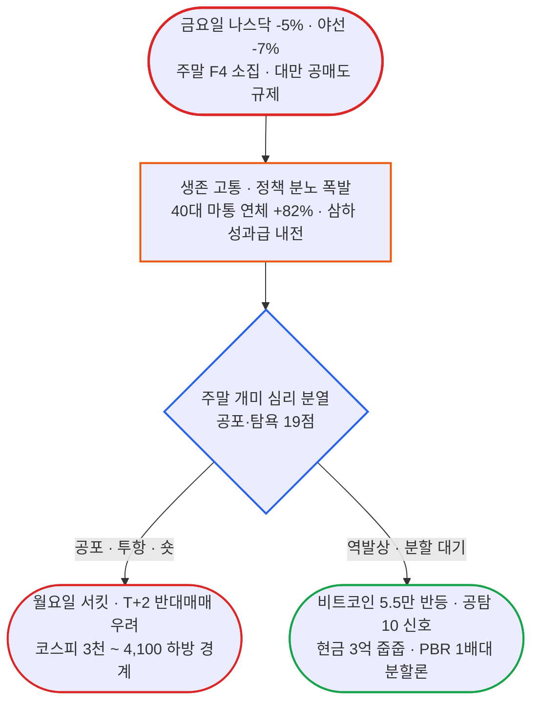

<div class="kb-briefing" markdown="1">

# 블라인드 주식·투자 24시간 브리핑: <span class="kb-heading-detail">"주말 F4 소집과 야선 -7% 공포, 그리고 현금 쥔 개미들의 바겐세일 반격"</span> { #블라인드-주식투자-24시간-브리핑-주말-f4-소집과-야선--7-공포-그리고-현금-쥔-개미들의-바겐세일-반격 }

<div class="kb-points kb-points--grid" markdown>

<div class="kb-point" markdown>
<p class="kb-point__label" markdown>작성일</p>

2026-11-22

</div>

<div class="kb-point" markdown>
<p class="kb-point__label" markdown>수집 기간</p>

2026년 11월 21일(토) 16:35 ~ 11월 22일(일) 16:32 (KST)

</div>

<div class="kb-point" markdown>
<p class="kb-point__label" markdown>수집 규모</p>

최근 24시간 게시글 687개 전수 수집 (본문·댓글 정밀 분석 139개, 상세 수집 원댓글 722개·대댓글 472개 총 1,194개, 목록 미리보기 분석 548개)

</div>

</div>

!!! warning "주의사항"
    아래 내용은 모두 블라인드 익명 사용자들의 날것의 주장과 여론이다. 수치, 인용 기사, 소식은 따로 검증하지 않았다. "속보", "폭로", "적정가" 같은 표현이 붙은 글도 출처가 불분명하거나 추측과 풍자를 섞은 경우가 많다. 투자 판단에 쓰기 전에 원문 기사나 공시를 직접 확인해야 한다. 작성자 소속은 블라인드에 표시된 회사명이며 실제 재직 여부는 확인할 수 없다. "언급 글 수"는 `entities.js`로 제목, 본문, 댓글에 종목명이나 별칭이 들어간 글을 센 값이다. 이번 범위는 11월 20일(금) 국내·미국 증시 동반 폭락 이후 첫 주말(토 오후 ~ 일 오후) 여론으로, 월요일 개장 공포와 F4 회의·성과급·저가 매수 논쟁이 정면으로 충돌했다.

<div class="kb-briefing-section kb-briefing-section--dashboard" markdown="1">

## 📊 블라인드 개미 공포·탐욕 지수 (Fear & Greed Index)

극단적 공포의 밑바닥에서 미세한 반발 매수 심리가 고개를 들기 시작했다. 당일 종합 지수는 **19점(극단적 공포)으로** 직전 11월 21일 오전(17점)보다 **2점** 소폭 반등했으나 여전히 패닉 영역에 묶여 있다. 금요일 밤 나스닥 폭락과 코스피 야간선물 -7% 마감, 40대 마이너스통장 연체액 82% 급증 뉴스가 월요일 서킷브레이커 공포를 자극하는 한편, 주말 사이 비트코인이 5만 8,000달러 테스트 후 반등하고 긴급 F4 회의가 소집되자 현금을 쥔 대기 매수세("3억·3.5억 분할 매수", "바겐세일 줍줍")와 정량 바닥 계산 글이 동시에 떠올랐다. 다만 삼성전자·SK하이닉스 성과급 주식 수 복사를 둘러싼 직장인 계층 갈등과 "국장은 외인 엑시트 도박장"이라는 환멸이 깊어 진정한 바닥 신호인지는 의견이 날카롭게 엇갈린다.

<div class="kb-portfolio-metrics">
  <div class="kb-portfolio-metric-card">
    <span class="label">당일 공포·탐욕 지수</span>
    <span class="value">19점 (극단적 공포)</span>
    <span class="sub">0 극단적 공포 ~ 100 극단적 탐욕</span>
  </div>
  <div class="kb-portfolio-metric-card">
    <span class="label">직전 브리핑 대비</span>
    <span class="value">+2p 소폭 반등</span>
    <span class="sub">11/19 29점 ➔ 11/20 23점 ➔ 11/21 17점 ➔ 11/22 19점</span>
  </div>
  <div class="kb-portfolio-metric-card">
    <span class="label">지배적 개미 분위기</span>
    <span class="value">월요일 서킷 공포 · 성과급 내전</span>
    <span class="sub">"야선 -7%·반대매매 폭탄" vs "삼전 5만 가야 15,000주 받는다"</span>
  </div>
  <div class="kb-portfolio-metric-card">
    <span class="label">역발상 수급 시그널</span>
    <span class="value">인버스·현금 관망 vs 억대 분할매수</span>
    <span class="sub">"월요일 피바다 줍줍" 다수 등장에 "아직 진짜 공포 아님" 경고 교차</span>
  </div>
</div>

```vegalite
{
  "$schema": "https://vega.github.io/schema/vega-lite/v5.json",
  "background": "transparent",
  "width": "container",
  "height": 220,
  "padding": {"top": 8, "bottom": 4, "left": 4, "right": 8},
  "data": {
    "values": [
      {"metric": "종합 공포·탐욕 지수", "score": 19, "max": 100, "zone": "극단적 공포", "label": "19점 (극단적 공포 · +2p)", "desc": "월요일 갭락·반대매매 공포 속에 현금 대기자 저가매수론과 비트코인 반등 기대가 소폭 유입"},
      {"metric": "① 체감 손익·계좌 심리", "score": 14, "max": 100, "zone": "극단적 공포", "label": "14점 (극단적 공포)", "desc": "원금 -4억, 기프티콘 환불, 재건축 이주비 -2억 퇴학 선언과 40대 마통 연체 82% 급증"},
      {"metric": "② 매수·투매 수급 태도", "score": 24, "max": 100, "zone": "극단적 공포", "label": "24점 (극단적 공포)", "desc": "월요일 시초가 투매·신용 정리 vs 3억~3.5억 현금 보유자의 SOXL·국장 분할매수 선언"},
      {"metric": "③ 반도체·업황 신뢰도", "score": 17, "max": 100, "zone": "극단적 공포", "label": "17점 (극단적 공포)", "desc": "평택 P4 가동·D램 담합소송·28년 30조설 vs LTA 선수금 20 ~ 30%·순자산 1년 뒤 바닥론"},
      {"metric": "④ 지수 지지선 신뢰도", "score": 16, "max": 100, "zone": "극단적 공포", "label": "16점 (극단적 공포)", "desc": "야선 -7% 기반 코스피 4,500 붕괴 및 2,500 ~ 3,000 회귀 공포 vs 4,500대 분할 진입론"},
      {"metric": "⑤ 역발상 바닥 기대감", "score": 24, "max": 100, "zone": "극단적 공포", "label": "24점 (극단적 공포)", "desc": "공탐지수 10·비트코인 5.5만 반등·10분할 전략 부상 vs 줍줍글 많아 진짜 바닥 아님론"}
    ]
  },
  "encoding": {
    "y": {
      "field": "metric",
      "type": "nominal",
      "sort": null,
      "axis": {"title": null, "labelFontWeight": 500, "labelFontSize": 12, "labelLimit": 180, "ticks": false, "domain": false, "labelPadding": 12}
    }
  },
  "layer": [
    {
      "mark": {"type": "bar", "cornerRadius": 7, "height": 14, "color": "#94a3b8", "opacity": 0.14},
      "encoding": {
        "x": {
          "field": "max",
          "type": "quantitative",
          "scale": {"domain": [0, 118]},
          "axis": {
            "title": "블라인드 개미 심리 스펙트럼 (0 ~ 24 극단적 공포 · 25 ~ 44 공포 · 45 ~ 55 중립 · 56 ~ 74 탐욕 · 75 ~ 100 극단적 탐욕)",
            "values": [0, 25, 50, 75, 100],
            "labelExpr": "datum.value == 0 ? '0 (극단적 공포)' : datum.value == 25 ? '25 (공포)' : datum.value == 50 ? '50 (중립)' : datum.value == 75 ? '75 (탐욕)' : '100 (극단적 탐욕)'",
            "grid": false
          }
        }
      }
    },
    {
      "data": {"values": [{"x": 25}, {"x": 45}, {"x": 55}, {"x": 75}]},
      "mark": {"type": "rule", "strokeDash": [2, 4], "color": "#94a3b8", "opacity": 0.5},
      "encoding": {"x": {"field": "x", "type": "quantitative"}, "y": {"value": 0}, "y2": {"value": "height"}}
    },
    {
      "mark": {"type": "bar", "cornerRadius": 7, "height": 14},
      "encoding": {
        "x": {"field": "score", "type": "quantitative"},
        "color": {
          "field": "zone",
          "type": "nominal",
          "scale": {
            "domain": ["극단적 공포", "공포", "중립", "탐욕", "극단적 탐욕"],
            "range": ["#dc2626", "#ea580c", "#64748b", "#16a34a", "#2563eb"]
          },
          "legend": null
        },
        "tooltip": [
          {"field": "metric", "title": "심리 지표"},
          {"field": "label", "title": "점수 및 구간"},
          {"field": "desc", "title": "핵심 진단"}
        ]
      }
    },
    {
      "mark": {"type": "text", "align": "left", "dx": 10, "fontWeight": 600, "fontSize": 12},
      "encoding": {
        "x": {"field": "score", "type": "quantitative"},
        "text": {"field": "label", "type": "nominal"}
      }
    }
  ],
  "config": {"view": {"stroke": "transparent"}}
}
```

---

</div>

<nav class="kb-briefing-nav" aria-label="브리핑 주요 주제" markdown="1">

**주제 바로가기**

- [1. 전체 분위기](#1-전체-분위기-월요일-공포와-성과급-분노-그리고-주말-줍줍-대기열의-충돌)
- [2. 원인 분석](#2-원인-분석-주말-게시판을-지배한-폭락의-5대-뇌관)
- [3. 찌라시와 미확인 소식 (확인 필요)](#3-찌라시와-미확인-소식-확인-필요)
- [4. 종목·섹터별 개인 투자자 심리와 전망](#4-종목섹터별-개인-투자자-심리와-전망)
- [5. 대표 투자 의견](#5-대표-투자-의견)
- [6. 다음 체크포인트](#6-다음-체크포인트)

</nav>

<div class="kb-briefing-section" markdown="1">

## 1. 전체 분위기: 월요일 공포와 성과급 분노, 그리고 주말 줍줍 대기열의 충돌

금요일 장 마감 직후의 아수라장이 주말을 지나며 세 갈래의 치열한 논전으로 굳어졌다. 첫째는 **월요일 개장 공포와 신용 반대매매 경계**다. 코스피 야간선물 -7% 마감과 대만의 주말 추가 공매도 규제 소식이 겹치면서, 한국 증시만 무방비로 두들겨 맞을 것이라는 위기감이 팽배하다. 일요일 소집된 F4(거시경제·금융현안간담회) 회의를 두고도 "예의주시 밥값 회의"라며 기대를 접은 냉소가 가득하다.

둘째는 **삼성전자·SK하이닉스 성과급을 둘러싼 극단적인 계층 반목**이다. 어제 터진 '삼전 5만 원 기원' 논란이 오늘 더 거칠게 번졌다. 영업이익 10% 기준 자사주 보상 구조 때문에 주가가 내릴수록 직원이 받는 주식 수가 불어나고, 그 물량이 다시 잠재 매도 압력이 된다는 주주 측 분노가 폭발했다. "국세청 세금 아끼게 5만 전자 협조 부탁한다"는 조롱성 협조공문 글이 댓글 112개·조회수 4,401회를 찍으며 게시판 최상단을 점령했다.

셋째는 **주말 사이 불어닥친 역발상 매수론과 반론의 충돌**이다. 비트코인과 주말 나스닥 선물이 소폭 반등하자 "공포탐욕지수 10이다", "월요일 피바다에서 3억 줍줍한다"는 매수 예고 글이 쏟아졌다. 그러자 곧바로 "아직 너처럼 싸게 주울 생각에 신난 애들이 천지니 진짜 바닥이 아니다"라는 역지표 경고가 맞붙었다.



<div class="kb-briefing-topic" markdown="1">

### 블라인드 명예의 전당: 주말 게시판을 흔든 레전드 글과 티키타카

<div class="kb-feed" markdown>

<div class="kb-post" markdown>
<p class="kb-post__title" markdown>성과급 전쟁 2라운드: "세금 덜 내게 삼전 5만 원 협조 좀" vs "주총·정치권으로 전면 무효"</p>

**"(협조공문)국세청에 세금 덜 뜯기려면 삼전 5만 가야 됨"** (`삼성전자` | 👍33 · 💬112 · 👁4,401): 올해 영업이익 370조 원 기준 메모리 성과급을 인당 7억 5,000만 원으로 잡으면 현금 수령 시 세금으로 반토막 나 세후 4억도 못 건진다고 적었다. 반면 주가 20만 원이면 3,750주, 10만 원이면 7,500주, 5만 원이면 15,000주로 주식이 복사돼 나중에 20만 원 복귀 시 소액주주 장내매도 비과세로 세후 26억 5,000만 원을 손에 쥔다며 "1월 말까지만 5만전자 협조 부탁드린다"고 비꼬았다.

**댓글창 대폭발과 내부 내전**: 댓글에서는 "성과급 받지도 못하는 DX(세트) 애들이 분탕 친다"(👍16)는 반발과 "어, 적어도 내 주변 DS(메모리)도 다 이렇게 생각한다"(👍11), "삼전 애들 다 이러냐, 응원은 못 하겠다"(👍30)가 정면 충돌했다. 곧이어 **"성과급이 주주보다 우선이 맞음?"**(`새회사` | 👍37 · 💬84 · 👁1,356)에서는 "주주 몫인 이익을 직원이 떼어가는 건 도둑놈 심보, 주총 배임 이슈로 국민연금·외인이 동의 안 해준다"(👍21), "그러니 외인이 코스피에 투자할 이유가 없다"(👍27)가 베스트 댓글을 휩쓸었다.

</div>

<div class="kb-post" markdown>
<p class="kb-post__title" markdown>현실 파탄과 자조 블랙유머: "기프티콘 환불" · "여직원에게 반도체 추천했다 결혼각"</p>

**"저번에 회사 여직원한테 반도체 추천했는데"** (`ex-COUPANG` | 👍11 · 💬14 · 👁1,477): "아침에 톡으로 계좌 보여주면서 울고불고 나보고 책임지란다. 드디어 결혼할 것 같다"는 블랙유머에 "오늘 처음으로 피식했다"(👍6), "이쁘면 혼인신고, 안 이쁘면 경찰신고"라는 댓글이 달리며 폭락장 속 유일한 웃음벨이 됐다.

**생존 고통과 현실 소비 축소**: **"갈때까지갔다 이제"**(`LG디스플레이` | 👍5 · 💬10 · 👁375) 작성자는 "카카오톡 기프티콘을 환불하고 있다, 모두가 준 마음 미안해진다"며 절박함을 드러냈다. **"주식 퇴학합니다."**(`안전보건공단` | 👍2 · 💬3 · 👁1,337)는 6년간 모은 2억 수익에 이어 집 재건축 이주비까지 넣었다가 -2억 손실 위기에 처해 분담금까지 걱정하는 사연을 올렸다. 이 외에도 원금 -4억(`삼성웰스토리` `o11x76du`), 재산 4,600만 원 전액 고점 물림(`새회사` `6uob1mbq`), 이혼 위기 토로(`공무원` `as85wbgk`), 40% 마감 세일 도시락을 사 먹으며 "내 계좌도 -40%라 40% 세일 사야지"(`ex-위메프` `c68msd3f`)라고 자조하는 글이 줄을 이었다.

</div>

<div class="kb-post" markdown>
<p class="kb-post__title" markdown>주말 줍줍파 vs 인간지표 조롱파의 난타전</p>

**"월요일 피바다장 줍줍할 생각에"** (`11번가` | 👍3 · 💬22 · 👁630): 코스피 8,800에 현금화해 둔 3억 원으로 월요일 하닉 80만 원·삼전 15만 원 구간에 분할 매수하겠다며 "니들 패닉셀 물량 주울 생각에 기분이 째진다"고 도발했다. 댓글에서는 "보통 정신적 미성숙자들이 회피성으로 쓰는 글"(👍5), "노인증이면 허언증"(👍5)이라며 극렬히 충돌했다.

**"이 글 자체가 저점이 아니라는 증거"**: **"월욜 프장에 풀매수"**(`롯데쇼핑` `m16awrkv`) 작성자는 "개미 패닉셀 때 풀매수해 이말올 먹으려 했는데 나 같은 뷰를 보는 개미가 너무 많아 안 산다"고 꼬집었고, **"내가 공포인지 아닌지 시장 커뮤판단기준"**(`한영회계법인` `pqrvhzry`)도 "폭락 후 매수 대기 중이라는 글이 많으면 아직 진짜 공포가 아니다"라고 진단했다.

</div>

</div>

</div>

<div class="kb-briefing-topic" markdown="1">

### 다음 거래일 예상: "월요일 시초가 갭락 -5 ~ -15% 확정" vs "전약후강·선반영 반등"

<div class="kb-points kb-points--grid" markdown>

<div class="kb-point" markdown>
<p class="kb-point__label" markdown>지배적 비관론 (시초가 급락 및 화요일 반대매매 폭탄)</p>

금요일 밤 미국 반도체 급락과 코스피 야간선물 -7%를 근거로 월요일 시초가 -5.3% ~ -15% 갭하락(`qy0nbvyh`, `fodhue4k`, `75covwbf`), 장중 서킷브레이커 발동을 점치는 글이 압도적이다. 특히 `현대자동차`(`xjohag51`)와 `기업은행`(`qxij52uy`), `현대오토에버`(`uvz883ea`) 작성자들은 정부의 담보비율 면제(130% 완화)로 유예됐던 지난주 반등 베팅 물량이 **월 ~ 화요일(T+2) 반대매매 롱스퀴즈**로 한꺼번에 쏟아질 수 있다고 경고했다.

</div>

<div class="kb-point" markdown>
<p class="kb-point__label" markdown>소수 반론 (전약후강·주말 코인 반등 선반영)</p>

반면 `새회사`(`76ycsgfh`)는 "풋옵션이 과도하게 쌓였고 유가·달러·금리가 고점 대비 내려왔다"며 전약후강을 예상했고, `공무원`(`6w2b35zi`)·`금광기업`(`7ugsg6ta`)·`공무원`(`kmfdiv6k`) 등은 주말 비트코인과 위켄드 나스닥 반등을 근거로 월요일 반발 매수세 유입을 기대했다. `한국수력원자력`(`1vouocdl`)은 하이닉스 ADR 낙폭 환산 시 월요일 시초가를 **102.7만 ~ 106만 원(-8 ~ -5%)** 수준으로 추산했다.

</div>

</div>

</div>

<div class="kb-briefing-topic" markdown="1">

### 지수·종목 지지선 및 목표가 매트릭스 (게시판 여론 집계)

| 종목 / 지수 | 현재가 / 위치 (원문 기준) | 1차 지지선·매수 고려대 | 극단적 비관치 (공포 타겟) | 주요 근거 (게시판 여론) |
| :--- | :--- | :--- | :--- | :--- |
| **코스피** | 4,869.96 (9,000 고점 대비) | 4,300 ~ 4,600 (1차 분할) | 2,500 ~ 3,800 (900·2,000설 포함) | 야선 -7% 반영, 다음 매물대 4,100 (`uvz883ea`), 외인 연 220 ~ 250조 매도 공포 |
| **코스닥** | 650선 전후 | 550 ~ 650 (분할 시작) | "코스닥은 사망" (추가 급락) | 6 ~ 7월 대비 -30 ~ 40% 하락, 2차전지·코스닥 레버 손실 -50% 속출 |
| **삼성전자** | 18만 3,100원 (고점 36.2만 대비 -50%) | 15만 ~ 18.5만 원 (기본 바닥) | 5만 ~ 14.7만 원 (7만·8만·12.8만설) | 1년 뒤 순자산 1.05 ~ 1.15배(`1vouocdl`) vs BNK 비관 13.3 ~ 14.7만 · 직원 "5만전자 기원" |
| **SK하이닉스** | 108 ~ 111.3만 원 (고점 291.9만 대비 -62%) | 80만 ~ 104.8만 원 (월욜 102.7 ~ 106만) | 9만 ~ 75.8만 원 (20 ~ 30만 · 44만설) | 기본 시나리오 95.7 ~ 104.8만(`1vouocdl`) vs BNK 2028년 30조대 영업이익 전망 기반 20 ~ 44만설 |
| **엔비디아 (`NVDA`)** | 130달러대 (고점 대비 -47%) | 130달러 전후 적립 고려 | 80달러 (네오클라우드 붕괴 시) | 선행 저평가 vs SEC 회계조사·젠슨 폭언 파묘·순환출자 붕괴 공포 |
| **SOXL (반도체 3배)** | 30 ~ 33달러대 (고점 대비 -90%) | 10 ~ 30달러 이하 분할 | 10달러 미만 · 청산/병합 우려 | 7달러 관세 폭락 기억(`m8o4elmb`) vs 하루 -33 ~ 35% 시 상폐 가능성 경고(`ktujghu1`) |
| **현대차 · LG이노텍 · 삼성전기** | 현차 25만선 / 이노텍 26만 / 삼전기 145층 물림 | 이노텍 20 ~ 21만 / 삼전기 30만 대기 | 현차 본주 10만(우 7만) · 적정 10 ~ 15만 | 현차 현직자 테슬라 FSD v15 쇼크("배당률 8 ~ 10% 나와야 매수", `0v6dc0ow`), LG계열 불신 |
| **비트코인 (`BTC`)** | 5.5만 ~ 5.8만 달러 테스트 후 반등 | 5.5만 달러(365일선) 지지 확인 | 주말 휩쏘 후 재하락 | 4년 만에 365일 이평선 테스트 반등(`ldbaxgh1`) vs 저금리 종료 속 자산 동반 절하 |

---

</div>

</div>

<div class="kb-briefing-section" markdown="1">

## 2. 원인 분석: 주말 게시판을 지배한 폭락의 5대 뇌관

| 주제 | 핵심 논점 | 팽팽한 대립 구도 | 결론 |
| :--- | :--- | :--- | :--- |
| **① 연준 금리·유동성 경색** | 리사 쿡 빅스텝·고금리 공포 속 유가 빼고 전 자산 동반 하락 | "유가 탓 공급 인플레라 빅스텝 명분 없다" vs "AI 부의 효과 잡으려 연준이 일부러 누른다" | 12월 FOMC 인상·빅스텝 여부가 확정되기 전까지 현금 가치 독주 지속 |
| **② 국내 정책·신용 유예 역풍** | F4 회의 무능 성토 및 대만 공매도 금지와 대비되는 한국 방치론 | "연기금 노출·담보비율 유예·단일 레버가 외인 ATM기 만들었다" vs "공매도 금지는 MSCI 탈락 자해" | 화요일 T+2 반대매매와 공매도 집중 유입 경계로 정부 신뢰 바닥 추락 |
| **③ 삼전·하닉 성과급과 공급·소송** | 주가 하락할수록 성과급 자사주 수량 증가 + P4 가동 + D램 담합소송 | "직원 보상 주식이 잠재 매도 물량 뫼비우스띠" vs "LTA 선수금 20 ~ 30%와 주주환원 100조 방어" | 주총 부결 시 현금 지급 여부와 2028년 공급 과잉 시점이 핵심 쟁점 |
| **④ AI 순환금융·인프라 패권전** | 네오클라우드 대출 구조(코어위브 CDS 상승)와 미·중 데이터센터 규제 격차 | "감가상각 빠른 GPU를 빚으로 돌린 다단계" vs "상승장엔 칭송하다 하락장에만 문제 삼는 궤변" | 미국 주정부 규제·전력 병목으로 AI 수요 이연 시 2028년 공급 쇼크 우려 |
| **⑤ 외국인 220 ~ 250조 엑시트** | 2026년 외인 220 ~ 250조 순매도 추정과 개인 빚투·은퇴자 물량 설거지론 | "초대형 외인이 펌핑 후 물량 넘기고 탈출하는 플랜" vs "지분율 38% 유지 속 순환 손바뀜" | 외국인이 3일 연속 대량 순매수로 돌아서기 전까진 기술적 반등에 그칠 위험 |

<div class="kb-briefing-topic" markdown="1">

### ① 연준의 의도적 자산시장 압박과 유동성 메마름

- **공급 인플레 vs 부의 효과 억제 논쟁**: `삼정KPMG`(`ammpvpf5`, 👍24 💬17 👁1,102)는 최근 물가 상승은 유가(공급 충격) 때문이지 AI 인프라 투자 때문이 아니라며, 금리로 유가를 못 잡으니 연준이 매파 발언으로 AI 투자의 기대 인플레이션을 일부러 박살 내고 있다고 분석했다. 이에 베스트 댓글(👍9)은 "미국 자산 대부분이 주식이라 AI 주가 상승에 따른 부의 효과를 눌러야 소비·물가가 잡힌다"고 맞받아쳤다.
- **25년 저금리 시대의 종말**: `변호사`(`txkzpvj3`, 👍3 💬7)는 원유만 빼고 금·은·구리·주식·비트코인·미국채까지 다 빠지는 이유를 "지정화폐(현금) 가치 상승과 모든 자산의 절하"로 짚었다. 댓글에서는 비둘기파 월러 이사까지 0.5%p 인상을 언급해 내년 상반기 기준금리 4.0 ~ 5.0%, 시장금리 7%대 가능성까지 거론됐다.

</div>

<div class="kb-briefing-topic" markdown="1">

### ② 정부·F4 무능론과 대만 대조, 그리고 반대매매 시한폭탄

- **F4 회의 조롱과 외인 ATM기 비판**: 주말 F4(한은·금융위·금감원·기재부) 소집 기사에 대해 `현대모비스`(`pjfb611y`), `변호사`(`z6oiv7m6`), `POSCO`(`d4ua62is`), `베스핀글로벌`(`gcim2z3x`) 등은 "결국 예의주시·맛집 탐방", "단일종목 레버리지 승인하고 국민연금 포지션 까발려 외인 220 ~ 250조 탈출만 도왔다"(`wyok17d7` 👍12)고 맹비난했다. `아이센스`(`5d5m2hmi`)·`제때`(`gloa7h5n`)·`새회사`(`dei2n1w5`)는 대만이 주말에도 3차 공매도 규제를 내놨는데 한국은 MSCI 선진국지수 욕심에 손 놓고 있다고 성토했다.
- **공매도 금지 반대론과 담보비율 유예 역풍**: 반면 `새회사`(`b3kuzb27` 👍8)와 `현대케피코`(`hsl4237c`)는 "공매도 금지하면 MSCI 탈락하고 평단 영원히 못 온다"고 반박했고, `새회사`(`fadilvzf`) 댓글에서도 증안펀드 13개국 중 성공 사례는 3개국뿐이라며 국가 개입은 세금만 녹인다고 지적했다. 한편 `현대자동차`(`xjohag51`)와 `기업은행`(`qxij52uy`)은 정부가 신용 담보비율을 130%로 유예해 준 탓에 지난주 반등 매수자들의 T+2 반대매매가 **월 ~ 화요일에 한꺼번에 터지는 롱스퀴즈**가 올 수 있다고 우려했다.

</div>

<div class="kb-briefing-topic" markdown="1">

### ③ 성과급 뫼비우스띠와 공급 증설·담합 소송의 3중 압박

- **성과급 자사주 역설**: `삼성전자`(`5tpydwo0`)는 주가가 내릴수록 회사가 성과급 주식을 더 많이 사야 하므로 하방 방어가 된다고 주장했지만, `삼정KPMG`(`6n3wzhsp`)와 `현대모비스`(`ppp5tp60`)는 "특별성과급 재원이 35조에서 70조로 늘어나고 직원은 주식을 받자마자 팔 텐데 그게 다 잠재 매도 물량 뫼비우스띠"라고 정면 반박했다.
- **P4 가동과 D램 담합 소송**: 여기에 삼성 평택 P4 하동 라인 임시사용승인으로 메모리 생산능력이 월 65만 장에서 135만 장으로 확대된다는 소식(`w6u67oau`)과 미국 D램 가격담합·주주소송 기사(`ockqwwkf`)가 겹치며 공급·법무 리스크까지 도마 위에 올랐다.

</div>

<div class="kb-briefing-topic" markdown="1">

### ④ AI 순환금융 회의론과 미·중 데이터센터 패권 이동

- **네오클라우드·대출 다단계 비판 vs 사업의 본질**: `LG디스플레이`(`73c5hzu2` 👍6)는 GPU·데이터센터·램·HBM까지 모조리 대출로 돌리는 구조를 비판했으나, 댓글(👍9)은 "상승장엔 문제없다 하다가 하락장 되니 빚을 문제 삼는다"고 반박했다. `도쿄일렉트론코리아`(`fifhdq0m`)는 코어위브·아이렌·네비우스 같은 적자 네오클라우드가 파산해 중고 램이 풀려야 진짜 저점(엔비디아 80달러)이 온다고 주장했다.
- **미·중 규제 비대칭**: `LS일렉트릭`(`lurh2s6m` 👍6)은 민주당 의회 장악과 주지사들의 데이터센터 반대 공약 때문에 미국 인허가가 지연되는 사이, 국가 주도로 전력·부지·데이터를 밀어주는 중국이 속도를 앞지르고 있다는 거시적 패권 이동론을 펴 높은 공감을 얻었다. `한국수력원자력`(`1vouocdl`)도 텍사스 전력망 연결 대기 474GW와 주지사 공약 때문에 2028년 약 5GW 데이터센터가 2029년으로 밀릴 수 있다는 모건스탠리 분석을 인용했다.

</div>

<div class="kb-briefing-topic" markdown="1">

### ⑤ 이창용 한은 총재 비판과 405060 은퇴자·마통 연체 충격

- **통화정책·원화 신뢰 훼손 성토**: `SK하이닉스`(`g2l16j12` 👍8 💬14)는 이창용 한은 총재가 제때 금리를 올리지 않고 서학개미 탓만 해 원화 가치 신뢰를 무너뜨렸다고 직격했고, 댓글에서도 "한국이 미국보다 리스크 큰 변동성 장세로 전락했다"는 비판이 쏟아졌다.
- **40대 마통 연체 +82%와 은퇴자 DC 계좌 붕괴**: `도쿄일렉트론코리아`(`dr85ngii` 👍5)는 이번 하락장은 2030보다 퇴직금을 DC로 전환해 억 단위를 넣은 **405060 노후 자금 붕괴**가 진짜 위험이라고 짚었다. `새회사`(`hmlbal5o` 👍5)·`GS리테일`(`6yii1oj0`)이 공유한 '40대 마통 연체액 올해 82% 증가' 연합뉴스 속보는 이 우려가 현실 지표로 터지고 있음을 보여줬다.

---

</div>

---

</div>

<div class="kb-briefing-section" markdown="1">

## 3. 찌라시와 미확인 소식 (확인 필요)

<div class="kb-briefing-topic" markdown="1">

### ⚠️ [루머/외신 인용] 소프트뱅크 손정의, 1조 달러(약 1,350조 원) SK하이닉스 인수 검토설 & 소프트뱅크 부도설
<div class="kb-rumor" data-trust="low" markdown>
<div class="kb-rumor__head" markdown="span"><span class="kb-rumor__level">신뢰도 하 ~ 중</span><span class="kb-meter" aria-hidden="true"><i class="on"></i><i class="on"></i><i></i><i></i><i></i></span><span>외신 보도 인용이나 당사자 부인 및 현실성 결여 지적 다수</span></div>
<div class="kb-rumor__row" markdown>
<p class="kb-rumor__label">원문 주장</p>
<div markdown>

`GS리테일`(`l8q72yom` 💬5 👁1,256)이 "손정의 회장, 약 1조 달러에 SK하이닉스 인수하는 방안 검토" 외신 보도 링크를 공유했고, `새회사`(`r08wk4oj` 👍8 👁1,481)는 "하이닉스 무지성 조 달러 규모 인수 및 자금 조달 문의라니 AI 금융 버블이 심각하다"고 놀랐다. 동시에 `농협중앙회`(`4818ibu0` 👁1,050)는 블로그 '메르' 언급을 빌려 **소프트뱅크 부도설**까지 거론했다.

</div>
</div>
<div class="kb-rumor__row" markdown>
<p class="kb-rumor__label">팩트체크 및 현직자 반박</p>
<div markdown>

댓글에서는 "이미 끝난 떡밥, '지금은 고려하지 않는 중'이라 선 그었다", "최첨단 반도체는 국가 핵심기술이라 정부 허가 없이 못 판다, 팔았다간 광화문에 거꾸로 걸릴 것"(👍2), "지금 소프트뱅크 목숨도 간당간당한데 1,300조 원을 은행이 빌려주겠냐"며 일축했다. 일부는 "최태원의 한일 AI 협력과 하이닉스의 키옥시아 최대주주 구도 속에서 일본이 라인(LINE)처럼 노리는 것 아니냐"(👍2)고 의심했다.

</div>
</div>
<div class="kb-rumor__row kb-rumor__row--key" markdown>
<p class="kb-rumor__label">투자 관점 핵심 체크포인트</p>
<div markdown>

실제 M&A 가능성이 아닌 소프트뱅크의 AI 투자 자금 조달 부담(크레딧 리스크)과 일본 내 메모리 주도권 경계심을 읽는 소재로만 참고한다.

</div>
</div>
</div>

</div>

<div class="kb-briefing-topic" markdown="1">

### ⚠️ [풍문/업계 루머] TSMC-젠슨 황 '꽌시' 결렬 및 선수금 요구설 & 젠슨 황 폭언 NYT 폭로
<div class="kb-rumor" data-trust="low" markdown>
<div class="kb-rumor__head" markdown="span"><span class="kb-rumor__level">신뢰도 중하</span><span class="kb-meter" aria-hidden="true"><i class="on"></i><i class="on"></i><i></i><i></i><i></i></span><span>NYT 폭언 보도는 기사 인용이나, TSMC 선수금 압박·이사회 항복설은 작성자 추론</span></div>
<div class="kb-rumor__row" markdown>
<p class="kb-rumor__label">원문 주장</p>
<div markdown>

`새회사`(`6kc58g1r` 💬4)는 TSMC 회장과 젠슨 황이 의형제처럼 신용으로 일했는데 젠슨 황 사임 후 TSMC가 "모든 고객에게 선발주 후정산은 절대 안 하겠다"며 엔비디아 순환출자 구조를 압박하고 있다고 주장했다. 이를 통해 애플·빅테크까지 TSMC 눈치를 보게 돼 엔비디아 이사회가 젠슨 황 복귀를 허용할 것이라 전망했다. 한편 `변호사`(`koyt28xm` 👍3 💬13)는 경향신문이 인용한 NYT 보도("어머니가 낙태했어야 했다", "뇌에 오줌 누겠다" 등 폭언 폭로)를 올렸다.

</div>
</div>
<div class="kb-rumor__row" markdown>
<p class="kb-rumor__label">팩트체크 및 현직자 반박</p>
<div markdown>

`6kc58g1r` 댓글에는 "오피셜이에요 찌라시에요?", "리사 수도 황 형이랑 친척 아니냐, 그래서 AMD도 타겟인가"라는 의문이 달렸고, `koyt28xm`·`r8c4301u` 댓글에서는 "잡스나 게이츠도 마찬가지였는데 주가 빠지니 마녀사냥한다", "직원들 다 백만장자에 주차장에 람보르기니 널렸는데 이제 와 파묘한다"는 냉소가 컸다.

</div>
</div>
<div class="kb-rumor__row kb-rumor__row--key" markdown>
<p class="kb-rumor__label">투자 관점 핵심 체크포인트</p>
<div markdown>

TSMC의 대금 결제 조건 변경 공식 확인은 없으며, 젠슨 황 복귀 여부와 별개로 엔비디아의 SEC 회계조사 진행 단계(웰스 통지·매출 재작성 여부)를 최우선으로 확인해야 한다.

</div>
</div>
</div>

</div>

<div class="kb-briefing-topic" markdown="1">

### ⚠️ [정책/속보] 긴급 F4 회의(거시경제·금융현안간담회) 소집 & 담보비율 유예(130%) 역풍
<div class="kb-rumor" data-trust="high" markdown>
<div class="kb-rumor__head" markdown="span"><span class="kb-rumor__level">신뢰도 중상</span><span class="kb-meter" aria-hidden="true"><i class="on"></i><i class="on"></i><i class="on"></i><i class="on"></i><i></i></span><span>뉴데일리·연합인포맥스 기사 링크 존재, 회의 실제 성과는 미정</span></div>
<div class="kb-rumor__row" markdown>
<p class="kb-rumor__label">원문 주장</p>
<div markdown>

`현대모비스`(`pjfb611y`), `POSCO`(`d4ua62is`), `변호사`(`z6oiv7m6`), `베스핀글로벌`(`gcim2z3x`), `LX MMA`(`kusx2lz6`) 등이 일요일 F4 회의 소집 소식을 공유했다. 일부 작성자(`57fbqvfn`)는 "오늘이나 내일 중 정부 대응 나와 살짝 반등 줄 것"이라 봤다.

</div>
</div>
<div class="kb-rumor__row" markdown>
<p class="kb-rumor__label">팩트체크 및 현직자 반박</p>
<div markdown>

대다수 댓글은 "국민연금 더 쑤셔 넣기 하려나(한도 초과)"(👍6), "또 세금으로 지원해 외인 도망갈 기회만 주고 끝날 것"(👍8), "그냥 맛집 탐방·점심 식사 회의"라며 극도로 불신했다. 오히려 `xjohag51`과 `qxij52uy`는 기존 담보비율 130% 면제 조치가 미뤄 둔 반대매매를 월 ~ 화요일 한꺼번에 터뜨리는 폭탄이 될 수 있다고 경고했다.

</div>
</div>
<div class="kb-rumor__row kb-rumor__row--key" markdown>
<p class="kb-rumor__label">투자 관점 핵심 체크포인트</p>
<div markdown>

F4 회의 결과에서 실제 수급 대책(공매도 한시 조치·연기금 한도 조정·신용 유예 연장 여부)이 나오는지, 아니면 원론적 '시장 모니터링 강화' 멘트에 그치는지 월요일 장전 발표를 확인해야 한다.

</div>
</div>
</div>

</div>

<div class="kb-briefing-topic" markdown="1">

### ⚠️ [소송/보도 확인] 미국 D램 가격담합 본안 소송(내년 1월) 및 주주소송 원고 모집
<div class="kb-rumor" data-trust="high" markdown>
<div class="kb-rumor__head" markdown="span"><span class="kb-rumor__level">신뢰도 중상</span><span class="kb-meter" aria-hidden="true"><i class="on"></i><i class="on"></i><i class="on"></i><i class="on"></i><i></i></span><span>뉴스버스 기사 인용 및 현직자 회계사 추정 댓글 포함, 최종 배상액 미정</span></div>
<div class="kb-rumor__row" markdown>
<p class="kb-rumor__label">원문 주장</p>
<div markdown>

`한국건강관리협회`(`ockqwwkf` 👍4 💬11 👁831)가 미국 내 D램 가격담합 소송 및 주주소송 기사를 공유하며 패소 타격을 우려했고, `네이버웹툰`(`v2b6ohrx` 👍11)은 "독과점 소송으로 성과급 다 취소되고 미국에 벌금 상납한다"고 비꼬았다.

</div>
</div>
<div class="kb-rumor__row" markdown>
<p class="kb-rumor__label">팩트체크 및 현직자 반박</p>
<div markdown>

댓글에서는 "담합은 내년 1월부터 본안 소송이고 주주소송은 원고 모집 단계"라는 구체적 일정과 함께, "기각 안 난 거면 내부 증거를 까야 해서 메모리 3사는 지금 얼마로 쇼부(합의) 칠지 계산하고 있을 것", "어차피 몇 년 걸리고 벌금 물 때 되면 재료 소진으로 오른다"는 현실적 해석이 달렸다.

</div>
</div>
<div class="kb-rumor__row kb-rumor__row--key" markdown>
<p class="kb-rumor__label">투자 관점 핵심 체크포인트</p>
<div markdown>

내년 1월 본안 소송 개시 전 합의금 규모와 삼전·하닉·마이크론의 충당금 반영 여부를 공시로 확인해야 한다.

</div>
</div>
</div>

</div>

<div class="kb-briefing-topic" markdown="1">

### ⚠️ [증설/입지 풍문] 삼성전자 평택 P4 임시사용승인(월 135만 장) & 호남(광주) 반도체 팹 4기 추진설
<div class="kb-rumor" data-trust="high" markdown>
<div class="kb-rumor__head" markdown="span"><span class="kb-rumor__level">신뢰도 중상</span><span class="kb-meter" aria-hidden="true"><i class="on"></i><i class="on"></i><i class="on"></i><i class="on"></i><i></i></span><span>P4 승인은 기사 제목 인용) / 하 ~ 중(광주 팹 4기 추진은 현직자 회의론 압도</span></div>
<div class="kb-rumor__row" markdown>
<p class="kb-rumor__label">원문 주장</p>
<div markdown>

`새회사`(`w6u67oau`)는 "삼성전자 평택 P4 하동 라인 임시사용승인 완료…연내 완전 가동, 메모리 생산능력 월 65만 장 ➔ 135만 장 확대" 보도를 공유했다. 한편 `공무원`(`vw705yxo` 💬10)은 삼전·하닉 광주 반도체 공장(팹 4기, 전기 6.3GW·하루 용수 60만 톤 수요 vs 공급 목표 65만 톤) 추진 가능성을 물었고, 정치권 글(`q4h08jqs`, `oauvnedg`)에선 "호남 반도체 당장 중지하라"는 비난이 붙었다.

</div>
</div>
<div class="kb-rumor__row" markdown>
<p class="kb-rumor__label">팩트체크 및 현직자 반박</p>
<div markdown>

P4 관련 댓글은 "램 값 꺾였는데 생산 늘면 10토막", "P5까지 돌면 전기 폭발할지도", "28년 수요는 왜 얘기 안 하냐"로 갈렸다. 광주 팹에 대해서는 **현직자 댓글(👍3)**이 "전력·용수보다 **협력사 인원 부족**이 치명적"이라며 "경기남부 1시간 거리인 평택·화성 대응도 벅찬데 3시간 거리 광주로 설비 대응 오라 하면 며칠씩 라인 서고 난리 난다. 100% 개구라·정권용 립서비스"라고 일축했다. (`1vouocdl`은 평택 P4 월 10만 장 마무리, 3년 내 총 65만→135만 장 증설 계획으로 구체 수치를 구분해 적었다.)

</div>
</div>
<div class="kb-rumor__row kb-rumor__row--key" markdown>
<p class="kb-rumor__label">투자 관점 핵심 체크포인트</p>
<div markdown>

P4 실제 웨이퍼 투입 속도와 2027 ~ 2028년 범용 D램 증설 물량이 HBM 비중 확대를 얼마나 상쇄하는지가 중기 실적의 핵심이다.

</div>
</div>
</div>

</div>

<div class="kb-briefing-topic" markdown="1">

### ⚠️ [지정학/통상] 이란 오만만 봉쇄선 출항·사우디 타격설 & 중국 범용 반도체 자립 후 희토류 7종 제재설
<div class="kb-rumor" data-trust="mid" markdown>
<div class="kb-rumor__head" markdown="span"><span class="kb-rumor__level">신뢰도 중</span><span class="kb-meter" aria-hidden="true"><i class="on"></i><i class="on"></i><i class="on"></i><i></i><i></i></span><span>X·언론 인용 주장이나 실제 전면 봉쇄·제재 발동 여부는 확인 필요</span></div>
<div class="kb-rumor__row" markdown>
<p class="kb-rumor__label">원문 주장</p>
<div markdown>

`새회사`(`76ycsgfh`) 댓글에서 한 이용자는 "이란 배가 이미 출발해 오만만 6시간 후 통과, 24시간 내 봉쇄선 도착한다는 오피셜이 X에 많다"고 주장했고, `KT`(`t5jmoit7`)는 "후티의 사우디 타격과 이란의 바레인·쿠웨이트 확전 기조로 유가가 다시 튈 것"이라 경고했다. 또 `세아제강`(`o0tosry8`)은 중국이 D램·낸드 자립 달성 시 디스프로슘·터븀·이트륨 등 희토류 7종 수출허가제로 한국·미국 범용 반도체를 고사시킬 것이라 내다봤다.

</div>
</div>
<div class="kb-rumor__row" markdown>
<p class="kb-rumor__label">팩트체크 및 현직자 반박</p>
<div markdown>

지정학 글들은 원유·유가 반등 시 연준 금리 인상 압력이 재점화된다는 논리로 연결된다. 다만 `1vouocdl`은 최근 WTI·유가가 3주 연속 내렸음을 근거로 물가 둔화 가능성을 짚어 시각이 엇갈렸다.

</div>
</div>
<div class="kb-rumor__row kb-rumor__row--key" markdown>
<p class="kb-rumor__label">투자 관점 핵심 체크포인트</p>
<div markdown>

WTI 유가 75달러(`xjgngi1y` 인용 인플레 기준선) 및 브렌트유 재상승 여부와 1월 10일 미·중 휴전 만료 전후의 희토류·수출통제 조치를 추적해야 한다.

</div>
</div>
</div>

</div>

<div class="kb-briefing-topic" markdown="1">

### [미확인 추산/음모론] 국민연금 반년 -25% 손실·비공개 투자 빼돌리기설 & 아시아 공매도 한국 상륙설
<div class="kb-rumor" data-trust="low" markdown>
<div class="kb-rumor__head" markdown="span"><span class="kb-rumor__level">신뢰도 하</span><span class="kb-meter" aria-hidden="true"><i class="on"></i><i></i><i></i><i></i><i></i></span><span>GPT 어림 계산 및 작성자 뇌피셜·음모론</span></div>
<div class="kb-rumor__row" markdown>
<p class="kb-rumor__label">원문 주장</p>
<div markdown>

`현대자동차`(`27v3rlnk`)는 5월 대비 11월 말 국민연금 보유자산이 환율·금리·주가 하락으로 반년 만에 25% 날아갔을 것이라 GPT로 추산했고, `농협중앙회`(`q4h08jqs`)는 "국민연금 SAA·TAA 비공개 투자를 늘려 자식 앞으로 해외 빼돌리는 것 아니냐"는 음모론을 썼다. `ex-LG전자`(`dvefmrov`)는 "대만 공매도 금지로 아시아 공매도 세력이 한국 상륙해 월요일 5조 순매도할 것"이라 단언했다.

</div>
</div>
<div class="kb-rumor__row" markdown>
<p class="kb-rumor__label">팩트체크 및 현직자 반박</p>
<div markdown>

공식 기금운용 통계와 무관한 사적 추정·정치적 선동 글이다. 다만 국민연금의 국내 주식 목표 비중 상향(20.8% 언급, `1vouocdl`)과 외국인 누적 순매도(게시판 내 220 ~ 250조 원 언급, `rxvmasa5`·`wyok17d7`·`jli1rtmm`)에 대한 개미들의 극단적 불신을 반영한다.

</div>
</div>
<div class="kb-rumor__row kb-rumor__row--key" markdown>
<p class="kb-rumor__label">투자 관점 핵심 체크포인트</p>
<div markdown>

음모론 수치는 배제하고, 실제 월요일 외국인 선물·현물 수급과 한국거래소 공매도 거래대금만 객관적으로 확인한다.

</div>
</div>
</div>

</div>

---

</div>

<div class="kb-briefing-section" markdown="1">

## 4. 종목·섹터별 개인 투자자 심리와 전망

| 종목·섹터 | 언급 글 수 | 지배적 심리 | 대표 전망 (원문 인용) | 소수 반대 의견 |
| :--- | :---: | :--- | :--- | :--- |
| **국내 지수(코스피·코스닥)** | 97개 | 월요일 갭락 공포·정부 원망 | "야선 -7% 서킷 확정, 3,000 ~ 4,100 간다" / "국장은 도박장" | "미리 맞아서 선방·전약후강", "4,500대부터 분할 줍줍" |
| **SK하이닉스** | 92개 | 100만 붕괴 공포·적정가 대립 | "100만 깨지고 20 ~ 44만 간다", "담보 유예 폭탄" | "기본 바닥 95.7 ~ 104.8만, LTA 선수금·환원 100조 방어" |
| **미국 지수(나스닥·S&P)** | 73개 | 속도 공포 vs 미장 우상향 믿음 | "닷컴·리먼급 계단식 하락", "QQQ 590 붕괴" | "6년 연평균 11%로 버블 아님", "10분할로 기계적 매수" |
| **삼성전자** | 67개 | 성과급 내전·주총 부결 요구 | "직원 5만 기원, 잠재 매도 물량 폭발, 7만 ~ 12.8만설" | "기본 바닥 16.9 ~ 18.5만, 우선주·자사주 소각 수급 대기" |
| **반도체 (전반)** | 62개 | 2028 피크아웃·중국 증설 경계 | "P4 가동·담합소송·낸드 사망선고, 반도체 끝" | "D램 재고 10일 미만·HBM4 단가 상승, 아직 주문 감축 무" |
| **레버리지·인버스 ETF** | 59개 | 청산 공포 vs 고수 줍줍·숏 환호 | "단일 2배 출시 악질, 레버는 깡통 지름길" | "SOXS 33% 익절 후 SOXL 스위칭", "바닥 확인 후 레버 교체" |
| **SOXL (반도체 3배)** | 38개 | 상폐 공포·평단 지옥 vs 무한매수 | "10달러 미만·상폐 조심, 30 ~ 200층 구조 불가" | "관세 7달러 때도 살렸다, 30 이하 10분할·무한매수" |
| **엔비디아 (`NVDA`)** | 32개 | SEC·폭언 파묘 공포 vs 저평가론 | "대출 다단계 붕괴, 네오클라우드 망하면 80달러" | "회계는 이미 다 공시된 내용, 근들갑 끝나면 반등" |
| **코인 (비트코인 등)** | 32개 | 주말 반등 안도 vs 동반 절하 경계 | "주말 비트 5.5만 365일선 반등, 월요일 랠리 신호" | "휩쏘일 뿐 다시 내린다", "지정화폐 빼고 다 하락" |
| **채권·달러·환율** | 30개 | 헷징 무력화 당황·예적금 회귀 | "슨피 하락인데 환율 꿈쩍도 안 함", "유동성 고갈" | "우량 선진국 채권·연 4 ~ 7% 예적금으로 덜 맞기" |
| **부동산** | 28개 | 유주택자 안도 vs 27년 침체 전이 | "무주택 주식 몰빵 파산, 상급지 아파트는 요지부동" | "성과급 막히면 경기남부 폭락·고금리에 27년 침체" |
| **AI·빅테크·테슬라·현대차** | 27 / 9·15개 | 구글·테슬라 FSD 극찬 vs 현차·앤트로픽 비관 | "앤트로픽 희망 없고 구글이 신", "FSD v15에 현차 적정 10 ~ 15만" | "빅테크 B2B 수익 전환 중", "현차 저평가·배당주 방어" |

<div class="kb-briefing-topic" markdown="1">

### 1. 국내 지수(코스피·코스닥) — 언급 글 97개

- **보유자 상태**: 2026년 1월보다 지수가 낮아져 올해 수익 반납은 물론 원금 -4억(`삼성웰스토리`), 국장 5억 ➔ 2.5억 반토막(`LG전자` `44uzhf0a`), 재건축 이주비 -2억(`안전보건공단` `a645z80w`), 2월 잔금 자금 2,100만 ➔ 1,600만 원(`공무원` `txn5jqdr`), 대출 3.8억·순자산 -6,000만 원(`한국타이어` `xszp41es`) 등 절박한 손실 사연이 줄줄이 올라왔다. "국장 0.9% 수익이 상위 10%"(`LG전자` `vqqx6ca6`)라는 자조가 현실을 요약한다.
- **심리**: 극단적 불신과 절망이다. `NC`(`t6p8og66`)는 국장을 "외인·기관 타짜와 증권사만 버는 홀짝 도박장"이라 규정했고, `한화시스템`(`3qz7b1d3`·`n6g22a0y`)은 "외국이 수백 조를 빼려 먼저 3 ~ 5배 펌핑해 개인과 연기금에 떠넘긴 엑시트 플랜"이라며 정치권·연기금을 맹비난했다. `GS건설`(`1ic8kulq`)은 "우리가 금요일에 먼저 쳐맞고 나스닥이 같은 날 쳐맞았는데 왜 월요일에 또 쳐맞아야 하느냐"며 억울함을 토로했고, `기업은행`(`84kjn0sf`)과 `공무원`(`8yhxwza5`)은 차트 무용론과 정책 부재를 질타했다.
- **전망과 목표가·지지선**: 비관론은 야선 -7% 기반 월요일 -5.3% ~ -12% 폭락 후 4,500 붕괴 ➔ 4,100(`uvz883ea`), 3,000 이하, 심지어 2,500(`a5gqu4uj`·`rg0puo25`)·2,000(`2biip1wz`)·900(`eyo4uba6`)까지 열어뒀다. 반대로 `한국토지주택공사`(`tlfklpjv`) 댓글(👍1)은 4,500(1천만) ➔ 4,200(2천만) ➔ 3,800(4천만) ➔ 3,500(잔여 몰빵) 4단계 분할 시 28년까지 5,000 복구로 수익이 난다고 봤고, `입소스코리아`(`xyw1h4yf`)는 "삼닉 이익을 보면 코스피 7,000이 정상"이라 반론했다. `한국중부발전`(`m6zrmvwl`)은 29년간 연평균 코스피 +8.28% vs 코스닥 -2.08% 장기 격차를 짚었다.
- **행동 계획**: 월요일 개장 즉시 손절·탈출하겠다는 파(`4581uncx`, `hmbxbmov`, `yqjmpvwv`)와 "반대매매 유예분 터지는 화요일까지 기다렸다가 줍겠다"는 현금 관망파(`fodhue4k`, `qxij52uy`), "월요일 피바다부터 분할 매수"라는 진입파(`wayxqxqc`, `ls7d0csp`)가 맞선다.
- **어제 대비 변화**: 어제(11/21)는 4,869.96 붕괴 직후의 충격과 부고 소식에 눌린 무력감이 컸다면, 오늘은 일요일 F4 회의와 야선 -7%를 앞둔 **정부 성토·반대매매 계산·줍줍 대기열**로 심리가 구체화됐다.
- **종합 판단**: 신용 반대매매 T+2 물량과 외국인 수급 이탈 확인 전까지는 시초가 변동성이 극심할 수밖에 없어 성급한 추격보다 수급 진정 확인이 우선이다.

</div>

<div class="kb-briefing-topic" markdown="1">

### 2. SK하이닉스 — 언급 글 92개

- **보유자 상태**: 200층(`khcyho3z`), 190만 원(`l5yalfqw`), 180만 원(`zqrir243`), 160층("잠이 안 온다", `vey6mrqm`), 150층 -30% 이상(`hlx6r1e2`), 120층(`j8kduxfc`·`yrnvuz53`), 100만 원 언저리(3,000만 원 보유, "월요일 100만 원 수익 건지고 팔까", `g6dyws4a`), 심지어 SOL 하이닉스 관련 ETF 평단 12,000원(`msybtrva` 댓글)까지 전 층에 개인이 갇혀 있다.
- **심리**: "주총 부결 나도 8월 재협상으로 성과급 현금 준다"는 현직자 글(`ylt5loz6`)이 타사 직장인의 분노를 건드리며 "100만 원 붕괴 확정", "빈센트에 이어 손정의도 버렸다"는 공포와 조롱이 뒤섞였다. `삼성전자`(`uj28wgzj`)와 `에스에프익스프레스`(`7chfna8p`)는 "반도체 호황 몇 년 안 남았는데 5년 뒤 오른다는 근거가 뭐냐, 월요일 하닉 레버 반대매매 파티 예정"이라 경고했다.
- **전망과 목표가·지지선**:
    - **비관론**: `국세청`(`baa8nwdq` 👍5)은 영업이익이 10분의 1로 꺾이면 주가도 300만 원에서 10토막 난 **20 ~ 30만 원이 적정가(오버슈팅 10만 원)**라 주장했고, `SK`(`75covwbf`)는 "두 번 다시 100만 원 위로 안 온다", `무신사`(`no6xh8gd`)는 "9만 원이 바닥"이라 극단적으로 낮춰 잡았다. `한국철도공사`(`ngg654hw`)는 이주완 박사 20만 원설을 비꼬며 "진짜 20만 가면 시총 141조라 은행 대출받아 회장 하겠다"고 자조했다.
    - **정량 바닥론**: `한국수력원자력`(`1vouocdl`)은 1년 뒤 주당 순자산 기준으로 **기본(60%) 내년 1분기 95.7만 ~ 104.8만 원(-14 ~ -6%)**, **나쁨(20%, BNK 전망 시) 내년 10월 65.3만 ~ 75.8만 원(-41 ~ -32%)**, **최악(닷컴형) 44만 원(-60%)**을 제시하며 월요일 시초가는 ADR 환산 **102.7만 ~ 106만 원**으로 계산했다.
- **행동 계획**: 90만 원·80만 원·50만 원(`horgxtya`, `vjtvm5aq`, `2ntvbuz6`)에서 받겠다는 대기 매수세와 "월요일 8시 프리장 사서 10시에 5% 먹고 파는 단타"(`itd8jsgs`), 11/26 배당락(주당 2만 원, 보통 1만+특별 1만)을 앞두고 고민하는 보유자가 갈린다.
- **어제 대비 변화**: 어제는 BNK 28년 34조 리포트의 직격탄에 넋이 나갔다면, 오늘은 손정의 1조 달러 인수설 떡밥, 자사주 매입 소진 여부(`betbw3ps` "내년 1월까지 추가 일정 있음" 정정), `1vouocdl`의 정교한 밸류에이션 모델까지 등장하며 논쟁이 입체화됐다.
- **종합 판단**: 100만 원 라운드 피겨 이탈 여부가 월요일 개장 최대 승부처이며, 자사주·배당(시총 13% 안팎 환원)이 외인 매도와 반대매매를 얼마나 버텨주는지가 관건이다.

</div>

<div class="kb-briefing-topic" markdown="1">

### 3. 미국 지수(나스닥·S&P 500) — 언급 글 73개

- **보유자 상태**: 6년 차 QQQ 적립 투자자는 아직 +32%로 선방 중이나(`w3eo65ba`), 1년 전 S&P 500 적립을 시작한 투자자는 원금 마이너스 진입 목전(`16armbkh`), QQQ 6개월 분할 매수를 끝내자마자 폭락을 맞은 공무원(`x67br3ou`), QQQ -20%만 보고 TQQQ에 현금 절반을 넣었다가 공포에 질린 투자자(`rq4zz62l`), "S&P500 추천한 애들 패고 싶다"는 공무원(`oz87blkk`)까지 희비가 극명히 갈린다.
- **심리**: "국장 피해서 미장 왔는데 똑같이 쳐맞는다"는 허탈함과 동시에 "그래도 결국 우상향하는 건 미장 지수뿐"(`qtiwp3vx`, `t6p8og66`, `o63067js`)이라는 최후의 보루 심리가 굳건하다. `경동나비엔`(`uknm36t5`)은 "2010년부터 버크셔가 나스닥을 이긴 적 없다"며 지수 저가 매수를 옹호했다.
- **전망과 목표가·지지선**: `현대모비스`(`terhriq1`)는 하락폭은 평범하지만 하락 기울기가 닷컴·서브프라임급이라 무섭다고 했고, `공무원`(`ngwb1ud7`)은 화요일까지 빼며 QQQ 590달러 붕괴를 점쳤다. `한국철도공사`(`gtqk4xhy`)는 S&P 5,000대 지지선 대기를, `삼보모터스`(`6a3skbnt`)는 나스닥 18,000 재매수를 외쳤다. 반면 `서울특별시`(`gr57d6sv`)는 "S&P·나스닥 모두 6년 연평균 11%대 상승이라 버블이 아니다"라고 반박했다.
- **행동 계획**: `KCC`(`xjgngi1y`)가 제시한 **QQQ 고점 대비 5 ~ 10% 하락마다 10분할 기계적 매수** 전략과, `현대모비스`(`vtibxilq`)의 **지수 90% 유지 + 폭락 시에만 일부 레버리지 스위칭** 전략이 큰 호응을 얻었다.
- **어제 대비 변화**: 어제 나스닥 -5.28% 당일 충격에서 벗어나 오늘은 주말 위켄드 나스닥·비트코인 반등을 보며 "월요일 2.5 ~ 4% 반등"(`6w2b35zi`) vs "화요일까지 데드캣 없는 하락"(`ngwb1ud7`)으로 단기 방향성이 팽팽하다.
- **종합 판단**: 개인들이 "국장 버리고 S&P·QQQ 적립식"을 최후의 해법으로 꼽는 만큼 미국 지수 저가 매수 대기자금은 여전히 두텁다.

</div>

<div class="kb-briefing-topic" markdown="1">

### 4. 삼성전자 — 언급 글 67개

- **보유자 상태**: 27층에 집 살 돈까지 물려 엄마한테 1,000만 원만 넣었다고 거짓말한 공무원(`cn1anei8`), 19층 물림(`w2ir75ff`), 3분기 배당금 세후 500만 원 받으려다 고점 대비 1.5억 날린 현직자(`n6oqhvjs`), -30% 근접 손절 포기(`yn1cj8uk`), 18만 원 왔는데 막상 손이 안 나가는 5억➔1.9억 계좌(`fcsn0qhe`) 등 고통이 깊다.
- **심리**: 전날보다 격화된 **'성과급 5만전자 기원' 분노**가 게시판 지분을 휩쓸었다. 타사 직원들은 "성과급 줄 돈 있으면 주가나 복구하라"(`uwzvx08l`), "주총 결의도 없이 40조 산 자사주가 20조 됐다고 주주 돈으로 더 사면 주주소송해야 한다"(`om5ti4wd`), "주가 떨어지면 잠재 매도 물량만 는다"(`6n3wzhsp`)며 노골적 반감을 드러냈고, 내부에서도 "별 시덥지 않은 놈들까지 똑같이 나누니 이 꼴"(`z2py4bko`)이라는 불만이 나왔다.
- **전망과 목표가·지지선**: `삼성전자`(`dz0s5zi6`) 현직자조차 "실상은 5만 전자 그릇"이라 자학했고, `새회사`(`gqsw8iey`)는 8만 원, `변호사`·`서울시메트로9호선` 댓글은 7만 원을 거론했다. 반면 `1vouocdl`은 기본 바닥 **16.9만 ~ 18.5만 원(이미 범위 상단 진입)**, 나쁠 때 **13.3만 ~ 14.7만 원**, 최악 **12.8만 원**을 제시하며 삼성생명·화재 지분(약 10%) 금산법 한도 때문에 보통주 대신 **우선주 매입·소각** 가능성이 높다는 핵심 법률 포인트를 짚었다.
- **행동 계획**: 15 ~ 16만 원대 1차 진입 대기자(`wayxqxqc`, `lp1azw2k`), 10만 원 대기(`2ntvbuz6`), "18만도 비싸니 7만 원 전엔 촉수엄금" 관망파가 나뉜다.
- **어제 대비 변화**: 평택 P4 하동 라인 임시사용승인(월 65만➔135만 장) 소식이 공급 과잉 공포로 해석되며 어제보다 펀더멘털 경계감이 한층 높아졌다.
- **종합 판단**: 1월 말 주주환원(55 ~ 75조 원) 발표와 성과급 지급 방식(주총·금산법 변수)이 주가 수급의 양날의 검이 될 전망이다.

</div>

<div class="kb-briefing-topic" markdown="1">

### 5. 반도체 (전반) — 언급 글 62개

- **보유자·현직자 상태**: "28년 상반기 영업이익 적자 전망에 아니라고 말해달라"(`ppqn8aio`), "반도체 투자했다가 반도 채 안 남았다"(`p3j66wqr`), "반도체는 예전에 빼고 내수로 옮겼다"(`00xxfjr6`)는 탄식과 자조가 교차했다. 현직자 중 `SK하이닉스`(`c6qpokdb`)는 "반도체·AI가 버블이라 쳐도 도대체 그만큼 돈 버는 다음 주도 섹터가 어디 있느냐"며 2028년 이익 급감 전망에 당혹감을 드러냈다.
- **심리와 논점**: "지하철 노인칸에서 할배들이 반도체를 논하니 아직 바닥 아니다"(`a421o0br`), "중국 낸드 장악 + 희토류 7종 제재 + 평택 P4 증설(월 65만 ➔ 135만 장)로 끝났다"(`o0tosry8`·`w6u67oau`)는 비관론이 거세다. 반면 `변호사`(`17autadc`)가 전한 "삼성 29년 메모리까지 완판" 소식에도 시장은 "완판은 물량 계약일 뿐 가격은 그때 가서 깎인다"(`rqlog8el` 댓글)며 냉소로 일관한다.
- **현직자·업계 의견**: `도쿄일렉트론코리아`(`vjtvm5aq`, `fifhdq0m`, `jli1rtmm`) 소속 작성자들은 일제히 보수적 현금 관망이나 네오클라우드 붕괴 후 진입, 혹은 "평소 5조 매도하던 월가가 올해 222조 팔았고 아직도 팔 물량이 산처럼 남았다"는 수급 경고를 쏟아냈다. `정보통신기획평가원`(`tcnxp772`)만 "삼하 조롱이 극에 달했고 LTA가 100% 틀릴 순 없으니 걸어볼 만하다"고 반론을 폈다.
- **종합 판단**: D램 현물·계약가 둔화 여부와 12 ~ 1월 빅테크 CapEx 발주 유지 여부가 확인될 때까지 "완판" 호재도 시장의 의심을 뚫기 힘든 국면이다.

</div>

<div class="kb-briefing-topic" markdown="1">

### 6. 레버리지·인버스 ETF — 언급 글 59개

- **보유자 상태**: 하이닉스 본주 ➔ 반도체 2배 레버 ➔ SOXL 3배로 갈아타며 1.6억 원 원금을 날리고 "13만 불로 디램 2배·네비우스·엔비디아를 거치며 2만 불 남았다"(`4vs02h4d`)는 참사 고백, 코스닥·2차전지 레버리지 -50%(`xjgngi1y` 댓글), 티큐(TQQQ) -20%(`gf8dvpuc`), QLD에 현금 10 ~ 20%만 남기고 몰빵할지(`yhpdybax`)·4천만 원 물탈지(`dupy3jjc`) 고민하는 사연이 줄을 이었다.
- **심리와 전망**: 단일종목 2배 레버리지를 승인한 정부를 성토하는 목소리(`youf5oxk` 👍9, `myj6s4dt`, `i11w0amt`)가 빗발쳤고, `새회사`(`3lauf8g1`)는 "라떼는 FAZ·FAS가 지금의 SOXL·SOXS였다, 크게 데인 뒤 레버리지·숏은 절대 안 한다"고 조언했다. 반면 `삼천리`(`bwhvbr1a`)처럼 "SOXS로 33% 먹고 SOXL로 스위칭"한 단기 승자와 5 ~ 6천 대부터 인버스를 들고 버틴 투자자(`zrmazcig`, `j3f6vb2i` "SOXS +20%")도 포착됐다.
- **행동 계획 및 종합 판단**: 하락 시 음의 복리와 T+2 반대매매 유예 종료 시한이 겹쳐 레버리지 보유자들의 심리적 압박이 한계치에 달해 있으며, 고수 댓글들은 "QLD·레버리지는 -60% 이하이거나 반등 확인 후 지수로 갈아타라"고 권고한다.

</div>

<div class="kb-briefing-topic" markdown="1">

### 7. SOXL (반도체 3배 ETF) — 언급 글 38개

- **보유자 상태**: 평단 200달러·130달러·71달러(`mbc684t4`), 평단 100달러 초과(`jep56d78`), 평단 70달러(`penaw057`), 평단 55달러(`xr4ksjkv`), 평단 45달러(`cuzvdh63`), 마이너스통장 -9,500만 원 물린 SOXL·마이크론 2배(`fz7tal4y`), 앱 삭제하고 100달러 매도 대기(`pfrqnulk`)까지 전 층에 개인이 물려 있다.
- **심리 및 전망**: `ex-스타벅스`(`ktujghu1`)의 **"속슬 상폐 가능성(기준가 하루 35% 이상 하락 시 청산) 염두"** 글에 "SOXX가 하루 33% 어떻게 빠지냐" vs "ETF는 지수 아니다, 3배라 원금 녹는다"는 격론이 붙었다. `NAVER`(`5tz22kel`)도 "스왑이자와 변동성 끌림 때문에 특정 가격(예: 100달러) 차트 분석 자체가 무의미하다"고 일침을 가했다.
- **행동 계획**: `SK하이닉스`(`7bzi4v6d`)의 "현재 -2억·현금 3.5억으로 SOXL 무한매수", `한국토지신탁`(`m8o4elmb`)의 "관세 7달러 때도 구해줬다, 10달러까지 열어두고 버틴다" vs `의사`(`iri7xx5e`)의 "과거 속슬로 집 샀지만 한 자릿수 오기 전엔 절대 안 들어간다"가 대조를 이뤘다.
- **어제 대비 변화**: 어제 39달러 붕괴 직전 공포에서 오늘은 주말 30 ~ 33달러대 확인 후 "10달러 미만 가능 여부"(`faldttgj`, `r5fgib8p`)와 청산·병합 리스크로 논점이 내려갔다.

</div>

<div class="kb-briefing-topic" markdown="1">

### 8. 엔비디아 (`NVDA`) — 언급 글 32개

- **보유자 상태**: 평단 149달러 신규 진입 후 패닉(`cdisheqn`), 평단 40달러대 장기 보유자(`z0z8acks` 댓글), 저번 주에 뺄 걸 후회하는 투자자(`v6zb8kbr`)가 섞여 있다.
- **심리 및 전망**: `LG디스플레이`(`73c5hzu2`)의 GPU·데이터센터 대출 다단계 비판, `변호사`(`koyt28xm`)의 NYT 폭언 파묘, `도쿄일렉트론코리아`(`fifhdq0m`)의 **80달러 저점론**, `현대케피코`(`ep6vt680`)의 "SEC 회계장부 털고 나면 버블 터진다"가 공포를 키웠다. 반면 `크래프톤`(`6pez1rui`)은 "버리가 떠들 만큼 이미 공시된 합법 계약이라 억지로 내리는 감이 있다"고 반박했고, `한화생명`(`rqlog8el`)은 "잡스 죽고 애플 망했냐, -47%에 하루 -14%면 기회"라고 맞섰다. `새회사`(`6kc58g1r`·`r8c4301u`)는 TSMC의 젠슨 황 의형제 '꽌시' 압박(선발주 후정산 거부)이 오히려 이사회가 젠슨 황 복귀를 허용하는 계기가 될 수 있다고 추론했다.
- **종합 판단**: 젠슨 황 사임 후유증과 SEC 회계조사·순환금융 의혹이 해소되기 전까지는 단기 급락에 따른 반발 매수와 추가 투매 경계가 팽팽히 맞설 전망이다.

</div>

<div class="kb-briefing-topic" markdown="1">

### 9. 코인 (비트코인·이더리움) — 언급 글 32개

- **보유자 상태 및 행동 계획**: 주식 -1억 손실을 만회하겠다며 코인 차트도 모르는데 비트코인 2억 분할 매수를 고민하는 글(`lslwy3w1`), 레버리지 100%로 300% 수익을 냈다며 환호하는 글(`k1s11ab3`), 주식 레버리지 손실 후 코인 선물 트레이딩으로 넘어가겠다는 고백(`jep56d78` 댓글)까지 극단적 위험 추구가 나타났다.
- **심리 및 전망**: 주말 사이 비트코인이 5만 5,000 ~ 5만 8,000달러선까지 밀린 뒤 365일 장기 이평선을 4년 만에 테스트하고 반등하자 분위기가 180도 갈렸다. `삼성전자`(`ldbaxgh1`)와 `공무원`(`kmfdiv6k`), `현대자동차`(`0ygguyyc`)는 "가장 위험자산인 코인이 먼저 반등했으니 월요일 증시도 반등·상승한다"고 기대한 반면, `새회사`(`3fm2fzwu`)는 "비트 휩쏘였고 다시 내릴 예정", `변호사`(`txkzpvj3`)는 유동성 고갈의 예외가 아니라고 잘라 말했다.

</div>

<div class="kb-briefing-topic" markdown="1">

### 10. 채권·달러·환율 — 언급 글 30개

- **심리 및 논점**: `삼성물산`(`geuspwzs`)은 "원래 S&P가 빠지면 환율이 올라 헷징이 됐는데 지금은 환율이 꿈쩍도 안 해 더블로 맞는다"며 당황했고(`ivjv8o42` "환율 천장일 때 미장 가 환차손+미장 하락 동시 타격"), `새회사`(`wlrrc2k5`)는 "채권 ETF가 어제 오르긴 했는데 하락을 막아줄지 의문"이라고 토로했다. `SK텔레콤`(`y1iy7nof`)·`삼성전자`(`ia44e566`)는 환율 급변과 반도체 달러 유입 효과를 짚었으며, `LS일렉트릭`(`0xfe6zfg`)은 "과거 환율 1,600원대 달러 매수 선동에 당한 MZ들이 고점 물리듯 작업 글에 속지 말라"고 꼬집었다.
- **행동 계획**: `증권사 현직자`(`msybtrva`)는 "대형 본드 헤지펀드가 중국의 미국채 매도를 받아내고 있다, 지금 한국에선 불릴 생각보다 덜 맞을 생각으로 연 4 ~ 5%대 우량 선진국 채권이나 예적금을 봐야 한다"고 조언했다.

</div>

<div class="kb-briefing-topic" markdown="1">

### 11. 부동산 — 언급 글 28개

- **심리 및 논점**: 주식 폭락이 반사적으로 **'서울·수도권 상급지 아파트 무적론'**을 되살렸다. `SK텔레콤`(`rkbpsjea` 👍9)은 "모든 자산이 폭락해도 서울 부동산은 요지부동, 무주택 주식 몰빵 도박꾼만 망했다"고 직격했고, `NAVER`(`mq23ookr`)는 서울 2호선 내 아파트 신고가 소식을 전했으며, `현대자동차`(`qtiwp3vx`)도 2021년 고점 대비 수익률로 미장 S&P500과 수도권 상급지를 나란히 옹호했다. `두산에너빌리티`(`8m3g3ksi`)처럼 마용성➔코스피200➔강남3구 갈아타기로 위기를 피했다는 성공담과, 1년 전 매도 후 현금 대기 중이라는 글(`8ersw7hd`)도 부러움을 샀다.
- **반대 의견 및 위험 요인**: 반면 `한국야금`(`sgn1zqfq`)·`SK케미칼`(`dk61uwqi`)·`변호사`(`0oj81qnw`)는 "대규모 실업·고금리·삼전닉스 성과급 삭감 시 **경기남부와 서울 하급지 경매 출회, 그리고 2027년 부동산 침체**로 전이된다"고 맞섰으며, 노도강 아파트 한 채 값 전소 고백(`hlc2568a`)과 강남 아파트도 꽤 빠졌다는 댓글(`0oj81qnw`)도 확인됐다.

</div>

<div class="kb-briefing-topic" markdown="1">

### 12. AI·빅테크 · 테슬라 · 현대차 — 언급 글 27 / 9 · 15개

- **AI·빅테크 & 구글·앤트로픽**: `ex-COUPANG`(`e0zvem68` 👍8)은 일반 소비자가 챗GPT·제미나이·클로드 외 AI 앱에 지갑을 열지 않고 빅테크 업데이트가 스타트업 기능을 흡수해 골드러시 곡괭이 장수만 돈을 번다고 진단했다. `새회사`(`0mdu8e3u`)는 "앤트로픽 상장 직후 구글이 압도적 성능 모델을 풀었다, 앤트로픽은 희망 없으니 구글·MS·아마존 사라"고 주장했고, `연세대학교의료원`(`il3c887e`)·`스타트업`(`fbcq6sew`)·`현대모비스`(`ae24e44p`)도 현금창출력이 탄탄한 구글·애플·마소·아마존 저가 매수를 저울질했다.
- **테슬라 & 현대차 (FSD v15 쇼크)**: 테슬라 `FSD v15` 실사용 영상이 퍼지며 국내 완성차 현직자들까지 충격에 빠졌다. `현대자동차`(`0v6dc0ow` 👍5 💬11) 현직자는 "그냥 GTA 플레이 화면이다, 기술 격차가 10년 이상 난다. 현대차 적정가는 배당률 8 ~ 10% 나오는 **10 ~ 15만 원선**"이라 자평했고, `한국전력공사`(`pj426veh`)는 "자동차 회사 다 망할 것 같다", `삼성디스플레이`(`bqi3qe16`)는 "머스크 팀이면 테라팹도 금방 성공시킬 것"이라 감탄했다. `Amazon`(`ujwsk5zo`) 6년 장기 투자자는 테슬라가 과거보다 덜 빠진다며 다음 상승장 700 ~ 1,000달러를 기대했다. 반면 `SC제일은행`(`o204dnml`)은 "매출·순수익으로 현차 > 테슬라"라며 현차 저평가론을 폈으나, `한화솔루션`(`2wfiuwfr`)·`두산에너빌리티`(`4jgtk5wu`)는 현차·네카오 같은 내수주는 답이 없다며 비관했다. (현차 보유자 47층·56층·58층, 기아 내년 배당금 기대 `3umtf42k` 확인)

</div>

<div class="kb-briefing-topic" markdown="1">

### 기타 종목·섹터 요약 (언급 1 ~ 10개)

| 종목·섹터 | 언급 수 | 게시판 내 핵심 논점 및 반응 |
| :--- | :---: | :--- |
| **구글 · 애플 · MS · 아마존** | 10 / 5 / 4 / 3 | 폭락장 속 현금창출력·AI 모델 경쟁력으로 "구글이 신이다", "애플·마소·아마존 사고 싶다" 피난처 선호 부각 |
| **네이버 · 카카오** | 9 / 1 | 네이버 주주 "실적 전 -3%일 때 손절할 걸, 결혼 어떡하나"(wryj2hhx), "내카오 답 없음" vs AI 추천 목록 거론 |
| **마이크론 · 샌디스크(WDC)** | 6 / 4 | 샌디스크 -60% ~ -62% 인증 속출(`27mzmfnu`, `wnywfrq1`), "낸드는 사망선고·중국 팹 10개 건설 중이라 탈출 권고"(`abr4lajj`) |
| **삼성전기 · LG이노텍** | 5 / 5 | 삼전기 145층 물림(`5chatwhg`), 적정가 20만·대기 30만 설전; 이노텍 34만 물림(`c7hsjeuu`)에 "바닥 20 ~ 21만·엘롯씨 피하라" 조언 |
| **네오클라우드 (코어위브·네비우스·아이렌)** | 2 / 1 | 코어위브 CDS 10월 고점 돌파 경고(`1vouocdl`), "조달금리 높은 정크기업 무너져야 시장 안정"(`fifhdq0m`), 네비우스 -50% 손절 사례 |
| **원전·전력·두산에너빌리티** | 5 / 1 | "전력망·규제 병목이 미국 데이터센터 발목"(`lurh2s6m`), 두에빌 4만 원대 시총 25조 놀람(`04qyyry8`)·89층 물림(`zqrir243`) |
| **2차전지 · 에코프로 · 바이오** | 4 / 1 / 4 | 2차전지 레버 -50%에 "고금리·데센 착공 타임랙으로 실적 급등 난망"(`xjgngi1y`), 바이오("건강이 최고·바이오의 계절") 대안 기대 |
| **방산 · 조선 · 한한령·엔터 · 로켓랩·존슨앤존슨** | 3 / 4 / 2 / 1 | 방산·조선은 "매출·영익 증명" 방어론과 "동반 박살" 공포 공존; 아모레퍼시픽·LG생건 "10년 쓰레기 투탑" 성토; 존슨앤존슨 배당 방어 극찬(`y0u17hom`) |

---

</div>

---

</div>

<div class="kb-briefing-section" markdown="1">

## 5. 대표 투자 의견

<div class="kb-briefing-topic" markdown="1">

### 1) 정량 밸류에이션·시나리오 분할매수론 (`한국수력원자력` `1vouocdl`)

이번 24시간 수집 글 중 가장 방대하고 체계적인 정량 리포트는 `한국수력원자력`(`1vouocdl`)의 **「삼성전자·하이닉스 바닥은 어디쯤일까, 그 이유는 뭘까」**다. 9월 말 순자산에 키움·BNK 추정 이익과 배당·자사주 매입을 반영한 **1년 뒤 주당 순자산 배수(0.9 ~ 1.5배)**로 4가지 가격 시나리오를 제시했다.

- **핵심 4대 방어 논리**: ① 하이닉스 14개 고객사 최장 5년 계약(2027 ~ 28년 생산능력 절반 이상·29년 물량 완판) 및 마이크론 선수금 320억 달러(계약액 20 ~ 30% 위약금 방어), ② 하이닉스 올해 약 100조 원(시총 13%)·삼성 90 ~ 110조 원(시총 8 ~ 9%) 주주환원, ③ HBM4 단가 상승(Gb당 $2.05+ ➔ $3 ~ 5.5) 및 웨이퍼 3 ~ 4배 소모에 따른 범용 공급 축소, ④ 추론·에이전트 AI 확산으로 블랙웰(원가 10% 미만) 대비 베라 루빈 메모리 비중 26% 확대.
- **명확한 매수 실행과 하방 헤지**: 목돈 절반은 1분기 기본 시나리오 범위(삼성 16.9만 ~ 18.5만 / 하이닉스 95.7만 ~ 104.8만)에서 분할 진입하고, 나머지 절반은 내년 10월 3분기 실적과 2028년 HBM 가격 협상을 보고 투입한다. 개별 종목 변동성이 부담스럽다면 **채권혼합 ETF(`RISE 삼성전자SK하이닉스채권혼합50`)**로 낙폭과 본전 회복 부담을 절반으로 낮추며 연금계좌 100% 담기 전략을 권고했다. 단, **엔비디아 매출 재작성·SEC 웰스 통지·D램 3사 점유율 85% 이탈** 시 원칙을 전부 재검토한다.

</div>

<div class="kb-briefing-topic" markdown="1">

### 2) 매크로 유동성·연준 심리전 분석론 (`삼정KPMG` `ammpvpf5` · `변호사` `txkzpvj3` · `LS일렉트릭` `lurh2s6m`)

- **연준의 '기대 인플레' 압박설 (`ammpvpf5`)**: 공급 충격(유가)은 금리로 못 잡으니 연준이 매파 발언으로 AI 투자의 기대 인플레와 자산 부의 효과를 일부러 눌러 수요를 꺾으려 한다는 해석이다. 따라서 전쟁이 끝나 유가가 잡히면 무한 금리 인상 공포도 종료된다고 봤다.
- **현금 독주와 미·중 데이터센터 속도전 (`txkzpvj3` · `lurh2s6m`)**: 현금(지정화폐) 가치가 오르며 모든 위험·안전자산이 동반 절하되는 유동성 수축기에는 분산투자도 무력하며, 중장기적으로는 미국 주정부 전력·주민 규제로 지연되는 AI 인프라 패권이 중국으로 기울 위험까지 경계해야 한다는 거시 관점이 제시됐다.

</div>

<div class="kb-briefing-topic" markdown="1">

### 3) 현업·증권사 보수적 관망론 (`증권사` `msybtrva` · `SK텔레콤` `vl4c7hqg` · `도쿄일렉트론코리아` `vjtvm5aq`)

- **크레딧 스프레드와 예적금 회귀 (`msybtrva`)**: 증권사 소속 작성자는 "빅테크 신용스프레드 확대와 미국 금융권 대출 수요 감소가 매크로의 진짜 위험"이라며, 주가가 많이 빠졌다고 사지 말고 **불릴 생각보다 덜 맞을 생각**을 해야 할 예적금·우량 선진국 채권의 시대라고 단언했다.
- **수급 확인 후 진입 원칙 (`vl4c7hqg`)**: 20년 차 투자자를 자처한 작성자는 모든 펀더멘털 논쟁을 제치고 **"외인이 3일 연속 최소 3조 이상 순매수하는지"**만 확인하라고 주문했다.

</div>

<div class="kb-briefing-topic" markdown="1">

### 4) 기계적 지수 분할매수론 (`현대자동차` `qtiwp3vx` · `KCC` `xjgngi1y` · `현대모비스` `vtibxilq`)

- **10분할 매수와 U자 대응 (`xjgngi1y`)**: 10월 초 현금 80 ~ 90%를 확보해 목요일부터 매수를 시작한 작성자는 이평선(5·10·20·50·100·150·200) 기준 **최소 10분할(고점 대비 5 ~ 10% 하락마다 기계적 매수)**을 권고하며, 코스닥·2차전지 레버리지 물린 투자자에겐 섣부른 물타기 대신 반등 확인 후 지수 전환을 조언했다. `qtiwp3vx` 역시 2021년 최고점에 S&P 500을 몰빵해도 현재 +60%라며 장기 적립식 미장 투자의 유효성을 강조했다.

</div>

<div class="kb-briefing-topic" markdown="1">

### 대안 섹터·자산 논의

| 대안 섹터·자산 | 게시판 내 핵심 주장 | 반론 및 주의점 |
| :--- | :--- | :--- |
| **예적금 · 우량 선진국 채권** | 고금리(시장금리 7% 거론) 및 유동성 수축기엔 현금·연 4 ~ 5% 채권으로 방어 (`msybtrva`·`txkzpvj3`) | 한국 특유의 고수익 기대감과 인플레·환위험 고려 필요 |
| **채권혼합 ETF (삼전·하닉 50)** | 원금 -40% 시 67% 올라야 본전인 본주 대비 변동성 절반 방어, 연금계좌 100% 가능 (`1vouocdl`) | 급반등 시 업사이드 절반 제한, 장 초반 호가 괴리 주의(지정가 필수) |
| **미국 배당·지수 (`QQQM`·`SPY`·`SCHD`·`JNJ`)** | 존슨앤존슨 등 고배당 방어주 수익 보존(`y0u17hom`) 및 S&P·나스닥 10분할 적립(`i26wsuqe`) | 금리 추가 상승 시 지수 밸류에이션 하방 압력 잔존 |
| **바이오 · 내수·엔터 · 자율주행(테슬라)** | 숏·현금 이후 차기 섹터로 바이오("건강이 최고")·자율주행(`c6qpokdb`·`etsn1bwm`) 및 외인 순매수 내수주(`p06dva2e`) 거론 | 하락장 전반에서 개별 테마주 동반 유동성 이탈 위험 |
| **인버스(`SOXS`)·단기 스위칭** | SOXS +20 ~ 33% 수익 실현 후 SOXL 분할 스위칭(`bwhvbr1a`·`j3f6vb2i`) | 추세 급반전 시 양방향 손실(위아래 털림) 위험 극대화 |

---

</div>

---

</div>

<div class="kb-briefing-section" markdown="1">

## 6. 다음 체크포인트

1. **11월 23일(월) 국내 증시 시초가 갭락 및 일요일 F4 회의 후속 대책**: 주말 F4 회의에서 공매도 억제·연기금·담보비율 관련 실질 조치가 나오는지, 아니면 원론적 발언에 그쳐 야선 -7% 충격과 SK하이닉스 100만 원선 이탈 테스트가 현실화되는지 확인해야 한다.
2. **11월 23 ~ 24일(월 ~ 화) T+2 신용 반대매매 롱스퀴즈 및 외국인 수급**: 지난주 반등 기대 매수세와 담보비율 130% 유예 계좌의 반대매매 출회 압력을 개인 수급이 받아내는지, 외국인의 연속 순매도가 멈추는지 점검해야 한다.
3. **11월 26일(목) SK하이닉스 3분기 배당 기준 수급 & 삼성 1월 말 주주환원(금산법 변수)**: 26일 매수 시 지급되는 하이닉스 주당 2만 원(27일 배당락) 배당 수요가 100만 원대 하방 지지력으로 작동하는지 확인한다.
4. **11월 말 낸드·D램 계약가 & 코어위브 CDS·엔비디아 SEC 공시**: 낸드 계약가 2개월 연속 상승 실패 여부와 DDR5 현물가 마이너스 전환 여부(`1vouocdl` 하방 신호), 그리고 AI 크레딧 바로미터인 코어위브 CDS 상승 진정 여부를 추적해야 한다.
5. **12월 중순 FOMC 및 물가(11월 CPI) · 마이크론 실적**: 리사 쿡·월러 등 연준 매파의 12월 0.25 ~ 0.50%p 인상 압박이 실제 회의에서 어떻게 확정되는지, 유가(WTI 75달러 기준선)와 이란 해상 봉쇄 변수가 물가 경로를 흔드는지 주시해야 한다.
6. **1월 10일 미·중 휴전 만료, 텍사스·오하이오 주지사 취임 및 1월 31일 담보비율 면제 종료**: 내년 1월에 몰린 미·중 통상(희토류 제재 포함), 미국 주정부 데이터센터 인허가 규제, 국내 4분기 실적과 담보비율 면제 일괄 종료가 맞물리는 중기 변곡점을 대비해야 한다.

</div>

</div>
