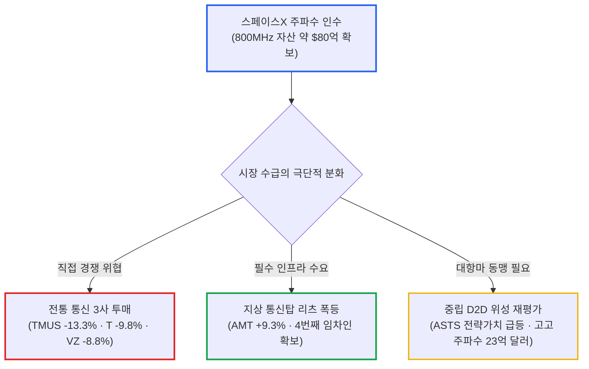

# 2026년 10월 12일(월) 하루치 뉴스정리

- **작성일**: 2026-10-12

스페이스X가 80억 달러를 베팅해 미국 전역의 800MHz 저주파 대역을 삼키며 버라이즌·AT&T·티모바일의 시가총액을 하루 만에 수십조 원 날려버렸고, 중국 창신메모리(CXMT)는 삼성전자와 SK하이닉스의 독무대였던 차세대 4F²D램 독자 개발에 성공해 2026년 말 서버용 DDR5 양산을 선언했다. 레이 달리오는 미 국채 10년물 금리가 5%대로 치솟으면서 주식의 기대수익률 우위가 사라졌고 회계상 이익과 무관하게 잉여현금흐름(FCF)이 말라비틀어지는 사이클 후반부에 진입했다고 경고했다. 지수가 7,800선 위에서 숨을 고르는 동안, 무지한 대중은 통신 3사의 '고배당 착시'에 속아 물을 타고 AI 테마의 뜬구름을 쫓고 있다. 그러나 진짜 판도는 독점 인프라를 장악한 위성·통신탑 연합과, 수주잔고와 현금을 쥐고 실적을 찍어내는 소수 기업으로 급격히 재편되고 있다.

## 요약

| 구분 | 주요 내용 |
| :--- | :--- |
| **핵심 진단** | 스페이스X 80억 달러 주파수 인수로 지상 통신 3사 급락 및 통신탑 리츠(AMT) 폭등. 중국 CXMT의 4F²D램 양산 선언과 5%대 금리 속 레이 달리오의 FCF 악화 경고 |
| **핵심 종목 팩트** | 통신 3사(TMUS -13.3%, T -9.8%, VZ -8.8%) 투매 속 통신탑(AMT +9.3%) 급등. 펩시코 가이던스 대폭 삭감, 팔란티어 골드만 매수 상향($230), 휴마나 Stars 4성 복귀 |
| **착시 교정** | ① "위성통신 ➔ 지상 통신탑 불필요" 착시(팩트는 도심/실내망 커버리지를 위해 통신탑 필수 임차), ② "D2D 경쟁 ➔ AST스페이스모바일 타격" 착시(통신 3사가 스페이스X 대항마로 ASTS와 결속 강화) |
| **스마트머니 돈길** | 레거시 통신 과점주 매도 ➔ 통신탑 리츠(AMT/CCI) 및 저주파 자산 보유사(GOGO/ATEX), 확정 수주 엔터프라이즈 AI(PLTR), 실물 금·달러 캐리 |
| **가장 더러운 변수** | 미 10년물 5%대 고착화와 사우디 킹칼리드 공항 피격(후티 반군, 12명 사망). 트럼프의 미군 군사개입 시사 및 러시아산 디젤 제재 완화 논란 |
| **계좌 행동 지침** | 지수 횡보에 취해 껍데기 테마주 추격 엄금. 원가 전가 실패 소비재(PEP) 비중 축소, FCF 풍부한 실물 인프라(AMT) 및 독점 소프트웨어(PLTR) 압축 대응 |

---

## 1. 스페이스X의 80억 달러 주파수 폭격: 통신 3사의 몰락과 통신탑의 부활

10월 9일 장 마감 후 시장을 뒤흔든 진원지는 일론 머스크였다. 스페이스X가 사모펀드 Grain Management로부터 미국 전역의 800MHz 저주파 대역 주파수 자산을 약 **80억 달러에** 인수하기로 전격 합의했다. 

언론과 대중은 1차원적인 공포에 질려 비명을 질렀다. "스페이스X가 위성으로 일반 스마트폰 직접 연결(D2D) 통신망을 깔면 기존 통신사는 다 망한다"는 선동이 번지며 전통 통신 3사의 주가는 단 하루 만에 도륙났다. 티모바일(TMUS)은 **-13.27% 폭락했고**, AT&T(T)는 **-9.81%**, 버라이즌(VZ)은 **-8.75% 곤두박질쳤다**.

그러나 대중이 패닉에 빠져 통신주를 내던질 때, 정작 지상 통신탑 리츠는 사상 유례없는 폭등세를 연출했다. 아메리칸타워(AMT)는 무려 **+9.30% 폭등했고**, 크라운캐슬(CCI)과 SBA커뮤니케이션스(SBAC) 역시 동반 급등했다. 

번스타인의 매디슨 레자이 애널리스트는 대중의 무지를 완벽하게 비웃었다:

> "통신탑을 거대한 아파트에 비유해 보라. 지금까지 이 아파트에는 버라이즌, AT&T, 티모바일이라는 3명의 세입자만 살고 있었다. 스페이스X의 주파수 인수는 이 아파트에 '스페이스X'라는 막강한 4번째 세입자가 월세를 내러 들어온다는 뜻이다. 저궤도 위성 전파는 콘크리트 벽을 뚫지 못하며, 인구 밀집 지역의 방대한 트래픽을 감당할 수 없다. 스페이스X가 이동통신 사업을 하려면 결국 지상 통신탑을 임차해 기지국을 박아야만 한다."

이 판도 변화에서 가장 극적인 반전을 맞이한 종목은 AST스페이스모바일(ASTS)이다. 스페이스X의 진출 소식에 단기 경쟁 우려로 주가가 급락했지만, 베렌버그와 로스캐피털의 평가는 정반대였다. 

스페이스X가 자체 통신사를 선언하며 AT&T·버라이즌의 밥그릇을 직접 빼앗으려 나선 순간, 통신 3사는 누구의 손을 잡겠는가? 기존 통신사들과의 협력만을 사업 모델로 삼은 유일한 중립적 위성 파트너, AST스페이스모바일의 전략적 가치는 오히려 천정부지로 치솟았다. 통신 3사는 스페이스X에 대항하기 위해 AST스페이스모바일과의 동맹을 사활을 걸고 강화할 수밖에 없다.

아울러 주파수 자산의 가치 재평가도 폭발했다. 로스캐피털에 따르면 스페이스X가 지불한 주파수 단가를 동일하게 적용할 경우, 고고(GOGO)가 보유한 주파수 자산 가치는 무려 **23억 달러에** 달한다. 이는 현재 고고의 전체 기업가치(EV 약 10억 달러)의 2배를 훌쩍 웃도는 규모다. 앤테릭스(ATEX), 넥스트내브(NN) 등 숨은 저주파 보유사들과 백홀 장비 업체 아비아트네트웍스(AVNW), 세라곤(CRNT)으로 진짜 돈길이 번지고 있다.

머스크는 한술 더 떠 엑스(X)를 통해 "스페이스X의 기업가치가 전 세계 경제 생산 규모(약 126조 달러)보다 몇 자릿수 더 커질 경로가 보인다"며 12경 달러짜리 희망회로를 띄웠고, 인도에서는 1,060억 달러 IPO를 준비 중인 암바니의 릴라이언스 지오를 상대로 초저가 요금 전쟁을 선포했다. 머스크의 허풍 뒤에서 실물 인프라와 주파수 패권을 쥔 자들만이 막대한 실속을 챙기고 있다.

---

## 2. 중국 창신메모리의 4F²D램 선전포고와 미국의 인재 빗장

10월 12일 상하이 반도체 행사에서 한국 메모리 반도체 진영의 등골을 서늘하게 만드는 뉴스가 터졌다. 중국 최대 D램 제조사 창신메모리(CXMT)의 차오 칸위 사장이 독자 개발한 '수직 환형 게이트(VSG)' 트랜지스터를 기반으로 차세대 **4F²셀 구조 D램** 개발에서 유의미한 성과를 거뒀으며, 2026년 말까지 서버용 DDR5 RDIMM 신제품을 양산하겠다고 전격 발표했다.

4F²구조는 현재 글로벌 상용 메모리의 표준인 6F²대비 셀 면적을 30% 이상 줄여 웨이퍼 한 장에서 뽑아낼 수 있는 집적도를 극대화하는 차세대 핵심 기술이다. SK하이닉스가 작년에야 로드맵을 공개했고 삼성전자가 2028년 양산을 목표로 10나노 이하 공정에 적용하려던 영역이다. 미국의 극자외선(EUV) 장비 반입 금지라는 족쇄 속에서도, 중국이 공정을 뜯어고쳐 300개 이상의 특허를 앞세우며 턱밑까지 추격해 온 것이다.

글로벌 투자은행 CLSA는 CXMT에 대해 TSMC를 비교 벤치마크로 삼아 프리미엄을 부여하며 목표주가 **84.70위안에** '시장수익률 상회(Outperform)' 커버리지를 개시했다. CXMT의 비트 출하 기준 글로벌 시장점유율이 작년 9%에서 올해 12%, 내년에는 **14%까지** 치솟을 것이라는 전망이다. 

번스타인 역시 목표주가 70위안을 제시하며 가세했다. 중국 내수만으로도 전 세계 D램 수요의 20%를 소화할 수 있는 데다, 미·중을 제외한 제3국 PC·스마트폰 제조사 공급망을 뚫으면 순수 해외 시장에서만 글로벌 점유율 **10%포인트를** 추가로 쓸어 담을 수 있다는 계산이다.

미국 정부는 당혹감 속에 빗장을 더 걸어 잠그고 있다. 트럼프 행정부와 JD 밴스 부통령은 마이크로소프트, 어도비, 코그니전트 등 8개 기술기업의 외국인 직원 영주권 후원을 전격 중단시켰다. 미국인 일자리를 지킨다는 정치적 쇼지만, 빅테크 입장에서는 글로벌 핵심 엔지니어 수급에 직격탄을 맞은 꼴이다.

빅테크 내부의 합종연횡과 분열도 가속화되고 있다:

- **아마존의 반격**: 서로 다른 AI 가속기 간 연산 효율을 극대화하는 스타트업 데카트(Decart)를 **약 70억 달러에** 인수 협상 중이다. 자체 개발 칩 '트레이니엄'과 AWS 인프라 효율을 높여 엔비디아 의존도를 낮추려는 필사적 몸부림이다.
- **오픈AI의 내부 균열**: 안전성 우려를 제기한 핵심 연구원 3명을 '기밀 규정 위반'이라는 핑계로 전격 해고했다. 그러면서 뒤로는 트럼프 1기 백악관 부비서실장 등 정치권 인사들을 대거 영입하며 로비망을 구축하고 있다.
- **사티아 나델라의 선 긋기**: 마이크로소프트 CEO 나델라는 "AI 시스템에는 반드시 인간이 통제할 수 있는 비상정지 스위치(Kill Switch)가 필요하다"며 통제 불능의 AI 폭주에 공식적인 경고장을 날렸다.

---

## 3. 매크로 충격과 실물 경제의 비명: 레이 달리오의 FCF 경고와 원가 전가 실패

브리지워터의 설립자 레이 달리오는 CNBC와의 인터뷰에서 시장의 환각에 찬물을 끼얹었다:

> "글로벌 채권 금리가 5%대로 치솟으면서 주식의 상대적 기대수익률 우위는 이미 사라졌다. 지금은 사이클의 후반부다. 장부상 회계 이익만 보고 좋아하지 마라. 기업이 이익을 낸다고 해도 막대한 자본지출(CAPEX)을 회수하지 못해 잉여현금흐름(FCF)이 악화되면 결국 유동성 위기가 터진다. 앞으로 기업 이익은 개선될지 몰라도 FCF는 곤두박질칠 것이다."

아폴로 글로벌 매니지먼트의 토르스텐 슬록 수석 이코노미스트 역시 데이터로 팩트를 폭행했다. AI 투자가 경제를 견인한다는 장밋빛 환상과 달리, 기술 진보의 핵심 척도인 총요소생산성(TFP) 개선 효과는 **0%를 밑돌고 있다**. 노동시간당 생산량이 늘어난 것은 기술 혁신 때문이 아니라 자본과 기계를 무식하게 때려 박은 '자본 심화(Capital Deepening)'의 착시일 뿐이다.

BNP파리바의 분석은 더 참혹하다. S&P 500이 올해 13.5% 오른 것은 소수 AI 메가캡의 착시일 뿐, AI 종목을 제외한 미국의 '구경제(Old Economy)' 지수 상승률은 **5.5%에** 불과해 유럽 스톡스600(5.6%)보다도 뒤처졌다. 미국 경제 전체가 잘나가는 것이 아니라, 소수 기술주가 지수에 분칠을 해두었을 뿐이다.

여기에 지정학적 뇌관이 다시 터졌다. 주말 사이 예멘 후티 반군이 사우디아라비아 수도 리야드의 킹칼리드 국제공항을 미사일로 공격해 **12명이 숨지고 309명이 다쳤다**. 트럼프 대통령은 즉각 "사우디의 공습을 미군이 지원할 수 있다"며 군사개입을 시사했다. 한편으로는 디젤 부족을 막겠다며 푸틴과 협의해 러시아산 디젤 수입 제재를 6개월간 일시 면제하며 대러 제재법 위반 논란을 자초했다. 

실물 기업들의 3분기 성적표는 고유가와 인플레이션의 공포를 여실히 보여준다:

| 기업명 / 티커 | 발표 실적 및 시장 팩트 | 이면의 숨겨진 리스크 및 시장 착시 | 스마트머니 냉정 판정 |
| :--- | :--- | :--- | :--- |
| **펩시코 (PEP)** | 3분기 유기적 매출 +3.1% 달성 | 연간 EPS 성장률 가이던스 **4~6%에서 1~2%로 폭락**. 북미 음료 부진 및 마케팅비 급증 | **골드만·JP모건 목표가 일제 하향**. 원가 상승 전가 실패로 이익 마진 훼손 |
| **코스트코 (COST)** | 9월 미국 동일매장 매출 +8% 반등 | 노동절 시차 효과(0.5%p) 및 우버이츠 기프트카드 일회성 매출. 저마진 푸드코트·약국 의존 | 겉보기 매출 증가에 속지 마라. 미즈호 지적대로 **수익성 낮은 저마진 사업 부담 가중** |
| **리바이스 (LEVI)** | 3분기 EPS 컨센서스 상회 | 소비자 직접판매(DTC) 실적 붕괴. 관세 환급금을 마케팅에 재투자하느라 4분기 이익 압박 | **웰스파고·바클레이즈 목표가 하향**. 소비 둔화 속 의류 브랜드의 가격 결정력 상실 |
| **컨스텔레이션브랜즈 (STZ)** | 맥주 출하 증가로 2분기 호조 | 유통업체들의 단순 재고 보충에 불과. 하반기 마케팅비·운송비 폭증으로 이익 둔화 불가피 | **파이퍼샌들러 목표가 $161 ➔ $125 대폭 삭감**. 3분기 출하량 급감 경고 |
| **휴마나 (HUM)** | CMS 메디케어 어드밴티지 Stars 등급 **3.5 ➔ 4.0 상향** | 정부 보너스 지급 재개로 2028년 조정 EPS **$35 이상 달성 가시화** | **베어드 목표가 $390 ➔ $596 폭등 제시**. 정부 재정을 확정 흡수하는 최고의 방어주 |
| **CVS헬스 (CVS)** | 애트나 4성 이상 플랜 가입자 비중 **81%에서 69%로 추락** | 등급 하락으로 2028년 주당순이익(EPS) **$0.41 직격탄 증발** | 메디케어 품질 등급 강등으로 정부 보조금 삭감. 턴어라운드 지연 불가피 |
| **팔란티어 (PLTR)** | 엔비디아 공급망 전반에 AIP 도입, 네비우스 소버린 AI 공급사 선정 | 나스닥 대비 주가 상승 저조했으나 연환산 매출(ARR) 폭증세 유지 | **골드만삭스 매수 상향 (목표가 $230)**. 말로만 떠드는 AI가 아닌 실전 기업 도입 독점 |

위 표를 보면 명확하다. 원가 상승을 감당하지 못하고 가이던스를 깎아내린 전통 소비재(PEP, LEVI, STZ)는 월가의 뭇매를 맞고 있다. 반면 정부 보조금을 확정 지은 휴마나(HUM)와 실제 엔터프라이즈 계약을 쓸어 담는 팔란티어(PLTR)만이 냉혹한 차별화 장세에서 살아남고 있다.

---

## 4. 시장의 착각과 데이터가 밝히는 진실

### 착각 ① “위성통신이 상용화되면 지상 통신탑은 고철 덩어리가 된다?” ➔ 통신탑 리츠의 재평가
대중은 일론 머스크의 우주 쇼에 홀려 지상 인프라가 하루아침에 무용지물이 될 것이라 착각한다. 그러나 물리 법칙은 거짓말을 하지 않는다. 위성 신호는 두꺼운 콘크리트 빌딩 내부를 뚫지 못하며, 출퇴근길 도심 지하철의 데이터 폭증을 우주에서 소화하는 것은 불가능하다. 스페이스X가 80억 달러나 들여 지상 주파수를 산 진짜 이유가 바로 이것이다. 스페이스X는 통신탑을 없애는 파괴자가 아니라, 아메리칸타워(AMT)의 가장 큰 신규 월세 고객이 될 뿐이다.

### 착각 ② “스페이스X의 진출로 AST스페이스모바일(ASTS)은 끝장났다?” ➔ 동맹의 강화
언론은 스페이스X의 주파수 인수를 AST스페이스모바일의 악재로 포장했다. 그러나 정반대다. 스페이스X가 직접 이동통신 사업에 뛰어들어 기존 통신사들의 숨통을 조이기 시작하면서, AT&T·버라이즌·티모바일은 독자적인 위성망을 갖출 수 없는 처지에 몰렸다. 이들에게 남은 유일한 구명줄은 기존 통신사들과 이익을 공유하는 '중립적 파트너' AST스페이스모바일뿐이다. 벼랑 끝에 몰린 통신 3사가 ASTS에 자금과 주파수를 몰아줄 수밖에 없는 구조가 완성됐다.

### 착각 ③ “배당 잘 주는 통신주와 필수소비재는 든든한 경기 방어주다?” ➔ 원금 파괴의 덫
AT&T와 버라이즌의 6~7% 배당률에 취해 물을 타는 것은 자살행위다. 막대한 부채를 짊어진 상태에서 스페이스X라는 거대 공룡과 출혈 경쟁을 벌여야 한다. 배당 몇 푼 받으려다 원금이 -10%씩 녹아내린다. 펩시코(PEP) 역시 마찬가지다. 원가 상승을 견디지 못해 연간 EPS 성장률 가이던스를 1~2%로 토막 냈다. 인플레이션을 가격에 전가하지 못하는 기업의 배당은 방패가 아니라 쥐약이다.

### 착각 ④ “S&P 500이 7,800선이니 미국 경제 전반이 건전하다?” ➔ 구경제의 역성장
BNP파리바와 아폴로가 증명했듯, AI 대형주를 걷어낸 미국의 구경제 상승률은 5.5%로 유럽보다 처참하다. 10년물 국채금리가 5%대 위에서 짓누르고 있는 상황에서 대다수 기업들은 빚 갚기에 급급하다. 지수의 숫자놀음에 취해 시장 전체가 안전하다고 믿는 것은 눈을 가리고 지뢰밭을 걷는 것과 같다.

---

## 5. 스마트머니의 포트폴리오 재편: 진짜 현금흐름과 독점 병목으로의 피신

소음 속에서 진짜 돈을 굴리는 스마트머니는 이미 판을 다시 짜고 있다:

1. **통신 섹터의 냉혹한 스위칭**:
    - 부채투성이 레거시 통신 3사(T, VZ, TMUS)를 가차 없이 내던지고, 통신탑 리츠(AMT, CCI)로 피신했다.
    - 스페이스X의 거래가를 역산해 자산가치 괴리가 발생한 저주파 보유 기업 고고(GOGO, 주파수 가치 23억 달러 vs 시총 10억 달러)와 앤테릭스(ATEX)를 조용히 장바구니에 담고 있다.

2. **뜬구름 잡는 AI에서 엔터프라이즈 실적주로 압축**:
    - 트럼프 행정명령에 맞춰 'AIForce'를 'SIForce'로 바꿨다며 간판 갈이나 하는 세일즈포스(CRM) 따위의 마케팅 쇼는 비웃음을 샀다.
    - 골드만삭스가 목표가 **230달러로** 매수 상향한 팔란티어(PLTR)처럼 엔비디아 공급망에 AIP를 깔고 네비우스의 소버린 AI 인프라를 독점 수주하는 진짜 소프트웨어로 돈이 몰린다. 뱅크오브아메리카가 목표가 **100달러로** 신규 매수를 제시한 펭귄솔루션스(PENG)처럼 AI 클러스터의 물리적 성능을 쥐어짜는 인프라 관리 기업도 핵심 피난처다.

3. **제도적 확정 현금흐름으로의 도피**:
    - 메디케어 어드밴티지 등급이 강등당해 2028년 EPS가 0.41달러 날아간 CVS헬스는 퇴출 대상이다.
    - 반면 4성 등급을 탈환하며 연간 수천억 원의 정부 보너스를 확정 지은 휴마나(HUM)는 베어드가 목표가를 **596달러로** 무려 52%나 올려 잡으며 기관의 러브콜을 받고 있다.

4. **내부자들의 극명한 신호**:
    - 오라클(ORCL) 이사 스티븐 러스코프스키는 주가 변동성을 틈타 **350만 달러 규모의 자사주를** 공개시장에서 직접 매수했다.
    - 반면 이베이(EBAY) CEO 제이미 이아노네는 주가가 반등하자마자 **240만 달러어치 주식을** 시장에 내다 팔았다. 경영진이 자사 주식을 어떻게 대하는지가 가장 정직한 나침반이다.

5. **부채 쓰나미를 비웃는 비트코인 베팅**:
    - 스트래티지(MSTR)의 마이클 세일러는 X에 "주황색을 더 담을 공간은 항상 있다"며 또 한 번의 비트코인 추가 매수를 예고했다. 현재 보유량만 84만 8천 개(평가액 약 705억 달러, 평단가 75,441달러)에 달한다. 미국의 눈덩이 부채와 5%대 금리 발작 속에서 법정통화의 종말에 베팅하는 자금은 멈추지 않는다.

---

## 6. 실전 포트폴리오 대응 전략: 5%대 금리 시대의 자산군별 행동 수칙

단순한 관망이나 어설픈 물타기는 계좌를 깡통으로 만드는 지름길이다. 지금 당장 실행해야 할 자산군별 포지셔닝 지침은 다음과 같다:

| 자산군 / 섹터 | 핵심 종목군 | 실전 행동 방침 | 구체적 실행 가이드 |
| :--- | :--- | :---: | :--- |
| **통신 인프라 & 탑 리츠** | AMT, CCI, SBAC | **눌림목 적극 매수** | 스페이스X 진출로 4번째 대형 세입자 확보. 단기 급등 후 눌림목마다 분할 매수 |
| **레거시 통신 과점주** | T, VZ, TMUS | **배당 미련 버리고 전량 축소** | 고배당 함정에 속지 마라. 스페이스X와의 출혈 경쟁 및 망 투자비 급증으로 원금 손실 위험 극대화 |
| **위성 D2D & 주파수 수혜** | ASTS, GOGO, ATEX | **선별적 전략 보유** | ASTS는 통신 3사의 필수 대항마로 부상. GOGO는 주파수 청산 가치($23억) 대비 극단적 저평가 활용 |
| **엔터프라이즈 AI 플랫폼** | PLTR, PENG | **조정 시 비중 확대** | 마케팅 테마주 배제. 엔비디아 파트너십과 수주잔고로 실적 증명하는 독점 소프트웨어 집중 |
| **원가 전가 실패 소비재** | PEP, LEVI, STZ | **반등 시 비중 축소** | 원가 폭등을 가격에 전가하지 못해 가이던스 깎은 기업은 밸류에이션 리레이팅 불가. 기계적 손절 |
| **제도적 수혜 헬스케어** | HUM | **핵심 방어주 편입** | 메디케어 Stars 4성 복귀로 2028년까지 정부 현금흐름 확정. CVS헬스와의 철저한 차별화 |
| **탄약 버퍼 (현금 & 실물 금)** | MMF, 단기채, 골드 | **계좌 최소 20% 의무 확보** | 10년물 금리 5%대 상단 압박과 중동 전운 대비. 시장 발작 시 우량주를 헐값에 담을 총알 |

---

## 7. 향후 2~4주 시장 핵심 모니터링 체크리스트

| 핵심 모니터링 지표 | 안도 신호 (Bull) | 위험 신호 (Bear) | 시장 대응 의미 |
| :--- | :--- | :--- | :--- |
| **미 10년물 국채금리** | 5.00% 이하 하향 안정 | **5.35% 상향 돌파** | 5.35% 돌파 시 고PER 성장주 밸류에이션 재붕괴 및 채권 발작 |
| **브렌트유 & 중동 확전** | 배럴당 95달러 하회 | **배럴당 105달러 돌파** | 후티 반군의 사우디 공항 피격 후 미군 군사개입 시 유가 폭등 및 CPI 재점화 |
| **미 6대 은행 3분기 실적** | NII 증가 및 대손충당금 안정 | **운영비 급증 및 연체율 상승** | 13~14일 JPM·GS·C 실적으로 실물 경기 침체 및 신용 위험 판정 |
| **미 9월 CPI / PPI 발표** | 근원 물가 예상치 하회 | **기대인플레 반등 확인** | 물가 재점화 시 12월 연준 추가 금리 인상 확률 90% 돌파 |
| **달러-원 환율** | 1,330원대 하향 안정 | **1,350원 상향 돌파** | 중동 불안과 강달러 고착화 시 외국인 국내 증시 순매도 가속 |
| **창신메모리(CXMT) 진전** | 기술적 결함 및 수율 난항 | **서버용 DDR5 양산 확인** | 삼성·SK하이닉스 레거시 및 차세대 D램 가격 협상력 훼손 여부 |

---

## 8. 최종 판정 및 핵심 실행 원칙

10월 12일 시장의 모든 데이터가 가리키는 결론은 하나다.

**5%대 국채금리 환경에서 미래의 꿈만 파는 기업은 죽고, 당장 손에 쥐어지는 독점 인프라와 확정 현금흐름을 가진 자만이 왕이 된다.**

스페이스X가 80억 달러를 쏟아붓는다고 해서 낡은 통신사의 배당금을 주워 담는 것은 눈먼 돈이다. 통신탑을 쥐고 월세를 뜯어낼 아메리칸타워(AMT)를 보아야 하고, 통신 3사가 살기 위해 매달릴 AST스페이스모바일(ASTS)을 읽어야 한다. 

원가 상승에 짓눌려 가이던스를 깎아내린 펩시코(PEP)의 핑계를 듣지 말고, 정부 보증 수표를 쥐어 든 휴마나(HUM)와 실전 엔터프라이즈 계약을 독식하는 팔란티어(PLTR)의 숫자를 보아라.

레이 달리오의 경고처럼 회계상 이익의 환각에서 벗어나라. 잉여현금흐름(FCF)이 마르고 빚으로 연명하는 기업들을 포트폴리오에서 가차 없이 도려내고, 물리적 독점 병목과 현금 20%의 방파제 뒤로 물러서라.

!!! tip "최종 핵심 제언 (Executive Takeaway)"
    **화려한 지수 반등의 가면 뒤에서 5%대 금리와 고유가라는 칼날이 실물 경제를 난도질하고 있다.**  
    스페이스X 80억 달러 딜의 본질은 레거시 통신사의 몰락과 지상 통신탑(AMT)의 구조적 승리다. 고배당이라는 미끼에 낚여 통신 3사나 원가 전가에 실패한 소비재(PEP)에 물을 타지 마라.  
    창신메모리의 4F²D램 추격과 미 정부의 영주권 규제 등 기술 패권의 지각변동 속에서, 확실한 수주를 쥔 엔터프라이즈 AI(PLTR)와 정부 확정 수익(HUM)으로 포트폴리오를 압축하라. 계좌의 20%는 현금과 실물 금으로 봉인하여 다가올 금리 발작의 순간에 최후의 승자가 될 탄약으로 아껴두어라.
