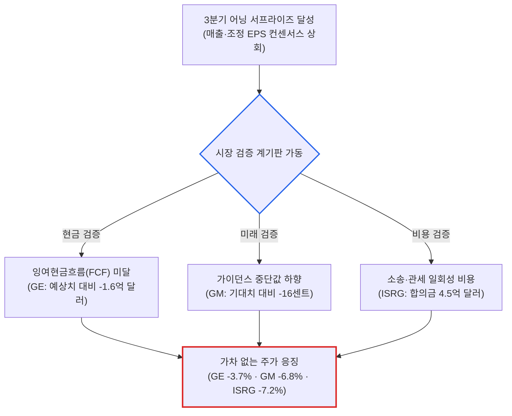

# 2026년 10월 21일(수) 하루치 뉴스정리

- **작성일**: 2026-10-21

스페이스X가 분기 매출 145억 8천만 달러(+161%)를 찍고 순이익 44억 달러로 영업흑자 전환하며 시간외 4.7% 폭등하고, 슈퍼마이크로컴퓨터(SMCI)가 분기 가이던스를 195억 달러로 28% 올려치며 14% 폭등한 날, 주식시장은 역사상 가장 잔인한 '현금흐름 단두대'를 세웠다. 매출과 영업이익이 월가 컨센서스를 부수며 날아올라도 잉여현금흐름(FCF)이 예상치를 고작 1억 6천만 달러 밑돌았다는 이유로 세계 1위 항공엔진 제왕 GE 에어로스페이스가 -3.7% 두들겨 맞았다. GM은 500억 달러 매출에 200억 달러 자사주 매입 폭탄을 던지고도 가이던스 중단값이 16센트 모자라다는 핑계로 -6.8% 패개쳐졌으며, 인튜이티브 서지컬은 22% 성장 서프라이즈를 내고도 4억 5천만 달러 소송합의금 한 방에 시간외 -7.2% 폭락했다. 빚으로 그래픽카드를 사재기하던 코어위브가 510억 달러 부채와 ROIC 8.9%라는 사형선고를 받는 동안, 스마트머니는 3M(+5.8%)과 노스롭그루먼(+4.6%) 같은 '진짜 현금을 토해내는 우량 가치주'로 숨 가쁘게 도망쳤다.

## 요약

| 구분 | 주요 내용 |
| :--- | :--- |
| **핵심 진단** | 실적 서프라이즈보다 잉여현금흐름(FCF)과 마진 방어를 우선하는 냉혹한 '현금흐름 단두대' 장세 도래 |
| **핵심 종목 팩트** | 스페이스X 3Q 매출 145.8억 달러·순익 44억 달러 흑자전환, SMCI 가이던스 195억 달러 상향(+14%), GE·GM·ISRG 호실적에도 현금흐름·비용 쇼크로 급락 |
| **착시 교정** | ① 마이크론 PER 5배의 착시(호황기 피크 주가 반토막 잔혹사), ② AI 채권 ETF(AIBN)의 위험(코어위브 CDS 폭등 속 폭탄 돌리기), ③ 테슬라-스페이스X 합병의 환상(주식 희석) |
| **돈길 확산 신호** | 스페이스X SI 부문 매출 75.6억 달러(+830%), 세일스포스의 브레이즈 56.6억 달러 인수(+51%), 3M·노스롭그루먼 등 고품질 우량주 순환매 |
| **가장 더러운 변수** | 미 10년물 국채금리 5.11% 고착화, 항공유 갤런당 4.80달러 폭등(+23%)에 따른 유나이티드항공 실적 반토막, 9월 잠정주택판매 -7.3% 폭락 |
| **계좌 행동 지침** | 차입 의존 네오클라우드 전량 정리, FCF 적자 고평가 기술주 비중 축소, 독점적 현금 창출력 보유 우량주 및 현금 20% 압축 |

---

## 1. 어닝 서프라이즈 뒤에 숨겨진 '현금흐름 단두대': GE·GM·인튜이티브의 잔혹한 숙청

주식시장의 심판관들이 마침내 가면을 벗었다. 숫자가 조금만 좋아도 주가를 천장으로 쏘아 올리던 유동성의 잔치는 끝났다. 이제 시장은 장부상 매출이나 조정 영업이익 따위는 쳐다보지도 않는다. 오직 "오늘 당장 금고에 들어온 진짜 현금이 얼마인가", 그리고 "앞으로 1센트라도 성장세가 꺾일 핑계가 있는가"만을 따져 묻고 있다. 

그 단두대의 첫 번째 제물은 세계 항공엔진 시장의 절대 군주 GE 에어로스페이스(GE)였다. GE는 3분기 조정 EPS 2.25달러(전년비 +36%), 매출 132억 9천만 달러(+18%)를 기록하며 월가 전문가들의 기대를 완벽하게 뭉갰다. 연간 영업이익 가이던스도 110억 달러로 상향 조정했다. 흠잡을 데 없는 '어닝 서프라이즈'였다. 그러나 종가는 -3.67% 급락한 299.87달러로 마감했다. 주가를 곤두박질치게 만든 단 하나의 이유는 3분기 잉여현금흐름(FCF)이 20억 4천만 달러에 그쳐, 월가 예상치(22억 달러)에 1억 6천만 달러 모자랐기 때문이다. 인플레이션으로 영업이익률이 27.9%로 10bp 밀리자 시장은 망설임 없이 매도 버튼을 눌렀다.

제너럴모터스(GM)의 학살극은 더 노골적이었다. GM은 3분기 매출 500억 2천만 달러, 조정 EPS 3.70달러를 찍으며 컨센서스를 보기 좋게 넘어섰다. 이사회는 무려 200억 달러(약 27조 원) 규모의 신규 자사주 매입 프로그램까지 승인했다. 주주환원의 끝판왕을 보여준 셈이다. 하지만 주가는 장중 내내 패닉셀에 시달리며 -6.84% 폭락했다. 연간 EPS 가이던스 범위의 중단값(13.25달러)이 실적 발표 직전 시장이 기대했던 13.41달러보다 고작 16센트 낮았다는 게 죄목이었다. 200억 달러를 사들이든 말든, 연간 이익 눈높이가 1% 깎였다는 이유로 주가를 내동댕이쳤다.

로봇 수술의 독점자 인튜이티브 서지컬(ISRG) 역시 시간외 거래에서 -7.20% 폭락하며 피를 흘렸다. 3분기 매출 30억 5천만 달러(+22%), 비GAAP EPS 3.00달러로 사상 최대 실적을 달성했고 분기 중 29억 4천만 달러의 자사주를 쓸어 담았다. 그러나 반독점 집단소송 합의로 인한 세전 4억 5천만 달러의 일회성 비용이 발생하며 GAAP 기준 순이익이 토막 났다. 여기에 경영진이 관세 리스크로 인해 마진이 0.9%포인트 깎일 수 있다고 실토하자, 투자자들은 시간외 거래에서 주가를 한때 13%까지 내던졌다.

넷플릭스(NFLX) 역시 시간외에서 6% 급락했다. 3분기 역대 최대인 48억 달러를 들여 자사주 6,390만 주를 소각했음에도, 연간 광고 매출 전망치를 기존 30억 달러에서 27억 달러로 깎고 4분기 매출 가이던스를 하향하자 가차 없는 투매가 쏟아졌다. 전체 인력의 6%를 자르는 구조조정 비용까지 겹쳤다. 시장의 메시지는 서늘할 정도로 명확하다. 회사가 자사주를 수십억 달러씩 태우든 어닝 서프라이즈를 내든 상관없다. 현금흐름이 조금이라도 비거나 가이던스가 단 1센트라도 낮아지면 죽는 장이다.

---

## 2. 3분기 실적 호조와 잉여현금흐름(FCF) 충격 비교 매트릭스

호실적을 발표하고도 주가가 난도질당한 기업들의 이면에는 공통된 치명상이 숨어 있다. 장부상 매출 성장의 화려함 뒤에 가려진 현금흐름 훼손과 가이던스 결함을 나란히 대조해 보면 시장이 무엇에 공포를 느끼는지 한눈에 드러난다.

| 기업명 (티커) | 3분기 실적 성적표 | 주가 반응 | 가려진 치명적 결함 (시장의 숙청 사유) | 시장 함의 및 경고 신호 |
| :--- | :--- | :---: | :--- | :--- |
| **GE 에어로스페이스** (`GE`) | 매출 132.9억 달러 (+18%) 조정 EPS $2.25 (컨센 $2.00) | **-3.67%** | 3Q FCF 20.4억 달러로 컨센서스(22억 달러) 미달, 영업이익률 10bp 하락 | 자본재 대장주도 현금 창출력에 금이 가면 밸류에이션 프리미엄 박탈 |
| **제너럴 모터스** (`GM`) | 매출 500.2억 달러 (호조) 조정 EPS $3.70 (컨센 $3.63) | **-6.84%** | 연간 가이던스 중단값($13.25)이 월가 눈높이($13.41) 미달, 200억 달러 자사주 매입 시기 불투명 | 전통 제조업의 실적 피크아웃 우려 고착화 및 주주환원 약발 소멸 |
| **인튜이티브 서지컬** (`ISRG`) | 매출 30.5억 달러 (+22%) 비GAAP EPS $3.00 (컨센 $2.65) | **-7.20%** (시간외) | 반독점 소송 합의금 4.5억 달러로 GAAP 순익 훼손, 관세로 매출총이익률 0.9%p 압박 | 독점 헬스케어 플랫폼도 규제 비용과 관세 인플레 앞에서는 마진 방어 한계 |
| **넷플릭스** (`NFLX`) | 매출 128.7억 달러 (부합) GAAP EPS $0.87 (컨센 $0.82) | **-5.71%** (시간외) | 연간 광고 매출 30억 ➔ 27억 달러 하향, 4Q 매출 가이던스 미달, 1천 명 감원 비용 | 고성장 스토리 둔화 시 역대 최대(48억 달러) 자사주 매입도 주가 방어 불가 |
| **유나이티드항공** (`UAL`) | 탑승객 수 전년비 +2% 증가 여객 수요는 견조 유지 | **가이던스 폭락** | 항공유 갤런당 $4.80 급등(+23%), 4Q EPS 가이던스 $0.50~$1.50로 컨센($1.76) 대폭 하회 | 유가 100달러 시대, 원가 전가에 실패한 운송·소비재의 마진 압살 확인 |

표에서 보듯, 시장은 이제 '좋은 실적'에 보상하지 않는다. 대신 '결함이 있는 실적'을 잔혹하게 처형한다. 이것이 5.1%가 넘는 고금리와 100달러 유가가 지배하는 거시경제 환경에서 살아남는 자본의 생존 본능이다.

---

## 3. 스페이스X 13GW와 SMCI 195억 달러의 포효 vs 510억 달러 빚더미 코어위브의 침몰

반면 AI 인프라의 진짜 최전선에서는 전혀 다른 차원의 머니게임이 벌어지고 있다. 뜬구름 잡는 소프트웨어가 아니라, 물리적 실체와 독점적 인프라를 쥔 자들이 시장의 돈을 진공청소기처럼 빨아들이고 있다.

일론 머스크의 스페이스X(SPCX)가 공개한 3분기 성적표는 시장을 경악하게 만들었다. 분기 매출은 전년 대비 161% 폭증한 145억 8천만 달러를 기록했고, 1년 전 10억 5천만 달러 적자에서 44억 달러(약 6조 원) 순이익으로 드라마틱한 흑자전환에 성공했다. 특히 AI 인프라를 담당하는 초지능(SI) 부문 매출은 75억 6천만 달러로 1년 전보다 무려 9배(+830%) 넘게 폭발했다. 전체 매출의 52%가 이제 로켓이 아닌 AI 연산에서 나온다. 

스페이스X 컨퍼런스콜에서 머스크와 브렛 존슨 CFO가 밝힌 숫자는 더 충격적이다. 구형 엔비디아 H100 GPU조차 신제품 때보다 비싼 웃돈을 주고 빌려 가고 있으며, AI 연산 설비의 투자금 회수기간은 1년 미만, 2027년에는 6개월로 단축된다. 스페이스X는 현재 1.7GW인 AI 컴퓨팅 용량을 2027년 말 13GW 이상으로 늘리겠다고 선언했다. 핵심 병목인 전력과 냉각 설비를 해결하기 위해, 로켓 엔진 정밀 주조 기술로 발전용 가스터빈 핵심 부품을 직접 찍어내 경쟁사보다 전력을 12~18개월 일찍 끌어오겠다는 전략이다. 4분기 자본지출(CapEx)만 최대 400억 달러(약 54조 원)를 쏟아붓겠다고 공언했다.

여기에 AI 데이터센터 서버 맹주 슈퍼마이크로컴퓨터(SMCI)가 불을 질렀다. 지난 7월 실적 우려로 시장을 떨게 했던 SMCI는 다음 분기 매출 전망치를 기존 145억~155억 달러에서 185억~195억 달러로 무려 28% 전격 상향했다. 월가 컨센서스(152억 달러)를 40억 달러 이상 짓밟은 수치다. 주가는 시간외에서 13.92% 폭등했다. 앤트로픽에 최대 2GW 규모 MI450 가속기를 납품하고 하반기 서버 매출이 80% 이상 폭증할 것이라 예고한 AMD, 그리고 데이터센터 대용량 HDD 공급 부족이 400EB(엑사바이트)에 달해 현물 가격이 계약가의 2~5배로 치솟았다는 시게이트(STX)의 목표주가 상향(1,200달러)까지 합세했다.

그러나 화려한 인프라 잔치의 뒤편에는 썩어 문드러진 부채의 시체가 널려 있다. HSBC는 사모 신용으로 GPU를 사들였던 네오클라우드 대장주 코어위브(CRWV)에 매도 의견과 목표주가 39달러를 던졌다. 코어위브가 짊어진 부채만 510억 달러(약 69조 원)가 넘는다. HSBC의 진단은 치명적이다. 코어위브의 투하자본수익률(ROIC)은 향후 5년간 평균 8.9%에 불과한데, 이는 회사의 자금 차입비용(이자율)보다 낮다. 즉, 설비투자를 늘리면 늘릴수록 회사의 가치가 파괴되는 역마진 구조에 갇혔다는 뜻이다. 

코어위브의 신용부도스와프(CDS) 스프레드가 폭등하는 와중에 월가는 아마존, 마이크로소프트 채권에 오라클과 코어위브의 위험 부채를 짬뽕한 상장지수펀드(AIBN ETF)를 출시했다. 과거 2021년 비트코인 고점 선물 ETF나 스팩(SPAC) 거품 정점 때 나타났던 전형적인 '폭탄 돌리기' 상품이다. 자체 전력과 현금으로 13GW를 짓는 스페이스X와, 빚으로 GPU를 사서 마진 역마진에 빠진 코어위브. AI 하드웨어 생태계는 지금 극단적인 양극화의 갈림길에 서 있다.

---

## 4. AI 인프라 실수요와 부채 리스크 대조 분석표

진짜 자체 현금으로 전력과 하드웨어를 장악한 승자와, 고금리 빚을 내어 장비를 사재기하다 이자 비용의 늪에 빠진 패자의 재무 구조는 완전히 딴판이다.

| 기업 및 자산군 | 3분기 핵심 데이터 및 가이던스 | 자금 조달 및 전력 인프라 역량 | 투자 등급 및 리스크 판정 |
| :--- | :--- | :--- | :--- |
| **스페이스X** (`SPCX`) | 3Q 매출 $145.8억(+161%), 순익 $44억 흑자 SI 부문 매출 $75.6억(+830%), 설비 1.7GW | 자체 영업현금흐름 + 가스터빈 부품 자체 주조로 전력 확보 12~18개월 단축. '27년 13GW 목표 | **압도적 A+** (자체 전력망과 막대한 현금흐름으로 AI 인프라 독점) |
| **슈퍼마이크로** (`SMCI`) | FY27 1Q 매출 가이던스 $185억~$195억 (기존 대비 +28% 상향, 월가 컨센 $152억 압도) | 서버랙 냉각 솔루션 장악, 엔비디아 차세대 칩 탑재 서버 출하 본격화 | **전술적 B+** (단기 실적 회복 강하나 회계 이슈 잔재 모니터링 필수) |
| **시게이트** (`STX`) | HDD 시장 공급 부족 400EB 도달 현물 거래가격이 계약가 대비 2~5배 폭등 | 빅테크 니어라인 스토리지 품귀, 고마진 제품 믹스 전환 가속화 | **상승 A** (모건스탠리 목표가 $1,200 상향, 공급 부족 장기 수혜) |
| **코어위브** (`CRWV`) | 부채 규모 $510억 돌파 ROIC 8.9%로 자본비용 하회 (역마진 경고) | 사모 신용 및 고금리 차입 의존, CDS 스프레드 1,000bp 상회로 신용위험 극대화 | **퇴출 C-** (HSBC 매도 리포트, 부채 감당 불가 시 구조조정 불가피) |
| **AI 채권 ETF** (`AIBN`) | 하이퍼스케일러 + 오라클·코어위브 채권 편입 신규 상장 첫날 거래량 미미 | 위험 채권 포장 상품. 코어위브·오라클 CDS 프리미엄 2021년 이후 최고치 경신 | **경고 D** (과열 국면 말기 금융공학 상품, 하락장 도래 시 유동성 함정) |

이 표가 증명하는 사실은 하나다. 반도체 칩이 있느냐 없느냐가 아니라, '발전소와 전력망을 통제하고 빚 없이 현금을 돌릴 수 있느냐'가 2026년 하반기 테크 생태계의 유일한 생존 기준이다.

---

## 5. 시장의 왜곡된 편견과 데이터가 입증하는 냉혹한 진실

대중과 언론은 항상 과거의 공식에 갇혀 헛다리를 짚는다. 표면적인 뉴스 헤드라인만 믿고 불나방처럼 뛰어드는 개미들이 반드시 깨달아야 할 3가지 착시와 데이터의 현실을 폭로한다.

### 착시 ① "마이크론 PER이 5배니 역사적 바닥이다?" ➔ 천장에서 주가가 먼저 반토막 난 메모리의 피눈물

언론과 증권사는 마이크론(MU) 주가가 6월 고점(1,213달러) 대비 26% 하락한 900달러 선으로 내려오자, 2027 회계연도 기준 PER이 5배에 불과하다며 "극도의 저평가"라고 떠들어댄다. 

그러나 메모리 사이클의 역사를 아는 타짜들은 소름 돋는 기시감을 느낀다. 모틀리풀이 분석한 마이크론의 과거 세 차례 호황기(1993~1994년, 2009년, 2013년)를 보면, 마이크론은 항상 연간 순이익이 사상 최대치를 찍고 있을 때 주가가 먼저 고점을 치고 폭락했다. 1995년 마이크론 주가는 9월 고점 대비 -58% 급락했지만, 정작 분기 순이익 사상 최고치는 주가가 반토막 난 뒤인 1996 회계연도 1분기에 찍혔다. 2010년과 2015년에도 실적 호조 속에서 주가는 각각 -24%, -60% 선제적으로 곤두박질쳤다.

현재 마이크론의 조정 EPS 증가율은 3분기 106%에서 4분기 33%로 쪼그라들었고, 다음 분기 가이던스 기준 증가율은 14%에 그칠 전망이다. D램 가격 상승 폭 역시 60%대에서 10%대로 꺾였다. 메모리 반도체의 PER 5배는 저평가가 아니라, "내년 이익이 반토막 날 것을 시장이 이미 알고 있다"는 강력한 피크아웃 신호다.

### 착시 ② "AI 채권 ETF(AIBN)는 안전한 분산투자다?" ➔ 고위험 부채의 교묘한 폭탄 돌리기

빅테크 채권을 담았다는 디파이언스의 AIBN ETF가 출시되자, 채권 개미들은 마이크로소프트와 알파벳의 신용도만 믿고 달려들 태세다. 

하지만 구성 종목의 속을 뜯어보면 경악을 금치 못한다. 전체 자산의 절반은 우량 빅테크지만, 나머지 절반에는 오라클과 코어위브 같은 고위험 채권이 버젓이 들어가 있다. 오라클의 부채 보장 비용은 2021년 이후 최고치로 치솟았고, 코어위브 CDS 스프레드는 1년 만에 3배가 폭등했다. 안전한 빅테크 이름표를 방패 삼아 부실 네오클라우드 채권을 일반 투자자에게 떠넘기는 전형적인 금융공학 트릭이다. 2021년 10월 첫 비트코인 선물 ETF가 출시된 직후 비트코인이 -70% 폭락했고, 스팩(SPAC) ETF가 유행한 뒤 -60% 폭락했던 역사를 잊지 마라.

### 착시 ③ "테슬라와 스페이스X 합병은 무조건적인 주가 10배 호재다?" ➔ 420달러 차익거래와 주식 희석의 덫

캐시 우드가 테슬라 목표가를 5,000달러로 외치고 머스크가 스페이스X 실적 발표에서 테슬라와의 합병에 지지 의사를 밝히자 테슬라 커뮤니티는 축제 분위기다. 로보택시와 우주 데이터센터의 결합이라는 환상에 취했다.

그러나 퓨처펀드의 게리 블랙이 지적한 차가운 현실을 직시해야 한다. 이번 합병은 현금 인수가 아닌 주식 교환으로 진행될 공산이 크며, 이 과정에서 테슬라 주주들은 막대한 지분 희석을 겪게 된다. 스페이스X가 테슬라 주당 420달러 수준의 인수가를 제시한다 해도, 6~12개월간의 거래 기간 동안 헤지펀드들의 롱숏 차익거래로 테슬라 주가는 짓눌릴 수밖에 없다. 게다가 머스크 본인이 밝혔듯, 테슬라 전체 발행주식의 50% 이상이 찬성해야 하는 극도로 높은 법적 문턱이 남아 있다. 확정되지 않은 합병 환상에 취해 불타기를 하는 것은 도박이다.

---

## 6. 스마트머니의 자금 대이동: 고베타 환상에서 '현금 창출 우량주'로

기술주가 널뛰기를 반복하고 AI 테마의 잡음이 극에 달하자, 월가의 진짜 큰손들은 조용히 판을 바꾸고 있다. 모건스탠리, 골드만삭스, 파이퍼샌들러가 일제히 우량주(Quality Stocks) 비중 확대를 외치는 배경을 주목해야 한다.

모건스탠리의 마이크 윌슨은 고품질 주식과 저품질 주식 간의 이익 전망치 조정 격차가 역사적 상위 20%에 도달했다고 지적했다. 과거 이 격차가 벌어졌을 때, 빚이 적고 안정적인 현금을 창출하는 고품질 우량주는 이후 12개월간 저품질 고베타 주식 대비 평균 +8%의 초과 수익률을 기록했다. 파이퍼샌들러 역시 시장 변동성에 편승하던 고베타 주식의 랠리가 역사적 정점에 도달했으며, 이제는 우량주의 시대가 열렸다고 단언했다.

실제로 간밤 다우지수는 529포인트(+1.02%) 급등하며 52,495.88로 신고가를 갈아치웠다. 3분기 깜짝 실적을 낸 3M이 5.78% 폭등했고, 방산업체 노스롭그루먼이 4.57% 치솟았다. 반면 나스닥은 기술주 반등을 지키지 못하고 약보합(-0.02%)으로 미끄러졌으며, 필라델피아 반도체지수 역시 -0.29% 밀렸다. 지수의 외형만 보면 평온해 보이지만, 밑바닥에서는 자금이 고평가 기술주에서 실물 현금흐름을 증명한 전통 우량주로 대탈출하고 있다.

여기에 거대 플랫폼 기업들의 M&A 머니게임도 실속 위주로 전환됐다. 세일스포스(CRM)는 기업용 AI 마케팅 솔루션 기업 브레이즈(BRZE)를 56억 6천만 달러에 전액 현금으로 인수하기로 합의했다. 주당 47.50달러로 전일 종가 대비 50% 이상의 프리미엄을 얹어줬고, 브레이즈 주가는 장중 50.9% 폭등했다. 말만 앞서는 스타트업이 아니라, 실제 기업 고객을 쥐고 당장 현금을 벌어들이는 B2B AI 에이전트를 웃돈 주고 통째로 사들이는 것이 지금 빅테크 타짜들의 실속 챙기기다. 반면 출하량 둔화 신호가 감지된 애플(AAPL)은 루프캐피털로부터 5년 만의 고점 밸류에이션 부담을 지적받으며 투자의견이 '중립'으로 강등됐다.

---

## 7. 향후 2~4주 시장 핵심 모니터링 체크리스트

금리와 유가, 기업의 현금흐름 지표가 살얼음판을 걷고 있다. 감정에 휩쓸리지 않고 계좌를 지키기 위해 매일 아침 점검해야 할 4대 핵심 계기판이다.

| 핵심 모니터링 지표 | 안도 신호 (Bull 판정) | 위험 신호 (Bear 판정) | 시장 대응 및 포트폴리오 함의 |
| :--- | :--- | :--- | :--- |
| **미 국채 10년물 금리** | **5.05% 이하 하향 안정** | **5.25% 상향 돌파** | 5.25% 돌파 시 FCF 적자 고PER 기술주 멀티플 연쇄 붕괴 불가피 |
| **WTI 원유 선물 가격** | **배럴당 95달러 하회** | **배럴당 105달러 돌파** | 유가 105달러 안착 시 항공·물류 마진 궤멸 및 연준 12월 추가 인상 확률 90% 상회 |
| **빅테크 메타·테슬라 실적** | **CapEx 대비 FCF 유지 및 AI 매출 입증** | **CapEx 폭증 속 FCF 훼손 및 가이던스 미달** | 메타의 '뮤즈' 수익화 증명 실패 시 빅테크 설비투자 회의론 증폭 |
| **반도체 다이버전스** | **마이크론·필라델피아 지수 200일선 지지** | **실적 발표 후 주요 반도체 연쇄 신저가** | D램 가격 상승 둔화에 따른 메모리 피크아웃 현실화 확인 |

---

## 8. 실전 포트폴리오 대응 전략: 자산군별 행동 수칙

어설픈 위로와 희망 회로는 집어치워라. 지금 계좌에 현금흐름이 결손 난 고베타 주식이 담겨 있다면 당장 가위질해야 살아남는다. 

| 자산군 / 섹터 | 핵심 종목 및 자산 | 행동 방침 | 실행 기준 및 포트폴리오 가이드 |
| :--- | :--- | :---: | :--- |
| **자체 현금 AI 인프라** | SPCX, SMCI, STX, AMD | **선별 보유 및 압축 (35~40%)** | 스페이스X처럼 자체 전력과 막대한 흑자를 내거나, 시게이트처럼 400EB 공급 부족 독점력을 쥔 하드웨어만 압축 보유 |
| **메모리 반도체** | MU (마이크론) | **반등 시 분할 차익 실현** | PER 5배 착시에 속지 마라. D램 가격 상승세 둔화와 내년 이익 피크아웃 우려 속 비중 축소 |
| **차입형 네오클라우드** | CRWV, AIBN ETF | **전량 매도 및 손절** | ROIC(8.9%)가 차입비용을 밑돌아 투자할수록 가치가 파괴됨. 고위험 AI 채권 ETF는 출시 즉시 기피 |
| **FCF 기반 고품질 우량주** | MMM, NOC, V, NOW | **비중 확대 (30~35%)** | 10년물 금리 5.1% 환경에서 안정적 현금 창출력 입증. 고베타 기술주 피난 자금의 종착지 |
| **현금 및 단기 국채** | T-Bills, MMF, 달러 | **계좌의 최소 20% 의무 유지** | 연 5% 확정 무위험 수익 향유. 어닝 쇼크로 우량주가 투매에 휩쓸릴 때 바닥에서 주워 담을 탄약 확보 |

스페이스X처럼 로켓 기술로 자체 가스터빈 부품을 찍어내 전력망을 뚫고 44억 달러 순이익을 내는 독점자나, 시게이트처럼 400EB 품귀로 현물가를 2~5배 부르는 하드웨어는 포트폴리오의 중심을 지킬 만하다. 하지만 코어위브처럼 빚으로 그래픽카드를 빌려주고 마진을 쥐어짜다 역마진 늪에 빠진 기업은 반등이 나올 때마다 미련 없이 털어내야 한다.

아울러 마이크론의 PER 5배라는 숫자에 현혹되어 물타기를 시도하는 우를 범하지 마라. 과거 세 차례 호황기마다 실적 정점 직전에 주가가 반토막 났던 잔혹사가 되풀이되고 있다. 지금은 고베타 기술주를 줄이고 3M이나 노스롭그루먼처럼 현금 창출력이 검증된 우량 가치주로 대피하면서, 계좌의 20% 이상을 현금 실탄으로 묶어두는 것만이 살아남는 길이다.

---

## 9. 최종 판정 및 핵심 실행 원칙

오늘 시장이 던진 결론은 냉혹할 정도로 명료하다. 숫자의 껍데기는 벗겨졌고, 잉여현금흐름(FCF)이라는 단두대 위에 모든 기업이 올려졌다.

1. **원칙 1 (현금흐름 지상주의)**: 매출 증가율이 20%든 100%든 상관없다. 내 손에 쥐어지는 FCF가 꺾인 기업은 가차 없이 주가가 패개쳐진다. 장부상 이익에 속지 마라.
2. **원칙 2 (부채의 역마진 응징)**: 빚을 내어 장비를 사재기하고 ROIC가 차입비용을 밑도는 기업은 투자를 늘릴수록 파멸한다. 차입형 네오클라우드에 한 푼도 베팅하지 마라.
3. **원칙 3 (진짜 독점 인프라 압축)**: 로켓 기술로 전력망을 뚫고 44억 달러 흑자를 낸 스페이스X와 400EB 품귀를 누리는 시게이트처럼, '원가를 통제하고 현금을 쥐어짜는 진짜 인프라'에만 집중하라.

!!! tip "최종 핵심 제언 (Executive Takeaway)"
    어닝 서프라이즈를 내고도 FCF 1억 달러가 모자라 주가가 두들겨 맞는 시대다. 지수가 버틴다고 안심하지 마라. 물 밑에서는 고베타 기술주에서 고품질 우량주로 자본의 대탈출이 진행 중이다. 빚으로 지은 AI 모래성을 버리고, 진짜 현금을 토해내는 우량 독점 기업과 20%의 현금 탄약으로 계좌의 방파제를 쌓아라.
