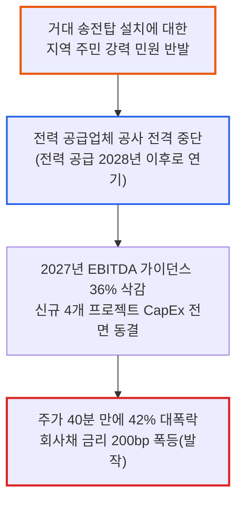

# 2026년 10월 22일(목) 하루치 뉴스정리

- **작성일**: 2026-10-22

메타가 분기 매출 646억 달러를 찍고도 349억 달러의 천문학적인 AI 설비투자와 소송비용에 치여 잉여현금흐름(FCF)이 -21억 달러 적자로 곤두박질치고 250억 달러 벌금 철퇴를 맞은 날, 그리고 호주 최대 데이터센터 넥스트DC가 고압 송전선 주민 민원 한 방에 전력이 끊기며 주가가 40분 만에 42% 폭락하고 회사채 금리가 200bp 치솟은 날, 주식시장은 환상으로 포장된 AI의 화려한 껍데기를 벗겨내고 '물리적 전력망'과 '진짜 금고 현금'이라는 가장 원초적인 시험대를 들이밀었다. 테슬라는 일론 머스크가 1,000억 달러 테라팹과 옵티머스 100만 대라는 장밋빛 화법을 쏟아냈음에도 정작 올해 설비투자(CapEx)를 50억 달러나 기습 삭감했고, 램리서치는 분기 매출 54% 폭증이라는 사상 최대 실적을 내고도 부품 공급망 병목과 중국 팹 투자 축소 꼬투리가 잡혀 시간외 6% 두들겨 맞았다. 워런 버핏의 버크셔 해서웨이가 10일 연속 상승하며 81만 달러 사상 최고가를 갈아치우고 12거래일간 반도체 ETF 대비 22%포인트라는 16년 만의 최대 초과수익을 기록하는 동안, 스마트머니는 거품 낀 AI 환상에서 도망쳐 '현금 방파제'와 '실물 전력 독점자'로 피신하고 있다.

## 요약

| 구분 | 주요 내용 |
| :--- | :--- |
| **핵심 진단** | 화려한 매출 성장 뒤에 가려진 빅테크 FCF 적자 전환과 송전망 주민 민원 발작이 촉발한 '물리적 인프라 옥석 가리기' 장세 |
| **핵심 종목 팩트** | 메타 3Q FCF -21억 달러 적자 전환 및 250억 달러 벌금, 호주 넥스트DC 전력 중단에 -42% 폭락, 테슬라 연간 CapEx 50억 달러 삭감, 램리서치 역대 최대 실적에도 시간외 -6% 급락 |
| **착시 교정** | ① 테슬라 1,000억 달러 테라팹 환상(올해 CapEx 50억 달러 삭감 및 옵티머스 상업화 1년 지연), ② 메타 26% 매출 성장의 착시(349억 달러 CapEx 폭식과 FCF 적자), ③ 데이터센터 맹신(주민 민원에 하루 만에 42% 증발한 넥스트DC) |
| **돈길 확산 신호** | 버크셔 해서웨이 사상 최고가 경신(반도체 대비 12일간 +22%p 초과수익), "AI 병목은 전력과 냉각" 발언에 블룸에너지(+7.1%)·GE버노바(+4.0%) 실물 전력주 폭등 |
| **가장 더러운 변수** | AT&T 순부채 1,498억 달러 및 스타링크 진출 공포(-6.5%), 사우스웨스트 항공유 급등에 연간 이익 가이던스 30% 삭감, 홍콩 항셍지수 -3.11% 급락 |
| **계좌 행동 지침** | FCF 결손 고평가 기술주 비중 축소, 설비투자 빚더미 인프라 퇴출, 실물 전력 및 독점 하드웨어 압축, 계좌 20% 현금 방파제 사수 |

---

## 1. 메타의 FCF -21억 달러 적자 추락과 넥스트DC의 42% 폭락: AI 인프라가 마주한 '물리적 한계'

주식시장의 채점관들이 마침내 장부상 매출이라는 허상을 걷어내고 가장 잔인한 현미경을 들이대기 시작했다. 뜬구름 잡는 모델 출시나 미래의 장밋빛 로드맵 따위는 더 이상 통하지 않는다. 오늘 시장을 강타한 두 가지 사건은 AI 인프라가 얼마나 취약한 모래성 위에 서 있는지를 적나라하게 폭로했다.

첫 번째 충격은 소셜미디어와 AI의 거인 메타 플랫폼스(META)에서 터져 나왔다. 3분기 매출은 646억 달러로 전년 동기 대비 26% 늘어나며 월가 예상치를 보기 좋게 상회했다. 그러나 껍데기를 벗겨낸 알맹이는 처참했다. 영업이익은 130억 달러로 1년 전(205억 달러)보다 무려 37% 쪼그라들었고, 영업이익률은 40%에서 20%로 반토막 났다. 청소년 안전 소송 합의금으로 99억 달러가 뜯겨 나간 데다, 뉴멕시코주 법원 배심원단은 케임브리지 애널리티카 개인정보 유출 건으로 무려 250억 달러(약 34조 원)라는 천문학적인 벌금을 때려 맞혔다.

더 치명적인 것은 현금흐름의 붕괴다. 메타는 3분기에만 349억 1천만 달러(약 47조 원)의 자본지출(CapEx)을 쏟아부었고, 연간 CapEx 가이던스를 최대 1,450억 달러로 상향했다. 돈을 버는 족족 AI 서버에 털어 넣은 결과, 1년 전 106억 달러 흑자였던 잉여현금흐름(FCF)은 마이너스 21억 달러(약 2조 8천억 원) 적자로 추락했다. 아무리 광고로 646억 달러를 벌어도 남는 돈이 마이너스인 기업에 시장이 언제까지 무한한 프리미엄을 줄 수 있겠는가. 메타는 결국 의결권 없는 C종 보통주를 신설해 돈을 조달하겠다고 나섰다.

두 번째 충격은 지구 반대편 호주에서 발생했다. AI 데이터센터 열풍을 타고 승승장구하던 호주 최대 상업용 데이터센터 개발사 넥스트DC의 주가가 개장 단 40분 만에 42% 대폭락했다. 하루 만에 시가총액 29억 호주달러(약 2조 6천억 원)가 증발하며 주가는 8년 전 수준으로 후퇴했다. 2030년 만기 회사채 금리는 며칠 새 200bp 급등해 7%대 후반으로 치솟았다. 

원인은 허망할 정도로 단순했다. 멜버른 서부 M3 데이터센터 용량을 60MW에서 225MW로 늘리려던 계획이 66kV 고압 송전선로 설치를 둘러싼 '지역 주민들의 거센 민원 반발'에 가로막혀 전력 공급업체가 공사를 전격 중단한 것이다. 대형 고객사 전력 공급 시점은 2028 회계연도 이후로 밀려났고, 회사는 2027년 EBITDA 가이던스를 36% 기습 삭감하며 신규 프로젝트 4개의 설비투자를 동결했다. 엔비디아 칩이 아무리 좋아도 송전탑 하나 못 꽂으면 데이터센터는 깡통에 불과하다는 물리적 한계가 시장의 뒤통수를 후려친 순간이다.

---

## 2. 3분기 주요 테크 및 인프라 기업 실적·병목 비교 매트릭스

장부상 매출과 주가 반응, 그리고 그 이면에 가려진 치명적 결함과 시장의 처형 사유를 나란히 대조해 보면 지금 스마트머니가 어디서 탈출하고 있는지 명확히 드러난다.

| 기업명 (티커) | 3분기 표면 실적 지표 | 시장 주가 반응 | 가려진 치명적 결함 (시장의 처형 사유) | 시장 함의 및 위험 신호 |
| :--- | :--- | :---: | :--- | :--- |
| **메타 플랫폼스** (`META`) | 매출 $646억 (+26% YoY) 영업이익 $130억 (-37%) | **시간외 등락** (마진 반토막) | 분기 CapEx $349억 폭증으로 FCF -$21억 적자 전환, 소송 합의금 $99억 및 $250억 벌금 | 빅테크의 무제한 현금 창출력 신화 붕괴, 무의결권 주식 신설로 자금 조달 불가피 |
| **넥스트DC** (`NXT.AX`) | 호주 최대 데이터센터 60MW ➔ 225MW 확장 추진 | **-42.0%** (40분 만에 폭락) | 66kV 고압선 주민 민원으로 전력 공사 중단, '27년 EBITDA 가이던스 36% 삭감 | '송전망 사회적 수용성' 박탈 시 프로젝트 좌초 선례 확인, 부채 조달형 인프라 퇴출 |
| **테슬라** (`TSLA`) | 매출 $280.5억 (보합) 조정 EPS $0.48 (컨센 상회) | **정규장 +3.4%** 시간외 혼조 | 자동차 매출 -3%, 3Q CapEx $47.3억(컨센 $75억 대폭 하회), 올해 CapEx $50억 삭감 | 머스크의 1,000억 달러 테라팹 수사와 달리 단기 설비투자 긴축, 옵티머스 1년 뒤로 지연 |
| **램리서치** (`LRCX`) | 매출 $82.2억 (+54% YoY) EPS $2.20 (+75% YoY) | **시간외 -6.07%** (사상 최대 실적) | 부품 공급망 제약으로 2Q 가이던스 눈높이 미달, 중국 매출 비중(35%) 급락 예고 | 반도체 장비 피크아웃 우려 속 높아진 월가 눈높이를 조금이라도 밑돌면 가차 없이 응징 |
| **AT&T** (`T`) | 3Q EPS $0.65 (컨센 $0.60) 연간 가이던스 상향 | **-6.45%** (장중 급락) | 순부채 $1,498억 달러 육박, 부채비율 2.5배 달성 '29년으로 연기, 스타링크 잠식 공포 | 5.1% 고금리 환경에서 부채 상환 지연 기업에 대한 기관 매도세 및 위성 통신 위협 |
| **텍사스 인스트루먼츠** (`TXN`) | 매출 $60.55억 (+28% YoY) EPS $2.62 (+77% YoY) | **시간외 +0.99%** (견조한 반등) | 데이터센터 매출 +95%, 산업용 +40%, 매출총이익률 64.2%로 280bp 개선 | 아날로그 반도체 바닥 통과 확인, 자동차·산업용 사이클 턴어라운드 및 가격 상승 |

표에서 보듯, 시장은 이제 단순히 '매출이 늘었는가'를 보지 않는다. FCF가 적자로 돌아섰거나, 주민 민원으로 송전탑이 멈췄거나, 순부채가 1,500억 달러에 달하는 기업들은 실적 발표와 동시에 가차 없이 단두대로 보내지고 있다.

---

## 3. 테슬라의 50억 달러 CapEx 삭감과 테라팹 1,000억 달러 환상: 말과 숫자의 극단적 괴리

테슬라의 3분기 실적 컨퍼런스콜은 일론 머스크의 천재적인 화술과 차가운 재무 데이터가 정면으로 충돌한 무대였다. 대중은 머스크의 입에서 쏟아져 나온 '1,000억 달러 테라팹'과 '옵티머스 100만 대 생산'이라는 환상적인 헤드라인에 취해 열광하고 있지만, 대차대조표의 숫자는 전혀 다른 현실을 가리키고 있다.

우선 3분기 본업 성적표부터 보자. 매출은 280억 4,600만 달러로 전년 대비 제자리걸음(0%)을 걸었고, 핵심인 자동차 부문 매출은 205억 6천만 달러로 오히려 전년 대비 3% 감소했다. 차량 판매 단가(ASP) 하락과 배터리 부족이 발목을 잡았다. 조정 EPS(0.48달러)가 전년 대비 4% 줄어들었음에도 시장 예상(0.43달러)을 웃돌았다는 이유로 정규장에서 3.4% 올랐지만, 장 마감 후 드러난 설비투자 수치는 충격적이었다.

월가가 예상한 테슬라의 3분기 CapEx는 75억 달러였다. 그러나 실제 뚜껑을 열어보니 47억 3,200만 달러에 그쳤다. 직전 분기(57억 8,900만 달러)보다 10억 달러 이상 줄어든 수치다. 여기에 바이바브 타네자 CFO는 2026년 연간 CapEx 가이던스를 기존 250억 달러에서 200억 달러로 무려 50억 달러(약 6조 7천억 원)나 전격 삭감했다. "자본 배분을 효율적으로 관리했다"는 포장지를 둘렀지만, 본질은 현금 유출을 방어하기 위해 단기 투자의 고삐를 틀어쥐었다는 뜻이다.

그런데 머스크는 컨콜에서 무엇을 말했는가. 자체 반도체 공장인 '테라팹(TeraFab)'에 장기적으로 1,000억 달러(약 135조 원) 이상을 쏟아부을 수 있다고 떠들었다. 스페이스X와 투자비를 어떻게 나눌지도 정하지 않았으면서 말이다. 프리몬트 공장에서 옵티머스 생산 라인을 깔고 있지만 실제 연간 100만 대에 도달하려면 최소 1년 이상이 걸리며 로봇 손의 내구성과 AI 성능 문제를 해결해야 한다고 털어놓았다. 로보택시 역시 2027년 2분기에나 의미 있는 성과가 나타날 것이라며 시점을 뒤로 밀었다.

결국 지금의 테슬라는 "당장 올해는 50억 달러 지출을 줄이면서 버티고, 미래에는 1,000억 달러를 투자하겠다"는 거대한 시간차 베팅을 하고 있다. 스페이스X와의 합병 설이 돌며 두 주식 간의 20일 상관계수가 0.64까지 치솟았지만, 300억 달러 차입 여력을 확보해 둔 채 현금흐름 관리에 들어간 테슬라의 숫자를 직시해야 한다. 화려한 미래 내러티브 뒤에 숨겨진 단기 투자 축소의 칼날을 대중만 보지 못하고 있다.

---

## 4. 램리서치 -6% 급락과 버크셔 신고가의 역설: 시장이 반도체 대신 현금을 택한 이유

어닝 시즌의 가장 냉혹한 희비극은 램리서치(LRCX)와 버크셔 해서웨이(BRK.A)의 극단적인 디커플링에서 완성됐다.

반도체 식각 및 증착 장비의 제왕 램리서치는 FY27 1분기 매출 82억 2천만 달러(+54.4% YoY), 비GAAP EPS 2.20달러(+74.6% YoY)라는 경이적인 성적표를 내놓았다. 영업현금흐름은 35억 달러로 97% 폭증했고 잉여현금흐름은 32억 4천만 달러로 2배 이상 뛰었다. 팀 아처 CEO는 2027년 글로벌 반도체 장비 시장이 2,000억 달러를 돌파하고 DRAM 투자가 폭발할 것이라며 다년간의 슈퍼사이클을 선언했다.

그러나 실적 발표 직후 램리서치 주가는 시간외 거래에서 -6.07% 곤두박질쳤다. 시장의 칼날은 두 군데를 찔렀다. 첫째, 부품 공급망 제약으로 인해 2분기에 장비를 제때 인도하지 못해 매출 가이던스가 시장의 잔뜩 부풀려진 기대를 압도하지 못했다는 점이다. 둘째, 1분기 전체 매출의 35%를 차지했던 중국 비중이 현지 팹 투자 축소로 2분기부터 큰 폭으로 하락할 것이라는 경영진의 경고였다. 완벽한 숫자를 내놓아도 미래의 그림자가 1mm만 드리우면 6%를 패개치는 것이 지금의 반도체 시장이다.

그 시간, 월가의 타짜들은 어디로 향했는가. 기술주 혁신 따위는 쳐다보지도 않는 워런 버핏의 버크셔 해서웨이(BRK.A)가 81만 1,320달러로 사상 최고가를 갈아치웠다. 최근 15거래일 중 14거래일 동안 올랐고, 2018년 이후 처음으로 10일 연속 상승 기록을 세웠다.

더 소름 돋는 것은 상대 수익률이다. 아이셰어즈 반도체 ETF(SOXX)가 11거래일 중 10일 동안 하락하며 피를 흘리는 동안, 버크셔 A주는 최근 12거래일간 반도체 ETF 대비 무려 22%포인트 높은 초과수익을 냈다. 2010년 이후 16년 만에 벌어진 최대 격차다. 시장 참여자들은 지금 버크셔 해서웨이를 단순한 가치주가 아니라, 'AI 반도체 거품 붕괴에 대비한 가장 완벽한 헷지 수단'으로 매집하고 있다. 뜬구름 잡는 AI 가속기보다 버핏이 쌓아둔 수천억 달러의 안전 현금과 실물 보험·철도 캐시카우가 더 신뢰받는 장세다.

---

## 5. 시장의 위험한 착각과 데이터가 입증하는 냉혹한 진실

언론의 장밋빛 헤드라인과 주가 반등에 취해 본질을 놓치는 개미들이 반드시 깨달아야 할 3가지 착시와 차가운 팩트를 해부한다.

### 착시 ① “테슬라 실적 선방과 1,000억 달러 테라팹은 무조건 호재다?” ➔ 올해 50억 달러 CapEx 후퇴와 1년 뒤로 밀린 옵티머스

대중은 머스크의 '1,000억 달러 테라팹' 발언에 환호하며 로보택시와 반도체 수직계열화가 눈앞에 온 것처럼 착각한다. 

그러나 대차대조표의 진실은 정반대다. 테슬라는 올해 설비투자 계획을 250억 달러에서 200억 달러로 50억 달러(20%)나 깎았다. 3분기 실제 CapEx(47.3억 달러) 역시 월가 예상(75억 달러)에 한참 못 미쳤다. 자동차 매출은 3% 줄었고 배터리 공급 부족에 시달리고 있다. 옵티머스는 100만 대 라인을 깐다면서도 "내구성과 센서 문제로 상업화에 최소 1년 이상 걸린다"고 못 박았으며, 테라팹의 양산 목표는 2028년 하반기다. 2028년의 장밋빛 꿈을 팔아 당장의 50억 달러 현금 지출 축소를 감추고 있는 국면이다.

### 착시 ② “메타의 26% 매출 성장은 AI 수익화의 증거다?” ➔ 349억 달러 CapEx 폭식과 FCF 적자, 250억 달러 법적 벌금의 덫

광고 매출이 646억 달러로 26% 늘어난 것을 보고 "메타의 AI 광고 에이전트가 완벽히 안착했다"며 불타기에 나서는 투자자들이 수두룩하다.

하지만 현금흐름표를 열어보면 공포가 밀려온다. 분기에만 349억 달러의 CapEx를 집어삼키며 잉여현금흐름(FCF)은 -21억 달러 적자로 전락했다. 1년 전 106억 달러 흑자에서 현금이 마이너스로 돌아선 것이다. 영업이익률은 40%에서 20%로 반토막 났다. 여기에 소송 합의금 99억 달러가 뜯겨 나갔고, 뉴멕시코 법원은 250억 달러의 징벌적 벌금을 부과했다. 의결권 없는 C종 주식까지 새로 찍어내야 할 정도로 현금 사정이 빡빡해진 것이 메타의 진짜 민낯이다.

### 착시 ③ “데이터센터 짓기만 하면 무조건 AI 수혜주다?” ➔ 송전선 주민 민원에 주가 42% 날아간 넥스트DC의 경고

데이터센터 리츠나 개발사 주식을 사두면 AI 시대에 무조건 배당과 시세차익을 누릴 것이라는 막연한 환상이 시장을 지배하고 있다.

호주 넥스트DC의 -42% 폭락 사태를 보라. 멜버른 서부 단지를 확장하려다 66kV 송전탑을 반대하는 지역 주민 민원 한 방에 공사가 멈췄고, 전력 공급은 2028년 이후로 날아갔다. EBITDA 가이던스가 36% 날아가고 회사채 금리가 7% 후반으로 폭등하는 데 단 40분밖에 걸리지 않았다. '전력망에 대한 사회적 수용성'과 인허가 장벽을 통과하지 못한 채 부채로 짓는 데이터센터는 하루아침에 자본을 집어삼키는 블랙홀로 전락한다.

---

## 6. 스마트머니의 자금 대이동: AI 환상에서 '전력 실물 독점'과 '버크셔의 현금 방파제'로

시장의 진짜 큰손들은 이미 칩의 성능 경쟁에서 빠져나와 '물리적 에너지와 전력망'으로 판을 옮겼다. 

스페이스X의 일론 머스크가 실적 컨퍼런스콜에서 던진 한마디는 이 자금 이동의 본질을 꿰뚫고 있다. "AI 발전을 가로막는 실질적인 병목은 반도체(칩)가 아니라 전력과 냉각 탓이다." 스페이스X는 2027년 말까지 20GW 규모의 전력과 냉각 설비를 자체 확보하겠다고 선언했다. 이 발언 직후 신재생 에너지 및 연료전지 기업 블룸에너지(BE) 주가는 전일 대비 +7.13% 폭등한 238.53달러에 마감했다. 발전용 가스터빈 수주가 폭발하고 있는 GE 버노바(GEV)는 +4.00% 급등했고, 건설·전력 인프라 대장주 캐터필러(CAT)도 +2.06% 올랐다.

엔비디아 역시 이 병목을 뚫기 위해 컨테이너 화물 크기에 차세대 '베라 루빈' 랙 7개를 쑤셔 넣은 모듈형 시스템 'DSX 포드'를 공개했다. 공장에서 전원 연결과 수랭식 냉각 구성을 다 마친 채 트럭으로 배송해, 데이터센터 구축 기간을 기존 6개월에서 단 14일로 줄이겠다는 전략이다. 폭스콘과 HPE를 통해 공급될 이 시스템은 전력과 인프라 공사 지연에 지친 하이퍼스케일러들의 구명보트가 될 전망이다.

반면 고금리와 부채에 찌든 레거시 인프라는 철저히 외면당하고 있다. AT&T(T)는 3분기 호실적과 가이던스 상향에도 불구하고 -6.45% 급락했다. 순부채가 1,498억 달러에 달하는 데다 스페이스X 스타링크의 다이렉트 투 셀(휴대폰 위성통신) 진출로 통신 점유율이 뜯어먹힐 것이라는 공포가 덮친 탓이다. 드론 제조사 에이벡스(AVEX)는 미 해군이 저렴한 대안(GARC)을 찾아 구매를 중단하자 하루 만에 -31% 폭락했다. 지난달 6억 5천만 달러에 드론 발사정 회사를 인수한 것이 치명적인 자충수가 됐다.

소프트웨어 플랫폼의 머니게임은 실속 위주로 재편되고 있다. 오픈AI는 구글 클라우드에 GPT 모델과 코덱스를 공급하며 미국 3대 클라우드(MS 애저, AWS, GCP)를 모두 장악했고, 챗GPT 광고를 89개국으로 넓히며 연환산 광고 매출 10억 달러를 찍었다. 앤트로픽은 개인 업무를 능동적으로 대신 처리하는 '클로드 듀엣'을 선보이며 에이전트 상용화에 나섰다. 말만 요란한 스타트업은 굶어 죽고, 압도적인 실사용 점유율과 광고 캐시를 쥐어짜는 최상위 플랫폼만이 살아남는 양극화다.

---

## 7. 향후 2~4주 시장 핵심 모니터링 체크리스트

금리와 유가, 기업의 FCF 지표가 살얼음판을 걷고 있다. 감정에 휩쓸리지 않고 계좌를 지키기 위해 매일 아침 점검해야 할 4대 핵심 계기판이다.

| 핵심 모니터링 지표 | 안도 신호 (Bull 판정) | 위험 신호 (Bear 판정) | 시장 대응 및 포트폴리오 함의 |
| :--- | :--- | :--- | :--- |
| **빅테크 FCF 및 CapEx 마진** | CapEx 집행 속 FCF 흑자 방어 확인 | 메타처럼 대규모 투자 속 FCF 마이너스 적자 전환 | FCF 결손 확인 시 고PER 성장주 멀티플 연쇄 붕괴 불가피 |
| **전력·송전망 인허가 및 민원** | 분산형 전원(SOFC, 가스터빈) 계약 증가 | 넥스트DC처럼 송전선 민원으로 프로젝트 중단 확산 | 전력 공급 차질 발생 데이터센터 및 클라우드 기업 즉시 매도 |
| **반도체 vs 버크셔 다이버전스** | SOXX 지수 50일선 회복 및 장비 수주 정상화 | 버크셔 신고가 지속 속 반도체 ETF 연쇄 신저가 | 스마트머니의 기술주 탈출 지속 시 기술주 비중 축소 속도전 |
| **원유 선물 가격 및 항공유** | WTI 배럴당 95달러 하회 안정 | 브렌트유 배럴당 105달러 상향 돌파 | 사우스웨스트·델타처럼 운송·제조 마진 압살 및 추가 금리 인상 확정 |

---

## 8. 실전 포트폴리오 대응 전략: 자산군별 행동 수칙

어설픈 위로와 장밋빛 희망 회로는 집어치워라. 지금 계좌에 FCF가 결손 나고 전력 인허가도 없는 AI 테마주가 들어 있다면 당장 잘라내야 살아남는다.

| 자산군 / 섹터 | 핵심 종목 및 자산군 | 행동 방침 | 실행 기준 및 포트폴리오 가이드 |
| :--- | :--- | :---: | :--- |
| **실물 전력 및 에너지 인프라** | BE (블룸에너지), GEV (GE버노바), CAT | **비중 확대 (25~30%)** | "AI 병목은 전력과 냉각" 머스크 발언의 직접 수혜. 송전망을 통과하지 않고 현장에서 즉시 전력을 꽂는 분산 발전주 집중 |
| **핵심 하드웨어 및 반도체** | NVDA, TSMC, TXN, LRCX | **선별 압축 (25~30%)** | 램리서치처럼 단기 실적 후퇴 노이즈가 발생한 우량주는 분할 매수하되, 아날로그 턴어라운드를 입증한 TXN처럼 실속주 편입 |
| **FCF 훼손 빅테크 & 부채주** | META, T (AT&T), CRWV | **비중 축소 및 손절** | FCF 적자로 전락한 메타는 반등 시 비중 축소. 순부채 1,500억 달러 AT&T와 역마진 네오클라우드는 포트폴리오 퇴출 |
| **현금 방파제 및 가치주** | BRK.A/B (버크셔), 단기 T-Bills | **비중 20~25% 필수 유지** | 반도체 하락장 속 10일 연속 상승한 버크셔와 5%대 확정 금리 단기채로 계좌 하방 방파제 구축 |
| **경기소비재 및 운송주** | LUV (사우스웨스트), GM, EBAY | **매수 금지 및 정리** | 유가 폭등으로 가이던스 30% 깎은 항공주와 구조조정(9% 감원) 진행 중인 이커머스는 반등 시 전량 정리 |

스페이스X와 엔비디아처럼 전력과 냉각 솔루션을 직접 장악하고 모듈화로 시간을 단축하는 기업, 혹은 블룸에너지나 GE 버노바처럼 발전 설비를 공급하는 기업은 계좌의 중심에 둘 만하다. 그러나 호주 넥스트DC처럼 주민 민원 하나 해결 못 해 42% 폭락하거나, 메타처럼 350억 달러씩 쏟아붓다 FCF가 마이너스로 곤두박질친 기업은 시장의 냉혹한 매도세를 피할 수 없다.

아울러 테슬라의 1,000억 달러 테라팹 수사에 현혹되어 무리하게 불타기를 하지 마라. 올해 CapEx를 50억 달러 삭감했다는 냉정한 대차대조표가 우선이다. 지금은 반도체 ETF를 12일간 22%p 앞선 버크셔 해서웨이처럼 단단한 현금흐름을 쥔 자산에 숨어들면서, 계좌의 최소 20%를 현금 탄약으로 잠가두는 것만이 계좌를 지키는 유일한 생존법이다.

---

## 9. 최종 판정 및 핵심 실행 원칙

오늘 시장이 던진 결론은 칼날처럼 서늘하고 명확하다. 허황된 소프트웨어 내러티브의 시대는 끝났고, '물리적 전력망'과 '잉여현금흐름'의 시대가 열렸다.

1. **원칙 1 (물리적 인프라의 절대성)**: 송전탑과 발전소가 없는 데이터센터는 모래성이다. 주민 민원에 40분 만에 42% 날아간 넥스트DC를 보라. 현장에 전력을 꽂을 수 있는 실물 에너지 독점 기업에만 돈을 묻어라.
2. **원칙 2 (FCF 결손의 즉각 처형)**: 매출이 26% 늘어나도 분기 CapEx 349억 달러를 퍼부어 FCF가 적자로 전락한 메타는 사치다. 금고에 들어오는 순현금이 꺾인 기업은 가차 없이 비중을 줄여라.
3. **원칙 3 (말잔치 대신 숫자에 피신)**: 1,000억 달러를 투자하겠다면서 올해 CapEx를 50억 달러 깎은 테슬라의 말에 속지 마라. 반도체 ETF를 22%p 짓밟고 신고가를 친 버크셔처럼, 증명된 현금 방파제로 계좌를 지켜라.

!!! tip "최종 핵심 제언 (Executive Takeaway)"
    AI의 병목이 반도체 칩에서 전력과 냉각, 그리고 지역 주민의 송전탑 민원으로 전이됐다. 칩만 사서 쌓아두던 시대는 끝났다. FCF가 적자로 돌아선 빅테크와 빚으로 지은 데이터센터는 단두대에 올랐고, 시장은 버크셔 해서웨이와 실물 발전주로 도망치고 있다. 화려한 미래 수사에 속아 FCF 결손주에 물타지 마라. 진짜 전력을 틀어쥔 인프라 독점주와 20%의 현금 탄약만이 다가올 인프라 옥석 가리기 폭풍 속에서 계좌를 지켜낼 것이다.
