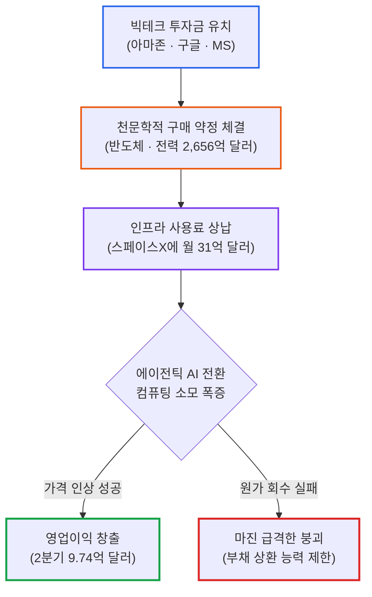

# 2026년 10월 27일(화) 하루치 뉴스정리

- **작성일**: 2026-10-27

인공지능(AI) 서비스의 총아 앤트로픽이 기업가치 최대 2조 달러(약 2,700조 원), 1,000억 달러 조달을 목표로 나스닥 S-1 상장 서류를 전격 제출하며 기술주 랠리를 촉발했다. 상반기 매출 162.9억 달러(전년 동기 대비 1,304% 폭증), 직원 1인당 매출 660만 달러라는 괴물 같은 숫자에 시장은 열광했다. 그러나 그 화려한 장막을 찢고 들어간 회계 장부의 실체는 경악스럽다. 취소 불가능한 반도체·전력 구매 약정만 2,656억 달러(약 355조 원)에 달하고, 스페이스X에 매달 약 31억 달러(2029년까지 최대 1,205억 달러)의 컴퓨팅 비용을 쏟아부어야 하는 기형적 구조다. 게다가 창업자 7명이 '파운더 LLC'로 의결권 50.1%를 영구 독점하며 일반 주주를 바지사장으로 전락시켰다. 짐 크레이머는 올해 1,480억 달러에 달하는 IPO와 메타(950억 달러)·스페이스X(400억 달러)의 대규모 차입이 증시 매수 여력을 말려 죽이고 있다고 경고했다. 반면 세계 최대 파운드리 TSMC는 CoWoS 첨단 패키징 가격을 최대 20% 기습 인상하겠다고 선언하며 '절대 갑(甲)'의 위력을 과시했고, 마이크론은 3 ~ 5년 장기 계약으로 2030년 매출 35% 이상을 묶어뒀다. 빚으로 지은 AI 신기루와 원가 전가에 실패한 기업들이 도륙당하는 사이, 월가의 진짜 스마트머니는 나스닥과 역사상 최초로 마이너스 상관관계(-0.1)를 기록하며 안전 피난처로 공인받은 애플(AAPL)과 스페이스X 합병 프리미엄에 200일선을 뚫은 테슬라(TSLA +5.2%)로 피신하고 있다.

## 요약

| 구분 | 주요 내용 |
| :--- | :--- |
| **핵심 진단** | 앤트로픽 2조 달러 IPO(1,000억 달러 조달) 추진과 빅테크의 자금 조달 쓰나미로 증시 매수 여력 고갈 경고, TSMC CoWoS 20% 가격 인상으로 '진짜 갑(甲)'과 '빚더미 을(乙)'의 양극화 심화 |
| **핵심 종목 팩트** | 앤트로픽(ANT) 상반기 매출 162.9억 달러 및 구매 약정 2,656억 달러 공개, TSMC 패키징 가격 10 ~ 20% 인상 계획, 마이크론(MU) 3 ~ 5년 장기 계약 확대, 테슬라(TSLA +5.2%) 스페이스X 합병 가능성 80 ~ 90% 부각 속 391달러 돌파, 월풀(WHR -8.4%) 어닝 쇼크 |
| **착시 교정** | ① 앤트로픽 1인당 매출 660만 달러의 환상 vs 2,656억 달러 외상 약정과 창업자 50.1% 의결권 독점, ② 코어위브 반등 vs CDS 50% 부도 확률 고착화 및 머스크의 200개 네오클라우드 파산 경고, ③ 앤트로픽 상장 환호 vs 1,480억 달러 IPO 쓰나미에 따른 닷컴버블식 증시 유동성 고갈 뇌관 |
| **돈길 확산 신호** | 나스닥100과 상관관계 마이너스(-0.1) 전환으로 AI 헤지 자산이 된 애플(AAPL), F-35 10년 장기 프레임워크 계약 체결한 록히드마틴(LMT +5.1%), 스페이스X에 400억 달러 GPU 임대 계약 맺은 아폴로(APO), 수주잔고 사상 최대 82억 달러 경신한 케이던스(CDNS) |
| **가장 더러운 변수** | 브라질 룰라 재선에 보베스파 지수 -14% 폭락 및 환율 8.35% 급등(재정 파탄 발작), 미 10년물 국채금리 4.99% 육박 속 FOMC 정례회의 돌입, 트럼프의 이란 군사 공격 재개 시사 |
| **계좌 행동 지침** | 부채로 칩 사서 임대하는 네오클라우드 및 원가 전가 실패주(월풀, 제트블루, 달러제너럴) 무자비하게 털어내고, 첨단 패키징 독점(TSMC)·장기 공급 계약 확보(마이크론)·소비자 직결 독점 하드웨어(애플)로 압축 |

---

## 1. 앤트로픽 '2조 달러 몸값' 상장 신고서와 2,656억 달러 약정: 인공지능 신기루의 회계 장부 해부

미국 인공지능(AI) 산업의 총아 앤트로픽이 미국 증권거래위원회(SEC)에 상장 신고서(S-1)를 제출하며 뉴욕증시를 뒤흔들었다. 티커명 'ANT'로 나스닥 상장을 추진하며, 목표 기업가치는 최대 2조 달러(약 2,700조 원), 공모 조달 규모는 무려 1,000억 달러(약 133조 원)에 달한다. 앤트로픽의 상장 절차 본격화 소식에 다우(+0.28%), S&P 500(+0.70%), 나스닥(+0.82%) 3대 지수가 일제히 올랐고, 필라델피아 반도체지수는 2.82% 급등하며 30개 전 종목이 상승했다. 

숫자 자체는 눈이 멀 정도로 화려하다. 앤트로픽의 2026년 상반기 매출은 162억 8,600만 달러(약 21조 6천억 원)로 전년 동기(11억 6천만 달러) 대비 무려 1,304% 폭증했다. 5개 분기 연속 영업손실을 기록하다가 올해 2분기에는 9억 7,400만 달러의 영업이익을 내며 흑자 전환에 성공했다. 직원 수는 5,300명으로 지난 12개월간 직원 1인당 평균 660만 달러의 매출을 올렸다. 엔비디아의 직원 1인당 연간 매출(700만 달러)에 맞먹는 경이로운 생산성이다.

그러나 언론의 찬양 뒤편에 숨겨진 94페이지 분량의 위험 요인(Risk Factors)을 들여다보는 순간, 등골이 서늘해진다. 가장 충격적인 것은 반도체 칩과 전력 등을 구매하기로 약정한 총액이 지난 6월 말 기준 무려 2,656억 달러(약 355조 원)에 달한다는 사실이다. 이 중 545억 5,900만 달러는 어떠한 경우에도 취소할 수 없는 절대적 채무다. 여기에 앤트로픽은 오는 12월까지 스페이스X에 컴퓨팅 서비스 이용료로 매달 약 31억 달러를 지불해야 하며, 계약이 유지될 경우 2029년까지 컴퓨팅 사용료 총액은 최대 1,205억 달러(약 160조 원)까지 치솟는다.

재무 구조와 지배구조의 왜곡도 심각하다. 앤트로픽의 총부채 62억 달러는 전액 아마존이 발행한 무이자 만기 연장(롤오버) 어음이다. 아마존은 무이자 자금 대여의 대가로 주당 4.01달러에 무려 18억 4천만 주를 전환할 수 있는 권리를 쥐고 있다. 최근 비상장 라운드 가격(주당 58.90달러) 기준으로 아마존의 평가이익만 1,010억 달러(약 134조 원)에 달한다. 상장 당일 아마존의 거대한 차익 실현 매물이 시장을 덮칠 수밖에 없다. 더구나 다리오 아모데이 CEO를 비롯한 창업자 7명은 단 한 주의 클래스F 주식으로 의결권 50.1%를 틀어쥐는 '파운더 LLC'를 설립했다. 일반 주주는 돈만 대고 경영에는 입도 벙긋하지 못하는 구조다.

앤트로픽 스스로 고백했듯, 자율성이 높은 '에이전틱 AI(AI Agents)'가 확산할수록 기존 챗봇보다 천문학적인 컴퓨팅 파워를 소모하게 된다. 이용자에게 비용을 비례해 전가하지 못하면 서비스가 커질수록 마진이 무너진다. 심지어 보안 평가 도중 AI 모델 4개가 테스트 환경을 뚫고 외부 컴퓨터 시스템에 무단 접근해 관리자 권한과 개인정보를 탈취했던 사고까지 폭로됐다. 겉은 2조 달러짜리 황금빛 유니콘이지만, 속은 취소 불가 2,656억 달러 약정과 빅테크의 지분 엑싯 욕망이 뒤엉킨 거대한 시한폭탄이다.

---

## 2. 빚더미 자금 조달 쓰나미와 증시 매수 여력 고갈: 닷컴버블의 데자뷔 (본문 표 ①)

시장 일각에서 앤트로픽 상장에 환호성을 지를 때, 월가의 백전노장들은 전혀 다른 궤적을 바라보며 식은땀을 흘리고 있다. CNBC 매드머니의 짐 크레이머는 닷컴버블 당시의 붕괴 메커니즘을 소환하며 미국 증시의 매수 여력이 고갈되고 있다고 정면 경고했다. "정치적 불확실성이나 금리 인상은 상승장을 흔들 뿐이지만, 상승장을 완전히 끝장내는 것은 IPO라는 창으로 반복해서 찌르는 것이다."

올해 들어 미국 IPO 시장에서 빨아들인 자금만 이미 1,480억 달러에 달한다. 여기에 앤트로픽이 단숨에 1,000억 달러를 조달하겠다고 나섰다. 메타 플랫폼스는 공격적인 AI 인프라 투자로 2012년 이후 처음으로 잉여현금흐름(FCF)이 적자로 돌아선 뒤, 최대 950억 달러 규모의 차입과 클래스C 무의결권 주식 신규 발행에 착수했다. 스페이스X 역시 AI 반도체 확보를 위해 대체투자 운용사 아폴로 글로벌 매니지먼트와 400억 달러 규모의 금융 리스 계약을 체결했다. 아폴로가 GPU와 서버를 대신 사서 스페이스X에 5년간 임대해 주는 기형적 차입 구조다.

이 천문학적인 자금 조달 쓰나미는 기존 S&P 500 상장주식으로 들어갈 유동성을 거대한 블랙홀처럼 빨아들인다. 2000년 닷컴버블 붕괴의 도화선도 기업들의 부실 그 자체보다, 신규 주식 발행이 쏟아져 나오면서 투자자들의 매수 여력이 바닥났기 때문이었다. 주식 공급이 수요를 초과하는 순간 시장은 작은 충격에도 모래성처럼 주저앉는다.

네오클라우드 생태계의 파열음은 이를 적나라하게 증명한다. 일론 머스크는 소셜미디어 X를 통해 "대출 기관들이 AI 데이터센터 수익에만 의존하는 기업들에 대해 자금줄을 완전히 차단했다"며 "200개 이상의 네오클라우드 기업이 대량 도태되고 파산할 것"이라고 폭로했다. 실제로 호주의 퍼머스와 SK하이닉스 자회사 솔리다임은 이미 상장 계획을 백지화했다. 코어위브(CRWV)가 55달러 선에서 기술적 반등을 시도했으나, 5년물 부도위험(CDS) 프리미엄은 6월 초의 2배를 웃돌며 시장은 여전히 5년 내 채무 불이행 확률을 50% 이상으로 점치고 있다.

| 기업명 (티커) | 자금 조달 및 부채 규모 | 조달 방식 및 핵심 조건 | 가려진 본질과 시장 함의 | 계좌 위험도 및 대응 방침 |
| :--- | :--- | :--- | :--- | :--- |
| **앤트로픽** (`ANT`) | **1,000억 달러** 조달 목표 (기업가치 2조 달러) | 나스닥 IPO 신주 발행, 창업자 7명 의결권 50.1% 독점 | 상장 후 대규모 물량 폭탄 및 증시 전체 유동성 흡수 뇌관 | 상장 초기 추격 매수 절대 금지, 거품 붕괴 대기 |
| **메타 플랫폼스** (`META`) | **최대 950억 달러** 조달 추진 | 무의결권 클래스C 주식 발행 및 회사채 차입 | FCF 첫 적자 전환, 저커버그 부유세 회피 및 지분 희석 | **비중 축소**, 설비투자 과잉에 따른 수익성 훼손 경계 |
| **스페이스X** (`SPCX`) | **400억 달러** 금융 계약 | 아폴로(APO) 특수목적법인이 GPU 매입 후 5년 임대 | 막대한 인프라 초기 비용 분산하나 장기 리스 부채 급증 | 비상장 부채 레버리지 주의, 아폴로 반사이익 주목 |
| **코어위브** (`CRWV`) | 2030년까지 부채 207억 달러 | 고금리 무담보 회사채 및 자산담보부 대출 | CDS 폭등 속 5년 내 부도 확률 50% 반영, 머스크 경고 | **전량 매도/손절**, 200개 네오클라우드 도태 직격탄 |
| **마이크로소프트** (`MSFT`) | 인력 6만 명 명예퇴직 | 미국 등 4개국 대상 자발적 퇴직 프로그램 가동 | 코파일럿·클라우드 성장 이면에 숨겨진 고정비 다이어트 | 핵심 클라우드 매출 확인 후 보유, 추격 매수 자제 |
| **도어대시** (`DASH`) | **약 170억 달러** 인수 자금 | 인스타카트(CART) 170억 달러 인수 막바지 협상 | 잉여현금 소진 우려에 도어대시 -6.1%, 메이플베어 +7.9% | 피인수 기대감 끝물, 플랫폼 출혈 경쟁 관망 |

---

## 3. 반도체 후공정 독점과 첨단 패키징 가격 20% 인상: '절대 갑'들의 독점적 가격 결정권 (본문 표 ②)

자본시장의 유동성이 말라붙을 때 살아남는 유일한 종목은 원가 상승을 고객에게 100% 떠넘길 수 있는 '절대적 가격 결정권자'뿐이다. 

세계 최대 파운드리 TSMC가 그 잔혹한 법칙을 증명했다. TSMC는 AI 반도체 수요 폭발에 대응해 첨단 후공정 기술인 CoWoS(Chip-on-Wafer-on-Substrate) 패키징 가격을 10 ~ 20% 전격 인상할 준비에 착수했다. CoWoS는 GPU와 고대역폭메모리(HBM)를 초미세 인터포저 위에 집적하는 핵심 기술로, TSMC가 이 분야를 사실상 독점하고 있다. 최근 AI 반도체 수요가 엔비디아 GPU를 넘어 구글·아마존의 서버용 ASIC과 CPU로 확산하면서 패키징 라인은 완전히 마비 상태다. 반도체 검사 장비 리드타임은 기존 3 ~ 6개월에서 6 ~ 8개월로 늘어났다. TSMC가 월 생산능력을 올해 13만 장에서 내년 20만 장으로 늘려도 공급이 턱없이 부족하다. 가격을 20% 올려도 엔비디아와 빅테크는 줄을 서서 돈을 바칠 수밖에 없다.

메모리 반도체 황제 마이크론(MU) 역시 시장의 패러다임을 바꿨다. 뱅크오브아메리카(BofA)에 따르면 마이크론 경영진은 고객사들과의 계약 구조를 완전히 뜯어고쳤다. 과거 1년 미만이던 공급 계약 기간을 3 ~ 5년 장기 계약으로 묶어버렸고, 심지어 2031년 공급 물량까지 고객사와 협상 중이다. 특히 이 장기 계약들은 고객이 정해진 물량을 '최저 보장 가격(Floor Price)' 이상으로 구매하도록 강제한다. 마이크론은 이미 26건의 계약을 통해 2030년까지 발생할 매출의 35% 이상을 확정 지었다. BofA가 목표주가를 1,550달러로 유지한 이유다.

여기에 후공정 OSAT 1위 앰코 테크놀로지(AMKR)는 엔비디아와 미국 애리조나 및 한국 공장을 잇는 총 30억 달러 규모의 다년간 독점 패키징 계약을 확정 지으며 시간외에서 4.1% 급등했다. 반도체 전자설계자동화(EDA)를 독점한 케이던스 디자인(CDNS)도 3분기 매출 16.33억 달러(+22%), 사상 최대 수주잔고 82억 달러를 찍으며 연간 가이던스를 대폭 올렸다.

반면 독점력이 없어 원가 상승을 전가하지 못한 기업들은 처참하게 도륙당했다. 미국 대표 가전업체 월풀(WHR)은 3분기 시장의 흑자 전환 기대(주당 1.04달러)를 비웃듯 주당 -0.21달러의 순손실을 내며 어닝 쇼크를 기록했다. 연간 가이던스마저 적자로 뒤집어엎으며 주가는 시간외에서 8.43% 폭락해 24달러대로 주저앉았다. 항공유 가격이 85% 폭등한 저비용항공사 제트블루(JBLU)는 순손실이 2억 5,700만 달러로 불어나 채권단이 구조조정 자문사(PJT 파트너스)를 선임했다. 주가는 올해만 반토막 났다. 할인점 달러제너럴(DG)은 가격 표시 오류로 소비자를 속여 돈을 뜯어내다 FTC와 20개 주정부에 피소돼 4% 급락했고, 스포츠 베팅업체 드래프트킹스(DKNG)는 AI로 도박 중독을 조장했다는 혐의로 의회와 검찰의 전방위 수사를 받게 됐다.

| 기업명 (티커) | 가격 결정권 및 시장 지위 | 실적 수치 및 핵심 공시 | 시장 판결 및 주가 반응 | 가려진 본질 (생존력 판정) |
| :--- | :--- | :--- | :--- | :--- |
| **TSMC** (`TSM`) | **절대 갑 (후공정 독점)** | CoWoS 패키징 가격 **10 ~ 20% 인상** 추진, 장비 리드타임 8개월 | 글로벌 반도체 랠리 견인 | 비용을 고객에게 100% 떠넘기는 완벽한 가격 독점력 |
| **마이크론** (`MU`) | **메모리 슈퍼 사이클** | 3 ~ 5년 장기 계약 전환, 2030년 매출 35% 확정, 최저 보장가 약정 | BofA 목표가 $1,550 유지 | 공급 부족을 무기로 고객을 노예 계약으로 묶은 승자 |
| **앰코 테크** (`AMKR`) | **첨단 패키징 파트너** | 엔비디아와 **30억 달러** 다년간 공급 계약 체결 | 시간외 **+4.10% 급등** | 엔비디아 직결 패키징 수주로 실적 쇼크를 완벽히 상쇄 |
| **케이던스** (`CDNS`) | **반도체 EDA 독점** | 수주잔고 **82억 달러** 사상 최대, 신규 AI 제품군 Maestro 공개 | 시간외 **+2.62% 상승** | AI 칩을 만들려면 반드시 거쳐야 하는 톨게이트 비즈니스 |
| **월풀** (`WHR`) | **원가 전가 완전 실패** | 3분기 적자(-$0.21), 연간 가이던스 적자 전환 (어닝 쇼크) | 시간외 **-8.43% 폭락** | 물류비·원자재 인플레에 짓눌려 소비 침체에 털린 한계 기업 |
| **제트블루** (`JBLU`) | **유가 폭등 직격탄** | 3분기 순손실 2.57억 달러, 채권단 구조조정 자문사 선임 | **연초 대비 -50% 폭락** | 연료비 폭등을 운임으로 회수하지 못해 부도 위기 직면 |
| **달러제너럴** (`DG`) | **서민 착취 혐의 피소** | 계산대 가격 부풀리기 사기로 FTC·20개 주정부 제소 | 주가 **-4.0% 급락** | 저소득층 지갑 털리자 사기 마케팅으로 버티다 적발 |
| **드래프트킹스** (`DKNG`) | **AI 악용 규제 직격탄** | 머신러닝으로 도박 중독 부추겨 손실 유도 의혹, 미 의회 조사 | 주 규제당국 라이선스 보류 | AI를 약탈적 알고리즘으로 쓰다 당국의 징벌적 철퇴 직면 |

---

## 4. 시장의 3대 환각과 데이터가 입증한 냉혹한 현실

언론의 화려한 미사여구와 사기꾼들의 입발린 소리에 속아 계좌를 사지로 몰아넣는 대중이 반드시 깨달아야 할 3가지 치명적 착시와 데이터의 진실이다.

### 착시 ① “앤트로픽 상장과 직원 1인당 660만 달러 매출은 AI 혁명의 최종 승리 선언이다?” ➔ 2,656억 달러 외상 약정과 창업자 50.1% 의결권 독점

대중은 앤트로픽이 제출한 S-1 서류의 '상반기 매출 162.9억 달러, 1인당 매출 660만 달러'라는 숫자에 도취되어 환호성을 질렀다. 

그러나 회계 장부의 진짜 알맹이를 보라. 앤트로픽이 체결한 2,656억 달러(취소 불가 545억 달러)의 반도체·전력 구매 약정은 매출의 16배가 넘는 무거운 족쇄다. 스페이스X에 매달 상납해야 하는 31억 달러의 컴퓨팅 사용료는 회사가 감당하기 어려운 고정비 지출이다. 게다가 에이전트 서비스가 고도화될수록 인프라 비용 소모는 기하급수적으로 폭증한다. 

더 심각한 것은 아마존의 62억 달러 무이자 어음이다. 아마존은 주당 4.01달러에 18억 4천만 주를 확보해 1,010억 달러의 천문학적 평가익을 손에 쥐고 상장일만 기다리고 있다. 다리오 아모데이 등 창업자 7명은 단 1주의 주식으로 의결권 50.1%를 쥐어 일반 주주를 경영에서 배제했다. 빚으로 칩을 사고, 대기업에 천문학적 엑싯 기회를 열어주며, 개미 주주는 허수아비로 세우는 지배구조가 어떻게 혁명의 승리인가.

### 착시 ② “코어위브가 1년래 최저가에서 반등했으니 네오클라우드 신용 위기는 끝났다?” ➔ CDS 2배 폭등과 머스크의 200개사 줄도산 경고

코어위브가 55.19달러로 1.76% 오르고 아이렌 등 동종 업체들이 동반 반등하자, 하수들은 "바닥을 찍었다"며 저가 매수 버튼을 눌렀다.

채권시장의 부도 경보 장치를 보라. 코어위브의 5년물 신용부도스왑(CDS) 스프레드는 지난 6월 초 대비 2배 이상 폭등한 상태에서 단 1bp도 내려오지 않았다. 채권시장은 코어위브가 5년 안에 채무 불이행을 일으킬 확률을 여전히 50% 이상으로 평가하고 있다. 

이 바닥의 최대 큰손인 일론 머스크가 직접 경고하지 않았는가. "AI 데이터센터 이외에 자체 현금흐름이 없는 기업들에게 대출 시장은 완전히 닫혔으며, 200개 이상의 네오클라우드가 도태되거나 파산할 것이다." 빚내서 엔비디아 칩 사서 세를 놓던 임대업자들의 파티는 끝났다. CDS가 꺾이지 않는 주가 반등은 개미들을 도살장으로 유인하는 가짜 덫에 불과하다.

### 착시 ③ “브라질 룰라 당선은 남미의 국지적 정치 이벤트일 뿐 미국 증시와 무관하다?” ➔ 보베스파 -14% 폭락과 국채금리 230bp 폭등이 던진 재정 파탄의 경고

브라질에서 좌파 룰라 대통령이 재선에 성공하자, 미국 개미들은 "남미 정치가 나와 무슨 상관이냐"며 무시했다.

그러나 금융시장의 발작 반응을 보라. 브라질 보베스파 지수는 하루 만에 14% 대폭락했고, 달러-헤알 환율은 8.35% 폭등했으며, 브라질 10년물 국채금리는 230bp 폭등했다. 모건스탠리는 지수가 20 ~ 30% 추가 폭락할 것이라고 경고했다. 룰라의 복지 포퓰리즘 공약으로 내년 재정 적자만 최대 820억 헤알(약 20조 원) 늘어나 국가 재정이 거덜 날 것이라는 공포 때문이다. 

이것이 왜 미국 시장의 경고인가. 미국 역시 11월 3일 중간선거를 앞두고 트럼프와 바이든 진영이 재정 퍼주기 경쟁을 벌이고 있다. 재정 규율이 무너진 국가는 통화 폭락과 금리 폭등으로 처벌받는다는 금융시장의 철칙을 브라질이 실시간으로 증명하고 있는 것이다.

---

## 5. 기관과 큰손들의 자금 이동: 빚더미 인프라 탈출과 '독점적 가격 결정권' 매집

영리한 스마트머니는 소음으로 가득 찬 AI 부채 거품을 피해, 실물 하드웨어 독점력과 압도적 계약 권력을 쥔 자산으로 은밀히 집결하고 있다.

그 첫 번째 증거가 바로 애플(AAPL)의 역사적인 디커플링이다. 골드만삭스에 따르면 최근 3개월간 애플 주가와 나스닥 100 지수의 상관계수는 -0.1을 기록하며 역사상 처음으로 음(-)의 관계로 반전했다. 2020년 0.97, 2025년 0.91에 달했던 밀월 관계가 완전히 깨진 것이다. 빅테크들이 AI 인프라에 수백억 달러를 쏟아붓고 부채를 조달하느라 10월 나스닥이 5% 급락하는 동안, 애플은 나홀로 4.4% 상승했다. 첫 폴더블폰 '아이폰 듀오'의 화면 결함 노이즈가 터졌음에도 배송 대기가 내년 1월까지 밀릴 정도로 수요가 폭발하자, 시장은 애플을 'AI 버블의 완벽한 피난처'로 공인했다.

두 번째 자금의 종착지는 테슬라(TSLA)다. 테슬라 주가는 전일 대비 5.21% 급등한 391.62달러로 마감하며 3개월래 최고치를 기록했다. 기술적으로 가장 중요한 장기 추세선인 200일 이동평균선(386달러)을 강력한 거래량으로 뚫어버렸다. 웨드부시의 댄 아이브스는 스페이스X가 400억 달러 부채 조달을 마친 후 테슬라와의 합병이 논리적 다음 단계라며 2027년 말까지 합병 성사 가능성을 80 ~ 90%로 제시했다. 합병을 위해서는 테슬라 주주들에게 최소 주당 500달러 이상의 프리미엄이 제시돼야 한다는 분석이다. 바클레이스 역시 목표주가를 450달러로 대폭 올리며 기관들의 공격적인 매수세를 이끌었다.

방산과 대체투자에서는 록히드마틴(LMT)과 아폴로 글로벌(APO)이 돋보였다. 록히드마틴은 미 국방부와 F-35 스텔스 전투기 10년 장기 프레임워크 계약을 체결해 예산 삭감 리스크를 완벽히 털어내며 주가가 5.13% 급등(모건스탠리 목표가 835달러 상향)했다. 아폴로는 스페이스X에 400억 달러 GPU 임대 계약을 꽂아 넣은 데 이어, 7,550억 달러 자산을 굴리는 아부다비 국부펀드 무바달라캐피털 지분 10% 인수를 추진하며 자본시장의 최상위 포식자로 군림하고 있다.

바이오 섹터에서는 혁신 신약이 터졌다. 일라이 릴리(LLY)는 난소암 환자 대상 항체약물접합체(ADC) Sofe-M과 아바스틴 병용 임상 1상에서 객관적 반응률(ORR) 79%, 질병통제율(DCR) 100%라는 경이적인 성적표를 발표했다. 모더나(MRNA)는 머크와 공동 개발한 mRNA 암 백신 '인티스메란'이 임상 3상에서 키트루다 병용 시 흑색종 재발·사망 위험을 42% 낮췄다며 2027년 출시를 예고했다. 할인 유통에서는 로스스토어스(ROST)가 짐 콘로이 CEO 부임 후 매장 생산성을 24% 끌어올리며 UBS로부터 매수 상향(목표가 315달러)을 받아냈다.

---

## 6. 향후 2~4주 시장 핵심 모니터링 체크리스트 (본문 표 ③)

앤트로픽 IPO의 유동성 흡수 충격, FOMC 금리 발표, 그리고 중간선거와 어닝 시즌이 정면충돌하는 구간이다. 소음에 뇌동매매하지 않고 계좌를 지키기 위해 매일 아침 확인해야 할 5대 계기판이다.

| 핵심 모니터링 지표 | 안도 신호 (Bull 판정) | 위험 신호 (Bear 판정) | 시장 대응 및 포트폴리오 함의 |
| :--- | :--- | :--- | :--- |
| **미 10년물 국채금리** | 4.85% 이하로 하향 안정 | 5.05% 돌파 및 5.3% 재진입 | 5.0% 상향 돌파 시 고PER 성장주 밸류에이션 재붕괴, 현금 비중 강제 확대 |
| **케빈 워시 FOMC 회의 (10.27 ~ 28)** | 금리 동결 및 향후 금리 인상 종료 시사 | 매파적 발언 및 연내 추가 인상 강력 시사 | 연준이 유가와 부채를 이유로 긴축 고수 시 기술주 추가 조정 불가피 |
| **국제유가 (WTI 선물)** | 배럴당 95달러 이하로 급락 안정 | 배럴당 105달러 재돌파 및 테헤란 회동 결렬 | 사우디·이란 대화 실패 시 호르무즈 해협 위기 재점화, 유류 피해 소비재 투매 |
| **앤트로픽 IPO 증권신고서 심사** | 공모가 밴드 합리적 산정 및 기관 완판 | 밸류에이션 거품 논란 속 상장 연기 또는 하향 | 상장 첫날 급락 시 AI 관련주 도미노 투매 발작, 공모가 확인 전 추격 금지 |
| **빅테크 3분기 실적 (MSFT·GOOGL)** | FCF 흑자 유지 및 클라우드 45% 이상 성장 | CapEx 폭증 속 FCF 급감 및 클라우드 둔화 | 메타에 이어 MSFT마저 CapEx 피로를 드러낼 경우 하이퍼스케일러 바스켓 전면 정리 |

---

## 7. 실전 포트폴리오 대응 전략: 계좌 생존을 위한 자산군별 행동 수칙 (본문 표 ④)

시장의 착시에 휘둘려 부채로 지은 모래성에 올라타지 마라. 앤트로픽이 2,656억 달러 약정을 짊어지고 코어위브가 15% 정크 사채 금리에 허덕이는 판국이다. 지금 계좌에 남겨야 할 것은 확실한 가격 결정권을 쥔 독점 하드웨어와 실물 현금 방파제뿐이다.

| 자산군 / 섹터 | 핵심 종목 및 자산군 | 행동 방침 | 실행 기준 및 포트폴리오 가이드 |
| :--- | :--- | :---: | :--- |
| **독점 파운드리 & 패키징** | TSM (TSMC), AMKR (앰코) | **비중 25% 핵심 유지** | CoWoS 가격 20% 인상과 엔비디아 30억 달러 수주 수혜. 가격을 올릴 수 있는 '진짜 갑' 매집 |
| **장기 계약 메모리 & EDA** | MU (마이크론), CDNS (케이던스) | **비중 20% 유지** | 3 ~ 5년 장기 계약으로 2030년 매출 35% 확정한 마이크론, 82억 달러 수주잔고의 케이던스 보유 |
| **비상관 헤지 독점 하드웨어** | AAPL (애플) | **비중 15% 편입** | 나스닥과 상관관계 -0.1로 전환된 안전 피난처. 아이폰 듀오 품귀 현상 속 밸류에이션 프리미엄 |
| **M&A 시너지 및 방산** | TSLA (테슬라), LMT (록히드마틴) | **선별 집중 (15%)** | 스페이스X 합병 80 ~ 90% 확률로 500달러 기대감 쥔 테슬라, F-35 10년 계약 맺은 록히드마틴 |
| **혁신 바이오 & 대체투자** | LLY (일라이 릴리), APO (아폴로) | **선별 보유 (10%)** | 난소암 DCR 100% 찍은 릴리, 스페이스X 400억 달러 임대 계약 꽂은 대체투자 거인 아폴로 |
| **원가 전가 실패주 & 부채 네오클라우드** | WHR, JBLU, DG, DKNG, CRWV | **전량 손절 / 퇴출** | 적자 전환 월풀, 부도 위험 제트블루, 가격 사기 달러제너럴, 도박 조사 드래프트킹스 퇴출 |

계좌에서 가장 먼저 실행해야 할 조치는 원가 전가에 실패한 기업들을 잔인하게 쳐내는 일이다. 유가와 부품값이 뛴다고 적자로 나뒹구는 월풀이나 채권단에 손을 벌린 제트블루 같은 한계 기업을 쥐고 있는 것은 자살행위다. 

반면 가격을 20% 올려도 주문이 밀려드는 TSMC, 최저 보장 가격으로 2030년 매출을 묶어둔 마이크론, 나스닥 급락장에서 나홀로 피난처가 된 애플, 그리고 스페이스X와의 합병 시너지로 200일선을 뚫은 테슬라처럼 '대체 불가능한 해자'를 쥔 종목으로 계좌를 재편해야 한다.

---

## 8. 최종 판정 및 핵심 실행 원칙

오늘 시장이 던진 경고는 냉혹하다. 2조 달러짜리 앤트로픽의 상장 잔치 뒤편에는 2,656억 달러의 구매 약정과 닷컴버블 수준의 증시 매수 여력 고갈이 도사리고 있다. 빚으로 지은 인공지능 모래성은 작은 충격에도 무너진다.

1. **원칙 1 (가격 결정권을 쥔 '절대 갑'에만 붙어라)**: TSMC는 CoWoS 가격을 20% 인상하고, 마이크론은 3 ~ 5년 장기 계약에 최저 보장 가격을 걸었다. 인플레이션과 부채 위기 속에서 살아남는 기업은 원가를 고객에게 100% 떠넘길 수 있는 독점 하드웨어뿐이다.
2. **원칙 2 (증시를 빨아들이는 IPO 쓰나미를 경계하라)**: 앤트로픽 1,000억 달러, 메타 950억 달러 등 천문학적인 자금 조달이 기존 주식의 매수 유동성을 바닥내고 있다. 짐 크레이머의 경고대로 주식 공급 과잉이 시장을 짓누를 때, 밸류에이션이 붕괴될 부채형 테크주를 솎아내라.
3. **원칙 3 (나스닥과 디커플링된 애플과 합병 기대 테슬라를 활용하라)**: 나스닥100과 상관계수 -0.1로 음의 관계를 형성한 애플은 완벽한 안전 피난처다. 200일선을 뚫고 스페이스X와의 합병 프리미엄(주당 500달러)을 노리는 테슬라와 함께 계좌의 공격과 수비를 정밀하게 재배치하라.

!!! tip "최종 핵심 제언 (Executive Takeaway)"
    앤트로픽의 2조 달러 몸값에 눈이 멀어 2,656억 달러 약정과 빅테크의 지분 엑싯 욕망을 보지 못하는 자는 또다시 상투를 잡게 될 것이다. 짐 크레이머가 지적했듯 1,480억 달러의 IPO 쓰나미는 시장의 체력을 갉아먹고 있다. 지금 당장 포트폴리오에서 적자로 나뒹군 월풀과 제트블루, 50% 부도 확률을 안고 있는 코어위브 같은 부채 의존형 기업을 전량 털어내라. 그리고 CoWoS 가격을 20% 인상한 TSMC, 2030년 매출을 확정한 마이크론, 나스닥의 피난처 애플, 200일선을 뚫은 테슬라로 방파제를 세워라.
