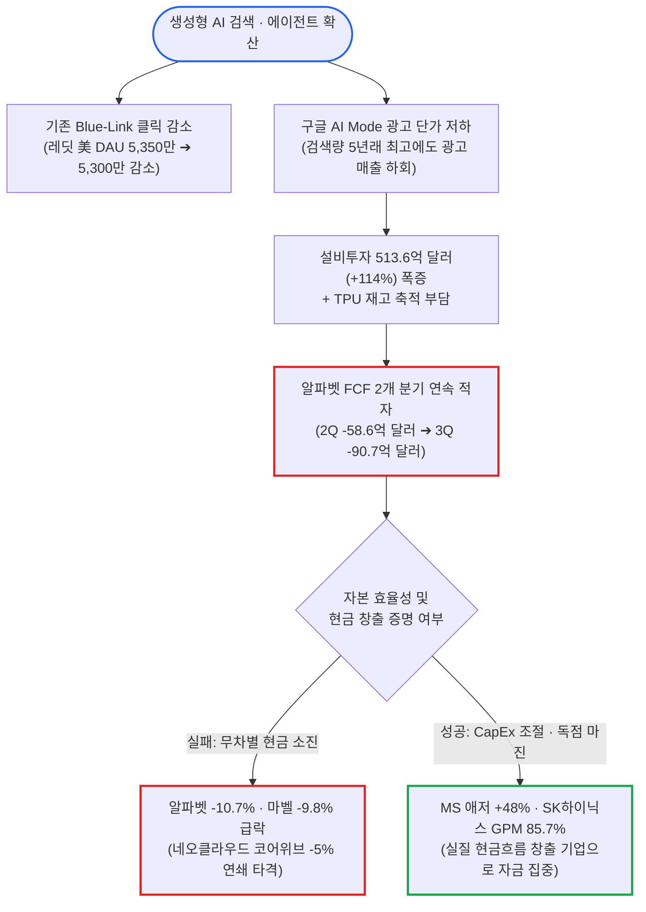

# 2026년 10월 29일(목) 하루치 뉴스정리

- **작성일**: 2026-10-29

구글 모회사 알파벳(GOOGL)의 3분기 검색 질의량은 지난 5년 사이 최고치로 폭증했지만, 정작 검색 광고 매출(633.5억 달러)은 월가 예상치(649억 달러)에 못 미치며 시간외 주가가 10.7% 폭락했다. 인공지능(AI) 에이전트와 챗봇이 파란색 링크 클릭을 증발시키는 '자기잠식(Cannibalization)의 저주'가 숫자로 입증된 것이다. 설상가상으로 3분기 설비투자(CapEx)가 513.6억 달러(+114% YoY)로 치솟으면서 알파벳의 잉여현금흐름(FCF)은 -90.7억 달러 적자로 추락해 2004년 상장 이후 사상 첫 2개 분기 연속 마이너스라는 치욕을 맛봤다. 반면 마이크로소프트(MSFT)는 외부 GPU 공급 지연을 이유로 연간 자본지출 전망을 1,750억 달러에서 1,700억 달러로 전격 깎으면서도 애저(Azure) 클라우드 성장률을 48%로 끌어올려 시간외 4.1% 급등했다. MS가 설비투자를 55억 달러 줄이자마자 빚내서 칩을 사던 코어위브와 네비우스 등 네오클라우드 주가는 즉각 5% 급락했다. 한편 케빈 워시 연준 의장이 기준금리를 3.75 ~ 4.00%로 동결하며 인플레이션 낙관론을 폈지만, 선물시장은 12월 금리 인상 확률을 85.3%로 반영했고 미 10년물 국채금리는 5.039%로 치솟았다. 헛돈 쓰는 빅테크와 가이던스가 꺾인 보안·SaaS(포티넷 -26.1%, 서비스나우 -17.4%)가 도륙당하는 사이, 스마트머니는 2029년까지 HBM 물량을 완판하고 매출총이익률 85.7%를 찍은 SK하이닉스(+13%)와 비만약 독점으로 연간 매출 가이던스를 920억 달러로 높인 일라이 릴리(LLY +2.9%)로 무자비하게 이동하고 있다.

## 요약

| 구분 | 주요 내용 |
| :--- | :--- |
| **핵심 진단** | 알파벳 2개 분기 연속 FCF 적자(-90.7억 달러) 및 검색 광고 부진(-10.7% 폭락) vs MS 설비투자 속도 조절 속 애저 +48% 성장(+4.1% 상승), 빅테크 AI 수익화 성적표의 잔인한 양극화 |
| **핵심 종목 팩트** | SK하이닉스 GPM 85.7%·'29년 물량 완판(+13%), 일라이 릴리(LLY) 매출 244억 달러(+38.6%)·연간 가이던스 910억 ~ 920억 달러 상향, KLA 영업이익률 46.1% 사상 최고, 포티넷(FTNT -26.1%)·서비스나우(NOW -17.4%) 가이던스 쇼크 폭락 |
| **착시 교정** | ① 워시 의장의 비둘기파 화법 환호 vs 10년물 금리 5.039% 돌파 및 12월 금리 인상 확률 85.3%, ② 구글 검색량 5년래 최고라는 변명 vs AI 검색(AI Mode)의 저조한 광고 단가와 레딧(RDDT) 미국 DAU 2개 분기 연속 감소, ③ 마벨(MRVL -9.8%)의 루멘텀 인수 및 AI 인프라 확장 환상 vs 주식 희석 공포와 캐터필러(CAT -7.7%) 차익실현 |
| **돈길 확산 신호** | 2029 ~ 2030년까지 공급 물량 입도선매 끝낸 메모리·스토리지(SK하이닉스, 마이크론 +5.9%, 시게이트 40TB HDD, KLA +3.7%), 비만·항암 독점 바이오(일라이 릴리, 젠맙 사망 위험 50% 감소), 저소득층 가성비 외식 독식(치폴레 +7.0%) 및 행동주의 M&A(웬디스 +15.2%, 울트라라이프 +166% 프리미엄) |
| **가장 더러운 변수** | 미 10년물 국채금리 5.039% 및 30년물 5.366% 급등(커브 스티프닝), 후티 반군 아덴 공항 공습 및 네타냐후 집권 연장 가능성에 WTI 유가 102.78달러(+2.88%) 재돌파, 미 법무부(DOJ)의 엔비디아 허깅페이스(129억 달러) 인수 반독점 조사 착수 |
| **계좌 행동 지침** | 잉여현금흐름이 적자로 돌아선 빅테크(알파벳)·주식 희석 M&A 기업(마벨)·성장 둔화 소프트웨어(포티넷) 추격 매수 전면 금지, '29년까지 완판된 저PER 메모리·공정장비(SK하이닉스, MU, KLAC)와 압도적 가격 결정권 보유주(LLY, MSFT)로 압축 |

---

## 1. 알파벳 FCF -90.7억 달러 적자 쇼크와 검색 제국의 균열: 빅테크 AI 수익화의 잔인한 성적표

장 마감 후 발표된 알파벳(GOOGL)과 마이크로소프트(MSFT)의 3분기 실적은 AI 인프라 투자 사이클의 승자와 패자를 잔혹하게 갈라놓았다. 알파벳은 3분기 매출 1,275.8억 달러(+24.7% YoY)로 월가 컨센서스(1,282.2억 달러)를 밑돌았고, GAAP 주당순이익(EPS)은 2.12달러(-26.1% YoY)로 예상치(3.01달러)에 참담하게 미달했다. 보유 중인 스페이스X와 앤트로픽 등 비상장 지분증권에서 86.6억 달러의 미실현 평가손실(EPS -0.55달러 영향)이 발생한 탓도 있지만, 시장을 진짜 패닉으로 몰아넣은 것은 본업인 검색 광고의 둔화와 현금흐름의 증발이었다. 실적 발표 직후 알파벳 주가는 시간외 및 프리마켓에서 10.74% 폭락하며 나스닥 선물을 끌어내렸다.

구글 클라우드 매출은 자체 AI 칩인 TPU 시스템 판매와 GCP 수요 폭발에 힘입어 307.1억 달러(+103% YoY)로 두 배 넘게 뛰었고, 영업이익률도 36.2%(영업이익 111.2억 달러, +209%)라는 괴물 같은 숫자를 찍었다. 클라우드 수주잔고 역시 5,610억 달러로 불어났다. 그러나 알파벳 매출의 기둥인 구글 검색 및 기타 매출은 633.5억 달러(+12% YoY)에 그쳐 시장 기대치(649억 달러)를 15억 달러 이상 밑돌았다. 유튜브 광고(112.1억 달러, +9%)를 포함한 전체 디지털 광고 매출(820.1억 달러, +11%) 역시 컨센서스(836억 달러)를 하회했다. 순다르 피차이 CEO는 "AI 기능 도입으로 전체 검색 질의 증가율이 최근 5년 중 가장 높았다"고 항변했지만, 필립 쉰들러 최고사업책임자(CBO)는 컨퍼런스콜에서 뼈아픈 진실을 자백했다. 빠르게 늘어나는 'AI Mode'와 'AI Overviews' 검색의 광고 수익화 수준이 기존 파란색 링크(Blue-link) 검색보다 현저히 낮아 매출 성장률을 갉아먹었다는 것이다. 사용자가 AI 요약 답변만 보고 링크를 클릭하지 않으니 광고 단가와 노출이 동시에 줄어드는 구조적 딜레마다.

더 치명적인 것은 현금흐름표다. 알파벳의 3분기 자본지출(CapEx)은 서버·네트워크 장비(65%)와 데이터센터(35%) 투입으로 전년 대비 114% 폭증한 513.6억 달러에 달했다. 여기에 내년도 매출 인식을 위한 TPU 시스템 재고 축적과 EU 반독점 벌금(52억 달러) 현금 납부까지 겹치며 영업현금흐름은 422.9억 달러(-13%)로 줄어들었다. 그 결과 영업현금에서 설비투자를 뺀 잉여현금흐름(FCF)은 지난 2분기(-58.6억 달러, 2004년 상장 후 첫 적자)에 이어 3분기 **-90.7억 달러 적자**로 적자 폭이 더욱 커졌다. 미래 구매약정만 9,240억 달러, 미개시 리스 의무가 1,520억 달러에 달하는데, 아나트 아슈케나지 CFO는 올해 연간 CapEx 가이던스(1,950억 ~ 2,050억 달러)를 유지한 채 "2027년 자본지출은 올해보다 상당히 더 증가할 것"이라고 못 박았다. 자율주행 자회사 웨이모가 포함된 기타 사업(Other Bets) 역시 누적 3억 마일 주행과 15개 도시 확장에도 불구하고 매출 3.72억 달러에 영업손실만 20.5억 달러(전년 동기 -14.3억 달러)로 불어났다.

반면 마이크로소프트(MSFT)는 철저한 자본 규율로 시장의 환호를 끌어냈다. MS의 FY27 1분기(7 ~ 9월) 매출은 922.8억 달러(+18.8% YoY, 컨센서스 906.9억 달러 상회), 비GAAP EPS는 4.89달러(+18.4%, 컨센서스 4.73달러 상회)를 기록했다. 핵심인 애저(Azure) 클라우드 매출은 331.7억 달러로 48% 폭증하며 전 분기(+42%)와 시장 전망(+44%)을 모두 뛰어넘었다. 아미 후드 CFO는 다음 분기(FY 2분기) 매출 가이던스를 최대 971억 달러(+18 ~ 19%)로 제시하며 애저 성장률이 환율 제외 기준 **+49 ~ 50%**로 추가 가속화될 것이라고 선언했다. 특히 MS는 외부 GPU 공급업체의 장비 인도 지연을 이유로 당초 500억 달러 이상으로 잡았던 1분기 자본지출(금융리스 포함)을 452억 달러로 집행했고, 2026년(CY 기준) 연간 자본지출 전망치를 기존 1,750억 달러에서 **1,700억 달러로 하향 조정**했다. 무턱대고 현금을 태우는 대신 잉여현금흐름 흑자(1분기 FCF 186.3억 달러)와 배당·자사주 매입(102억 달러 환원)을 지키는 쪽을 택한 것이다.

MS가 설비투자 고삐를 죄자마자 그 불똥은 빚내서 데이터센터를 짓던 네오클라우드 업체들로 튀었다. MS의 분기 설비투자가 컨센서스(507억 달러)를 55억 달러 밑돌았다는 소식에 코어위브(CRWV)와 네비우스(NBIS)는 시간외에서 5% 급락했고 아이렌(IREN)도 3% 떨어졌다. 일론 머스크가 경고한 "자체 매출 없는 네오클라우드 200곳 이상 도산 및 부채 조달 차단" 시나리오가 현실화하고 있다.

---

## 2. 케빈 워시 연준의 '립서비스 동결'과 10년물 국채금리 5.04% 돌파: 유가 102달러가 만든 스태그플레이션의 덫 (본문 표 ①)

10월 연방공개시장위원회(FOMC) 정례회의에서 연준은 연방기금금리 목표범위를 3.75 ~ 4.00%로 동결했다. 지난달 3년 만에 처음으로 금리를 인상한 지 한 달 만의 숨 고르기다. 그러나 투표권자 12명 중 대표적 매파인 베스 해맥 클리블랜드 연은 총재와 리사 쿡 이사가 25bp(0.25%p) 추가 인상을 주장하며 반대표를 던져 10 대 2로 갈렸다. 더구나 FOMC 성명서는 미국 경제 활동에 대한 평가를 기존 '견조한(solid)'에서 **'강력한(strong)'**으로 한 단계 격상했다. 경기가 뜨거우니 언제든 금리를 더 올릴 수 있다는 매파적 포석이다.

그럼에도 뉴욕증시 3대 지수(다우 +0.19%, S&P 500 +0.28%, 나스닥 +0.27%)가 정규장에서 상승 마감한 것은 케빈 워시 연준 의장의 기자회견 발언 때문이었다. 워시 의장은 "지난달 금리 인상 이후 일부 기업과 가계의 금융·신용 여건이 예상대로 긴축적으로 변했다"며 "기대 인플레이션 지표들이 올바른 방향으로 움직이고 있어 기분이 좋다. 물가 안정 달성은 달력상의 고정된 날짜에 얽매이는 것이 아니다"라고 발언했다. 주식쟁이들은 이를 비둘기파적 신호로 해석하며 환호했고, 통화정책에 민감한 미 2년물 국채금리는 장중 10bp 가까이 급락한 뒤 4.712%(-2.7bp)로 마감했다. 달러인덱스(DXY)도 102.113(-0.18%)으로 내려앉았다.

하지만 채권시장의 장기물 타짜들과 선물시장의 판독은 정반대였다. 워시 의장이 인플레이션에 안일한 태도를 보이자 장기 인플레이션 프리미엄이 폭발하며 미 10년물 국채금리는 4.7bp 치솟은 **5.0390%**, 30년물 국채금리는 6.1bp 급등한 **5.3660%**에 마감했다. 2년물 금리는 내리고 10년·30년물 금리는 치솟는 전형적인 '베어 스티프닝(Bear Steepening)'이 나타나며 10년-2년 금리차는 32.7bp로 벌어졌다. 게다가 시카고상품거래소(CME) 페드워치에서 연방기금금리 선물시장은 **오는 12월 FOMC에서 연준이 기준금리를 25bp 인상할 확률을 무려 85.3%**로 가격에 반영했다. 스콧 베센트 미 재무장관조차 CNBC 인터뷰에서 "3분기 GDP가 강세를 보일 것이며, 연준의 향후 추가 금리 인상이 반드시 통화정책 실수를 의미하는 것은 아니다"라며 12월 인상의 길을 열어줬다.

장기 금리를 5% 위로 못 박은 주범은 중동발 유가 폭등이다. 예멘의 친이란 후티 반군이 예멘 정부 임시 수도인 아덴과 공항을 공습해 항공기 운항이 전면 중단됐고, 이스라엘 총선에서 대이란 강경파인 네타냐후 총리의 우파 연합(53석)과 야당(48석)이 모두 과반(61석) 확보에 실패해 네타냐후의 집권 연장과 이란 공습 가능성이 커졌다. 여기에 미국 상업용 원유 재고마저 전주 대비 189만 배럴 깜짝 감소하자, 서부텍사스산원유(WTI)는 하루 만에 2.88% 급등한 **배럴당 102.78달러**, 브렌트유는 1.26% 오른 **115.32달러**로 치솟았다. 유가가 100달러 위에서 날뛰고 장기 국채금리가 5%를 넘어서자, 이자를 주지 않는 금 선물 가격은 온스당 4,054.00달러(-0.51%)로 밀렸고 차입 비용에 민감한 유틸리티 섹터(XLU -0.84%, 비스트라 -2.69%, 넥스테라 -1.70%)는 직격탄을 맞았다.

| 매크로 및 외환·원자재 지표 | 당일 수치 및 변동폭 | 표면적 시장 해석 (언론 보도) | 이면의 진짜 메커니즘과 리스크 함의 |
| :--- | :---: | :--- | :--- |
| **연준 기준금리 및 12월 전망** | **3.75 ~ 4.00% 동결** (12월 인상 확률 **85.3%**) | 워시 의장 "금융여건 긴축적, 인플레 긍정적" 발언에 안도 | 성명서 경기 평가 'Strong' 상향 및 반대표 2표(해맥·쿡), 베센트 재무장관도 추가 인상 용인 |
| **미 국채 10년물 / 30년물 금리** | **5.039%** (+4.7bp) **5.366%** (+6.1bp) | 2년물 금리 하락(4.712%, -2.7bp)에 따른 단기 금리 진정 기대 | 워시의 물가 안일함에 장기 채권 자경단 발작, 10년물 5% 고착화로 고밸류 및 유틸리티(XLU) 타격 |
| **국제유가 (WTI / 브렌트유)** | **$102.78** (+2.88%) **$115.32** (+1.26%) | 밴스 부통령의 이란 서한 발송 보도로 장 막판 상승폭 일부 반납 | 후티 반군 아덴 공항 공습·네타냐후 집권 연장 시나리오·원유 재고 189만 배럴 감소로 인플레 재점화 |
| **달러-원 환율 (NDF 1개월물)** | **1,341.90원** (+5.0원) (예상 레인지 1,331 ~ 1,350원) | 코스피 6,000선 탈환(+6% 급등) 및 외국인 주식 7,600억 순매수 | 외국인이 한국 주식을 사면서 동시에 환 헤지(달러선물 매수)를 걸어 주가 상승에도 원화 약세 유발 |
| **캐나다(BOC) 및 영국 재정** | BOC **+25bp 금리 인상** 영국 재정여력 150억 파운드 | 캐나다 예상 부합 인상(USD/CAD -0.43%), 영국 증세 기반 예산안 발표 | 글로벌 중앙은행의 긴축 재개 확산, 재정 규율 입증한 국가(영국 파운드 +0.10%)만 통화 가치 방어 |

---

## 3. SK하이닉스 GPM 85.7%·릴리 매출 +38.6% 폭발 vs 포티넷 -26%·마벨 -9.8% 참사: 실적 시즌의 냉혹한 심판 (본문 표 ②)

이번 3분기 실적 시즌에서 시장이 기업을 심판하는 기준은 단 하나다. "대체 불가능한 독점력으로 마진을 쥐어짜고 미래 가이던스를 올렸는가, 아니면 비용 상승과 주식 희석으로 주주 가치를 훼손했는가."

반도체와 하드웨어 진영에서는 **SK하이닉스(SKHY)**가 완벽한 모범 답안을 제시했다. SK하이닉스는 컨센서스를 6% 웃도는 매출과 함께 **매출총이익률(GPM) 85.7%**라는 경이적인 수익성을 기록하며 미국 ADR 주가가 13% 넘게 폭등했다. 4분기 출하량 증가율 가이던스는 3분기(+10%)의 두 배가 넘는 20%대 중반으로 제시됐고, 무엇보다 장기 고객 계약을 통해 **2029년까지의 생산 물량이 사실상 100% 완판(Sold out)**됐다고 선언했다. 짐 크레이머는 "2027년 예상 이익 기준 PER 4배에 불과한 낮은 밸류에이션, 성장 가속, 2029년 완판, 대규모 주주환원이 결합해 AI 투자 회의론을 단숨에 잠재웠다"고 극찬했다. 이에 힘입어 마이크론(MU +5.86%), 램 리서치(LRCX +5.39%), AMD(+3.24%)가 일제히 급등했다.

반도체 공정 제어 장비 절대 강자 **KLA(KLAC)** 역시 FY27 1분기 매출 41.4억 달러(+29%), 비GAAP EPS 1.22달러(+38.6%)로 컨센서스를 가볍게 넘기며 시간외 3.65% 상승했다. 비GAAP 매출총이익률 62.7%, **영업이익률 46.1%**로 사상 최고치를 찍었고, 첨단 패키징용 공정 제어 장비 매출이 올해 70% 이상 폭증해 11억 달러에 달할 것이라고 밝혔다. KLA는 글로벌 웨이퍼 제조장비(WFE) 시장 규모가 올해 1,500억 달러 중반에서 내년 2,000억 달러를 돌파할 것이라며 다음 분기 매출 가이던스도 45억 ~ 49억 달러(컨센서스 44.9억 달러)로 높여 잡았다. 데이터 저장장치 업체 **시게이트(STX)** 또한 AI가 모델 훈련에서 추론·에이전트로 넘어가며 데이터 저장 수요가 폭발해, 대용량 니어라인 하드디스크(HDD) 물량이 2028년까지(일부 클라우드 고객은 2030년까지) 이미 장기계약으로 배정 완료됐다며 40TB HDD 증산을 선언했다.

반면 같은 AI 인프라 섹터라도 주주 가치를 훼손하거나 기대치가 과열된 종목은 피를 흘렸다. **마벨 테크놀로지(MRVL)**는 시가총액 827.9억 달러 규모의 광통신 부품사 **루멘텀(LITE, +5.5%)** 인수를 협상 중이라는 보도에 프리마켓에서 **9.8% 폭락**했다. 지난 1년간 셀레스티얼 AI(32.5억 달러)와 엑스콘(5.4억 달러)을 사들인 마벨(시총 2,206.7억 달러)이 덩치가 큰 루멘텀에 반도체 대형 M&A 평균 프리미엄(38%, 주당 1,260달러 이상)을 얹어 자사주로 인수 대금을 치를 경우, 기존 주주들의 지분이 처참하게 희석될 것이라는 공포가 덮친 것이다. 중장비 거인 **캐터필러(CAT)**는 데이터센터 발전기 수요 덕에 전력·에너지 매출이 87.8억 달러(+18%)로 늘고 전체 매출(207억 달러, +17.6%)과 EPS(7.20달러, +45.5%), 조정 영업이익률(20.6%, +3.1%p) 모두 컨센서스를 깨부쉈으나, AI 인프라 섹터 전반의 차익실현 매물과 맞물려 프리마켓에서 **7.7% 급락**했다.

사이버보안과 엔터프라이즈 소프트웨어는 가이던스 쇼크에 초토화됐다. **포티넷(FTNT)**은 3분기 매출(20.78억 달러, +20.5%)과 비GAAP EPS(0.91달러)가 예상치를 넘었으나, 제품 매출 성장률이 직전 분기 +52%에서 +37%로 둔화되고 핵심인 서비스 매출(13.13억 달러)이 컨센서스(13.3억 달러)를 밑돌았다. 고객들이 보안 장비만 먼저 깔고 서비스 활성화를 늦추면서 연간 서비스 매출 가이던스를 51.5억 ~ 51.7억 달러(기존 51.8억 ~ 52.2억 달러)로 하향 조정하자 시간외 주가는 **-26.14% 대폭락**했다. **서비스나우(NOW)** 역시 3분기 구독 매출(39.88억 달러, +21%) 선전과 오픈AI 챗GPT 플러그인 연동(Action Fabric 처리량 한 달 새 500% 폭증), 연간 AI 계약가치(ACV) 목표 상향(15억 ➔ 17억 달러)에도 불구하고, 3분기 비GAAP EPS(1.00달러 vs 예상 1.02달러) 미달과 4분기 현재 잔여이행의무(cRPO) 성장률 가이던스 둔화(+21% ➔ +18.5%, 컨센서스 +19.8% 하회)에 발목이 잡혀 시간외 **-17.36% 폭락**했다.

제약·바이오와 소비재·물류에서도 실적의 결이 극명하게 갈렸다. **일라이 릴리(LLY)**는 비만 치료제 마운자로(107.2억 달러, +65%)와 젭바운드(53.5억 달러, +49%)의 폭발적 성장에 힘입어 3분기 매출 244억 달러(+38.6%, 컨센서스 20억 달러 상회), 비GAAP EPS 7.48달러(컨센서스 1.88달러 상회), 매출총이익률 83.9%를 찍었다. 경구용 비만약 파운다요(1.84억 달러)가 예상(2.17억 달러)을 소폭 밑돌고 R&D·M&A 비용 반영으로 EPS 가이던스를 35.00 ~ 36.00달러로 미세 조정했지만, 연간 매출 가이던스를 기존 850억 ~ 870억 달러에서 **910억 ~ 920억 달러**로 최대 60억 달러나 끌어올리며 프리마켓에서 2.9% 상승했다. 외식업체 **치폴레(CMG)**는 소고기·인건비 상승으로 3분기 EPS(0.27달러)가 예상(0.29달러)을 밑돌고 영업이익률(13.7%, -2.2%p)이 깎였음에도, 저소득층 소비자의 가성비 유입 덕에 동일매장매출(+2.1% vs 예상 +1.4%)이 3분기 연속 플러스 성장을 기록하고 연말 +3 ~ 4% 가속화 전망을 내놓으며 시간외 **6.96% 급등**했다. 반면 **페덱스(FDX)**는 매출(229억 달러, +12%)과 EPS(3.74달러, +27.6%), 연간 EPS 가이던스(18.00 ~ 18.60달러) 상향에도 불구하고, 운전기사 부족과 고디젤가로 미국 내 특송 영업이익률(6.6%, -0.2%p)이 악화됐다는 소식에 시간외 2.11% 하락했다.

| 기업명 (티커) | 핵심 실적 및 가이던스 팩트 | 주가 반응 | 시장 판결의 본질 (생존력 및 해자 진단) |
| :--- | :--- | :---: | :--- |
| **SK하이닉스** (`SKHY`) | 매출 컨센 +6% 상회, **GPM 85.7%**, 4Q 출하량 +20%대 중반, **'29년 물량 완판** | **+13.0% 폭등** | PER 4배 저평가 + 3년 치 독점 입도선매 + 주주환원의 완벽한 3박자 |
| **일라이 릴리** (`LLY`) | 3Q 매출 $244억(+38.6%), 마운자로 $107.2억(+65%), 연 매출 가이던스 **$910억 ~ $920억** 상향 | 프리마켓 **+2.9%** | GPM 83.9%의 압도적 비만약 독점력으로 R&D 비용 증가를 찍어누름 |
| **마이크로소프트** (`MSFT`) | 1Q 매출 $922.8억(+18.8%), **애저 +48%** (2Q +49 ~ 50% 전망), 연 CapEx $1,700억으로 하향 | 시간외 **+4.1%** | 무리한 GPU 사재기 대신 운영 효율과 FCF 흑자($186억) 지킨 자본 규율 |
| **KLA** (`KLAC`) | 1Q 매출 $41.4억(+29%), **영업이익률 46.1% 사상 최고**, 첨단 패키징 장비 +70%($11억) | 시간외 **+3.7%** | 선단 파운드리·패키징 수율 제어 독점, 내년 WFE 시장 2,000억 달러 돌파 수혜 |
| **카바나** (`CVNA`) | 3Q 매출 $80.4억(+42.4%), 소매 판매 **21.7만 대(+39%) 사상 최대**, EBITDA 상단 전망 | 시간외 **+8.4%** | 할부금리 인하로 GPU($7,093) 소폭 감소했으나 압도적 점유율 확장으로 돌파 |
| **치폴레** (`CMG`) | 3Q EPS $0.27(하회)에도 **동일매장매출 +2.1%**(상회), 저소득층 지출이 고소득층 추월 | 시간외 **+7.0%** | 외식 불황 속 멕시코·한국 등 글로벌 확장 및 치폴레인(드라이브스루) 효율 입증 |
| **T모바일** (`TMUS`) | 3Q 매출 $235.8억(+7.4%), EPS $3.22(+33.6%), **후불 ARPA $155.73(+4.2%)**, FCF 상향 | 시간외 **+0.7%** | 이탈률(1.09%) 소폭 상승했으나 프리미엄 요금제 단가 인상으로 현금창출력 방어 |
| **페덱스** (`FDX`) | 3Q 매출 $229억(+12%), 연 EPS $18.0 ~ $18.6 상향 불구 **美 특송 마진 6.6%(-0.2%p) 하락** | 시간외 **-2.1%** | 기사 부족 및 디젤 유가(WTI $102) 폭등이 4분기 연말 성수기 마진 잠식 우려 자극 |
| **캐터필러** (`CAT`) | 3Q 매출 $207억(+17.6%), 전력·에너지 $87.8억(+18%), 영업이익률 20.6%(+3.1%p), 수주 최대 | 프리마켓 **-7.7%** | 실적은 흠잡을 데 없으나 MS 설비투자 조절에 따른 AI 인프라 섹터 동반 차익실현 |
| **마벨 테크** (`MRVL`) | 시총 $828억 광통신 기업 **루멘텀(LITE +5.5%) 인수 협상**, 38% 프리미엄 시 주당 $1,260 부담 | 프리마켓 **-9.8%** | 광통신 수직계열화 명분이나 대규모 자사주 지급에 따른 심각한 주식 희석 공포 |
| **알파벳** (`GOOGL`) | 3Q 매출 $1,275.8억(하회), 검색 광고 부진, CapEx $513.6억(+114%)에 **FCF -$90.7억 적자** | 프리마켓 **-10.7%** | AI 검색의 저수익성 자기잠식 확인 및 2개 분기 연속 FCF 마이너스 현금 소진 발작 |
| **서비스나우** (`NOW`) | 3Q EPS $1.00(하회), **4Q cRPO 성장률 가이던스 +18.5%**(전분기 +21%, 컨센 +19.8% 하회) | 시간외 **-17.4%** | 조기 갱신 기저효과 및 AI 구축 인력 지원에 따른 구독 매출 분류 지연에 고밸류 철퇴 |
| **포티넷** (`FTNT`) | 3Q 제품 성장 둔화(+52% ➔ +37%), 서비스 매출 하회 및 **연간 서비스 가이던스 하향** | 시간외 **-26.1%** | 장비 납품 후 서비스 활성화 지연에 따른 성장 모멘텀 훼손, 어설픈 호실적의 비극 |

---

## 4. 대중의 3대 눈먼 착시와 데이터가 까발린 시장의 진실

기레기들의 자극적인 헤드라인과 경영진의 변명에 속아 내 계좌가 왜 녹아내리는지 모르는 개미들이 지금 당장 직시해야 할 3가지 착시다.

### 착시 ① “구글 검색량이 5년 만에 최고치이고 AI가 트래픽을 늘려준다?” ➔ AI 에이전트가 광고 클릭을 증발시키는 수익 모델의 파괴 (알파벳·레딧 동반 타격)

구글 경영진은 "검색 질의 증가율이 5년래 최고치"라며 환율과 2분기 월드컵 기저효과 탓으로 검색 매출 부진을 돌렸다. 

그러나 위즈덤트리와 월가 애널리스트들이 지적한 본질을 보라. 과거 검색엔진은 사용자가 파란색 링크를 여러 개 클릭해 웹사이트를 돌아다니는 과정에서 막대한 광고비를 챙겼다. 하지만 이제 소비자들은 챗봇에게 직접 답을 묻거나, AI Overviews 요약만 읽고 창을 닫는다. 심지어 AI 에이전트가 보급되면 링크를 클릭할 필요도 없이 에이전트가 뒤에서 구매와 예약을 끝내버린다. 구글 스스로도 "AI Mode 검색의 수익화 수준이 기존 검색보다 낮다"고 자백하지 않았는가.

이 변화의 직격탄을 맞은 또 다른 희생양이 바로 오늘 장 마감 후 실적을 발표하는 **레딧(RDDT)**이다. 구글 검색이 AI 요약 답변을 최상단에 띄우면서 외부 웹사이트로 넘어가는 트래픽이 말라붙자, 레딧의 미국 일간 활성사용자(DAU)는 1분기 5,350만 명에서 2분기 5,320만 명으로 줄었고 3분기에는 5,300만 명으로 추가 감소했을 것으로 추정된다. 주가가 연초 대비 40% 이상 폭락한 이유다. 구글과 오픈AI로부터 받는 연간 6,000만 ~ 7,000만 달러짜리 데이터 라이선스 계약 단가를 대폭 올리지 못하는 한, 트래픽 감소는 구조적 재앙이다.

### 착시 ② “비상장 대어 앤트로픽을 간접 보유한 테마 ETF와 스페이스X 주식은 무조건 황금알을 낳는다?” ➔ SPV 고보수 덫에 빠져 -27% 폭락한 ETF와 13억 주 보호예수 폭탄

개미들은 IPO를 앞둔 앤트로픽과 오픈AI, 스페이스X에 올라타겠다며 특수목적법인(SPV)과 파생상품을 섞은 간접 투자 ETF에 돈을 쏟아붓고 있다.

성적표를 까보자. 자산의 10.5%를 SPV를 통해 앤트로픽에 넣고 루멘텀 등 광통신주 25개를 담은 'Tema Photonics & Optical ETF(LAZR)'는 운용보수를 0.75%나 뜯어가면서 6월 말 출시 이후 **-27% 폭락**했다. 앤트로픽(9%)과 오픈AI(4%), 스페이스X 등을 담은 'Corgi MANGOS ETF(MN)' 역시 10월 초 출시 한 달 만에 **-10% 하락**했다. Fundrise(VCX)와 Destiny Tech100(DXYZ)은 운용보수만 연 1.85%, 2.50%를 강탈한다. 비상장 거품을 비싼 수수료 주고 뒷북 매수한 대가다.

상장된 **스페이스X(SPCX)**의 수급 현실도 냉혹하다. 대규모 보호예수(Lock-up) 물량이 풀리면서 유통 주식 수가 무려 13억 주에 달했고, 주가는 6월 최고점(212달러) 대비 3분의 1 토막이 나며 핵심 지지선인 **140달러**를 위협받고 있다. JP모건이 개인 투자자들에게 앤트로픽 공모주를 팔기 위해 자금을 모집하면서 기존 스페이스X 주식을 팔아 갈아타는 수급 이탈까지 겹쳤다. 스페이스X가 지난 22일 보호예수 부담으로 9% 급락한 사이 로켓랩(RKLB), 파이어플라이(FLY), 인튜이티브 머신스(LUNR), AST 스페이스모바일(ASTS) 등 중소 우주주들이 8 ~ 14% 반등한 것은 전형적인 수급 이동이다. 스페이스X는 140달러 지지선이 무너지면 8월 저점인 108달러까지 하방이 열려 있다.

### 착시 ③ “미국 소비가 둔화돼서 외식·자동차·이커머스 주식은 다 죽었다?” ➔ 껍데기만 죽고 독점적 가성비·구조조정·신사업 기업은 폭발한다

고물가와 고금리에 미국 저소득층 지갑이 닫힌 것은 사실이다. 버거 체인 **웬디스(WEN)**는 동일매장매출이 6개 분기 연속 역성장하며 최근 2년간 주가가 65% 폭락했고, **페이팔(PYPL)**은 에버코어로부터 "기술적 문제 해결과 마케팅 비용 투입으로 턴어라운드에 수년이 걸릴 것"이라는 혹평을 받았다. **드래프트킹스(DKNG)**는 스포츠 베팅 합법화 주에서 도박 장애 진단이 61% 폭증(18 ~ 29세 남성 집중)하자 CEO가 직접 나서 "부모들이 자녀에게 도박 예방교육을 해야 한다"며 규제 소나기를 피하려 진땀을 빼고 있다.

그러나 이 잔인한 소비 양극화 속에서도 돈을 쓸어 담는 기업들은 따로 있다. **치폴레(CMG)**는 올해 들어 처음으로 저소득층 소비자의 방문과 지출이 고소득층을 앞질렀다. 어설픈 정크푸드 대신 치폴레의 가성비에 지갑을 연 것이다. **윙스톱(WING)**은 미국 내 동일매장매출 부진에도 2027년 초 인도 시장(1,000개 매장 잠재력) 진출과 글로벌 1만 개 매장 확장 스토리에 주가가 하루 만에 **12.18% 폭등(138.57달러)**했다. 온라인 중고차 플랫폼 **카바나(CVNA)**는 정체된 미국 중고차 시장에서 나홀로 소매 판매량 21만 7,385대(+39%)로 사상 최고치를 갈아치우며 시간외 8.38% 급등했고, 호스피스와 배관 청소(로토루터)를 결합한 기묘한 복리 성장주 **케메드(CHE)**는 메디케어 지급 한도 악재를 털어내며 제프리스로부터 매수 상향(목표가 620달러, +22% 여력)을 받아냈다. 소비가 죽은 게 아니라 경쟁력 없는 한계 기업만 죽어나가는 것이다.

---

## 5. 타짜들의 진짜 돈길: 행동주의 M&A 사냥, 독점 바이오, 그리고 현금흐름 괴물들

대중이 빅테크의 시간외 급락에 얼어붙어 있을 때, 월가의 스마트머니와 내부자들은 확실한 현금흐름과 독점적 촉매제가 있는 곳으로 돈을 옮기고 있다.

첫째, **행동주의 펀드와 전략적 투자자들의 헐값 기업 사냥(M&A)**이 불을 뿜고 있다. 억만장자 넬슨 펠츠가 이끄는 트라이언 펀드 매니지먼트는 블루파이브 캐피털, 식스스 스트리트, 최대 가맹점주 플린 그룹과 컨소시엄(기존 지분 16.25% 보유)을 꾸려, 주가가 65% 폭락한 **웬디스(WEN)**를 주당 7.35달러(약 14억 달러, 20% 프리미엄)에 통째로 사들여 비상장화(Take-private)하겠다고 제안했다. 상장사로서의 단기 실적 압박을 벗어던지고 사모펀드 체제에서 고강도 구조조정을 단행하겠다는 타짜들의 계산에 웬디스 주가는 15.15% 폭등했다. 산업용 배터리 강자 **에너시스(ENS)**는 군용 통신 및 드론·대드론 시스템용 특수 배터리를 만드는 **울트라라이프(ULBI)**를 직전 종가 대비 무려 **166% 프리미엄**을 얹은 주당 16달러(기업가치 3.2억 달러) 전액 현금으로 인수하기로 합의했다. 국방 전력 솔루션 독점을 위해 웃돈을 아끼지 않은 것이다. 배달 플랫폼 **도어대시(DASH)** 역시 식료품 배송 1위 **인스타카트(CART)**를 약 170억 달러에 인수하는 협상을 금일 중 마무리할 태세다. 또한 뉴욕 닉스(NBA)와 레인저스(NHL)를 전격 분할 상장한 **MSG 닉커보커스(MSGK +5.54%, 목표가 445달러)**와 **MSG 레인저스(MSGR, 목표가 278달러)**는 NBA 신생팀 창단 분배금(최대 7억 달러)과 구단 지분 매각 기대감에 구겐하임으로부터 동반 매수 추천을 받았다.

둘째, **기업 내부자(CEO)의 바닥권 자사주 매입과 구경제의 체질 개선**이다. AI가 IT 컨설팅 수요를 뺏을 것이라는 공포에 시달렸던 **액센추어(ACN)**의 줄리 스위트 CEO는 주가가 6월 저점(124.44달러) 대비 두 배 가까이 반등한 주당 246달러에서도 자기 돈 **300만 달러(약 12,200주)**를 베팅해 지분을 늘렸다. 폴라 프라이스 이사도 20만 달러를 매수했다. 2023년 이후 첫 공개시장 내부자 매수로, AI 엔터프라이즈 통합 사업에 대한 강력한 확신을 보여준 것이다. 자동차 섹터에서는 **제너럴 모터스(GM)**가 군수 부문 계약 가속화와 고마진 구독 서비스(OnStar, Super Cruise), 그리고 200억 달러 규모의 자사주 매입 한도를 무기로 티그레스 파이낸셜로부터 강력매수(목표가 132달러) 평가를 받았다. **포드(F +2.05%)**는 3분기 조정 FCF 47억 달러(예상 27억 달러 대폭 상회)를 찍으며 올해 EBIT 가이던스 하단을 105억 달러로 올렸고, 올해 주가가 57% 폭락했던 **스텔란티스(STLA)**는 60억 유로 비용 절감과 북미 흑자 전환에 힘입어 하루 만에 **13.04% 폭등**했다.

셋째, **플랫폼의 진화와 바이오·하드웨어의 슈퍼 사이클**이다. JP모건은 11월 2일 실적을 발표하는 **팔란티어(PLTR)**에 대해 2분기 매출 성장률 +93%, 조정 영업이익률 62%, FCF 증가율 +126%라는 경이적 숫자를 근거로, 2028년까지 3년간 연평균 FCF가 77% 성장할 것이라며 목표주가 **262달러(비중확대, Positive Catalyst Watch)**를 제시했다. 번스타인은 **로빈후드(HOOD)**가 3분기 예측 시장(Prediction Markets) 매출이 전년 대비 6배(500%) 폭증하고 자체 'HOOD 체인' 온체인 거래량이 1,000억 달러를 돌파했다며 목표주가 **160달러(+69% 상승 여력)**를 외쳤다. **애플(AAPL)**은 오는 11월 6일 OLED와 M5 프로·맥스 칩을 탑재한 사상 최초의 **터치스크린 맥북**(14인치 2,899달러, 16인치 3,399달러)을 출시하며 하드웨어 교체 주기를 자극하고 있다(HSBC 목표가 366달러 유지). 통신장비 쪽에서는 스페이스X가 미국 내 8만 개 기지국 확보에 약 60억 달러의 RAN 장비를 투입할 것으로 추산되면서 BofA가 **노키아(NOK)**를 핵심 수혜주(매수)로 꼽았다. 바이오에서는 릴리(LLY)와 더불어 **젠맙(GMAB)**이 머크의 키트루다와 자사 항체 신약 '페토셈타맙'을 병용한 재발성·전이성 두경부암 임상 3상에서 **사망 위험을 50% 낮추는 대성공**을 거두며 주가가 폭등했다. 반면 **엔비디아(NVDA)**는 지난해 그록(200억 달러) 인수에 이어 오픈소스 AI 플랫폼 **허깅페이스(129억 달러)** 인수 건까지 미국 법무부(DOJ)의 반독점 조사 타깃이 되며 생태계 독점에 제동이 걸렸다.

---

## 6. 향후 2~4주 시장 핵심 모니터링 체크리스트 (본문 표 ③)

오늘 밤(한국시간 21시 30분) 발표될 미국 3분기 GDP 속보치와 9월 근원 PCE 물가지수, 그리고 장 마감 후 쏟아질 아마존(AMZN)·레딧(RDDT)의 실적이 시장의 단기 명운을 가른다. 매일 점검해야 할 5대 생존 지표다.

| 핵심 모니터링 지표 | 안도 신호 (Bull 판정) | 위험 신호 (Bear 판정) | 시장 대응 및 포트폴리오 함의 |
| :--- | :--- | :--- | :--- |
| **미 9월 근원 PCE 및 3Q GDP (10.29 밤)** | 근원 PCE 둔화 및 GDP 적정 성장 | PCE 물가 서프라이즈 및 GDP 과열 | 물가·성장 동시 과열 시 12월 금리 인상(현재 85.3%) 100% 굳히기 및 10년물 금리 5.1% 돌파 |
| **미 10년물 국채금리 & WTI 유가** | 10년물 4.90% 하회 / WTI $98 이하 | 10년물 **5.05% 돌파** / WTI **$105 돌파** | 후티 반군 도발·네타냐후 연정에 유가 폭등 지속 시 운송(FDX)·유틸리티(XLU) 추가 투매 |
| **빅테크 AI CapEx vs FCF 추이** | 아마존(AMZN) 클라우드 마진 및 FCF 방어 | 알파벳처럼 CapEx 폭증 속 FCF 적자 전환 | 현금흐름을 갉아먹는 무차별 설비투자 확인 시 해당 빅테크 및 네오클라우드 즉시 비중 축소 |
| **애플(11.2) · 팔란티어(11.2) 실적 발표** | 아이폰18·터치 맥북 가이던스 호조, PLTR FCF 증명 | 하드웨어 수요 둔화 또는 PLTR 성장률 피크아웃 | FCF 대비 55배 밸류 받는 팔란티어는 작은 가이던스 흠결에도 포티넷(-26%) 꼴 날 수 있음에 유의 |
| **스페이스X(SPCX) 140달러 지지 여부** | 140달러 방어 후 50일선(150달러) 탈환 | **140달러 종가 이탈** (13억 주 락업 물량 출회) | 140달러 붕괴 시 8월 저점(108달러)까지 추락 위험, 앤트로픽 IPO 수급 블랙홀 경계 |

---

## 7. 실전 포트폴리오 대응 전략: 계좌 생존을 위한 자산군별 행동 수칙 (본문 표 ④)

알파벳이 분기에 514억 달러를 태우며 잉여현금흐름이 -91억 달러 적자로 돌아서고, 포티넷이 서비스 가이던스 삐끗 하나로 하룻밤에 -26% 도륙당하는 살벌한 장세다. 스토리텔링에 취해 어설픈 주식을 들고 있다가는 계좌가 뼈도 못 추린다. 지금 당장 실행해야 할 자산군별 액션 플랜이다.

| 자산군 / 섹터 | 핵심 타겟 종목 | 행동 방침 | 실전 실행 기준 및 포트폴리오 가이드 |
| :--- | :--- | :---: | :--- |
| **완판 메모리 & 독점 공정장비** | **SK하이닉스**, **MU** (마이크론), **KLAC** (KLA), **STX** (시게이트) | **핵심 비중 확대 (30%)** | GPM 85.7%·'29년 물량 완판된 SK하이닉스와 마이크론, 영업이익률 46.1% 찍은 KLA, '28 ~ '30년 HDD 입도선매 끝낸 시게이트 집중 보유 |
| **자본 규율 빅테크 & 하드웨어** | **MSFT** (마이크로소프트), **AAPL** (애플) | **주력 방파제 유지 (20%)** | CapEx 속도 조절하며 애저 +48% 성장·FCF 흑자 지킨 MSFT, 11월 6일 첫 터치스크린 맥북 출시로 교체 주기 여는 AAPL 홀딩 |
| **독점 바이오 & 가격 결정권** | **LLY** (일라이 릴리), **GMAB** (젠맙) | **비중 유지 및 눌림목 매수 (15%)** | 비만약 폭주로 연 매출 가이던스 920억 달러로 높인 릴리, 두경부암 사망 위험 50% 낮춘 젠맙으로 매크로 금리 발작 헤지 |
| **실적 턴어라운드 & 신시장 플랫폼** | **CMG** (치폴레), **CVNA** (카바나), **HOOD** (로빈후드), **ACN** | **선별 트레이딩 (15%)** | 저소득층 흡수한 치폴레, 사상 최대 판매 카바나, 예측 시장 6배 성장 로빈후드, CEO가 300만 달러 자사주 산 액센추어 선별 접근 |
| **현금성 달러 & 단기채 버퍼** | **SGOV / 달러 예수금** (연 4.7% 수익) | **현금 비중 확보 (20%)** | 10년물 금리 5.04%, 12월 금리 인상 확률 85%, 유가 102달러 환경에서 급락 시 알짜 독점주를 줍기 위한 필수 실탄 확보 |
| **FCF 적자·희석 M&A·성장 둔화주** | **GOOGL**, **MRVL**, **FTNT**, **NOW**, **CRWV**, **LAZR ETF** | **추격 금지 / 비중 축소** | 2분기 연속 FCF 적자 알파벳, 주식 희석 우려 마벨, 가이던스 꺾인 포티넷·서비스나우, MS 투자 축소에 직격탄 맞은 네오클라우드 정리 |

가장 먼저 계좌에서 청소해야 할 종목은 '주주 돈으로 무리한 도박을 벌이는 기업'과 '비싼 수수료의 테마 상품'이다. 시총 830억 달러짜리 루멘텀을 인수하겠다고 자사주 희석 공포를 자초한 마벨(MRVL), MS가 설비투자를 55억 달러 줄이자마자 숨통이 막히는 코어위브(CRWV) 같은 부채형 네오클라우드, 그리고 비상장 앤트로픽 좀 섞어놓고 연 0.75 ~ 2.50% 수수료를 뜯어가며 -27% 폭락한 SPV 테마 ETF(LAZR, DXYZ)는 당장 내다 버려라. 알파벳(GOOGL) 역시 클라우드는 훌륭하나 검색 광고 자기잠식과 분기 90억 달러 규모의 FCF 적자가 진정되기 전까지는 성급한 물타기를 멈추고 관망해야 한다.

반면 진짜 돈은 '공급이 달려서 고객이 줄을 서는 곳'으로 흐른다. 알파벳이 FCF 적자를 감수하며 쏟아부은 513.6억 달러의 설비투자는 결국 SK하이닉스와 마이크론의 HBM, KLA의 첨단 패키징 검사장비, 시게이트의 40TB 대용량 하드디스크 통장으로 꽂힌다. 삽질하는 광부(빅테크·네오클라우드)가 피를 흘릴 때, 돈을 선수금으로 받고 2029년까지 물량을 완판시킨 청바지·곡괭이 독점 기업(SKHY, MU, KLAC)과 비만약으로 분기 244억 달러를 쓸어 담는 일라이 릴리(LLY)로 포트폴리오의 중심축을 단단히 고정하라.

---

## 8. 최종 판정 및 핵심 실행 원칙

오늘 시장은 AI 시대의 가장 역설적인 진실을 폭로했다. AI 기술이 발전해 검색량이 5년 만에 최고치를 찍자 구글의 광고 수익 모델이 흔들리고 잉여현금흐름이 -90.7억 달러 적자로 추락한 반면, 그 AI를 돌리기 위해 필수적인 메모리와 공정장비를 쥔 SK하이닉스(GPM 85.7%)와 KLA(OPM 46.1%)는 사상 유례없는 호황을 누리고 있다.

1. **원칙 1 (현금흐름표를 배신하는 설비투자를 경계하라)**: 마이크로소프트는 설비투자를 50억 달러 줄여 FCF 흑자를 지켰기에 올랐고, 알파벳은 514억 달러를 쏟아부어 2분기 연속 FCF 적자를 냈기에 10.7% 폭락했다. 매출 성장률만 보지 말고 반드시 잉여현금흐름(FCF)과 자본 효율성을 확인하라.
2. **원칙 2 (2029년까지 물량이 완판된 진짜 하드웨어 갑을 쥐어라)**: 빅테크의 CapEx 출혈 경쟁과 엔비디아의 반독점 조사 속에서도, PER 4배에 2029년 물량을 완판한 SK하이닉스, 마이크론, KLA, 시게이트의 수주잔고는 흔들리지 않는다. 거품 논란을 이기는 유일한 무기는 낮은 밸류에이션과 확정된 장기 공급 계약이다.
3. **원칙 3 (금리 5.04%와 유가 102달러의 거시적 중력을 무시하지 마라)**: 워시 의장의 말장난에 속지 마라. 12월 금리 인상 확률은 85.3%이고 미 10년물 금리는 5%를 뚫었다. 고평가 소프트웨어(FTNT, NOW)가 작은 가이던스 하향에도 20%씩 박살 나는 이유다. 마운자로로 현금을 쓸어 담는 일라이 릴리나 CEO가 직접 300만 달러를 매수한 액센추어처럼 확실한 숫자와 방어력이 검증된 곳에만 자본을 배치하라.

!!! tip "최종 핵심 제언 (Executive Takeaway)"
    검색량이 늘어날수록 광고 단가가 깎이고 분기에 91억 달러씩 현금이 증발하는 알파벳의 성적표는 AI 에이전트 시대가 기존 플랫폼에 축복이 아닌 '수익 모델의 재앙'이 될 수 있음을 증명했다. 미 10년물 금리가 5.04%로 치솟고 유가가 102달러를 넘나드는 고금리·고유가 판에서, 가이던스가 조금만 흔들려도 포티넷(-26.1%)과 서비스나우(-17.4%)처럼 단두대에 오른다. 지금 당장 주식 희석 M&A에 나선 마벨과 자금줄이 막히는 네오클라우드, 고보수 비상장 ETF에서 손을 떼라. 그리고 빅테크가 피눈물을 흘리며 바치는 설비투자 자금을 고스란히 현금으로 흡수하는 SK하이닉스, 마이크론, KLA와 자본 규율을 증명한 마이크로소프트, 비만약 제국 일라이 릴리로 계좌의 성벽을 높이 쌓아라.
