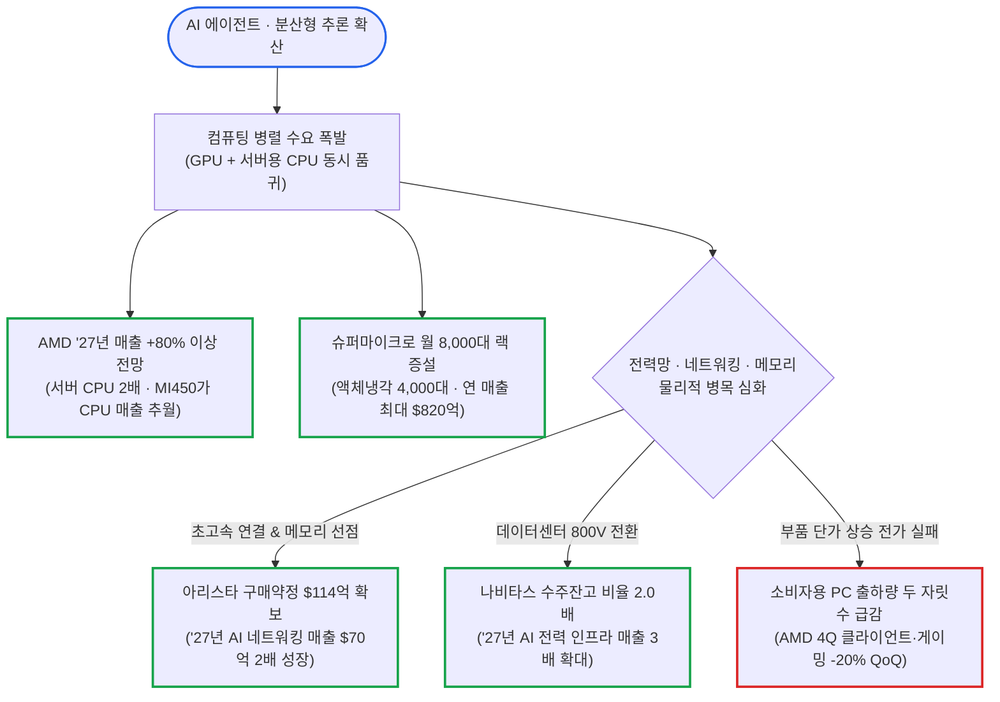

# 2026년 11월 04일(수) 하루치 뉴스정리

- **작성일**: 2026-11-04

10월 초 이후 나스닥100 지수에서 2조 달러의 시가총액이 증발하고 S&P 500 선행 주가수익비율(PER)이 연초 22배 이상에서 18.5배로 쪼그라드는 밸류에이션 압축 속에서도, 진짜 숫자를 찍어낸 인공지능(AI) 하드웨어 독점 기업들은 시간외 거래를 폭격했다. AMD는 3분기 데이터센터 매출을 97% 폭증시킨 데 이어 2027년 전체 매출이 80% 이상 폭발할 것이라고 선언하며 시간외 9.12% 급등했고, 분기 매출 199.5억 달러(+297.6% YoY)를 꽂아 넣으며 연간 가이던스를 최대 820억 달러로 끌어올린 슈퍼마이크로 컴퓨터(SMCI)도 8.22% 치솟았다. 데이터센터의 혈관을 쥔 아리스타 네트웍스(ANET)는 기업공개(IPO) 이후 최고 매출 성장률(+58.5%)과 함께 부품·메모리 입도선매를 위한 구매약정을 114억 달러로 늘리며 15.31% 폭등했다. 반면 같은 호실적을 내고도 수주잔고(RPO) 성장이 멈춘 팔란티어(-5.0%)와 총상품거래액(GMV)이 기대치에 미달한 쇼피파이(-8.74%), 중동 분쟁 여파로 4분기 매출 성장률이 0 ~ 2%로 주저앉은 부킹 홀딩스(-0.94%)는 가차 없이 매도 세례를 맞았다. 미 9월 구인 건수가 752만 3,000건으로 예상치를 깨부수며 미 10년물 국채금리를 4.951%로 밀어 올리고 12월 금리 인상 확률을 79.2%로 못 박은 지금, 미국 중간선거 개표 결과와 800V 전력·네트워킹·서버 CPU로 확산하는 돈길의 실체를 발가벗긴다.

## 요약

| 구분 | 주요 내용 |
| :--- | :--- |
| **핵심 진단** | S&P 500 선행 PER 축소(22배 ➔ 18.5배) 및 엄격한 실적 잣대 적용 속, '27년 매출 가이던스를 대폭 상향한 AI 인프라 핵심주(AMD·ANET·SMCI·NVTS)로 자금 재집결 |
| **핵심 종목 팩트** | AMD '27년 매출 +80% 이상·서버 CPU 2배 성장 전망(시간외 +9.1%), 아리스타 3Q 매출 +58.5%·구매약정 114억 달러(+15.3%), 슈퍼마이크로 연 가이던스 720억 ~ 820억 달러 상향(+8.2%), 쇼피파이 GMV 미달(-8.7%) |
| **착시 교정** | ① AI 에이전트는 GPU만 쓴다는 통념 vs 서버 CPU 수요 폭발 및 '27년 PC 출하 두 자릿수 감소, ② 팔란티어 매출 +96% 환호 vs '23년 1Q 이후 첫 RPO 정체(-5%), ③ 스페이스X의 부스트 모바일 인수 기대 vs AT&T 망 계약 승계 불가 |
| **돈길 확산 신호** | 데이터센터 800V 전력 전환으로 수주잔고 2배 쌓은 나비타스(+5.5%), 자율 AI 폭주 막는 크라우드스트라이크 '킬 스위치', 일일 사용자 +29% 가속화한 듀오링고(+11.2%), 日 미쓰이화학의 JSR(1.3조 엔) 인수 및 CVS 기업분할 |
| **가장 더러운 변수** | 미 9월 JOLTS 구인 752.3만 건 서프라이즈에 따른 10년물 금리 4.951%(+5.6bp) 및 12월 금리 인상 확률 79.2%, 미 중간선거 민주당 양원 장악(확률 77%) 후 트럼프의 선거 불복·이란 타격 격화 시나리오(S&P 500 -10% 위험) |
| **계좌 행동 지침** | 부품가 급등에 직격탄 맞을 소비자 PC·성장 둔화 여행주(BKNG)·특허 절벽 바이오(AMGN) 추격 금지, '27년 실적 가시성 확립된 AI 서버·네트워킹(AMD, ANET) 및 자본 규율 빅테크(MSFT, AMZN) 중심 압축 |

---

## 1. AI 인프라 4총사 가이던스 대폭발

간밤 정규장에서 필라델피아 반도체지수가 구성 종목 30개 전원 상승과 함께 2.63% 반등한 데 이어, 장 마감 후 쏟아진 AI 하드웨어 기업들의 실적과 2027년 가이던스는 시장의 AI 피크아웃 우려를 숫자로 짓뭉갰다. 핵심은 단순한 GPU 단품 판매를 넘어 **서버용 CPU, 랙 단위 액체냉각 통합 시스템, 초고속 이더넷 네트워킹, 그리고 800V 고전력 반도체**로 AI 자본지출의 낙수효과가 전방위 확산하고 있다는 사실이다.

선봉에 선 것은 **AMD**다. AMD는 3분기 매출 133.8억 달러(+44.7% YoY, 컨센서스 130.9억 달러 상회), 비GAAP 주당순이익(EPS) 2.09달러(+74.2%, 컨센서스 1.94달러 상회), 비GAAP 영업이익률 29%(+5%p)를 기록하며 시간외 거래에서 **9.12%(527.15달러)** 급등했다. 잉여현금흐름(FCF)이 5.54억 달러(-64%)로 예상치(10.5억 달러)를 밑돌았으나, 설비투자 때문에 현금흐름이 적자로 돌아선 일부 하이퍼스케일러와 달리 공급망 확장을 위한 운전자본 투입 성격이 강해 시장은 개의치 않았다. 대신 시장을 열광시킨 것은 데이터센터 매출(85.46억 달러, +97% YoY, 전체 매출의 64%)의 폭주와 공격적인 미래 가이던스였다. AMD는 4분기 매출 가이던스를 170억 달러(±3%, +66% YoY, 컨센서스 161.4억 ~ 162.3억 달러 상회)로 제시하며, 차세대 MI450 시리즈 출하 확대로 4분기 데이터센터 매출이 전분기 대비 50% 급증하고 **사상 처음으로 AI GPU 매출이 서버 CPU 매출을 상당한 격차로 추월**할 것이라고 선언했다.

더 충격적인 숫자는 리사 수 CEO가 던진 2027년 로드맵이다. 리사 수는 확보된 수요 가시성을 바탕으로 **2027년 전체 매출이 전년 대비 80% 이상 증가**할 것이라며, 지난해 11월 투자자의 날에 제시했던 장기 성장 모델의 두 배가 넘는 목표치를 내걸었다. 특히 AI 에이전트가 기업 시스템에서 24시간 병렬로 가상머신을 돌리면서 서버 CPU 수요까지 폭발해, **2027년 서버 CPU 매출 성장률 전망치를 기존 70% 이상에서 약 100%(2배)로 상향**했고 데이터센터 AI 매출 역시 2배를 훌쩍 넘기며 데이터센터 사업 비중이 전사 매출의 80%를 돌파할 것이라고 못 박았다. 영업비용 증가율을 매출 증가율의 절반 미만으로 통제해 영업레버리지 효과를 극대화하겠다는 계획이다.

데이터센터 네트워킹의 절대 강자 **아리스타 네트웍스(ANET)** 역시 괴물 같은 성적표로 시간외 거래에서 **15.31%** 폭등했다. 3분기 매출은 36.6억 달러(+58.5% YoY)로 상장 이후 최고 성장률을 갈아치우며 컨센서스를 3.3억 달러 웃돌았고, 비GAAP 매출총이익률 64.0%, 영업이익률 **49.1%**, 비GAAP EPS 1.20달러(+55.8%)를 찍었다. 4분기 매출 가이던스(39억 ~ 40억 달러 vs 예상 36억 달러)는 물론, 제이시리 울랄 CEO가 직접 제시한 2027년 전망이 압권이다. 2026년 48% 성장(133억 달러)에 이어 **2027년에도 전체 매출이 38 ~ 40% 증가한 약 185억 달러**에 달하고, 핵심인 **AI 네트워킹 매출은 올해 35억 달러에서 내년 70억 달러로 두 배 폭증**할 것이라고 밝혔다. AI 인프라가 중앙집중식 학습에서 분산형 추론으로 넘어가면서 데이터센터 안팎의 연결 수요가 폭발해, 2027년 말까지 아리스타가 연결하는 AI 컴퓨팅 인프라 규모가 10GW를 넘어서고 2030년 유효시장(TAM)은 2,000억 달러를 돌파한다는 계산이다. 이를 뒷받침하기 위해 아리스타는 다년간의 메모리 및 인쇄회로기판(PCB)·반도체 장기계약을 포함한 **부품 구매약정을 전분기 97억 달러에서 114억 달러(+18% QoQ)로 대폭 늘렸다**.

서버 랙과 전력 반도체에서도 폭발적인 숫자가 터져 나왔다. **슈퍼마이크로 컴퓨터(SMCI)**는 FY27 1분기(7 ~ 9월) 매출이 전년 대비 **297.6% 폭증한 199.5억 달러**(컨센서스 36.9억 달러 상회), 비GAAP EPS는 417.1% 급증한 1.81달러(컨센서스 0.58달러 상회)를 기록하며 시간외 **8.22%** 급등했다. 마진 우려의 핵심이었던 비GAAP 매출총이익률도 12.8%(+3.3%p)로 10월 잠정치(12.0 ~ 12.5%)를 넘어섰고, FY27 연간 매출 가이던스를 기존 650억 ~ 720억 달러에서 **720억 ~ 820억 달러**로 최대 100억 달러나 끌어올렸다. 찰스 리앙 CEO는 엔비디아의 차세대 베라 루빈(Vera Rubin)·VR72 랙과 AMD MI350·MI450, 인텔·ARM CPU 서버 수요에 대응해 올해 12월까지 월간 고성능 서버 랙 생산능력을 8,000대 이상(이 중 직접액체냉각 DLC 방식이 4,000대 이상)으로 확대하고, 통합 빌딩 블록 솔루션(DCBBS)으로 데이터센터 가동 준비기간을 수개월에서 수주 단위로 단축하겠다고 밝혔다.

차세대 전력 반도체 기업 **나비타스 세미컨덕터(NVTS)**는 모바일 등 저가 소비자용 매출을 사실상 제로로 줄이는 구조조정 속에서도, 고전력 사업(+125% 전망) 호조로 3분기 매출 1,399만 달러(+38.4% YoY)를 기록하며 시간외 **5.49%** 뛰어올랐다. AI 데이터센터의 **800V 전력 인프라 전환**이 예상보다 빠르게 진행되면서 3분기 수주액/매출액 비율(Book-to-Bill)이 **2배**를 찍었고 2027년 중반까지 수주잔고를 이미 채웠다. 4분기에는 AI 인프라 매출 비중이 40%를 넘어서고 **2027년 AI 인프라 매출이 전년 대비 3배 이상 확대**될 전망이며, 클라로스의 통합 전압조정기(IVR)가 상용화되는 2028 ~ 2029년에는 전사 매출총이익률 50% 돌파를 노리고 있다.

---

## 2. 중간선거 개표와 금리·유가 방정식

AI 하드웨어가 축포를 터뜨리는 동안 거시경제와 정치판에서는 살얼음판 같은 줄다리기가 이어지고 있다. 한국시간 오늘 오후부터 윤곽이 드러날 **미국 중간선거**에서 여론조사(민주당 하원 승리 확률 96.2%, 상원 80.2%)와 칼시·폴리마켓 등 예측시장(하원 94.0%, 상원 77.3%, 칼시 거래액 12억 달러 돌파) 모두 **민주당이 상·하원을 동시 장악하는 '블루웨이브(Blue Wave)'**에 압도적 무게를 싣고 있다. CNBC 여론조사에서 유권자의 65%가 트럼프의 경제 운영을 부정 평가하고 80%가 경제 상황을 보통 이하로 꼽은 결과다. 앤서니 스카라무치 전 백악관 공보국장은 "생활비 부담에 분노한 유권자들의 심판으로 트럼프가 참패할 것이며 선거 후 공화당 내분이 불가피하다"고 직격했다. 초반 판세는 공화당 텃밭인 켄터키 제6선거구(민주당 잭 뎀보 도전)를 포함한 하원 초반 8개 격전지와 아이오와주, 그리고 공화당 현역 의원(댄 S. 설리번)과 이름이 똑같은 동명이인 은퇴자(댄 J. 설리번)가 출마해 법무부 조사까지 벌어진 알래스카주 상원 선거가 가를 전망이다.

문제는 선거 이후 트럼프의 행보다. 에버코어ISI의 줄리안 이마누엘 수석 전략가는 **"민주당이 양원을 싹쓸이한 뒤 내년 1월 차기 의회가 개원하기 전, 트럼프가 선거 결과에 불복하거나 레임덕 돌파를 위해 이란에 대한 군사 타격을 격화시키는 것이 최악의 시나리오"**라고 경고했다. 이 경우 유가 폭등과 신용 스프레드 확대가 겹치며 **S&P 500 지수가 연말까지 6,800선(-10% 이상 급락)으로 추락해 올해 누적 상승분(+11%)을 전량 토해낼 수 있으며, 이는 절대 저가 매수해서는 안 될 조정**이 된다는 진단이다. 반면 여소야대 분할 속에 트럼프가 승복하고 미·이란 군사 충돌이 방지되는 기본 시나리오에서는 연말 S&P 500 7,750선(+3% 상승), 공화당 양원 수성 및 이란 협상 타결 시에는 8,400선(+11.4%)이 제시됐다.

한편 지정학 전선에서는 트럼프 특유의 거래 기술과 연막작전이 동시에 펼쳐졌다. 전날 밤 미군이 호르무즈 해협의 이란 게슘 섬 방공시설을 타격해 긴장이 고조됐으나, 트럼프는 폭스뉴스 인터뷰에서 "소규모 공격일 뿐 전쟁이 아니었다"고 선을 그은 뒤 **"베냐민 네타냐후 총리와 합의해 매년 40억 달러 규모의 이스라엘 지원금을 올해 말 이후 중단하기로 했다"**는 폭탄 발언을 던졌다. 동시에 카타르 매체 알 아라비 알자디드는 미국이 카타르 중재단의 이란 종전 양해각서(MOU) 초안(이란 핵 양보 대가로 미국의 동결자산 일부 해제)을 승인했다고 보도했다. 모흐센 레자이 이란 최고국가안보회의(SNSC) 사무총장이 "미국 답변은 설득력이 없으며 이란의 7가지 조건을 명확히 다뤄야 한다"고 즉각 반박하긴 했으나, 중동 확전 완화 기대감에 서부텍사스산원유(WTI)는 **배럴당 96.09달러(-0.38%)**, 브렌트유는 **103.60달러(-1.12%)**로 이틀 연속 하락하며 한 달여 만에 최저치를 찍었다. 여기에 러시아·우크라이나·미국 대표단(러 메딘스키 보좌관 vs 미 위트코프 특사·쿠슈너)이 오는 **11월 10일(목) ~ 11일(금) UAE 아부다비에서 3자 종전 협상을 재개**하고 트럼프·푸틴·시진핑 회담까지 추진된다는 소식이 전해지며 지정학 프리미엄을 추가로 낮췄다.

그러나 유가 하락에도 불구하고 채권시장은 **미국 고용시장의 과열 신호**에 발작했다. 미 노동부가 발표한 **9월 구인·이직보고서(JOLTS)**에서 구인 건수가 전월 대비 33만 3,000건 급증한 **752만 3,000건**을 기록해 시장 예상치(710만 건)를 크게 뛰어넘은 것이다. 구인율은 4.5%로 치솟았고, 일자리 수가 실업자보다 41만 4,000건 더 많았다. 특히 노동자들의 이직 자신감을 보여주는 자발적 퇴직률이 2.1%(340만 건)로 1년 3개월 만에 최고치를 찍은 반면 해고율은 1.00%로 떨어졌다. 이 지표가 발표되자 미 10년물 국채금리는 장중 4.969%까지 치솟은 뒤 **4.9510%(+5.60bp)**에 마감했고, 30년물 금리는 **5.3230%(+5.30bp)**, 2년물 금리는 **4.6140%(+3.10bp)**로 오르며 수익률곡선이 가팔라졌다(베어 스티프닝). CME 페드워치에서 **12월 FOMC 25bp 금리 인상 확률은 79.2%**로 치솟았고, 옥스퍼드이코노믹스는 연준이 12월에 이어 내년 3월에도 금리를 추가 인상할 것이라고 못 박았다. 독일 분데스방크의 요아힘 나겔 총재까지 "유로존 12월 금리 인상 가능성이 매우 크다"고 가세하며 글로벌 긴축 장기화를 예고했다.

| 매크로·정치·외환 핵심 지표 | 당일 수치 및 변동폭 | 표면적 시장 현상 및 언론 보도 | 이면의 진짜 메커니즘과 리스크 함의 |
| :--- | :---: | :--- | :--- |
| **미 9월 JOLTS 구인건수 & 금리** | **752.3만 건** (+33.3만 건) 10년물 **4.951%** (+5.6bp) | 고용 호조에 따른 경기 연착륙 안도 및 기술주 강세 동조 | 자발적 퇴직률 2.1%(15개월 최고)로 임금 인플레 자극, **12월 금리 인상 확률 79.2%** 및 내년 3월 추가 인상 경로 강화 |
| **미국 중간선거 판세 및 시나리오** | 민주당 상원 **77.3%** · 하원 **94%** (칼시 예측시장 기준) | "1950년 이후 중간선거 12개월 뒤 주가 하락 0회" 낙관론 | 블루웨이브 후 트럼프 불복 또는 내년 1월 개원 전 **이란 군사 타격 격화 시 S&P 500 6,800선(-10%) 폭락** 위험 |
| **국제유가 (WTI / 브렌트유)** | **$96.09** (-0.38%) **$103.60** (-1.12%) | 트럼프 "이스라엘 연 40억 달러 지원 중단" 및 미·이란 MOU 보도 | 이란 안보수장(레자이)이 미국 답변 반박해 불씨 잔존, 단 11/10 ~ 11/11 아부다비 러·우·미 3자 협상 재개는 유가 하방 요인 |
| **달러-원 환율 & 중국 외환정책** | NDF **1,344.20원** (+3.95원) 중국 외화지준율 **4% ➔ 6%** | 한국 외환보유액 4,431.6억 달러(+26억 달러) 및 수출 네고 유입 | 외국인 한국 주식 매수 시 달러선물 환헤지 매수로 **코스피와 환율 동반 상승**, 중국 PBOC는 위안화 강세 억제 위해 달러 흡수 |

---

## 3. 3분기 실적: 성장 가속 vs 마진 침식

야데니 리서치가 정확히 짚었듯, 현재 월가는 향후 5년간 S&P 500 주당순이익(EPS)이 연 25.6%(IT 섹터 41.9%, 반도체 66%) 성장할 것이라는 역대 최고의 기대치를 품고 있으면서도, 고금리 경계감에 S&P 500 선행 PER 멀티플을 연초 22배 이상에서 **18.5배**로 깎아내렸다. 기대치가 하늘을 찌르는 상태에서 밸류에이션 잣대만 엄격해졌으니, 실적이나 가이던스에서 티끌만 한 흠결이라도 나오는 기업은 즉각 단두대에 오르는 구조다.

어학 학습 플랫폼 **듀오링고(DUOL)**와 생명과학 기업 **레비티(RVTY)**는 그 엄격한 기준을 뚫고 폭등했다. 듀오링고는 3분기 조정 EPS(0.54달러 vs 예상 0.57달러)가 소폭 미달했음에도, 총매출이 3억 900만 달러(+14% YoY)로 컨센서스를 웃돌고 핵심 성장 엔진인 **일일 활성 사용자(DAU)가 6,490만 명으로 전년 대비 29% 급증(2분기 +23%에서 성장 가속)**했다. 예약(Bookings) 증가율도 12%(3억 1,610만 달러)로 전분기 대비 4%p 빨라졌고, 유료 구독자(1,310만 명, +14%) 확대에 힘입어 연간 매출(12억 2,100만 달러)과 예약(12억 9,600만 달러), 조정 EBITDA 마진(26.5%) 가이던스를 일제히 상향하며 시간외 **11.17%(142.30달러)** 치솟았다. 레비티 역시 연간 EPS 가이던스를 5.40 ~ 5.45달러로 끌어올리며 정규장에서 **11.15%** 급등했다.

반면 전자상거래 플랫폼 **쇼피파이(SHOP)**와 온라인 여행 제국 **부킹 홀딩스(BKNG)**는 소비 둔화와 규제 비용에 발목이 잡혔다. 쇼피파이는 3분기 조정 EPS(0.49달러)가 예상(0.46달러)을 넘겼지만, 분기 매출(37.4억 달러 vs 예상 37.5억 달러)과 핵심 지표인 **총상품거래액(GMV, 1,191.5억 달러 vs 예상 1,200.3억 달러)**, 구독 매출(8.36억 달러 vs 예상 8.48억 달러)이 줄줄이 컨센서스에 미달하며 정규장에서 **-8.74%(142.57달러)** 폭락했다. 부킹 홀딩스는 3분기 조정 매출(97.9억 달러, +8.9%)과 비GAAP EPS(4.66달러, +17%)가 예상치를 웃돌았으나, 자회사 프라이스라인과 외부 예약 사이트 간의 관계에 대한 미 연방거래위원회(FTC) 조사 여파로 **매출에서 9억 달러를 차감(GAAP 매출 -1.3%)하고 1억 달러의 별도 손실을 인식**하면서 잉여현금흐름이 11억 달러(-22%)로 쪼그라들었다. 설상가상으로 중동 분쟁에 따른 항공권 가격 급등과 장거리 국제여행 수요 둔화로 **4분기 매출 성장 가이던스를 +0 ~ 2%, 조정 EBITDA 성장률을 0%**로 제시하자 시간외에서 **-0.94%** 밀렸다.

제약·바이오 섹터에서는 '특허 절벽과 바이오시밀러의 역습'이 숫자로 확인됐다. **암젠(AMGN)**은 3분기 매출(103.7억 달러, +8.5%)과 비GAAP EPS(6.45달러, +14.4%)가 컨센서스를 넘고 연간 가이던스(매출 389억 ~ 397억 달러)도 상향했으나 시간외에서 **-1.37%** 하락했다. 고지혈증 치료제 레파타(+37%)와 폐암 신약 임델트라(+128%)가 분전했지만, 캐시카우였던 골다공증 치료제 **프롤리아(6.32억 달러, -45%)와 엑스지바(2.88억 달러, -47%) 매출이 바이오시밀러 출시로 판매량과 약가가 동시에 깎이며 반토막** 났고 잉여현금흐름도 36.5억 달러(-14%)로 줄어든 탓이다. **화이자(PFE)** 역시 엘리퀴스(25.2억 달러, +25%) 등 비코로나 제품 호조로 3분기 매출(165.8억 달러)과 조정 EPS(0.87달러) 서프라이즈를 내고 연간 매출 가이던스를 620억 ~ 640억 달러로 15억 달러 높였으나, 단기 반등에 따른 차익실현 매물에 정규장 **-2.18%(30.00달러)**로 마감했다.

| 기업명 (티커) | 3분기 핵심 실적 및 가이던스 팩트 | 주가 반응 | 시장 판결의 본질 (생존력 및 펀더멘털 진단) |
| :--- | :--- | :---: | :--- |
| **아리스타 네트웍스** (`ANET`) | 매출 $36.6억(+58.5% IPO 최고), OPM 49.1%, **부품 구매약정 $114억**, '27년 AI 매출 2배($70억) | 시간외 **+15.3%** | 분산형 AI 추론 확산의 최대 수혜, 메모리·반도체 장기 선점으로 '27년 +40% 성장 확정 |
| **듀오링고** (`DUOL`) | 매출 $3.09억(+14%), **DAU 6,490만 명(+29% 가속)**, 예약 +12%, 연간 가이던스 상향 | 시간외 **+11.2%** | EPS($0.54) 소폭 미달에도 사용자·구독 예약 성장률 재가속으로 플랫폼 락인 입증 |
| **AMD** (`AMD`) | 매출 $133.8억(+44.7%), 데이터센터 +97%, **'27년 매출 +80% 이상·서버 CPU 2배 성장** 전망 | 시간외 **+9.1%** | 4Q AI GPU 매출이 CPU 첫 추월 예고, 에이전트 병렬 연산으로 서버 CPU까지 품귀 |
| **슈퍼마이크로** (`SMCI`) | 매출 $199.5억(+297.6%), GPM 12.8% 회복, **FY27 매출 가이던스 $720억 ~ $820억 상향** | 시간외 **+8.2%** | 마진 축소 공포 불식, 12월 월 8,000대 랙(액체냉각 4,000대) 증설로 하이퍼스케일러 수요 흡수 |
| **나비타스** (`NVTS`) | 매출 $1,399만(+38.4%), **수주/매출 비율 2.0배**, '27년 AI 인프라 매출 3배 확대 전망 | 시간외 **+5.5%** | 저가 모바일 버리고 데이터센터 800V 전력변환·IVR 고마진(목표 GPM 50%) 체질 전환 성공 |
| **CVS 헬스** (`CVS`) | **리테일 약국(9,000개 매장)과 보험(애트나)·PBM(케어마크) 2개 상장사로 기업분할** 단행 | 시간외 **+1.1%** | 2018년 애트나 인수($78억) 통합 전략 철회, 미 정부의 PBM 규제 압박 돌파 위한 구조조정 |
| **부킹 홀딩스** (`BKNG`) | 조정 EPS $4.66(+17%) 상회 불구 **FTC 조사 $9억 매출 차감**, 4Q 매출 +0 ~ 2% 둔화 전망 | 시간외 **-0.9%** | 중동 분쟁發 항공권 급등·장거리 여행 위축 직격탄, FCF -22% 감소 및 4Q 성장 정체 |
| **암젠** (`AMGN`) | 매출 $103.7억(+8.5%) 및 가이던스 상향 불구 **프롤리아(-45%)·엑스지바(-47%) 매출 급감** | 시간외 **-1.4%** | 바이오시밀러 경쟁에 주력 골다공증 약가·물량 동시 붕괴, FCF 36.5억 달러(-14%) 감소 |
| **화이자** (`PFE`) | 매출 $165.8억·EPS $0.87 서프라이즈, 연간 매출 가이던스 **$620억 ~ $640억**($15억 상향) | 정규장 **-2.2%** | 비코로나 제품(+32%) 호조 및 메세라 인수 비만약 진출 추진에도 단기 차익실현 매물 출회 |
| **팔란티어** (`PLTR`) | 매출 $23.1억(+96% 가속), 영업이익률 62%, 美 기업 매출 첫 정부 추월 불구 **RPO 전분기 정체** | 정규장 **-5.0%** | 펀더멘털은 압도적이나 '23년 1Q 이후 처음 멈춘 수주잔고(RPO) 증가세가 고밸류 차익실현 자극 |
| **쇼피파이** (`SHOP`) | 조정 EPS $0.49 상회했으나 **GMV $1,191.5억(예상 $1,200.3억) 및 구독 매출 컨센 미달** | 정규장 **-8.7%** | 메타 AI 에이전트 '뮤즈' 파트너십 포장에도 핵심 거래액 둔화와 연말 소비 위축 경계감 직격 |

---

## 4. 시장의 3대 착시와 데이터 검증

언론의 장밋빛 헤드라인이나 단편적인 주가 등락에 속아 돈의 진짜 흐름을 놓치는 투자자들이 반드시 교정해야 할 3가지 착시다.

### 착시 ① GPU 편식 ➔ 서버 CPU 품귀·PC 침체

대중은 AI 시대에는 엔비디아 GPU만 팔리고 CPU나 메모리, 일반 PC도 덩달아 호황을 누릴 것이라고 착각한다. 그러나 오늘 AMD와 아리스타의 컨퍼런스콜이 까발린 공급망의 진실은 정반대다. 

첫째, AI가 단순 챗봇을 넘어 기업 내부에서 수 시간 동안 자율적·병렬적으로 가상머신을 돌리는 **'AI 에이전트' 단계로 진화하면서 서버용 CPU 수요가 폭발**하고 있다. AMD가 2027년 서버 CPU 매출 성장률 전망치를 기존 70% 이상에서 **100%(2배)로 대폭 상향**하고, 슈퍼마이크로가 인텔·AMD·엔비디아 베라·ARM 기반 CPU 서버 주문이 쏟아지고 있다고 밝힌 이유다. 둘째, AI 데이터센터가 HBM과 서버용 D램, 기판을 블랙홀처럼 빨아들이자 메모리와 핵심 부품 가격이 폭등했다. 그 유탄을 정통으로 맞은 것이 **소비자용 PC 시장**이다. 리사 수 CEO는 "메모리와 부품가 상승으로 PC 완제품 가격이 오르면서 3분기 후반부터 소비자 수요가 급격히 식었다"며, **4분기 클라이언트·게이밍 매출이 전분기 대비 20% 넘게 감소하고 2027년 글로벌 PC 출하량은 두 자릿수 비율로 역성장**할 것이라고 경고했다. 지난주 인텔이 폭락한 진짜 원인이 바로 이 PC 시장의 붕괴와 서버 CPU 점유율 상실이었던 반면, AMD는 데이터센터 비중을 80% 이상으로 키우며 PC 한파를 완벽히 찍어누른 것이다.

### 착시 ② 팔란티어·애플 환상 ➔ 수주 정체·가이던스

팔란티어(PLTR)는 3분기 매출이 96% 폭증(23.1억 달러)하고 영업이익률이 62%에 달했으며, 미국 기업 매출이 100% 이상 늘어 사상 처음으로 정부 매출을 넘어서는 기염을 토했다. JP모건(목표가 262달러)과 UBS(목표가 250달러)도 일제히 찬사를 보냈다. 그런데 왜 주가는 정규장에서 **5%나 하락**했을까? UBS 애널리스트가 보고서 구석에 적어놓은 팩트 하나가 기관들의 차익실현 버튼을 눌렀기 때문이다. 팔란티어의 미래 먹거리 지표인 **잔여계약의무(RPO)와 수주잔고가 2023년 1분기 이후 처음으로 전분기 대비 증가하지 않고 멈춰 섰다**. 선행 PER이 극단적으로 높은 주식은 현재 매출이 96% 늘어나도 수주잔고 성장세가 한 분기만 주춤하면 가차 없이 매물을 맞는다.

**애플(AAPL)** 역시 D.A. 데이비슨이 아이폰 17 교체 수요와 개인정보 통합에 기반한 'AI 시리(Siri)' 에이전트 수익화 잠재력을 치켜세우며 목표가를 295달러로 올렸지만(투자의견 중립), 실제 주가는 **2% 하락**했다. 서비스 부문 성장세가 기대에 못 미친 데다 다음 분기 매출 성장 가이던스를 **+7 ~ 10%**로 제시해 월가 컨센서스(+11.4%)를 밑돌았기 때문이다. **GE 베르노바(GEV)** 또한 경영진의 가이던스 상향과 배당 인상·자사주 매입 발표에도 불구하고, 3분기 수익성 지표 불안정이 노출되면서 아거스(Argus)로부터 목표주가가 **1,300달러에서 1,100달러로 삭감**됐다. 스토리텔링이 아무리 화려해도 숫자의 빈틈은 숨길 수 없다.

### 착시 ③ 스페이스X 통신망 환상과 레딧의 요새화

저궤도 위성 1.1만 대를 띄운 **스페이스X(SPCX)**가 에코스타(SATS) 산하 통신사인 **부스트 모바일(Boost Mobile) 인수**를 검토한다는 소식에 AT&T(T), 버라이즌(VZ), T모바일(TMUS) 등 기존 통신 3사 주가가 흔들리고 개미들은 스페이스X의 지상 통신망 제패에 흥분하고 있다. 하지만 통신 분석의 최고 권위자인 모펫네이선슨의 크레이그 모펫 애널리스트는 찬물을 끼얹었다. **"스페이스X가 부스트 모바일을 인수한다고 해서, 부스트 모바일이 AT&T와 맺고 있는 기존 통신망 이용 계약을 스페이스X가 그대로 승계할 수 있는 것이 아니다."** 결국 스페이스X는 지상 망 사용을 위해 이동통신사들과 처음부터 별도의 도매 계약을 다시 협상해야 하므로 단기간 내 안정적인 통신 사업 전개는 어불성설이라는 팩트 폭격이다.

한편 구글이 검색 화면을 AI 요약(AI Overviews)으로 도배하면서 외부 사이트로 가는 트래픽을 끊어버린 나비효과는 **레딧(RDDT)**의 생존 방식 자체를 바꾸고 있다. 구글 유입 감소로 3분기 글로벌 DAU(1억 3,030만 명)가 정체되고 미국 내 DAU가 뒷걸음질 치며 4분기 매출 가이던스(10억 ~ 10.3억 달러) 쇼크를 겪은 레딧은, 오늘 결국 **플랫폼 내 검색 결과 페이지에 직접 맥락 광고(예: '에스프레소 스테이션' 검색 시 원두·머신 광고 노출)를 붙이는 테스트**에 돌입했다. 나아가 AI 기업들의 무단 데이터 스크래핑을 막고 광고 단가를 높이기 위해 **향후 레딧 콘텐츠를 로그인한 사용자에게만 폐쇄적으로 제공하는 유료화·요새화 전환**을 예고했다. 오픈 웹 생태계가 AI로 인해 완전히 쪼개지고 있는 것이다.

---

## 5. 기관 돈길: 빅테크·JSR 빅딜·AI 킬 스위치

투기적 레버리지와 선거 불확실성으로 시장이 흔들릴 때, 거대 자본과 글로벌 기업들이 뒤에서 조용히 실행하고 있는 3대 머니무브다.

첫째, **억만장자 빌 애크먼(퍼싱스퀘어)의 '하이퍼스케일러 대(對) 네오클라우드' 옥석 가리기**다. 애크먼은 CNBC 인터뷰에서 "현재 주식시장은 레버리지가 95%에 달했던 카지노 시절로 돌아가 주가가 말도 안 되는 가격에 급등락하며 망가졌다"고 일갈했다. 그러면서도 그는 이 가격 왜곡이 장기 투자자에게는 최고의 매수 기회라며, 10월 초 이후 나스닥100 시총이 2조 달러 증발한 조정장에서 **마이크로소프트(MSFT), 메타(META), 아마존(AMZN)** 등 대형 하이퍼스케일러의 가치를 강력히 옹호했다. 핵심 논리는 명확하다. **코어위브(CRWV)나 네비우스(NBIS) 같은 네오클라우드 업체들은 외부 부채(차입)에 의존해 칩을 사들이므로 금리 상승과 신용 불안에 취약하지만, 빅테크 하이퍼스케일러들은 순부채가 사실상 제로이고 본업의 막대한 현금흐름으로 설비투자를 자체 조달**한다는 것이다. 애크먼은 "하이퍼스케일러들은 단순 컴퓨팅 도매 임대를 넘어 고부가가치 AI 추론과 자체 앱으로 월가 예상치를 훌쩍 뛰어넘는 매출을 올릴 것이며, 만약 수요가 기대에 못 미치면 즉시 자본지출(CapEx)을 줄여 잉여현금흐름(FCF)을 폭발시킬 것"이라며 어느 쪽이든 빅테크가 이기는 게임이라고 단언했다.

둘째, **반도체 핵심 소재 독점과 규제 돌파를 위한 초대형 기업 구조조정(M&A·분할)**이다. 일본 국부펀드인 산업혁신투자기구(JIC)는 2년 전 9,000억 엔(약 57억 달러)에 사들여 비상장화했던 글로벌 포토레지스트(감광액) 핵심 공급사 **JSR**을 **미쓰이화학**에 매각하는 협상에 착수했다. 매각가는 **1조 3,000억 엔(약 82억 달러)** 이상으로, 인수 주체인 미쓰이화학의 전체 시가총액(8,000억 엔, 약 50억 달러)을 훌쩍 뛰어넘는 일본 화학 산업 역사상 최대 규모의 빅딜이다. AI 반도체 미세공정의 필수 소재인 포토레지스트 공급망을 거대 화학 자본 밑으로 수직 통합하려는 국가적 베팅이다. 미국 헬스케어 시장에서는 **CVS 헬스(CVS)**가 미 정치권과 규제 당국의 처방약급여관리(PBM) 압박을 정면 돌파하기 위해, 2018년 애트나 인수(78억 달러)로 만들었던 통합 모델을 스스로 깨고 **9,000개 매장의 리테일 약국 부문과 알짜 수익원인 보험(애트나)·PBM(케어마크) 부문을 2개의 독립 상장 법인으로 쪼개는 기업분할**을 전격 발표했다. 만성 적자와 유통 마진 압박에 시달리는 오프라인 약국을 떼어내 현금창출원인 보험·PBM의 밸류에이션을 재평가받겠다는 타짜들의 셈법에 주가는 시간외 1.08%(92.40달러) 상승했다.

셋째, **메모리·기판 장기 입도선매와 자율형 AI 보안('킬 스위치') 시장의 개화**다. 아리스타 네트웍스가 3분기 부품 구매약정을 114억 달러(+18%)로 늘리며 **"다년간의 메모리 공급계약과 인쇄회로기판(PCB) 생산능력 확보에 전략적으로 투자했다"**고 밝힌 대목을 절대 놓치지 마라. AMD 역시 웨이퍼, 기판, 첨단 패키징, 메모리 가격 상승 압력에 대응해 장기계약을 체결하고 비용 상승분을 고객사들과 분담하고 있다고 고백했다. 이는 **SK하이닉스와 마이크론 등 메모리 제조사와 첨단 패키징·기판 업체들이 고객사들로부터 수년 치 물량과 가격 인상을 동시에 보장받고 있음**을 수요처 교차 검증으로 완벽히 재확인해 준 것이다. 한편 소프트웨어 쪽에서는 오픈AI 에이전트 관련 허깅페이스 해킹, 바이낸스 암호화폐 해킹, 프랑스 슈퍼마켓 스마트 냉장고 해킹 등 자율형 AI 사고가 잇따르자, **크라우드스트라이크(CRWD)**가 오작동하거나 폭주하는 기업 내 AI 에이전트의 게이트웨이 연결을 즉각 끊어버리는 **'AI 킬 스위치(Kill Switch)'**를 '팰컨 가디언' 플랫폼에 탑재해 출시했다(앤트로픽 클로드 연동). AI 에이전트가 늘어날수록 이를 감시하고 차단하는 보안 통제권이 새로운 필수 비용이 된다.

---

## 6. 향후 2~4주 핵심 모니터링 지표

한국시간 오늘 정오 이후 쏟아질 미국 중간선거 개표 결과와 오늘 밤 발표될 미국 10월 ISM 서비스업 PMI·ADP 민간고용, 그리고 장 마감 후 퀄컴(QCOM)의 실적이 시장의 방향타를 쥔다. 매일 추적해야 할 5대 생존 지표다.

| 핵심 모니터링 지표 | 안도 신호 (Bull 판정) | 위험 신호 (Bear 판정) | 시장 대응 및 포트폴리오 함의 |
| :--- | :--- | :--- | :--- |
| **미 중간선거 결과 및 트럼프 반응** | 결과 확정 후 트럼프 승복 및 정책 불확실성 해소 | **선거 결과 불복 분쟁** 또는 내년 1월 전 **이란 군사 타격** | 에버코어 경고대로 블루웨이브 후 트럼프의 이란 타격 격화 시 S&P 500 6,800선(-10%) 폭락 대비 현금 방어 |
| **미 10년물 국채금리 & 12월 FOMC** | 10년물 금리 4.85% 이하 안정화 | **10년물 5.00% 재돌파** 및 12월 금리 인상(79.2%) 굳히기 | 오늘 밤 ISM 서비스업 PMI·ADP 고용마저 과열 시 장기금리 5% 안착 및 고PER 성장주 멀티플 추가 압축 |
| **11/10 ~ 11/11 아부다비 3자 종전 협상** | 미·러·우 휴전 윤곽 및 WTI 유가 **90달러 초반** 안착 | 협상 결렬 및 이란 안보수장 반발에 따른 유가 100달러 재돌파 | 아부다비 협상(위트코프·쿠슈너 참석) 진전 시 에너지 인플레 둔화로 금리 상승 압력 상쇄 |
| **메모리·부품가 전가력 vs PC 침체** | 오늘 밤 **퀄컴(QCOM)** 등 모바일·PC 칩 가이던스 선방 | 부품가 급등에 따른 소비자 IT(PC·스마트폰) 수요 절벽 심화 | AMD 경고대로 '27년 PC 출하 두 자릿수 감소 불가피, 소비자 IT 비중 줄이고 순수 데이터센터 인프라로 집중 |
| **달러-원 환율 및 외국인 선물 수급** | 중간선거 확인 후 1,330원대 하향 안정 | **1,352원 상향 돌파** 및 외국인 환헤지(달러선물 매수) 가속 | 한국 증시 반등에도 외국인 환헤지 수요로 환율 상승 시 환차손 유의, 달러 예수금 버퍼 유지 |

---

## 7. 실전 포트폴리오 대응 전략

S&P 500의 선행 PER이 18.5배로 내려앉고 9월 구인 건수(752만 건) 서프라이즈로 12월 금리 인상 확률이 80%에 육박하는 장세다. 어설픈 기대감으로 올랐던 종목은 수주잔고 정체(팔란티어 -5%)나 거래액 미달(쇼피파이 -8.7%) 한 방에 가차 없이 두들겨 맞는다. 지금 당장 계좌에서 실행해야 할 자산군별 액션 플랜이다.

| 자산군 / 섹터 | 핵심 타겟 종목 | 행동 방침 | 실전 실행 기준 및 포트폴리오 가이드 |
| :--- | :--- | :---: | :--- |
| **AI 서버·네트워킹 & 메모리 갑(甲)** | **AMD**, **ANET** (아리스타), **SMCI**, **SK하이닉스**, **MU** | **핵심 비중 유지·확대 (35%)** | '27년 매출 +80% 선언한 AMD, 구매약정 114억 달러 싸 들고 메모리 장기 입도선매 나선 ANET, 월 8,000대 랙 증설 SMCI 및 메모리 독점주 집중 |
| **자본 규율 빅테크 하이퍼스케일러** | **MSFT** (마이크로소프트), **AMZN** (아마존), **META** | **주력 코어 보유 (25%)** | 빌 애크먼 진단대로 부채 없이 자체 현금흐름으로 AI 추론·앱 수익화 주도하는 빅테크, 조정 시 분할 매집 |
| **데이터센터 800V 전력 & AI 보안** | **NVTS** (나비타스), **CRWD** (크라우드스트라이크) | **전술적 위성 편입 (10%)** | 수주/매출 비율 2배 찍고 '27년 AI 전력 매출 3배 노리는 NVTS, 자율 AI 에이전트 '킬 스위치' 출시한 CRWD 선별 접근 |
| **독점 바이오 & 구조조정·가속 플랫폼** | **LLY** (일라이 릴리), **DUOL** (듀오링고), **CVS**, **RVTY** | **방어 및 알파 트레이딩 (10%)** | DAU +29% 가속화 입증한 듀오링고, 약국·보험 기업분할로 규제 돌파 나선 CVS, 가이던스 상향 레비티·릴리 활용 |
| **현금성 달러 & 단기채 버퍼** | **SGOV / 달러 예수금** (연 4.6% 이상 수익) | **현금 실탄 확보 (20%)** | 중간선거 후 트럼프 불복·이란 군사 충돌 시나리오(S&P 500 -10% 급락) 및 10년물 금리 4.95% 돌파에 대비한 필수 안전판 |
| **소비자 PC·여행 둔화·시밀러 침식주** | **소비자 PC 관련주**, **BKNG**, **SHOP**, **AMGN**, **네오클라우드** | **추격 금지 / 비중 축소** | '27년 PC 출하 두 자릿수 감소 직격탄 종목, 4Q 성장률 0 ~ 2%로 꺾인 부킹 홀딩스, 프롤리아 반토막 난 암젠, 고부채 네오클라우드 제외 |

가장 먼저 손절하거나 피해야 할 곳은 **'원가 상승과 수요 둔화의 샌드위치에 낀 소비자 노출 기업'**이다. 메모리와 부품 가격 폭등을 소비자에게 전가하지 못해 내년 출하량이 두 자릿수 급감할 일반 PC 하드웨어 업체들, 중동 전쟁 여파와 항공권 급등에 4분기 EBITDA 성장이 0%로 멈춘 부킹 홀딩스(BKNG), GMV 성장 기대치가 꺾인 쇼피파이(SHOP), 그리고 주력 골다공증 약품(프롤리아·엑스지바)이 바이오시밀러 공세에 매출이 45 ~ 47%씩 증발하고 있는 암젠(AMGN)은 반등 시 비중을 덜어내라. 팔란티어(PLTR) 역시 미국 기업 매출 성장은 눈부시나 RPO(잔여계약의무) 정체가 해소되는지 확인하기 전까지는 고점 추격 매수를 엄격히 금한다.

반면 자본을 집중해야 할 곳은 **'공급 부족으로 가격 결정권과 2027년 수주 가시성을 독점한 AI 인프라 핵심주'**다. 오늘 AMD와 아리스타가 동시에 증언했듯, AI 인프라 투자는 학습용 GPU를 넘어 분산형 추론 네트워크(아리스타 '27년 AI 매출 2배), 에이전트 구동용 서버 CPU(AMD '27년 서버 CPU 매출 2배), 액체냉각 서버 랙(슈퍼마이크로 연 매출 최대 820억 달러), 그리고 800V 고전력 시스템(나비타스 '27년 AI 매출 3배)으로 팽창하고 있다. 무엇보다 이들이 114억 달러짜리 구매약정서를 들고 줄을 서서 사들이는 핵심 부품이 바로 메모리(HBM·서버 D램)와 첨단 패키징·소재(JSR 등)다. 단기 시간외 폭등에 흥분해 시초가에 무지성 추격 매수하지 말고, 중간선거 개표와 국채금리(4.95%) 흔들림으로 눌림목이 나올 때마다 분할로 담아라.

---

## 8. 최종 판정 및 실행 원칙

오늘 시장은 "AI 투자가 정점을 찍었다"는 비관론자들의 헛소리를 AMD(+80% 성장 전망), 아리스타(구매약정 114억 달러), 슈퍼마이크로(연 매출 820억 달러 가이던스)의 압도적인 2027년 숫자로 박살 냈다. 동시에 똑같은 AI 테마라도 부채로 연명하는 네오클라우드나 수주잔고가 멈춘 고밸류 소프트웨어, 부품값 인상에 치이는 소비자 PC는 가차 없이 버림받는 냉혹한 차별화 장세임을 증명했다.

1. **원칙 1 (AI 에이전트가 촉발한 '서버 CPU·네트워킹·800V 전력' 확장을 잡아라)**: AI가 모델 학습에서 24시간 돌아가는 자율 에이전트와 분산 추론으로 넘어가면서 서버 CPU(AMD)와 이더넷 스위치(ANET), 액체냉각 랙(SMCI), 800V 전력칩(NVTS)이 동시다발적 품귀를 겪고 있다. 부품가 상승분을 고객에게 전가하는 독점 하드웨어와 메모리만 쥐어라.
2. **원칙 2 (선행 PER 18.5배의 엄격한 심판대에서 '수주잔고와 거래액'을 검증하라)**: 매출이 96% 늘어난 팔란티어도 RPO가 한 분기 멈추자 5% 빠졌고, 쇼피파이(-8.7%)와 부킹 홀딩스, 암젠도 핵심 지표 균열에 즉각 매도 세례를 맞았다. 헤드라인 EPS 서프라이즈에 속지 말고 반드시 RPO, GMV, 4분기 가이던스 마진을 현미경처럼 발라내라.
3. **원칙 3 (중간선거 후 정치적 꼬리 위험과 금리 5%의 중력에 대비해 현금 20%를 남겨라)**: 9월 구인 건수(752만 건) 급증으로 12월 금리 인상 확률은 79.2%에 달하고 10년물 금리는 4.95%를 찍었다. 민주당의 양원 장악 이후 트럼프의 선거 불복이나 내년 1월 개원 전 대이란 군사 행동 격화라는 최악의 시나리오(S&P 500 -10% 급락)가 터질 때, 헐값에 무너진 빅테크와 AI 독점주를 쓸어 담을 수 있도록 최소 20%의 달러 현금 실탄을 사수하라.

!!! tip "최종 핵심 제언 (Executive Takeaway)"
    메모리와 부품 가격이 치솟아 내년 글로벌 PC 출하량이 두 자릿수 급감하는데도, AI 데이터센터는 물량이 모자라 아리스타가 114억 달러의 구매약정을 걸고 AMD가 2027년 매출 80% 이상 성장을 외치는 극단적인 양극화의 시대다. 미 10년물 국채금리가 4.95%를 넘나들고 12월 금리 인상이 기정사실화한 지금, 바이오시밀러에 본업이 깎이는 제약주(암젠)나 여행 둔화에 갇힌 소비재(부킹 홀딩스·쇼피파이), 빚내서 칩을 사는 네오클라우드에 한눈팔지 마라. 현금흐름이 철옹성 같은 빅테크 하이퍼스케일러(MSFT·AMZN)와 2027년 수주잔고를 싹쓸이한 AI 인프라의 진짜 승자들(AMD·ANET·SMCI·메모리)로 계좌를 압축하고, 중간선거 직후의 정치적 변동성을 알짜 종목 분할 매수의 기회로 활용하라.
