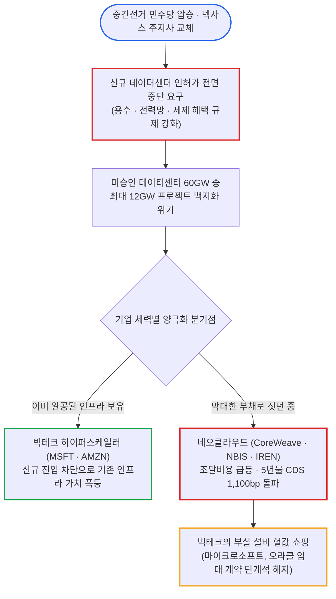

# 2026년 11월 07일(토) 하루치 뉴스정리

- **작성일**: 2026-11-07

하루 만에 시가총액 1조 달러가 공중분해되고 개미들이 코로나 팬데믹 이후 최대 규모인 3억 3,800만 달러의 주식을 내던진 지 불과 24시간 만에, 뉴욕 증시는 얄팍한 '저가 매수' 간판을 걸고 반등 놀이를 벌였다. 필라델피아 반도체지수가 4.2% 반등하고 AMD가 11% 뛰었다고 안도하는가? 전날 두들겨 맞은 12.3% 폭락의 3분의 1도 못 건진 기술적 되돌림에 불과하다. 같은 시각, 미국 10월 비농업 고용은 16만 5천 명으로 시장 예상치의 2.5배를 폭격했고, 시카고 선물시장은 연방준비제도(Fed)의 12월 기준금리 '인상' 확률을 77.1%로 못 박았다. 10년물 국채금리가 4.86%로 치솟고 텍사스 주정부가 데이터센터 신규 인허가에 셔터를 내리겠다고 으름장을 놓는 동안, 시장 밑바닥에서는 진짜 돈을 쥔 자들의 무자비한 옥석 가리기가 시작됐다.

## 요약

| 구분 | 주요 내용 |
| :--- | :--- |
| **핵심 진단** | 전일 반도체 -12.3% 폭락 후 기술적 반등(필라델피아 반도체 +4.2%) 연출. 그러나 10월 고용 서프라이즈(16.5만 명)로 12월 금리 '인상' 베팅(77.1%) 급등하며 채권 약세·달러 강세 재점화 |
| **핵심 종목 팩트** | AMD +11%·램리서치 $25B 자사주매입(+10.7%) 반등 vs 엔비디아의 TSMC 3D 메모리 개발 요청 및 마이크론 대만 팹 파업 중단, 테슬라 사이버트럭 '27년 단종 선언 |
| **착시 교정** | ① 반도체 V자 반등 환호 vs 전날 폭락분의 3분의 1 수준 기술적 반등 및 개미 패닉셀($3.38억) 후 3배 레버리지 몰빵 투기, ② AI 불패론 vs 텍사스 규제로 12GW 취소 위기 및 코어위브 CDS 1,100bp 폭등 |
| **돈길 확산 신호** | 인허가 끝난 기존 데이터센터를 쥔 하이퍼스케일러(MSFT·AMZN)의 독점 해자 강화, $137B 현금 쥐고도 $70B 회사채 발행해 유동성 비축하는 애플, $20B 계약 수주한 광학(COHR) |
| **가장 더러운 변수** | 10월 비농업 신규 고용 16.5만 명(예상 6.5만 명) 폭증에 따른 12월 금리 인상 확률 77.1%, 민주당 양원 장악 후 텍사스 데이터센터 건설 중단 법안 발의 및 빅테크 의회 청문회 소환 |
| **계좌 행동 지침** | 차입금에 의존하는 네오클라우드(CRWV·NBIS) 및 펀더멘털 훼손 레거시(NKE·FIVN) 전량 정리, 현금흐름 막강한 독점 인프라주 압축, 패닉 후 3배 레버리지(TQQQ·SOXL) 추격 매수 즉각 중단 |

---

## 1. 기술적 반등의 덫과 12월 금리 발작

하루 전인 11월 5일 뉴욕 증시가 목격한 것은 단순한 조정이 아니었다. 매그니피센트 7(M7)에서만 시가총액 1조 달러가 사라졌다. 엔비디아 혼자 4,400억 달러(-9%)를 증발시키며 연초 이후 수익률을 -2.6%로 처박았고, 필라델피아 반도체지수는 하루 만에 12.25% 폭락했다. 공포에 질린 미국 개인투자자들은 단 하루 만에 개별 주식 3억 3,800만 달러어치를 내던졌다. 2020년 3월 코로나 팬데믹 폭락장 이후 6년 만에 터진 최대 규모의 개미 투매였다. 하지만 그 개미들은 현금을 쥐고 도망친 것이 아니었다. 주식을 던진 돈으로 TQQQ와 SOXL 같은 3배 레버리지 ETF에 불나방처럼 뛰어들었다. 투매와 강제 청산, 맹목적 도박이 뒤엉킨 아비규환이었다.

그리고 11월 6일 장이 열리자 나스닥은 1.09% 반등했고 필라델피아 반도체지수는 4.21% 뛰었다. 언론과 증권가는 기다렸다는 듯 '저가 매수세 유입'이라며 축포를 쐈다. 착각하지 마라. 전날 12.3% 두들겨 맞은 반도체 지수가 고작 4.2% 오른 것은 반등이 아니라 시체에 전기를 통하게 한 반사작용이다. 다우 지수는 0.46% 떨어져 반등 대열에 끼지도 못했다. S&P 500 구성 종목 중 34.6%가 52주 최고가 대비 20% 이상 떨어진 약세장에 진입해 있고, 나스닥 100 종목의 58.4%가 고점 대비 -20% 아래서 허우적대고 있다.

진짜 뇌관은 주식 시장 뒤편의 채권과 고용 지표에서 터졌다. 미국 노동부가 발표한 10월 비농업 신규 고용은 16만 5천 명으로 시장 예상치(6만 5천 명)의 2.5배를 훌쩍 넘었다. 지난 두 달 치 수치도 8만 4천 명 상향 수정됐다. 실업률은 4.2%에서 4.1%로 떨어졌고, 시간당 평균임금은 전월 대비 0.4% 뛰어올랐다. 고용 시장이 식기는커녕 펄펄 끓고 있다는 증거다.

| 주요 지표 및 자산군 | 전일 대비 변동 | 현재 수치 / 종가 | 시장 함의 및 실전 판정 |
| :--- | :--- | :--- | :--- |
| **다우존스 30** | -237.33pt (-0.46%) | 51,285.73 | 경기 민감 대형주 부진, 기술주 반등 온기 차단 |
| **S&P 500** | +23.13pt (+0.31%) | 7,376.86 | 전일 급락 대비 미미한 반등, 34.6%가 약세장 진입 |
| **나스닥 종합** | +264.43pt (+1.09%) | 24,579.42 | 대형 기술주 반등 주도했으나 장중 상승폭 반납 |
| **필라델피아 반도체** | +379.84pt (+4.21%) | 9,390.25 | 전일 -12.25% 폭락 대비 3분의 1 되돌림에 불과 |
| **미 국채 2년물 금리** | +4.50bp | 4.5220% | 통화정책 민감 단기 금리 급등, 긴축 우려 반영 |
| **미 국채 10년물 금리** | +2.20bp | 4.8580% | 장기 금리 4.86% 재진입, 주식 할인율 압박 가중 |
| **12월 금리 인상 확률** | +10.2%p (66.9% ➔ 77.1%) | 77.1% | CME 페드워치 기준 연내 25bp '추가 인상' 기정사실화 |
| **달러 인덱스 (DXY)** | +0.683pt (+0.67%) | 102.280 | 국채금리 급등과 맞물려 달러 독주, 글로벌 유동성 흡수 |
| **금 선물 (COMEX)** | -47.80달러 (-1.16%) | 4,065.70달러/oz | 강력한 고용 지표와 달러 강세에 온스당 $4,065로 후퇴 |
| **서부텍사스산원유 (WTI)** | +0.31달러 (+0.34%) | 90.83달러/배럴 | 중간선거 후 종전 협상 탐색 속 배럴당 90달러선 횡보 |

위 표에서 가장 중요한 숫자는 시카고상품거래소(CME) 페드워치툴의 12월 기준금리 인상 확률이다. 전날 66.9%에서 77.1%로 치솟았다. 반면 금리 동결 확률은 22.9%로 쪼그라들었다. 지금 시장은 "연준이 금리를 언제 내릴까"를 논하는 장이 아니다. "12월에 금리를 또 올리면 부채로 버티던 기업들이 얼마나 쓰러질까"를 걱정해야 하는 살얼음판이다. 국채 2년물 금리는 4.52%로 튀었고 10년물 금리는 4.86%를 기록하며 수익률 곡선이 평평해지는 베어 플래트닝이 일어났다. 달러인덱스는 102.28로 급등했고, 금값은 온스당 4,065달러로 1.16% 주저앉았다. 고용이 너무 좋아서 금리를 더 올려야 하는 거시경제 환경은 밸류에이션이 잔뜩 부푼 기술주에게 쥐약이다.

---

## 2. 텍사스 규제 장벽과 네오클라우드 학살

기술주 폭락의 도화선은 중간선거 결과였다. 민주당이 연방 상원과 하원을 모두 장악한 데 이어, 공화당 텃밭이던 텍사스 주지사 선거에서 민주당 지나 히노호사(Gina Hinojosa) 당선인이 승리했다. 히노호사는 당선되자마자 CNN과의 인터뷰에서 비수를 꽂았다. 주민 보호 조치가 법제화될 때까지 텍사스 내 데이터센터 신규 건설을 전면 중단하겠다고 선언한 것이다. 전력망 파괴, 냉각수 고갈, 지방정부의 과도한 세제 혜택을 손보겠다는 뜻이다. 나아가 텍사스공원야생동물국에 스페이스X로의 공공부지 매각 논의까지 즉각 중단하라고 요구했다.

서스퀘하나의 분석에 따르면 2025년부터 2030년까지 계획된 미국 AI 데이터센터 인프라는 총 148GW 규모다. 이 중 40%에 달하는 60GW는 아직 정부 인허가조차 받지 못했다. 최악의 시나리오에서는 2028 ~ 2030년에 예정된 프로젝트 중 12GW가 완전히 취소될 수 있다. 승인을 기다리던 사업 5개 중 1개가 백지화된다는 소리다.

이 다이어그램이 보여주는 결론은 명확하다. 규제의 칼날은 모든 기업을 똑같이 베지 않는다. 빚으로 GPU를 사들이며 몸집을 불리던 네오클라우드(Neo-Cloud) 기업들의 숨통부터 끊는다. 코어위브(CRWV), 네비우스(NBIS), 아이렌(IREN) 같은 기업들은 10월 한 달 동안에만 주가가 30% 넘게 폭락했다. 특히 코어위브의 5년물 신용부도스와프(CDS) 프리미엄은 1,100bp를 넘어섰다. 시장이 이들의 부도 위험을 정크본드 수준으로 평가하기 시작했다는 뜻이다.

반면 이미 전력망과 인허가를 확보하고 가동 중인 마이크로소프트(MSFT)와 아마존(AMZN) 같은 하이퍼스케일러에게 신규 규제는 오히려 경쟁자의 진입을 막는 거대한 해자(규제적 참호)가 된다. 신규 공급이 막히면 이미 지어진 컴퓨팅 자원의 몸값은 천정부지로 솟는다. JP모건 자산운용이 지적했듯, 막대한 현금을 쥔 하이퍼스케일러들은 자금난에 빠진 네오클라우드 기업들의 데이터센터 설비를 헐값에 주워 담을 준비를 하고 있다. 이미 마이크로소프트는 오라클(ORCL)로부터 임대해 쓰던 AI 컴퓨팅 자원 계약을 단계적으로 종료하기 시작했다. 자체 인프라가 궤도에 오르자 외부 임대 비용부터 쳐내는 것이다. 오라클 주가는 장중 5.17% 급락하며 비명을 질렀다.

일론 머스크의 왕국도 정면타를 맞았다. 머스크는 공화당 후보들에게 4억 7,000만 달러가 넘는 천문학적 정치자금을 쏟아부었지만 참패했다. 그 결과 테슬라(TSLA)와 스페이스X는 이틀 만에 합산 시가총액 4,560억 달러(약 630조 원)를 허공에 날렸다. 머스크의 개인 자산도 8,000억 달러 아래로 미끄러졌다. 민주당 의회는 테슬라의 자율주행 조사와 스페이스X의 텍사스 스타베이스 슈퍼컴퓨터 증설에 대한 전방위 조사를 벼르고 있다. 테슬라가 품질 불량과 리콜로 얼룩진 사이버트럭을 2027년 중반에 단종시키고 무인 로보택시인 '사이버캡' 양산에 올인하겠다고 밝힌 것도, 이런 사방의 규제 압박 속에서 활로를 찾으려는 고육지책이다.

---

## 3. 빅테크 실탄 확보와 AI 자금줄 균열

시장이 혼돈에 빠지자 현금 부자 빅테크는 즉각 방어벽을 쳤다. 애플(AAPL)은 7개 만기 구조로 70억 달러가 넘는 회사채를 발행하기로 결정했다. 애플이 보유한 현금성 자산만 1,370억 달러이고 연간 영업현금흐름이 1,450억 달러에 달한다. 그런 회사가 2025년 5월 이후 1년 반 만에 다시 채권 시장에서 거액을 당기는 이유가 무엇일까. 다이와 캐피털이 경고했듯, 2027년부터 메모리 가격 상승과 부품 품귀로 인한 원가 압박이 본격화될 것에 대비해 가장 유리한 조건으로 실탄을 쟁여두는 것이다.

한편 인공지능 진영의 핵심 자금줄이었던 앤트로픽(Anthropic)의 기업공개(IPO) 전선에는 심각한 파열음이 나고 있다. 앤트로픽은 추수감사절 직전 IPO를 통해 최대 1,000억 달러를 조달하고 1.5조 달러 이상의 기업가치를 인정받을 계획이었다. 그러나 AI 투자 심리가 급랭하면서 기관 투자자들은 기업가치를 1조 달러 수준으로 대폭 깎아야 한다고 압박하고 있다. 자금 조달 목표액도 800억 달러로 축소되거나 IPO 자체가 연기될 위기다. 앤트로픽은 엔비디아 반도체와 클라우드 용량 확보를 위해 무려 9,000억 달러에 달하는 장기 구매 약정을 맺어둔 상태다. 앤트로픽의 몸값이 깎이고 상장이 꼬이면 지분을 쥐고 있는 알파벳(GOOGL), 아마존, 엔비디아의 장부 가치에도 도미노 충격이 번진다.

| 기업 / 섹터 | 당일 주가 흐름 | 핵심 팩트 및 경영 지표 | 시장 함의 및 리스크 평가 |
| :--- | :--- | :--- | :--- |
| **램 리서치 (LRCX)** | +10.7% 급등 | 250억 달러 규모 자사주매입 승인, 분기배당 $0.33 | 전일 -16% 폭락 후 대규모 주주환원으로 바닥 방어 |
| **마이크론 (MU)** | +6.8% 상승 (상단 제한) | 대만 45억 달러 EUV 메모리 공장 노사 갈등으로 건설 중단 | 엔비디아의 TSMC 3D 메모리 개발 요청으로 점유율 위협 |
| **애플 (AAPL)** | 보합권 등락 | $70억+ 회사채 발행 추진, $137B 현금 보유에도 실탄 확충 | '27년 메모리 가격 상승 및 부품 부족에 따른 마진 압박 대비 |
| **코어위브 (CRWV)** | +8.8% 반등 | 10월 주가 -30% 이상 폭락, 5년물 CDS 프리미엄 1,100bp 돌파 | 자금조달 비용 급등으로 차입 중심 AI 인프라 모델 한계 |
| **앤트로픽 (비상장)** | IPO 불확실성 증폭 | 목표 밸류 1.5조 달러 ➔ 1조 달러 하향 논의, $9,000억 약정 의무 | 상장 차질 시 알파벳·아마존·엔비디아 연쇄 충격 불가피 |
| **나이키 (NKE)** | 투자의견 매도 하향 | 조던 매출 $87억 ➔ $70.3억 급감, 1Q 중국 매출 -26% 폭락 | 트루이스트 목표가 $29 제시, 브랜드 파워 붕괴 및 소비 침체 |
| **파이브나인 (FIVN)** | -19.2% 폭락 | EPS 가이던스 대폭 하향, Level AI 인수액 3.25억 달러 지출 | 실적 부진 속 무리한 AI 인수합병으로 주주가치 훼손 |

반도체 공급망 내부에서도 균열이 감지된다. 램 리서치(LRCX)는 전날 16% 폭락하자마자 250억 달러(약 34조 원) 규모의 천문학적 자사주 매입 카드를 꺼내며 10.7% 급반등했다. 경영진이 회삿돈을 쏟아부어 주가를 띄운 것이다. 반면 마이크론 테크놀로지(MU)는 6.8% 반등했지만 표정이 어둡다. 대만 노조와의 협상 결렬로 45억 달러 규모의 극자외선(EUV) 차세대 D램 공장 건설이 전면 중단됐다. 마이크론 생산량의 60%를 차지하는 대만에서의 차질은 2027년 차세대 메모리 공급에 치명타다. 설상가상으로 엔비디아가 TSMC에 직접 첨단 3차원(3D) 메모리 반도체 개발을 요청했다는 소식이 전해졌다. 삼성전자, SK하이닉스, 마이크론이 과점하던 메모리 시장에 세계 최대 파운드리인 TSMC가 경쟁자로 뛰어든다면 메모리 3사의 마진율은 무너질 수밖에 없다.

여기에 지정학 리스크까지 기름을 붓고 있다. 미국 공화당 의원들은 엔비디아의 젠슨 황 CEO에게 11월 18일 비공개 브리핑에 출석해 중국 정보기관 연계 의혹을 해명하라고 공식 통보했다. 엔비디아 고객사인 싱가포르 메가스피드의 전직 임원이 중국에 기밀을 넘겼다는 의혹 때문이다. 미국 정부의 대중국 반도체 수출 통제망은 이미 구멍이 숭숭 뚫려 있다. 중국 스타트업 문샷 AI(Moonshot AI)는 미국의 규제를 비웃듯 유럽 클라우드 업체를 통해 엔비디아 블랙웰 GPU 8,000개 이상을 원격으로 확보하고 있다. 의회가 통제 강화 입법을 밀어붙이면 엔비디아의 해외 클라우드 매출처마저 강제 폐쇄될 수 있다.

---

## 4. 피바다 속 계좌 생존을 위한 실행 지침

하루 반등에 흥분해서 계좌 비밀번호를 누르는 것은 시장의 총알받이가 되겠다고 자청하는 짓이다. 공포에 질려 바닥에서 주식을 집어 던진 뒤, 다시 3배 레버리지 ETF(TQQQ, SOXL)를 매수하는 개미들의 매매 행태는 언제나 계좌 청산으로 끝났다. 지금 시장에서 돈을 지키고 기회를 잡기 위한 냉혹한 생존 수칙 4가지를 머릿속에 박아라.

1. **레버리지 상품(3X ETF)을 전량 폐기하라**:
    - 변동성 지수(VIX)가 25를 웃돌고 10년물 금리가 4.86%인 장세에서 3배 레버리지는 자살행위다.
    - 하루 4% 반등에 속아 SOXL이나 TQQQ를 추격 매수하면, 다음 하락 파동 한 방에 계좌 원금이 녹아내린다. 지금은 베팅할 때가 아니라 방어할 때다.

2. **부채로 연명하는 네오클라우드와 좀비 기업을 잘라내라**:
    - 코어위브처럼 CDS 프리미엄이 1,100bp를 넘어선 기업이나 파이브나인(FIVN)처럼 실적을 깎아 먹으며 빚내서 AI 기업을 인수하는 곳은 가차 없이 손절해라.
    - 나이키(NKE)처럼 조던 브랜드 매출이 꺾이고 중국 시장에서 점유율을 잃는 소비재(-26% 폭락)도 반등의 기대를 버려야 한다. 실적과 현금흐름에 구조적 구멍이 뚫린 종목은 반등장에서도 가장 먼저 버림받는다.

3. **인허가 장벽을 친 하이퍼스케일러와 현금 부자에게 피신하라**:
    - 데이터센터 규제가 강해질수록 이미 완공된 전력과 서버를 쥔 마이크로소프트, 아마존 같은 기업의 희소성은 극대화된다.
    - $1,370억 현금을 쥐고도 선제적으로 70억 달러 회사채를 찍어 유동성을 잠그는 애플처럼, 대공황급 위기가 와도 버틸 체력이 있는 메가캡으로 포트폴리오를 압축해라.

4. **12월 금리 인상 쇼크에 대비해 현금 비중을 30% 이상 확보하라**:
    - 10월 신규 고용 16.5만 명 폭증으로 12월 금리 인상 확률이 77.1%까지 치솟았다.
    - 연준이 진짜로 기준금리를 올리거나 매파적 동결을 시사할 경우 기술주는 전저점을 깨고 내려갈 수 있다. 그때 진짜 헐값에 나올 우량주를 쓸어 담을 현금 실탄을 반드시 손에 쥐고 있어야 한다.
