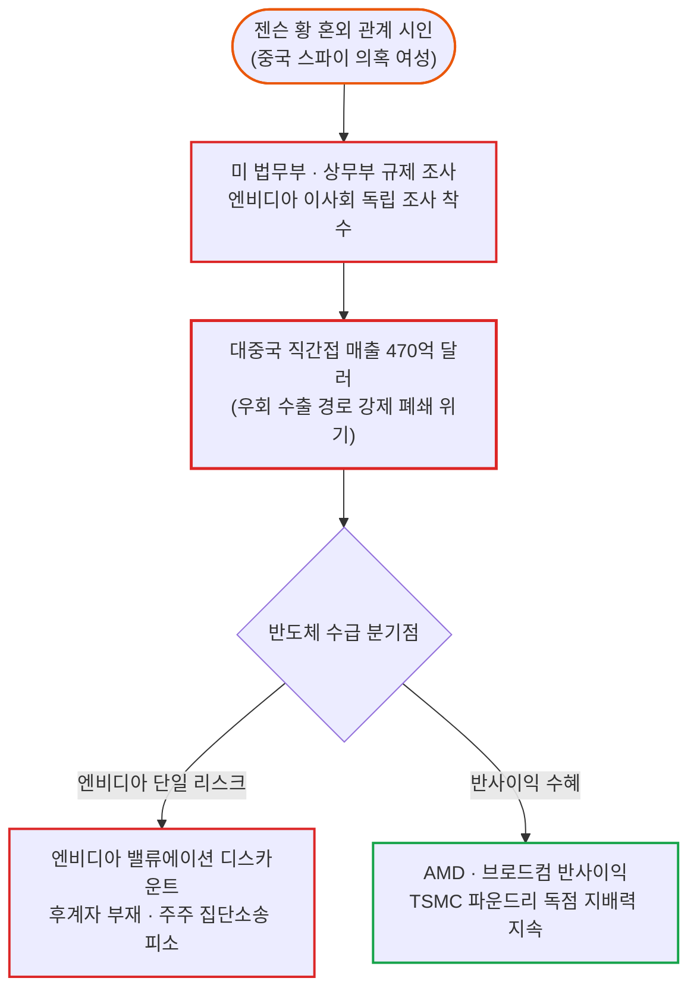

# 2026년 11월 10일(화) 하루치 뉴스정리

- **작성일**: 2026-11-10

필라델피아 반도체지수가 하루 만에 6.85% 폭등하며 30개 종목 중 29개가 축포를 쏘아 올렸지만, 인공지능(AI) 황제 엔비디아 혼자 시가총액 1,900억 달러(약 260조 원)를 허공에 날리며 처참하게 왕따당했다. 젠슨 황의 중국 스파이 불륜 스캔들이라는 사생활 막장극 뒤편에는 470억 달러에 달하는 대중국 우회 수출 규제 뇌관과 후계자 전무라는 1인 지배구조의 민낯이 도사리고 있다. 트럼프의 이란 협상 유화 발언으로 국제유가가 4.4% 폭락했음에도, 시카고 선물시장의 12월 기준금리 인상 베팅은 84.5%로 치솟았고 미 10년물 국채금리는 4.86% 위에서 단 1bp도 내려앉지 않았다. 시장의 표면은 화려한 불꽃놀이지만, 수면 아래에서는 가짜 반등에 속은 개미들의 피를 빨아먹는 냉혹한 차별화가 진행 중이다.

## 요약

| 구분 | 주요 내용 |
| :--- | :--- |
| **핵심 진단** | 필리지수 +6.85% 폭등 속 엔비디아(-4.27%) 홀로 소외. 젠슨 황 사생활 스캔들이 촉발한 대중국 우회 매출(최대 $47B) 규제 조사 및 1인 후계자 부재 리스크 부각 |
| **핵심 종목 팩트** | AMD +13.26%(오펜하이머 목표가 $600 상향), TSMC 10월 매출 +59.7% YoY 폭증, 테이크투(TTWO) GTA VI 예약 771만 건 돌파 vs 보잉·펩시코·스카이댄스 대규모 인력 감원 |
| **착시 교정** | ① 젠슨 황 단순 사생활 해프닝 ➔ 미 법무부(DOJ) 이관 및 470억 달러 대중 매출 차단 리스크, ② 유가 폭락($86) 안도감 ➔ 12월 금리 '인상' 확률 84.5% 폭등, ③ 반도체 1만선 탈환 ➔ 숏스퀴즈성 기술적 반등 |
| **돈길 확산 신호** | 엔비디아 단일 의존 탈피한 ASIC·대안 반도체(AMD·AVGO) 분산, 현금 파이프라인 확실한 소프트웨어·플랫폼(유튜브 $60B 독점, GTA VI 순현금 전환), 허가 완료 데이터센터(ORCL) |
| **가장 더러운 변수** | 엘리자베스 워런 상원 은행위원장 내정에 따른 빅테크·AI 규제 칼날, 10년물 국채금리 4.86% 고착화 및 12월 연준 추가 금리 인상 공포, 10월 CPI 대기 |
| **계좌 행동 지침** | 급반등한 레버리지(SOXL·TQQQ) 추격 절대 금지, 엔비디아 몰빵 비중 대안 반도체 및 현금 흐름 우량주로 압축 분산, 12월 추가 긴축 대비 현금 실탄 30% 유지 |

---

## 1. 젠슨 황 스캔들과 엔비디아 왕따

뉴욕 증시의 3대 지수가 2% 넘게 반등하고 필라델피아 반도체지수가 6.85% 치솟으며 10,033.93으로 1만 선을 탈환한 날, 잔칫집의 주인공이어야 할 엔비디아(NVDA)는 홀로 초상집이었다. 장중 9% 가까이 폭락한 끝에 4.27% 하락한 178.67달러로 마감하며 시가총액 1,900억 달러가 날아갔다. 필라델피아 반도체 구성을 이루는 30개 종목 중 하락한 것은 오직 엔비디아 단 하나뿐이었다.

발단은 막장 드라마 같은 사생활 폭로였다. 젠슨 황 CEO가 중국 정보기관(국가안전부 MSS) 스파이로 의심받는 싱가포르 클라우드 인프라 기업 메가스피드(Megaspeed)의 전직 임원 앨리스 황과의 혼외 관계를 공식 시인했다. 엔비디아 이사회는 부랴부랴 독립 조사위원회를 꾸렸고, 캘리포니아 북부 연방법원에는 경영진이 중요 정보를 은폐해 주주를 오도했다는 집단소송이 접수됐다.

그러나 월가의 진짜 타짜들이 주목하는 것은 침실 스캔들이 아니다. 공매도 업체 컬퍼리서치(Culper Research)가 이미 6개월 전 지적했던 '엔비디아의 치명적인 중국 문제'가 현실화된 것이다. 뉴스트리트 리서치에 따르면 엔비디아의 2027 회계연도 전체 매출 약 4,110억 달러 중 최대 10%에 달하는 370억 ~ 470억 달러가 중국 시장과 직간접적으로 연결되어 있다. 정식 규제를 준수하는 직접 매출 260억 달러(6%) 외에, 제3국을 우회하거나 중국 자본이 통제하는 해외 데이터센터를 거치는 불법 우회 매출만 150억 달러(4%)에 달한다.

미국 상무부는 메가스피드 조사를 미 법무부(DOJ)로 정식 이관했다. 여기에 민주당의 중간선거 압승으로 내년 1월 상원 은행위원장에 취임할 엘리자베스 워런 의원이 첨단 AI 칩의 중국 수출 우회 경로를 뿌리 뽑겠다고 선언했다. 트럼프가 "젠슨 황은 명예로운 사람이고 스파이라는 사실을 몰랐을 것"이라며 방어막을 쳐주고 캐시 우드의 아크인베스트가 5개 ETF로 9만 443주를 주워 담았지만, 핵심은 젠슨 황 없는 엔비디아의 대안이 전무하다는 1인 지배구조의 구조적 취약점이다.

---

## 2. 유가 4% 폭락과 12월 금리 발작

증시 반등의 일등 공신은 뜻밖에도 중동에서 날아온 기름값 폭락이었다. 트럼프 대통령이 CNN 인터뷰에서 이란과의 강력한 협상을 전제로 "전쟁을 재개할 가능성은 극히 작다"는 말을 5차례나 반복하자 국제유가가 곤두박질쳤다. 서부텍사스산원유(WTI) 12월물은 4.38% 추락한 배럴당 86.85달러로 8월 말 이후 최저치를 갈아치웠고, 브렌트유 역시 5.85% 급락한 92.57달러로 마감했다.

사우디 매체 알 아라비야에 따르면 카타르와 파키스탄의 중재로 미국과 이란의 종전 협상이 급물살을 타고 있다. 이란 내 국제원자력기구(IAEA) 사찰단 복귀, 우라늄 농축 3.67% 상한 동결, 이란 동결자산 60억 ~ 90억 달러 해제, 호르무즈 해협 즉각 재개방이 협상 테이블에 올라왔다. 지정학 전쟁 프리미엄이 걷히자 달러인덱스(DXY)는 101.67로 0.59% 떨어졌고, 달러-원 환율도 1,340원선으로 내려왔다.

그러나 멍청한 대중이 유가 하락을 보며 "이제 인플레이션이 끝났고 연준이 돈을 풀 것"이라며 샴페인을 터뜨릴 때, 채권시장은 정반대의 살벌한 경고를 보냈다. 미 국채 10년물 금리는 유가가 4% 넘게 떨어졌는데도 4.8620%로 오히려 0.4bp 올랐고, 통화정책에 민감한 2년물 금리는 4.5470%로 2.5bp나 상승했다. 주식 랠리로 안전자산 채권 매수세가 상쇄된 데다, 10월 비농업 고용 16만 5천 명 서프라이즈의 후폭풍이 가시지 않은 탓이다.

| 주요 자산 지표 | 당일 수치 / 종가 | 전일 대비 변동폭 | 시장 함의 및 위험 신호 |
| :--- | :--- | :--- | :--- |
| **S&P 500** | 7,549.94 | +173.08pt (+2.35%) | 저가 매수 유입, 7,500선 회복했으나 레버리지 숏커버 주도 |
| **나스닥 종합** | 25,253.14 | +673.71pt (+2.74%) | 기술주 반등 이끌었으나 엔비디아 홀로 역주행 마감 |
| **필라델피아 반도체** | 10,033.93 | +643.68pt (+6.85%) | 3거래일 만에 10,000선 탈환, 30개 중 29개 급등 |
| **미 10년물 국채금리** | 4.8620% | +0.40bp | 유가 폭락에도 4.86%대 고착화, 밸류에이션 할인율 압박 유지 |
| **미 2년물 국채금리** | 4.5470% | +2.50bp | 단기 긴축 우려 반영, 12월 추가 금리 인상 공포 반영 |
| **12월 금리 인상 확률** | 84.5% | +8.2%p (76.3% ➔ 84.5%) | CME 페드워치 기준 연내 25bp 추가 금리 인상 기정사실화 |
| **서부텍사스산원유 (WTI)** | 86.85달러/배럴 | -3.98달러 (-4.38%) | 트럼프 이란 종전 유화 발언 및 호르무즈 개방 기대로 폭락 |
| **달러 인덱스 (DXY)** | 101.674 | -0.606pt (-0.59%) | 전쟁 공포 완화 속 하락, 글로벌 위험자산 선호 심리 자극 |
| **금 선물 (COMEX)** | 4,114.50달러/oz | +39.60달러 (+0.97%) | 달러 약세 및 인민은행 24개월 연속 금 매집 지속 속 반등 |
| **변동성 지수 (VIX)** | 19.92 | -5.72pt (-22.31%) | 공포 프리미엄 급격 완화, 20선 아래로 일시 복귀 |

가장 소름 돋는 숫자는 시카고상품거래소(CME) 페드워치의 12월 기준금리 25bp 추가 인상 확률이다. 전날 76.3%에서 84.5%로 수직 상승했다. 금리 동결 확률은 15.5%로 쪼그라들었다. 시카고 연방준비은행 총재조차 "연준은 물가 관리 실패를 인정해야 한다"고 쏘아붙였다. 유가가 빠져도 임금과 서비스 물가가 버티고 있어 연준은 12월에 금리를 또 올릴 채비를 하고 있다. 고금리가 장기화되는 한, 부채로 연명하는 기업들의 도산 시계는 멈추지 않는다.

---

## 3. 반도체 6.8% 폭등과 실적 양극화

반도체 판에서는 지각변동이 일어났다. 엔비디아의 독점 옹벽에 균열이 가자 대안 칩 메이커들이 폭발적인 랠리를 펼쳤다. AMD는 오펜하이머가 투자의견을 '시장수익률 상회'로 올리고 목표주가 600달러를 제시하자 무려 13.26% 폭등한 508.58달러로 장을 마쳤다. 앤트로픽과의 전략적 파트너십과 차세대 GPU MI500 출시가 엔비디아의 빈자리를 파고들 것이라는 분석이다. 브로드컴(AVGO)도 맞춤형 ASIC 수요 기대감으로 8.78% 올랐고, 어플라이드 머티어리얼즈(AMAT)는 11.37% 급등했다.

세계 파운드리 맹주 TSMC는 실적으로 차별화된 위상을 증명했다. 10월 연결 매출이 5,868억 9천만 대만달러로 전년 동기 대비 59.7%, 전월 대비 14.7% 폭증했다. 1 ~ 10월 누적 매출만 4조 4,856억 대만달러(+43.3%)에 달한다. 엔비디아가 TSMC에 3차원(3D) D램 생산 계획 수립을 요청했다는 소식은 파운드리가 메모리 영역까지 손을 뻗어 공급망 주도권을 쥐고 흔들 것임을 보여준다. 반면 중국 본토 반도체 IPO는 장쑤 신더가 상장 첫날 패키징 경쟁력으로 42% 폭등한 반면, GPU 제조사 쑤저우 덩린은 8.6% 급락하며 기술력 없는 껍데기 기업의 몰락을 보여줬다.

실적과 펀더멘털의 격차는 개별 기업 성적표에서 더욱 참혹하게 드러났다. 돈을 확실하게 쓸어 담는 기업은 가이던스를 올리고 환호했지만, 비용 압박과 수요 둔화에 짓눌린 레거시 기업들은 대량 해고의 피바람을 맞았다.

| 기업명 / 티커 | 당일 주가 변동 | 3분기 실적 및 주요 경영 수치 | 시장 함의 및 펀더멘털 평가 |
| :--- | :--- | :--- | :--- |
| **테이크투 (TTWO)** | 시간외 +4.63% | 연간 매출 가이던스 $7.98B ~ $8.18B 상향, GTA VI 예약 771만 건 | 신작 예약 폭발로 회계연도 말 순현금 전환 확실시 |
| **스카이댄스 (SKYD)** | 정규장 강세 마감 | 3년간 $60억 비용 절감 발표, 백오피스·AI로 $22억 감축 | 파라마운트-워너 합병 후 고위 임원 8명 퇴진 및 인력 구조조정 |
| **보잉 (BA)** | -0.59% ($172.38) | 상업용 항공기 인력 5%(약 2,500명) 감원 공식화 | 737 Max 증산 '27년 초 지연, FCF $100억 달성 '29년으로 연기 |
| **펩시코 (PEP)** | +0.38% ($141.88) | 북미 사업부 인력 1,000명 감원, 음료 출하량 -2% 감소 | 엘리엇의 $40억 지분 압박 속 원가 상승 및 스낵 수요 부진 대응 |
| **로켓랩 (RKLB)** | 시간외 -6.37% | 역대 최대 매출 $2.68억(+72.7%), 수주잔고 $35.7억 | 뉴트론 단가 $7,000만(+27%) 인상에도 EPS 적자(-$0.12) 지속 실망 |
| **힘스앤드허스 (HIMS)** | 시간외 -3.40% | 매출 $8.90억(+48.6%), 순손실 -$0.14 적자 전환 | 비만약 마진 하락 및 연간 EBITDA 가이던스 하향으로 급락 |
| **플러그파워 (PLUG)** | 시간외 -0.67% | 매출 $2.01억 상회, GAAP 순익 $9,904만 흑자 전환 | 전환사채 평가익($1.92억)에 의존한 무늬만 흑자, 현금 $1.34억 바닥 |
| **일라이릴리 (LLY)** | 헬스케어 강세 | 경구용 비만약 수면무호흡증 임상 3상 성공 (호흡중단 -44%) | 주사제 한계 넘는 경구용 파운다요의 적응증 확대로 해자 강화 |

비용 절감과 인력 감축은 제조업과 소비재 전반으로 번졌다. 보잉(BA)은 737 Max 증산 일정이 2027년으로 밀리자 직원 2,500명을 잘라내기로 했고, 잉여현금흐름 100억 달러 달성 목표도 2029년으로 1년 미뤘다. 펩시코(PEP) 역시 북미 음료 판매가 2% 줄어들자 행동주의 펀드 엘리엇의 40억 달러 압박에 밀려 1,000명 감원 카드를 꺼냈다. 반면 테이크투 인터랙티브(TTWO)는 11월 19일 출시될 GTA VI의 디지털 예약 판매량이 771만 건을 돌파하며 연간 매출 가이던스를 최대 81.8억 달러로 끌어올렸다. 회계연도 말에 순현금 기업으로 전환된다는 자신감이다.

미디어 생태계에서는 구글 유튜브의 완벽한 승리가 확인됐다. 스카이댄스가 3년간 60억 달러를 쥐어짜며 HBO Max와 파라마운트+를 묶는 동안, 유튜브는 2025년 기준 매출 600억 달러(약 81조 원)를 달성하며 넷플릭스(450억 달러)를 아득히 따돌렸다. 미국 TV 시청 점유율 15.8%를 기록한 유튜브는 막대한 제작 선급금을 주는 레거시 미디어와 달리 크리에이터에게 광고 수익의 일부만 사후 배분해 재무 리스크가 제로다. 생성형 AI 번역과 태깅 기술까지 무장한 유튜브에 맞서 넷플릭스는 10억 달러를 들여 유튜버 모시기에 나섰지만, 판은 이미 기울었다.

---

## 4. 시장의 3대 착시와 데이터 검증

### 착시 ① 사생활 뒤 470억 달러 규제 뇌관

- **대중의 착각**: 젠슨 황의 스캔들은 흔한 최고경영자의 사생활 일탈일 뿐이며, AI 칩에 대한 독점적 수요는 변함없으니 이번 급락은 무조건 주워 담아야 할 기회다.
- **실제 팩트 데이터**: 단순 치정이 아니라 불륜 상대가 중국 국가안전부(MSS) 간첩 혐의자이며, 상대 회사가 미국의 수출 제재를 우회해 온 메가스피드라는 점이 핵심이다. 엔비디아의 중국 관련 직간접 매출 노출도는 연간 최대 470억 달러(전체 매출의 10%)에 달한다. 미 상무부에서 법무부(DOJ)로 조사가 넘어간 상태에서 엘리자베스 워런이 이끄는 상원 은행위원회가 제3국 우회 경로를 틀어막으면 470억 달러의 매출 공백과 후계자 없는 지배구조 리스크가 멀티플을 영구적으로 깎아내린다.

### 착시 ② 유가 급락 뒤 12월 금리 인상 베팅

- **대중의 착각**: 트럼프의 중동 종전 선언으로 유가가 배럴당 86달러대로 내려앉았으니 인플레이션이 완전히 잡혔고 연준의 금리 인하 사이클이 재개될 것이다.
- **실제 팩트 데이터**: 유가는 떨어졌지만 10월 비농업 신규 고용은 16만 5천 명으로 컨센서스를 2.5배 웃돌았고 실업률은 4.1%로 낮아졌다. 유가가 4% 넘게 떨어진 날에도 미 국채 10년물 금리는 4.86%를 지켰고 2년물은 4.54%로 올랐다. 시카고 선물시장의 12월 기준금리 25bp 추가 인상 확률은 76.3%에서 84.5%로 폭등했다. 연준의 발목을 잡는 것은 기름값이 아니라 식지 않는 임금과 서비스 물가다.

### 착시 ③ 반도체 1만 탈환 뒤 숏커버 착시

- **대중의 착각**: 필라델피아 반도체지수가 하루 만에 6.85% 급반등하며 10,000선을 회복했으니 중간선거 직후 터진 AI 반도체 폭락장은 완전히 끝났다.
- **실제 팩트 데이터**: 간밤의 랠리는 펀더멘털 개선에 의한 질적 반등이 아니라, 역사적 고점에 달했던 숏 포지션 청산과 과매도에 따른 기계적 숏커버링이다. 메타(META)는 3분기 대규모 설비투자(CapEx)로 잉여현금흐름이 21억 달러 적자로 전환됐고 선행 PER 18배에도 추가 디스카운트 경고를 받고 있다. 민주당의 데이터센터 전력망 규제와 빅테크 FCF 적자 리스크는 단 1밀리미터도 해결되지 않았다.

---

## 5. 기관 자금 이동: 대안 칩과 현금 파이프

스마트 머니는 엔비디아의 단일 독점 체제가 흔들리는 틈을 타 대안 반도체와 확실한 캐시카우로 포트폴리오를 발 빠르게 재편하고 있다.

첫째, 엔비디아 단일 지배력에 대한 헤지 자금이 AMD와 브로드컴, 그리고 파운드리 절대 권력인 TSMC로 이동하고 있다. 오펜하이머가 AMD 목표가를 600달러로 상향하고 MI500과 앤트로픽 협력에 주목한 것은, 하이퍼스케일러들이 엔비디아의 높은 단가와 지정학 리스크를 피하기 위해 대안 공급망을 적극 육성하고 있기 때문이다. TSMC는 엔비디아의 3D D램 요구까지 흡수하며 전 세계 AI 칩의 유일무이한 병목이자 독점 제조소로 군림하고 있다.

둘째, 막대한 빚으로 데이터센터를 짓던 네오클라우드 대신, 이미 허가를 끝마친 인프라와 확실한 소프트웨어 현금 파이프라인으로 자금이 쏠린다. 미즈호가 분석했듯 오라클(ORCL)은 5개 대규모 데이터센터 중 4개의 허가를 이미 끝내 신규 진입 규제의 최대 수혜주로 부상했다. 게임 업계에서는 테이크투(TTWO)가 GTA VI 예약 771만 건을 등에 업고 연말 순현금 전환을 예고하며 게임주 중 독보적인 수급을 빨아들이고 있다.

셋째, 안전자산과 헤지 포지션의 조용한 축적이다. 국제 금 가격은 온스당 4,114.50달러로 1% 반등했다. 중국 인민은행은 10월에도 83만 온스(약 25.8톤)를 사들이며 24개월 연속 금을 비축했다. 올해 누적 매입량만 129톤에 달한다. 달러 패권의 지정학 균열과 연준의 12월 추가 금리 인상 위험에 대비해 중앙은행과 큰손들은 주식의 반등 놀이에 취하지 않고 금과 유동성 방어막을 계속 쌓고 있다.

---

## 6. 향후 2~4주 핵심 모니터링 지표

| 핵심 모니터링 지표 | 안도 신호 (Bull) | 위험 신호 (Bear) | 시장 실전 대응 함의 |
| :--- | :--- | :--- | :--- |
| **미 10월 CPI 발표** | 헤드라인 전월비 +0.2% 이하 | 헤드라인 전월비 +0.4% 이상 | 예상치 상회 시 12월 25bp 금리 인상 100% 확정 및 채권 발작 |
| **10년물 국채금리** | 4.75% 이하 하향 안정 | 4.95% 상향 돌파 | 5.0% 재진입 시 고PER 기술주 멀티플 연쇄 압살 |
| **엔비디아 의회 및 DOJ 조사** | 단순 개인 일탈로 종결 | 대중 우회 수출 제재 위반 입증 | 470억 달러 매출 타격 및 젠슨 황 거취 위기 시 증시 폭락 |
| **브렌트유 가격** | 배럴당 90달러 하향 이탈 | 배럴당 100달러 재돌파 | 중동 협상 결렬로 유가 반등 시 스태그플레이션 공포 재점화 |
| **앤트로픽 IPO 기업가치** | 1.2조 달러 이상 방어 | 1.0조 달러 미만 붕괴 | IPO 흥행 실패 시 구글·아마존·엔비디아 장부가치 도미노 손상 |

---

## 7. 실전 포트폴리오 대응 전략

하루 반등에 흥분해서 계좌 잔고를 털어 레버리지 ETF(SOXL, TQQQ)를 추격 매수하는 행위는 기관들의 차익 실현 물량을 받아내는 자살 특공대 짓이다. 12월 기준금리 인상 확률이 84.5%에 달하고 미 국채 10년물 금리가 4.86%인 살얼음판에서 살아남기 위한 실전 포트폴리오 가이드를 제시한다.

| 자산군 / 섹터 | 추천 포지션 | 목표 비중 | 실전 대응 행동 수칙 |
| :--- | :---: | :---: | :--- |
| **AI 하드웨어 코어** | 비중 축소 및 재편 | 25% | 엔비디아 단일 몰빵을 분산해 파운드리 독점(TSMC) 및 ASIC(AVGO)으로 교체 |
| **현금흐름 소프트웨어** | 비중 확대 | 20% | 규제 장벽을 넘은 기허가 인프라(ORCL) 및 현금 창출력 검증된 플랫폼(GOOGL, TTWO) |
| **우량 경기민감주** | 분할 매수 | 15% | 밸류에이션 매력 생기고 FCF 탄탄한 산업재(CAT, GEV) 선별 진입 |
| **원자재 및 귀금속** | 보유 및 유지 | 10% | 중앙은행 24개월 연속 매집 중인 금(GLD) 및 방어용 자산 유지 |
| **안전 현금 (MMF / 단기채)** | 비중 유지 | 30% | 12월 금리 인상 쇼크 및 10년물 5.0% 시험 시 우량주 저가 줍줍용 실탄 확보 |

---

## 8. 최종 판정 및 실행 원칙

오늘 시장이 보낸 신호는 명확하다. 엔비디아라는 거대한 태양 하나에만 의존하던 AI 생태계가 균열을 보이기 시작했고, 유가가 떨어져도 금리는 내려오지 않는 잔인한 고금리 현실이 이어지고 있다.

1. **엔비디아의 사생활 프레임에 속지 마라**:
    - 본질은 치정이 아니라 470억 달러에 달하는 대중국 우회 수출 경로의 차단 위기와 대체 불가능한 젠슨 황의 1인 지배구조 리스크다.
    - 엔비디아에 쏠린 비중을 TSMC와 브로드컴, AMD 등 대안 생태계로 반드시 쪼개 놓아라.

2. **유가 급락에 속아 금리 인하 환상을 품지 마라**:
    - 페드워치의 12월 금리 인상 확률은 84.5%로 치솟았다.
    - 10년물 금리가 4.86%를 버티고 있는 한 부채 비율이 높고 FCF가 적자인 테크 기업은 반등할 때마다 팔아치워야 한다.

3. **하루 6% 폭등에 뇌동매매하지 말고 현금 30%를 사수하라**:
    - 지수가 10,000선을 되찾았다고 안도하지 마라. 지금의 반등은 과매도에 따른 기술적 되돌림과 숏커버링이 뒤섞인 불안한 줄타기다.
    - 10월 CPI와 12월 FOMC의 금리 발작이 터졌을 때 던져질 진짜 알짜 기업을 쓸어 담을 현금 실탄을 반드시 쥐고 있어라.

!!! tip "최종 핵심 제언 (Executive Takeaway)"
    필라델피아 반도체지수가 6.8% 올랐다고 축배를 들지 마라. 황제가 부상을 입고 휘청거리자 신하들이 각자도생을 시작한 형국이다. 엔비디아 없는 AI는 상상할 수 없다던 시장이 이제 젠슨 황 없는 엔비디아의 리스크를 가격에 반영하기 시작했다. 유가 하락이라는 달콤한 마약 뒤에 12월 금리 인상이라는 단두대가 기다리고 있다. 계좌에서 부채와 거품을 걷어내고, 스스로 돈을 버는 독점적 현금 파이프라인에 탑승한 채 현금 30%를 단단히 쥐고 버텨라.

