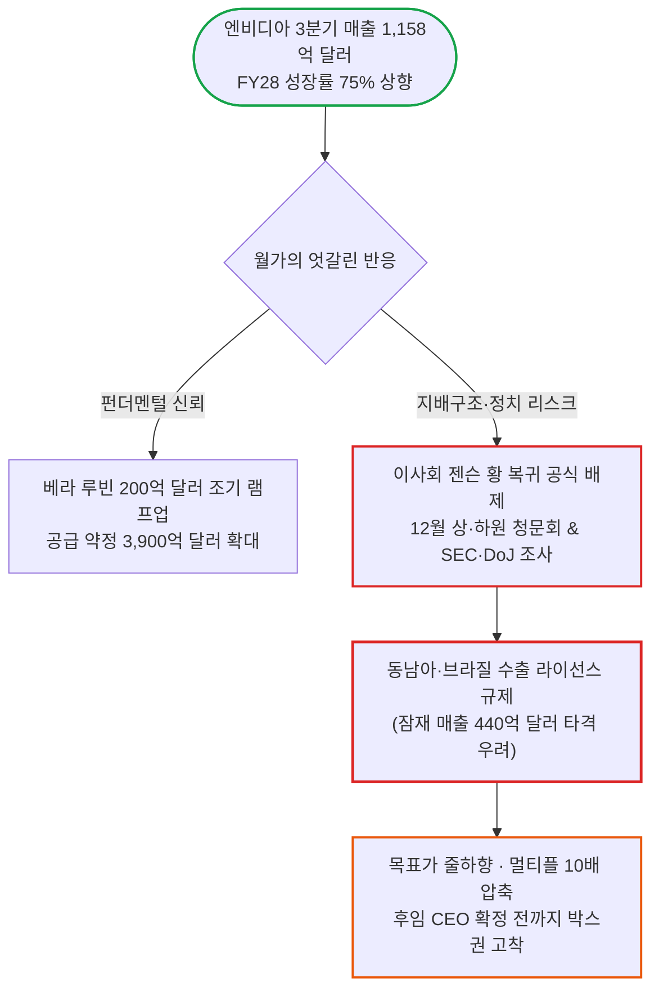

# 2026년 11월 18일(수) 하루치 뉴스정리

- **작성일**: 2026-11-18

분기 매출 1,158억 달러(약 155조 원)와 영업이익률 75%라는 인류 역사상 유례없는 성적표를 들이밀고도, 엔비디아의 목표주가는 줄줄이 깎였고 뉴욕 증시는 공포지수(VIX)가 27.7까지 치솟으며 나흘 연속 침몰했다. 젠슨 황의 복귀를 원천 봉쇄한 이사회와 의회 청문회 소환장, 그리고 미국의 대중국·동남아 수출 통제 칼날이 엔비디아의 실적 축포에 찬물을 끼얹었다. 여기에 미국 국가안보국(NSA) 기밀망과 애플, JP모건, 항공관제 시스템이 나흘 연속 줄줄이 마비되는 초유의 전산 공포까지 겹치자, 시장은 S&P 500 200일 이동평균선을 깨고 현금과 국채로 도망치기 시작했다.

## 요약

| 구분 | 주요 내용 |
| :--- | :--- |
| **핵심 진단** | 엔비디아 FY27 3분기 매출 +103%(1,158억 달러) 서프라이즈에도, 지배구조·수출규제 리스크로 밸류에이션 멀티플 강등. 미 인프라 연속 마비와 연준 매파 발언이 증시 4거래일 연속 하락 압박 |
| **핵심 종목 팩트** | 엔비디아 FY28 성장률 75% 상향 vs 파이퍼샌들러 목표가 $300 ➔ $230 하향. 앤트로픽 IPO 앞두고 세일즈포스(-9.45%)·서비스나우(-6.51%) 급락. 마이크론 $350억 자사주 매입 12월 9일 개시 |
| **착시 교정** | ① 실적 대박이면 주가 폭등 ➔ PER 멀티플 14배에서 10배로 압축, ② 네오클라우드 급등 ➔ 엔비디아 보증(1,180억 달러) 조건부 축소 경고, ③ 중국 광트랜시버 금지 ➔ 미국 빅테크·레이저 공급망 동반 타격 |
| **돈길 확산 신호** | 350억 달러 자사주 매입 앞둔 메모리 독점(마이크론·삼성전자·SK하이닉스), 2028년까지 확정된 반도체 장비(AMAT·LRCX·KLAC·ASML), 부채 회피형 AI 인프라 조달(스페이스X SPV) |
| **가장 더러운 변수** | 동남아·브라질 AI 칩 수출 라이선스 규제(매출 최대 440억 달러 타격 추산), 세인트루이스 연은 총재의 '4차례 연속 금리 인상' 경고, 12월 1일·3일 젠슨 황 의회 청문회 |
| **계좌 행동 지침** | 실적만 보고 엔비디아·네오클라우드 추격 매수 절대 금지, SaaS 투매 속 과매도 우량주 및 메모리·반도체 장비 분할 접근, VIX 25 돌파 구간 현금 비중 엄격 유지 |

---

## 1. 엔비디아의 어닝 서프라이즈와 그림자

엔비디아의 숫자는 흠잡을 데가 없었다. 2027 회계연도 3분기 매출은 1,158억 4,000만 달러로 1년 전보다 103.2% 늘었고, 주당순이익(EPS)은 2.68달러로 111% 뛰며 월가 예상치를 가볍게 뭉갰다. 데이터센터 매출만 1,076억 달러를 찍었고, 차세대 칩인 베라 루빈은 출하 첫 분기에만 200억 달러를 팔아치우며 역사상 가장 빠른 공급 확대를 증명했다. 경영진은 한 술 더 떠 중국 데이터센터 매출을 아예 빼고도 4분기 매출 전망치를 1,300억 달러(전후)로 제시했고, 2028 회계연도 매출 성장률 목표를 기존 70%에서 75%로 올려 잡았다.

그런데도 월가의 반응은 싸늘하다. 파이퍼샌들러는 이익 전망치를 올리면서도 목표주가를 300달러에서 230달러로 잘랐고(적용 PER 14배 ➔ 10배), 모간스탠리 역시 목표주가를 267달러에서 260달러로 내렸으며, 서밋인사이츠는 투자의견을 아예 보유(Hold)로 강등했다.

이유는 숫자가 아니라 사람과 정치다. 젠슨 황 전 CEO가 성명을 내고 "이사회가 부르면 복귀하겠다"며 야후파이낸스 설문 78.4%의 지지와 트럼프 대통령의 호의적 신호까지 등에 업고 복귀전을 띄웠지만, 하비 존스 이사회 의장은 콘퍼런스콜에서 "복귀 계획은 없다"며 싹을 잘랐다. 여기에 미 법무부(DoJ)와 증권거래위원회(SEC)가 메가스피드 우회 수출 및 공시 의혹을 겨냥해 칼을 빼 들었고, 젠슨 황은 오는 12월 1일 하원 비공개 면담과 3일 상원 은행위 공개 청문회 증언대에 서야 한다.

여기에 미국 상무부가 꺼내 든 동남아(싱가포르·말레이시아·인도네시아·태국) 및 브라질 대상 AI 칩 수출 라이선스 의무화가 결정타를 날렸다. 제프리스는 중국 하이퍼스케일러들이 동남아 클라우드를 통해 AI 칩을 빌려 쓰는 경로가 막힐 경우, 2027년 엔비디아 매출에 최대 440억 달러의 구멍이 뚫리고 데이터센터 증설 수요가 1 ~ 2GW 증발할 수 있다고 경고했다.

---

## 2. 국가 통신망 마비와 전산 공포의 실체

간밤 뉴욕 증시를 진짜로 얼어붙게 만든 방아쇠는 미국 핵심 디지털 인프라의 연쇄 붕괴였다. 지난주 목요일 마이크로소프트(MS) 아웃룩과 365 서비스가 하루 넘게 먹통이 된 것을 시작으로, 금요일에는 미 연방항공청(FAA)의 통신 라우터 과부하로 9·11 테러 이후 최장 시간인 4시간 넘게 미국 전역의 항공기 출발이 중단됐다. 월요일에는 JP모건체이스의 거래 시스템과 유나이티드항공이 멈춰 섰고, 화요일에는 급기야 미 국가안보국(NSA)의 1급 기밀망인 'NSA 넷'과 애플 아이클라우드·앱스토어까지 동시다발적으로 장애를 일으켰다.

미 국토안보부는 노후화된 시스템의 기술 통합 오류일 뿐 사이버 공격은 아니라고 진화에 나섰지만, 시장은 믿지 않았다. 공포지수(VIX)는 장중 27.7까지 치솟았고 S&P 500 풋옵션 대 콜옵션 비율은 1.5까지 뛰며 지난 4월 이후 최고 수준의 하락 방어 수요를 드러냈다. S&P 500 지수는 장중 200일 이동평균선이 뚫리며 7,340.53으로 밀렸다.

매크로 금리 환경도 시장의 목을 조르고 있다. 10월 핵심 소매판매가 전월 대비 0.6% 급증해 예상치(0.3 ~ 0.4%)를 두 배 가까이 웃돌자, 세인트루이스 연은의 알베르토 무살렘 총재는 "현재 실질금리가 1%포인트 낮다"며 오는 12월부터 내년 4월까지 최대 4차례 연속 금리 인상이 필요할 수 있다고 폭탄 발언을 던졌다. 뉴욕 연은 존 윌리엄스 총재가 "50bp 빅스텝 같은 극적 조치는 필요 없다"며 달래긴 했지만, 시장은 이미 12월 25bp 금리 인상을 97% 이상 기정사실로 가격에 반영한 상태다.

| 주요 지표 및 섹터 | 당일 수치 / 변동폭 | 시장 함의 및 충격 원인 |
| :--- | :--- | :--- |
| **S&P 500 / 나스닥** | 7,340.53 (-1.03%) / 24,328.38 (-0.74%) | 4거래일 연속 하락. S&P 500 장중 200일 이동평균선 이탈 |
| **VIX (공포지수)** | 25.46 (+11.13%, 장중 27.70) | 4일 연속 급등. SPY 풋/콜 비율 1.5 기록하며 4월 이후 최고 경계감 |
| **미 10년물 / 2년물 금리** | 5.1020% (-2.0bp) / 4.7890% (-3.8bp) | 소매판매 서프라이즈로 상승 출발했으나 전산장애 공포 속 안전선호로 반락 |
| **금융 섹터 (XLF)** | -1.91% (JP모건 -2.44%, 웰스파고 -2.53%) | 은행 전산장애 우려와 시스템 안정성 훼손으로 전 업종 중 최대 낙폭 |
| **유틸리티 (XLU) / 부동산 (XLRE)** | -1.59% / -1.49% | AI 전력 수요 둔화 우려(콘스텔레이션 -3.51%) 및 주택건설 신뢰지수 2012년래 최저(25) |

---

## 3. 앤트로픽 상장과 소프트웨어주 급락

오는 19일 나스닥 데뷔를 앞둔 앤트로픽(Anthropic)의 기업공개(IPO)가 소프트웨어 섹터를 피바다로 만들고 있다. 공모 희망가 70 ~ 78달러 기준 예상 시가총액은 1조 3,000억 ~ 1조 4,500억 달러에 달하며, 올해 상장한 스페이스X(1조 7,700억 달러)에 이은 초대형 자금 블랙홀이다. 이번 상장으로 지분 약 28.4% 이상을 쥔 아마존(최대 2,600억 달러)과 구글(약 1,330억 달러)은 장부상 최대 4,000억 달러에 달하는 평가차익을 손에 쥐게 된다.

하지만 월가의 시선은 극단적으로 갈린다. 케빈 오리어리 같은 낙관론자는 "1997년 아마존 IPO처럼 플랫폼을 사는 것"이라며 찬양하지만, 냉정한 숫자를 뜯어보면 기가 막힌다. 앤트로픽은 올해 9개월 동안만 13억 달러의 영업손실을 냈고 2030년까지도 흑자 전환이 불투명한데, 앞으로 쏟아부어야 할 데이터센터 투자금만 무려 9,000억 달러(1년 내 700억 달러 집행)에 달한다.

더 큰 피해자는 엉뚱하게도 기존 기업용 소프트웨어(SaaS) 기업들이다. 기관과 개인이 최대 640억 달러에 달하는 앤트로픽 공모주 청약 자금을 마련하기 위해 비트코인(50일간 23% 하락)과 기존 소프트웨어 주식을 내던지고 있는 데다, AI 에이전트가 기존 소프트웨어의 '직원 수(시트)당 과금 모델'을 파괴할 것이라는 공포가 겹쳤다. 그 결과 세일즈포스(CRM)가 신용등급 강등(A+ ➔ A)과 맞물려 하루 만에 9.45% 폭락했고, 서비스나우(NOW)도 6.51% 주저앉으며 소프트웨어 ETF(IGV)를 끌어내렸다.

---

## 4. 시장의 3대 착시와 데이터 검증

### 착시 ① 실적 대박 ➔ 밸류에이션 리레이팅

대중은 "엔비디아가 매출 103% 늘고 내년도 75% 성장한다는데 주가가 왜 못 날아가느냐"며 답답해한다. 그러나 주식의 가격은 이익(EPS)과 멀티플(PER)의 곱이다. 창업자 스캔들과 SEC·법무부 조사, 그리고 국가안보·수출통제 위원회까지 신설해야 할 만큼 거세진 정치적 압박은 엔비디아의 주가수익비율(PER)을 14배에서 10배로 깎아내리고 있다. 이익이 10% 늘어도 멀티플이 30% 깎이면 주가는 제자리를 맴돈다. 후임 CEO가 확정되고 12월 의회 청문회의 칼바람이 지나가기 전까지 실적만으로 전고점을 뚫기는 어렵다.

### 착시 ② 엔비디아 대안 ➔ 네오클라우드 환상

엔비디아 실적 발표 직후 코어위브(+6.7 ~ 8.9%), 네비우스(+8.0 ~ 11.4%), 아이렌(+7.7 ~ 9.7%) 같은 네오클라우드 종목들이 급반등하자 개미들이 다시 환호성을 지르고 있다. 하지만 콜레트 크레스 임시 CEO가 컨퍼런스콜에서 뱉은 문장을 똑바로 읽어야 한다. 엔비디아의 AI 데이터센터 지급보증 최대 노출액은 1,180억 달러(오하이오 1,050억 달러 포함), 네오클라우드 지원 약정은 320억 달러에 달하지만, 크레스 CEO는 **"이들이 자체적으로 지분이나 부채를 조달하고 전력·부지를 완공해 승인을 받아야 발효되며, 조건 미달 시 약정을 축소·철회할 수 있다"**고 못 박았다. 엔비디아라는 중앙은행의 조건부 백스톱에 목줄이 매인 고부채 기업들의 반등은 펀더멘털 승리가 아니라 단기 숏커버링일 뿐이다.

### 착시 ③ 중국 규제 ➔ 미국 기업 일방적 승리

트럼프 행정부와 FCC가 빅테크들의 결사반대를 꺾고 중국산 광트랜시버 수입 금지를 밀어붙이자, 시장에서는 코히런트(COHR)나 루멘텀(LITE) 같은 미국 광통신주만 매수하며 환호했다. 그러나 BNP파리바의 팩트 체크는 정반대다. 미국과 일본의 레이저 부품 기업들조차 중국 광트랜시버 제조사에 핵심 부품을 납품해 돈을 벌어왔다. 중국 업체를 당장 배제하면 미국 부품사들의 단기 고객 수요가 증발할 뿐 아니라, 800G·1.6T 초고속 AI 데이터센터에 들어갈 물량을 미국 내 생산능력만으로 도저히 감당할 수 없어 빅테크들의 데이터센터 증설 속도 자체가 느려지는 부메랑을 맞는다.

---

## 5. 스마트 머니의 은밀한 자금 이동

소음이 시끄러운 틈을 타 진짜 돈을 굴리는 타짜들은 정치 리스크와 적자 AI 모델의 환상에서 빠져나와 **현금 창출력**과 **독점적 공급 병목**이 확실한 곳으로 돈을 옮기고 있다.

가장 눈에 띄는 돈길은 메모리 반도체다. 미국 칩스법 보조금 수령 조건으로 묶여 있던 마이크론(MU)의 대규모 자사주 매입 빗장이 오는 12월 9일 풀린다. 마이크론은 분기당 330억 ~ 380억 달러에 달하는 엄청난 잉여현금흐름을 바탕으로 무려 350억 달러 규모의 자사주 매입을 가동한다. 주가가 고점(1,214달러) 대비 719달러까지 내려온 덕분에 같은 돈으로 전체 지분의 4.3%인 4,900만 주를 쓸어 담아 소각할 수 있으며, 이것만으로 주당순이익(EPS)이 4.5% 자동 상승한다. 억만장자 데이비드 테퍼(아팔루사)가 3분기 마이크론 지분을 28% 늘려 최대 보유 종목(13억 3,000만 달러)으로 삼은 배경이다.

애플의 백기 투항도 메모리의 패권을 증명한다. 늘 단기 계약을 걸고 매년 단가를 후려치던 애플이 극심한 서버용 메모리 부족에 밀려 SK하이닉스에 이어 삼성전자와도 '27년 상반기부터 4 ~ 5년짜리 장기 DRAM 공급계약을 추진하고 있다. 가격마저 시장 변동가로 내주는 공급자 우위 계약이다. 여기에 번스타인은 첨단 로직과 메모리 증설에 따라 웨이퍼 팹 장비(WFE) 시장이 2027년 2,170억 달러(+39%), 2028년 2,790억 달러(+28%)까지 커진다며 AMAT, LRCX, KLAC, ASML에 대한 과도한 실적 우려를 일축했다.

| 스마트 머니 타겟 | 핵심 자금 이벤트 및 규모 | 투자 함의 및 포지션 성격 |
| :--- | :--- | :--- |
| **마이크론 (`MU`)** | 12월 9일 자사주 매입 제한 해제. 350억 달러 매입(지분 4.3% 소각 효과) | 데이비드 테퍼 최대 보유 종목. 압도적 잉여현금흐름 기반 주가 하방 경직성 확보 |
| **삼성전자 · SK하이닉스** | 애플과 4 ~ 5년 장기 DRAM 공급계약 체결(추진). 서버용 생산 집중 | 갑(빅테크)과 을(부품사)의 권력 역전. 장기 물량·단가 방어력 입증 |
| **반도체 장비 4대장** | 번스타인, '27 ~ '28년 WFE 투자 2,170억 ➔ 2,790억 달러 고성장 제시 | AMAT($600), LRCX($350), KLAC($225), ASML(€2,500) 중장기 수주 가시성 확보 |
| **스페이스X (`SPCX`)** | 400억 달러 조달 중 40억 달러 SPV(ABS) 발행해 엔비디아 AI 칩 매입 | 재무제표 부채 전가 없이 투자적격 신용등급을 유지하며 AI 칩 물량 선점 |
| **버크셔 해서웨이 (`BRK`)** | 52주 신고가 부근에서 CFO·법무총괄 자사주 200만 달러 동반 매입 | 고금리·전산 공포 장세에서 현금 가치와 방어적 이익 창출력 재확인 |

---

## 6. 향후 2~4주 핵심 모니터링 지표

| 핵심 지표 | 안도 신호 (Bull) | 위험 신호 (Bear) | 시장 대응 의미 |
| :--- | :--- | :--- | :--- |
| **미 10년물 국채금리** | 5.00% 이하 하향 안정 | 5.15% 상향 돌파 및 5.30% 안착 | 금리 5.15% 돌파 시 12월 추가 긴축 공포로 성장주 멀티플 재압축 |
| **CBOE VIX 지수** | 20 이하 빠른 진정 | 27.7 돌파 및 30선 근접 | 25 이상 고착 시 패닉성 마진콜 및 추세적 현금화 장세 판정 |
| **12월 1~3일 청문회** | 엔비디아 추가 제재 없이 마무리 | 행정부·의회 대중/동남아 수출 전면 금지 법제화 | NDAA 법안 내 칩 규제 조항 확정 시 엔비디아·네오클라우드 동반 타격 |
| **앤트로픽 상장 이후 수급** | 공모가 안착 및 빅테크 지분 가치 재평가 | 상장 직후 급락 및 AI 수익성 회의론 폭발 | 상장 흥행 실패 시 2027년 AI 설비투자(CapEx) 피크아웃 공포 확산 |

---

## 7. 실전 포트폴리오 대응 전략

현재 장세는 실적의 펀더멘털(AI 인프라 수요 폭증)과 매크로·정치의 역풍(고금리 장기화, 수출 규제, CEO 리스크, 전산 인프라 불안)이 정면 충돌하는 구간이다. 방향성 베팅에 전 재산을 거는 사람은 양쪽에서 뺨을 맞는다.

- **엔비디아 및 고부채 네오클라우드 추격 매수 금지**: 호실적에 취해 엔비디아를 지금 가격에 추격하거나, 빚으로 연명하는 네오클라우드(코어위브·네비우스 등)의 기술적 반등에 올라타지 마라. 엔비디아는 정식 CEO 선임과 12월 청문회 리스크가 걷힐 때까지 박스권 등락이 불가피하다.
- **메모리·반도체 장비 및 현금 창출 방어주 압축**: 자사주 매입 실탄이 장전된 메모리(마이크론 등)와 '27 ~ '28년 설비투자가 확정된 반도체 장비 핵심주, 그리고 가격 결정력을 입증한 필수소비재(코카콜라 등)·유통 플랫폼(월마트 등)으로 포트폴리오의 무게 중심을 옮겨라.
- **SaaS 패닉셀 구간 분할 대응**: 앤트로픽 IPO 유동성 쏠림으로 세일즈포스·서비스나우 등 기존 엔터프라이즈 소프트웨어주가 무차별 투매를 맞고 있다. AI 에이전트 위협이라는 공포가 실적을 훼손하는지 다음 분기 가이던스를 확인하기 전까지는 한 번에 몰빵하지 말고 철저히 소액 선발대 단위로만 호흡을 길게 가져가라.

---

## 8. 최종 판정 및 실행 원칙

숫자가 증명하는 AI 인프라의 실수요는 살아있지만, 주가를 결정짓는 멀티플과 유동성은 연준의 금리 인상 기조와 워싱턴의 규제 칼날에 묶여 있다.

1. **현금 비중 30% 이상 유지**: VIX 25 돌파 및 S&P 500 200일선 이탈 구간에서 섣불리 레버리지(TQQQ·SOXL)를 쥐지 마라.
2. **가짜 호재와 조건부 보증 경계**: 엔비디아의 조건부 네오클라우드 보증이나 중국 규제 반사이익 테마주에 뇌동매매하지 말고, 잉여현금흐름(FCF)과 자사주 매입이 확정된 기업만 골라 담아라.
3. **12월 1~3일 청문회 및 12월 9일 마이크론 매입 개시 주시**: 정치적 불확실성의 정점을 통과하는 12월 초순까지 포지션 크기를 줄이고, 철저히 싸게 사서 기다리는 전략만 구사하라.

!!! tip "최종 핵심 제언 (Executive Takeaway)"
    1,158억 달러짜리 어닝 서프라이즈도 워싱턴의 규제와 연준의 긴축 앞에선 주가를 바로 날리지 못한다. 지금은 영웅 놀이를 할 때가 아니라, 350억 달러 자사주 매입처럼 확실히 찍히는 현금 흐름과 내 계좌의 현금 비중을 지키는 생존자가 다음 랠리의 과실을 따먹는다.
