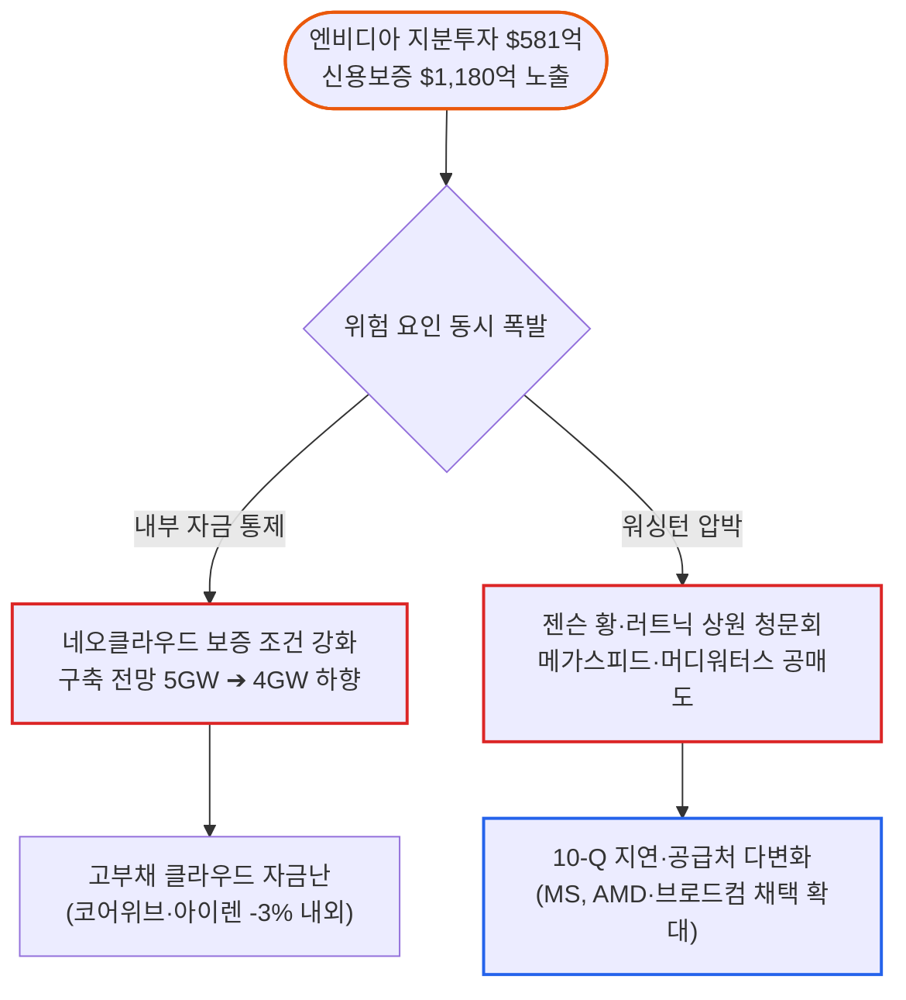

# 2026년 11월 19일(목) 하루치 뉴스정리

- **작성일**: 2026-11-19

연준 FOMC 의사록에서 12월 50bp '빅스텝' 금리 인상까지 거론되며 미국 잠정 주택판매가 2001년 집계 이후 최저치로 주저앉았는데, 바로 그날 밤 나스닥에서는 AI 스타트업 앤트로픽이 공모가를 83달러로 올려 잡으며 인류 역사상 최대 규모인 813억 달러짜리 IPO 흥행을 터뜨렸다. 한편 매출이 1년 새 두 배 넘게 뛴 엔비디아는 정작 본업이 아닌 78조 원대 지분 투자와 157조 원대 지급보증이라는 순환금융 족쇄, 그리고 워싱턴의 사법·정치 포위망에 걸려 2.89% 밀리며 시장을 혼란에 빠뜨렸다.

## 요약

| 구분 | 주요 내용 |
| :--- | :--- |
| **핵심 진단** | 연준의 12월 금리 인상 기정사실화와 AI발 금융불안 경고 속에서, AI 섹터 내부의 '부채·규제 리스크'와 '실질 현금흐름·자본 쏠림'이 극명하게 갈린 하루 |
| **핵심 종목 팩트** | 엔비디아(-2.89%, $150.96) 9개월 지분투자 $581억·신용보증 $1,180억 노출. 앤트로픽 $813억(그린슈 포함 $935억) 사상 최대 IPO. 팔로알토(시간외 +8.26%) 호실적 및 $45억 AI 인수 |
| **착시 교정** | ① 유가 급락 ➔ 지정학 해소가 아닌 재고 폭증·공급과잉 공포, ② 엔비디아 호실적 ➔ 네오클라우드 보증 조건부 축소로 수요 거품 제어, ③ 앤트로픽 흥행 ➔ 미국 전체 근로자 월 $1,750 지출 필요한 밸류 부담 |
| **돈길 확산 신호** | 엔비디아 독점 균열 반사이익(AMD +5.31%, 브로드컴 +3.64%), AI 보안 통합 플랫폼(팔로알토), 클라우드 전환 초기 SaaS(맨해튼 어소시에이츠), 자체 발전 AI 인프라(스페이스X 750MW) |
| **가장 더러운 변수** | 12월 FOMC 25bp 기정사실 및 50bp 빅스텝 소수의견(7.8% 반영), 미 CMS 건강보험 환수 칼날(UNH -10.21%), 12월 엔비디아 의회 청문회와 동남아 수출통제 |
| **계좌 행동 지침** | 부채 의존형 네오클라우드 및 엔비디아 추격 매수 금지, 현금창출형 사이버보안·엔비디아 대안주 눌림목 분할 접근, VIX 24대 고금리 장세 현금 비중 유지 |

---

## 1. 엔비디아의 두 얼굴과 네오클라우드 돈줄 죄기

엔비디아의 3분기 숫자(매출 1,158억 달러, 전년 대비 +103%)는 눈부셨지만, 주가는 정규장에서 2.89% 떨어진 150.96달러로 주저앉았다. 젠슨 황 전 CEO 사임 이후 주가는 이미 26%나 녹아내렸다. 숫자 뒤에 숨어 있던 '돈의 출처'와 '워싱턴의 칼날'이 동시에 수면 위로 떠올랐기 때문이다.

가장 뼈아픈 팩트는 엔비디아의 재무제표 이면에 깔린 순환금융 구조다. 엔비디아는 올해 10월 25일까지 9개월 동안 오픈AI, 앤트로픽, 인프라 금융업체 등 다른 AI 기업 지분을 사들이는 데만 무려 581억 달러(약 77조 6,000억 원)를 쏟아부었다. 전년 동기(49억 5,000만 달러)의 12배에 육박하며, 같은 기간 자사주 매입액(612억 달러)과 맞먹는 거금이다. 여기에 얹어준 신용보증 규모만 1,180억 달러(약 157조 5,000억 원)에 달한다. AI 투자 열기가 식으면 칩 매출 감소와 지분 평가손실을 동시에 얻어맞는 '이중 노출' 폭탄을 안고 있는 셈이다.

콜레트 크레스 임시 CEO는 이번 실적 발표에서 네오클라우드(코어위브·아이렌 등)를 향한 돈줄을 조이기 시작했다. 재무제표 각주를 슬쩍 고쳐 "네오클라우드가 자체 자금 조달에 성공하고 데이터센터를 완공해야만 엔비디아의 보증이 발효되며, 지연되면 약정을 축소·면제할 수 있다"고 못 박았다. 모건스탠리는 곧바로 네오클라우드 분기 투자 전망치를 360억 달러에서 320억 달러로, 구축 규모를 5GW에서 4GW로 깎아버렸다.

정치·사법 포위망도 갈수록 조여든다. 젠슨 황 전 CEO와 하워드 러트닉 상무장관은 크리스마스 전 미 상원 은행위원회 공개 청문회 출석에 동의했다. 하원 민주당은 러트닉 장관 아들들이 경영하는 캔터 피츠제럴드의 엔비디아 지분과 싱가포르 메가스피드 규제 지연 사이의 이해충돌 조사에 착수했고, 행동주의 공매도 기관 머디 워터스까지 전직 서열 3위 임원(아제이 푸리)과 슈퍼마이크로 임원 간의 연결고리를 엮어 엔비디아 하락 베팅을 공개했다. 고객사들도 가만히 있지 않는다. 마이크로소프트(MS) 커머셜 CEO 저드슨 알토프가 "AI 칩 공급처를 다변화하겠다"고 공언하자마자, 시장의 자금은 곧바로 경쟁사인 AMD(+5.31%)와 브로드컴(+3.64%)으로 쏠렸다.

---

## 2. FOMC 빅스텝 경고와 섹터 피바다

간밤 공개된 10월 FOMC 의사록은 시장에 남아 있던 금리 인하의 헛된 꿈을 완전히 산산조각 냈다. 거의 모든 참석자가 물가상승률 2% 목표 복귀를 위해 추가 금리 인상이 필요하다는 데 동의했고, 두어 명의 위원은 입수 데이터가 비우호적일 경우 12월에 25bp를 넘는 '빅스텝(50bp)' 인상까지 고려해야 한다고 발언했다.

크리스토퍼 월러 연준 이사는 아예 대놓고 "내년 1월 인상을 명확히 예고하지 않을 거라면 12월에 50bp를 올려 매듭짓고 사람들에게 충격을 줘야 한다"고 총대를 멨다. 마이클 바 이사와 메리 데일리 총재도 추가 인상을 외치며 합창했다. 심지어 연준 실무진은 의사록에서 "AI 관련 부채 급증과 장부 외 리스 약정, 순환금융 구조가 금융불안을 키울 수 있다"며 AI 버블의 금융 시스템 전이 위험까지 공식 테이블에 올렸다.

| 주요 지표 및 섹터 | 당일 수치 / 변동폭 | 시장 함의 및 충격 원인 |
| :--- | :--- | :--- |
| **다우 / S&P 500 / 나스닥** | 50,198(-1.11%) / 7,323(-0.23%) / 24,429(+0.42%) | S&P 500 5거래일 연속 하락. 빅테크·반도체 일부 반등으로 나스닥만 소폭 방어 |
| **미 2년물 / 10년물 금리** | 4.8000%(+1.1bp) / 5.0660%(-3.6bp) | 12월 50bp 인상 확률 7.8%(25bp 92.2%) 반영에 단기물 상승·커브 플래트닝 |
| **달러인덱스 / 원달러 환율** | DXY 103.78(+0.26%) / 1,333.70원 | DXY 장중 103.9로 19개월래 최고치. 외국인 달러선물 7만 2천 계약 순매도 방어 |
| **WTI / 브렌트유** | $83.26(-3.20%) / $91.95(-1.28%) | 미 원유(+338만)·휘발유(+519만 배럴) 재고 급증에 따른 공급과잉 우려로 3개월 최저 |
| **헬스케어 (XLV)** | -2.20% (유나이티드헬스 -10.21%) | 미 CMS 건강보험 부정청구 감독 강화 및 '18년 이후 부적절 지급금 환수 추진 쇼크 |
| **에너지 (XLE) / 소비재 (XLY)** | XLE -3.27% / XLY +1.79% | 정유주(VLO -5.52%, MPC -5.50%) 급락 vs TJX(+8.05%)·아마존(+3.82%) 급등 |

고금리 직격탄은 실물 지표에서도 터져 나왔다. 전미부동산중개인협회(NAR)가 발표한 10월 잠정 주택판매는 전월 대비 4.7% 급감해 예상치(-2.0%)를 두 배 넘게 밑돌았고, 잠정 주택판매지수는 63.0으로 2001년 통계 작성 이래 사상 최저치를 갈아치웠다. 여기에 미 건강보험 감독당국(CMS)이 2018년 이후 부적절하게 지급된 보험금 환수 칼날을 빼 들면서 대장주 유나이티드헬스(UNH)가 하루 만에 10.21% 폭락하는 등 방어주 섹터마저 박살이 났다.

---

## 3. 앤트로픽 813억 달러 상장과 빅테크 명암

매크로가 50bp 빅스텝 공포에 떨고 있는 와중에도, 자본시장 한복판에서는 역대 최대 규모의 자금 블랙홀이 폭발했다. 클로드 개발사 앤트로픽(종목코드 ANT)이 공모 희망 범위(70 ~ 78달러)를 뚫고 공모가를 주당 83달러로 확정 지으며 9억 8,000만 주, 무려 813억 달러(그린슈 행사 시 최대 935 ~ 940억 달러)를 끌어모았다. 지난 6월 스페이스X가 세웠던 역대 최대 IPO 기록(기본 750억 달러)을 불과 다섯 달 만에 갈아치운 것이다.

앤트로픽 지분을 쥔 아마존(+3.82%)이 화답했고 아시아 장에서 나스닥100 선물도 1.44% 뛰어올랐지만, 월가의 시선은 극단적으로 쪼개져 있다. 낙관론자들은 전년 대비 1,206% 폭증한 매출 성장률과 청약 경쟁률 6배를 외치지만, 냉정한 펀드매니저들은 계산기를 두드리고 혀를 찬다.

> **트루노스어드바이저스 드루브 마닉탈라 CIO의 산수**: 앤트로픽이 계획한 데이터센터 확충 비용을 자체적으로 감당하려면 연간 **3조 5,000억 달러**의 매출이 필요하다. 이는 패스트푸드점 직원부터 미용사까지 미국의 모든 근로자가 매달 **1,750달러(약 230만 원)**를 AI 구독료로 갖다 바쳐야 나오는 숫자다.

| 기업 / 자산 | 핵심 이벤트 및 숫자 | 시장 함의 및 리스크 요인 |
| :--- | :--- | :--- |
| **앤트로픽 (`ANT`)** | 공모가 $83, 기본 $813억 조달(역대 최대) | 청약 수요 6배 흥행 vs 상위 5개 고객 매출 비중 21%, 클라우드 의존 절반 |
| **팔로알토 (`PANW`)** | 매출 $34.45억(+39%), NGS ARR $97.3억(+66%) | 시간외 +8.26%. $45억 주식교환으로 '어플라이드 컴퓨트' 인수해 AI 보안 선점 |
| **스페이스X (`SPCX`)** | 텍사스 $240억 데이터센터·750MW 발전소 승인 | 전력망에 기대지 않고 천연가스 터빈 35대로 자체 전력 조달하며 규제 우회 |
| **맨해튼 어소시에이츠 (`MANH`)** | JP모건 '비중확대', 목표가 $308 (+23% 여력) | 기존 고객 클라우드 전환율 아직 25%, 30% 넘는 FCF 마진으로 Rule of 40 입증 |

같은 날 사이버보안 대장주 팔로알토 네트웍스(PANW)는 AI 거품을 말이 아닌 숫자로 증명하며 시간외에서 8.26% 급등했다. 분기 매출 34억 4,500만 달러(+39.2%), 조정 EPS 1.05달러로 컨센서스를 가볍게 부수고 연간 가이던스까지 올려 잡았다. 더 무서운 것은 다음 수다. 팔로알토는 설립 18개월 만에 ARR 1억 달러를 찍은 AI 사후훈련 스타트업 '어플라이드 컴퓨트'를 45억 달러 전액 주식 교환으로 삼키며, "오픈웨이트 AI 모델 토큰 비중이 1년 새 5% 미만에서 60% 이상으로 커졌다. 폭주하는 기업용 AI 에이전트를 감시하는 AI 보안 모델을 직접 훈련·서빙하겠다"고 선언했다.

---

## 4. 시장의 3대 착시와 데이터 검증

### 착시 ① 유가 3% 급락 ➔ 지정학 위기 해소

국제유가(WTI)가 83.26달러로 3.20% 빠지고 트럼프·시진핑·푸틴이 중국 선전 APEC에서 3자 회담을 연다고 하니 대중은 "이제 전쟁도 끝나고 인플레이션도 잡히겠구나"라며 안도한다. 완전히 틀린 독해다. 이번 유가 하락은 평화 협상 때문이 아니라 미국 원유(+338만 배럴)와 휘발유(+519만 배럴) 재고가 예상치를 세 배 이상 웃돌며 터진 **공급과잉 공포** 때문이다. 정작 국제에너지기구(IEA) 파티 비롤 사무총장은 "호르무즈 해협의 안전 신뢰가 무너졌고 2026년 2월 이전으로 돌아갈 경로가 보이지 않는다"며 에너지 공급망의 구조적 파괴를 경고했다. 유가가 빠진다고 에너지·전력 인프라 투자가 멈추는 게 아니라, 각국의 에너지 자립과 원전·천연가스 자체 발전(스페이스X 750MW 사례)으로 돈이 더 몰리고 있다.

### 착시 ② 엔비디아 매도 ➔ AI 투자 종말

엔비디아 주가가 빠지고 MS가 공급처 다변화를 외치자 "드디어 AI 반도체 버블이 꺼진다"고 호들갑을 떠는 사람들이 있다. 데이터는 정반대를 가리킨다. 엔비디아의 하락은 AI 칩 수요 부족이 아니라 **독점 지위 약화(MS의 AMD·브로드컴 병행)**, **네오클라우드 보증 조건부 축소**, 그리고 **10-Q 공시 지연과 의회 청문회라는 지배구조 리스크** 때문이다. AI 칩이 필요 없는 게 아니라, 엔비디아 한 회사에만 목줄을 매달지 않겠다는 빅테크들의 탈엔비디아 움직임이 주가를 갈라놓고 있을 뿐이다.

### 착시 ③ 일론 머스크의 변심 ➔ 정치적 중립

일론 머스크가 뉴욕타임스 딜북 서밋에서 "나는 MAGA가 아니다. 중간선거에 5억 달러를 쓴 게 어리석었다"며 민주당 출신 텍사스 차기 주지사(지나 히노호사)를 "온건하다"고 치켜세우자 언론은 머스크가 반성했다고 떠든다. 천만의 말씀이다. 히노호사 당선인은 텍사스 신규 데이터센터 건설 중단 조치를 지지하는 인물이다. 텍사스에 240억 달러짜리 스페이스X 데이터센터와 자체 발전소를 지어야 하는 머스크가, 중간선거에서 공화당이 참패하자 곧바로 권력의 눈치를 보며 사업 인허가를 지키기 위해 엎드린 철저한 실리 계산일 뿐이다.

---

## 5. 기관 자금 이동: 살아남은 돈길의 추적

대중이 엔비디아 뉴스와 유가 등락에 정신이 팔려 있을 때, 시장을 읽는 자금들은 철저하게 세 가지 확실한 길목으로 이동하고 있다.

첫째는 **엔비디아 독점 균열의 직접 수혜주**다. MS가 자체 칩(Maia)과 경쟁사 칩 확대를 공식화한 날, AMD(+5.31%)와 브로드컴(+3.64%)이 즉각 급등한 것은 단기 테마가 아니다. 빅테크 고객사 입장에서는 CEO 공백과 10-Q 지연, 수출통제 조사까지 겹친 엔비디아 단일 벤더 리스크를 줄이는 것이 생존 과제다.

둘째는 **파산 위기를 딛고 콜옵션과 실물 병목에 집중한 공격적 스마트 머니**다. 오픈AI 출신 리오폴드 애션브레너가 이끄는 헤지펀드 시추에이셔널 어웨어니스는 올여름 기술주 폭락으로 운용자산이 450억 달러에서 100억 달러로 67% 증발하는 마진콜 수모를 겪고도 AI 베팅을 접지 않았다. 3분기 13F 공시를 뜯어보면 포트폴리오를 보통주에서 **콜옵션** 중심으로 재편하면서 샤론AI(28%), 연료전지 발전 **블룸에너지(24.7%)**, 네비우스(21.1%), **샌디스크(11.5%)**, **메모리 ETF(8.9%)**에 자금을 집중했다. AI의 진짜 병목이 '칩'에서 '전력'과 '메모리'로 넘어간다는 걸 정확히 짚은 포지션이다.

셋째는 **AI를 방패가 아니라 무기·플랫폼으로 바꾼 현금 창출 기업**이다. 팔로알토 네트웍스(PANW)처럼 해킹 방어 수요(중대 취약점 발견 25년 대비 7배 급증)를 독식하면서 잉여현금흐름 마진 38% 이상을 유지하는 기업이나, 맨해튼 어소시에이츠(MANH)처럼 기존 고객의 25%만 클라우드로 전환돼 향후 몇 년간 30%대 FCF 마진과 매출 가속이 보장된 버티컬 SaaS로 기관의 리포트와 자금이 쏠리고 있다.

---

## 6. 향후 2~4주 핵심 모니터링 지표

| 핵심 지표 | 안도 신호 (Bull) | 위험 신호 (Bear) | 시장 대응 의미 |
| :--- | :--- | :--- | :--- |
| **앤트로픽(`ANT`) 상장 직후 주가** | 공모가 $83 안착 및 거래대금 유지 | 공모가 하회 및 차익실현 매물 폭탄 | 상장 첫 주 급락 시 AI 고밸류 회의론 및 빅테크 지분 평가손 우려 확대 |
| **12월 FOMC 빅스텝 확률** | 50bp 확률 5% 미만으로 축소 | 물가 지표 쇼크로 50bp 확률 20% 돌파 | 12월 50bp 가능성이 현실화되면 나스닥·고부채 네오클라우드 2차 투매 |
| **12월 상원 은행위 청문회** | 엔비디아 추가 제재 없는 해명 수준 | 동남아·제3국 우회 수출 전면 차단 법안 | 메가스피드 관련 수출통제 확대 시 엔비디아 멀티플 추가 하향 |
| **미 2년물 국채금리** | 4.70% 이하 하향 안정 | 4.85% 돌파 및 5.00% 재위협 | 연준 긴축 민감 지표인 2년물 급등은 중소형주·부동산·소비재 압박 신호 |

---

## 7. 실전 포트폴리오 대응 전략

지금 시장은 12월 금리 인상이 기정사실화된 고금리 압박과 AI 섹터 내부의 옥석 가리기가 정면으로 부딪히는 구간이다. 어설프게 바닥을 예단해 몰빵하면 연준과 워싱턴에 양쪽 뺨을 맞는다.

- **엔비디아·고부채 네오클라우드 추격 금지**: 엔비디아는 10-Q 보고서 제출 지연 해소, 정식 CEO 선임, 12월 청문회 통과라는 세 가지 숙제를 풀기 전까지 실적만으로 전고점을 회복하기 어렵다. 엔비디아의 조건부 보증에 목줄이 매인 고부채 네오클라우드(코어위브 등) 역시 금리 인상 기조에서 변동성 폭탄이므로 단기 반등에 올라타지 마라.
- **탈엔비디아 수혜주와 AI 보안·전력 압축**: 엔비디아 단일 의존도를 낮추려는 빅테크의 움직임에서 직접 이익을 챙기는 브로드컴(AVGO)·AMD와, AI 에이전트 폭증으로 긴급 보안 예산을 쓸어 담는 팔로알토 네트웍스(PANW)처럼 현금흐름이 확실한 종목만 조정 시 분할 접근 대상으로 삼아라.
- **앤트로픽 상장 광풍 관망 원칙**: 공모가 83달러, 조달액 813억 달러짜리 초대형 IPO의 상장 첫날 추격 매수는 기관의 물량 받아주기가 될 위험이 크다. 상장 초기 변동성이 가라앉고 시장이 적정 기업가치를 소화하는 과정을 확인한 뒤 판단해도 늦지 않다.

---

## 8. 최종 판정 및 실행 원칙

FOMC 의사록이 50bp 빅스텝을 거론하고 미 건강보험 당국이 유나이티드헬스를 하루에 10%씩 두들겨 패는 장세에서도, 돈이 되는 곳(팔로알토 +8.26%, 브로드컴 +3.64%, AMD +5.31%)은 정확히 숫자로 응답한다.

1. **현금 비중 30% 이상 유지**: 12월 8 ~ 9일 FOMC와 12월 엔비디아 청문회라는 거대한 이벤트가 코앞에 있다. 섣불리 레버리지 상품에 올라타지 말고 조정 시 주워 담을 현금을 손에 쥐어라.
2. **순환금융과 자체 현금흐름 구별**: 남의 보증과 빚으로 데이터센터를 짓는 기업이 아니라, 팔로알토처럼 영업현금흐름과 잉여현금흐름(FCF) 마진 30% 이상을 자체 창출하는 기업으로 계좌를 압축하라.
3. **공모주·테마주 뇌동매매 차단**: 앤트로픽 상장 당일 호가창을 보며 흥분하지 말고, 오히려 이 유동성 쏠림 때문에 억울하게 매도당한 우량 현금흐름 기업들의 가격 매력을 냉정하게 계산해라.

!!! tip "최종 핵심 제언 (Executive Takeaway)"
    연준이 50bp 빅스텝을 입에 올리고 AI 순환금융의 위험을 경고하기 시작했다면, 빚과 스토리로 버티던 가짜 AI 테마주들의 시간은 끝났다. 남의 지갑(보증)에 기대는 기업을 버리고, 스스로 현금을 찍어내며 경쟁자의 위기를 뺏어 먹는 진짜 독점 기업의 눌림목만 기다려라.
