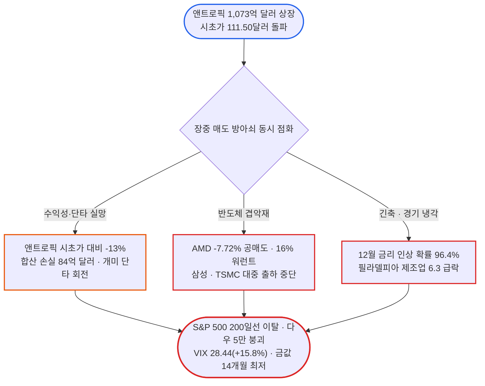

# 2026년 11월 20일(금) 하루치 뉴스정리

- **작성일**: 2026-11-20

인류 역사상 최대 규모인 1,073억 달러짜리 앤트로픽 상장 축포가 터진 바로 그날, 정작 뉴욕증시 3대 지수는 일제히 2% 넘게 고꾸라지며 다우 5만 선과 S&P 500 200일 이동평균선이 동시에 무너졌다. '엔비디아 대안주'라는 찬사를 받으며 이달에만 40% 넘게 폭등했던 AMD는 공매도와 순환금융 폭격에 7.72% 주저앉았고, 12월 금리 인상 확률이 **96.4%에** 달한 강달러 압박 속에 안전자산 금값마저 14개월 만에 최저치로 밀려났다.

## 요약

| 구분 | 핵심 내용 |
| :--- | :--- |
| **핵심 진단** | 역대 최대 앤트로픽 IPO가 반등 촉매가 아닌 '뉴스에 매도' 방아쇠로 작동하며, AMD 공매도·수출통제 쇼크와 매파 연준 속에 S&P 500 200일선 이탈 및 VIX 28대 급등 |
| **핵심 종목 팩트** | 앤트로픽(`ANT`) 공모가 $83 ➔ 시초가 $111.50 ➔ 종가 $97.17(시초가 대비 약 -13%), AMD(-7.72%) 숏·워런트 폭격, 삼성·TSMC 대중 출하 중단, 인튜이트(시간외 -10.33%) 메일침프 70% 손절 |
| **착시 교정** | ① 앤트로픽 흥행 ➔ OpenAI·앤트로픽 합산 성장률 75% ➔ 48% 둔화 및 손실 $84억 확대, ② AMD 대안론 ➔ 1센트 워런트·중국 펌웨어 리스크, ③ 유가 최저 ➔ 연준 긴축과 서민 소비 위축 공존 |
| **돈길 확산 신호** | 2027년 공급 부족 심화 메모리(마이크론), AI 보안 플랫폼(팔로알토), 연쇄 장애 속 독립망(스페이스X), EDA 복점(시놉시스)·전력(블룸에너지), 부실 테크 헐값 인수(벤딩 스푼스) |
| **가장 더러운 변수** | 12월 25bp 인상 96.4%·50bp 3.6% 기정사실화 속 미 제조업·고용 지표 냉각, 미 상무부(BIS) 11월 16일 대중 반도체 예외 조항 폐쇄, 11월 23일 앤트로픽 옵션 거래 개시 |
| **계좌 행동 지침** | 대형 AI IPO 및 순환금융·규제 노출 칩 추격 매수 금지, 가격 결정권이 확인된 메모리·보안·독립망 중심 조정 시 분할 관찰, VIX 28대 고변동성 국면 현금·배당성장 방패 유지 |

---

## 1. 앤트로픽 상장과 반도체 이중 폭격

시장이 그렇게 목이 빠져라 기다리던 AI 구원투수 앤트로픽(티커 `ANT`)이 상장 첫날 오히려 기술주 투매의 방아쇠를 당겼다. 앤트로픽은 희망 공모가 범위(70 ~ 78달러)를 웃도는 주당 83달러로 공모를 확정하며 공모 813억 달러와 사모 260억 달러를 합쳐 총 1,073억 달러를 조달했다. 지난 6월 스페이스X가 세운 기본 공모 750억 달러 기록을 갈아치운 역대 최대 IPO다. 나스닥 시초가는 공모가보다 34% 높은 111.50달러에 형성돼 한때 시가총액 2조 달러에 육박하며 메타, 브로드컴, 스페이스X까지 추월했고 장중에는 114.99달러(+38.54%)까지 치솟았다. 하지만 거기까지였다. 차익실현 매물이 폭포수처럼 쏟아지며 장중 92 ~ 95달러대까지 밀렸고 종가는 97.17달러에 턱걸이해 공모가 대비로는 +17.07%, 시초가 대비로는 약 **13%가** 빠진 채 마감했다.

겉으로 드러난 외형 숫자와 월가 투자은행(IB)들의 장밋빛 찬가는 현기증이 날 정도다. 앤트로픽의 3분기 매출은 170억 달러로 전년 동기(14억 달러) 대비 1,100% 넘게 폭증했고, 9월까지 누적 9개월 매출은 332억 4,000만 달러(+1,200%), 연간 환산 매출(ARR)은 810억 달러에 달한다. 연 10만 달러 이상 쓰는 기업 고객도 1년 만에 약 1,500곳에서 1만 2,000곳 가까이 불었다. 멜리우스 리서치(목표가 155달러), 니덤(150달러, FY27 매출 +150%·매출총이익률 90%·영업이익률 35% 전망), 울프 리서치(135달러), 시티즌스 JMP(125달러, 2029년 매출 4,178억 달러 전망)가 일제히 매수 리포트를 쏟아냈다. 공동창업자 7명은 모두 회사를 지키는 가운데 각자 약 1.3%씩 보유한 지분 가치가 공모가 기준 도합 1,400억 달러(약 186조 원)로 불어났고, 의결권이 없는 아마존(지분 약 14.7%)·알파벳(13.7%)과 달리 특수법인 파운더 LLC의 클래스 F 주식을 통해 **의결권 50.1%를** 틀어쥐었다(지분 80% 자선 기부 서약은 법적 구속력 없는 철회 가능 조항이다).

그러나 냉정한 펀드매니저들이 뜯어본 내부 장부는 이야기가 완전히 달랐다. 나일스인베스트먼트매니지먼트의 댄 나일스가 짚었듯 오픈AI와 앤트로픽의 합산 매출 전분기 대비 증가율은 2분기 75%에서 3분기 **48%로** 급격히 꺾인 반면, 합산 손실은 같은 기간 79억 달러에서 **약 84억 달러로** 오히려 불어났다. 가격 치킨게임이 매출 성장의 질을 갉아먹고 있는 것이다. 게다가 앤트로픽이 짊어진 컴퓨팅 인프라 약정 규모만 총 **8,954억 달러에** 달하며, 이 가운데 스페이스X AI 자회사와 맺은 2029년까지 최대 1,205억 달러 계약 외에 일론 머스크는 추가 10GW 임대까지 논의 중이라고 밝혔다. 수급 질도 엉망이었다. 반다 리서치 집계에 따르면 상장 후 첫 3시간 개인 순매수는 3,700만 달러로 스페이스X 상장 당시(9,900만 달러)의 37%에 그쳤는데, 매수·매도를 합친 총거래대금은 약 8억 2,000만 달러로 스페이스X 기록(6억 6,900만 달러)을 넘어섰다. 개미들조차 쥐고 가기보다 장중 단타 치고 빠지기에 바빴다는 뜻이다. 30년 베테랑 트레이더 스티브 그라소가 "추격 매수는 금물이며 며칠 내 차익실현 매도세가 나올 것"이라고 경고한 가운데, Cboe 글로벌마켓의 JJ 키너핸 수석 부사장은 앤트로픽 옵션 거래가 시작되는 **11월 23일**을 AI 투자 테마의 진짜 시험대로 지목했다.

> **월가의 이중 경고**: 댄 나일스가 "오픈AI·앤트로픽의 합산 성장률 둔화(75% ➔ 48%)와 손실 확대(79억 ➔ 84억 달러)"를 지적한 날, 투자 분석 매체 더 베어 케이브는 "엔비디아가 AI 산업의 중앙은행이라면 AMD는 **'AI의 실리콘밸리은행(SVB)'에** 가깝다"며 AI 설비투자 뱅크런 위험을 정조준했다.

반도체 진영에서는 더 처참한 이중 폭격이 떨어졌다. 젠슨 황 전 CEO 사임 이후 엔비디아의 완벽한 대안으로 꼽히며 이달에만 40% 넘게 급등했던 AMD(`AMD`)가 하루 만에 **7.72%(장중 -11.24%, 491달러대)** 폭락했다. 공매도 세력 헌터브룩 캐피털이 숏 포지션을 선언하며 "미국 상무부가 2025년 3월 수출통제 명단에 올린 중국 서버 제조사 IEIT 시스템즈가 제재 이후에도 AMD 최신 펌웨어 최소 6개 버전(최근 10월 19일 적용)을 공급받았고, 연계 3사(중국 마긴프라·싱가포르 카이터스·미국 아이브리스) 역시 99.94% 일치하는 펌웨어를 쓴다"고 폭로했다. AMD는 중국·홍콩 매출 비중이 20%를 넘고 싱가포르 매출도 2025년 기준 42억 8,000만 달러(전체 매출 10% 이상)에 달해 동남아 우회 수출 규제 직격탄에 노출돼 있다. 설상가상으로 더 베어 케이브는 AMD가 리스 보증, 미판매 클라우드 손실 보전, 고객 지분 매입 등 엔비디아식 순환금융을 똑같이 돌리면서도 이익률과 가격 결정력은 한참 떨어지고, 심지어 **최대 AI 고객사 두 곳에 발행주식 최대 16%를 주당 1센트에 살 수 있는 신주인수권(워런트)**까지 넘겼다고 까발렸다.

규제와 인재 이탈의 칼날은 반도체 공급망 전체를 베고 있다. 파이낸셜타임스 보도에 따르면 미 상무부 산업안보국(BIS)이 지난 11월 16일 미국 기술을 쓴 첨단 반도체의 최종 중국행 사전 허가를 의무화하고 패키징·테스트 업체를 통한 우회로와 스마트폰 등 비(非)AI 칩 예외 조항까지 전면 폐쇄하면서, **삼성전자와 TSMC가 중국 고객사(바이두 쿤룬·바이트댄스 등 AI 고객 및 스마트폰 고객 포함)에 일부 칩 출하를 중단**했다. 엔비디아(`NVDA`) 역시 장 초반 3.6% 반등했다가 3% 안팎 하락 마감하며 10월 고점 대비 30% 넘게 무너졌고, 다이와는 후임 CEO 불확실성을 이유로 목표주가를 245달러에서 185달러로 낮췄다. 내부에서는 수천 명의 직원이 젠슨 황 복귀 공개서한에 서명하고 샹원 리 연구과학자가 이사회를 공개 저격하는 등 동요가 커지고 있다. 콜레트 크레스 임시 CEO가 급여 인상과 추가 주식 보상을 12월로 앞당겨 진화에 나섰지만, 지난 10년 주가 폭등으로 이미 부자가 된 핵심 아키텍처 리더 5 ~ 10명의 경쟁사(AMD·브로드컴·하이퍼스케일러) 이적을 막아낼지는 미지수다.

---

## 2. 식는 경기와 매파 연준, 금값 최저

주식시장 기술적 지표에는 이미 빨간불이 들어왔다. 다우지수는 6월 10일 이후 처음으로 종가 5만 선 아래인 49,097.06(-2.19%)으로 주저앉았고, S&P 500은 6거래일 연속 밀리며 7,175.83(-2.02%)을 기록해 **200일 이동평균선 아래로** 떨어졌다. 나스닥(-2.25%, 23,879.20)과 필라델피아 반도체지수(-2.41%)도 나란히 얻어맞았고 S&P 전 업종(임의소비재 -3%대, 통신·산업·헬스케어 -2%대)이 파랗게 질렸다. 판뮤어 리버럼의 조아킴 클레멘트는 200일선 붕괴에 맞춰 방어적 전략을 확대하며 "마이크로소프트가 자체 데이터센터 중심으로 자본지출 방향을 튼 만큼 2027년 AI 설비투자 가이던스가 시장 기대를 밑돌 위험이 크다. AI 버블은 붕괴 직전"이라고 직격탄을 날렸다. 공포지수로 불리는 VIX는 하루 새 15.80% 치솟아 **28.44까지** 올라섰다.

가장 고약한 대목은 실물 경기가 식어 가는데도 중앙은행이 금리 인상 페달에서 발을 떼지 않는 스태그플레이션성 엇박자다. 지난주 신규 실업보험 청구는 20만 3,000건(예상 19만 7,000건)으로 늘었고, 연속 실업보험 청구는 전주 대비 7만 건 급증한 **176만 3,000건으로** 8월 말 이후 최고치를 찍어 재취업 난항을 드러냈다. 11월 필라델피아 연은 제조업 지수는 전달보다 14.6포인트 추락한 **6.3(예상치 20.0)으로** 5월 이후 최저 바닥을 기었다. 그럼에도 필립 제퍼슨 연준 부의장은 기대인플레이션 이탈 시 더 강력한 대응을, 오스탄 굴스비 시카고 연은 총재는 경제 과열 차단을 외쳤고 독일 분데스방크 나겔 총재까지 ECB 추가 긴축 가능성을 거론했다. 그 결과 CME 페드워치 기준 12월 FOMC 25bp 금리 인상 확률은 **96.4%에**, 50bp 빅스텝 확률은 **3.6%에** 달했다.

| 주요 지표 및 자산 | 당일 수치 / 변동폭 | 시장 함의 및 충격 원인 |
| :--- | :--- | :--- |
| **다우 / S&P 500 / 나스닥** | 49,097(-2.19%) / 7,175(-2.02%) / 23,879(-2.25%) | 다우 6월 이후 첫 5만 선 붕괴, S&P 500 6거래일 연속 하락 및 200일선 이탈 |
| **필라델피아 반도체 / VIX** | SOX -2.41% / VIX 28.44 (+15.80%) | AMD(-7.72%)·엔비디아(-3%대) 투매로 반도체 1만 선 이탈, 공포 심리 급등 |
| **미 2년물 / 10년물 / 30년물** | 4.7790%(-2.1bp) / 5.0510%(-1.5bp) / 5.4010%(-1.1bp) | 증시 급락과 제조업 지표 쇼크로 위험회피 채권 매수 유입(10년물 장중 5.039%) |
| **달러인덱스 / 원·달러 환율** | DXY 103.888(+0.104%) / NDF 1,334.70원(+5.60원) | DXY 19개월래 최고권. 서울장 예상 1,330.00 ~ 1,343.00원, 1조 달러 수출 네고 상단 방어 |
| **WTI / 브렌트유 / 금 선물** | WTI $83.21(-0.06%) / 브렌트 $91.98(+0.03%) / 금 $3,689.30(-1.41%) | 트럼프 대이란 공격 내년 유보로 유가 3개월 최저, 연준 긴축·강달러에 금값 14개월 최저 |
| **미 실물지표 / 12월 FOMC** | 연속실업 176.3만 건 / 필라제조 6.3 / 25bp 96.4% | 고용·제조업 냉각에도 연준·ECB 매파 발언 이어지며 12월 금리 인상 기정사실화 |

채권·원자재·외환 시장의 숫자도 거친 충돌을 보여준다. 미 국채는 경기 둔화와 위험회피 심리가 겹치며 단기물 금리가 더 내리는 불 스티프닝 흐름을 탔다(10년물은 오후 3시 이후 5.0390%까지 내려 1주일 최저). 반면 달러인덱스(DXY)는 **103.888로** 작년 4월 이후 최고 수준을 유지했는데, 도이체방크 집계 기준 최근 2주간 미국 외 지역 ETF의 미국 주식 저가 매수세가 올해 최대치를 찍으며 달러 수요를 끌어올린 탓도 컸다. 이 강달러와 금리 인상 공포가 겹치자 금 선물은 장중 3,668.40달러까지 떨어져 **14개월 만에 최저치를** 갈아치웠고 은 선물도 44달러 중반대에서 1.2% 남짓 밀렸다. 국제유가(WTI)는 이란 추가 공습 보도 직후 장중 1.9% 넘게 뛰었다가 트럼프 대통령이 악시오스에 "결정을 서두르지 않고 새해 뒤 상황을 보겠다"고 한발 물러서고 NBC 인터뷰에서도 시진핑·푸틴의 이란 종전 압박을 전하면서 83.21달러(3개월 최저)로 주춤했다. 서울 외환시장에서는 코스피 5거래일 연속 외국인 순매도가 환율을 밀어 올리지만, 사상 처음으로 **연간 누계 수출 1조 달러(연간 1조 1,700억 달러 추산, 세계 4위)를** 달성한 한국 반도체 기업들의 네고 물량이 1,340원대 초반에서 상단을 눌러놓는 팽팽한 줄다리기가 예고됐다.

---

## 3. 기업 실적 양극화와 M&A 참사

똑같은 기술주와 소비재라도 가격 결정권을 쥔 승자와, 자본 배분에 실패하거나 서민 지갑에 발목 잡힌 패자의 성적표가 무자비하게 갈렸다. 가장 무서운 독점의 숫자를 찍은 쪽은 메모리와 사이버보안, 그리고 지상망 밖의 독립 네트워크다. 스콧 드보어 마이크론(`MU`) CTO는 "메모리 수급이 균형을 이룰 시점을 특정할 수 없으며 **2027년은 2026년보다 공급 제약이 더 심해질 것**"이라고 못 박았다. 이미 엔비디아 임시 CEO조차 지난 17일 실적 컨퍼런스콜에서 "메모리 비용 상승이 마진을 깎아먹는다"고 시인했고, 마이크론이 미국 D램 증설에 2,500억 달러 이상을 퍼부어도 공장 완공까지 걸리는 물리적 시간 때문에 공급 부족은 쉽게 풀리지 않는다(연초 대비 +145%). 팔로알토 네트웍스(`PANW`)는 1분기 매출 34억 4,000만 달러·조정 EPS 1.05달러로 컨센서스를 부수고 비수기에도 차세대 보안(NGS) 신규 순 ARR 증가율 **60% 이상을** 기록해 프리마켓에서 9.6% 치솟았다. 시놉시스(`SNPS`) 역시 200억 달러 EDA 복점 지위를 앞세워 바클레이즈로부터 목표가 640달러 비중확대 의견을 받았고, 스페이스X(`SPCX`)는 최근 MS 아웃룩·미 FAA·NSA의 연쇄 전산 장애 속에서 스타링크 위성망을 무기로 나스닥이 4% 빠진 5거래일 동안 오히려 3% 넘게 역행 상승했다(모건스탠리 목표가 300달러 유지). 이 밖에 블룸에너지(`BE`)는 밸류 축소로 목표가가 260달러에서 230달러로 내려갔지만 2027년 호실적 기대감에 Outperform으로 상향됐고, 애플(`AAPL`, 아이폰 18 최근 5년 최강 업그레이드 의향)과 몽고DB(`MDB` +7.03%)·박스(`BOX` +3.0%)·NXP(`NXPI`)·ASTS도 월가의 매수 표를 얻었다.

반대로 거품 시절의 헛발질과 실물 소비 위축이 한꺼번에 터진 쪽은 피바다를 맞았다. 인튜이트(`INTU`)는 1분기 조정 EPS 2.91달러·매출 43억 5,000만 달러(+12% YoY)로 예상치를 웃돌았지만 장 마감 후 시간외 거래에서 **10.33% 폭락한 278.00달러로** 추락했다. 5년 전인 2021년에 무려 **120억 달러(약 16조 원)를 주고 산 이메일 마케팅 자회사 메일침프(1분기 매출 -1%, 3억 1,300만 달러)를 이탈리아 테크 통합사 벤딩 스푼스(`BSP`)에 매입가의 30%인 36억 8,000만 달러에 손절 매각**하기로 한 탓이다. 70%에 가까운 83억 달러짜리 경영 실패를 공식 자백한 셈이다. 반대로 버크셔 해서웨이가 7월(6억 달러)과 10월(3.3억 달러) 두 차례에 걸쳐 총 9억 3,000만 달러를 실어 준 벤딩 스푼스는 지난 9월 에어테이블을 전고점 가치의 10%에 헐값 인수한 데 이어 또 하나의 알짜 매물을 줍는 데 성공했다.

| 기업 / 티커 | 핵심 팩트 및 수치 | 시장 함의 및 승패 구분 |
| :--- | :--- | :--- |
| **앤트로픽 (`ANT`)** | 공모 $813억·사모 $260억, 3Q 매출 $170억, 종가 $97.17 | 시초가 $111.50 대비 -13% 추락, 합산 손실 확대 및 $8,954억 약정 부담 |
| **AMD (`AMD`)** | 주가 -7.72%(장중 -11.24%), 중·홍 20%+·싱가포르 $42.8억 | 블랙리스트 펌웨어 의혹 + 고객사 2곳에 1센트 16% 워런트 부여 폭로 |
| **마이크론 (`MU`)** | 연초 대비 +145%, $2,500억+ 투자에도 2027년 공급 더 타이트 | 엔비디아 마진까지 갉아먹는 AI 메모리 병목의 절대 가격 결정자 |
| **팔로알토 (`PANW`)** | 매출 $34.4억·EPS $1.05 서프라이즈, NGS 순 ARR +60%+ | AI 보안 플랫폼 통합 수혜 및 $45억 어플라이드 컴퓨트 인수로 질주 |
| **스페이스X (`SPCX`)** | 최근 5거래일 +3%+(나스닥 -4% 역행), MS 목표가 $300 | MS·FAA·NSA 연쇄 장애 속 위성 독립망 '오프더그리드' 독보적 대안 |
| **인튜이트 (`INTU`)** | 시간외 -10.33%, 메일침프 $120억 인수 ➔ $36.8억 매각 | 5년 만의 70% M&A 참사 vs 버크셔가 쥔 벤딩 스푼스의 부실 테크 사냥 |
| **월마트 (`WMT`)·갭 (`GAP`)** | WMT 매출 $1,888.4억(+5.2%), GAP 동일매장 0%·가이던스 하향 | 인플레·가솔린 부담에 저·중소득층 필수재 쏠림 및 의류 소비 둔화 확인 |
| **JPM · 비자 · 마스터카드** | JPM -1.20%, 비자 -3.12%, 마스터카드 -2.62% | 외부 마케팅 협력사 해킹(`n0n` 자처)으로 고객 이름·이메일 유출 타격 |

소비재와 금융, 미디어에서도 균열음이 선명했다. 월마트(`WMT`)는 3분기 매출 1,888억 4,000만 달러(+5.2% YoY)·전자상거래 +17%·광고 +25%로 선전해 연간 매출 가이던스를 4.9 ~ 5.2%, 조정 EPS를 2.84 ~ 2.89달러로 올렸으나, 월가 컨센서스(5.5% / 2.88달러)를 밑돌아 프리마켓에서 미끄러졌다. 정작 시장이 뜯어본 위험 신호는 경영진의 입에서 나왔다. **인플레이션과 가솔린 가격 부담에 저·중소득층이 필수소비재에만 돈을 써 10월 소매 매출 증가세가 둔화됐고, 식료품·잡화 가격을 깎아줘야 했다는 고백**이다. 갭(`GAP`) 역시 동일매장매출 0%(예상 +1.3%) 부진 속에 애슬레타 CEO가 경쟁사 룰루레몬으로 떠나 뷰오리·패블레틱스 출신 애슐리 켁터를 구원투수로 앉히며 연간 매출(보합)과 EPS(2.29 ~ 2.34달러) 가이던스를 낮췄다. 금융권에서는 JP모건체이스·비자·마스터카드가 외부 마케팅 협력업체 해킹(랜섬웨어 조직 `n0n` 소행 자처)으로 고객 이름·이메일이 노출되며 카드 결제망 양대 산맥 주가가 2 ~ 3%대 동반 하락했고, 2030년 FIFA 월드컵 미국 중계권(15억 달러 이상 추정) 입찰에서는 넷플릭스·아마존·유튜브·폭스가 격돌한 반면 **디즈니(`DIS`)는 수익성 타산이 안 나온다며 최종 불참**을 선언해 레거시 미디어의 쪼그라든 체력을 드러냈고, 스트래티지(`MSTR`)는 비트코인 하락 압력 경고 속에 매도 하향을, 테이크-투(`TTWO`)는 전일 GTA VI 기대 급등(+6% 이상) 뒤 -2.7% 반락을 맞았다.

---

## 4. 시장의 3대 착시와 데이터 검증

### 착시 ① 앤트로픽 흥행 ➔ AI 랠리 재개

공모가 대비 +17.07% 상승 마감과 1,073억 달러라는 천문학적 자금 조달 헤드라인만 보고 "이제 AI 랠리가 다시 시작된다"고 흥분하는 사람들이 많다. 숫자를 까보면 정반대다. 앤트로픽은 시초가(111.50달러)에서 13%나 폭락해 장 마감 기준 시가총액 수천억 달러가 허공으로 증발했고, 개인 순매수(첫 3시간 3,700만 달러)는 스페이스X 상장 당시의 3분의 1 토막에 머물렀으며 총거래대금(8억 2,000만 달러)만 부풀려진 단타 판이었다. 더 본질적인 팩트는 오픈AI·앤트로픽 합산 매출 성장률의 급락(75% ➔ 48%)과 합산 손실의 확대(84억 달러), 그리고 8,954억 달러의 인프라 약정 부담이다. 대형 IPO가 AI 투자 심리를 구하기는커녕 S&P 500 200일선을 깨부수는 유동성 블랙홀이자 차익실현 출구로 쓰였다.

### 착시 ② AMD 급등 ➔ 엔비디아 완벽 대안

젠슨 황 전 CEO 사임 이후 이달 들어 AMD 주가가 40% 넘게 치솟자 대중은 "엔비디아 리스크를 피할 무결점 대안주"라며 열광했다. 그러나 단 하루 만에 그 환상이 산산조각 났다. 더 베어 케이브가 폭로했듯 AMD는 고객에게 데이터센터 리스를 보증하고 지분을 사주는 엔비디아식 순환금융을 똑같이 돌리면서 이익률과 가격 결정력은 약하고, 심지어 **최대 고객 2곳에 발행주식 16%를 주당 1센트에 넘기는 초저가 워런트 폭탄**까지 안고 있다. 여기에 중국·홍콩(매출 20%+)과 싱가포르(42.8억 달러, 10%+) 매출 비중이 30%를 넘나드는 판국에 블랙리스트 IEIT와 99.94% 일치하는 펌웨어 정황까지 터졌다. 엔비디아의 규제·순환금융 리스크에서 1밀리미터도 벗어나지 못한 쌍둥이 취약 고리였다.

### 착시 ③ 유가 안정 ➔ 인플레·긴축 종료

트럼프 대통령이 이란 추가 공격 결정을 내년으로 미루고 서부텍사스산원유(WTI)가 배럴당 83.21달러로 3개월 만에 최저치를 찍자 "인플레이션과 연준 금리 인상이 곧 끝난다"는 헛된 기대가 고개를 든다. 채권과 금, 연준 선물이 보여주는 현실은 냉혹하다. 12월 FOMC 25bp 인상 확률은 **96.4%로** 못 박혔고 제퍼슨 부의장과 굴스비 총재는 기대인플레 고정을 이유로 추가 긴축 의지를 꺾지 않았다. 금값이 14개월 최저(3,689.30달러)로 무너진 건 평화 때문이 아니라 달러 강세(DXY 103.888)와 고금리 공포 때문이다. 게다가 월마트가 직접 확인했듯 서민들은 이미 누적된 물가와 휘발유 부담에 필수품 외 지갑을 닫기 시작했다. 유가가 조금 내렸다고 연준의 칼날이 무뎌지는 장세가 아니다.

---

## 5. 기관 자금 이동: 메모리·보안·독립망

소란스러운 지수 급락 뒤에서 진짜 돈을 굴리는 큰손들은 네 갈래 확실한 길목으로 자금을 옮기고 있다. 첫째는 **칩 설계가 아니라 '물리적 병목'과 '설계 툴'로의 이동**이다. 엔비디아가 메모리 원가 상승으로 마진 압박을 시인하고 마이크론이 2027년 공급 부족 심화를 선언한 것은 AI 가치사슬의 가격 결정력이 GPU 벤더에서 메모리(마이크론 등)로 넘어가고 있음을 보여준다. 반도체 섹터 R&D 지출이 가속화되자 이 돈을 복점으로 떼어먹는 시놉시스(FY26 ~ FY30 연평균 매출 +15%·영업이익률 50%·2030년 FCF 60억 달러 목표), 밸류에이션 조정을 거쳐 2027년 실적 서프라이즈를 노리는 전력 인프라 블룸에너지(BMO Outperform 상향, 목표가 230달러), 미국·유럽 고비용 팹에 휴머노이드 로봇을 투입하고 로봇용 특수 반도체를 납품하려는 글로벌파운드리스(웨드부시 주목)처럼 실물 병목을 쥔 기업들로 리서치와 자금이 모인다.

둘째는 **인프라 마비 공포를 현금흐름으로 바꾸는 보안과 오프더그리드(독립망)다**. JP모건·비자·마스터카드 협력사 해킹과 MS·FAA·NSA의 잇따른 시스템 마비는 기업과 국가가 보안과 통신 이중화 예산을 절대 깎을 수 없게 만든다. 비수기에도 NGS 순 ARR을 60% 이상 늘린 팔로알토 네트웍스(몽고DB +7.03%, 박스 +3.0% 등 데이터 인프라 동반 상향)와 나스닥 급락 속에서도 역행 상승한 스페이스X가 기관의 방어적 성장 바스켓을 채우는 이유다.

셋째는 **거품이 터진 테크 기업을 헐값에 삼키는 '시체 청소부' 모델**이다. 버크셔 해서웨이가 9억 3,000만 달러를 투자한 벤딩 스푼스는 인튜이트가 120억 달러에 샀던 메일침프를 36억 8,000만 달러에, 에어테이블을 전고점의 10% 가격에 쓸어 담았다. 고평가 SaaS의 붕괴가 누군가에게는 손절 참사지만, 현금을 쥔 통합자에게는 수십 퍼센트 할인된 캐시카우 사냥터로 바뀌고 있다.

넷째는 **권력 계좌의 배당·오프프라이스 이동과 해외 자금의 달러 매수**다. 트럼프 대통령의 9월 재산공개(총 751건, 최소 4,090만 ~ 최대 1억 4,810만 달러 거래)를 두고 언론은 정부 계약 직전의 팔란티어·스페이스X·엔비디아 매수 타이밍 시비에만 매달린다. 하지만 자금 비중만 놓고 보면 9월 23일 하루에 **뱅가드 배당성장 ETF(`VIG`)를 500만 ~ 2,500만 달러(단일 최대 규모) 사들이고, 오프프라이스 소매주 TJX를 매수한 반면 컴캐스트·맥도날드·홈디포·나이키 등 전통 소비재·미디어를 100만 ~ 500만 달러 단위로 대거 팔아치운 흐름**이 훨씬 선명하다. 한편 미국 밖의 해외 투자자들은 최근 2주간 올해 최대 규모의 미국 주식 저가 매수 자금을 밀어 넣으며 달러 강세의 하단을 떠받치고 있다.

---

## 6. 향후 2 ~ 4주 핵심 모니터링 지표

| 핵심 지표 | 안도 신호 (Bull) | 위험 신호 (Bear) | 시장 대응 의미 |
| :--- | :--- | :--- | :--- |
| **앤트로픽 11월 23일 옵션 개시** | 공모가 $83 지지 및 현물·콜옵션 매수 유입 | $83 하회 및 풋옵션 쏠림·차익실현 투매 | AI 테마 전반의 위험선호 잔존 여부를 가르는 첫 번째 시험대 |
| **S&P 500 200일선 및 VIX 28.44** | 200일선 신속 회복 및 VIX 20 초반 진정 | 200일선 아래 안착 및 VIX 30 상향 돌파 | 추세 이탈 고착 시 기관 기계적 매도(CTA) 추가 출회 경고 |
| **미 BIS 허가 및 AMD 해명** | 소비자 칩 신속 허가 및 AMD 위반 소명 | 허가 장기 지연 및 동남아 추가 제재 발표 | 삼성·TSMC 생산 차질 규모 및 AI 칩 밸류 재산정 분기점 |
| **미시간대 기대인플레·12월 FOMC** | 기대인플레 안정 및 50bp 인상 확률 소멸 | 기대인플레 급등 및 50bp 빅스텝 확률 급등 | 25bp 기정사실 장세에서 50bp 공포 재점화 시 성장주 2차 충격 |
| **원·달러 환율 및 외인 수급** | 1,330원대 안착 및 코스피 외인 매도 멈춤 | 1,343원 돌파 및 외인 이탈 가속화 | 1조 달러 수출 네고 물량이 반도체 투매를 방어할 수 있는지 확인 |

---

## 7. 실전 포트폴리오 대응 전략

댄 나일스가 말한 "올바른 롱과 숏의 조합이 필수였던 2022년 하반기", JJ 키너핸이 짚은 "아무거나 맹목적으로 사면 오르던 시대의 종말"이 지금 눈앞에 펼쳐지고 있다. S&P 500 200일선이 깨지고 VIX가 28.44까지 뛴 구간에서 설익은 저가 매수 습관을 버리지 못하면 계좌가 깎여 나간다.

| 섹터 / 자산군 | 대응 판정 | 실행 기준 및 관찰 포인트 | 핵심 경계 리스크 |
| :--- | :---: | :--- | :--- |
| **초대형 AI 신규 IPO (`ANT`)** | **추격 금지** | 11월 23일 옵션 개시 이후 변동성 진정과 공모가 $83 방어 확인 뒤 판단 | 시초가 대비 -13% 투매, 합산 손실 $84억 확대, 추가 차익 매물 |
| **순환금융·규제 노출 칩 (`AMD`, `NVDA`)** | **관망 / 추격 금지** | AMD 숏·16% 워런트 희석 소명, NVDA 후임 CEO·인재 이탈 진정 대기 | BIS 동남아 규제 확대 및 AI CapEx 둔화 시 보증·약정 동반 타격 |
| **실물 병목·독립 인프라 (`MU`, `PANW`, `SNPS`, `BE`, `SPCX`)** | **조정 시 분할 검토** | 가격 결정권과 자체 현금흐름이 확인된 종목만 시장 급락 구간에 분할 관찰 | 지수 급락 동조화 변동성 및 연중 급등 피로감(MU +145%, PANW +84%) |
| **소비 위축·레거시 미디어 (`GAP`, `DIS`, 부실 SaaS)** | **비중 축소 / 회피** | 가격 인하·가이던스 하향·중계권 탈락 종목은 싼 것처럼 보여도 진입 금지 | 고금리·고물가 장기화로 마진 추가 훼손 및 역성장 지속 |
| **방어 자산 (`VIG`류 배당성장·현금)** | **비중 유지** | VIX 28대·12월 FOMC 앞두고 변동성 완충 및 우량주 조정 대기 실탄 확보 | 금값조차 14개월 최저인 강달러·긴축 장세에서 무리한 레버리지 금지 |

- **신규 상장주 1일 차 뇌동매매 금지**: 앤트로픽처럼 공모 813억 달러짜리 초대형 매물이 상장하자마자 시초가 대비 13%씩 깎이는 장에서는 락업과 단타 물량이 소화될 때까지 최소 수주 이상 가격 안정화를 기다려야 한다.
- **대안주 착시 경계**: 엔비디아가 흔들린다고 해서 사업 구조와 중국 노출도가 닮은 2등 칩 주식을 대안으로 집어 들면 AMD의 -7.72% 폭락처럼 같은 규제의 덫에 걸린다.
- **병목과 현금흐름 중심 재편**: 반도체를 보더라도 칩 설계보다 마진을 쥐고 흔드는 메모리 공급 제약(마이크론), 기업 보안 통합(팔로알토), 지상망과 분리된 독립망(스페이스X), 배당성장 ETF(`VIG`)처럼 현금 창출력이나 구조적 독점이 숫자로 찍히는 쪽으로 관찰 리스트를 좁혀라.

---

## 8. 최종 판정 및 실행 원칙

역대 최대 규모 IPO 축포조차 S&P 500 200일선 이탈을 막지 못했고, 오히려 빚과 순환금융과 중국 우회 매출로 부풀렸던 AI 스토리의 면죄부가 끝났음을 시장이 선언한 하루다. 매파 연준과 식어 가는 제조·소비 지표 사이에서 이제는 화려한 매출 성장률 뒤에 숨은 손실과 약정, 규제 노출도를 먼저 따져야 살아남는다.

1. **IPO·규제 노출 반도체 추격 매수 중단**: 앤트로픽 11월 23일 옵션 개시와 AMD·삼성·TSMC의 수출통제 파장이 정리되기 전까지 하락 폭만 보고 섣불리 받아내지 마라.
2. **가격 결정권이 넘어간 병목으로 시선 압축**: AI 설비투자가 이어지든 속도가 줄든 협상력을 쥔 메모리, 대체 불가능한 AI 보안 통합 플랫폼, 오프더그리드 인프라가 조정으로 내려올 때만 분할로 따져봐라.
3. **12월 FOMC와 VIX 진정까지 현금 방패 유지**: 금리 인상 확률 96.4%, 금값 14개월 최저, VIX 28.44라는 고변동성 장세에서는 수익률 자랑보다 현금과 배당성장 방어 자산을 쥐고 다음 기회를 기다리는 쪽이 최종 승자가 된다.

!!! tip "최종 핵심 제언 (Executive Takeaway)"
    1,073억 달러짜리 앤트로픽 상장이 시장을 구원하지 못하고 도리어 다우 5만 선과 S&P 200일선을 무너뜨렸다면, 시장은 이미 "성장 스토리면 다 용서받던 시절"에서 "수익성·지배구조·현금흐름을 하나하나 심판하는 2022년식 옥석 가리기"로 넘어간 것이다. 남의 돈과 보증과 중국 우회 매출에 기댄 종목을 치우고, 스스로 가격을 정하고 현금을 쌓는 병목 독점 기업만 조정장에서 골라 담아라.
