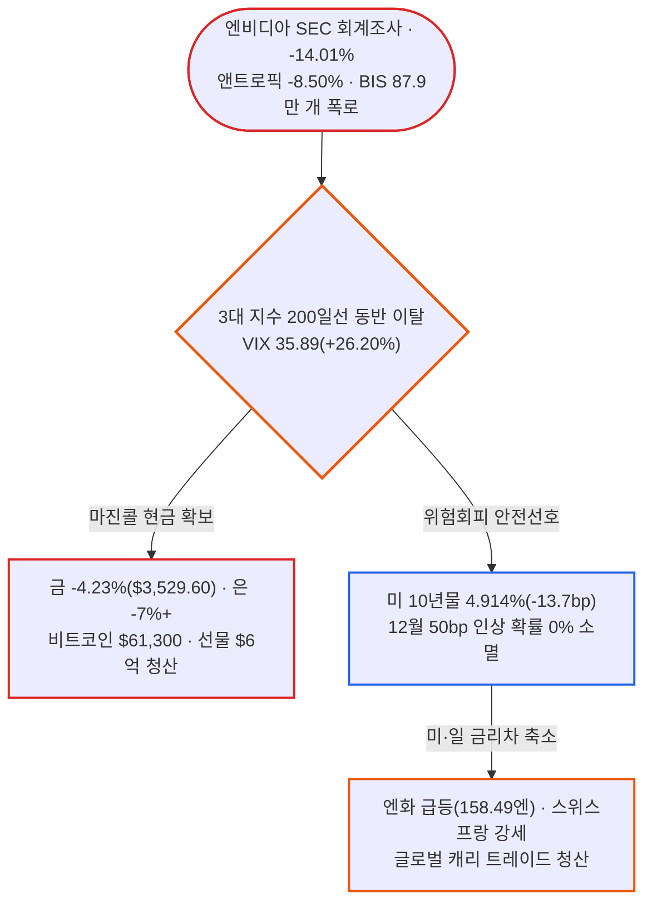

# 2026년 11월 21일(토) 하루치 뉴스정리

- **작성일**: 2026-11-21

나스닥 종합지수가 하루 만에 **5.28% 추락**하며 2020년 3월 코로나 팬데믹(-12.64%) 이후 최악의 한 주(-10.02%)를 찍었다. 필라델피아 반도체지수는 **10.73% 폭락**해 한 달도 안 돼 두 번째 10%대 붕괴를 맞았고, 엔비디아는 미국 증권거래위원회(SEC) 회계 관행 조사 소식에 **14.01% 주저앉으며** 시가총액 4위로 밀려났다. 3대 지수가 일제히 200일 이동평균선 아래로 꺾이고 공포지수(VIX)가 **35.89까지** 치솟은 패닉 속에서 안전자산이라던 금(-4.23%)과 비트코인(61,300달러)마저 현금 확보용 강제청산으로 박살 난 반면, 정작 연준의 12월 빅스텝(50bp 인상) 확률은 0%로 증발하고 미 10년물 국채금리는 **4.914%로** 급락하는 기괴한 역전이 벌어졌다.

## 요약

| 구분 | 핵심 내용 |
| :--- | :--- |
| **핵심 진단** | 뚜렷한 단일 악재 없이 AI·반도체 투매가 폭발하며 3대 지수 전원 200일선 이탈, 나스닥은 2020년 3월 이후 최악의 주간(-10.02%) 기록 및 VIX 35.89 급등 |
| **핵심 종목 팩트** | 엔비디아(-14.01%) SEC 회계조사·시총 4위 추락, 브로드컴·AMD·마이크론·하이닉스 ADR -13%대 동반 붕괴, 앤트로픽 상장 이튿날 -8.50%(공모가 $83 턱걸이) |
| **착시 교정** | ① 금·비트코인 피난처 ➔ 현금 확보 강제청산 폭탄, ② 젠슨 황 복귀설 반등 기대 ➔ SEC 조사·BIS 가짜 기업 폭로 리스크, ③ 빅테크 EPS ➔ 지분 평가익 착시, ④ 소비재 반등 ➔ 마진 압박·감원 민낯 |
| **돈길 확산 신호** | 사이버 장애 연쇄 속 보안 통합(`PANW`·`CRWD`), 미 상원 BAAJA 통과 및 전력망 투자 슈퍼사이클, 오프그리드(`SPCX`), 고마진 낙폭과대(`APP`·`CRM`) |
| **가장 더러운 변수** | 11월 23일 앤트로픽 옵션 개시, 12월 1일 젠슨 황·러트닉 미 하원 증언, 금리 25bp 인상(90.6%)과 동결(9.4%)이 충돌하는 FOMC 경계감, 호르무즈 해협 유조선 공격 |
| **계좌 행동 지침** | 200일선 이탈 패닉장 추격 매도 및 레버리지·낙폭 반도체 섣부른 물타기 금지, 미 국채·현금 방패 유지 속 보안·전력망·고마진 실적주만 선별 관찰 |

---

## 1. 코로나 이후 최악의 주간과 엔비디아 추락

20일(현지시간) 뉴욕증시는 AI와 반도체를 중심으로 이성을 잃은 투매가 쏟아진 하루였다. 다우존스30산업평균지수는 전장 대비 1.93%(-949.73포인트) 내린 48,147.33, S&P 500 지수는 3.70%(-265.44포인트) 급락한 6,910.39로 마감하며 7거래일 연속 하락과 동시에 7개월 만에 7,000선을 내줬다. 기술주 중심의 나스닥 종합지수는 **5.28%(-1,261.47포인트)** 빠진 22,617.73에 주저앉았다. 이번 주 나스닥 하락률은 10.02%로 지난해 4월 상호관세 충격 주간(-10.02%)을 소수점 셋째 자리 이하에서 웃돌며 2020년 3월 코로나 사태(-12.64%) 이후 최악의 주간 성적표를 썼다. BTIG의 조너선 크린스키는 3대 주요 지수가 모두 200일 이동평균선 아래에 놓여 추가 하락 위험이 크다고 경고했고, VIX는 하루 새 26.20% 뛰어 **35.89까지** 치솟았다. 유럽 유로스톡스50(-2.09%)과 독일 DAX(-1.97%)도 동반 약세를 피하지 못했고, S&P 11개 업종 중 필수소비재(+0.68%, 월마트·존슨앤드존슨·코스트코·코카콜라·P&G +1%대)를 뺀 전 업종이 무너졌다.

피바다의 진앙지는 반도체였다. 필라델피아 반도체지수(SOX)는 10.73% 폭락해 지난 5일(-12.25%)에 이어 한 달도 안 돼 두 번째 10% 이상 붕괴를 기록했다. 한 달 내 SOX가 두 번 이상 10% 넘게 무너진 것은 2020년 3월 팬데믹 이후 처음이다. 브로드컴·AMD·마이크론테크놀로지가 13% 안팎으로 쏟아졌고, SK하이닉스 ADR은 13.11%, TSMC ADR은 장중 8.49%, 인텔과 ASML은 5%대 급락했다. 상대적으로 가치주 성격이 강한 애플과 마이크로소프트만 장중 1%대 하락으로 버텼을 뿐 아마존(-3.55%), 스페이스X·메타(-6%대), 테슬라(-7%대) 등 AI 관련 대형주는 일제히 얻어맞았다.

대장주 엔비디아(`NVDA`)는 종가 기준 **14.01% 폭락해** 작년 1월 27일 '딥시크 쇼크'(-16.97%) 이후 최대 낙폭을 기록했고 시총은 3조 달러 턱걸이 수준까지 쪼그라들며 알파벳(약 3조 3,200억 달러)에 밀려 시총 4위로 주저앉았다. 지난 12일 젠슨 황 전 CEO가 중국 스파이 의심 여성과의 불륜설로 사임한 데 이어, 미국 증권거래위원회(SEC)가 엔비디아의 잠재적 회계 관행을 조사하고 있다는 소식이 기름을 부었다. 도널드 트럼프 대통령이 백악관 브리핑에서 젠슨 황을 향해 "크게 사과하고 복귀해 두 번째 기회를 받길 원한다"고 촉구하고 일론 머스크 CEO도 "연승 팀에서 마이클 조던을 내보낸 격"이라며 편을 들었지만(머스크는 중간선거 최소 4억 7,400만 달러 지출 후회 발언도 덧붙임), CNBC 짐 크레이머의 지적대로 전임자 복귀설은 오히려 후임 정식 CEO 선임과 경영 정상화를 마비시키는 악재로 작동했다.

여기에 워싱턴의 대중국 수출통제 폭탄까지 터졌다. 미 하원 외교위원회 브라이언 매스트 위원장과 그레고리 믹스 간사가 수출통제개혁법(ECRA)에 근거해 공개한 상무부 산업안보국(BIS) 자료에 따르면, 2025년 12월부터 2026년 5월까지 신청된 AI 칩 340만 개 중 **87만 9,000개 이상이** 승인(엔비디아 H200·AMD MI325X 포함)됐다. 승인 물량에는 미 국방부가 군 연계 기업으로 지정한 텐센트(15만 개), 알리바바(7만 5,000개), 바이두(4만 3,000개), BYD(4,000개)까지 포함됐고 바이트댄스·테슬라 상하이 신청도 확인됐다. 더 치명적인 대목은 엔비디아 신청서에 등장한 마진프라(Maginfra)와 뉴 매트릭스(New Matrix)가 칩 밀수 연루 의혹이 짙은 가짜 위장기업이라는 매스트 위원장의 폭로다. 공매도 투자사 헌터브룩 미디어 역시 제재 대상 중국 서버업체 IEIT 시스템즈가 AMD 최신 펌웨어를 계속 공급받았다고 주장했다. 상무부가 11월 16일 제3국 데이터센터 임차 우회로를 막는 임시 최종 규칙을 내놓은 데 이어 **12월 1일 젠슨 황의 하원 3개 위원회 비공개 진술과 하워드 러트닉 상무장관 증언**이 예고되면서 규제 불확실성은 정점으로 치닫고 있다. (한편 엔비디아는 인셉션의 병렬 생성 LLM '머큐리' 기술을 노리고 5억 달러 이상 인수를 막바지 협상 중이다.)

> **월가의 AI 재산정 경고**: 트레저리파트너스의 리처드 사퍼스타인은 "데이터센터 건축 둔화와 자금 조달처 감소, 기술 이익 성장 둔화가 주가에 반영되는 AI 재산정 과정"이라 짚었고, 나일스의 댄 나일스는 "오픈AI와 앤트로픽의 합산 매출 전분기 대비 성장률이 2분기 75%에서 3분기 **48%로** 꺾인 사이 합산 손실은 79억 달러에서 **84억 달러로** 커졌다"고 폭로했다.

상장 이튿날을 맞은 앤트로픽(`ANT`)도 거품이 걷히며 **8.50% 급락해** 공모가 83달러 선만 가까스로 지켰다(프리마켓 -9.17% 88.26달러, 장중 -10%대). 전날 희망 범위(70 ~ 78달러)를 뚫고 83달러로 상장해 공모 813억 달러(그린슈 행사 시 935억 달러, 사모 포함 1,073억 달러, 주관사 수수료 5억 5,000만 달러, 거래량 6억 4,000만 주+)를 조달하고 시초가 111.50달러(시총 2조 100억 달러)까지 뛰었지만 종가는 97.17달러(+17.07%)로 꺾였고 둘째 날 다시 쏟아졌다. 3분기 매출 170억 달러(+1,100% YoY)·연환산 매출 810억 달러·연 10만 달러 이상 고객 1만 2,000곳이라는 폭발적 성장세 덕분에 로스 거버("제2의 구글")와 레베카 월서(장기 낙관)는 호평했지만, 모닝스타 말릭 아흐메드 칸(적정주가 92달러)과 시포트 제이 골드버그(중립), 스티브 그라소와 바론스(지난 6월 스페이스X도 상장 첫 3거래일 49% 급등 뒤 급락)는 한목소리로 추격매수를 말렸다. 이제 시선은 개인 콜옵션 수급이 처음 시험대에 오르는 **11월 23일(월) 앤트로픽 옵션 거래 개시**로 쏠려 있다.

---

## 2. 패닉 속 금리 급락과 금·비트코인 강제청산

이날 매크로 시장에서는 말과 숫자가 정면으로 충돌하는 촌극이 벌어졌다. 연준 크리스토퍼 월러 이사는 공개 발언을 통해 "인플레이션이 잘못된 방향으로 광범위하게 확산하고 있어 12월 FOMC에서 50bp 금리 인상이 필요할 가능성이 높고, 작년 75bp 금리 인하를 되돌리는 것 이상의 긴축이 필요하다"고 으름장을 놨다. 하지만 정작 채권과 금리 선물 시장은 월러의 말을 콧방귀로 넘겼다. 나스닥과 반도체가 패닉 투매에 빠지면서 금융 여건 자체가 급격히 조여들자 국채로 안전자산 매수세가 밀려든 탓이다.

미 국채 10년물 금리는 전장 대비 13.70bp 굴러떨어진 **4.9140%를** 기록해 지난 12일 이후 처음으로 5.0% 선 아래로 내려앉았다. 통화정책에 민감한 2년물 금리는 16.60bp 급락한 **4.6130%**로 더 가파르게 내렸고, 30년물도 9.70bp 하락한 5.3040%에 거래되며 10년물과 2년물 금리 차이는 27.20bp에서 30.10bp로 벌어진 전형적인 불 스티프닝(단기물 강세 주도 금리 하락)이 나타났다. CME 페드워치에서 한때 고개를 들던 **12월 50bp 빅스텝 확률은 0%로 완전히 소멸**했고, 25bp 인상 확률이 90.6 ~ 91.5%로 낮아진 반면 **금리 동결 확률이 8.5 ~ 9.4%(장중 한때 10% 상회)까지** 되살아났다. 오전 10시 발표된 11월 미시간대 소비자심리지수 확정치(51.5, 전달 48.0 대비 +3.5p)에서 **1년 기대 인플레이션이 전달 4.7%에서 3.7%로 1.0%p 급락**(이란 사태 이전 수준 복귀)하고 5 ~ 10년 장기 기대 인플레이션도 3.5%에서 3.3%로 내려온 점도 채권 매수세에 힘을 보탰다. LPL 로렌스 길럼은 AI 매도세가 금융 여건을 죄면 연준이 긴축 속도를 늦출 유연성이 생긴다고 진단했고, 클리어스테드의 짐 아와드는 AI 지출 둔화 우려로 경제성장 공포가 번지고 있다고 짚었다.

외환과 원자재, 가상자산 시장에서는 유동성 발작이 그대로 찍혔다. 달러인덱스(DXY)는 장 초반 금리 급락에 103.582까지 밀렸다가 안전자산 수요가 붙으며 103.860(-0.027%)으로 보합권까지 되돌렸다. 반면 저금리 안전 통화인 엔화(달러-엔 158.494엔, -0.737%)와 스위스프랑(0.8396프랑, -0.498%)은 급등했고 위험통화인 호주달러는 0.6614달러(-0.721%)로 고꾸라졌다. ING의 크리스 터너는 이를 광범위한 캐리 트레이드 청산 신호로 보며 DXY 단기 목표치 104.60을 유지했고, 도이치방크의 팀 베이커와 조지 사라벨로스는 4년 평균 대비 20% 넘게 고평가된 상태에서도 높은 실질금리와 주식 자금 유입에 기대어 **'AI 달러'가** 2027년 상반기까지 예외적 강세를 이어갈 것(2027년 말 유로/달러 1.15달러, 달러/엔 145엔, 리스크는 쌍둥이 적자 및 민주당 의회 견제 시 관세 재개)으로 내다봤다.

| 자산군 / 핵심 지표 | 당일 수치 및 변동폭 | 시장 작동 메커니즘과 함의 |
| :--- | :--- | :--- |
| **다우 / S&P 500 / 나스닥** | 48,147(-1.93%) / 6,910(-3.70%) / 22,617(-5.28%) | 나스닥 주간 -10.02%(코로나 이후 최악), 3대 지수 전원 200일선 이탈 |
| **SOX / 엔비디아 / VIX** | SOX -10.73% / NVDA -14.01% / VIX 35.89(+26.20%) | 한 달 내 SOX 두 번째 10%+ 붕괴, NVDA SEC 조사 악재로 시총 4위 추락 |
| **미 2년물 / 10년물 / 30년물** | 4.6130%(-16.6bp) / 4.9140%(-13.7bp) / 5.3040%(-9.7bp) | 증시 패닉발 안전자산 쏠림으로 불 스티프닝, 12월 50bp 인상 확률 0% 증발 |
| **DXY / 달러-엔 / 호주달러** | DXY 103.860 / 158.494엔(-0.737%) / AUD 0.6614(-0.721%) | 미·일 금리 차 축소 속 엔·스위스프랑 급등 및 광범위한 캐리 청산 진행 |
| **금 선물 / 은 선물 / 비트코인** | 금 $3,529.60(-4.23%) / 은 -7%+ / BTC $61,300 | 주식 마진콜·손실 메우기용 현금 확보 강제청산, 코인 24시간 선물 $6억 청산 |
| **WTI / 브렌트유** | WTI $83.98(+0.93%) / 브렌트 $92.57(+0.64%) | 호르무즈 게슘섬 폭발 보도·11월 매일 1건꼴 유조선 공격 속 사흘 만에 반등 |

가장 뼈아픈 붕괴는 금과 비트코인이었다. 12월 인도분 금 선물은 하루 새 **4.23%(-155.90달러) 추락한** 온스당 3,529.60달러(장중 3,514.90달러로 작년 9월 초 이후 최저)를 기록해 올해 1월 사상 최고치(5,589달러) 대비 처참히 무너졌고 은 선물도 7% 넘게 떨어져 41달러 초반까지 주저앉았다. 하이리지퓨처스 데이비드 메저와 스탠다드차타드 수키 쿠퍼의 설명처럼 이자 없는 금이 강달러와 고금리 부담에 치인 데다 주식 폭락 손실을 메우려는 **현금 확보용 강제청산** 물량까지 덮친 결과다. 비트코인 역시 최근 80,000달러에서 62,000달러 선까지 내준 데 이어 **61,300달러로** 주저앉아 7월 초 이후 최저치를 쳤고 24시간 선물 강제청산액은 **6억 달러를** 돌파했다. 한편 국제유가(WTI 83.98달러, +0.93%)는 이란 호르무즈 해협 게슘섬 폭발음 보도(타스님 통신 적 미사일 보도 후 불발탄 처리로 정정)와 11월 하루 한 건꼴로 발생하는 유조선 공격(UOB), 트럼프 대통령의 대이란 강경 발언("51년간 허튼소리, 가짜 협상 거부")이 맞물리며 3일 만에 반등했다. 22V 리서치의 조르디 비서는 S&P 500·러셀2000·나스닥100·유가가 동시에 200일선 아래로 떨어지고 10년물 금리가 고공행진한 17일 같은 조합은 2008년 이후 6번뿐이었으며, 짧게 끝나면 6개월 뒤 +2.5 ~ 23% 반등했지만 길어지면 2008년·2022년 하반기처럼 **15 ~ 44% 폭락으로** 번졌다고 경고했다.

---

## 3. 빅테크 실적 착시와 보안·소비재 양극화

시장 전체가 패닉에 휩싸인 날 바론스는 빅테크 손익계산서에 숨겨진 회계 착시를 정조준했다. 오픈AI, 앤트로픽, 스페이스X에 대규모 지분을 태운 알파벳, 아마존, 마이크로소프트의 순이익과 주당순이익(EPS)이 영업외수익의 미실현 평가손익 때문에 춤을 추고 있다는 지적이다. 실제로 스페이스X와 앤트로픽 무의결권주 18억 주를 쥔 알파벳은 올해 2분기 스페이스X 상장 덕분에 영업이익(410억 달러)의 두 배가 넘는 **990억 달러의 미실현 지분 이익을** 장부에 얹어 순이익이 770억 달러 불어나고 희석 EPS가 2.85달러에서 9.11달러로 튀었다. 이 일회성 평가익을 걷어내면 실제 본업 EPS는 당시 컨센서스(2.88달러)를 소폭 밑돌았다. 반대로 3분기에는 스페이스X 주가 하락으로 87억 달러 미실현 손실(EPS -0.55달러)을 봤는데, 이런 핵심 수치를 실적 발표 자료 8페이지 작은 각주에만 숨겨 놓았다. 앤트로픽 무의결권주 19억 주를 가진 아마존 역시 분기 중 앤트로픽 주가가 5%만 흔들려도 순이익이 출렁이며, 오픈AI 지분 24%를 쥔 마이크로소프트만 작년 10월 FY26 1분기부터 실적 발표 첫 페이지에 Non-GAAP 조정표를 올려 지분 손익을 투명하게 분리 공시하고 있다.

기술주 내부에서는 보안, 독립망, 현금 창출 여부에 따라 옥석이 피도 눈물도 없이 갈렸다. 팔로알토 네트웍스(`PANW`)는 FY27 1분기 3개 제품 부문 모두 성장세가 가속되며 5년 이상 만에 최대 매출 서프라이즈를 기록했고, SASE ARR +30%, 최근 12개월 방화벽 수주 +28%, AI 보안 솔루션 Prisma AIRS ARR 1억 7,000만 달러 근접에 힘입어 FY27 가이던스까지 올려 잡았다. 어플라이드 컴퓨트 45억 달러 인수 발표 직후 시간외에서 5% 빠졌다가 주간 9% 반등(크라우드스트라이크·지스케일러 동반 상승)하자 키뱅크·파이퍼 샌들러가 목표주가를 450달러로, BTIG(442달러)·DA데이비슨(430달러)이 일제히 상향했다. 모건스탠리의 아담 조나스는 MS·FAA(항공기 4시간 이상 중단)·NSA 연쇄 장애 속에서 스타링크 위성망을 보유한 스페이스X(`SPCX`)를 '궁극의 오프그리드' 종목(비중확대, 목표가 300달러)으로 꼽았으나, 정작 스페이스X가 지난 8월 600억 달러에 인수한 코딩 플랫폼 커서(Cursor)는 지정학적 위험 때문에 중국 문샷의 키미 K2.5 기반 모델 사용 중단을 검토 중이라는 의회 보고서가 나왔다. 애플(`AAPL`)은 메타의 AI 에이전트 '뮤즈'(11월 일평균 이용자 880만 명, 전월 대비 +127%)에 맞서 전 세계 25억 대 활성 기기 OS 업데이트를 무기로 컴퓨터를 직접 조작하는 자율형 AI 에이전트 인력을 채용하고 있다.

| 기업 / 종목 | 핵심 숫자 및 팩트 | 월가 판정 및 내재 리스크 |
| :--- | :--- | :--- |
| **알파벳 · 아마존 (`GOOGL` · `AMZN`)** | 앤트로픽 무의결권주 18억 주 / 19억 주 보유 | 알파벳 2Q 지분 이익 $990억 착시(제외 시 EPS 하회), 주가 5% 변동마다 실적 왜곡 |
| **팔로알토 네트웍스 (`PANW`)** | 3개 부문 가속, SASE ARR +30%, $45억 인수 | AI 공격 급증 속 보안 통합 슈퍼사이클 수혜, 키뱅크·파이퍼 목표가 $450 상향 |
| **인튜이트 · 빌 홀딩스 (`INTU` · `BILL`)** | `INTU` -4.64%(프리 -9.9%), `BILL` $60억 현금 인수 | 메일침프 3분의 1 가격($36.8억) 손절·가이던스 하향 vs `BILL` 주당 $63.25(31% 프리미엄) 매각 |
| **앱러빈 · 세일즈포스 (`APP` · `CRM`)** | `APP` 3Q 매출 $21.8억(+55%)·순익률 66%, `CRM` $183.31 | 고점 대비 -46% `APP` 목표가 $545, CapEx 피로 대안 `CRM` 12월 2일 실적 앞 목표가 $300 |
| **P&G · BJ's 홀세일 (`PG` · `BJ`)** | `PG` 제조·물류 인력 20 ~ 30% 감축, `BJ` 프리 -3.61% | `PG` 원자재 비용 +40%($14억), `BJ` $2.4억 합의금으로 상품 마진 -170bp 하락 가림 |
| **로스 스토어스 · 타겟 (`ROST` · `TGT`)** | `ROST` -3.91%(4Q EPS 가이던스 미달), `TGT` 목표가 상향 | 저가 의류·유통 소비 둔화 신호 vs `TGT` 관세 환급 제외 마진 방어(일회성 소멸 뒤 관건) |

소프트웨어와 낙폭과대주 진영에서는 M&A 굴욕과 고마진 반격이 교차했다. 인튜이트(`INTU`)는 크레딧 카르마 둔화로 FY27 매출 가이던스를 낮추고 5년 전 인수했던 메일침프를 버크셔 해서웨이가 투자한 벤딩 스푼스에 인수가 3분의 1 수준인 36억 8,000만 달러에 팔아넘기며 프리마켓 9.9% 급락(장 초반 -4.64%)했다. 핀테크 기업 빌 홀딩스(`BILL`)는 사모펀드 TPG와 코페이(`CPAY`)가 주당 63.25달러(60일 가중평균주가 대비 31% 프리미엄), 총 약 60억 달러 전액 현금 인수를 발표했음에도 프리마켓 3.9% 밀렸다. 반면 제프리스는 소프트웨어 ETF(`IGV` +1.6%) 랠리에서 소외돼 4거래일 연속 하락한 세일즈포스(`CRM`, 183.31달러)에 대해 12월 2일 실적 발표에서 유기적 성장 가속과 고CapEx 피로 반사이익을 기대하며 목표가 300달러를 고수했다. 52주 고점 대비 46% 빠진 앱러빈(`APP`)도 3분기 매출 21억 8,000만 달러(+55%), 순이익률 **66%에** 조정 EBITDA 마진 **84%에** 잉여현금흐름 14억 달러를 찍으며 프리덤 캐피털의 매수(목표가 545달러)를 얻었고, 6개월 새 71% 폭락해 25.55달러까지 떨어진 AST 스페이스모바일(`ASTS`, 로켓랩도 150달러 이상에서 50.99달러로 하락)은 B. 라일리로부터 목표가 48달러 유지와 함께 매수 상향을 받았다.

실물 경기 최전선의 필수소비재와 유통주들은 방어주 랠리 뒤편의 민낯을 드러냈다. P&G(`PG`)는 투자자의 날 행사에서 원자재 비용 전망치가 10억 달러에서 14억 달러(+40%)로 불어나고 FY26 EPS 증가율이 1% 밑으로 꺾이자 **제조·물류 인력 20 ~ 30%(약 1만 5,000명)**를 자르고 FY27 ~ 30 최대 100억 달러 비용을 깎겠다고 발표했다. BJ's 홀세일(`BJ`)은 3분기 매출 62억 8,000만 달러(+17.5%)와 비GAAP EPS 1.73달러(+49.1%), 연간 EPS 가이던스 상향(5.10 ~ 5.30달러)에도 신용카드 수수료 소송 합의금 2억 4,000만 달러(관련 비용 9,500만 달러 차감)라는 일회성 이익과 판촉에 따른 **상품 매출총이익률 170bp 하락**이 까발려지며 프리마켓 3.61% 내렸다. 로스 스토어스(`ROST`) 역시 4분기 EPS 가이던스(2.16 ~ 2.25달러)와 동일매장매출(4 ~ 5%)이 모두 눈높이에 못 미쳐 3.91% 밀렸고, 로스 컴퍼니스(`LOW`)는 3분기 EPS 상회와 2026년 10억 달러 비용 절감에도 비용 부담 탓에 텔시(255달러)와 RBC(229달러)가 목표가를 소폭 낮췄다. 그나마 타겟(`TGT`)은 관세 환급 효과를 빼도 매출총이익률이 예상을 웃돌아 목표가가 183 ~ 198달러로 올랐고, 갭(`GAP`)은 비GAAP EPS 상회로 프리마켓 3.0% 상승했다.

---

## 4. 시장의 4대 착시와 데이터 검증

### 착시 ① 금·비트코인 ➔ 패닉장의 안전 피난처

증시가 흔들릴 때 금이나 '디지털 금' 비트코인을 쥐고 있으면 계좌를 지켜줄 것이라는 대중의 믿음은 오늘 하루 만에 산산조각 났다. 금 선물은 하루에 **4.23%나** 떨어져 14개월 최저치(3,529.60달러)로 고꾸라졌고 은은 7% 이상, 비트코인은 61,300달러까지 추락하며 6억 달러 넘는 선물 포지션이 강제 청산됐다. 레버리지가 낀 패닉장에서는 유동성이 급한 기관들이 가장 쉽게 현금화할 수 있는 금과 코인부터 시장가로 던져 주식 마진콜을 막는다. 진짜 안전 피난처 노릇을 한 자산은 금리를 13.7bp 이상 끌어내린 미국 국채와 엔화·스위스프랑, 그리고 현금뿐이었다.

### 착시 ② 엔비디아 폭락 ➔ 젠슨 황 복귀로 끝

트럼프 대통령의 "두 번째 기회" 촉구와 일론 머스크의 마이클 조던 비유를 보고 "젠슨 황만 돌아오면 엔비디아 -14% 폭락이 금방 회복된다"고 기대하는 개인이 많다. 그러나 시장을 짓누르는 진짜 뇌관은 인물이 아니라 제도와 회계다. SEC의 잠재적 회계 관행 조사라는 칼날이 새로 겨눠졌고, 미 하원 외교위가 공개한 BIS 승인 물량(87만 9,000개) 속에 마진프라와 뉴 매트릭스 같은 가짜 위장기업이 엮여 있다는 폭로까지 나왔다. 게다가 짐 크레이머의 분석대로 전임자 복귀설이 커질수록 새 정식 CEO 선임이 꼬여 지배구조 공백이 길어지고, 12월 1일 하원 3개 위원회 비공개 진술이라는 사법적 변수가 눈앞에 버티고 있다.

### 착시 ③ 빅테크 EPS 급등 ➔ 본업 성장세

올해 2분기 알파벳의 희석 EPS가 2.85달러에서 9.11달러로 폭증한 숫자를 보고 빅테크 본업이 압도적이라고 착각해서는 안 된다. 스페이스X 상장으로 얹힌 990억 달러의 미실현 평가익(영업이익 410억 달러의 2.4배)을 빼면 본업 EPS는 오히려 월가 기대치를 밑돌았다. 반대로 3분기에는 스페이스X 하락분 87억 달러(EPS -0.55달러)가 실적 자료 8페이지 작은 각주에 숨어 실적을 갉아먹었다. 이제 나스닥에 상장된 앤트로픽 무의결권주를 알파벳이 18억 주, 아마존이 19억 주씩 쥔 만큼 앤트로픽 주가가 5% 출렁일 때마다 두 회사의 당기순이익이 요동치는 회계 착시가 일상화된다.

### 착시 ④ 필수소비재 반등 ➔ 탄탄한 실물 경기

월마트, 코스트코, P&G가 패닉장에서 1% 안팎 상승하며 필수소비재 업종만 유일하게 빨간불(+0.68%)을 켜자 경기가 튼튼하다는 착각이 생긴다. 정작 소비재 기업 내부 성적표는 비명 일색이다. P&G는 원자재 비용 부담이 40% 뛰어 제조·물류 인력 최대 30%인 **1만 5,000명이나** 해고하기로 했고, BJ's는 판촉 경쟁에 상품 매출총이익률이 170bp 깎인 것을 신용카드 소송 합의금 2억 4,000만 달러로 덮었다가 주가가 미끄러졌다. 로스 스토어스가 4분기 가이던스를 꺾은 것까지 합치면 소비재 반등은 경기가 좋아서가 아니라 갈 곳 잃은 자금이 일시적으로 대피한 방어 쏠림에 불과하다.

---

## 5. 기관 자금 이동: 보안·전력망·방어주

패닉 투매가 휩쓸고 지나간 자리에서 큰손들이 노골적으로 실탄을 꽂고 있는 첫 번째 길목은 **AI 사이버보안 통합**이다. 지난 일주일간 마이크로소프트, 체이스은행, 애플, 미 연방항공청(전국 항공편 4시간 이상 중단), 국가안보국(NSA)에서 연쇄 시스템 장애가 터지자 백악관은 국가사이버국장을 국방부 CIO 커스틴 데이비스로 전격 교체했다. 마코 루비오 국무장관이 악의적 공격 연계를 부인했는데도 레이 달리오의 브릿지워터는 "공격 여부가 확실해질 때까지 기다리면 대응이 늦고, 오픈소스 AI로 해킹이 더 위험해졌다"며 **향후 1년 내 경제를 뒤흔들 사이버 공격 확률을 33%로** 가정하고 자금을 굴린다고 밝혔다. 팔로알토 네트웍스(`PANW`)가 45억 달러 인수에도 주간 9% 급등하고 크라우드스트라이크(`CRWD`)·지스케일러(`ZS`)가 동반 강세를 탄 것은 기업들이 보안 지출을 단일 플랫폼으로 통합하는 슈퍼사이클이 열렸기 때문이다.

두 번째 길목은 **전력망 병목 해소와 오프그리드 인프라**다. 미 상원이 19일 초당적 찬성 62표 대 반대 33표(척 슈머 원내대표 등 민주당 10여 명 합류)로 통과시킨 '2026년 초당적 미국 생활비 부담 완화 및 일자리 법안(BAAJA)'은 환경 인허가 절차를 깎고 송전 규정을 개편하며, 기승인 풍력·태양광 취소를 막는 대신 하이퍼스케일러에게 전력망 비용을 물리는 구조다. 로디엄 그룹은 2040년까지 청정에너지 17 ~ 249GW 추가와 천연가스 수출 8 ~ 15% 증가를 내다봤다. 국제에너지기구(IEA) 역시 2030년 데이터센터 전력 사용량이 두 배(약 1,000TWh)로 뛰고 2035년까지 송전선 2,600만 km 신설과 1,600만 km 교체가 필요해 구리·케이블·변압기가 부족하며 향후 10년 전력망 투자가 75% 늘어날 최고 테마라고 못 박았다. 지상 전력망 연결 대기가 최대 전력 수요를 넘어서는 지역이 속출하자 모건스탠리가 스타링크 위성망을 가진 스페이스X를 '오프그리드' 최고 대안으로 꼽은 맥락도 정확히 일치한다.

세 번째와 네 번째 자금 이동은 **고마진 현금 사냥과 국채·저금리 통화 방패**다. 사모펀드 TPG와 코페이는 빌 홀딩스(`BILL`)를 60억 달러 전액 현금에 인수했고, 버크셔가 투자한 벤딩 스푼스는 인튜이트에서 메일침프를 36억 8,000만 달러 헐값에 건졌다. 공개 주식에서는 순이익률 **66%에** EBITDA 마진 **84%에** 달하는 앱러빈(`APP`), CapEx 피로 대안으로 꼽힌 세일즈포스(`CRM`), 6개월 -71% 폭락 뒤 리스크-보상이 개선된 ASTS처럼 숫자가 남거나 악재가 극단적으로 선반영된 종목으로 리서치 매수 표가 이동했다. 매크로 자금은 미 국채 2년·10년물 불 스티프닝과 엔·스위스프랑 매수(캐리 트레이드 청산), 그리고 필수소비재(월마트·코스트코·P&G) 방어 바스켓으로 빠르게 재배치됐다.

---

## 6. 향후 2 ~ 4주 핵심 모니터링 지표

| 핵심 지표 | 안도 신호 (Bull) | 위험 신호 (Bear) | 시장 대응 의미 |
| :--- | :--- | :--- | :--- |
| **앤트로픽 옵션 개시 (11/23)** | 공모가 $83 지지 및 콜옵션·현물 유입 | $83 이탈 및 풋옵션 쏠림·차익 투매 | AI 테마 전반의 개인·기관 위험선호 잔존 여부 첫 시험대 |
| **엔비디아 의회 증언 (12/1)** | 추가 제재 없는 소명 및 SEC 조사 축소 | 가짜 기업 연루 처벌·수출규제 추가 강화 | 젠슨 황·러트닉 증언 결과에 따른 AI 칩 밸류에이션 분기점 |
| **3대 지수 200일선 · VIX 35.89** | 200일선 단기 회복 및 VIX 20대 하향 | 200일선 이탈 장기화 및 VIX 40 돌파 | 22V 경고처럼 장기 이탈 시 -15 ~ 44% 하락 구간 전이 경계 |
| **12월 FOMC 확률 · 미 10년물** | 동결 확률 확대 및 10년물 4.90% 하회 안정 | 50bp 인상 공포 재점화 및 10년물 5.0% 재돌파 | 월러 매파 발언 vs 경기 둔화 공포 중 연준의 실제 선택 확인 |
| **금 $3,500 · BTC $60,000** | 강제청산 진정 및 저점 다지기 성공 | $3,500·$60,000 동반 붕괴 및 유가 $90+ 급등 | 주식 마진콜 연쇄 청산 종료 여부 및 호르무즈 지정학 리스크 점검 |
| **BAAJA 하원 통과 · CRM 실적** | 하원 통과·트럼프 서명 및 12/2 CRM 서프라이즈 | 민주당 분열로 법안 표류 및 SW 가이던스 부진 | 전력망 인허가 수혜와 고CapEx 대안 SW 순환매 지속성 검증 |

---

## 7. 패닉장 계좌 생존과 섹터 대응 전략

22V 리서치의 조르디 비서가 짚었듯 3대 지수와 유가가 200일선 아래로 떨어지고 10년물 금리가 높게 버틴 구간이 짧게 끝나면 6개월 뒤 반등장이 열리지만, 길어지면 2008년이나 2022년 하반기식 대형 하락장으로 번진다. 지금은 방향을 예단해 몰빵할 때가 아니라 섹터별 체력 차이를 갈라 계좌 방어막부터 쳐야 하는 자리다.

| 섹터 / 자산군 | 대응 판정 | 실행 기준 및 관찰 포인트 | 핵심 경계 리스크 |
| :--- | :---: | :--- | :--- |
| **AI 반도체 · 신규 AI IPO** | **추격·물타기 금지** | 11/23 `ANT` 옵션 개시, 12/1 의회 증언, `NVDA` SEC 조사 윤곽 확인 후 판단 | SOX 한 달 두 번째 10%+ 폭락, BIS 제재·가짜 기업 폭로·합산 손실 $84억 |
| **사이버보안 · 전력망 · 독립망** | **조정 시 선별 관찰** | `PANW`·`CRWD`·`ZS` 플랫폼 통합 수혜, BAAJA 전력망, `SPCX` 오프그리드 | 지수 투매 동조화 변동성 및 하원 법안 표결 지연 가능성 |
| **고마진 SW · 낙폭과대 옥석** | **실적 확인 후 분할** | `APP`(순익률 66%)·`CRM`(12/2 실적)·`ASTS`(-71% 후 바닥 다지기) 선별 체크 | AI 에이전트 잠식 우려 및 `INTU`식 M&A 손절·가이던스 하향 리스크 |
| **필수소비재 · 유통 방어주** | **착시 경계 / 선별** | `TGT`(관세 제외 마진 방어) 위주 점검, 인력 감축 `PG`·마진 훼손 `BJ` 경계 | 일회성 소송 합의·관세 환급 소멸 이후 실질 마진 및 소비 둔화 노출 |
| **현금 · 미 국채 · 금 · 비트코인** | **현금·국채 방어 유지** | 200일선 회복·강제청산 종료 확인 전까지 현금과 단기·중기 국채 비중 유지 | 금($3,500)·비트코인($60,000) 마진콜 청산 완료 전 저가 매수 시 추가 손실 |

- **반도체 낙폭만 보고 섣불리 물타기 금지**: 필라델피아 반도체지수가 한 달에 두 번이나 10% 넘게 깨진 장세에서는 싸 보인다는 이유만으로 받아내면 SEC 회계조사, 12월 1일 하원 증언, 동남아 우회 수출 차단에 추가 타격을 입는다.
- **금과 비트코인 강제청산 확인 전 진입 보류**: 주식 손실을 메우기 위해 금(-4.23%)과 코인(선물 6억 달러 청산)을 시장가로 던지는 수급이 멈춰야 진짜 바닥 신호가 켜지므로 3,500달러와 60,000달러 지지 여부를 먼저 확인해라.
- **실적 착시를 걷어낸 진짜 현금흐름 압축**: 알파벳의 지분 평가익(990억 달러)이나 BJ's의 소송 합의금(2억 4,000만 달러) 같은 일회성 숫자를 빼고도 본업이 커지는 사이버보안 통합주와 초고마진 소프트웨어, 전력망 병목 수혜주만 관심 목록에 남겨라.

---

## 8. 최종 판정 및 실행 원칙

나스닥 주간 -10.02% 폭락과 3대 지수 전원 200일선 이탈, 금과 비트코인의 동반 강제청산은 시장이 단순한 숨 고르기를 넘어 2022년식 유동성 스트레스 테스트에 들어갔음을 보여준다. 연준 이사의 50bp 협박조차 채권시장의 금리 급락과 50bp 확률 증발로 뒤집힐 만큼 시장 공포가 실물 경기와 AI 투자 지속성 자체를 의심하기 시작했다.

1. **이벤트 통과 전까지 현금·국채 방패 고수**: 11월 23일 앤트로픽 옵션 개시와 12월 1일 젠슨 황·러트닉 하원 증언이 끝날 때까지 레버리지와 반등 베팅을 멈추고 현금 및 국채 방어력을 지켜라.
2. **가짜 방어주와 회계 착시 종목 배제**: 금·코인 강제청산 틈에 섣불리 뛰어들지 말고, 빅테크 지분 평가익이나 소비재 소송 합의금·인력 구조조정에 가려진 펀더멘털 훼손을 반드시 분리해 내라.
3. **200일선 회복 신호와 구조적 병목에 집중**: 3대 지수의 200일선 재안착 속도를 확인하면서, 위기가 깊어질수록 예산을 깎을 수 없는 사이버보안 통합 플랫폼과 BAAJA·IEA가 증명한 전력망·오프그리드 인프라만 조정 시 분할 접근 대상으로 좁혀라.

!!! tip "최종 핵심 제언 (Executive Takeaway)"
    한 달 안에 필라델피아 반도체지수가 두 번이나 10% 넘게 깨지고 금과 비트코인까지 마진콜 현금화에 쓸려 나간 날은, 야수의 심장으로 바닥을 맞히는 날이 아니라 생존한 현금을 지키는 날이다. SEC 회계조사·수출통제 청문회·일회성 이익 착시가 걷히고 3대 지수가 200일선 위로 올라설 실마리가 보일 때까지, 본업 현금흐름과 보안·전력망 독점력을 쥔 극소수 종목만 남기고 계좌를 가볍게 묶어 두어라.
