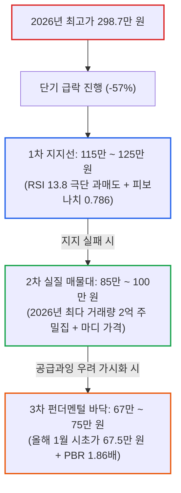

# SK하이닉스 급락 진단: 20만원설 검증과 2028년 DRAM 공급과잉 시나리오

- **작성일**: 2026-10-17
- **데이터 기준**: 2026-10-16 종가 기준 yfinance 시장 데이터, D램익스체인지 및 분기 재무제표 공시

300만 원에 육박하던 SK하이닉스 주가가 단기간에 120만 원대까지 반토막 이상 급락하며 시장에 공포가 확산되고 있다. 한편에서는 "2025년 봄 가격인 20만 원까지 추락해야 정상"이라는 극단적 비관론이 대두되고, 다른 한편에서는 "지금이 역사적 바닥"이라는 성급한 낙관론이 맞선다. 본 리포트는 20만 원설의 밸류에이션 모순을 숫자로 검증하고, 올해 1월 시초가(67만 원) 지지 가능성, 그리고 2028년 범용 D램 공급과잉 쓰나미가 기업 가치에 미칠 실질적 위협과 지지선 구간을 입체적으로 해부한다.

## 요약

| 구분 | 핵심 내용 |
| :--- | :--- |
| **상담 질문** | ① 20만 원까지 추락한다는 비관론은 타당한가? ② 올해 1월 가격인 67만 원까지는 빠질 수 있는가? ③ 2028년 D램 공급과잉이 오면 주가는 어떻게 되며, 현재 하락은 어디서 멈추는가? |
| **핵심 결론** | **20만 원설은 비현실적인 이론적 과장이나, 67만 원(올해 1월가)까지의 조정은 충분히 열어두어야 한다.** BPS가 36만 원으로 레벨업된 상태에서 20만 원은 PBR 0.55배로 사상 최악의 적자 국면(PBR 0.9배)보다 비정상적으로 낮은 가격이다. 반면 67만 원은 PBR 1.86배로 정상 호황기 평균 밸류에 해당한다. 2028년 글로벌 팹 준공 러시로 범용 D램 공급과잉 위험이 실재하므로, 장기 보유보다 단기 과매도(RSI 13.8)에 기반한 철저한 단계별 분할 매수 전략이 요구된다. |

---

## 1. 투자자 질문

> **질문 1**: "JTBC 방송에서 이주완 박사가 '삼성전자 7만 원, 하이닉스 20만 원이 적정가'라며 거품이 꺼지면 지난해 봄 가격으로 되돌아간다고 주장하는데, 실제로 20만 원까지 하락할 가능성이 있는가?"
>
> **질문 2**: "올해 1월 주가가 67만 원이었다. 거품이 다 꺼지면 최소한 올해 연초 가격인 67만 원까지는 빠질 수 있지 않은가?"
>
> **질문 3**: "SK하이닉스는 D램 매출이 대부분이고 HBM은 마진이 높아도 매출처가 엔비디아 등으로 한정되어 있다. 2028년부터 신규 공장들이 쏟아져 나오며 D램 공급과잉이 오면 주가가 크게 위협받지 않는가? 그렇다면 지금 하락은 어디쯤에서 멈출까?"

---

## 2. '20만원 회귀론'의 통찰과 치명적 오류

이주완 박사가 제기한 비관론은 산업적 왜곡을 짚어냈다는 점에서 가치가 있지만, 주가 20만 원이라는 결론은 기업의 장부 가치 변화를 완전히 간과한 중대한 오류를 안고 있다.

### 2.1 경청해야 할 산업적 경고: 단가(P) 급등 착시

이 박사의 지적 중 타당한 사실은 다음과 같다:

- **물량(Q)이 아닌 판가(P) 폭등에 의한 이익**:
    - 엔비디아는 AI 서버 칩 판매 수량(Q) 자체가 10배 이상 늘어나며 실적이 폭증했다.
    - 반면 국내 메모리사는 생산량은 1년 전과 큰 차이가 없는데, D램 공급 부족으로 가격(단가)만 가파르게 뛰어올라 영업이익률 60~70%를 기록했다.
- **공급 정상화 시 마진 훼손 속도**:
    - 단가 상승만으로 만들어진 고마진은 공급이 늘어나 가격이 꺾이는 순간 급격히 정상화된다.

### 2.2 20만 원설이 성립하지 않는 이유: PBR 0.55배의 모순

그러나 "가격이 2025년 4월 이전으로 돌아가니 주가도 그때 가격인 20만 원으로 간다"는 주장은 성립하기 어렵다. 그 사이에 회사가 벌어들여 곳간에 쌓아둔 **자본총계(순자산)의 레벨업**을 계산에서 누락했기 때문이다.

| 재무 지표 | 2024년 말 | 2025년 말 | 2026년 2분기 (현재) | 20만 원 도달 시 |
| :--- | :---: | :---: | :---: | :---: |
| **자기자본 (순자산)** | 73.9조 원 | 120.5조 원 | **262.4조 원** | 262.4조 원 (불변 가정) |
| **주당순자산 (BPS)** | 101,395원 | 165,347원 | **359,984원** | 359,984원 |
| **주가** | 17~20만 원 | 60만 원대 | **127만 원대** | **200,000원** |
| **PBR (주가순자산비율)** | 1.7 ~ 2.0배 | 3.6배 | **3.5배** | **0.55배** |

SK하이닉스는 2022~2023년 연간 9조 원대의 사상 최악 적자를 기록했을 때도 **PBR 0.9배(당시 7만 원대)**에서 바닥을 형성했다. 

현재 SK하이닉스는 현금과 자본 262조 원을 쌓아 주당 장부 가치(BPS)가 약 36만 원에 달한다. 주가가 20만 원이 된다는 것은 **PBR 0.55배**로, 공장과 설비를 전부 고철값으로 상각해야만 나오는 청산가치 반토막 수준이다. 회사가 연간 수십조 원의 적자를 수년간 연속으로 내지 않는 한 20만 원 도달은 불가능하다.

---

## 3. '올해 1월 67만 원'으로의 회귀는 왜 현실적인가

반면 질문자가 짚어낸 **"올해 1월 시초가인 67만 원까지의 하락 가능성"은 충분히 실현 가능한 정상적 조정 시나리오**다.

### 3.1 PBR 1.86배: 거품이 빠진 정상 호황기 밸류

주가가 67만 원으로 내려앉을 경우의 지표는 다음과 같다:

- **BPS(36만 원) 기준 PBR**: **약 1.86배**
- **시가총액**: 약 927조 원에서 **약 488조 원**으로 축소
- **고점(300만 원) 대비 낙폭**: **-77.6%**

과거 SK하이닉스의 역사적 사이클을 보면, 피크 국면에서는 PBR 2.5~3.5배를 상회하지만 호황이 정상 궤도로 연착륙하는 미드사이클(Mid-Cycle)에서는 **PBR 1.6~2.0배** 구간에 수렴했다. 즉, 67만 원은 회사가 망가지지 않고 **"단지 비정상적 단가 폭등 거품만 제거되는 것"**만으로도 도달할 수 있는 합리적인 밸류에이션 영역이다.

### 3.2 급등 랠리의 출발점으로 회귀하는 '라운드 트립'

2026년 1월 2일 SK하이닉스 종가는 675,500원이었다. 1월 67만 원에서 7월 300만 원까지 치솟았던 상승세는 온전히 HBM 쇼티지 기대감이 밀어올린 랠리였다. 

금융 시장 역사상 공급 병목으로 급등했던 종목이 피크아웃 우려를 맞이할 때는, 그 랠리가 시작되었던 **'연초 시초가'까지 상승폭을 전부 반납(Round-Trip)하고서야 비로소 지지력을 확인하는 패턴**이 반복되어 왔다.

---

## 4. 2028년 DRAM 공급과잉 쓰나미와 구조적 리스크

"SK하이닉스는 D램 의존도가 절대적인데, 2028년 공급과잉이 오면 주가가 위협받지 않는가?"라는 질문자의 통찰은 정확하다.

### 4.1 본체는 여전히 범용 D램 회사다

- **D램 매출 비중**: SK하이닉스 전체 매출의 **75~80%**가 D램에서 발생한다.
- **HBM의 착시**: HBM 단가가 높아 D램 매출액의 30~40%를 차지하는 것처럼 보이지만, 실제 **웨이퍼 비트(Bit) 출하량 기준으로는 5~10% 미만**이다.
- **수요처 한계**: HBM은 엔비디아 등 소수 빅테크에 70% 이상 의존한다. 반면 회사가 찍어내는 칩의 90% 이상은 여전히 전 세계 PC, 스마트폰, 일반 데이터센터에 공급되는 범용 D램(DDR5, LPDDR5)이다.

### 4.2 2028년 글로벌 신규 팹 동시 완공

2027년 말부터 2028년은 전 세계 주요 반도체 제조사의 대형 신규 팹이 일제히 가동되는 시기다:

1. **SK하이닉스 용인 1기 팹**: 120조 원이 투입되는 용인 반도체 클러스터 첫 번째 팹이 2027년 말 준공되어 2028년 본격 가동된다. 청주 M15X 팹 역시 양산 궤도에 오른다.
2. **삼성전자 평택 P4·P5**: 막대한 설비 증설 라인이 완공되어 웨이퍼를 쏟아낸다.
3. **마이크론 미국 팹**: 미 정부 보조금을 지원받은 아이다호 신규 D램 팹이 양산에 돌입한다.
4. **중국 CXMT(창신메모리)**: 허페이와 베이징 공장 증설로 월 웨이퍼 캐파가 20만~30만 장을 넘어서며 레거시 D램 시장을 저가로 잠식한다.

지난 1~2년간 범용 D램 가격이 오른 것은 제조사들이 HBM 생산에 라인을 집중하느라 범용 라인을 감산했던 '풍선 효과' 덕분이었다. 2028년 대규모 증설 팹들이 가동되면 이 병목이 일시에 풀리며 **심각한 범용 D램 공급과잉(Supply Glut)**이 발생할 수밖에 없다. 주가는 이를 6개월~1년 앞선 2027년 상반기부터 하락 압력으로 반영하게 된다.

---

## 5. 지금 하락은 어디서 멈추는가: 3단계 지지선 분석

현재 127만 원대인 주가가 어디서 멈춰설 것인가는 수급 지표와 매물대로 판별할 수 있다.

### 5.1 1차 지지선: 115만 ~ 125만 원 (단기 과매도 반등)
- **RSI 13.8의 극단치**: 일봉 RSI가 15 이하로 떨어지는 것은 수년에 한 번 볼 수 있는 패닉 투매 상태다.
- **피보나치 0.786 되돌림(114.6만 원)**: 2026년 랠리 전체 상승분의 78.6%를 반납한 자리가 114.6만 원이다.
- 10월 15일 123.8만 원 터치 후 16일 127.2만 원으로 약반등하며 하락세가 일단 제동이 걸렸다. 140만~150만 원 선으로의 기술적 반등(데드캣 바운스)이 유력한 자리다.

### 5.2 2차 지지선: 85만 ~ 100만 원 (최대 거래량 매물대)
- 만약 1차 지지선이 무너질 경우 하락을 받아낼 핵심 구간이다.
- 2026년 연간 거래량 분석 결과:
    - **80만~90만 원 구간**: 1억 488만 주 (2026년 거래량 1위)
    - **90만~100만 원 구간**: 9,302만 주 (2026년 거래량 2위)
- 올해 거래된 물량의 압도적인 2억 주가 이 구간에 쌓여 있다. 강력한 심리적 마디 가격인 **'100만 원'**과 맞물려 기관의 실질적인 저가 매수세가 유입되는 가장 두터운 방어선이다.

### 5.3 3차 지지선: 67만 ~ 75만 원 (올해 1월 출발점)
- 2028년 공급과잉 위험과 D램 고정가격 하락 추세가 공식화될 때 도달하는 펀더멘털 적정가다. 거품이 완전히 제거되는 장기 사이클 바닥 역할을 한다.

---

## 6. 종합 평가와 매매 로드맵

### 6.1 행동 판정: 선발대 진입

- **판정**: **선발대 진입** (단, 한 번에 매수하지 않고 67만 원까지 열어둔 분할 매수 필수)
- **근거**:
    1. 고점(300만 원) 대비 -57% 급락하여 RSI 13.8의 극단적 과매도 상태로 단기 손익비가 확보되었다.
    2. 단기 급등 상태가 아니며 패닉셀링이 진행된 가격 매력 구간이다.
    3. 회사의 회계 부정이나 기술 결함 같은 돌이킬 수 없는 펀더멘털 훼손이 아닌, 매크로 변동성과 사이클 논란에 기인한 하락이다.

### 6.2 타겟 투자자 분류

- **사지 말아야 할 사람**: SK하이닉스를 "10년 들고 갈 안전한 배당 성장주"로 착각하는 장기 투자자. 2028년 신규 팹 공급 쓰나미의 직격탄을 맞고 사이클의 늪에 갇힐 위험이 높다.
- **살 만한 사람**: 고점 대비 반토막 난 가격에서 단기 과매도 반등을 노리고, 하락 시 단계별로 평단가를 낮춰 **+10~20% 수익률을 챙기고 빠져나올 수 있는 규율 있는 전술적 투자자**.

### 6.3 분할 매수 실행 로드맵 (비중 기준)

전체 운용 자금 대비 67만 원까지의 하락을 버텨낼 수 있도록 설계한 4단계 분할 매수 계획이다.

| 회차 | 매수 구간 | 분할 투입 비중 | 누적 비중 | 예상 평단가 | 목표가 (+15%) | 비고 |
| :---: | :---: | :---: | :---: | :---: | :---: | :--- |
| **1회차** | **125만 원 전후** | **전체 자금의 1.5%** | 1.5% | 1,250,000원 | 1,437,500원 | **선발대 진입 (단기 RSI 13.8 과매도 반등 노림)** |
| **2회차** | **100만 원 선** | **전체 자금의 1.5%** | 3.0% | 1,125,000원 | 1,293,700원 | 1차 지지선 이탈 시 100만 원 마디 가격 추가 매수 |
| **3회차** | **85만 원 선** | **전체 자금의 3.0%** | 6.0% | 960,000원 | 1,104,000원 | 최다 매물대(2억 주) 중심 가격 본격 추가 매수 |
| **4회차** | **67만 원 선** | **전체 자금의 6.0%** | 12.0% | 791,600원 | 910,300원 | 올해 1월 시초가 도달 시 평단가를 70만 원대로 압축 |

- **자금 한도 및 대응 방침**:
    - 4단계(올해 1월 가격 67만 원)까지 모두 하락하더라도 전체 자금의 12%만 투입되므로 안전 마진이 충분하다.
    - 4단계 매수 완료 시 평단가는 79만 원 선으로 낮아진다. 주가가 67만 원에서 단 15%만 기술적 반등(91만 원)을 보여도 전체 포지션에서 깔끔하게 이익 실현 후 엑시트할 수 있다.
- **선발대 손절 조건**:
    - 단순 주가 하락이나 기간 경과로는 손절하지 않는다.
    - 엔비디아와의 HBM 독점/우선 공급 계약이 파기되거나, HBM4 수율 불량으로 고객사를 경쟁사에 전량 빼앗기는 등 **선발대 진입 시점에 알지 못했던 치명적인 펀더멘털 훼손이 새로 확인될 때만** 손절한다.
