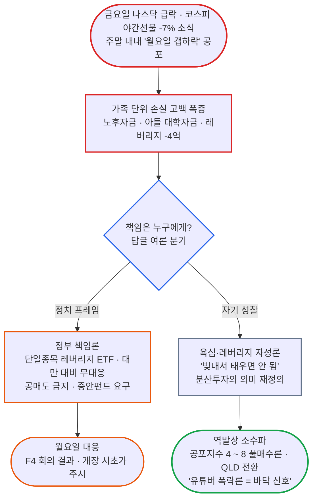

<div class="kb-briefing" markdown="1">

# 스레드 주식·투자 24시간 브리핑: <span class="kb-heading-detail">"노후자금·빚투 고백과 정부 책임론…공포·탐욕 19점, '월요일 -7%' 공포 속 역발상 매수론"</span> { #threads-briefing-2026-11-22 }

<div class="kb-points kb-points--grid" markdown>

<div class="kb-point" markdown>
<p class="kb-point__label" markdown>작성일</p>

2026-11-22

</div>

<div class="kb-point" markdown>
<p class="kb-point__label" markdown>수집 기간</p>

2026년 11월 21일(토) 16:56 ~ 11월 22일(일) 16:56 (KST)

</div>

<div class="kb-point" markdown>
<p class="kb-point__label" markdown>수집 규모</p>

24시간 이내 글 1,763개(한국어 1,668개), 원문·이어쓰기·답글 정밀 수집 101개, 수집 답글 2,443개

</div>

</div>

!!! warning "주의사항"
    아래 내용은 Threads(스레드)의 주식 관련 주제 태그 13개(Investing·재테크·코스피·나스닥·반도체·엔비디아 등)의 최신순 피드, 키워드 인기 검색 8개, 홈 추천 피드에서 최근 24시간 동안 올라온 공개 글과 답글을 모아 분석한 결과다. 태그 13개 중 12개는 24시간 경계까지 빠짐없이 수집했고, `#주식` 태그는 최신 글 색인이 늦어 기간 내 글이 잡히지 않았다. 모든 내용은 작성자 개인의 주장이며 사실 여부를 검증하지 않았다. 스레드는 조회수를 공개하지 않으므로 반응은 좋아요(❤️)와 답글(💬) 수로만 표시한다. 'DM 주면 자료 공유', '급등주 정보는 개인 메시지로' 같은 유인형 홍보 글이 섞여 있으니 각별히 주의해야 한다.

<div class="kb-briefing-section kb-briefing-section--dashboard" markdown="1">

## 📊 스레드 투자자 공포·탐욕 지수 (Fear & Greed Index)

스레드의 주말 투자 심리는 **19점(극단적 공포)이다.** 같은 날 X.com(17점), 블라인드(19점)와 거의 같은 바닥권이다.

다만 공포의 색깔이 다르다. X.com이 수급 통계와 매크로로 싸웠다면, 스레드는 **"엄마 노후자금", "아들 대학 자금", "-4억" 같은 가족 단위 손실 고백**이 타임라인을 덮었다.

그 분노는 곧바로 정치로 번졌다. 단일종목 레버리지 ETF 도입, 대만과 비교되는 정부 무대응, 공매도 금지 요구가 손실 고백 글의 답글마다 따라붙었다.

반대쪽에서는 "공포지수 4 ~ 8이면 풀매수 구간", "1.5년에 한 번 오는 기회", "유명 유튜버가 폭락을 외치면 바닥"이라는 역발상 글이 소수지만 꾸준히 반응을 얻었다.

<div class="kb-portfolio-metrics">
  <div class="kb-portfolio-metric-card">
    <span class="label">당일 공포·탐욕 지수</span>
    <span class="value">19점 (극단적 공포)</span>
    <span class="sub">스레드 첫 브리핑 · 0 극단적 공포 ~ 100 극단적 탐욕</span>
  </div>
  <div class="kb-portfolio-metric-card">
    <span class="label">타 커뮤니티 대비</span>
    <span class="value">X.com 17점 · 블라인드 19점</span>
    <span class="sub">같은 바닥권, 스레드는 가족 손실 고백 비중이 압도적</span>
  </div>
  <div class="kb-portfolio-metric-card">
    <span class="label">지배적 분위기</span>
    <span class="value">손실 고백 · 정부 책임론</span>
    <span class="sub">노후자금·빚투 고백 vs "레버리지 탓, 욕심 탓" 자성론</span>
  </div>
  <div class="kb-portfolio-metric-card">
    <span class="label">역발상 시그널</span>
    <span class="value">"주식 안 해" 선언 확산</span>
    <span class="sub">현금 100%·손절 인증과 필라테스 등록 밈이 1,700 좋아요</span>
  </div>
</div>

```vegalite
{
  "$schema": "https://vega.github.io/schema/vega-lite/v5.json",
  "background": "transparent", "width": "container", "height": 220,
  "padding": {"top": 8, "bottom": 4, "left": 4, "right": 8},
  "data": {
    "values": [
      {"metric": "종합 공포·탐욕 지수", "score": 19, "max": 100, "zone": "극단적 공포", "label": "19점 (극단적 공포)", "desc": "가족 단위 손실 고백과 정부 책임론, 월요일 갭하락 공포가 지배"},
      {"metric": "① 체감 손익·계좌 심리", "score": 10, "max": 100, "zone": "극단적 공포", "label": "10점 (극단적 공포)", "desc": "노후자금 -50 ~ -80%, 레버리지 잔고 -4억, 평가손 130억 고백"},
      {"metric": "② 매수·투매 수급 태도", "score": 22, "max": 100, "zone": "극단적 공포", "label": "22점 (극단적 공포)", "desc": "현금 100% 손절 인증 vs QLD 전환·코인 재매수 소수"},
      {"metric": "③ 반도체·업황 신뢰도", "score": 34, "max": 100, "zone": "공포", "label": "34점 (공포)", "desc": "삼성 2029년까지 완판 보도 vs 수출통제·젠슨 황 공백"},
      {"metric": "④ 지수 지지선 신뢰도", "score": 18, "max": 100, "zone": "극단적 공포", "label": "18점 (극단적 공포)", "desc": "코스피 3,500 ~ 4,000, 코스닥 500대 진입론 확산"},
      {"metric": "⑤ 역발상 바닥 기대감", "score": 36, "max": 100, "zone": "공포", "label": "36점 (공포)", "desc": "공포지수 4 ~ 8 풀매수론, 유튜버 폭락론 역지표설"}
    ]
  },
  "encoding": {
    "y": {"field": "metric", "type": "nominal", "sort": null, "axis": {"title": null, "labelFontWeight": 500, "labelFontSize": 12, "labelLimit": 180, "ticks": false, "domain": false, "labelPadding": 12}}
  },
  "layer": [
    {
      "mark": {"type": "bar", "cornerRadius": 7, "height": 14, "color": "#94a3b8", "opacity": 0.14},
      "encoding": {
        "x": {
          "field": "max", "type": "quantitative", "scale": {"domain": [0, 118]},
          "axis": {
            "title": "스레드 투자자 심리 스펙트럼 (0~24 극단적 공포 · 25~44 공포 · 45~55 중립 · 56~74 탐욕 · 75~100 극단적 탐욕)",
            "values": [0, 25, 50, 75, 100],
            "labelExpr": "datum.value == 0 ? '0 (극단적 공포)' : datum.value == 25 ? '25 (공포)' : datum.value == 50 ? '50 (중립)' : datum.value == 75 ? '75 (탐욕)' : '100 (극단적 탐욕)'",
            "grid": false
          }
        }
      }
    },
    {
      "data": {"values": [{"x": 25}, {"x": 45}, {"x": 55}, {"x": 75}]},
      "mark": {"type": "rule", "strokeDash": [2, 4], "color": "#94a3b8", "opacity": 0.5},
      "encoding": {"x": {"field": "x", "type": "quantitative"}, "y": {"value": 0}, "y2": {"value": "height"}}
    },
    {
      "mark": {"type": "bar", "cornerRadius": 7, "height": 14},
      "encoding": {
        "x": {"field": "score", "type": "quantitative"},
        "color": {"field": "zone", "type": "nominal", "scale": {"domain": ["극단적 공포", "공포", "중립", "탐욕", "극단적 탐욕"], "range": ["#dc2626", "#ea580c", "#64748b", "#16a34a", "#2563eb"]}, "legend": null},
        "tooltip": [{"field": "metric", "title": "심리 지표"}, {"field": "label", "title": "점수 및 구간"}, {"field": "desc", "title": "핵심 진단"}]
      }
    },
    {
      "mark": {"type": "text", "align": "left", "dx": 10, "fontWeight": 600, "fontSize": 12},
      "encoding": {"x": {"field": "score", "type": "quantitative"}, "text": {"field": "label", "type": "nominal"}}
    }
  ],
  "config": {"view": {"stroke": "transparent"}}
}
```

---

</div>

<nav class="kb-briefing-nav" aria-label="브리핑 주요 주제" markdown="1">

**주제 바로가기**

- [1. 전체 분위기](#threads-mood)
- [2. 핵심 쟁점](#threads-issues)
- [3. 찌라시·미확인 주장 팩트체크](#threads-rumors)
- [4. 종목·섹터별 투자자 심리](#threads-sectors)
- [5. 주목할 계정과 핵심 논지](#threads-accounts)
- [6. 다음 체크포인트](#threads-checkpoints)

</nav>

<div class="kb-briefing-section" markdown="1">

## 1. 전체 분위기: <span class="kb-heading-detail">계좌보다 가족 얘기가 먼저 나온 주말</span> { #threads-mood }

스레드는 주식 커뮤니티가 아니다. 그래서 폭락의 체감이 더 날것으로 드러난다.

블라인드가 직장인의 성과급·대출 이야기라면, 스레드는 **엄마, 시어머니, 남편, 아들 이야기**였다. 투자를 해 본 적 없던 사람들이 언제 들어왔고 얼마를 잃었는지가 줄줄이 고백됐다.

수집한 1,763개 가운데 한국어 글이 1,668개다. 종목·섹터 언급은 금리·연준·환율(419개), 미국 지수(395개), 반도체(393개), 엔비디아(368개), 국내 지수(367개) 순으로 몰렸다.

흐름은 세 갈래였다. 손실 고백이 먼저 터졌고, 그 아래 답글에서 정부 책임론이 커졌다. 그리고 소수의 정보형 계정이 "지금은 기회"라며 반대편에 섰다.



<div class="kb-briefing-topic" markdown="1">

### 반응 폭발 글과 답글 티키타카

#### 손실 고백: <span class="kb-heading-detail">"평생 모은 꼬마빌딩 판 돈이 -80%"</span> { #threads-loss-confessions }

<div class="kb-feed" markdown>

<div class="kb-post" markdown>
<p class="kb-post__title" markdown>어르신들까지 뛰어들었다…시어머니 꼬마빌딩 판 돈 -80%</p>
<div class="kb-post__meta"><span class="kb-chip">@moca_cream_latte</span><span class="kb-stat">좋아요 <b>1,200</b></span><span class="kb-stat">답글 <b>129</b></span><span class="kb-stat">리포스트 <b>55</b></span></div>

친구 시어머니가 월세 나오던 꼬마빌딩을 팔아 주식을 샀다가 -80%가 됐고, 엄마 친구 70대 여섯 분이 모두 50% 이상 손실이라는 글이다. 작성자는 답글에 "80대 백반집 사장님 부부가 하닉 250일 때 비상금 털어 샀다"는 사례를 더했다.

<div class="kb-reactions" markdown="1">
<p class="kb-reactions__label">답글 반응</p>

가장 많은 공감(❤️275)은 "노인들이나 애 업고 오는 애기엄마들이 객장에 보이기 시작하면 고점이라고. 역시 이번도 예외가 아니었던 거고"(`@auboutduciel`)였다. "주식 혐오하던 분도 이번에 삼전 대출받아서 들어갔더라"(`@ioxoxoxoi_1` ❤️33)는 증언도 나왔다. 상승장 막바지에 투자 경험이 없던 층까지 빨려 들어왔다는 자기 진단이다.

</div>

</div>

<div class="kb-post" markdown>
<p class="kb-post__title" markdown>66세 엄마 노후자금 물림 "억울해서라도 오래오래 살어"</p>
<div class="kb-post__meta"><span class="kb-chip">@minsfa84</span><span class="kb-stat">좋아요 <b>344</b></span><span class="kb-stat">답글 <b>28</b></span></div>

엄마가 노후자금을 주식에 넣었다가 물렸고, 둘이 함께 울었다는 짧은 글이다.

<div class="kb-reactions" markdown="1">
<p class="kb-reactions__label">답글 반응</p>

최다 공감(❤️66) 답글은 "단일종목레버리지 ETF 특검 해야합니다. 개개인의 잘못이 아니라 시장을 도박판으로 만든 정부 책임"(`@sebastian_byun_`)이었다. 위로보다 책임 추궁이 먼저 달린 것이 이번 주말 스레드 여론의 축소판이다.

</div>

</div>

<div class="kb-post" markdown>
<p class="kb-post__title" markdown>20년 투자자의 복기: 레버리지로 10억 → 대출 감안 -4억</p>
<div class="kb-post__meta"><span class="kb-chip">@gorae_dream</span><span class="kb-stat">좋아요 <b>259</b></span><span class="kb-stat">답글 <b>38</b></span></div>

코로나 폭락장에서 레버리지로 자산을 키웠고, 대출까지 얹어 10억 언저리까지 갔다가 "지금 남은 잔고는 대출을 생각하면 -4억"이라는 긴 타래다. 신용거래, 정치인 테마주, 2 ~ 3배 레버리지를 "현물시장에서 하지 말아야 할 것은 다 했다"고 썼다.

<div class="kb-reactions" markdown="1">
<p class="kb-reactions__label">답글 반응</p>

"현재 평가손이 130억이 넘는다…레버리지 아니라서 견딜 수 있음에 감사할 따름"(`@liber0987` ❤️41)이라는 거액 투자자의 답글과 "나도 4억, 몇 개월 만에 전재산 날렸네요"(`@oaigrande05` ❤️41)가 나란히 달렸다. "그냥 도박하신 거예요"(`@td__been` ❤️18)라는 냉정한 평가도 있었다.

</div>

</div>

<div class="kb-post" markdown>
<p class="kb-post__title" markdown>캠핑 와서도 하이닉스 생각뿐 "월요일 너무 무섭다"</p>
<div class="kb-post__meta"><span class="kb-chip">@chanstar_hi</span><span class="kb-stat">좋아요 <b>726</b></span><span class="kb-stat">답글 <b>56</b></span></div>

가족 캠핑 중에도 하이닉스가 머리에서 떠나지 않는다는 세 줄짜리 글이 726개 공감을 받았다. "사기당한 거 같은 기분"(`@taeu347` ❤️30), "하이닉스 삼성 스퀘어 생각만 해도 심장이 두근"(`@kmj071526`) 같은 답글이 이어졌다.

</div>

</div>

#### 블랙 유머와 이탈 선언: <span class="kb-heading-detail">"주식으로 잃었다 치고 필라테스 등록할까요"</span> { #threads-black-humor }

손실 고백 못지않게 많이 퍼진 것은 "주식을 안 하겠다", "현금 100%다"라는 이탈 선언이다.

- 이탈과 조롱의 대표 글:

    - **"주식 안 하는데 주식해서 잃었다 치고 필라테스 등록할까요"** (@ddalgibusut | ❤️1,700 · 💬169): 이번 주말 국내 투자 관련 글 중 반응 1위다. "주식으로 잃으면 슬픔 분노 탈모 여드름…"(❤️50) 같은 답글로 밈이 됐다.
    - **"자랑할 거 있는데 나 현금 100퍼야. 손절침 ㅋㅋㅋ ㅠㅠ"** (@_elissssse | ❤️139 · 💬17): "손절도 능력이다"(❤️8), "손절도 용기요 능력입니다"(❤️7)라는 위로가 붙었다.
    - **"주식 천만 원밖에 안 한 내가 기특하다. 마이너스 70프로지만"** (@lauren_jian | ❤️284 · 💬48): "천만 원만 들어갔다니 너무 부러워"(❤️95)라는 답글이 이번 장의 상대적 박탈감을 보여 준다.

- 반대편의 반발도 있었다. "주식 안 했다고 자랑하는 글 왜 올리나"(@chrong20 | ❤️144 · 💬58)에는 "상반기에 주식으로 돈 벌었다고 조롱하던 인간들이 너무 많았음. 업보임"(❤️87)이라는 답이 가장 많은 공감을 얻었다.

영어권 스레드도 비슷했다. "401K를 봤는데 사이버 공격을 당한 줄 알았다"(@manda.mahnaz | ❤️3,200 · 💬363)에 "아빠가 은행에 사기 신고 전화했더니 그냥 나스닥이래"(❤️218)라는 답글이 달렸다.

</div>

</div>

<div class="kb-briefing-topic" markdown="1">

### 지수·종목 지지선 여론 매트릭스

스레드 이용자들이 말한 바닥 가격대를 정리했다. 모두 개인 의견이며 근거가 약한 것이 많다.

| 종목/지수 | 현재가/위치 | 1차 지지선 | 극단적 비관치 | 주요 근거 |
| :--- | :--- | :--- | :--- | :--- |
| 코스피 | 금요일 급락 후 4,800대 | 4,500 ~ 4,000 | 3,500 (1년 횡보) · 900(소수 극언) | 전업투자자 지인 전언, 반도체 상승분 반납론 |
| 코스닥 | 금요일 사이드카 발동 | 계엄 당시 저점 | 500대 진입 | 외국인 공매도 비중, 정부 무대응 |
| 나스닥·S&P 500 | 고점 대비 -20% 안팎 | "늘 있던 조정" | 2022년식 2년 하락 | 22년 하락장 비교, 중간선거 불확실성 |
| SOXL | 금요일 30달러 안팎 | 20달러대 | 10달러 미만 | -90% 역사 반복론, 7 ~ 12달러 과거 저점 |
| 삼성전자 | 고점 대비 큰 폭 하락 | 15만 원 | 10만 원 | 미국 수출통제 강화 보도 |

표에서 보듯 지지선 논의는 근거보다 감정이 앞섰다. 코스피 3,500을 말한 글(@acebtif | ❤️201)도 "전업투자자 지인의 말"을 옮긴 것이고, 작성자 본인은 주식을 하지 않는다고 밝혔다.

</div>

</div>

<div class="kb-briefing-section" markdown="1">

## 2. 핵심 쟁점: <span class="kb-heading-detail">누구 탓인가, 언제 사는가</span> { #threads-issues }

| 주제 | 핵심 논점 | 팽팽한 대립 구도 | 결론 |
| :--- | :--- | :--- | :--- |
| 정부 책임론 | 단일종목 레버리지 ETF와 정책 실패 | "정부가 도박판 만들었다" vs "오를 땐 정부 덕이라더니" | 정치 진영 싸움으로 번져 정보 가치는 낮다 |
| 대만 vs 한국 | 증시 안정책의 속도 차이 | 공매도 금지 요구 vs "공매도 막으면 반등도 막힌다" | F4 회의 결과가 첫 시험대 |
| 레버리지·빚투 | 손실의 원인 | 시장 탓 vs 욕심·레버리지 탓 | 자성론이 공감을 더 많이 받았다 |
| 매수 시점 | 지금 사야 하나 | "1.5년 만의 기회" vs "투매 단계는 시작도 안 했다" | 분할·날짜 분산 매수론이 절충안 |
| 반도체 펀더멘털 | 실적과 주가의 괴리 | 2029년 완판 계약 vs 메모리 가격 하락 | "주가는 외국인 마음"이라는 체념 |

### 쟁점 ① 단일종목 레버리지 ETF와 정부 책임론

가장 뜨거웠던 것은 정책 책임 공방이다. 다만 대부분 정치 진영 싸움이어서 투자 정보로서의 가치는 낮다.

- 책임론의 대표 글:

    - **"코스피가 8000까지 오른 건 반도체 특수였지 이재명이랑 상관없다"** (@agnus____dei | ❤️579 · 💬55): 증권업계를 취재한다는 작성자가 "단일종목 레버리지 ETF를 무리하게 도입해 변동성을 키웠고 이후 지수는 4800까지 떨어졌다"고 썼다. "단일종목 레버리지 만들어서 변동성을 키워 놓고 원인을 알면서 회피하는 느낌"(❤️29)이라는 동조가 이어졌다.
    - **"좌파들 갑자기 이재명 욕하는데 얘 뭐 했나요"** (@freedomarchive1 | ❤️506 · 💬85): "주식 망한듯"(❤️648)이라는 답글이 원글보다 많은 공감을 받았다.

- 반대 진영의 글도 수백 개 공감을 받았다. 대통령의 시장 방문을 응원한 글(❤️728)에는 "증시에서만 날아간 돈이 4년치 국가예산인데 좋냐"(❤️44)는 반박이 달렸다.

이 쟁점은 계좌 손실을 정치 분노로 바꾸는 통로였다. 투자 판단에 쓸 만한 것은 "단일종목 레버리지 상품이 변동성을 키웠다"는 구조적 지적 하나뿐이다.

### 쟁점 ② "대만은 즉시 대책, 한국은 입꾹닫"

대만의 증시 안정책이 비교 대상이 되면서 정부 무대응 비판이 커졌다.

- 대만 비교론:

    - **"한국 증시는 고점 대비 반토막, 코스닥은 imf 계엄까지 왔지만 입꾹닫"** (@starryme0 | ❤️183 · 💬61): 작성자는 "코스닥은 계엄 때도 안 갔던 500대로 진입할 것"이라고 고정 답글에 덧붙였다.
    - **"대만 공매도 금지, 그럼 그 세력은 어디로? 당연히 한국이겠지"** (@jin.daily_8 | ❤️82): 대만에서 막힌 공매도 자금이 한국으로 온다는 걱정이다.

- 반론도 의미 있었다. "공매도를 금지하면 폭락도 막겠지만 폭등 가능성도 줄어든다. 대만이 금지했으니 우리 시장을 열어 둬야 블루오션"(@seoulkorea1234567 ❤️11), "공매도 규제는 큰 의미 없어. 지수선물옵션이나 인버스 ETF 하면 되니까"(@adultmoonn ❤️3)라는 답글이다.

공매도 금지와 증안펀드 요구는 22일(일) 긴급 F4 회의 소집 소식과 맞물렸다. 다음 날 발표 내용이 이 여론의 방향을 정할 것이다.

### 쟁점 ③ 빚투·레버리지: 시장 탓인가, 욕심 탓인가

정치 공방과 달리 이 쟁점에서는 자기 성찰형 글이 더 많은 공감을 받았다.

- 자성론의 대표 글:

    - **"삼전 5만 원 때 억 단위로 산 지인이 천만 원만 빌려 달라더라"** (@steve_directs | ❤️294 · 💬55): 30만 원을 넘겨도 팔지 않다가 하락 중 "풀신용, 풀카드론"을 넣었고, 반대매매를 막으려 돈을 빌리러 왔다는 사연이다. 결론은 "주식하다 망하는 건 만족을 모르는 과도한 욕심 때문"이었다.
    - **"이렇게 다 떨어질 거면 분산 투자가 무슨 의미가 있어?"** (@azqsx000 | ❤️235 · 💬59): "분산투자는 주식 종목 분산이 아니라 주식, 채권, 예적금, 부동산에 나누라는 것"(❤️32), "설마 엔비디아, 삼성전자, 하이닉스 이렇게 한 건 아니지?"(❤️25)라는 답글이 핵심을 찔렀다.
    - **"올해 폭락장에서도 수익권인 사람들의 공통점"** (@smc_investor | ❤️153 · 💬38): 50명 넘는 답글을 모아 보니 ① 집 잔금 때문에 강제로 현금화한 사람, ② 3 ~ 6년 전 낮은 평단을 깔고 버틴 사람, ③ 레버리지 없이 S&P 500만 모은 사람만 살아남았다는 정리다.

### 쟁점 ④ 지금이 기회인가, 투매는 시작도 안 했나

매수 시점 논쟁은 소수의 정보형 계정이 끌고 갔다.

- 기회론: "미국 주식 기준 지금의 하락은 1.5년 정도에 한 번 오는 기회"(@a.once.a.year.trader | ❤️111 · 💬50), "공포지수 4 ~ 8 사이면 풀매수를 때려야 할 시점"(@kyu.line | ❤️103)이 대표적이다. 후자는 2020년 3월, 2022년, 2025년 4월의 공포지수와 이후 반등률을 근거로 들었다.
- 신중론: "지금은 기회가 되면 현금 확보를 하고, 안 되면 버티는 구간"(@amisyoori | ❤️125), "반도체 고점은 올 6월이고 평균 1년간 조정이었음. 즉 내년 여름까지 조정"(@asjasj123 ❤️3)이 맞섰다. 심리 사이클 그림을 올린 글(@bonghyun.cho | ❤️66)에는 "본격적인 하락은 투매 단계임. 아직 시작도 안 했다"(❤️3)는 답글이 달렸다.

절충안으로 가장 실용적이었던 답글은 SOXL 복기 글(@zkwi12)에 달린 "-85%에서 사도 -90%까지 가면 거기서 또 -33%임. 분할은 낙폭 말고 날짜로 쪼개는 게 맞음"(@dentm_an ❤️6)이었다.

### 쟁점 ⑤ 실적은 좋은데 주가는 왜

삼성전자 장기 계약 보도를 두고 "이해할 수 없는 하락"이라는 글이 이어졌다.

- **"분명 메모리 가격이 꺾인다는 논리로 주가가 꺾였는데, 29년까지 계약 확보, 31년까지 공급 계약?"** (@es_blab | ❤️150 · 💬20): "메모리 3사의 장기 계약에는 강력한 Take-or-Pay 조항이 있다고 한다. 물량을 취소해도 돈은 줘야 한다"(@nakwonn ❤️6)는 보충이 달렸다.
- 반박도 날카로웠다. "가격은 약속받은 것이 아니어서 영업이익 감소는 아직 가능한 시나리오"(@luckiertoday ❤️8), "6월 전고점 때 하던 이야기랑 토씨 하나 안 바뀌고 앵무새처럼 반복 중"(@jxelloss ❤️5)이었다.

</div>

<div class="kb-briefing-section" markdown="1">

## 3. 찌라시·미확인 주장 팩트체크 { #threads-rumors }

### ⚠️ [풍문] 미국 수출통제 강화로 삼성·TSMC 중국행 칩 출하 중단

<div class="kb-rumor" data-trust="mid" markdown>
<div class="kb-rumor__head" markdown="span"><span class="kb-rumor__level">신뢰도 중</span><span class="kb-meter" aria-hidden="true"><i class="on"></i><i class="on"></i><i class="on"></i><i></i><i></i></span><span>보도 제목 인용은 사실로 보이나, 메모리 영향은 답글에서 반박됨</span></div>
<div class="kb-rumor__row" markdown>
<p class="kb-rumor__label">원문 주장</p>

`@cozia___`(❤️601 · 💬35)가 "삼성전자 악재네요. 여기서 더 무너지려나"라며 '美 수출통제 강화에 삼성·TSMC 중국행 칩 출하 중단' 기사 제목을 옮겼다. "15만전자… 아니 10만전자가 코앞"(❤️17)이라는 공포 답글이 붙었다.

</div>
<div class="kb-rumor__row" markdown>
<p class="kb-rumor__label">팩트체크 및 답글 반박</p>

`@gwanjo_stock`(❤️9)은 미 상무부(BIS)가 16일 발표하고 19일 시행한 규정 변경이며, 패키징·테스트 업체의 자체 판단 출하 경로가 막힌 것이라고 설명했다. 출하 중단은 허가 신청 기간의 일시 중단이고 고객으로 바이두 쿤룬과 바이트댄스가 거론된다고 덧붙였다. `@dt.w.sh`(❤️4)는 "삼성전자 주력인 D램, HBM, 낸드플래시는 직접적인 출하 중단 대상이 아니다"라고 반박했고, `@hrm_soft`(❤️26)는 "이런 모호한 것보다 낸드·디램 현물가격 하락이 더 걱정"이라고 짚었다.

</div>
<div class="kb-rumor__row kb-rumor__row--key" markdown>
<p class="kb-rumor__label">투자 체크포인트</p>

규제 대상이 파운드리 위탁 생산인지, 메모리까지 포함하는지 원문 공고로 확인해야 한다. 23일(월) 발표되는 11월 1 ~ 20일 수출 실적에 반영되는지도 함께 본다.

</div>
</div>

### [미확인] SEC 엔비디아 회계 조사 착수설과 젠슨 황 공백

<div class="kb-rumor" data-trust="low" markdown>
<div class="kb-rumor__head" markdown="span"><span class="kb-rumor__level">신뢰도 중하</span><span class="kb-meter" aria-hidden="true"><i class="on"></i><i class="on"></i><i></i><i></i><i></i></span><span>"로이터 속보"를 단 글이 공매도 상담 권유로 끝나는 등 출처 신뢰가 낮음</span></div>
<div class="kb-rumor__row" markdown>
<p class="kb-rumor__label">원문 주장</p>

"SEC가 엔비디아 회계 문제와 관련해 조사에 착수했다"는 '로이터 속보' 글(`@asdf_7367`)이 돌았다. 같은 글은 "공매도 관점에서 살펴볼 한국 주식이 궁금하면 연락 달라"로 끝난다. 젠슨 황이 최대 500억 달러를 모아 새 반도체 회사를 세울 수 있다는 팟캐스트 발언 소개(`@wiredot.news` ❤️24)도 함께 퍼졌다.

</div>
<div class="kb-rumor__row" markdown>
<p class="kb-rumor__label">팩트체크 및 답글 반응</p>

"한 달 만에 반값이 되다니 믿을 수가 없다"(`@sweety_purin` ❤️114) 글에 "22% 매출 부풀리기 의혹으로 큰 거 하나 맞아서 엎어진 놈한테 한 대 더"(❤️4)라는 답글이 달리는 등 의혹이 사실처럼 소비됐다. 반면 `@snowgyul`(❤️20)은 "가장 큰 원인은 젠슨 황의 부재"라며 다음 실적 발표일인 내년 2월 24일까지 횡보를 예상했다.

</div>
<div class="kb-rumor__row kb-rumor__row--key" markdown>
<p class="kb-rumor__label">투자 체크포인트</p>

SEC의 공식 발표나 엔비디아 공시 없이 "조사 착수"를 사실로 받아들이지 않는다. 속보 형식에 상담·DM 유도가 붙은 글은 정보가 아니라 영업으로 본다.

</div>
</div>

### ⚠️ [미확인] "40대 마이너스통장 연체액 급증, 내일 코스피 -7%"

<div class="kb-rumor" data-trust="low" markdown>
<div class="kb-rumor__head" markdown="span"><span class="kb-rumor__level">신뢰도 하</span><span class="kb-meter" aria-hidden="true"><i class="on"></i><i></i><i></i><i></i><i></i></span><span>출처 없는 '속보'에 작성자 고정 답글은 유료 가입 링크</span></div>
<div class="kb-rumor__row" markdown>
<p class="kb-rumor__label">원문 주장</p>

`@msalq3`(❤️245 · 💬15)가 "속보) 40대 마통 연체액 급증. 내일 코스피 -7% 쳐맞고 시작하는데 더 급증할 듯"이라고 썼다.

</div>
<div class="kb-rumor__row" markdown>
<p class="kb-rumor__label">팩트체크 및 답글 반응</p>

연체 통계의 출처는 없다. 작성자가 직접 고정한 답글은 외부 가입 신청 링크였다. 답글은 "빚투하는 순간 기관 외인들이 그 데이터 읽고 매도한다"(❤️29), "마통도 규제하겠네"(❤️4)처럼 공포를 키우는 쪽으로 흘렀다. '-7%'는 금요일 밤 코스피200 야간선물 낙폭을 시초가 예측으로 바꾼 것이다. 야간선물은 거래량이 적어 실제 시초가와 다를 수 있다는 정보형 글(`@macro_floww`)도 있었다.

</div>
<div class="kb-rumor__row kb-rumor__row--key" markdown>
<p class="kb-rumor__label">투자 체크포인트</p>

신용잔고와 반대매매 규모는 금융투자협회 통계로 확인한다. 공포를 자극한 뒤 링크로 유도하는 글은 리딩방 영업 패턴이다.

</div>
</div>

### [주의] 수익 인증·DM 유도형 홍보 계정

<div class="kb-rumor" data-trust="low" markdown>
<div class="kb-rumor__head" markdown="span"><span class="kb-rumor__level">신뢰도 하</span><span class="kb-meter" aria-hidden="true"><i class="on"></i><i></i><i></i><i></i><i></i></span><span>답글 수를 스스로 부풀리는 유인형 계정, 이번 수집에서 최소 10개 글에서 확인</span></div>
<div class="kb-rumor__row" markdown>
<p class="kb-rumor__label">원문 주장</p>

"이번 달 매매 수익 21,616,370원" 인증 뒤 "DM에 '77' 보내 주면 자료 공유"(`@hyeon__uuuu` 💬60), "VIX가 송곳처럼 올라 나스닥 큰 반등" 뒤 "급등주 정보는 개인 메시지로"(`@slow__cowe__` 💬43), "QQQ 물린 애들 잘 봐 둬라" 뒤 "먼저 팔로우 부탁, 메시지 보내 드릴게요"(`@sirleyfigueira` 💬137) 같은 글이다.

</div>
<div class="kb-rumor__row" markdown>
<p class="kb-rumor__label">팩트체크</p>

세 계정 모두 답글 대부분이 작성자 본인의 같은 문구 반복이거나 '77' 같은 신청 답글이다. 좋아요는 0 ~ 60개인데 답글만 수십 ~ 백여 개라는 기형적인 비율이 공통점이다.

</div>
<div class="kb-rumor__row kb-rumor__row--key" markdown>
<p class="kb-rumor__label">투자 체크포인트</p>

폭락장에서는 손실을 만회하려는 심리를 노리는 영업이 늘어난다. 답글 수만 많고 좋아요가 적은 글, DM·링크로 유도하는 글은 걸러 읽는다.

</div>
</div>

</div>

<div class="kb-briefing-section" markdown="1">

## 4. 종목·섹터별 투자자 심리 { #threads-sectors }

| 종목·섹터 | 언급 글 수 | 지배적 심리 | 대표 전망(원문 인용) | 소수 반대 의견 |
| :--- | :--- | :--- | :--- | :--- |
| 금리·연준·환율 | 419 | 공포 | "금리 인상 걱정까지 겹친 한 주" | "금리 인상도 이제 잦아들 것" |
| 미국 지수 | 395 | 공포 속 적립 | "-20%는 생각보다 자주 옴" | "2022년처럼 2년 갈 수도" |
| 반도체 전반 | 393 | 체념 | "반도체는 과도한 랠리분을 그대로 반납하는 장" | "29년까지 완판인데 이해 안 됨" |
| 엔비디아 | 368 | 충격 | "한 달 만에 반값이 되다니" | "다시 오지 않을 세일 기간" |
| 국내 지수 | 367 | 극단적 공포 | "코스닥 500대 진입할 것" | "급락 후 장기 횡보는 거의 없다" |
| SK하이닉스 | 156 | 공포·후회 | "캠핑 와서도 하이닉스 생각뿐" | "평단 낮으면 묻어 둬라" |
| 삼성전자 | 124 | 분노 | "10만전자가 코앞" | "D램·HBM은 규제 대상 아님" |
| 레버리지·인버스 ETF | 96 | 자책 | "3배는 분할매수해야겠다" | "SOXS 사면 되는 거 아냐?" |

### 1. 국내 지수(코스피·코스닥): <span class="kb-heading-detail">"월요일 시초가가 무섭다"</span> { #sector-kr-index }

보유자 상태부터 극단적이다. 노후자금 -50 ~ -80%, 모든 종목 기본 -50%라는 고백이 줄을 이었다.

- 심리와 행동:

    - **"현금이 50프로 있는데도 물을 못 타는 이유는 종목이 너무 많아서"** (@_aekyo | ❤️79 · 💬13): "현금 50퍼 있으면 상위 10퍼라고 생각하라. 11월 말 종가와 12월 첫째 주 반등 강도를 보고 들어가도 안 늦는다"(❤️5)는 조언이 달렸다.
    - **"월요일에 들어가면 마이너스 몇천, 심하면 일억…그래도 추매해야 하니까"** (@___hee_bling | ❤️144 · 💬22): 손을 떨며 패닉셀 물량을 줍겠다는 '센 척 일기'다. "롱은 무조건 살려준다"(❤️4)는 기도 메타가 이어졌다.

- 지지선 전망은 3,500(1년 횡보)부터 4,500까지 넓게 흩어졌다. "고점에서 급락한 후 바닥에서 장기 횡보하는 경우는 거의 없다"(@seungnam.t.kim ❤️11)는 반론이 그나마 근거를 갖춘 의견이었다.

종합하면 국내 지수 심리는 투매 직전의 극단적 공포다. 역발상 관점에서는 의미 있는 신호지만, 월요일 시초가와 F4 대책이 확인되기 전까지는 공포가 더 깊어질 여지가 있다.

### 2. 미국 지수(나스닥·S&P 500): <span class="kb-heading-detail">적립식 버티기와 레버리지 전환</span> { #sector-us-index }

미국 지수는 공포 속에서도 '적립'이라는 행동 원칙이 살아 있는 유일한 영역이었다.

- 버티기 원칙:

    - **"S&P500·나스닥100 -20% 맞은 초보분들께"** (@woong2v | ❤️211 · 💬25): "-20%는 생각보다 자주 옴", "적립식이면 하락이 오히려 재료", "단, 빚내서 산 돈이나 1 ~ 2년 안에 쓸 돈이면 얘기가 다름"이라는 7단계 정리다. "연저펀이랑 적립식 ISA에서는 세일이다 하고 때려 담았다"(❤️8)는 답글이 붙었다.
    - **"QQQ 적립 잠시 중단, 이제 QLD 적립식으로 전환"** (@kim_spoon__ | ❤️224 · 💬42): 고점 대비 -20%부터 2배 레버리지로 바꾸기로 미리 정해 뒀다는 글이다. "레버리지는 들어가는 규칙보다 나오는 규칙이 없어서 꼬인다. 기한을 전고점 돌파로 건 게 좋다"(❤️3)는 평가가 나왔다.

- 비관론: "QQQ 지수 투자는 안전하다고 지인 추천받아 샀다가 물린 애들 잘 봐 둬라"(@sirleyfigueira)는 글이 답글 137개를 기록했지만, 3장에서 보듯 DM 유도형 계정이었다.

- 시각 차이: "이번 장보다 22년 하락장이 더 어려웠다. 지금은 늘 있어 온 조정"(@archist_plumber | ❤️158)에 "지금은 22랑 비교도 안 됨"(❤️7), "올해는 무난히 버틴다고 될 문제가 아니다"(❤️6)가 맞섰다.

### 3. 반도체·SK하이닉스·삼성전자: <span class="kb-heading-detail">"실적은 역대급인데 왜"</span> { #sector-semis }

반도체는 체념과 분노가 섞였다. 펀더멘털 낙관론자와 "주가는 외국인 마음"이라는 체념파가 정면으로 부딪혔다.

- 삼성전자: 2027 ~ 2029년 메모리 생산능력 대부분이 계약 완판됐다는 보도(@insight.b_m | ❤️201)에 "이런 뉴스 볼 때마다 너무 슬퍼. 잘하는데 왜 주가는"(❤️21)이 가장 많은 공감을 받았다. 반도체 업계 은퇴 엔지니어는 "2000년 주문 물량이 3년 대기였는데 닷컴이 깨져도 취소 못 하는 계약이라 2002년까지 공장이 잘 돌아갔다"(❤️3)는 경험담을 남겼다.
- SK하이닉스: 캠핑장 글(❤️726)처럼 보유자의 고통 고백이 가장 많았다. 낮은 평단의 장기 보유자에게는 "평단 9만이면 그냥 묻어 둬야지"(❤️8) 같은 답글이 달렸다.
- 차트형 해석: 하이닉스의 상승-조정-상승 구간을 대칭 이론으로 설명하는 글(@s_siik04 ❤️55)도 있었지만, 작성자 스스로 "지나고 나서 보면 얼추 맞아떨어지는 것"이라고 한계를 인정했다.

종합 판단: 실적 신뢰와 주가 불신의 괴리가 극대화된 상태다. 이 괴리가 풀리는 계기로는 23일 수출 실적과 메모리 현물가격이 거론됐다.

### 4. 엔비디아·앤트로픽: <span class="kb-heading-detail">"든든한 엔비디아가 한 달 만에 반값"</span> { #sector-nvda }

엔비디아(368개)는 미국 개별 종목 중 압도적 1위다. 충격의 핵심은 '믿었던 대장주의 배신'이다.

- 보유자 심리: "2020년부터 보유, 평단 30대인데 젠슨 황 사건 터지고 주식 앱 한 번도 안 들어감"(@babyboylovs2 ❤️63)처럼 장기 보유자도 앱을 닫았다.
- 원인 진단: "젠슨 황 불륜, 미국 금리 인상 가능성, 데이터센터 규제 가능성…여러 이유를 갖다 붙이지만 개미들이 들러붙어서라고 본다"(@davidkim_daivid ❤️12)는 수급론이 나왔다.
- 해외 시각: 마이클 버리가 엔비디아 등에 숏 포지션을 잡았을 때 모두 조롱했지만 크게 이겼다는 글(@marketman15 | ❤️1,500)에는 "그는 지난 두 번의 침체 중 34번을 예측했다"(❤️756)는 조롱이 1위였다.
- 앤트로픽(91개): 영어권에서는 "앤트로픽 IPO가 백만장자를 만들었지만 AI 버블이 터지면 노동자 퇴직연금이 위험"(@rbreich ❤️875) 같은 버블론이 많았다. 국내에서는 상장 자금이 기술 대기업 매도를 불렀다는 수급 블랙홀론이 이어졌다.

### 5. 레버리지·인버스 ETF: <span class="kb-heading-detail">SOXL 복기와 SOXS 논쟁</span> { #sector-leverage }

레버리지 ETF(96개)는 상세 수집 비중(21개)이 가장 높았다. 그만큼 긴 복기 글과 논쟁이 많았다는 뜻이다.

- **"이번 하락을 보며 느낀 점, 기록용"** (@zkwi12 | ❤️173 · 💬33): "SOXL이 -90% 이상 폭락하는 게임을 나는 해 봤다", "졸업 시즌이 왔을 때는 이미 현금이 없다", "3배 레버리지만큼은 가족들을 생각해서 분할매수해야겠다"는 반성문이다.
- **"SOXL 10달러 미만 확신하는 사람들은 본인이 SOXS 사면 되는 거 아냐?"** (@jal.salm | ❤️71 · 💬87): "하락 예상하면 꼭 숏 쳐야 함?"(❤️13), "비관론자는 명성을 얻고 낙관론자는 돈을 번다"(❤️3)로 갈렸다. 답글 87개로 레버리지 영역에서 가장 뜨거운 토론이었다.
- 가짜 수치 정정: "SOXL 최종 26불로 마무리"라는 글(@davidhchun)에 "가짜뉴스를…장중 최저가는 29달러선이었고 종가 30달러선, 애프터마켓 33달러선"(❤️42)이라는 정정 답글이 원글보다 많은 공감을 받았다.

### 6. 코인·금: <span class="kb-heading-detail">"안전자산도 안전하지 않았다"</span> { #sector-crypto-gold }

- 코인(105개): "재혼해야 하는데 주식 코인 제정신 아니다"(@imgold2026 ❤️172)는 고통 고백과 "남편과 합의하에 비트코인, 이더리움 재매수 시작, 코인 주기설 믿어 본다"(@lienju79 ❤️77)는 분할 매수 선언이 공존했다. 후자에는 "떨어지는 거 잡지 말고 확실한 반등 나오고부터 매집해도 충분"(❤️3)이라는 조언이 달렸다.
- 금(106개, 원자재 포함): 영어권에서 "모두가 금을 가장 안전한 자산이라 불렀지만 1월 고점 대비 거의 37% 하락"(@cryptowalaindia ❤️1,100)이라는 글이 퍼졌다. 국내에서는 "금도 내가 사면 고점"이라는 자조가 이어졌다.

### 기타 종목·섹터

| 종목·섹터 | 언급 글 수 | 한 줄 요약 |
| :--- | :--- | :--- |
| 정책·연기금·증안펀드 | 99 | 국민연금 매수 여력 회의론과 증안펀드 집행 요구가 공존 |
| ETF·적립식(S&P·배당) | 98 | VOO·QQQ·SCHD 기초 설명형 글이 리포스트를 많이 받음 |
| AMD | 31 | 중국 수출 제한 매출 타격설과 회사 반박을 함께 언급 |
| 구글(알파벳) | 27 | 빅테크 동반 하락 맥락에서만 언급 |
| 테슬라 | 21 | 피지컬 AI 기대 답글이 일부 있었으나 화제성은 낮음 |
| 방어주 | 소수 | "성장 없이 배당만 주는 종목은 고금리에서 채권보다 못하다"는 재정의(@everything.many ❤️80) |

</div>

<div class="kb-briefing-section" markdown="1">

## 5. 주목할 계정과 핵심 논지 { #threads-accounts }

반응 수가 아니라 글의 근거와 일관성을 기준으로 골랐다. 유인형 홍보 계정은 제외했다.

| 계정 | 성격 | 이번 24시간 핵심 논지 |
| :--- | :--- | :--- |
| @macro_floww | 매크로 해설 | 야간선물 -7%와 실제 시초가의 차이, 사이드카·서킷브레이커 작동 원리, 월요일 확인할 세 가지(외국인 순매도, 환율, HPE·델 실적) |
| @woong2v | 초보용 ETF 교육 | 지수 -20% 대응 원칙, 세제 혜택 계좌용 국내 상장 ETF 대체법, "빚낸 돈은 예외" |
| @smc_investor | 커뮤니티 여론 정리 | 수익권 생존자의 3가지 공통점, "유명 유튜버가 폭락을 외치면 반대로 움직였다"는 역지표론(❤️491) |
| @amisyoori | 국내 단기 매매 | "피가 낭자한 시장에서 현금 비중 자랑할 때가 아니다. 지금은 버티는 구간" |
| @why_varum | 매매 기법 | 물타기의 목적은 평단을 -20% 안쪽으로 관리하는 것. -40%면 +67% 반등이 필요하다는 계산 |
| @mr_mam_stock | AI 분석 프롬프트 공유 | 기업 분석용 장문 프롬프트 공개로 리포스트 165·공유 296 기록 |

이 중 `@macro_floww`의 6장짜리 타래는 감정 대신 제도와 일정만 다뤄 이번 수집에서 가장 정보 밀도가 높았다. "충격의 방향은 정해져 있지만 크기는 아직 정해지지 않았다"는 문장이 이번 주말 시장을 가장 정확하게 요약한다.

</div>

<div class="kb-briefing-section" markdown="1">

## 6. 다음 체크포인트 { #threads-checkpoints }

1. **23일(월) 코스피 시초가와 야간선물의 차이**: 스레드 공포의 중심은 '-7% 갭하락'이었다. 실제 시초가가 야간선물보다 덜 빠지면 투매 심리가 빠르게 식을 수 있다.
2. **22일 긴급 F4 회의 결과**: 공매도 금지·증안펀드 요구가 수백 개 글에서 반복됐다. 대책이 나오지 않으면 정부 책임론이 더 커지고 개인 이탈이 가속될 수 있다.
3. **23일 11월 1 ~ 20일 수출 실적**: 삼성전자 수출통제 논란과 메모리 가격 하락 우려가 숫자로 확인되는 첫 자료다.
4. **엔비디아 관련 공식 발표**: SEC 조사설과 경영 공백 논란은 공시로 확인되기 전까지 루머다. 이사회 결론과 공식 문서를 기다린다.
5. **신용잔고·반대매매 통계**: "40대 마통 연체 급증" 같은 출처 없는 글 대신 금융투자협회의 신용융자 잔고와 반대매매 규모를 본다.
6. **26일(목) 한국은행 금통위**: 정보형 계정들이 이번 주 최대 일정으로 꼽았다. 같은 날 미국은 추수감사절 휴장이다.
7. **유인형 계정 증가 여부**: 폭락장 뒤에는 '손실 복구'를 미끼로 한 리딩방 영업이 늘어난다. DM·링크 유도 글의 비중이 커지면 개인 심리가 더 취약해졌다는 신호로 읽는다.

</div>

</div>
