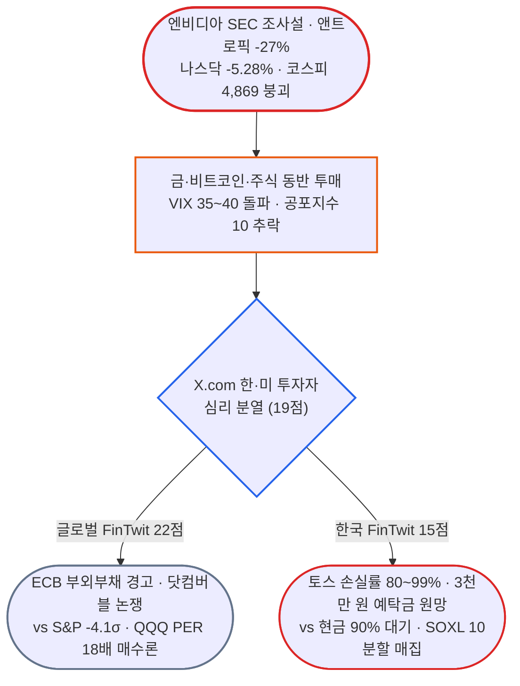

<div class="kb-briefing" markdown="1">

# X.com 주식·투자 24시간 브리핑: <span class="kb-heading-detail">"나스닥 올해 수익 전량 반납 · 코스피 4,869 붕괴…공포·탐욕 19점, 한·미 투심 완전 분열"</span> { #xcom-주식투자-24시간-브리핑-나스닥-올해-수익-전량-반납--코스피-4869-붕괴공포탐욕-19점-한미-투심-완전-분열 }

<div class="kb-points kb-points--grid" markdown>

<div class="kb-point" markdown>
<p class="kb-point__label" markdown>작성일</p>

2026-11-21

</div>

<div class="kb-point" markdown>
<p class="kb-point__label" markdown>수집 기간</p>

2026년 11월 20일(금) 11:21 ~ 11월 21일(토) 10:25 (KST)

</div>

<div class="kb-point" markdown>
<p class="kb-point__label" markdown>수집 규모</p>

최근 24시간 인기글 145건(한국어 108건 · 글로벌 37건), 본문·타래·댓글 정밀 분석 85건(한국어 49건 · 글로벌 36건), 수집 댓글 1,278개, 누적 조회수 약 1,212만 회

</div>

</div>

!!! warning "주의사항"
    아래 내용은 X.com에서 최근 24시간 동안 조회수와 댓글 반응이 집중된 국내외 투자자·트레이더·뉴스 계정의 공개 게시물과 댓글을 집계·분석한 결과다. 영문 게시물은 플랫폼 자동번역 표기와 원문이 섞여 있으며, "속보"나 "리포트 인용" 태그가 달린 글도 과장·루머·정치적 프레임이 혼재한다. 모든 수치와 사건은 공식 공시·SEC 자료·원문 보도를 직접 교차 확인한 뒤 투자 판단에 활용해야 한다.

<div class="kb-briefing-section kb-briefing-section--dashboard" markdown="1">

## 📊 X.com 투자자 공포·탐욕 지수 (Fear & Greed Index)

X.com 투자 심리가 극단적 공포 구간으로 주저앉았다.

당일 종합 지수는 **19점(극단적 공포)으로** 한국어권(**15점**)과 글로벌 영어권(**22점**) 모두 공황 국면에 진입했다.

글로벌 투자자는 공포지수(CNN F&G) 10, VIX 35 ~ 40 돌파, S&P 500의 50일선 대비 -4.1 표준편차 이탈을 보고 역발상 저가 매수와 닷컴버블 2.0 붕괴론으로 팽팽하게 맞섰다.

반면 한국 투자자는 코스피 4,869.96 붕괴와 단일종목 레버리지 3,000만 원 기본예탁금 규제 탓에 물탈 사다리마저 끊겼다는 체념과 분노에 휩싸였다.


<div class="kb-portfolio-metrics">
  <div class="kb-portfolio-metric-card">
    <span class="label">당일 공포·탐욕 지수</span>
    <span class="value">19점 (극단적 공포)</span>
    <span class="sub">0 극단적 공포 ~ 100 극단적 탐욕</span>
  </div>
  <div class="kb-portfolio-metric-card">
    <span class="label">한·미 FinTwit 온도차</span>
    <span class="value">한국 15점 vs 글로벌 22점</span>
    <span class="sub">한국은 레버리지 물림·제도 분노, 미국은 통계적 과매도 논쟁</span>
  </div>
  <div class="kb-portfolio-metric-card">
    <span class="label">지배적 시장 분위기</span>
    <span class="value">유동성 경색 · 신뢰 붕괴</span>
    <span class="sub">나스닥 올해 +19% 상승분 반납, 금·코인·주식 동반 하락</span>
  </div>
  <div class="kb-portfolio-metric-card">
    <span class="label">역발상 수급 시그널</span>
    <span class="value">투항 패닉 vs 분할 매수 개시</span>
    <span class="sub">VIX 35 돌파 · QQQ 선행 PER 18배에 일부 현금 투입 vs 2차 하락 경계</span>
  </div>
</div>

```vegalite
{
  "$schema": "https://vega.github.io/schema/vega-lite/v5.json",
  "background": "transparent",
  "width": "container",
  "height": 220,
  "padding": {"top": 8, "bottom": 4, "left": 4, "right": 8},
  "data": {
    "values": [
      {"metric": "종합 공포·탐욕 지수", "score": 19, "max": 100, "zone": "극단적 공포", "label": "19점 (극단적 공포)", "desc": "나스닥 연간 상승분 반납과 코스피 매도 사이드카가 겹친 전방위 투매"},
      {"metric": "① 국내·미국 지수 심리", "score": 14, "max": 100, "zone": "극단적 공포", "label": "14점 (극단적 공포)", "desc": "코스피 4,869.96 마감, 나스닥 -5.28%, QQQ 고점 대비 -20% 약세장 진입"},
      {"metric": "② 매수·투항 수급 태도", "score": 23, "max": 100, "zone": "극단적 공포", "label": "23점 (극단적 공포)", "desc": "크리스마스 선물 포기·전량 청산 자조 vs SOXL 10분할·QQQ 저가매수 충돌"},
      {"metric": "③ AI·반도체 업황 신뢰도", "score": 16, "max": 100, "zone": "극단적 공포", "label": "16점 (극단적 공포)", "desc": "NVDA SEC 조사설·브로드컴 TPU 감축설·BNK 하이닉스 28년 34조 쇼크"},
      {"metric": "④ 글로벌 FinTwit 경계심", "score": 20, "max": 100, "zone": "극단적 공포", "label": "20점 (극단적 공포)", "desc": "ECB AI 부외부채 경고, 앤트로픽 상장 이틀 차 -27% 폭락에 버블 경계 극대화"},
      {"metric": "⑤ 역발상 바닥 기대감", "score": 24, "max": 100, "zone": "극단적 공포", "label": "24점 (극단적 공포)", "desc": "VIX 35~40, S&P -4.1σ 과매도, 애플 5조 달러 방어에 단기 반등 기대 일부 유입"}
    ]
  },
  "encoding": {
    "y": {
      "field": "metric",
      "type": "nominal",
      "sort": null,
      "axis": {"title": null, "labelFontWeight": 500, "labelFontSize": 12, "labelLimit": 180, "ticks": false, "domain": false, "labelPadding": 12}
    }
  },
  "layer": [
    {
      "mark": {"type": "bar", "cornerRadius": 7, "height": 14, "color": "#94a3b8", "opacity": 0.14},
      "encoding": {
        "x": {
          "field": "max",
          "type": "quantitative",
          "scale": {"domain": [0, 118]},
          "axis": {
            "title": "X.com 투자자 심리 스펙트럼 (0~24 극단적 공포 · 25~44 공포 · 45~55 중립 · 56~74 탐욕 · 75~100 극단적 탐욕)",
            "values": [0, 25, 50, 75, 100],
            "labelExpr": "datum.value == 0 ? '0 (극단적 공포)' : datum.value == 25 ? '25 (공포)' : datum.value == 50 ? '50 (중립)' : datum.value == 75 ? '75 (탐욕)' : '100 (극단적 탐욕)'",
            "grid": false
          }
        }
      }
    },
    {
      "data": {"values": [{"x": 25}, {"x": 45}, {"x": 55}, {"x": 75}]},
      "mark": {"type": "rule", "strokeDash": [2, 4], "color": "#94a3b8", "opacity": 0.5},
      "encoding": {"x": {"field": "x", "type": "quantitative"}, "y": {"value": 0}, "y2": {"value": "height"}}
    },
    {
      "mark": {"type": "bar", "cornerRadius": 7, "height": 14},
      "encoding": {
        "x": {"field": "score", "type": "quantitative"},
        "color": {
          "field": "zone",
          "type": "nominal",
          "scale": {
            "domain": ["극단적 공포", "공포", "중립", "탐욕", "극단적 탐욕"],
            "range": ["#dc2626", "#ea580c", "#64748b", "#16a34a", "#2563eb"]
          },
          "legend": null
        },
        "tooltip": [
          {"field": "metric", "title": "심리 지표"},
          {"field": "label", "title": "점수 및 구간"},
          {"field": "desc", "title": "핵심 진단"}
        ]
      }
    },
    {
      "mark": {"type": "text", "align": "left", "dx": 10, "fontWeight": 600, "fontSize": 12},
      "encoding": {
        "x": {"field": "score", "type": "quantitative"},
        "text": {"field": "label", "type": "nominal"}
      }
    }
  ],
  "config": {"view": {"stroke": "transparent"}}
}
```

---


</div>

<nav class="kb-briefing-nav" aria-label="브리핑 주요 주제" markdown="1">

**주제 바로가기**

- [1. 전체 분위기](#1-전체-분위기-한국-fintwit과-글로벌-fintwit의-온도차)
- [2. 핵심 쟁점과 시장 변동성 원인 논쟁](#2-핵심-쟁점과-시장-변동성-원인-논쟁)
- [3. 속보·루머·미확인 주장 팩트체크](#3-속보루머미확인-주장-팩트체크)
- [4. 종목·섹터별 X.com 투자자 심리와 댓글 반응](#4-종목섹터별-xcom-투자자-심리와-댓글-반응)
- [5. 주목할 인사이트 계정과 핵심 논지](#5-주목할-인사이트-계정과-핵심-논지)
- [6. 향후 핵심 체크포인트](#6-향후-핵심-체크포인트)

</nav>


<div class="kb-briefing-section" markdown="1">

## 1. 전체 분위기: <span class="kb-heading-detail">한국 FinTwit과 글로벌 FinTwit의 온도차</span> { #1-전체-분위기-한국-fintwit과-글로벌-fintwit의-온도차 }

지난 24시간 X.com 금융권 여론은 **"안전지대 없는 전방위 마진콜과 투항"**으로 요약된다.

미국 본장에서 나스닥이 -5.28% 급락해 2026년 연간 상승분(+19% 폭)을 하루 만에 반납했고, 엔비디아는 로이터의 SEC 회계조사 보도 직후 -14.01% 폭락했다.

금값($3,550 하회)과 비트코인($59,000 하회)까지 주식과 한꺼번에 무너지자 현금 확보를 위한 강제 청산 장세라는 진단이 지배했다.


한국 FinTwit과 글로벌 FinTwit의 온도 차이는 뚜렷하다.

글로벌 X.com에서는 시총 증발 속보(7.4조 ~ 8.9조 달러)와 닷컴버블 비교가 쏟아지는 한편, **'나스닥스탄(Nasdaqistan)'과** **'크리스마스 선물 취소'** 같은 블랙 유머와 50일선 -4.1 표준편차·VIX 35~40 기준의 통계적 매수 논쟁이 활발하다.

반대로 한국 X.com은 코스피 4,869.96(-5.21%, 양 시장 매도 사이드카) 마감에 이어 토스증권 손실자 비율 80 ~ 99% 인증, 단일종목 레버리지 기본예탁금 3,000만 원 규제 성토, 월요일 개장 공포가 지배했다.




<div class="kb-briefing-topic" markdown="1">

### 조회수·댓글 폭발 대표 글과 댓글 티키타카

#### 글로벌 시장 붕괴와 블랙 유머: <span class="kb-heading-detail">"크리스마스 취소, 나스닥스탄의 하루"</span> { #글로벌-시장-붕괴와-블랙-유머-크리스마스-취소-나스닥스탄의-하루 }

<div class="kb-feed" markdown>

<div class="kb-post" markdown>
<p class="kb-post__title" markdown>금융 시장 전방위 폭락 속보</p>
<div class="kb-post__meta"><span class="kb-chip">@WatcherGuru</span><span class="kb-stat">조회 <b>1,265,267</b></span><span class="kb-stat">댓글 <b>738</b></span><span class="kb-stat">좋아요 <b>13,230</b></span></div>

금 $3,550, S&P 500 7,100, 나스닥 25,800, 비트코인 $59,000이 일제히 무너지며 하루 수조 달러가 증발했다고 전했다.

<div class="kb-reactions" markdown="1">
<p class="kb-reactions__label">댓글 반응</p>

댓글에서는 "금까지 주식과 같이 빠지는 게 놀랍다"(`@CrinkledCash` 좋아요 105),

</div>

"원유도 빠지는 이유가 뭐냐"(`@CryptoWorldJosh` 좋아요 32),

"퇴직연금(401k)이 제일 먼저 맞고 11월 4일 이후 상승일이 단 이틀뿐"(`@JakeIsHere5x5` 좋아요 20)이라는 성토와 정치권 책임 공방이 뒤엉켰다.


</div>

<div class="kb-post" markdown>
<p class="kb-post__title" markdown>나스닥스탄의 또 다른 하루</p>
<div class="kb-post__meta"><span class="kb-chip">@DudeWhoInvests</span><span class="kb-stat">조회 <b>466,619</b></span><span class="kb-stat">댓글 <b>179</b></span><span class="kb-stat">좋아요 <b>13,481</b></span></div>

짧은 한 줄 조롱에 1.3만 개 넘는 좋아요가 붙었다.

<div class="kb-reactions" markdown="1">
<p class="kb-reactions__label">댓글 반응</p>

댓글은 "젠슨 황을 복귀시켜라"(`@internetdialup` 좋아요 73),

</div>

"이제 웃을 수도 없는 지경"(`@GLR_WLP` 좋아요 27),

"방금 마지막 월급을 고기 분쇄기에 밀어 넣었다"(`@derpman76148` 좋아요 30),

"지금은 눈물이 아니라 총알(현금)을 꺼낼 시간"(`@Williamthawhale` 좋아요 7)으로 엇갈렸다.


</div>

<div class="kb-post" markdown>
<p class="kb-post__title" markdown>아내가 주식 수익금으로 크리스마스 선물을 사자고 한다</p>
<div class="kb-post__meta"><span class="kb-chip">@GrowthStockDad</span><span class="kb-stat">조회 <b>775,000</b></span><span class="kb-stat">댓글 <b>132</b></span><span class="kb-stat">좋아요 <b>12,525</b></span></div>

작성자가 직접 "현금(dry powder) 제로", "애들한테는 석탄이나 줘야겠다"고 자학 댓글을 달며 밈이 폭발했다.

<div class="kb-reactions" markdown="1">
<p class="kb-reactions__label">댓글 반응</p>

댓글창은 "올해 크리스마스 취소"(`@V15Jay` 좋아요 118),

</div>

"당신들 올해 수익이란 게 있긴 했어?"(`@OhThats_Good` 좋아요 58),

"주식을 팔아 주식을 사야 할 판"(`@adrianviewpoint` 좋아요 49) 같은 씁쓸한 농담으로 도배됐다.


</div>

<div class="kb-post" markdown>
<p class="kb-post__title" markdown>AI 참사 속 5조 달러 애플과 12초 시리</p>
<div class="kb-post__meta"><span class="kb-chip">@ecommerceshares</span><span class="kb-stat">조회 <b>469,652</b></span><span class="kb-stat">댓글 <b>123</b></span><span class="kb-stat">좋아요 <b>11,753</b></span></div>

AI 투매를 피해 애플(`$AAPL`)이 연초 대비 +27% 오르며 시총 5조 달러 고지를 버티는 반면 Siri는 타이머 맞추는 데 12초 걸린다고 비꼬았다.

작성자가 "AI 설비투자(CapEx)를 안 한 게 바로 핵심 포인트"라고 덧붙이자, "AI 컴퓨팅에 빚내서 자살하지 않았으니 승자"(`@SpacBobby` 좋아요 126),

"애플은 이 학살 속 저축 계좌"(`@BarExamTutor` 좋아요 8)라는 찬사와 "결국 12개월 내 밸류에이션이 꺾일 것"(`@InvestorMunger` 좋아요 2)이라는 숏 의견이 맞섰다.


</div>

</div>

#### 한국 FinTwit의 절망과 역설: <span class="kb-heading-detail">"10년 중 최악의 역겨운 장 vs 광견 매수 대기"</span> { #한국-fintwit의-절망과-역설-10년-중-최악의-역겨운-장-vs-광견-매수-대기 }

<div class="kb-feed" markdown>

<div class="kb-post" markdown>
<p class="kb-post__title" markdown>10년 주식 인생 중 최악의 역겨운 장</p>
<div class="kb-post__meta"><span class="kb-chip">@NURadu_</span><span class="kb-stat">조회 <b>718,000</b></span><span class="kb-stat">댓글 <b>172</b></span><span class="kb-stat">좋아요 <b>2,945</b></span></div>

2018년 박상기빔·미중 무역전쟁, 2020년 코로나빔, 2022년 긴축·FTX, 2024년 엔 캐리 블랙먼데이, 2025년 관세 쇼크를 다 버텼지만 이번 장이 가장 최악이라고 토로했다.

특히 SK하이닉스 2배 레버리지가 11월 6일 기준 고점 대비 -90% 넘게 빠지고 `NVDL`도 최근 한 달 -64% 폭락했는데, 2026년 7월 31일 시행된 단일종목 레버리지 현금 기본예탁금 3,000만 원 규제 때문에 자금 적은 개미는 물 탈 사다리마저 막혔다고 비판했다.

<div class="kb-reactions" markdown="1">
<p class="kb-reactions__label">댓글 반응</p>

댓글에선 "10월에 10배 먹었다가 어젯밤 AMD 레버리지 전량 청산하고 고점의 3분의 1만 남았다"(`@fan7211785` 좋아요 9),

</div>

"드러켄밀러가 왜 쉬는지 알겠다"(`@solorun23` 좋아요 20)는 공감이 쏟아졌다.


</div>

<div class="kb-post" markdown>
<p class="kb-post__title" markdown>토스증권 손실률 80 ~ 99% 인증 대란</p>
<div class="kb-post__meta"><span class="kb-chip">@viver_0 👁13,833</span><span class="kb-chip">💬41</span><span class="kb-chip">❤️218</span><span class="kb-chip">@Lonnie__X 👁4,522</span><span class="kb-chip">💬38</span><span class="kb-chip">❤️117</span><span class="kb-chip">@boboniaatto 👁2,706</span><span class="kb-chip">💬8</span><span class="kb-chip">❤️10</span></div>

토스증권 종목별 수익률 통계가 공유되며 충격이 번졌다.

현대차 86.82 ~ 97.03%, 삼성전자 59.11 ~ 80.66%, SK하이닉스 77.18 ~ 87.73%, 삼성전기 88.45%, 네이버 99.84%, QLD 94%, 하이닉스 레버리지 100% 손실 수치가 거론됐다.

<div class="kb-reactions" markdown="1">
<p class="kb-reactions__label">댓글 반응</p>

댓글에선 "타율적 장기투자자가 늘었다"(`@happy_dog2`),

</div>

"10명 중 8 ~ 9명이 물려 다들 호흡장애 오는 중"이라는 탄식이 이어졌다.


</div>

</div>


</div>

<div class="kb-briefing-topic" markdown="1">

### X.com 인용 주요 시장 수치

| 항목 | X.com 인용 수치 | 주요 출처 계정 (조회수) |
| :--- | :--- | :--- |
| **미국 3대 지수 (11/20 본장)** | 다우 48,147.33(-1.93%, 주간 -8%) · S&P 500 6,910.79(-3.69% ~ -3.70%, 7거래일 연속 하락) · 나스닥 22,617.73(-5.28%, 주간 -10%, YTD 음전) | `@jinseongeo83473`(3,331) · `@KobeissiLetter`(526,307) · `@Tesla_Teslaway`(46,000) |
| **미국 시총 증발 규모** | 최근 45일간 8.9조 달러 · 이번 주 7.4조 달러 · 11월 20일 하루 1.8조 ~ 2.5조 달러 | `@WatcherGuru`(402,000) · `@wallstengine`(194,000) · `@wallstreetbets`(127,000) |
| **공포·과매도 지표** | VIX 35.89 ~ 37 돌파(장 막판 40.03 터치 언급) · CNN 공포·탐욕 지수 10 · S&P 500 50일선 대비 -4.1 표준편차 | `@asklivermore`(130,000) · `@Barchart`(63,676) · `@bespokeinvest`(27,205) |
| **반도체·AI 급락 폭** | 필라델피아반도체 -10.73% · 엔비디아 -14.01%(주간 -23%) · AMD -13.25% · 브로드컴 -12.19% · 마이크론 -13.89% · 샌디스크 -16.05% · 아이렌 -17.97% | `@nyse_min`(1,426) · `@Tesla_Teslaway`(46,000) |
| **앤트로픽 (`$ANT`) IPO** | 공모가 $83 · 시초가 $111.5(+34.3%) · 장중 고점 $115 돌파 ➔ 이틀 차 장중 $83.05(고점 대비 -27%) | `@KobeissiLetter`(1,152,001) · `@BullTheoryio`(249,000) · `@KooKOO31127599`(585) |
| **국내·일본 증시 (11/20)** | 코스피 4,869.96(-5.21%, 매도 사이드카) · 코스닥 645.68(-5.71%) · 개인 코스피 +1.6조 순매수 vs 외인 -1.13조 · 일본 닛케이 57조 엔(3,580억 달러) 증발 | `@T_Nike_T`(407) · `@WhaleInsider`(65,151) · `@shmath8218`(1,232) |
| **안전·대체자산** | 금값 $3,550 하회(-3.7%/24h) · 은 -6.7%/24h · 비트코인 $58,000대($59,000 붕괴, 24h 청산 13억 달러+) | `@WatcherGuru`(1,265,267) · `@KevinSvenson_`(35,784) · `@Tesla_Teslaway`(46,000) |


</div>

<div class="kb-briefing-topic" markdown="1">

### 지수·핵심 종목 지지선과 전망 매트릭스

| 지수 / 종목 | X.com 내 현재 위치 인식 | 반등·매수 타점 전망 | 추가 하락·비관 타겟 | 주요 근거 및 대립 논리 |
| :--- | :--- | :--- | :--- | :--- |
| **나스닥 100 (`QQQ`)** | 10월 고점 대비 약 -20% 약세장 경계, 올해 상승분 반납 | 200주선 및 QQQ 선행 PER 18배(2022년 저점 하회), VIX 30 하회 시 | 닷컴버블 당시 -77.9% · 10% 반등 12번 속 계단식 하락, QQQ 500달러 | `@InTheAssembly` 저평가론 vs `@dons_korea` · `@dontstopinvest` 연봉 음봉 경계 |
| **S&P 500 (`SPY`)** | 6,910.79(-3.69%), 50일선 대비 -4.1 표준편차 | 1950년 이후 4번(1987·2011·2015·2026) 나온 극단적 과매도 후 단기 반등 | 2008년 10월도 -4σ 이후 추가 -25% 하락 사례 존재 | `@bespokeinvest` 과매도 통계 vs `@howmusicsounds` 2008년 반례 경고 |
| **코스피 (`KOSPI`)** | 4,869.96(-5.21%), 1월 중순 이후 최저치 | 4,500 ~ 4,800선(전반적 지지 기대), 외국인 순매수 이틀 연속 전환 시 | 2,700 ~ 4,000선 붕괴 공포("월요일 패닉셀" 경계) | `@OnWhEe` B경로 4,500 ~ 4,600 vs `@Quantview_trade` 외국인 수급 전환 우선론 |
| **엔비디아 (`NVDA`)** | 6주 만에 5조+ 달러 대비 -46% ~ -47% 급락, -14.01% | 젠슨 황 복귀 또는 SEC 무혐의·공식 해명 확인 시, 선행 PER 7배대 거론 | $60 ~ $100 하회 공포(회계 리스크 현실화 시) | `@aleabitoreddit` 과잉 반응론 vs `@edzitron` 순환금융·회계 조사 리스크 |
| **SK하이닉스 · 삼성전자** | 토스 투자자 59 ~ 88% 손실, 하이닉스 100만 원선 위협 | 하이닉스 104 ~ 105만 원(27년 BPS 1배 기준, BNK 목표가) · 삼성 15만 원대 | 하이닉스 20 ~ 85만 원(이주완 20만설) · 삼성 7만 원설 | `@FutureRichKimX` BNK 리포트 바닥론 vs `@soxx_i` 메모리 가격 하락 경고 |
| **SOXL (반도체 3배)** | 24시간 -25% 급락, 30달러대 위협 | 30달러 이하부터 10분할 소액 분할(`@PolarisLog`) | 10달러 중반 ~ 20달러 중반(`@Veritas18633531`), 청산 공포 | `@GulleongsoeT` 분할 매수 vs `@dontstopinvest` 반도체 연봉 훼손으로 레버리지 금지 |

---


</div>


</div>

<div class="kb-briefing-section" markdown="1">

## 2. 핵심 쟁점과 시장 변동성 원인 논쟁

| 쟁점 | 핵심 논점 | X.com 댓글·시장 대립 구도 | 투자 시사점 |
| :--- | :--- | :--- | :--- |
| **① 엔비디아 SEC 조사 · 젠슨 황 공백** | 로이터의 SEC 회계조사 보도 + 젠슨 황 CEO 사임 후유증 | "주주 파괴 FUD·엔론급은 아니다" vs "CFO가 임시 CEO인데 회계 조사면 치명적" | 조사 범위(싱가포르 매출·순환금융) 공식 공시 확인 전 진입 금물 |
| **② 앤트로픽 IPO 수급 블랙홀** | 813 ~ 1,200억 달러 수요 흡수 뒤 상장 이틀 만에 고점 -27% 폭락 | "개인·연금에 물량 떠넘긴 펌프 앤 덤프" vs "IPO 첫 주 변동성은 흔한 현상" | 공모가 $83 방어 여부가 전체 AI 공모·비상장 밸류에이션 풍향계 |
| **③ ECB AI 부외부채 · 순환금융 경고** | 메타 270억·MS 3,650억 달러 등 4,000억 달러+ 부외부채 및 순환거래 | "서브프라임과 달리 우량 빅테크" vs "감가상각 빠른 GPU를 장기 부채로 조달한 위험" | AI CapEx 수익성 검증 지연 시 사모신용·보험사 채권 시장 전이 점검 |
| **④ 연준 긴축 우려 · 유동성 경색** | 쿡 이사 인상 시사·케빈 워시 의장 매파 성향 속 금·코인 동반 투매 | "12월 금리 인상 91% 반영·긴축 체제" vs "증시 폭락으로 동결 확률 부활" | 금과 주식이 따로 움직이는 '유동성 경색 해소' 시점이 단기 신호 |
| **⑤ 브로드컴·메모리 쇼크 · 한국 규제** | 구글 TPU 8i 20% 감축설 + BNK 28년 하이닉스 34조 + 예탁금 3,000만 원 | "28년 적자까지 선반영한 바닥" vs "P에서 Q로 못 넘어가고 중국 증설 겹쳐 붕괴" | 국내 단일종목 레버리지 수급 차단으로 하방 변동성 증폭 경계 |

<div class="kb-briefing-topic" markdown="1">

### ① 엔비디아 SEC 회계조사 보도와 젠슨 황 복귀 촉구 논란

엔비디아의 -14.01% 추락이 시장을 얼어붙게 만들었다.

로이터가 미국 증권거래위원회(SEC)의 엔비디아 회계처리·공시 조사 착수를 보도한 가운데(`@aleabitoreddit`, `@Tesla_Teslaway`, `@blazingbees`), 도널드 트럼프 대통령이 젠슨 황의 CEO 복귀를 공개 촉구했다는 소식까지 겹쳤다(`@MrAustinPredict` 조회 198,000· 댓글 78· 좋아요 2,600). `@blazingbees`는 조사 골자가 매출처 지역 분류(본사 소재지 기준)와 순환금융 회계처리 두 가지라고 정리했다.


댓글 반응은 음모론과 공포가 뒤섞였다.

`@MajorOcelot45`(좋아요 88)는 "CFO를 임시 CEO로 앉혔는데 회계 조사라는 건 사임시킨 뒤 다시 젠슨을 복귀시키려는 FUD(공포 조장)"라고 맞섰고, `@DeauxWork`(좋아요 15)도 "스페이스X까지 겨냥한 표적 헤드라인"이라고 반발했다.

반면 `@WildTipsy`와 `@Serpico915`는 "엔론 2.0 아니냐", "구두 주문과 분식 의혹"을 꺼냈고, `@MrAustinPredict` 댓글에는 "엔비디아 이사회가 회사를 망쳤다, 당장 젠슨을 데려오라(`#BringJensenBack`)"는 성토가 빗발쳤다.


</div>

<div class="kb-briefing-topic" markdown="1">

### ② 앤트로픽(`$ANT`) IPO 수급 블랙홀과 -27% 급락

역대 최대 규모 AI 상장이 시장의 기폭제가 아니라 도화선이 됐다.

`@KobeissiLetter`(조회 1,152,001· 댓글 295· 좋아요 3,592)와 `@BullTheoryio`(조회 249,000· 댓글 184· 좋아요 3,566)에 따르면 `$ANT`는 공모가 $83에서 시초가 $111.5, 장중 $115를 넘겼으나 상장 이틀 차에 고점 대비 -27% 급락해 공모가 $83 턱밑($83.05)까지 추락했다.

`@zerohedge`(조회 190,000· 댓글 82· 좋아요 2,182)는 개인 수요가 1,115억 ~ 1,200억 달러 몰렸다고 꼬집었다.


댓글 여론은 극도로 싸늘하다.

"IPO = 아마도 고평가(It's Probably Overpriced)"(`@mymoneytrades` 좋아요 718),

"소매 투자자와 401k를 내부자 엑시트 유동성(exit liquidity)으로 썼다"(`@XZherron` 좋아요 17· `@vincent44957652` 좋아요 264),

"모든 밈코인 런칭과 똑같다"(`@akoskm` 좋아요 34) 같은 비난이 추천 최상단을 차지했다.

한국어권에서도 `@USAnt_IDEA`와 `@blazingbees`가 813억 달러 유동성 흡수로 기존 빅테크 수급이 말랐다는 해석을 내놨다.


</div>

<div class="kb-briefing-topic" markdown="1">

### ③ ECB 금융안정보고서: <span class="kb-heading-detail">AI 자금 조달은 '제2의 서브프라임'인가</span> { #③-ecb-금융안정보고서-ai-자금-조달은-제2의-서브프라임인가 }

글로벌 X.com에서 가장 지적인 토론이 붙은 글은 프랑스 경제 저널리스트 `@gregory_raymond`(조회 415,341· 댓글 156· 좋아요 3,443)의 ECB 2026년 11월 금융안정보고서 해부였다.

올해 빅테크 AI 비용이 7,250억 달러로 자체 이익을 넘자 부채와 '보이지 않는' 부외금융이 급증했다는 내용이다.

메타 루이지애나 데이터센터 협력사 차입 270억 달러, 마이크로소프트 미가동 데이터센터 임대 약정 3,650억 달러 등 ECB 추산 부외부채만 4,000억 달러가 넘는다.

여기에 엔비디아의 오픈AI 1,000억 달러 투자와 칩 재구매 순환구조, 2030년 6,000억 달러 지출을 약속한 오픈AI의 2025년 매출 130억 달러 괴리, 핌코(오라클 100억 달러)와 JP모건·MUFG(오라클 380억 달러 대출), 유럽 펀드·보험사의 미국 테크 채권·주식 노출을 짚었다.


<div class="kb-reactions" markdown="1">
<p class="kb-reactions__label">댓글 반응</p>

댓글에서는 치열한 반론과 재반론이 오갔다.

</div>

`@monst9r`(좋아요 46)와 `@Cyrus_Fazel`(좋아요 19)은 "부실 모기지를 우량 채권으로 둔갑시킨 서브프라임과 달리 오늘날 차주는 MS·오픈AI·오라클 등 프라임 등급"이라고 선을 그었다.

반면 `@oliviervarel`(좋아요 4)은 "몇 년 만에 가치가 0에 가까워질 GPU를 장기 부채로 사는데 새 아키텍처로 연산 수요가 10분의 1로 줄면 자금 조달자에겐 재앙"이라고 맞섰고, `@75Borr`(좋아요 37)과 `@Dontgetmewront`(좋아요 7)은 "19세기 철도·광섬유 인프라 버블처럼 기술은 맞지만 초기 투자자가 손실을 떠안고 수요가 약속 속도만큼 빨리 안 오는 게 문제"라고 정리했다.


</div>

<div class="kb-briefing-topic" markdown="1">

### ④ 연준 긴축 우려와 유동성 경색 (금·비트코인 동반 하락)

금리 환경 변화와 유동성 쇼크가 겹쳤다.

`@InTheAssembly`가 인용한 JP모건 전망(12월·1월·3월 연속 금리 인상으로 4.50 ~ 4.75%, 2028년까지 인하 없음)과 `@USAnt_IDEA`(조회 183,546)가 전한 스탠리 드러켄밀러의 경고(현 연준 의장 케빈 워시는 재정적자·인플레를 극혐해 긴축이 쉽게 안 끝남, 주식 순노출 제로 수준 축소)가 시장을 짓눌렀다.

`@Tesla_Teslaway`는 연준 쿡 이사의 인상 시사에도 불구하고 증시 폭락 탓에 12월 인상 확률이 흔들리고 있다고 전했다(`@Eddie9132151` 115% → 91% 언급).


특히 주식 하락과 함께 금(-3.7%), 은(-6.7%), 비트코인($59,000 붕괴)이 동반 추락한 현상을 놓고 `@RoyPapa5`(조회 13,218· 좋아요 248)의 해석이 주목받았다.

로빈 브룩스의 요인 분해 차트를 근거로 "금 하락은 실질금리 탓이 아니라 S&P 하락과 공포지수에서 온 마진콜·현금 확보 장세"라고 진단했다.

안전자산조차 현금화되는 위기 국면에서는 분산투자가 일시적으로 무력화된다는 지적이다.


</div>

<div class="kb-briefing-topic" markdown="1">

### ⑤ 브로드컴 TPU 감축설 · BNK 34조 쇼크 · 레버리지 예탁금 규제

반도체와 국내 증시 고유 악재도 동시에 터졌다.

`@Tesla_Teslaway`가 전한 궈밍치(TF인터내셔널) 보고서에 따르면 구글은 2027년 브로드컴 설계 TPU 8i 출하 계획을 약 100만 개(약 20%) 줄이고 미디어텍 TPU 8t를 늘리기로 했다.

이에 `@holzzak777`(조회 5,255· 좋아요 73)은 "SOXX를 무너뜨리기 위한 마지막 퍼즐로 브로드컴 악재가 떴다"고 촌평했다.


국내에선 BNK증권 이민희 연구원의 SK하이닉스 2028년 영업이익 34조 원(컨센서스 507조 원 대비 -93%, 목표가 105만 원) 전망이 충격을 줬다(`@BUZZ__tiab` 조회 20,938· 좋아요 70). 다만 `@FutureRichKimX`(조회 4,988· 좋아요 71)는 "이익이 박살 나도 적정가 105만 원(27년 BPS 1배)을 줬다는 건 주가가 바닥권이란 역설적 하방 지지 자료"라고 해석했다.

여기에 `@NURadu_`와 `@gyeon_baeg`가 비판한 단일종목 레버리지 3,000만 원 기본예탁금 규제가 소액 투자자의 물타기를 막아 체감 고통을 키웠다는 여론이 거셌다.


---


</div>


</div>

<div class="kb-briefing-section" markdown="1">

## 3. 속보·루머·미확인 주장 팩트체크

<div class="kb-briefing-topic" markdown="1">

### ⚠️ [외신 인용 / 확인 필요] SEC, 엔비디아 회계처리·공시 조사 착수설

<div class="kb-rumor" data-trust="high" markdown>
<div class="kb-rumor__head" markdown="span"><span class="kb-rumor__level">신뢰도 중상</span><span class="kb-meter" aria-hidden="true"><i class="on"></i><i class="on"></i><i class="on"></i><i class="on"></i><i></i></span><span>로이터 보도 인용이 다수 계정에서 공유됐으나 구체적 위반 혐의·제재 여부는 미확정</span></div>
<div class="kb-rumor__row" markdown>
<p class="kb-rumor__label">원문 주장</p>
<div markdown>

`@aleabitoreddit`(조회 220,000), `@Tesla_Teslaway`, `@blazingbees` 등은 로이터 보도를 인용해 SEC가 엔비디아의 매출처 지역 분류(본사 소재지 기준)와 순환금융 회계처리·공시 적정성을 들여다보고 있다고 전했다.

</div>
</div>
<div class="kb-rumor__row" markdown>
<p class="kb-rumor__label">댓글 반박 및 현장 검증</p>
<div markdown>

`@Schrodolf`는 "구체적 보고서 없이 익명 출처에 의존한다"고 지적했고, `@MajorOcelot45`는 "수년간 반복되던 회계 FUD의 재탕"이라고 반박했다. 반면 `@NURadu_`의 후속 트윗에서는 싱가포르 매출 주소지 문제를 둘러싼 공시 검증이 가벼운 사안이 아니라고 경계했다.

</div>
</div>
<div class="kb-rumor__row kb-rumor__row--key" markdown>
<p class="kb-rumor__label">투자 체크포인트</p>
<div markdown>

SEC의 정식 웰스 노티스(Wells Notice)나 엔비디아 10-Q/8-K 정정 공시 여부를 직접 확인하기 전에는 사실과 공포를 분리해서 봐야 한다.

</div>
</div>
</div>


</div>

<div class="kb-briefing-topic" markdown="1">

### ⚠️ [외신·영상 인용] 트럼프 대통령, 젠슨 황 엔비디아 CEO 복귀 공개 촉구

<div class="kb-rumor" data-trust="high" markdown>
<div class="kb-rumor__head" markdown="span"><span class="kb-rumor__level">신뢰도 중상</span><span class="kb-meter" aria-hidden="true"><i class="on"></i><i class="on"></i><i class="on"></i><i class="on"></i><i></i></span><span>백악관 브리핑·발언 인용이나 법적·이사회 구속력 없는 정치적 발언</span></div>
<div class="kb-rumor__row" markdown>
<p class="kb-rumor__label">원문 주장</p>
<div markdown>

`@MrAustinPredict`(조회 198,000)와 `@Tesla_Teslaway`는 트럼프 대통령이 "우리는 두 번째 기회의 나라"라며 엔비디아 이사회에 젠슨 황 복귀를 공개 촉구했다고 전했다. `@DrNHJ`는 같은 날 백악관 기자회견에서 트럼프가 미국 기업의 해외 데이터센터 건설에 막대한 세금을 매기겠다고 경고한 내용도 함께 전했다.

</div>
</div>
<div class="kb-rumor__row" markdown>
<p class="kb-rumor__label">댓글 반박 및 현장 검증</p>
<div markdown>

댓글에서는 "포트폴리오와 억만장자 친구들이 타격을 입으니 다급해진 것"(`@Sephirothia` 좋아요 10)이라는 냉소와 "엔비디아 이사회가 무능하다, 젠슨을 돌려달라"는 환호가 엇갈렸다.

</div>
</div>
<div class="kb-rumor__row kb-rumor__row--key" markdown>
<p class="kb-rumor__label">투자 체크포인트</p>
<div markdown>

엔비디아 이사회 의결 및 FBI·SEC 조사 경과 없이 정치적 발언만으로 즉각 복귀가 이뤄지기는 어렵다. 해외 데이터센터 과세 발언도 실제 입법·행정명령 여부를 따져야 한다.

</div>
</div>
</div>


</div>

<div class="kb-briefing-topic" markdown="1">

### ⚠️ [애널리스트 리포트] 구글, 2027년 브로드컴 TPU 8i 출하 20% 감축 · 미디어텍 확대

<div class="kb-rumor" data-trust="high" markdown>
<div class="kb-rumor__head" markdown="span"><span class="kb-rumor__level">신뢰도 중상</span><span class="kb-meter" aria-hidden="true"><i class="on"></i><i class="on"></i><i class="on"></i><i class="on"></i><i></i></span><span>궈밍치 TF인터내셔널 연구원 업계 조사 인용이나 고객사 공식 발표 아님</span></div>
<div class="kb-rumor__row" markdown>
<p class="kb-rumor__label">원문 주장</p>
<div markdown>

`@Tesla_Teslaway`가 전한 궈밍치 조사에 따르면 구글이 2027년 브로드컴 설계 TPU 8i 출하 계획을 약 100만 개(약 20%) 축소하고 고가형 8i Max 비중을 줄이는 대신 미디어텍 설계 TPU 8t를 늘린다. 다만 원인은 AI 수요 감소가 아니라 공급망·데이터센터 전력 제약에 따른 재배치라고 설명했다.

</div>
</div>
<div class="kb-rumor__row" markdown>
<p class="kb-rumor__label">댓글 반박 및 현장 검증</p>
<div markdown>

시장에서는 브로드컴(`-12.19%`) 급락의 빌미로 해석되며 반도체 ETF 전반을 끌어내렸다는 반응이 나왔다(`@holzzak777`).

</div>
</div>
<div class="kb-rumor__row kb-rumor__row--key" markdown>
<p class="kb-rumor__label">투자 체크포인트</p>
<div markdown>

브로드컴 실적 콘퍼런스콜에서 맞춤형 반도체(ASIC) 2027년 가이던스 변화가 실제로 확인되는지가 관건이다.

</div>
</div>
</div>


</div>

<div class="kb-briefing-topic" markdown="1">

### ⚠️ [외신 인용] 스페이스X 400 ~ 440억 달러 GPU 리스 금융과 우주 발사 금지 조항(FT)

<div class="kb-rumor" data-trust="high" markdown>
<div class="kb-rumor__head" markdown="span"><span class="kb-rumor__level">신뢰도 중상</span><span class="kb-meter" aria-hidden="true"><i class="on"></i><i class="on"></i><i class="on"></i><i class="on"></i><i></i></span><span>파이낸셜타임스 보도 인용</span></div>
<div class="kb-rumor__row" markdown>
<p class="kb-rumor__label">원문 주장</p>
<div markdown>

`@mindmoon_108`(조회 4,523)과 `@Tesla_Teslaway`는 아폴로·골드만삭스가 스페이스X용 GPU 자금 약 440억 달러 채권(400억 달러 규모 리스 구조 언급)을 발행한 가운데, 채권단이 채무 불이행 시 담보 회수가 불가능하다는 이유로 담보 GPU를 우주 데이터센터 궤도로 발사하지 못하게 막는 조항을 요구했다고 전했다.

</div>
</div>
<div class="kb-rumor__row" markdown>
<p class="kb-rumor__label">댓글 반박 및 현장 검증</p>
<div markdown>

스페이스X(`SPCX` -7.69%) 주가 압박 요인으로 해석됐으며, 댓글에서는 "담보가 안 잡힌 자체 GPU로만 궤도에 올릴 수 있느냐"는 질문이 달렸다.

</div>
</div>
<div class="kb-rumor__row kb-rumor__row--key" markdown>
<p class="kb-rumor__label">투자 체크포인트</p>
<div markdown>

AI GPU 리스·사모신용(Private Credit) 금융의 담보 조건이 까다로워지고 있다는 신호로, AI 인프라 자금 조달 비용 상승 여부를 점검해야 한다.

</div>
</div>
</div>


</div>

<div class="kb-briefing-topic" markdown="1">

### [과학·시장 아이러니] 앤트로픽 클로드, '리만 가설' 증명과 미국수학회 반박

<div class="kb-rumor" data-trust="mid" markdown>
<div class="kb-rumor__head" markdown="span"><span class="kb-rumor__level">신뢰도 중</span><span class="kb-meter" aria-hidden="true"><i class="on"></i><i class="on"></i><i class="on"></i><i></i><i></i></span><span>공식 발표와 학계 검증 진행 중이나 주가 수익성에는 무관</span></div>
<div class="kb-rumor__row" markdown>
<p class="kb-rumor__label">원문 주장</p>
<div markdown>

`@yeoulabba`와 `@mindmoon_108`은 앤트로픽 수학자 알푀게가 클로드와 함께 167년 된 난제 리만 가설 증명(1,737만 줄)을 찾았으며 MIT 수학자가 기계 검증으로 오류를 못 찾았다고 전했다. 동시에 미국수학회 측에서는 인간 손으로만 푼 별도 증명안을 서둘러 공개하며 신경전을 벌였다는 내용도 공유됐다.

</div>
</div>
<div class="kb-rumor__row" markdown>
<p class="kb-rumor__label">댓글 반박 및 현장 검증</p>
<div markdown>

`@yeoulabba` 글 댓글에서는 "수학 난제를 풀어도 구독료를 못 올리니 시장은 0원으로 친다", "성적표와 학원비 고지서가 한날 온 셈"이라는 현실 인식이 공감을 얻었다.

</div>
</div>
<div class="kb-rumor__row kb-rumor__row--key" markdown>
<p class="kb-rumor__label">투자 체크포인트</p>
<div markdown>

AI 기술 진보와 상업적 현금흐름·밸류에이션 사이의 시차를 극명히 보여주는 사례다.

</div>
</div>
</div>


</div>

<div class="kb-briefing-topic" markdown="1">

### [보도 혼선] 마이클 버리, 엔비디아 풋옵션 '전량 청산' vs '절반 매도'

<div class="kb-rumor" data-trust="mid" markdown>
<div class="kb-rumor__head" markdown="span"><span class="kb-rumor__level">신뢰도 중</span><span class="kb-meter" aria-hidden="true"><i class="on"></i><i class="on"></i><i class="on"></i><i></i><i></i></span><span>계정별 인용 내용 충돌</span></div>
<div class="kb-rumor__row" markdown>
<p class="kb-rumor__label">원문 주장</p>
<div markdown>

`@Kalshi_Finance`(댓글 내 바이럴)와 `@InTheAssembly` 인용에서는 마이클 버리가 `$NVDA` 풋·공매도 포지션을 "청산(closed)"했다고 표현한 반면, `@Tesla_Teslaway`는 "엔비디아 풋옵션 절반을 팔았고 나머지 절반과 나스닥100 풋은 유지했다"고 전했다.

</div>
</div>
<div class="kb-rumor__row" markdown>
<p class="kb-rumor__label">댓글 반박 및 현장 검증</p>
<div markdown>

국내외 X.com에서도 단기 바닥 신호로 해석하는 쪽과 아직 나스닥100 풋을 들고 있다는 신중론이 갈렸다.

</div>
</div>
<div class="kb-rumor__row kb-rumor__row--key" markdown>
<p class="kb-rumor__label">투자 체크포인트</p>
<div markdown>

숏 포지션 일부 차익실현 여부만 보고 바닥을 단정하지 말고 실제 공시·원문 발언을 대조해야 한다.

</div>
</div>
</div>


</div>

<div class="kb-briefing-topic" markdown="1">

### [미확인·추산 수치] 코스피 가계 주식 손실 563조 원 · 시총 3,500조 원 증발

<div class="kb-rumor" data-trust="low" markdown>
<div class="kb-rumor__head" markdown="span"><span class="kb-rumor__level">신뢰도 하 ~ 중</span><span class="kb-meter" aria-hidden="true"><i class="on"></i><i class="on"></i><i></i><i></i><i></i></span><span>뉴스 인용 추산치 및 작성자 어림 계산 혼재</span></div>
<div class="kb-rumor__row" markdown>
<p class="kb-rumor__label">원문 주장</p>
<div markdown>

`@inshort_1`(조회 15,819)과 `@qq3540`은 코스피 9,000에서 5,000 하락 기준 가계 주식 손실 563조 원 추산을 인용했고, `@Liberty0918`(조회 21,283)은 고점 대비 코스피 시총 증발을 약 3,500조 원(국가채무 1,400조 원의 2.5배)으로 추산했다.

</div>
</div>
<div class="kb-rumor__row" markdown>
<p class="kb-rumor__label">댓글 반박 및 현장 검증</p>
<div markdown>

`@BFbFkTBDaF65106`은 "GDP의 19%가 날아갔다"며 경악했으나, 가계 직접 보유 비중과 기관·외국인 비중, 장중 시점별 시가총액 차이가 반영되지 않은 거친 추산치다.

</div>
</div>
<div class="kb-rumor__row kb-rumor__row--key" markdown>
<p class="kb-rumor__label">투자 체크포인트</p>
<div markdown>

수치 자체의 정확성보다 한국 개인 투자자들이 체감하는 자산 증발 공포의 강도를 읽는 심리 지표로만 참고한다.

</div>
</div>
</div>

---


</div>


</div>

<div class="kb-briefing-section" markdown="1">

## 4. 종목·섹터별 X.com 투자자 심리와 댓글 반응

| 종목·섹터 | 언급 글 수 | 누적 조회수 | 지배적 심리 | 핵심 논점 및 대표 반응 |
| :--- | :---: | :---: | :--- | :--- |
| **미국 지수(나스닥·S&P)** | 48건 | 525.5만 | 공황·패닉 vs 과매도 매수론 | YTD 상승분 반납·QQQ -20% vs S&P -4.1σ · 선행 PER 18배 반등 기대 |
| **금리·연준·채권·환율** | 46건 | 715.3만 | 긴축 공포 · 유동성 경색 | 12월 인상 경계·케빈 워시 매파 부담 vs 폭락 여파로 동결 확률 부활 |
| **국내 지수(코스피·코스닥)** | 34건 | 15.7만 | 절망 · 제도 분노 · 월요일 공포 | 4,869.96 매도 사이드카, 개인 1.6조 순매수에도 외인 이탈 지속 |
| **엔비디아 (`NVDA`)** | 34건 | 390.3만 | 공포 · FUD 반발 · 복귀 기대 | -14.01% 폭락, SEC 조사·젠슨 부재 충격 vs 과매도 2008년 이후 최대 |
| **반도체·메모리(전반)** | 26건 | 119.1만 | 피크아웃 공포 · 사이클 의심 | 필반 -10.73%, LTA 신뢰 흔들림 vs 현 시세 이미 다운사이클 선반영 |
| **코인(비트코인 등)** | 23건 | 554.6만 | 실망 · 강제청산 공포 | BTC $59,000 하회·24h 청산 13억 달러+, 안전자산 동반 투매 |
| **앤트로픽 (`ANT`)** | 21건 | 378.1만 | 분노 · 조롱 · 수급 원망 | 고점 대비 -27%, 공모가 $83 턱밑, 내부자 엑시트 비판 폭주 |
| **SOXL·레버리지 ETF** | 18건 | 121.3만 | 원금 증발 절망 vs 분할 매집 | SK하이닉스 2배 -90%·SOXL -25%, 3,000만 원 예탁금 규제 성토 |
| **AI·빅테크·버블론** | 18건 | 149.5만 | 닷컴버블 데자뷰 · 부채 경고 | ECB 4,000억 달러 부외부채 경고 vs 철도·광섬유형 과도기론 |
| **SK하이닉스 · 삼성전자** | 16건 · 11건 | 79.4만 · 6.2만 | 80% 손실자 좌절 · 저점 논쟁 | 토스 손실률 59 ~ 88%, BNK 28년 34조 쇼크 vs PBR 1배 105만 원 하방론 |

<div class="kb-briefing-topic" markdown="1">

### 1. 미국 지수(나스닥·S&P 500) <span class="kb-heading-detail">— 언급 글 48건 · 누적 조회 525만 회</span> { #1-미국-지수나스닥sp-500--언급-글-48건--누적-조회-525만-회 }

<div class="kb-points kb-points--grid" markdown>

<div class="kb-point" markdown>
<p class="kb-point__label" markdown>본문 핵심 논지</p>

나스닥이 하루 -5.28% 떨어지며 올해 +19% 수익을 전부 지웠고(`@KobeissiLetter`), `QQQ`가 10월 고점 대비 -20%에 걸치며 사상 9번째 최악의 주간을 보냈다(`@Barchart`, `@RampCapitalLLC`). `@bespokeinvest`는 나스닥 100이 11월 들어 -10.0% 빠져 2000년(-23.6%)·2008년(-11.2%)에 이어 역대 최악권이며, S&P 500은 50일선 아래 4.1 표준편차까지 밀려 2015년 이후 최대 과매도라고 분석했다.

</div>

<div class="kb-point" markdown>
<p class="kb-point__label" markdown>댓글 찬반 반응</p>

강세·역발상 파는 `@InTheAssembly`의 QQQ 선행 PER 18배(2022년 저점 하회)와 `@asklivermore`의 VIX 35 ~ 40 진입 통계를 근거로 "서둘러 도망갈 때가 아니라 조금씩 QQQ를 살 때"(`@TintinPoker` 좋아요 11)라고 맞섰다.

반면 비관·신중 파는 "2008년 10월도 50일선 -4σ에서 추가로 -25%가 더 빠졌다"(`@howmusicsounds`),

"선행 PER 18배는 순환매출 위에 쌓인 이익 추정치가 유지될 때만 유효하다"(`@jjmorris123` 좋아요 14,`@DeepIceValue` 좋아요 1),

"`GS S&T` 기준 S&P 호가창 최상단 유동성이 150만 달러로 바닥"(`@zerohedge` 인용)이라고 반박했다.


</div>

<div class="kb-point" markdown>
<p class="kb-point__label" markdown>한국 투자자 시선</p>

`@dontstopinvest`는 나스닥 연봉이 '장대 윗꼬리 음봉'으로 마감할 위기라며 내년 상반기까지 하락 꼬리를 열어두고 현금 90 ~ 95% 대기 전략을 제시했고, `@dons_korea`는 닷컴버블 이후 저점까지 가는 동안 10% 이상 반등이 12번이나 나왔다며 섣부른 V자 반등 기대를 경계했다.

</div>

</div>


</div>

<div class="kb-briefing-topic" markdown="1">

### 2. 금리·연준·채권·환율 <span class="kb-heading-detail">— 언급 글 46건 · 누적 조회 715만 회</span> { #2-금리연준채권환율--언급-글-46건--누적-조회-715만-회 }

<div class="kb-points kb-points--grid" markdown>

<div class="kb-point" markdown>
<p class="kb-point__label" markdown>본문 핵심 논지</p>

시장을 짓누르는 핵심 배경으로 금리 인상 공포와 유동성 경색이 지목됐다.

`@InTheAssembly`는 JP모건이 12월·1월·3월 연속 인상(4.50 ~ 4.75%) 및 2028년까지 인하 없음을 전망했다고 전했고, `@USAnt_IDEA`는 케빈 워시 의장 체제의 긴축 의지를 짚었다.

`@blazingbees`와 `@fourseasonfan`은 안전자산 선호로 미 국채 10년물 금리가 4.95% ~ 5.05%로 하루 10bp 내려온 점에 주목하면서도, 경기 침체 신호라면 주식은 더 빠져야 끝난다고 봤다.


</div>

<div class="kb-point" markdown>
<p class="kb-point__label" markdown>댓글 및 시장 반응</p>

`@Eddie9132151` 글처럼 연준이 시장을 망가뜨린다는 분노가 큰 한편, `@Tesla_Teslaway`와 `@WatcherGuru` 댓글에선 "11월 20일 폭락으로 12월 인상 확률이 100% 아래로 내려왔다"는 반전 기대와 "식료품 가격은 안 떨어지는데 계좌만 녹았다"는 서민 인플레이션 불만이 함께 나타났다. `@RoyPapa5`는 주식·금·원자재가 동반 매도되는 현상을 유동성 부족과 마진콜로 설명하며 금의 디커플링 여부를 핵심 신호로 삼았다.

</div>

</div>


</div>

<div class="kb-briefing-topic" markdown="1">

### 3. 국내 지수(코스피·코스닥) <span class="kb-heading-detail">— 언급 글 34건 · 누적 조회 15.7만 회</span> { #3-국내-지수코스피코스닥--언급-글-34건--누적-조회-157만-회 }

<div class="kb-points kb-points--grid" markdown>

<div class="kb-point" markdown>
<p class="kb-point__label" markdown>본문 핵심 논지</p>

코스피 4,869.96(-5.21%, 1월 중순 이후 최저)과 코스닥 645.68(-5.71%) 동반 매도 사이드카가 발동됐다(`@T_Nike_T`, `@blazingbees`, `@1114`). 개인이 1.6조 ~ 1.9조 원을 순매수했지만 외국인과 기관의 동반 투매(코스피 외인 1.13조 ~ 1.7조, 기관 1.1조 언급)를 막지 못했다(`@THE0129`, `@kyle_yuk`). `@THE0129`는 여의도 전업투자자 사무실과 주식 스터디가 해산하는 2022년식 침체 분위기를 전했다.

</div>

<div class="kb-point" markdown>
<p class="kb-point__label" markdown>댓글 및 지지선 공방</p>

`@OnWhEe`는 코스피 4,500 ~ 4,600(차트상 4,600 ~ 4,800) 시나리오를 유지하면서도 주말 사이 방어 뉴스가 없으면 월요일 패닉셀을 피하기 어렵다고 경고했고, 댓글에서는 "3천대 가는 거 아니냐", "2,700 가느냐"는 공포가 쏟아졌다. `@Liberty0918`은 시총 3,500조 증발을 보고 탐욕이 싹튼다며 기회를 외쳤으나, 댓글(`@ForesightSun` 좋아요 5,`@Quantview_trade`)은 "월요일 시초가 확인 뒤, 외국인 이틀 이상 순매수 전환을 보고 들어가도 늦지 않다"고 차분히 제동을 걸었다. `@junssi1982`는 코스피·코스닥 역대 최대 공매도(한미반도체 잔고 1.2조 원 언급)를 지적하며 숏 스퀴즈 트리거 부재를 아쉬워했다.

</div>

</div>


</div>

<div class="kb-briefing-topic" markdown="1">

### 4. 엔비디아 (`NVDA`) <span class="kb-heading-detail">— 언급 글 34건 · 누적 조회 390만 회</span> { #4-엔비디아-nvda--언급-글-34건--누적-조회-390만-회 }

<div class="kb-points kb-points--grid" markdown>

<div class="kb-point" markdown>
<p class="kb-point__label" markdown>본문 핵심 논지</p>

하루 -14.01%, 주간 -23%, 6주 만에 아마존 한 곳 시총에 맞먹는 약 46 ~ 47%가 증발했다(`@TrendSpider`, `@aleabitoreddit`, `@Tesla_Teslaway`). `@Barchart`는 2008년 금융위기 이후 가장 과매도 수준이라고 짚었다.

악재의 중심엔 로이터의 SEC 회계조사 보도(매출처 분류·순환금융)와 젠슨 황 사임 공백이 있다.


</div>

<div class="kb-point" markdown>
<p class="kb-point__label" markdown>댓글 찬반 반응</p>

글로벌 댓글에서는 "선행 PER 7.56배인데 아무도 못 만진다"(`@NickCompounds`, `@casual_invest`),

"젠슨 없인 산업 구조 자체가 무너졌다, 당장 복귀시켜라"(`@AlchemyOfKnight`)는 패닉과, "실적은 역대급이고 순전한 FUD 조작"(`@MajorOcelot45`)이라는 반발이 정면 충돌했다.

한국 댓글에서는 "`$143`까지 내려와 현금 부자가 부럽지만 더 빠질까 봐 손이 안 나간다"(`@qq3540` 댓글 `@JY62TT`, `@asiwishi`),

"6주 만에 5조 달러에서 3조 초반이 됐다니 비현실적"이라는 반응이 주를 이뤘다.


</div>

</div>


</div>

<div class="kb-briefing-topic" markdown="1">

### 5. 반도체·메모리(전반) <span class="kb-heading-detail">— 언급 글 26건 · 누적 조회 119만 회</span> { #5-반도체메모리전반--언급-글-26건--누적-조회-119만-회 }

<div class="kb-points kb-points--grid" markdown>

<div class="kb-point" markdown>
<p class="kb-point__label" markdown>본문 핵심 논지</p>

필라델피아 반도체지수 -10.73%, `SOXX`·`SMH` 구성 대형주(NVDA·AMD·AVGO·MU·TSM)가 줄줄이 10%대 급락을 맞았다(`@nyse_min`, `@holzzak777`). `@THE0129`는 선진짱·윤지호 대담을 인용해 P(가격) 사이클에서 Q(물량) 사이클로 매끄럽게 이어지지 못하고 AI 인프라 투자가 멈추면 전 섹터로 충격이 번진다는 공포를 전했다.

</div>

<div class="kb-point" markdown>
<p class="kb-point__label" markdown>댓글 및 업계 시선</p>

`@gimduha77994334`는 "P가 아니라 Q 사이클 시작이라는 논리"로 버티던 투자자들이 순환적 포지셔닝 과열로 수십% 추가 하락을 맞는 패턴을 짚었다. 일본 니케이에서도 키옥시아 -11%, 어드반테스트 -10%, 이비덴 -12% 등 반도체 공급망이 동반 폭락했다(`@blazingbees`). `@WonhaengL`은 `SOXX`·`SOXL` 물량을 줄이며 "시중에 돈이 말랐다, 금리 인하 없인 보수적 대응이 답"이라고 진단했다.

</div>

</div>


</div>

<div class="kb-briefing-topic" markdown="1">

### 6. 코인(비트코인·이더리움) <span class="kb-heading-detail">— 언급 글 23건 · 누적 조회 554만 회</span> { #6-코인비트코인이더리움--언급-글-23건--누적-조회-554만-회 }

<div class="kb-points kb-points--grid" markdown>

<div class="kb-point" markdown>
<p class="kb-point__label" markdown>본문 핵심 논지</p>

비트코인이 $59,000 아래($58,000대)로 밀리며 24시간 암호화폐 청산 규모가 13억 달러를 넘겼다(`@WatcherGuru`, `@Tesla_Teslaway`). `@KevinSvenson_`은 24시간 기준 나스닥 -3.2%에 맞춰 비트코인도 -4.8% 동조 하락하며 안전자산·디지털 금 내러티브가 흔들리고 있음을 보여줬다.

</div>

<div class="kb-point" markdown>
<p class="kb-point__label" markdown>댓글 반응</p>

"$125k에 비트코인 산 애들 어디 갔나"(`@GrowthStockDad` 댓글),

"주식과 코인이 나란히 9,000억 달러 증발해 분산투자가 여러 곳에서 동시 손실로 변했다"(`@Timothytous`)는 자조와, "이번이 4번째 대폭락이지만 버틴다"(`@flytothegood`),

"58k 깨지면 주말 추가 하락 여지 열어두고 저점 분할 대기"(`@CryptoCT01`) 의견이 공존했다.


</div>

</div>


</div>

<div class="kb-briefing-topic" markdown="1">

### 7. 앤트로픽 (`ANT`) <span class="kb-heading-detail">— 언급 글 21건 · 누적 조회 378만 회</span> { #7-앤트로픽-ant--언급-글-21건--누적-조회-378만-회 }

<div class="kb-points kb-points--grid" markdown>

<div class="kb-point" markdown>
<p class="kb-point__label" markdown>본문 핵심 논지</p>

상장 첫날 시초가 +34.3% 급등 뒤 이틀 차에 고점 대비 -27% 급락하며 공모가 $83.00 턱밑($83.05)까지 내려왔다(`@KobeissiLetter`, `@BullTheoryio`, `@Tesla_Teslaway`). 직원 5,300명 기준 스톡옵션·보상 가치가 공모가 기준 약 2,320억 달러(`@SunyoungP29745`), 백만장자 직원 2,800명(`@InTheAssembly`) 등 거대 보상 규모가 상장 직후 차익실현 매물과 수급 블랙홀 논란을 불렀다.

</div>

<div class="kb-point" markdown>
<p class="kb-point__label" markdown>댓글 반응</p>

글로벌·한국 막론하고 "유통 물량 10% 미만 풀고 개인·연금에 떠넘겼다", "매출 대비 22배 버블"이라는 혹평이 쏟아졌다.

`@Since_Crypto`의 바이럴 영상(`$115.10` 매수 후 손절 영상) 댓글에서는 가짜 캡션·동명 토큰 주의를 당부하는 팩트체크(`@david1989_zhu`, `@liquidatedcryp`)가 달리기도 했다.


</div>

</div>


</div>

<div class="kb-briefing-topic" markdown="1">

### 8. SOXL·레버리지 ETF <span class="kb-heading-detail">— 언급 글 18건 · 누적 조회 121만 회</span> { #8-soxl레버리지-etf--언급-글-18건--누적-조회-121만-회 }

<div class="kb-points" markdown>

<div class="kb-point" markdown>
<p class="kb-point__label" markdown>본문 핵심 논지</p>

24시간 -25% 폭락(`@KevinSvenson_`)과 국내 단일종목 2배 레버리지 -90% 붕괴(`@NURadu_`), `QLD` 투자자 94% 손실(`@viver_0`), 하이닉스 레버리지 100% 손실(`@gyeon_baeg`, `@sikiri0`)이 X.com 한국어권을 강타했다.

</div>

<div class="kb-point" markdown>
<p class="kb-point__label" markdown>댓글 및 매매 전략 대립</p>

`@PolarisLog`(조회 11,547· 댓글 22· 좋아요 149)는 마지막 현금 20%로 `$30`에 `SOXL` 10분할 1차 진입(10달러 이탈까지 염두)을 선언했고 `@GulleongsoeT`도 분할 매수에 들어갔다. 그러나 댓글에서는 "`SOXL`이 청산돼야 바닥 나온다"(`@OdysseyBruin` 좋아요 4), "10 ~ 20달러 중반까지 열어둬라"(`@Veritas18633531`), "물타다가 홍수 난다"(`@Rubyyyung`)는 경고가 팽팽히 맞섰다.

</div>

</div>


</div>

<div class="kb-briefing-topic" markdown="1">

### 9. AI·빅테크·버블론 <span class="kb-heading-detail">— 언급 글 18건 · 누적 조회 149만 회</span> { #9-ai빅테크버블론--언급-글-18건--누적-조회-149만-회 }

<div class="kb-points kb-points--grid" markdown>

<div class="kb-point" markdown>
<p class="kb-point__label" markdown>본문 핵심 논지</p>

ECB 부외부채 경고(`@gregory_raymond`), CNBC에 가죽재킷을 입고 출연해 AI 최악은 아직 오지 않았다고 경고한 `@edzitron`(조회 94,000· 댓글 127· 좋아요 1,996), 댄 아이브스의 '7가지 퍼펙트 스톰 vs 4조 달러 AI 인프라 지속' 강세론(`@USAnt_IDEA`)이 정면 충돌했다.

</div>

<div class="kb-point" markdown>
<p class="kb-point__label" markdown>댓글 반응</p>

`@edzitron` 댓글에는 "지난 2주간 조롱하던 사람들이 조용해졌다, 사모펀드(PE)가 연기금·401k에 AI 물량을 떠넘기는 게임"(`@dontgetbored`, `@Fr4gUlat0r`)이라는 지지가 쏟아졌다. 반대로 `@KobeissiLetter`(타 스레드 인용)와 `@RoyPapa5`는 "비상장 데이터브릭스는 2,250억 달러 몸값을 올리는데 상장 AI만 공포로 던진다"며 공포 이후 10년 내 최고 매수 기회가 될 수 있다고 반론을 폈다.

</div>

</div>


</div>

<div class="kb-briefing-topic" markdown="1">

### 10. SK하이닉스 · 삼성전자 <span class="kb-heading-detail">— 언급 글 16건 · 11건 · 누적 조회 79.4만 · 6.2만 회</span> { #10-sk하이닉스--삼성전자--언급-글-16건--11건--누적-조회-794만--62만-회 }

<div class="kb-points kb-points--grid" markdown>

<div class="kb-point" markdown>
<p class="kb-point__label" markdown>본문 핵심 논지</p>

토스증권 기준 투자자 손실 비중이 59 ~ 88%까지 치솟으며 전 국민 물림 상태가 확인됐다(`@Lonnie__X`, `@boboniaatto`, `@soxx_i`). BNK의 하이닉스 2028년 영업이익 34조 원(목표가 105만 원) 쇼크와 이주완의 삼성전자 7만 원 · 하이닉스 20만 원 비관론이 X.com을 흔들었다.

</div>

<div class="kb-point" markdown>
<p class="kb-point__label" markdown>댓글 반응</p>

`@BUZZ__tiab` 댓글은 "숫자 하나 빼먹은 거 아니냐"는 당혹감이 컸지만, `@FutureRichKimX` 댓글에선 "이미 다운사이클 이익 급감을 주가가 선반영하고 있다는 하방 지지 근거"(`@schcrystar`, `@PForever0000`)라는 냉정한 분석이 공감을 얻었다. `@soxx_i` 댓글에선 "중국 디램 대량 생산 직전이라 빅테크가 속도 조절하는 2차전지 데자뷰"(`@ashvaov`) vs "폭락 무새 공포 마케팅"(`@leettttttt83838`) 논쟁이 붙었다.

</div>

</div>


</div>

<div class="kb-briefing-topic" markdown="1">

### 기타 종목·섹터 요약 (언급 1 ~ 5건)

| 종목·섹터 | 언급 수 | X.com 내 핵심 논점 및 반응 |
| :--- | :---: | :--- |
| **애플·MS·구글·아마존** | 4 / 2 / 3 / 2 | 애플(`$AAPL`)만 AI CapEx 미참여가 오히려 호재로 작용해 시총 5조 달러 방어("저축 계좌" 극찬); 구글 TPU 8i 20% 감축·MS 3,650억 달러 데이터센터 임대 약정 부각 |
| **테슬라 (`TSLA`)** | 5건 | 이탈리아 교통부 감독형 FSD 유럽 주요국 최초 임시 승인 호재에도 기술주 투매로 -7.64% 급락(`@Tesla_Teslaway`); 국토부 서류 보완 대조(`@yeoulabba`) |
| **AMD·브로드컴·마이크론·샌디스크** | 6 / 5 / 5 / 2 | AMD -13.25%(헌터브룩 숏리포트 여파 잔존)·AVGO -12.19%(TPU 감축설)·MU -13.89%·SNDK -16.05% 일제 폭락, 반도체 전방위 투매 |
| **현대차·네이버·삼성전기·한미반도체** | 2 / 2 / 3 / 3 | 토스 손실 비율 현대차 86.82 ~ 97.03%, 네이버 99.84%, 삼성전기 -13% · 88.45% 손실, 한미반도체 공매도 잔고 1.2조 원(국내 1위) 지적 |
| **소프트뱅크·아이렌·팔란티어·SaaS** | 3 / 1 / 1 | 日 소프트뱅크 오픈AI 646억 달러 노출 부담으로 장중 -16.6%(2,950.5엔) 폭락(`@shmath8218`); 아이렌 -17.97%; 드러켄밀러 `PLTR` 매수(`@USAnt_IDEA`); SaaS AI 공포 폭락 선례 비교(`@gimduha77994334`) |

---


</div>


</div>

<div class="kb-briefing-section" markdown="1">

## 5. 주목할 인사이트 계정과 핵심 논지

이번 24시간 수집 데이터에서 단순 비명·밈·선동을 배제하고, **1차 원문 근거·정량 통계·매크로 구조·엄격한 리스크 관리 원칙**을 제시한 글로벌 4개 계정과 한국어권 6개 계정의 핵심 통찰을 정리한다.

| 계정 | 구분 | 팔로워 | 강점 및 분석 스타일 | 이번 24시간 핵심 인사이트 |
| :--- | :---: | :---: | :--- | :--- |
| `@gregory_raymond` | 글로벌 | 15만 | 유럽 정책·기관 보고서 1차 원문 해부 | ECB 금융안정보고서 기반 AI 부외부채 4,000억 달러+ · 순환금융 구조 분석 |
| `@bespokeinvest` | 글로벌 | 26.9만 | 감정 배제 정량·역사적 통계 | S&P 500 50일선 -4.1σ(2015년 후 최저), 나스닥100 최악의 11월, XLK vs XLP 비교 |
| `@BlogJulianKomar` | 글로벌 | 16.8만 | 20년 경력 추세·모멘텀 리스크 규율 | 조정 3단계(조정→횡보→최종 투항) 및 숏커버 후 현금 대기·RS 워치리스트 전략 |
| `@InTheAssembly` | 글로벌 | 56.5만 | 밸류에이션·매크로 컨센서스 추적 | QQQ 선행 PER 18배(2022 저점 하회), JPM 연준 3연속 인상 전망, `$ANT` 임직원 지분 분석 |
| `@RoyPapa5` | 한국 | 2.3만 | 유동성·금리·자산 상관관계 해부 | 로빈 브룩스 금값 요인 분해(마진콜 현금 확보), 비상장·상장 AI 괴리 분석 |
| `@gimduha77994334` | 한국 | 1.1만 | 자산군 관통 타임프레임 불일치 분석 | 석탄·전력·메모리·금·SaaS·구리의 구조적 수요 vs 순환적 급락 메커니즘 해부 |
| `@blazingbees` | 한국 | 5만 | 전 헤지펀드 매니저의 통합 시황 | 한·일·미 증시와 반도체·환율·금리·뉴스를 매일 1건에 압축하는 '머니플로우' |
| `@Tesla_Teslaway` | 한국 | 1.7만 | 밤사이 미국 시장·외신 팩트 요약 | 로이터·FT·궈밍치(TPU 8i 감축)·테슬라 FSD 등 1차 보도 13개 핵심 신속 정리 |
| `@mindmoon_108` | 한국 | 2.2만 | 반도체 엔지니어 시각의 기술·금융 | FT 스페이스X 400억 달러 GPU 리스 담보 조항 및 AI 인프라 조달 제약 해석 |
| `@jinseongeo83473` | 한국 | 1.7만 | 보수적 체크리스트 · 1차 공시 검증 | VIX 30 하회·나스닥 반등 지속·금리/달러 안정 3대 확인 조건 및 현금흐름 점검 |

<div class="kb-points" markdown>

<div class="kb-point" markdown>
<p class="kb-point__label" markdown>위기 분석의 깊이 (`@gregory_raymond` · `@RoyPapa5` · `@gimduha77994334`)</p>

세 계정은 모두 "왜 안전자산(금)과 성장주(반도체·빅테크)가 같이 빠지는가"를 가격 변동이 아니라 자금 조달과 포지셔닝 구조에서 찾는다.

특히 `@gimduha77994334`가 짚은 **"장기 구조적 펀더멘털이 맞아도 단기 순환 자금이 꼬이면 수십% 폭락은 언제든 나온다"**는 경고와 **"단기 트레이딩으로 사놓고 물린 뒤 구조적 장기 투자로 말을 바꾸는 타임프레임 불일치를 경계하라"**는 조언은 이번 폭락장을 관통하는 핵심 원칙이다.


</div>

<div class="kb-point" markdown>
<p class="kb-point__label" markdown>실행 규율과 체크리스트 (`@BlogJulianKomar` · `@bespokeinvest` · `@jinseongeo83473`)</p>

`@BlogJulianKomar`는 최종 투항성 급락이 나오더라도 숏 커버 후 곧바로 공격 매수하지 말고 **현금 상태에서 추세 모델의 새 롱 신호가 나올 때까지 상대적 강도(RS) 종목 목록만 추려 기다리라**고 조언했다. `@jinseongeo83473` 역시 VIX 30 하회, 나스닥 반등 후 상승폭 유지, 국채금리·달러 안정을 다음 주 필수 확인 지표로 제시했다.

</div>

</div>

---


</div>

<div class="kb-briefing-section" markdown="1">

## 6. 향후 핵심 체크포인트

1. **엔비디아 SEC 회계조사 공식 확인 및 젠슨 황 거취 변화**: 로이터 보도 이후 SEC의 공식 조사 범위(싱가포르 매출·순환금융 회계)에 대한 엔비디아 측 공식 입장과 이사회 대응이 나와야 반도체·AI 섹터 투매의 진정 여부를 가늠할 수 있다.
2. **월요일 국내 증시 개장 수급(외국인 순매도 둔화)과 SK하이닉스 100만 원선 방어**: 코스피 4,869.96 붕괴와 미국 반도체 -10%대 급락이 겹친 월요일 장에서, 개인 저가 매수세가 반대매매 물량을 버텨내고 외국인 순매도가 멈추는지 확인해야 한다.
3. **금값($3,550대)과 주식 시장의 동조화 해소 및 VIX 30 하회 여부**: `@RoyPapa5`와 `@jinseongeo83473`이 공통으로 짚은 핵심 신호다. 금까지 내다 파는 마진콜·현금 확보 압박이 끝나고 VIX가 30 아래로 내려앉기 전까지는 변동성 축소가 어렵다.
4. **구글·브로드컴 TPU 8i 감축설과 AI CapEx 실제 발주 변동**: 궈밍치가 지목한 2027년 TPU 8i 약 20% 축소가 공급망 제약 때문인지, 아니면 빅테크 전반의 투자 속도 조절(ECB 경고 현실화)의 전조인지 후속 기업 코멘트로 검증해야 한다.
5. **12월 FOMC 금리 결정과 미 국채금리(10년물 5%선) 향방**: 연준의 추가 인상 기조가 이번 증시 폭락으로 꺾이는지(동결 확률 부활), 아니면 끈적한 인플레 때문에 긴축을 고수해 고PER 기술주 할인율 압박이 이어지는지가 중기 방향을 결정한다.
6. **앤트로픽(`$ANT`) 공모가 $83 방어 및 IPO 수급 소화 여부**: 상장 이틀 만에 $83.05까지 밀린 `$ANT`가 공모가 지지선을 지켜내지 못하면 향후 예정된 대형 AI·테크 IPO 투자 심리와 비상장 기업 밸류에이션까지 연쇄 타격을 입을 수 있다.

</div>

</div>
