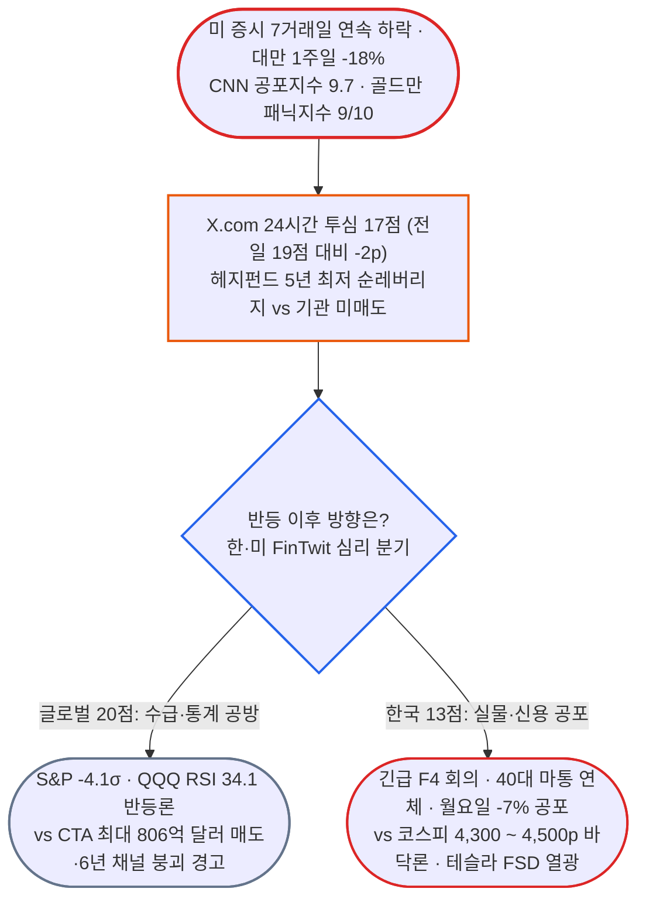

<div class="kb-briefing" markdown="1">

# X.com 주식·투자 24시간 브리핑: <span class="kb-heading-detail">"공포지수 9.7 추락 · CTA 806억 매도 경고…공포·탐욕 17점, 2000·2018년 재연 vs 과매도 반등 격돌"</span> { #xcom-주식투자-24시간-브리핑-공포지수-97-추락--cta-806억-매도-경고공포탐욕-17점-20002018년-재연-vs-과매도-반등-격돌 }

<div class="kb-points kb-points--grid" markdown>

<div class="kb-point" markdown>
<p class="kb-point__label" markdown>작성일</p>

2026-11-22

</div>

<div class="kb-point" markdown>
<p class="kb-point__label" markdown>수집 기간</p>

2026년 11월 21일(토) 17:05 ~ 11월 22일(일) 15:46 (KST)

</div>

<div class="kb-point" markdown>
<p class="kb-point__label" markdown>수집 규모</p>

최근 24시간 인기글 106건(한국어 86건 · 글로벌 20건), 본문·타래·댓글 정밀 분석 57건, 수집 댓글 844개(전체 답글 합산 3,090개), 누적 조회수 5,212,408회(약 521만 회)

</div>

</div>

!!! warning "주의사항"
    아래 내용은 X.com에서 최근 24시간 동안 조회수와 댓글 반응이 집중된 국내외 투자자·트레이더·뉴스 계정의 공개 게시물과 댓글을 집계·분석한 결과다. 영문 게시물은 플랫폼 자동번역 표기와 원문이 섞여 있으며, "속보"나 "리포트 인용" 태그가 달린 글도 과장·루머·정치적 프레임이 혼재한다. 모든 수치와 사건은 공식 공시·SEC 자료·원문 보도를 직접 교차 확인한 뒤 투자 판단에 활용해야 한다.

<div class="kb-briefing-section kb-briefing-section--dashboard" markdown="1">

## 📊 X.com 투자자 공포·탐욕 지수 (Fear & Greed Index)

주말 X.com 금융권 투자 심리는 전일(19점)보다 한 단계 더 얼어붙었다.

당일 종합 지수는 **17점(극단적 공포)으로** 전일 대비 **2포인트 하락**했다. 한국어권(**약 13점**)이 글로벌 영어권(**약 20점**)보다 훨씬 깊은 패닉에 빠졌다.

글로벌 FinTwit은 S&P 500의 50일선 -4.1 표준편차 이탈과 CNN 공포지수 9.7 추락을 근거로 단기 반등을 논하는 쪽과, 골드만삭스의 806억 달러 CTA 매도 경고 및 2018년 재연론을 외치는 쪽으로 양분됐다.

반면 한국 FinTwit은 주말 긴급 F4 회의 소집, 40대 마이너스통장 연체 급증, SK하이닉스 3배 레버리지 -99.5% 붕괴, 월요일 -7% 갭하락 공포가 겹치며 개장 전 공황이 극에 달했다.

<div class="kb-portfolio-metrics">
  <div class="kb-portfolio-metric-card">
    <span class="label">당일 공포·탐욕 지수</span>
    <span class="value">17점 (극단적 공포)</span>
    <span class="sub">전일(11/21) 19점 대비 -2p 하락</span>
  </div>
  <div class="kb-portfolio-metric-card">
    <span class="label">한·미 FinTwit 온도차</span>
    <span class="value">국내 13점 vs 글로벌 20점</span>
    <span class="sub">한국은 월요일 개장·신용연체 공포, 미국은 2000·2018 vs 반등 논쟁</span>
  </div>
  <div class="kb-portfolio-metric-card">
    <span class="label">지배적 시장 분위기</span>
    <span class="value">기계적 청산 · 2차 파동 경계</span>
    <span class="sub">헤지펀드 5년 최저 노출 vs 장기기관·개인 미매도 경계</span>
  </div>
  <div class="kb-portfolio-metric-card">
    <span class="label">역발상·이슈 시그널</span>
    <span class="value">과매도 극치 · 테슬라 독주</span>
    <span class="sub">CNN F&amp;G 9.7 · QQQ RSI 34.1 매수론 속 FSD v15 열광</span>
  </div>
</div>

```vegalite
{
  "$schema": "https://vega.github.io/schema/vega-lite/v5.json",
  "background": "transparent",
  "width": "container",
  "height": 220,
  "padding": {"top": 8, "bottom": 4, "left": 4, "right": 8},
  "data": {
    "values": [
      {"metric": "종합 공포·탐욕 지수", "score": 17, "max": 100, "zone": "극단적 공포", "label": "17점 (극단적 공포)", "desc": "전일 19점 대비 -2p 하락. CNN 공포지수 9.7과 월요일 국내 개장 공포 중첩"},
      {"metric": "① 국내·미국 지수 심리", "score": 11, "max": 100, "zone": "극단적 공포", "label": "11점 (극단적 공포)", "desc": "S&P 500 7거래일 연속 하락(-4.1σ), 대만 1주일 -18%·공매도 제한, 코스피 4,300 ~ 4,500p 거론"},
      {"metric": "② 매수·투항 수급 태도", "score": 16, "max": 100, "zone": "극단적 공포", "label": "16점 (극단적 공포)", "desc": "하이닉스 3배 -99.5%·오클로 세금 파산 위기 속 헤지펀드 5년 최저 순레버리지 vs 개인 펀드 유입 충돌"},
      {"metric": "③ AI·반도체 업황 신뢰도", "score": 18, "max": 100, "zone": "극단적 공포", "label": "18점 (극단적 공포)", "desc": "AI 기술주 고점 대비 15.9조 달러 증발, 젠슨 황 악수 프로토콜·조지 노블 엔론 2.0 공세·낸드 공급과잉설"},
      {"metric": "④ 글로벌 FinTwit 경계심", "score": 15, "max": 100, "zone": "극단적 공포", "label": "15점 (극단적 공포)", "desc": "골드만 패닉지수 9/10·CTA 최대 806억 달러 매도 경고, 2018년 재연 시 추가 하락 경고"},
      {"metric": "⑤ 역발상 바닥 기대감", "score": 25, "max": 100, "zone": "공포", "label": "25점 (공포)", "desc": "F&G 10 미만 후 3주 +10.5% 통계, QQQ 주봉 RSI 34.1, 테슬라 FSD v15 리얼리티 뷰 열광"}
    ]
  },
  "encoding": {
    "y": {
      "field": "metric",
      "type": "nominal",
      "sort": null,
      "axis": {"title": null, "labelFontWeight": 500, "labelFontSize": 12, "labelLimit": 180, "ticks": false, "domain": false, "labelPadding": 12}
    }
  },
  "layer": [
    {
      "mark": {"type": "bar", "cornerRadius": 7, "height": 14, "color": "#94a3b8", "opacity": 0.14},
      "encoding": {
        "x": {
          "field": "max",
          "type": "quantitative",
          "scale": {"domain": [0, 118]},
          "axis": {
            "title": "X.com 투자자 심리 스펙트럼 (0 ~ 24 극단적 공포 · 25 ~ 44 공포 · 45 ~ 55 중립 · 56 ~ 74 탐욕 · 75 ~ 100 극단적 탐욕)",
            "values": [0, 25, 50, 75, 100],
            "labelExpr": "datum.value == 0 ? '0 (극단적 공포)' : datum.value == 25 ? '25 (공포)' : datum.value == 50 ? '50 (중립)' : datum.value == 75 ? '75 (탐욕)' : '100 (극단적 탐욕)'",
            "grid": false
          }
        }
      }
    },
    {
      "data": {"values": [{"x": 25}, {"x": 45}, {"x": 55}, {"x": 75}]},
      "mark": {"type": "rule", "strokeDash": [2, 4], "color": "#94a3b8", "opacity": 0.5},
      "encoding": {"x": {"field": "x", "type": "quantitative"}, "y": {"value": 0}, "y2": {"value": "height"}}
    },
    {
      "mark": {"type": "bar", "cornerRadius": 7, "height": 14},
      "encoding": {
        "x": {"field": "score", "type": "quantitative"},
        "color": {
          "field": "zone",
          "type": "nominal",
          "scale": {
            "domain": ["극단적 공포", "공포", "중립", "탐욕", "극단적 탐욕"],
            "range": ["#dc2626", "#ea580c", "#64748b", "#16a34a", "#2563eb"]
          },
          "legend": null
        },
        "tooltip": [
          {"field": "metric", "title": "심리 지표"},
          {"field": "label", "title": "점수 및 구간"},
          {"field": "desc", "title": "핵심 진단"}
        ]
      }
    },
    {
      "mark": {"type": "text", "align": "left", "dx": 10, "fontWeight": 600, "fontSize": 12},
      "encoding": {
        "x": {"field": "score", "type": "quantitative"},
        "text": {"field": "label", "type": "nominal"}
      }
    }
  ],
  "config": {"view": {"stroke": "transparent"}}
}
```

---

</div>

<nav class="kb-briefing-nav" aria-label="브리핑 주요 주제" markdown="1">

**주제 바로가기**

- [1. 전체 분위기](#1-전체-분위기-2차-폭락-경고와-과매도-반등론의-정면-충돌)
- [2. 핵심 쟁점과 시장 변동성 원인 논쟁](#2-핵심-쟁점과-시장-변동성-원인-논쟁)
- [3. 속보·루머·미확인 주장 팩트체크](#3-속보루머미확인-주장-팩트체크)
- [4. 종목·섹터별 X.com 투자자 심리와 댓글 반응](#4-종목섹터별-xcom-투자자-심리와-댓글-반응)
- [5. 주목할 인사이트 계정과 핵심 논지](#5-주목할-인사이트-계정과-핵심-논지)
- [6. 향후 핵심 체크포인트](#6-향후-핵심-체크포인트)

</nav>

<div class="kb-briefing-section" markdown="1">

## 1. 전체 분위기: <span class="kb-heading-detail">2차 폭락 경고와 과매도 반등론의 정면 충돌</span> { #1-전체-분위기-2차-폭락-경고와-과매도-반등론의-정면-충돌 }

주말 X.com 금융권은 **"이번 폭락이 최종 투항인가, 아니면 베어마켓 랠리 뒤 2차 하락의 서막인가"**를 두고 치열하게 갈라졌다.

전일(21일) 폭락 직후에는 패닉과 블랙 유머가 앞섰다면, 하루가 지난 22일에는 월가 프라임 데스크 데이터·채권 스프레드·역사적 조정 사이클을 들이댄 정밀 복기와 시나리오 싸움이 전면으로 올라왔다.

한국과 글로벌의 체감 온도 차이는 오히려 더 벌어졌다.

글로벌 FinTwit은 대만의 공매도 전면 제한과 150억 달러 안정화 기금 투입, CNN 공포·탐욕 지수 9.7(2026년 3월 이후 첫 10 하회), S&P 500의 50일선 대비 -4.1 표준편차 이탈을 두고 **반등 통계 vs 2차 하락 경고**로 나뉘어 논쟁을 벌였다.

반면 한국 FinTwit은 일요일 긴급 F4 회의 소집, 40대 마이너스통장 연체액 급증, 지방 소매판매 전 지역 역성장 소식에 **레버리지 계좌 붕괴(하이닉스 3배 -99.5%, 오클로 세금 파산 위기)와 월요일 개장 -7% 공포**가 겹쳐 극도로 위축됐다.



<div class="kb-briefing-topic" markdown="1">

### 조회수·댓글 폭발 대표 글과 댓글 티키타카

#### 글로벌 충격파: <span class="kb-heading-detail">"대만 1주일 -18%에 공매도 금지, 앤트로픽 현금 2,370억 달러 vs 공포지수 9.7"</span> { #글로벌-충격파-대만-1주일--18에-공매도-금지-앤트로픽-현금-2370억-달러-vs-공포지수-97 }

<div class="kb-feed" markdown>

<div class="kb-post" markdown>
<p class="kb-post__title" markdown>대만 35년 만의 최악 주간 하락과 공매도 제한 속보</p>
<div class="kb-post__meta"><span class="kb-chip">@KobeissiLetter</span><span class="kb-stat">조회 <b>564,153</b></span><span class="kb-stat">댓글 <b>231</b></span><span class="kb-stat">좋아요 <b>6,078</b></span></div>

대만 증시가 1주일 만에 -18%(35년 만의 최악 주간 낙폭) 추락하자 월요일(23일)부터 전일 종가 이하 공매도 금지, 증거금 요건 150% 상향, 150억 달러 주식 안정화 펀드 매수를 동시에 꺼냈다는 속보다.

<div class="kb-reactions" markdown="1">
<p class="kb-reactions__label">댓글 반응</p>

"대만뿐만 아니라 모든 곳에서 금지해야 한다. 애널리스트들이 헛소리를 써 내고 숏 포지션을 공개하는 건 시세조종"(`@MRaximus` 좋아요 3)이라는 찬성론과 "안정보다 오히려 공황을 부추긴다"(`@Grubbygund` 좋아요 2)는 회의론이 맞섰다.

국내에서는 `@LifeBeLikeThatX`가 인용글을 통해 대만·TSMC 밸류체인에 묶인 헤지펀드들이 월요일 한국 시장으로 매도 물량을 쏟아낼 수 있다는 외국인 매도 전이 공포를 경고했다.

</div>

</div>

<div class="kb-post" markdown>
<p class="kb-post__title" markdown>앤트로픽 현금 2,370억 달러, 빅테크 4사 합산 초월 논란</p>
<div class="kb-post__meta"><span class="kb-chip">@KobeissiLetter</span><span class="kb-stat">조회 <b>288,227</b></span><span class="kb-stat">댓글 <b>302</b></span><span class="kb-stat">좋아요 <b>2,667</b></span></div>

앤트로픽이 IPO 조달 810억 달러와 사모 배정 260억 달러를 더해 현금 및 현금성 자산 2,370억 달러(버크셔 3,770억 달러 다음 규모)를 쥐었으며, 알파벳·아마존·스페이스X·애플 4사 합산보다 많다고 전했다.

<div class="kb-reactions" markdown="1">
<p class="kb-reactions__label">댓글 반응</p>

조회수 못지않게 냉소가 폭발했다. "그들은 장부에 약 9,000억 달러 규모의 미래 지출 약속도 가지고 있다"(`@P2Wice4` 좋아요 212)는 반박이 200개 넘는 좋아요를 받았고, "돈을 아주 빠르게 태워 없앨 것"(`@Polomvp888` 좋아요 37), "순환 자금 조달은 결국 들통난다"(`@Chaos2Cured` 좋아요 31)는 비판이 잇따랐다.

</div>

</div>

<div class="kb-post" markdown>
<p class="kb-post__title" markdown>공포·탐욕 지수 9.7 추락과 S&amp;P 500 50일선 -4.1σ 이탈</p>
<div class="kb-post__meta"><span class="kb-chip">@KobeissiLetter</span><span class="kb-stat">조회 <b>207,212</b></span><span class="kb-stat">댓글 <b>165</b></span><span class="kb-stat">좋아요 <b>1,378</b></span></div>

공포·탐욕 지수가 금요일 9.7로 떨어져 2026년 3월 이후 첫 10.0 하회를 기록했다(6거래일간 -30.6p · -76% 급락). 과거 10.0 미만 직후 3주간 S&amp;P 500은 평균 +10.5%(2021년 이후 +9.0%) 반등했다. 별도 스레드(조회 339,482 · 댓글 255)에서는 S&amp;P 500이 50일선 대비 -4.1 표준편차 떨어져 2015년 8월 이후 11년 만에 최대 과매도(2008년 -3.6σ, 2020년 -3.8σ보다 깊은 낙폭)를 기록했다고 지적했다.

<div class="kb-reactions" markdown="1">
<p class="kb-reactions__label">댓글 반응</p>

"지금이 매수 타이밍"(`@BitfuryGeorge` 좋아요 7)이라는 낙관론과 "오해의 소지가 있다. 왜 특정 기간과 50일선만 골라내 더 극적으로 포장하느냐"(`@BagholderPhD` 좋아요 36)는 통계 체리피킹 비판이 충돌했다. "이번 주 극단적 탐욕이 남은 곳은 식료품점 계산대뿐"(`@rsapp9472` 좋아요 2)이라는 뼈 있는 농담도 나왔다.

</div>

</div>

<div class="kb-post" markdown>
<p class="kb-post__title" markdown>14년 차 SOXL 전업 트레이더의 실제 체결가와 2차 타깃</p>
<div class="kb-post__meta"><span class="kb-chip">@EBvek1</span><span class="kb-stat">조회 <b>166,000</b></span><span class="kb-stat">댓글 <b>93</b></span><span class="kb-stat">좋아요 <b>1,211</b></span></div>

10월 19일 `SOXL` 외 전 종목을 현금화했다고 밝힌 14년 차 시스템 트레이더가 금요일 장 마감 직전 1차 목표가 **$29.94**에 실제 체결됐으며, 다음 2차 매수 지정가는 기존 `$21`에서 **$13.42**로 낮춰 걸어뒀다고 공개했다.

<div class="kb-reactions" markdown="1">
<p class="kb-reactions__label">댓글 반응</p>

"이전 모든 90% 폭락 뒤 1.5 ~ 2년 내 1,000% 반등이 나왔다. $13이 $130 갈 것"(`@nchandy1` 좋아요 21)과 "SOXX 100달러 수준이면 충분히 가능해 보인다"(`@Burbin_` 좋아요 4), "$13에서 풋옵션 매도가 낫다"(`@MomentGrinder` 좋아요 8) 등 구체적인 가격 전략 토론이 이어졌다.

</div>

</div>

</div>

#### 한국 FinTwit 현장: <span class="kb-heading-detail">"40대 마통 연체 · 하이닉스 3배 -99.5% · 2000년 vs 2026년 대전"</span> { #한국-fintwit-현장-40대-마통-연체--하이닉스-3배--995--2000년-vs-2026년-대전 }

<div class="kb-feed" markdown>

<div class="kb-post" markdown>
<p class="kb-post__title" markdown>2000년 5월과 2026년 11월: 금리는 같고 회사채는 정반대다</p>
<div class="kb-post__meta"><span class="kb-chip">@mk_kr_great_ag</span><span class="kb-stat">조회 <b>112,412</b></span><span class="kb-stat">댓글 <b>10</b></span><span class="kb-stat">좋아요 <b>538</b></span></div>

나스닥 고점에서 마지막 금리 인상까지 2000년 46거래일, 올해 12월 FOMC가 딱 45거래일째다. 2000년 5월 마지막 빅스텝 뒤 나스닥은 두 달간 +35% 급반등했다가 7월 회사채 가산금리(2.5%p → 2.9%p)와 루슨트 회계 스캔들로 재폭락했다. 반면 현재는 회사채 가산금리가 1.6%p이고 유가도 30% 넘게 빠져 있어 반등 뒤 재붕괴 근거가 약하다고 진단했다(단 빅테크 3분기 설비투자가 영업현금보다 15% 초과, 코어위브 채권금리 16% 육박은 경고 신호).

<div class="kb-reactions" markdown="1">
<p class="kb-reactions__label">댓글 반응</p>

"긴 글에서 가져간 건 한 줄: 2000년 반등을 끝낸 건 금리가 아니라 빚이었다. 결국 무너지는 건 빌린 돈으로 버티던 쪽부터다"(`@shoonyhan` 좋아요 8)라는 반응과 "빅테크도 현금흐름을 태우며 회사채를 쓰기 시작했다"(`@muse2market`)는 공감이 달렸다.

</div>

</div>

<div class="kb-post" markdown>
<p class="kb-post__title" markdown>40대 마통 연체액 급증과 내일 코스피 -7% 공포</p>
<div class="kb-post__meta"><span class="kb-chip">@qq3540</span><span class="kb-stat">조회 <b>24,434</b></span><span class="kb-stat">댓글 <b>57</b></span><span class="kb-stat">좋아요 <b>373</b></span></div>

40대 마이너스통장 연체액 급증 속보와 함께 내일 코스피가 -7%로 시작할 수 있다는 공포를 한 줄로 던져 큰 공감을 샀다.

<div class="kb-reactions" markdown="1">
<p class="kb-reactions__label">댓글 반응</p>

"연체액 증가는 주가보다 금리가 먼저 아프다는 뜻. 마통 금리 6 ~ 7%가 지수 -5%보다 통장을 먼저 때리니 신용잔고 감소를 먼저 본다"(`@asetfa77` 좋아요 3), "이미 마통 쓴 40대 1명 추가요"(`@kangsu33` 좋아요 3)라는 자조가 이어졌다.

</div>

</div>

<div class="kb-post" markdown>
<p class="kb-post__title" markdown>하이닉스 3배 레버리지 -99.5% 붕괴 · 오클로 32억→파산 위기</p>
<div class="kb-post__meta"><span class="kb-chip">@456girls</span><span class="kb-stat">조회 <b>7,229</b></span><span class="kb-stat">댓글 <b>15</b></span><span class="kb-stat">좋아요 <b>95</b></span></div>

SK하이닉스 3배 레버리지 상품이 -99.5% 하락해 1억 원이 50만 원이 된 계좌 사례가 충격을 줬다. 별도로 `@THE0129`(조회 2,025 · 댓글 5 · 좋아요 17)는 지난해 오클로로 32억 원을 익절해 양도세 7억 원이 확정된 뒤 재진입했다가 올해 -24억 원 손절로 파산 위기에 몰린 사연을 공유했고, `@smc_investor`(조회 41,721 · 댓글 7 · 좋아요 58)는 17억 계좌가 7억으로 줄어든 공무원 부부 사례와 함께 미래에셋증권 아이렌(`$IREN`) 보유자 87%가 손절했다는 잔인한 수치를 공개했다.

<div class="kb-reactions" markdown="1">
<p class="kb-reactions__label">댓글 반응</p>

"50만 원이면 원금 복구는 아예 불가능"(`@blackcow1210` 좋아요 2), "3배 레버리지는 변동성 끌림 현상 탓에 추세 하락장에서 장기 보유하면 구조적으로 소멸한다"(`@Pink0Clouds`), "아이렌 고점 물량 41%가 손절했고 1.6억으로 17억 찍었으면 좀 빼야지"(`@minyeong170546`)라는 뼈아픈 훈수와 탄식이 교차했다.

</div>

</div>

</div>

</div>

<div class="kb-briefing-topic" markdown="1">

### 국내외 실물·기술 이슈와 시장 반응

- **테슬라 FSD v15 '리얼리티 뷰(Reality View)' 열광**: 지수가 무너진 주말에도 한국어권 테슬라 주주들은 FSD v15 실제 영상에 환호했다. `@LayeredInvest`(조회 10,640 · 댓글 20 · 좋아요 325)는 AI4 칩으로 구름과 주변 차량 반사광까지 실시간 생성하는 리얼리티 뷰와 비정형 차고 자동 주차를 집중 공유했고, `@calmpeb`(조회 13,235 · 댓글 16 · 좋아요 199) · `@TSLA_Bitcoin`(조회 3,608 · 댓글 6 · 좋아요 175)은 "기술은 우주 최강인데 주가는 300대"라며 기술과 주가의 괴리를 토로했다. `@Soyeonsin0`은 FSD·로보택시·옵티머스가 단일 시각 두뇌(Tesla Super Intelligence)를 공유하게 됐다고 분석했다.
- **서울·인천 제외 전 지역 소매판매 마이너스 충격**: `@Myeongsu_bean`(조회 13,978 · 댓글 14 · 좋아요 166)은 3분기 기준 서울(+7.8% 백화점 매출 견인)과 인천을 제외한 전국 모든 지역의 소매판매가 전년 대비 역성장했다며, GDP +3.4% 숫자와 달리 돈이 실물로 돌지 않는 양극화가 4분기 증시 폭락과 맞물려 더 심해질 것이라고 경고했다.

</div>

</div>

---

<div class="kb-briefing-section" markdown="1">

## 2. 핵심 쟁점과 시장 변동성 원인 논쟁

### 쟁점 ① "연준의 12월 추가 긴축 vs 2000년·2018년 데자뷔"

| 비교 축 | 2000년 IT버블 (5월 빅스텝) | 2018년 4분기 긴축 폭락 | 2026년 11월 현재 (X.com 분석 종합) |
| :--- | :--- | :--- | :--- |
| **금리·연준 환경** | 마지막 인상일 2년물 6.9% > 기준금리 6.5% | 12월 19일 인상 후 1월 4일 파월 선회 | 12월 8 ~ 9일 FOMC 추가 인상 우려, 10년물 실질금리 **2.77%** |
| **회사채 신용 위험** | 하이일드·가산금리 2.5%p → 2.9%p 확산 | 크레딧 스프레드 빠른 확대 동반 | IG +5bp · HY +38bp(3.52%)로 2018년 움직임의 15 ~ 28% 수준 |
| **유가·인플레 변수** | 마지막 인상 뒤 유가 +30% 추가 상승 | 유가 -41% 동반 급락 | 유가 고점 대비 -30% 이상 하락(83달러 부근), 9월 PCE 3.6% |
| **안전자산 반응** | 금·채권 전통 방어 기능 작동 | 금 +5% · 엔화 +2.1% 강세 | 금 -9.5 ~ -10.8% · 구리 -13.1% · 엔화 -1% **전 자산 동반 하락** |
| **핵심 시사점** | 두 달 +35% 반등 후 빚(회사채)으로 재붕괴 | 고점 후 65거래일(총 -19.5%)에 바닥 | 현재 33거래일째. 2018년 경로 시 추가 -12%(6,294) vs 크레딧 방어 시 반등 |

`@mk_kr_great_ag`는 이번 조정이 금리 흐름은 2000년 5월과 닮았으나 유가 하락과 견조한 회사채 가산금리(1.6%p) 덕분에 12월 FOMC 이후 반등 확률이 높다고 봤다. 단 빅테크가 3분기 본업 현금보다 설비투자를 15% 더 쓰며 회사채 발행을 늘리고 코어위브 채권 금리가 16%까지 뛴 점은 2000년식 균열 신호로 지목했다.

반면 `@dons_korea`(조회 14,916 · 댓글 9 · 좋아요 129)는 골드만삭스 Brian Garrett의 노트를 인용해 "투자등급·하이일드 크레딧은 2018년의 15 ~ 28%밖에 안 벌어져 포지션 쏠림 사고일 수도 있지만, 크레딧이 늦게 반응하고 있는 것이라면 S&P 500은 6,294까지 12% 더 빠져 1월 첫째 주에야 저점이 나온다"고 짚었다. `@jonborica`(조회 13,179 · 댓글 6 · 좋아요 80) 역시 과거 폭락 후 V자 반등은 모두 금리 인하기에 나왔고 지금은 연준이 물가(3.6%)를 보며 금리를 올리는 국면이므로 반등은 비중 축소 기회로 써야 한다고 선을 그었다.

---

### 쟁점 ② "이미 팔 만큼 팔았다 vs 아직 팔 주체가 남았다"

수급 지표를 둘러싼 월가 데스크의 경고는 극명히 엇갈린다.

- **헤지펀드는 이미 바닥, 하지만 기관·개인이 남았다 (`@dons_korea` · `@coinbureau`)**: JPM과 골드만삭스 프라임 데이터에 따르면 글로벌 롱숏 헤지펀드 순레버리지는 **42.3%(5년 내 최저)**까지 줄고 총레버리지는 **315.9%(상위 2%)**까지 치솟아 이미 숏 포지션을 극대화했다. 나스닥 100 선물에서 CTA도 **36억 달러 순매도**로 10년 바닥권이다. 그러나 딜러 제외 일반 투자자(자산운용사·기관 등)는 나스닥 100 선물 **533억 달러 순매수**(10년 평균 65억 달러의 8배)를 유지 중이고, 지난주 주식형 펀드에도 개인 자금 **590억 달러**가 순유입됐다. 골드만 패닉 지수가 10점 만점에 9점을 찍은 가운데, `@coinbureau`(조회 28,643 · 댓글 44 · 좋아요 201)는 컴퓨터 매매(CTA) 펀드가 이번 주 증시가 **상승해도 286억 달러**, **보합이면 658억 달러**, **하락하면 최대 806억 달러**를 기계적으로 팔아야 한다고 경고했다.
- **차트 붕괴파 vs 정량 바닥파의 정면 충돌**: 기술적 약세론자인 `@PipCzar`(조회 35,215 · 댓글 50 · 좋아요 376)는 S&P 500이 6년 이상 이어진 상단 채널을 거짓 돌파했다가 다시 안으로 밀려 들어왔다며 앞으로 몇 달 안에 채널 하단이 깨질 확률이 70% 이상이라고 경고했다. 반면 `@FinanceLancelot`(조회 37,000 · 댓글 38 · 좋아요 288)은 나스닥(`$NDX`)이 금요일 높은 거래량 지지선에서 2025년 4월처럼 단기 바닥을 잡았으나, 이는 엘리어트 **(a) 하락 파동 뒤 (b) 격렬한 리테일 함정 랠리 → 12월 이후 더 큰 (c) 크래시**로 가는 경로일 수 있다고 경계했다. 이에 맞서 `@dubidubabap`(조회 12,000 · 댓글 2 · 좋아요 57)은 `$QQQ` 주봉 RSI 34.1과 S&P 500 3분기 이익(+32.9%)·선행 PER 17.1배(5년 평균 19.8배) 및 10년·2년 국채금리 하락 전환을 근거로 분할 매수 적기라고 반박했다.

| 논객 / 계정 | 현재 국면 진단 | 제시 바닥·목표 구간 | 핵심 근거 및 조건 |
| :--- | :--- | :--- | :--- |
| **`@PipCzar`** | 6년 채널 거짓 돌파, 약세 시작 | 수개월 내 채널 하단 붕괴(확률 70%+) | 주간 대형 음봉 후 베어마켓 랠리 매도 전략 |
| **`@FinanceLancelot`** | NDX 거래량 지지선 단기 바닥 | 월요일 ~ 12월 격렬한 (b)파 반등 후 재하락 | 네거티브 감마 해소 숏커버 후 (c)파 러그풀 주의 |
| **`@dons_korea`** | 2018년 경로 51% 진행 | 2018년 답습 시 S&P 500 **6,294** (-12% 추가) | 하이일드 스프레드 38bp 방어 시 포지션 사고로 반전 |
| **`@PeterLeejoa`** | 2018년형 긴축 조정(2008년 아님) | 2026년 말 ~ 2027년 초 바닥, **6 ~ 9개월** 회복 | 미 실질GDP +3.4% · 실업률 4.1% · HY 3.52% 견조 |
| **`@dubidubabap`** | 장기 로그 채널 중단선 하회 | QQQ 608.45달러 분할 매수, 채널 하단 비중 확대 | QQQ 주봉 RSI 34.1 · S&P 선행 PER 17.1배(5년 평균 19.8배) |
| **`@smc_investor` / `@AlexZio00`** | 코스피 고점(9,114) 대비 -46.57% | 코스피 **4,300 ~ 4,500p** 바닥론 · 하이닉스 100만 원 | 후행 PBR 0.94배(4,300p), 외국인 이달 14.4조 매도 클라이맥스 |
| **`@EBvek1`** | `$SOXL` 전형적 90% 폭락장 | 1차 **$29.94** 체결, 2차 **$13.42** 지정가 | 10월 19일 현금화 후 기계적 분할 매수 진입 |

---

### 쟁점 ③ "하드웨어 1차 AI 사이클 종료와 정치적 AI 길들이기"

AI 산업 자체의 붕괴인지, 주도주 교체 구간인지에 대한 구조적 논쟁도 깊어졌다.

- **문홍철 팀장 요약(`@PolarisLog` · 조회 24,240 · 좋아요 194)**: 11월 중간선거에서 민주당이 40년 만에 최대 승리로 상·하원을 장악한 뒤, 민주당 상임위원장들과 매파로 돌아선 월러 연준 이사가 AI 빅테크와 젠슨 황을 겨냥해 **정치적 AI 길들이기**에 나섰다고 해석했다. 다만 GDP 대비 AI 투자 정점은 2028년이라 시스템 붕괴는 아니며, 한국 정부 단독 부양책보다 12월 FOMC(8 ~ 9일) 이후 연준 태도 변화를 기다려야 한다고 봤다.
- **1차 하드웨어 사이클 종료 시나리오(`@Macaujeongc` · 조회 12,700 · 좋아요 153)**: QQQ와 SOXL 연봉 차트에 이른바 장기 추세 전환 경고 캔들이 형성되고 있다며, GPU·메모리 인프라 투자 중심의 1차 파동이 끝나고 연말 추세 회복에 실패하면 1년 이상 횡보·조정 뒤 **테슬라(자율주행·로보틱스)·스페이스X·앤트로픽 같은 2차 AI 활용 주도주**로 판이 넘어갈 수 있다고 분석했다.

</div>

---

<div class="kb-briefing-section" markdown="1">

## 3. 속보·루머·미확인 주장 팩트체크

주말 X.com 타임라인에 확산된 기업 스캔들·매크로 속보·음모론을 원문 근거와 댓글 검증 기준으로 분류했다.

### 1) 엔비디아 WSJ 중국 칩 우회 보도, 조지 노블 '엔론 2.0', TSMC "악수 프로토콜" 폭탄설

<div class="kb-rumor" data-trust="mid" markdown>
<div class="kb-rumor__head" markdown="span"><span class="kb-rumor__level">신뢰도 중</span><span class="kb-meter" aria-hidden="true"><i class="on"></i><i class="on"></i><i class="on"></i><i></i><i></i></span><span>WSJ 기사 인용과 과거 2000년대 회계·인터뷰 재해석·공매도 세력 주장이 뒤섞임</span></div>
<div class="kb-rumor__row" markdown>
<p class="kb-rumor__label">원문 주장</p>

`@carlquintanilla`(조회 51,060 · 좋아요 319)가 월스트리트저널(WSJ)의 리밍·메가스피드(Li Ming-Megaspeed) 중국향 엔비디아 칩 보도를 인용하자 악재 확산 우려가 번졌다. 동시에 `@USAnt_IDEA`(조회 7,296)가 소개한 전 피델리티 매니저 조지 노블의 블룸버그 인터뷰는 ① 창고 재고 폭탄론, ② 중국 불법 우회 수출, ③ 중고 GPU 잔존가치 마사지(Mark to Myth), ④ 순환 출자 엔론 2.0을 주장했다. 여기에 `@Dragonhau66`(조회 59,000 · 좋아요 350)은 젠슨 황이 렉 프리드먼 인터뷰에서 "TSMC와 30년간 서면 계약서 없이 신뢰로 일했다"고 밝힌 것을 끄집어내, 젠슨 황이 빠진 이사회 체제에서 이 '악수 프로토콜'이 깨지면 공급망 신용 붕괴로 주가가 100달러 밑으로 갈 것이라고 주장했다. `@FinanceLancelot`(조회 17,395 · 좋아요 308)도 2000년대 초반 엔비디아 회계 부정 전력을 상기시켰다.

</div>
<div class="kb-rumor__row" markdown>
<p class="kb-rumor__label">댓글 반박 및 현장 검증</p>

`@carlquintanilla` 댓글에서는 "WSJ이 왜 1년 전 이야기를 이제야 보도하느냐"(`@slockert1` 좋아요 2), "총기 회사가 총을 팔았을 때 책임질 수 없는 것과 같다"(`@MarketsnCharts`)는 냉소가 나왔다. `@USAnt_IDEA`는 조지 노블 본인이 엔비디아·오라클·코어위브 숏 포지션을 쥐고 있다는 이해상충을 짚으며, 빅테크 실수요 CAPEX·TSMC 첨단 패키징 캐파 부족·HBM 완판·전력망 병목이 재고 폭탄론과 정면 모순된다고 반박했다. `@Dragonhau66` 댓글에서도 "서면 계약이 없다고 법적 구속력이 없는 건 아니며 한마디로 100달러 붕괴를 단정하는 건 비약"(`@VC_kxs` 좋아요 4)이라는 지적이 달렸다.

</div>
<div class="kb-rumor__row kb-rumor__row--key" markdown>
<p class="kb-rumor__label">투자 체크포인트</p>

12월 1 ~ 2일로 예정된 젠슨 황 미 하원 증언과 12월 4일 기한 엔비디아 분기보고서(10-Q)에서 수출통제·매출채권·선급금·보증 항목의 실제 공시 수치를 확인해야 한다.

</div>
</div>

### 2) 앤트로픽 현금 2,370억 달러 vs 9,000억 달러 지출약속 & 리만가설 1일 검증 논란

<div class="kb-rumor" data-trust="high" markdown>
<div class="kb-rumor__head" markdown="span"><span class="kb-rumor__level">신뢰도 중상</span><span class="kb-meter" aria-hidden="true"><i class="on"></i><i class="on"></i><i class="on"></i><i class="on"></i><i></i></span><span>수치는 보도·발표 기반이나 단편적 숫자 부각과 홍보성 프레임 주의 필요</span></div>
<div class="kb-rumor__row" markdown>
<p class="kb-rumor__label">원문 주장</p>

`@KobeissiLetter`는 앤트로픽 현금 2,370억 달러가 알파벳·아마존·스페이스X·애플 합산을 넘는다고 띄웠고, `@sciam`(조회 235,000 · 좋아요 2,901)과 `@zerohedge`(조회 96,668 · 좋아요 641)는 독립 수학자들이 앤트로픽 수학자 Levent Alpöge의 리만 가설 증명 검증을 하루 만에 완료해 "실제"라고 판정했다고 보도했다. 기술 커뮤니티에서는 `@0xwhrrari`(조회 197,234 · 좋아요 2,002)가 앤트로픽 MCP 코드 모드가 15만 토큰을 2,000토큰으로 98.7% 줄였다는 논문을 극찬했다.

</div>
<div class="kb-rumor__row" markdown>
<p class="kb-rumor__label">댓글 반박 및 현장 검증</p>

`@KobeissiLetter` 댓글 베스트(`@P2Wice4` 좋아요 212)는 2,370억 달러 현금 뒤에 약 9,000억 달러 규모 미래 컴퓨팅 지출 약정 부채가 깔려 있음을 정면으로 찔렀고, IPO 홍보성 포스팅 의혹까지 제기됐다. `@sciam` 댓글에서는 "대형 수학 증명은 보통 동료 평가에만 몇 년이 걸리는데 하루 만에 검증됐다는 게 말이 안 된다"(`@aryawijaja` 좋아요 55)는 회의적 검증 요구가 높았다.

</div>
<div class="kb-rumor__row kb-rumor__row--key" markdown>
<p class="kb-rumor__label">투자 체크포인트</p>

IPO 직후 앤트로픽의 주가 하락(-26% 전후 거론)과 모건스탠리 초과배정옵션 1억 4,700만 주 상장 하루 만의 전량 소진(`@dubidubabap` 타 트윗 인용)이 말해주듯, 기술적 성취와 공모가 방어 수급은 별개로 움직인다.

</div>
</div>

### 3) 대만 공매도 금지·국안기금 150억 달러 & 한국 긴급 F4 회의·월요일 -7% 공포

<div class="kb-rumor" data-trust="high" markdown>
<div class="kb-rumor__head" markdown="span"><span class="kb-rumor__level">신뢰도 상</span><span class="kb-meter" aria-hidden="true"><i class="on"></i><i class="on"></i><i class="on"></i><i class="on"></i><i class="on"></i></span><span>대만 금감위 공식 조치·연합인포맥스 F4 회의 보도 확인, 단 코스피 -7% 갭하락 수치는 추정치</span></div>
<div class="kb-rumor__row" markdown>
<p class="kb-rumor__label">원문 주장</p>

대만 금감위는 21일 오후 전일 종가 이하 공매도 금지·증거금 150% 상향 등 5대 안정 조치를 내놨고(`@KobeissiLetter`, `@PolarisLog`), 한국에서도 이형일 부총리 주재 일요일 긴급 F4 회의(시장상황점검회의) 소집 보도가 확산됐다(`@DYKA01`, `@smc_investor`). 이를 두고 `@qq3540`은 "내일 코스피 -7% 쳐맞고 시작"할 수 있다고 썼다.

</div>
<div class="kb-rumor__row" markdown>
<p class="kb-rumor__label">댓글 반박 및 현장 검증</p>

대만 국태증권선물 궈징웨이 애널리스트(`@DrNHJ` 인용)는 과거 공매도 제한이 즉각 하락 중단을 보장하진 못했지만 중장기 저점 형성 신호가 될 수 있고 국안기금이 TSMC·미디어텍 등에 투입한 금액이 아직 500억 대만달러 미만이라 추가 개입 여력이 크다고 분석했다. 한국에서도 `@LifeBeLikeThatX` 등은 공매도 금지가 하락 자체를 막지는 못하며 대만 규제로 한국 시장에 외국인 헤지 매도가 쏠릴 수 있다고 경계했다.

</div>
<div class="kb-rumor__row kb-rumor__row--key" markdown>
<p class="kb-rumor__label">투자 체크포인트</p>

월요일 국내 장전·개장 직후 긴급 F4 회의 후속 대책 실효성, 외국인 순매도(이달 14.4조 원 돌파) 둔화 여부, 대만 증시의 공매도 제한 첫날 반등 지속력을 동시에 확인해야 한다.

</div>
</div>

### 4) 트렌드포스 "2026년 4Q부터 낸드 공급과잉 · 27년 1Q 가격 하락" 보고서

<div class="kb-rumor" data-trust="mid" markdown>
<div class="kb-rumor__head" markdown="span"><span class="kb-meter" aria-hidden="true"><i class="on"></i><i class="on"></i><i class="on"></i><i></i><i></i></span><span class="kb-rumor__level">신뢰도 중상</span><span>트렌드포스 보고서 인용이나 HBM·기업용 D램과 낸드 업황 분리 필요</span></div>
<div class="kb-rumor__row" markdown>
<p class="kb-rumor__label">원문 주장</p>

`@BiteconKim`(조회 2,340 · 좋아요 13)은 중국 클라우드 기업들의 기업용 SSD 주문 감소와 제조사들의 QLC·고적층 낸드 증설이 맞물려 **2026년 4분기 낸드 공급과잉 진입 → 2027년 1분기 계약가격 하락(당초보다 1분기 앞당겨짐)**이라는 대만 트렌드포스 보고서를 전했다.

</div>
<div class="kb-rumor__row" markdown>
<p class="kb-rumor__label">댓글 반박 및 현장 검증</p>

키옥시아를 비롯해 삼성전자·SK하이닉스 주가 하락의 펀더멘털 빌미를 제공한다는 해석이 나오는 반면, `@smc_investor`·`@PolarisLog` 등은 HBM 중심 수익성과 필라델피아 반도체 PER 14.4배(10년 평균 19.2배) 및 11월 펀드매니저 테크 비중 역대 최저 축소를 들어 과매도 반론을 폈다.

</div>
<div class="kb-rumor__row kb-rumor__row--key" markdown>
<p class="kb-rumor__label">투자 체크포인트</p>

당장 내일·모레 예정된 미국 서버 업체 **HPE와 델 실적(`@smc_investor` 지목)**에서 기업용 SSD·AI 서버 수요와 메모리 계약가 코멘트가 실제로 꺾이는지 검증해야 한다.

</div>
</div>

</div>

---

<div class="kb-briefing-section" markdown="1">

## 4. 종목·섹터별 X.com 투자자 심리와 댓글 반응

금일 수집된 106건에서 엔티티 사전 기준으로 **미국 지수(나스닥·S&P 28건 · 누적 조회 162.5만 회)**, **금리·연준·채권·환율(24건 · 127.4만 회)**, **테슬라(19건 · 17.6만 회)**, **엔비디아(17건 · 69.8만 회)**, **반도체·메모리 전반(17건 · 20.9만 회)** 순으로 여론이 집중됐다.

| 순위 | 종목·섹터 (구분) | 언급 글 (상세) | 누적 조회 | 총 댓글 | 핵심 심리 및 논쟁 요약 |
| :---: | :--- | :---: | :---: | :---: | :--- |
| **1** | **미국 지수 (나스닥·S&P)** | 28건 (20건) | 1,624,648 | 1,017 | S&P -4.1σ·RSI 34.1 반등 기대 vs CTA 806억 매도·6년 채널 붕괴론 |
| **2** | **금리·연준·채권·환율** | 24건 (19건) | 1,274,195 | 803 | 12월 FOMC 인상 공포·실질금리 2.77% vs 2000년·2018년 금리 경로 비교 |
| **3** | **테슬라 (`$TSLA`)** | 19건 (7건) | 175,539 | 226 | 지수 폭락 속 FSD v15 '리얼리티 뷰'·자동주차 기술 혁신에 열광 |
| **4** | **엔비디아 (`$NVDA`)** | 17건 (14건) | 697,564 | 560 | 200주선 이탈 위기·WSJ 중국 보도·악수 프로토콜 vs RSI 15 과매도 |
| **5** | **반도체·메모리(전반)** | 17건 (14건) | 208,983 | 119 | SOX PER 14.4배 역발상 지표 vs 트렌드포스 4Q26 낸드 공급과잉 경고 |
| **6** | **SK하이닉스** | 12건 (5건) | 168,115 | 89 | 3배 레버리지 -99.5% 붕괴 충격 · 100만 원선 vs 2008년 기준 42.8만 원 |
| **7** | **AI·빅테크·버블론** | 11건 (9건) | 261,524 | 144 | 고점 대비 15.9조 달러 증발 vs 1차 하드웨어·2차 피지컬AI 사이클 전환 |
| **8** | **코인 (`$BTC` · `$ETH`)** | 11건 (6건) | 217,056 | 146 | BTC 5.5만 달러 터치 후 6만 회복, 365일 하락 사이클 400일 경과 논쟁 |
| **9** | **유가·원자재·금·은** | 10건 (9건) | 313,543 | 186 | 금 -34 ~ -38% · 은 -65% 안전자산 동반 폭락 유동성 경색 충격 |
| **10** | **앤트로픽 (`$ANT`)** | 9건 (9건) | 980,195 | 650 | 현금 2,370억 vs 미래 약정 9,000억 · 리만가설 1일 검증 논란 · MCP 98.7% 절감 |

<div class="kb-briefing-topic" markdown="1">

### 1. 미국 지수 (나스닥·S&amp;P) <span class="kb-heading-detail">— 언급 글 28건 · 누적 조회 162.5만 회</span> { #1-미국-지수-나스닥sp--언급-글-28건--누적-조회-1625만-회 }

<div class="kb-points kb-points--grid" markdown>

<div class="kb-point" markdown>
<p class="kb-point__label" markdown>본문 핵심 논지</p>

S&amp;P 500 7거래일 연속 하락과 나스닥 100 주간 -10.4% 폭락 이후, `@KobeissiLetter`(공포지수 9.7·-4.1σ) · `@dubidubabap`(QQQ 주봉 RSI 34.1) · `@NickSchmidt`(2018·2022·2025 매도 비교)는 역사적 과매도를 부각했다. 반면 `@PipCzar` · `@dons_korea` · `@coinbureau`는 CTA 최대 806억 달러 매도 물량과 6년 채널 붕괴 가능성(70%+)을 경고했다.

</div>

<div class="kb-point" markdown>
<p class="kb-point__label" markdown>댓글 반응</p>

"대형 기관들은 아직 나스닥 선물 533억 달러 순매수 상태라 팔 게 남았다"(`@3egg1e`, `@quietbullish`)는 공포와 "다음 주 옵션 예상 변동폭 +-32.50달러(`$SPY`) 구간이라 극적인 단기 반등이 한 번은 온다"(`@MarketMike`, `@realkimchiboy`)는 기대가 맞붙었다.

</div>

</div>

</div>

<div class="kb-briefing-topic" markdown="1">

### 2. 엔비디아 · 반도체 · SK하이닉스 · 삼성전자 <span class="kb-heading-detail">— 4종 합산 52건 · 누적 조회 111.2만 회</span> { #2-엔비디아--반도체--sk하이닉스--삼성전자--4종-합산-52건--누적-조회-1112만-회 }

<div class="kb-points kb-points--grid" markdown>

<div class="kb-point" markdown>
<p class="kb-point__label" markdown>본문 핵심 논지</p>

`@dontstopinvest`는 엔비디아 200주선 이탈 위기를 4년 전 테슬라·메타(-70 ~ -80%)와 비교했고 `@crypto_birb`는 엔비디아 RSI가 2008년 이후 최저인 15에 도달했다고 짚었다. 한국에서는 `@ohmahahm`이 SK하이닉스의 과거 최악 사례 대입값(2008년형 42.8만 원 vs 현대전자형 9,500원)을 계산했고, `@BiteconKim`이 4Q26 낸드 공급과잉을 경고한 반면 `@PolarisLog`는 SOX PER 14.4배와 펀드매니저 테크 비중 축소를, `@SianRN01`은 12월 1 ~ 2일 청문회와 12월 9일 마이크론 자사주·브로드컴 실적을 반전 캘린더로 제시했다.

</div>

<div class="kb-point" markdown>
<p class="kb-point__label" markdown>댓글 반응</p>

"`@smc_investor`의 하이닉스 100만 원 지지 기대"와 "`@kkkdhoo`의 1999년 SK하이닉스 고점 차트 공포", "`@YeogGim`의 이너피스 자조"가 뒤엉켰고, `@SianRN01` 인용글은 "`$SMH`를 깨려면 엔비디아·TSMC를, `$SOXX`를 깨려면 AMD·브로드컴을 내려야 한다"며 섹터 순환 타격을 분석했다.

</div>

</div>

</div>

<div class="kb-briefing-topic" markdown="1">

### 3. 테슬라 · 빅테크 명암 (애플 vs 메모리) <span class="kb-heading-detail">— 테슬라 19건 · 애플 4건</span> { #3-테슬라--빅테크-명암-애플-vs-메모리--테슬라-19건--애플-4건 }

<div class="kb-points kb-points--grid" markdown>

<div class="kb-point" markdown>
<p class="kb-point__label" markdown>본문 핵심 논지</p>

테슬라 FSD v15 리얼리티 뷰 영상이 국내 X.com을 도배하며 `@LayeredInvest` · `@calmpeb` · `@TSLA_Bitcoin` · `@ohmahahm` · `@um_pp22` · `@RealBaeksookBoy` 등이 "GTA6 수준", "카메라 실시간 렌더링"이라며 열광했다. 한편 `@mad_dogdebt`(조회 4,379 · 댓글 25 · 좋아요 59)는 "X 피드와 블라인드만 보고 애플이 망한 줄 알았는데 지나고 보니 망한 건 메모리에 투자한 나뿐이고 애플은 고점 대비 -3.8%로 혼자 하락을 다 피했다"며 고백해 폭풍 공감을 끌어냈다.

</div>

<div class="kb-point" markdown>
<p class="kb-point__label" markdown>댓글 반응</p>

테슬라 댓글창에서는 `@best181p`(좋아요 6)가 한국 적용 여부를 묻는 등 실사용자 관심이 폭발했고, 애플 글에서는 "애플은 이 시대의 필수소비재"(`@HSJK33`), "대중 여론 반대로 가야 돈 번다"(`@goingwher`), "이제 작성자가 칭찬하니 애플도 고점일지도"(`@mad_dogdebt`) 같은 자조 섞인 티키타카가 이어졌다.

</div>

</div>

</div>

<div class="kb-briefing-topic" markdown="1">

### 4. SOXL · 레버리지 · 코인 (`$BTC` · `$ETH`) <span class="kb-heading-detail">— 레버리지 13건 · 코인 11건</span> { #4-soxl--레버리지--코인-btc--eth--레버리지-13건--코인-11건 }

<div class="kb-points kb-points--grid" markdown>

<div class="kb-point" markdown>
<p class="kb-point__label" markdown>본문 핵심 논지</p>

`SOXL` 진영에서는 `@EBvek1`($29.94 체결·$13.42 대기)과 `@soxx_i`(조회 35,796 · 좋아요 228, "라오어 와이프 촉으로 이제 SOXL 들어간다" 밈)가 화제를 모은 반면 `@456girls`(-99.5%)와 `@Sebagyeong` · `@shmath8218`은 "한 자릿수 공포지수는 기회지만 단일종목 레버리지는 절대 금물, 실행·생존 싸움"이라며 신중론을 폈다. 코인에서는 `@crypto_birb`(조회 34,844 · 좋아요 192)가 BTC `$57,499`에서 현물 50%가 손절됐다며 "강세장 시그널은 취소됐다(2027년 1 ~ 2분기까지 횡보)"고 선언했고, `@AdamsuMus`는 BTC 5.5만 달러 터치 후 6만 달러 반등 속 고래 2.7억 달러 스테이블 유입 및 이더리움 Glamsterdam 2027년 연기를 전했다.

</div>

<div class="kb-point" markdown>
<p class="kb-point__label" markdown>댓글 반응</p>

`@soxx_i` 댓글에서는 "이제 아내까지 파냐"(`@sulokim0420`), "아직도 속슬 매수 권유냐"(`@kostolanyinvest` 좋아요 4)는 날 선 비판이 나왔고, `@DrWhaleReal`의 "1,064일 상승 · 365일 하락 사이클" 주장에는 "이미 약 400일째라 가설이 깨졌다"(`@Venttechcapital` 좋아요 4)는 반박이 바로 달렸다.

</div>

</div>

</div>

</div>

---

<div class="kb-briefing-section" markdown="1">

## 5. 주목할 인사이트 계정과 핵심 논지

이번 크롤링에서 팩트·데이터 밀도와 시장 해석 역량이 검증된 국내외 주요 인사이트 계정의 핵심 뷰다.

<div class="kb-points kb-points--grid" markdown>

<div class="kb-point" markdown>
<p class="kb-point__label" markdown>글로벌 수급·밸류에이션 딥다이브 (`@dons_korea` · `@dubidubabap` · `@PolarisLog`)</p>

세 계정은 감정이 아닌 프라임 데스크와 정량 멀티플로 하락장을 해부한다.

`@dons_korea`는 JPM·골드만삭스 데이터를 통해 헤지펀드의 극단적 디레버리징과 달리 일반 투자자 선물(533억 달러 순매수) 미청산 리스크를 정확히 분리해 냈다. `@dubidubabap`은 QQQ 주봉 RSI(34.1), 10년물 실질금리(2.77%), S&amp;P 500 선행 PER(17.1배)과 3분기 이익(+32.9%)을 함께 올려 할인율 압박과 펀더멘털의 균형을 제시했고, `@PolarisLog`는 필라델피아 반도체 PER 14.4배와 테크 비중 축소 완료 지표를 통해 비관론과 반대편 데이터를 짚었다.

</div>

<div class="kb-point" markdown>
<p class="kb-point__label" markdown>사이클·변동성·차트 시나리오 (`@Macaujeongc` · `@laylaperfume` · `@PeterLeejoa` · `@NickSchmidt`)</p>

`@Macaujeongc`는 1차 하드웨어 사이클과 2차 피지컬AI 전환의 경계선을 긋고 "예상이 틀렸을 때의 방어 행동"을 분리해 냈으며, `@laylaperfume`는 금요일 OPEX 이후 네거티브 감마 해소 여부에 따른 베어마켓 랠리 vs 2차 시험 구조를 깔끔하게 정리했다. `@PeterLeejoa`는 2008 ~ 2025년 7대 폭락장 회복 기간과 실물 GDP(+3.4%)·하이일드(3.52%)를 비교해 6 ~ 9개월 회복 시나리오를 제시했고, `@NickSchmidt`는 QQQ의 역사적 하락 궤적을 한 장의 차트로 추적하고 있다.

</div>

<div class="kb-point" markdown>
<p class="kb-point__label" markdown>실물경제·전술 규율 (`@Myeongsu_bean` · `@theodore_invest` · `@dontstopinvest` · `@EBvek1` · `@smc_investor`)</p>

`@Myeongsu_bean`은 국내 지역별 소매판매·개인회생 등 거시 실물 지표의 균열을 포착했고, `@theodore_invest`와 `@dontstopinvest`는 각각 VIX 40 급락장 대응 태도와 200주선 이탈 시 위대한 기업의 조건을 짚었다. `@EBvek1`은 14년 경력 시스템 트레이더로서 실제 `$SOXL` 체결가(`$29.94`)와 다음 방어선(`$13.42`)을 투명하게 공개했고, `@smc_investor`는 증권사 주주현황 실데이터와 국내 개장 변수를 압축 브리핑했다.

</div>

</div>

---

</div>

<div class="kb-briefing-section" markdown="1">

## 6. 향후 핵심 체크포인트

1. **월요일(23일) 대만 공매도 금지 첫날 반응과 국내 개장 수급**: 대만의 전일 종가 이하 공매도 금지·국안기금 매수 효과가 실제로 아시아 반도체 투매를 진정시키는지, 아니면 대만 헤지 물량이 한국 코스피로 전이되는지 개장 직후 외국인 수급과 긴급 F4 회의 후속 대책을 확인해야 한다.
2. **CTA 806억 달러 기계적 매도 압력과 주 초반 반등의 질(`@coinbureau` · `@laylaperfume`)**: OPEX 이후 주 초반 반등이 나와도 CTA의 잔여 매도 물량(상승 시에도 286억 달러 출회 추정)을 소화하고 VIX가 이전 고점을 넘지 않으며 거래량이 안정되는지가 바닥 형성의 1차 시험대다.
3. **하이일드 스프레드(3.52%)와 미국 국채 2년물·실질금리 방향(`@dons_korea` · `@dubidubabap` · `@mk_kr_great_ag`)**: 이번 하락이 2018년식 포지션 청산에 그칠지, 2000년 7월처럼 신용 경색으로 번질지는 회사채 가산금리가 1.6%p(HY 3.52%) 위에서 벌어지는지와 12월 8 ~ 9일 FOMC 전후 2년물 금리가 꺾이는지에 달려 있다.
4. **HPE · 델 실적 및 트렌드포스 낸드 공급과잉설 검증**: 당장 이번 주 미국 서버 업체 HPE와 델 실적에서 엔터프라이즈 AI 서버·SSD 수주가 탄탄한지 확인해 삼성전자·SK하이닉스를 누르는 메모리 피크아웃 공포의 진위를 가려야 한다.
5. **12월 1 ~ 2일 젠슨 황 미 하원 증언과 12월 4일 엔비디아 10-Q**: 중국 우회 수출·순환금융·경영진 공백 우려가 의회 청문회와 분기보고서 공시로 해소될 경우 반도체 섹터 최대 노이즈가 걷힐 변곡점이 된다. 단 12월 9일 브로드컴 실적 및 마이크론 자사주 매입 재개 시점까지 단기 구라 반등과 재하락 가능성을 모두 열어둬야 한다.

</div>

</div>
